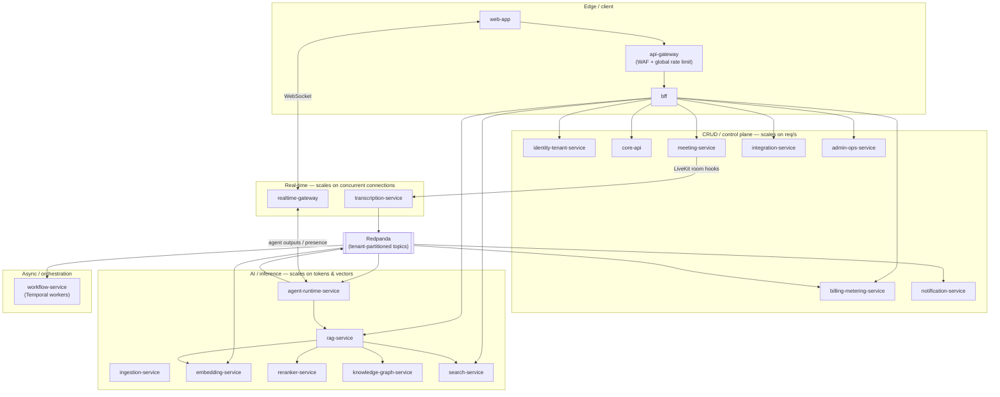
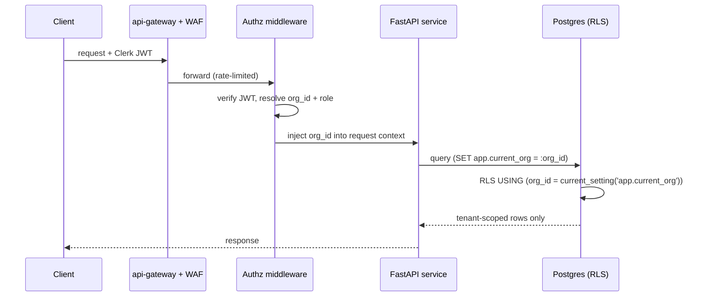
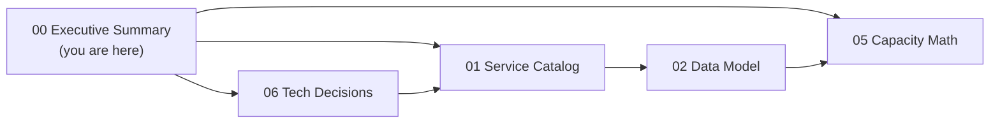

# NEXUS Executive Summary

The one-page orientation to NEXUS — what it is, the locked architecture decisions that make it a production multi-tenant SaaS, and how to navigate the rest of this document set.

## Related documents

- [Service Catalog](_canon/01-service-catalog.md) — the frozen list of microservices, data ownership, event contracts, and scaling profiles.
- [Data Model](_canon/02-data-model.md) — every entity, its owning service, tenant key, and store.
- [Capacity & Scaling Math](_canon/05-capacity-math.md) — the frozen capacity anchors and derived load/cost numbers.
- [Tech & Architecture Decisions](_canon/06-tech-decisions.md) — the canonical lock list of every technology decision.

> This summary cites the four frozen source-of-truth documents under `_canon/` (`_canon/NN-topic-name.md`), matching the convention used by every sibling top-level document in this set. The top-level documents (multi-tenancy, security, event streaming, inference, agent runtime, SaaS business, deployment) build on this canon and link back to it.

---

## 1. What NEXUS is

NEXUS is an **intelligent meeting orchestration platform**. Every meeting participant gets a *personal* AI agent that attends the meeting on their behalf: it captures role-relevant notes, suggests questions in real time, detects decisions, conflicts, and workload issues, and manages follow-ups through project-management integrations.

The product is not a single shared note-taker bolted onto a video call. It is a fleet of per-participant agents, each tuned to one person's role and skills, collaborating across meetings to fill the context gaps that any one participant cannot see.

### 1.1 The differentiator

Two things distinguish NEXUS from every "AI meeting summarizer":

1. **Personalized per-participant intelligence** — *not one shared note-taker*. Each participant's agent filters the live transcript through that user's role/skills via `get_user_context(user_id)`, scores relevance, and writes only what matters to *that person* into their `worklogs`.
2. **Agent-to-agent collaboration across meetings** — when a conversation references context a participant lacks, the `ContextGapAgent` queries *other users' agents* over the `agent-requests` / `agent-responses` topics (correlation IDs, deadlines, fall-through), with a fallback chain of peer-agents → related-meeting agents → RAG → silent.

The six agents — **PersonalListenerAgent, DecisionAgent, ActionAgent, QuestionAgent, ContextGapAgent, ProactiveAgent** — share one LangGraph `BaseAgent` lifecycle (spawn/process/terminate), one `AgentState` dataclass, and a versioned prompt-template loader. Confidence thresholds are uniform and frozen: **>0.7 surface, 0.4–0.7 silent log, <0.4 drop**, with no silent commits — decisions and actions always require user confirmation.

### 1.2 The SaaS target

> [SaaS-scale adjustment] The original NEXUS Execution Plan v2.1 was a 13-phase, 36-week build for a 4-person team, validated against a seeder of `2 orgs × 10 users × 5 meetings`. This document set re-targets NEXUS as a **production multi-tenant SaaS for millions of users across thousands of paying tenant organizations**. The seeder remains the canonical development/test fixture only; all production sizing uses the [Capacity & Scaling Math](_canon/05-capacity-math.md) anchors below.

The production target, anchored by [Capacity & Scaling Math](_canon/05-capacity-math.md):

| Anchor | Symbol | Value |
|---|---|---:|
| Registered users | A1 | 5,000,000 |
| Monthly / Daily active users | A2 / A3 | 2,000,000 / 1,000,000 |
| Paying tenant organizations | A4 | 3,000 |
| Peak concurrent meetings (throughput anchor) | A5 | 20,000 |
| Peak concurrent participants (fan-out anchor) | A6 | 100,000 |
| Meetings / month | R4 | 4,800,000 |
| `transcript_chunks` / month | T3 | 1,728,000,000 |
| LLM calls / month (cost-controlled) | L7 | 5,789,000,000 |
| LLM reduction vs naive per-chunk | L10 | 86% |
| Total variable infra cost | C-total | ~$19.5M/mo |

The two anchors are not interchangeable: **20k concurrent meetings** drives transcription, embedding, and LLM/agent load (one diarized stream per *meeting*); **100k concurrent participants** drives realtime fan-out (WebSocket connections, LiveKit tracks, presence). The gap between `20k × 6` nominal roster and `100k` observed is the effective occupancy of `5.0` — join-late / leave-early. See [Capacity & Scaling Math](_canon/05-capacity-math.md) §2.1.

---

## 2. Architecture at a glance

The system is **event-driven microservices with an explicit modular-monolith → services evolution path**. The cut is driven by one fact: the agent/inference tier scales and costs *completely differently* from the CRUD tier and must scale independently. Three scaling families, each with its own autoscaler signal and cost center.

The full canonical service list, data ownership, and synchronous-API ownership map live in the [Service Catalog](_canon/01-service-catalog.md). The three families and their independent Kubernetes HPA/KEDA signals:

| Family | Primary autoscaler signal | Cost driver |
|---|---|---|
| CRUD / control plane | HTTP req/s, p95 latency | CPU + Postgres connections |
| Real-time | Concurrent WebSocket connections / live audio streams | Long-lived connections, Deepgram minutes |
| AI / inference | Queue depth (chunk backlog), GPU utilization, token throughput | GPU + LLM tokens (separate cost center) |
| Async / orchestration | Temporal task-queue depth | Worker CPU |

---

## 3. Key locked architecture decisions

The authoritative decision register is [Tech & Architecture Decisions](_canon/06-tech-decisions.md); the rows below are the load-bearing subset every reader should know. **Origin** is `PDF` (carried over verbatim), `SaaS-add` (wholly new for SaaS scale), or `PDF→SaaS` (a PDF choice extended/hardened without renaming).

| Concern | Decision | Origin |
|---|---|---|
| Architecture style | Event-driven microservices with a modular-monolith → services evolution path | SaaS-add |
| Inference/CRUD separation | Agent + inference tier scales and is billed separately from the CRUD tier | SaaS-add |
| Compute platform | Kubernetes (EKS/GKE) + Terraform IaC; a self-hosted single-node VPS running Docker Compose is the MVP substrate | PDF→SaaS |
| Region strategy | Multi-region active-passive, evolving to active-active | SaaS-add |
| Tenancy model | Pooled + PostgreSQL RLS for the long tail; cell-based isolation for large/enterprise tenants | SaaS-add |
| Authz injection | Authz middleware injects `org_id` on every query; RLS is the backstop | SaaS-add |
| Primary DB | PostgreSQL via Supabase (managed), SQLAlchemy 2.0 async + asyncpg, Pydantic v2, Alembic | PDF |
| Graph store | Apache AGE, graph named `nexus_knowledge`; documented exit to Neptune / Neo4j Aura + relational MV fallback | PDF→SaaS |
| Vector DB | Qdrant Cloud, BGE-small-en 384-dim, per-tenant collections | PDF→SaaS |
| Event streaming | Redpanda (Kafka API), Avro + Schema Registry, `{topic}-value`, BACKWARD compat | PDF |
| Topic partitioning | All topics partitioned by tenant | SaaS-add |
| Delivery semantics | At-least-once with idempotency keys + transactional outbox/inbox + dedupe cache + DLQs | SaaS-add |
| Inference placement | Dedicated autoscaling GPU services (Ray Serve / vLLM) for BGE-small + BGE-reranker, OFF the API tier | PDF→SaaS |
| LLM cost pipeline | Relevance pre-gating → windowed batching → tiered routing (Haiku/Sonnet/Opus) → prompt caching → per-tenant token budgets & hard quotas | PDF→SaaS |
| Meeting SDK | LiveKit (self-hostable SFU) behind a transport adapter | PDF→SaaS |
| Transcription | Deepgram (WebSocket, diarization, interim + final; only finals persisted) | PDF |
| Agent framework | LangGraph `BaseAgent` + `AgentState` + versioned prompt loader; the six agents | PDF |
| Identity | Clerk (JWT verification, webhook user sync) + enterprise SSO/SAML/SCIM | PDF→SaaS |
| Security process | Shift-left: threat model in Phase 1, authz in every PR, dependency + secret scanning from day one | PDF→SaaS |
| Compliance | GDPR/CCPA, subprocessor DPAs + SCCs, data residency, PII redaction, RTBF, audit logging, SOC2 readiness | SaaS-add |
| SaaS business | Tenant lifecycle, Stripe billing/seats/dunning/tax, usage metering → quota enforcement, Free/Pro/Enterprise | SaaS-add |
| Workflow engine | Temporal Cloud — `MeetingLifecycleWorkflow`, `ActionFollowUpWorkflow` | PDF |

> [SaaS-scale adjustment] Of the 103 locked rows in [Tech & Architecture Decisions](_canon/06-tech-decisions.md), 65 are carried over verbatim from the PDF, 27 are wholly new SaaS additions, and 11 are PDF choices the SaaS posture extended without renaming. The PDF tech stack survives intact; the net-new mass is multi-tenancy, the SaaS business platform, compliance, and hardened event delivery.

---

## 4. Major SaaS adjustments vs the original plan

The PDF was a single-deployment student build. Eight changes turn it into a commercial multi-tenant SaaS. Each is a deliberate departure from the original plan.

> [SaaS-scale adjustment] **Multi-tenancy.** The PDF had no tenant concept. Tenant isolation is now enforced at every layer: Postgres RLS keyed on `org_id` for the pooled long tail, cell-based isolation for large/enterprise tenants, per-tenant Qdrant collections, an org-partitioned `nexus_knowledge` AGE graph, tenant-keyed Redpanda partitions, namespaced Redis keys, and an authz middleware that injects `org_id` on every query. See [Data Model](_canon/02-data-model.md) §7.

> [SaaS-scale adjustment] **Billing & metering.** Wholly added. Stripe subscriptions/seats/dunning/tax, a `usage-events` → aggregation → quota-enforcement pipeline, Free/Pro/Enterprise plans, and per-tenant token budgets with hard caps. Owned by `billing-metering-service`. See [Service Catalog](_canon/01-service-catalog.md).

> [SaaS-scale adjustment] **Cost-controlled AI.** The PDF ran an agent on every raw transcript chunk — the R4 cost bomb (~41.5B naive LLM calls/month, ≈$224M/mo all-Sonnet). Production replaces it with relevance pre-gating → 30s windowed batching (agents run per window, not per raw chunk) → tiered Haiku/Sonnet/Opus routing → semantic + Anthropic prompt caching → per-tenant hard quotas, an **86% call-volume reduction (L10)** before caching savings. See [Capacity & Scaling Math](_canon/05-capacity-math.md) §8.

> [SaaS-scale adjustment] **Compliance.** Wholly added: GDPR/CCPA, subprocessor DPAs (Deepgram/OpenAI/Anthropic/LiveKit) + SCCs, data residency and regional placement, PII redaction, retention + right-to-be-forgotten deletion workflows, append-only audit logging, and SOC2 readiness — table-stakes for selling to thousands of orgs.

> [SaaS-scale adjustment] **Multi-region.** The PDF was single-region Railway/Render. Production runs on Kubernetes (EKS/GKE) + Terraform IaC, multi-region active-passive evolving to active-active, with per-plan availability tiers (Free 99.5%, Pro 99.9%, Enterprise 99.95%). Railway and Render are struck entirely; the early-stage substrate is a self-hosted single-node VPS running Docker Compose ([ADR-0016](adr/0016-self-hosted-vps-mvp-substrate.md)).

> [SaaS-scale adjustment] **Shift-left security.** The PDF batched a single security audit into Phase 13. Security is now continuous — threat modeling in Phase 1, an authorization check reviewed in every PR, dependency + secret scanning from day one, an API gateway + WAF + global rate limiting, and deny-by-default agent-to-agent authorization.

> [SaaS-scale adjustment] **Dedicated inference.** The PDF ran BGE-small embeddings and the BGE-reranker via ONNX on the same FastAPI API tier. They now run as dedicated autoscaling GPU services (`embedding-service`, `reranker-service`) on Ray Serve / vLLM, off the API tier, with `agent-runtime-service` autoscaling on token throughput — so the inference cost center scales and bills independently of CRUD traffic. This is the architectural fix for R4 (cost) and R5 (latency).

> [SaaS-scale adjustment] **Idempotent events.** The PDF implied at-most-once "consume → process" semantics. Production locks at-least-once delivery with idempotency keys, a transactional outbox per producer, an inbox/dedupe cache per consumer (`nexus:{org_id}:dedupe:{topic}:{idempotency_key}`), and per-topic DLQs. Avro + Schema Registry BACKWARD compatibility is preserved verbatim.

### 4.1 The `org_id` injection chokepoint

The single control that makes pooled multi-tenancy safe: every request resolves an `org_id` from the Clerk-verified JWT, and RLS is the fail-closed backstop.

---

## 5. What is preserved verbatim from the PDF

The original tech stack and domain model survive intact. These names are frozen and used verbatim everywhere in this set — see [Tech & Architecture Decisions](_canon/06-tech-decisions.md) §4 for the full naming authority:

- **Graph:** `nexus_knowledge` (Apache AGE). **Node labels:** Person, Meeting, Decision, Action, Topic. **Edge labels:** `ATTENDED`, `PRODUCED`, `ASSIGNED_TO`, `RELATES_TO`, `FOLLOWS_FROM`.
- **Agents:** PersonalListenerAgent, DecisionAgent, ActionAgent, QuestionAgent, ContextGapAgent, ProactiveAgent.
- **Core tables:** `users`, `organizations`, `teams`, `team_members`, `departments`, `meetings`, `meeting_participants`, `transcript_chunks`, `meeting_speakers`, `worklogs`, `decisions`, `action_items`, `agent_suggestions`, `agent_collaborations`, `chat_messages`, `document_chunks`.
- **Topics:** `transcript-chunks`, `document-chunks`, `agent-results`, `decisions`, `actions`, `notifications`, `agent-requests`, `agent-responses`, `agent-stream`.
- **Utilities:** `get_user_context(user_id)`. **Workflows:** `MeetingLifecycleWorkflow`, `ActionFollowUpWorkflow`.
- **Confidence thresholds:** `>0.7` surface · `0.4–0.7` silent log · `<0.4` drop. **Latency budget:** live captions < 2s; agent end-to-end p50 < 2s / p95 < 4s; rerank < 500ms cold; embed batch 32 sub-100ms.

The original **PDF risk register IDs are preserved**: R1 (AGE on managed Supabase), R2 (meeting-SDK lock-in — resolved by locking LiveKit), R3 (event-streaming cost), R4 (LLM cost spiral — fixed by the cost-controlled pipeline), R5 (agent latency budget), R6 (multi-agent collaboration novelty), R7 (speaker-ID accuracy), R8 (integration scope creep).

---

## 6. How to navigate this document set

Read in this order depending on your goal:

| If you want to understand… | Start with | Then |
|---|---|---|
| The full system, fast | This summary | [Service Catalog](_canon/01-service-catalog.md) |
| Which service owns what | [Service Catalog](_canon/01-service-catalog.md) | [Data Model](_canon/02-data-model.md) |
| Tables, stores, tenant keys | [Data Model](_canon/02-data-model.md) | [Service Catalog](_canon/01-service-catalog.md) §5 (events) |
| Load, cost, and SLO numbers | [Capacity & Scaling Math](_canon/05-capacity-math.md) | — |
| Why a technology was chosen | [Tech & Architecture Decisions](_canon/06-tech-decisions.md) | the relevant ADR |

**Two principles bind every document in this set, and override local convenience wherever they conflict:** (1) tenant isolation at every layer via `org_id`; (2) at-least-once event delivery with idempotency. Every service, table, topic, capacity number, and term used here is the canonical one defined in the four referenced documents — no synonyms, no alternatives. Any rename must land in the glossary as an explicit `old → new` entry and supersede the relevant decision row via an ADR before use.
