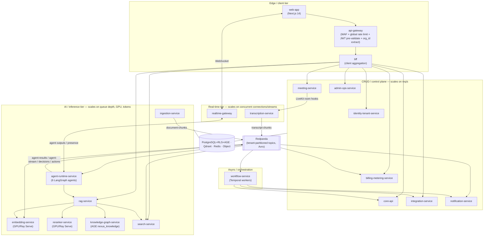
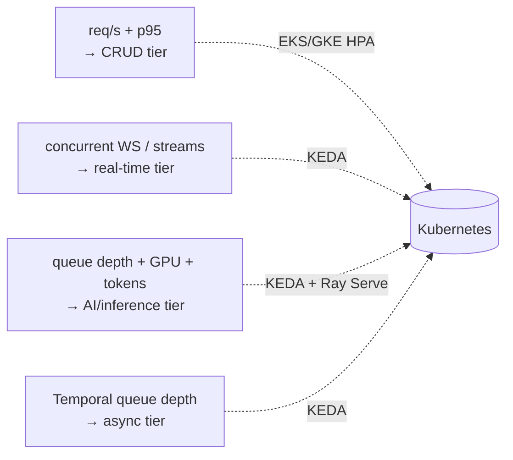
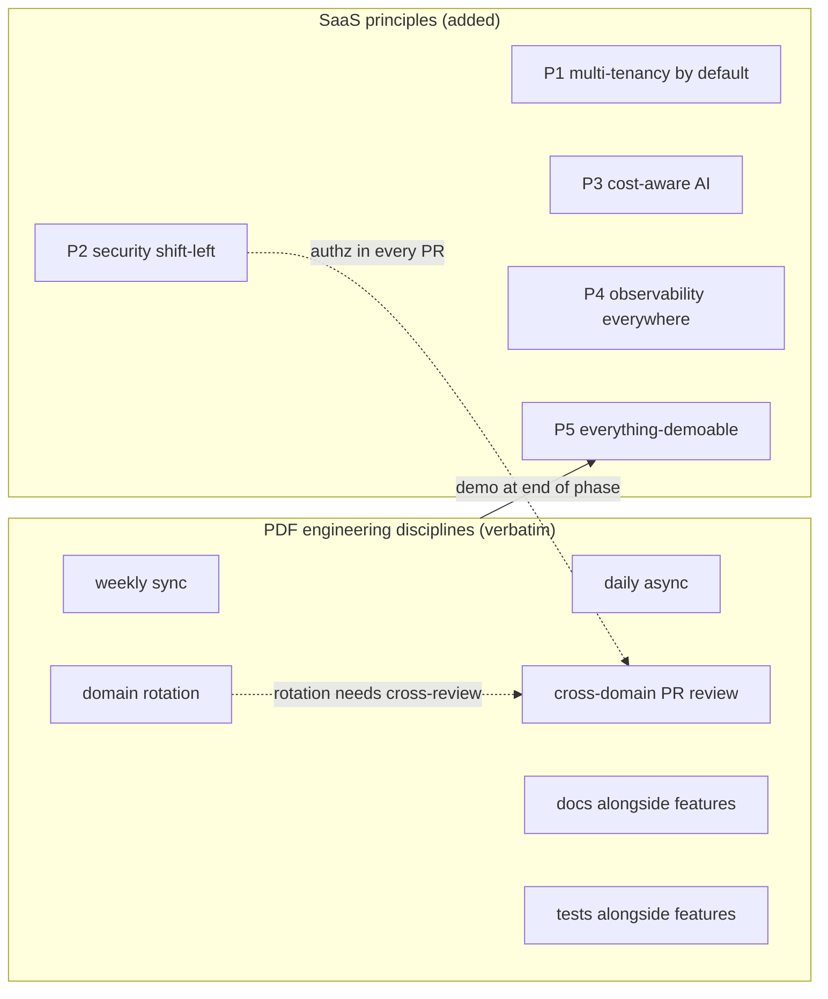
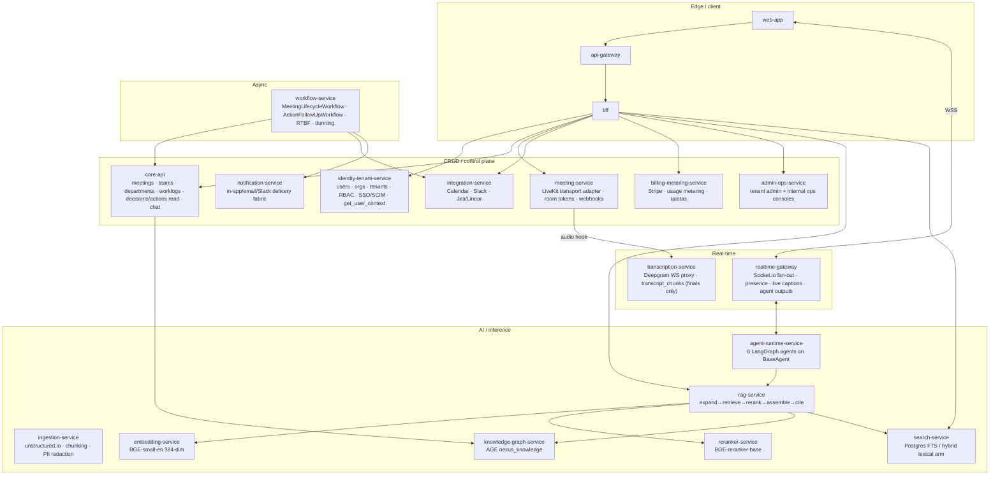

# Architecture Overview & Principles

The orienting document for the NEXUS architecture set: it fixes the architectural style and the reasons for it, the engineering and SaaS principles every other document inherits, the bounded-context map, and the quality-attribute targets the whole system is built to meet.

## Related documents

- [Service Catalog](04-service-catalog.md) — the canonical, frozen list of services, their data ownership, event contracts, and scaling profiles.
- [Data Model](_canon/02-data-model.md) — the frozen naming authority for every entity, table, collection, graph label, and key namespace.
- [Capacity & Scaling Math](_canon/05-capacity-math.md) — the single source of truth for load, cost, and SLO numbers; this document cites it by symbol rather than restating literals.
- [Tech & Architecture Decisions](_canon/06-tech-decisions.md) — the locked decision register; every choice here traces to a row there.
- [Data Architecture](05-data-architecture.md) — store selection, partitioning, retention, backups/PITR, and regional placement.
- [Multi-tenancy](06-multi-tenancy.md) — pooled + RLS for the long tail, cell-based isolation for large tenants, and the `org_id` injection chokepoint.

---

## 1. What NEXUS is

NEXUS is an intelligent meeting orchestration platform. Every participant gets a **personal AI agent** that attends meetings, captures role-relevant notes, suggests questions in real time, detects decisions / conflicts / workload issues, and manages follow-ups through PM integrations. The differentiator is twofold: **personalized per-participant intelligence** (not one shared note-taker) plus **agent-to-agent collaboration across meetings** to fill context gaps.

The six agents — `PersonalListenerAgent`, `DecisionAgent`, `ActionAgent`, `QuestionAgent`, `ContextGapAgent`, `ProactiveAgent` — run on a shared LangGraph `BaseAgent` lifecycle and emit confirmable, confidence-scored outputs (`>0.7` surface, `0.4–0.7` silent log, `<0.4` drop). No silent commits: decisions and actions require user confirmation before they become durable truth or graph edges.

> [SaaS-scale adjustment] The original NEXUS Execution Plan v2.1 (the "PDF") described a single application built by a 4-person team in 13 phases over 36 weeks, organized by domain and phase, with a seeder of `2 orgs x 10 users x 5 meetings`. This document and the set it leads re-cast NEXUS as a **production, multi-tenant SaaS for millions of users across thousands of paying tenant organizations**. The tech stack and the six agents survive intact; the net-new mass is multi-tenancy, the SaaS business platform, compliance, hardened event delivery, and an explicitly decomposed, independently-scaling architecture. Capacity is sized at the anchors in [Capacity & Scaling Math](_canon/05-capacity-math.md): registered users **A1 = 5,000,000**, paying tenants **A4 = 3,000**, peak concurrent meetings **A5 = 20,000**, peak concurrent participants **A6 = 100,000**.

---

## 2. Architecture style and why

### 2.1 The decision

The locked style is **event-driven microservices with an explicit modular-monolith → services evolution path** ([Tech & Architecture Decisions](_canon/06-tech-decisions.md), *Architecture style*).

> [SaaS-scale adjustment] The PDF was a modular monolith with role-rotating ownership and no service decomposition. The style above is `SaaS-add`: the architecture is cut into bounded contexts from day one, but those contexts ship as modules inside a single deployable during the early-stage build (a self-hosted single-node VPS running Docker Compose) and split out at seams already drawn here once they hit independent scaling or team-ownership pressure. The seams are real from the start; the deployment topology consolidates early and decomposes on load.

### 2.2 Why event-driven, why microservices

The forcing function is that **the agent/inference tier scales and costs completely differently from the CRUD tier, and must scale independently**. A request/second-bound API surface and a GPU/token-bound inference surface cannot share an autoscaler signal or a cost center without one starving or over-provisioning the other. Events decouple the two so each scales on its own signal.

Concretely, NEXUS has **four scaling families**, each with its own Kubernetes HPA/KEDA signal and its own cost center:

| Family | Representative services | Primary autoscaler signal | Cost driver |
| --- | --- | --- | --- |
| **CRUD / control plane** | `api-gateway`, `bff`, `identity-tenant-service`, `core-api`, `meeting-service`, `integration-service`, `billing-metering-service`, `admin-ops-service`, `notification-service` | HTTP req/s, p95 latency | CPU + Postgres connections |
| **Real-time** | `realtime-gateway`, `transcription-service` | Concurrent WebSocket connections / live audio streams | Long-lived connections, Deepgram minutes |
| **AI / inference** | `ingestion-service`, `embedding-service`, `reranker-service`, `agent-runtime-service`, `rag-service`, `knowledge-graph-service`, `search-service` | Queue depth (chunk backlog), GPU utilization, token throughput | GPU + LLM tokens (separate cost center) |
| **Async / orchestration** | `workflow-service` | Temporal task-queue depth | Worker CPU |

These families are the reason the monolith is cut where it is; the full service-by-service table lives in the [Service Catalog](04-service-catalog.md).

> [SaaS-scale adjustment] The PDF coupled CPU/GPU-bound inference (BGE-small embeddings via ONNX, the BGE-reranker cross-encoder) and per-chunk LLM agent processing onto the same FastAPI API tier. Here `embedding-service` and `reranker-service` are dedicated GPU / Ray Serve / vLLM services, and `agent-runtime-service` autoscales on token throughput — all **off the API tier**. This is the structural fix for PDF risks **R4** (LLM cost spiral) and **R5** (the tight sub-2s agent latency budget); the load math is in [Capacity & Scaling Math](_canon/05-capacity-math.md) §8.

### 2.3 Why at-least-once events with idempotency

Every inter-service arrow is **at-least-once with idempotency keys**, implemented with a transactional **outbox** on the producing side and an **inbox**/dedupe cache on the consuming side, with per-topic **DLQs**. Serialization is **Apache Avro + Redpanda Schema Registry**, one subject per topic (`{topic}-value`), **BACKWARD** compatibility — carried over verbatim from the PDF. All topics are **partitioned by tenant**.

> [SaaS-scale adjustment] The PDF implied a plain "consume → process" path. At ~17,900 events/sec peak and ~11.58B events/month ([Capacity & Scaling Math](_canon/05-capacity-math.md) E10/E12), at-least-once delivery with transactional outbox/inbox + dedupe cache + DLQs and tenant-keyed partitions is locked so retries never double-apply and a noisy tenant cannot starve others. Topic names, Avro subjects, and BACKWARD compatibility are unchanged from the PDF.

### 2.4 High-level architecture

The three user-facing scaling families (CRUD, real-time, AI/inference) plus the async tier each get an independent signal:

### 2.5 Modular-monolith → services split order

Deployment consolidates early and decomposes along the seams above as load arrives. The recommended extraction order (detailed in [Service Catalog](04-service-catalog.md) §7):

1. **Always separate from the start** (different runtime/scaling): `embedding-service`, `reranker-service` (GPU), `agent-runtime-service` (token-scaled), `transcription-service` + `realtime-gateway` (connection-scaled), `workflow-service` (Temporal workers).
2. **Extract next under CRUD load:** `core-api` from `bff`, then `identity-tenant-service`.
3. **Extract on SaaS-business pressure:** `billing-metering-service`, `integration-service`, `admin-ops-service`.
4. **Extract last:** `knowledge-graph-service`, `search-service` (start as libraries inside `rag-service`; split once Qdrant/AGE/FTS each warrant dedicated ops).

> [SaaS-scale adjustment] The compute substrate is **Kubernetes (EKS/GKE) + Terraform IaC**, multi-region active-passive evolving to active-active; the early-stage build runs on a self-hosted single-node VPS running Docker Compose ([ADR-0016](adr/0016-self-hosted-vps-mvp-substrate.md)). The PDF specified Railway/Render-only hosting, and both are now struck entirely. Every split above keeps a service aligned to a single scaling family and a single team-ownership boundary, so no extraction re-cuts a domain seam.

---

## 3. Design principles

NEXUS inherits **six engineering disciplines** from the PDF and adds **five SaaS principles** for production multi-tenant scale. PDF disciplines keep their exact meaning and are not marked as adjustments; the SaaS principles are wholly added and are called out.

### 3.1 The six PDF engineering disciplines (carried forward verbatim)

These trace directly to the PDF's cross-cutting practice line and govern *how the team builds*, in addition to *what it builds*.

| # | Discipline | What it means in practice |
| --- | --- | --- |
| 1 | **Weekly sync** | One synchronous team sync per week to align on phase goals and cross-domain dependencies. |
| 2 | **Daily async** | Daily asynchronous status; the team is timezone-tolerant and does not block on standups. |
| 3 | **Cross-domain PR review** | Every PR is reviewed by someone **outside the author's primary domain**, so no single owner becomes a knowledge silo. |
| 4 | **Docs alongside features** | Documentation lands in the same PR as the feature it describes; this architecture set is the durable form of that rule. |
| 5 | **Tests alongside features** | Pytest (backend), Playwright (E2E), Vitest (frontend) ship with the feature, not in a later test phase. |
| 6 | **Domain rotation** | Engineers rotate across domains over the phases so coverage and ownership are not concentrated. |

### 3.2 The five SaaS principles (added for production multi-tenant scale)

> [SaaS-scale adjustment] All five principles below are `SaaS-add`: the PDF had no notion of tenants, continuous security, AI cost control as a first-class constraint, fleet-wide observability SLOs, or productionizing the demo cadence. They are the architectural posture that turns a single-app MVP into a commercial SaaS.

| # | Principle | Statement | Where it is enforced |
| --- | --- | --- | --- |
| P1 | **Multi-tenancy by default** | Every tenant-scoped row, vector, graph node, event, cache key, and object carries or is keyed by `org_id`; isolation is enforced at every layer, never assumed. | [Multi-tenancy](06-multi-tenancy.md), §4 below |
| P2 | **Security shift-left** | Threat model in Phase 1, an authorization check reviewed in **every PR**, dependency + secret scanning from day one — instead of a single Phase-13 audit. | [Tech & Architecture Decisions](_canon/06-tech-decisions.md) §2.11 |
| P3 | **Cost-aware AI** | Agents never run per raw chunk; the LLM pipeline pre-gates, batches by window, routes by tier, and caches — under per-tenant token budgets and hard quotas. | [Capacity & Scaling Math](_canon/05-capacity-math.md) §8, §5 below |
| P4 | **Observability everywhere** | Structured JSON logs (tenant-tagged), Prometheus + Grafana metrics, Sentry, consumer-lag and per-tenant cost/quota dashboards, with explicit SLOs per tier. | [Capacity & Scaling Math](_canon/05-capacity-math.md) §11 |
| P5 | **Everything-demoable** | The PDF "demo at end of every phase" is elevated to a permanent product invariant: every surface is demoable, staging deploys on merge, and feature flags gate incomplete work per tenant. | `admin-ops-service` feature flags; CI/CD on merge |

> [SaaS-scale adjustment] **P5 is the SaaS elevation of a PDF practice, not a new idea.** The PDF's "demo at end of every phase" was a one-time-per-phase ceremony for a 4-person team. At SaaS scale it becomes a standing invariant — staging-on-merge plus per-tenant feature flags in `admin-ops-service` — so any state of the product is always demoable and shippable behind a flag. The six PDF disciplines and P5 therefore share a root; P1–P4 are wholly new.

---

## 4. Bounded-context map

The services are cut so the modular monolith can be peeled into services without re-cutting domain seams. Service names below are **canonical and used verbatim everywhere** — no document may introduce an alternative name; the [Service Catalog](04-service-catalog.md) is the single naming authority for services.

Each synchronous path prefix is owned by exactly one service (no overlap); the authoritative path-ownership table is in [Service Catalog](04-service-catalog.md) §6. Data ownership is equally exclusive: one service writes a given table, others read via API or events, never by cross-writing — see the service ownership map in [Data Model](_canon/02-data-model.md) §1.1.

### 4.1 Event topics across contexts

The canonical Redpanda topics, carried verbatim from the PDF, are `transcript-chunks`, `document-chunks`, `agent-results`, `decisions`, `actions`, `notifications`, `agent-requests`, `agent-responses`, `agent-stream`. The cross-meeting collaboration path — `ContextGapAgent` over `agent-requests` / `agent-responses` with correlation IDs, a deadline, and a fall-through chain (peer-agents → related-meeting agents → RAG → silent) — rides those last two verbatim.

> [SaaS-scale adjustment] SaaS scale adds control-plane, metering, and lifecycle topics absent from the PDF: `tenant-events`, `meeting-events`, `meeting-room-events`, `integration-events`, `usage-events`, `billing-events`, `graph-events`, `embedding-events`, `presence-events`, `notification-delivery-events`, `user-sync-events`, `admin-events`. These carry signals the original single-team phasing handled in-process. Producer→consumer wiring for every topic is in [Service Catalog](04-service-catalog.md) §5.

---

## 5. Quality-attribute targets

Every number below is **cited by symbol** from [Capacity & Scaling Math](_canon/05-capacity-math.md); that document is the single source and this one does not re-derive it. If a target changes, it changes there first.

### 5.1 Scalability

| Target | Value | Source |
| --- | --- | --- |
| Registered users | A1 = 5,000,000 | [Capacity](_canon/05-capacity-math.md) §2 |
| Paying tenant organizations | A4 = 3,000 | §2 |
| Peak concurrent meetings (throughput anchor) | A5 = 20,000 | §2 |
| Peak concurrent participants (fan-out anchor) | A6 = 100,000 | §2 |
| Meetings / month | R4 = 4,800,000 | §3 |
| `transcript_chunks` / month (flow) | T3 = 1,728,000,000 | §4 |
| Qdrant live vector stock (13-mo) | V7 = 4,420,000,000 (~17 TB) | §5 |
| Redpanda events / sec (peak) | E12 ≈ 17,900 | §6 |

> [SaaS-scale adjustment] Scaling families are decoupled precisely so these anchors drive *different* services: A5 (meetings) drives transcription, embedding, and LLM/agent load; A6 (participants) drives realtime fan-out (WebSocket, LiveKit tracks, presence). They are not interchangeable — see the reconciliation in [Capacity](_canon/05-capacity-math.md) §2.1.

### 5.2 Performance (latency SLOs)

| Surface | Metric | Target | Origin |
| --- | --- | --- | --- |
| CRUD / REST API | p95 / p99 | < 300 ms / < 800 ms | SaaS |
| Live captions (Deepgram final → UI) | p95 | < 2 s | PDF |
| End-to-end agent output (speech → sidebar) | p50 / p95 | < 2 s / < 4 s | PDF R5 |
| RAG search (`POST /api/rag/query`) | p95 warm / cold | < 500 ms / < 1.5 s | PDF |
| Token-mint (`POST /api/meetings/:id/token`) | p95 | < 250 ms | PDF |
| Agent-to-agent collaboration round-trip | p95 | < 1.5 s | PDF |

The end-to-end agent budget (Deepgram ~1s + LLM ~0.8s + network) is the PDF's tight live-intelligence bar (R5); streaming token deltas over `agent-stream` and per-user priority queues are load-bearing for hitting it. Full SLO tables, including pipeline-health SLOs (embedding consumer lag < 5 s, embed batch-of-32 < 100 ms, DLQ rate < 0.1%), are in [Capacity](_canon/05-capacity-math.md) §11.

### 5.3 Availability

> [SaaS-scale adjustment] Per-plan availability tiers and the supporting multi-region posture are wholly added vs the PDF.

| Plan tier | Monthly availability | Posture |
| --- | --- | --- |
| Free | 99.5% | Single-region, pooled + RLS |
| Pro | 99.9% | Multi-region active-passive |
| Enterprise | 99.95% | Cell-based isolation, active-active candidate |

### 5.4 Security

Identity is **Clerk** (Next.js + backend JWT verification, webhook user-sync), extended with enterprise **SSO/SAML/SCIM** and org **RBAC**. The edge is **API gateway + WAF + global rate limiting**. Agent-to-agent authorization is **deny-by-default, org/role scope-checked, and audited** — a personal agent may only query peers within its own tenant.

> [SaaS-scale adjustment] Security is **shift-left** (principle P2): threat model in Phase 1, an authorization check reviewed in every PR, dependency + secret scanning from day one — replacing the PDF's single Phase-13 audit. Agent-to-agent authz, enterprise SSO/SCIM, WAF, and hardened Clerk user-sync (outbox + reconciliation, Clerk as source of truth) are all `SaaS-add`. See [Tech & Architecture Decisions](_canon/06-tech-decisions.md) §2.11.

### 5.5 Cost-efficiency

LLM is **94% of variable infra cost (C3)**, so the dominant margin lever is the cost-controlled pipeline, not infra rightsizing.

| Metric | Value | Source |
| --- | --- | --- |
| LLM calls / month (cost-controlled) | L7 ≈ 5,789,000,000 | [Capacity](_canon/05-capacity-math.md) §8 |
| Reduction vs naive per-chunk | L10 = 86% | §8 |
| Variable infra cost / MAU / month | C2 ≈ $9.73 | §10 |
| Post Phase-13 optimization | C4 ≈ $6.99 / MAU / month | §10 |

> [SaaS-scale adjustment] The PDF's PersonalListenerAgent "processed every transcript chunk" — the **R4 cost bomb** (naive N2 ≈ 41.5B calls/month, all-Sonnet ≈ $224M/month). Principle P3 replaces it with **relevance pre-gating (Haiku) → windowed batching (30s windows, not per raw chunk) → tiered routing (Haiku→Sonnet→Opus) → semantic + Anthropic prompt caching → per-tenant token budgets and hard quotas**, an 86% call-volume reduction before any caching savings, with a further ~30% Phase-13 optimization target preserved as C4. The math is in [Capacity](_canon/05-capacity-math.md) §8.

### 5.6 Compliance

> [SaaS-scale adjustment] The compliance suite is wholly added vs the PDF and is table-stakes for selling to thousands of orgs.

GDPR/CCPA, subprocessor DPAs (Deepgram / OpenAI / Anthropic / LiveKit) + SCCs, data residency + regional placement, PII redaction (in `ingestion-service`), retention + right-to-be-forgotten deletion workflows, append-only tamper-evident audit logging, and SOC2 readiness. Right-to-be-forgotten is a single Temporal workflow in `workflow-service` that deletes by `org_id` / `user_id` across all stores — Postgres, Qdrant, AGE, Redis, and object storage — then appends a completion record to the audit log. See [Data Model](_canon/02-data-model.md) §7 and [Data Architecture](05-data-architecture.md).

---

## 6. How the rest of the set hangs off this document

| Concern | Authoritative document |
| --- | --- |
| Service names, ownership, event contracts, scaling profiles, split order | [Service Catalog](04-service-catalog.md) |
| Entity/table/collection/label/key names and tenancy keys | [Data Model](_canon/02-data-model.md) |
| Store selection, partitioning, retention, backups/PITR, regional placement | [Data Architecture](05-data-architecture.md) |
| Load, cost, and SLO numbers (cited by symbol everywhere) | [Capacity & Scaling Math](_canon/05-capacity-math.md) |
| Locked technology and architecture decisions (the why, one line each) | [Tech & Architecture Decisions](_canon/06-tech-decisions.md) |

Two invariants bind every document in the set and override any local convenience: **tenant isolation at every layer** (an authz middleware injects `org_id` on every query; events are tenant-partitioned; Postgres uses RLS for the pooled long tail and cell-based isolation for large/enterprise tenants) and **at-least-once event delivery with idempotency** (transactional outbox + inbox/dedupe + DLQs, Avro + Schema Registry BACKWARD compatibility, subject `{topic}-value`). Any future rename of a canonical service, entity, topic, agent, or graph label must land in the glossary as an explicit `old → new` entry and supersede the relevant row in [Tech & Architecture Decisions](_canon/06-tech-decisions.md) via an ADR before use.
