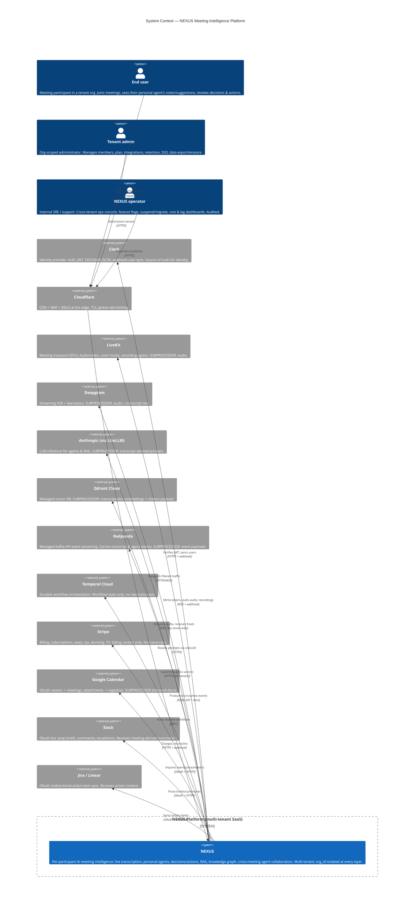
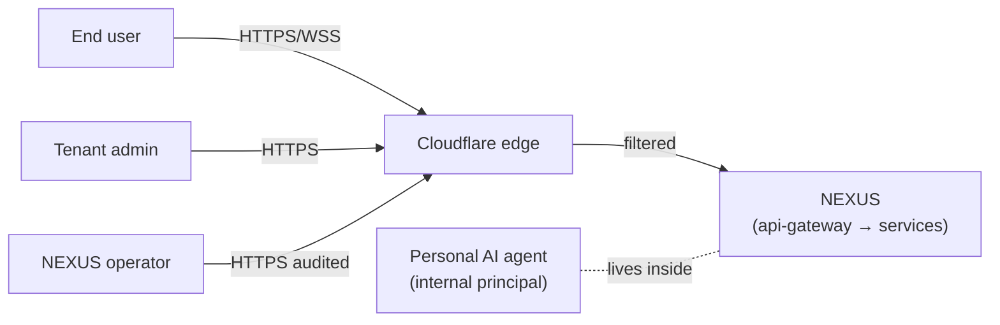
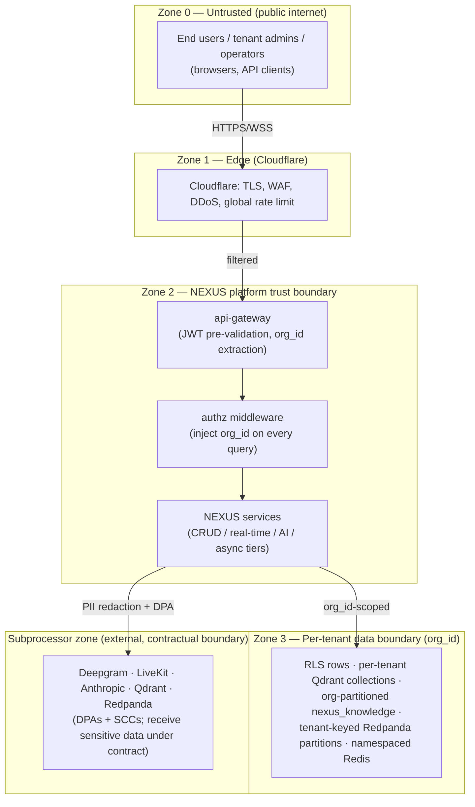
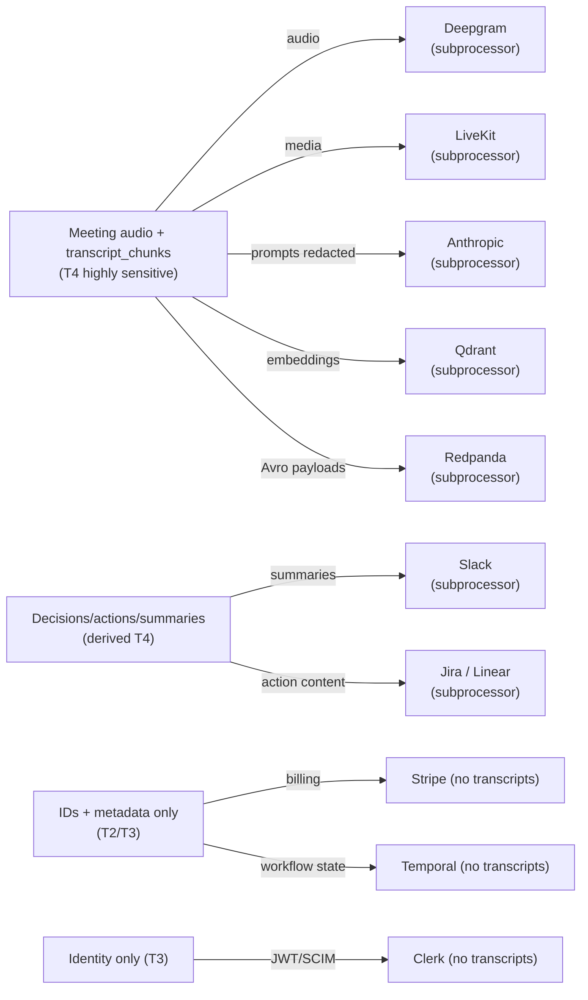
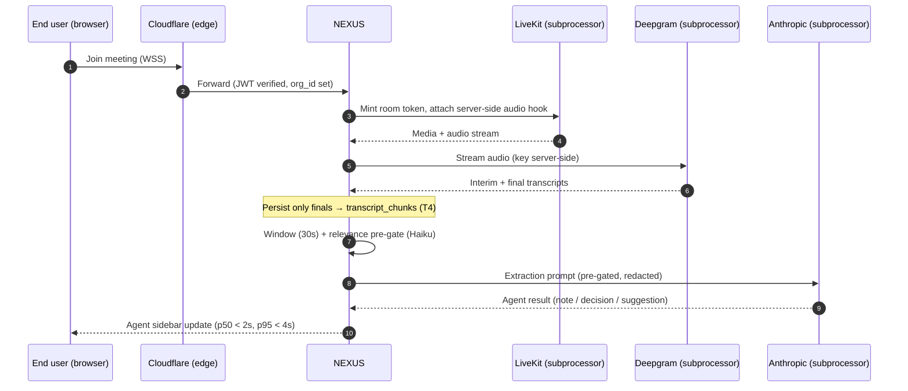

# System Context (C4 Level 1)

The system-level view of NEXUS: who uses it, which external systems it depends on, what data crosses each boundary, and where the trust and data-classification lines are drawn for a multi-tenant SaaS serving millions of users across thousands of paying tenant organizations.

## Related documents

- [Service Catalog](04-service-catalog.md) — the canonical microservice decomposition this context zooms into at C4 L2.
- [Multi-Tenancy & Isolation](06-multi-tenancy.md) — pooled + RLS for the long tail, cell-based isolation for enterprise, `org_id` injection.
- [Security & AuthZ](11-security-architecture.md) — Clerk, RBAC, agent-to-agent authz, edge security, threat model.
- [Data Architecture](05-data-architecture.md) — store selection, retention, residency, backups/PITR.
- [Event Streaming & Schema Registry](07-event-architecture.md) — Redpanda topics, Avro subjects, outbox/inbox, DLQs.
- [Inference & LLM Pipeline](09-rag-and-inference-serving.md) — embedding/reranker inference tier, cost-controlled LLM pipeline.
- [Agent Runtime & LangGraph](08-ai-agent-architecture.md) — the seven agents, multi-agent collaboration.
- [Deployment & Infrastructure](16-deployment-and-infrastructure.md) — Kubernetes, Terraform, multi-region posture.
- [SaaS Business: Billing, Metering, Tenancy Lifecycle](18-saas-business-architecture.md) — Stripe, usage metering, plans/tiers.
- [Capacity & Scaling Math](_canon/05-capacity-math.md) — frozen load/cost anchors imported by reference.
- [Locked Tech & Architecture Decisions](_canon/06-tech-decisions.md) — the decision register cited throughout.
- Glossary — canonical terms and any recorded `old -> new` rename. (No glossary file exists in this set; renames are recorded in the canon docs and superseding ADRs.)

---

## 1. Purpose and scope

This is the **C4 Level 1 (System Context)** view of NEXUS. It answers three questions and nothing more:

1. **Who** interacts with NEXUS (the human and machine actors)?
2. **What external systems** does NEXUS depend on, and in which direction does data flow?
3. **Where are the trust boundaries**, and how is data classified as it crosses them?

It deliberately treats NEXUS as a **single black box**. The internal decomposition into the services named in the [Service Catalog](04-service-catalog.md) — `api-gateway`, `core-api`, `agent-runtime-service`, `embedding-service`, and the rest — is the C4 **Level 2 (Container)** view and lives there. Anything below the system boundary is out of scope here.

> [SaaS-scale adjustment] The original PDF described NEXUS as a single-app, single-tenant build by a 4-person team with a `2 orgs x 10 users x 5 meetings` seeder. There was no tenant boundary, no operator persona, no billing or compliance external system, and no notion of subprocessors. This context diagram adds the **tenant trust boundary**, the **NEXUS operator** persona, and the full set of SaaS external systems (Stripe, Cloudflare WAF, the compliance-relevant subprocessor relationships). The seeder remains the development fixture only; production sizing follows the [Capacity & Scaling Math](_canon/05-capacity-math.md) anchors (`A5` 20k peak concurrent meetings, `A6` 100k peak concurrent participants).

NEXUS is an **intelligent meeting orchestration platform**: every participant gets a personal AI agent that attends meetings, captures role-relevant notes, suggests questions in real time, detects decisions/conflicts/workload issues, and manages follow-ups — with agent-to-agent collaboration across meetings to fill context gaps.

---

## 2. The C4 L1 context diagram

The single arrow that all human traffic crosses — `Cloudflare -> NEXUS` — is the **edge trust boundary**. Inside NEXUS, the `api-gateway` (WAF + global rate limiting + JWT pre-validation + `org_id` extraction) is the first internal hop; see [Service Catalog §3](04-service-catalog.md) and [Security & AuthZ](11-security-architecture.md).

---

## 3. Actors

| Actor | Type | What they do | Reaches NEXUS via | Authority scope |
| --- | --- | --- | --- | --- |
| **End user** | Human (tenant member) | Joins meetings, sees their personal agent's My Notes / suggestion cards / decision & action cards, confirms decisions/actions, runs RAG queries, reviews transcripts. | `web-app` (Next.js) → Cloudflare → `api-gateway` | Own user + org-visible data, RLS-scoped to their `org_id` and RBAC role. |
| **Tenant admin** | Human (tenant member, elevated) | Manages members, plan/seats, integrations, retention & PII settings, SSO/SCIM config, data export & right-to-be-forgotten requests. | `web-app` tenant admin console → Cloudflare → `api-gateway` | Single tenant (`org_id`), elevated RBAC. Cannot cross tenants. |
| **NEXUS operator** | Human (internal staff) | Cross-tenant support, feature flags, tenant suspend/migrate, consumer-lag & cost dashboards, audit-log access. | Internal ops console (`admin-ops-service`) behind Cloudflare + stricter authz | Cross-tenant, **deny-by-default**, every action audited to `audit_logs`. |
| **Personal AI agent** | Machine (internal, per participant) | One of the seven LangGraph agents acting on behalf of a user during a meeting; the agent-to-agent collaboration peer for `ContextGapAgent`. | Internal only — `agent-runtime-service`; never crosses the system boundary as an actor | Agent-to-agent authz: deny-by-default, **own tenant only**, org/role scope-checked, audited. |

> [SaaS-scale adjustment] The **NEXUS operator** persona and the **tenant admin** persona are both new. The PDF had a single undifferentiated "user" and a 4-person build team with no cross-tenant operations surface. The operator's cross-tenant reach is the single most security-sensitive path in the system and is therefore deny-by-default and fully audited (see [Security & AuthZ](11-security-architecture.md)).

The **personal AI agent** is listed as an actor for completeness but never appears on the L1 boundary: it is an internal machine principal inside `agent-runtime-service`. Its only externally-visible effect is mediated through the same external systems NEXUS already talks to (LLM providers, Slack, etc.). Agent-to-agent authorization is locked deny-by-default — an agent may query only peers within its own `org_id`.

---

## 4. External systems (dependencies)

Each row is a system NEXUS does **not** own but depends on. The "Data crossing" column is the basis for §6's data-classification analysis. Technology picks are frozen in [Locked Tech & Architecture Decisions](_canon/06-tech-decisions.md); nothing here introduces a new choice.

| External system | Role | Direction | Data crossing the boundary | Protocol | Origin |
| --- | --- | --- | --- | --- | --- |
| **Clerk** | Identity provider | Bidirectional | User identity, JWT claims, org/role, SSO/SAML/SCIM assertions, webhook user-sync events | HTTPS + inbound webhook (`/clerk/webhook`) | PDF |
| **Cloudflare** | CDN + WAF + DDoS + global rate limiting | Inbound edge | All client HTTPS/WSS traffic (terminated/filtered, then forwarded) | HTTPS/WSS | PDF→SaaS |
| **LiveKit** | Meeting transport (self-hostable SFU) | Bidirectional | **Audio/video media**, room lifecycle webhooks, recording egress refs | WSS media + webhook (`/livekit/webhook`) | PDF→SaaS |
| **Deepgram** | Streaming ASR + diarization | Bidirectional | **Raw meeting audio** out, **interim + final transcript text** back | WebSocket (Deepgram key server-side) | PDF |
| **Anthropic (via LiteLLM)** | LLM inference | Bidirectional | **Transcript-derived prompts** (windowed, pre-gated), agent outputs, streamed tokens | HTTPS via LiteLLM routing | PDF |
| **Qdrant Cloud** | Vector DB | Bidirectional | **384-dim BGE-small embeddings** + citation payload (`meeting_id`, `chunk_id`, `speaker`/`document_id`, `element_id`) | HTTPS, per-tenant collections | PDF |
| **Redpanda** | Event streaming (Kafka API) | Bidirectional | All Avro event payloads: `transcript-chunks`, `agent-results`, `decisions`, `actions`, etc. | Kafka API + Avro + Schema Registry | PDF→SaaS |
| **Temporal Cloud** | Durable workflow orchestration | Bidirectional | Workflow inputs/state: meeting/action/tenant/billing IDs and metadata — **no raw transcript text** | gRPC | PDF |
| **Stripe** | Billing & subscriptions | Bidirectional | Billing contact PII, seat/usage aggregates, subscription state; **no meeting content** | HTTPS + webhook (`/stripe/webhook`) | SaaS-add |
| **Google Calendar** | Calendar integration | Inbound-heavy | Event metadata, participant emails, **event attachments** routed to ingestion | OAuth + HTTPS | PDF |
| **Slack** | Chat integration | Outbound-heavy | **Meeting-derived prep briefs & summaries**, follow-up/escalation DMs | OAuth + HTTPS | PDF |
| **Jira / Linear** | Project management | Bidirectional | **Action-item content** out; external ticket status back via webhook | OAuth + webhook (`/webhooks/{provider}`) | PDF |

> [SaaS-scale adjustment] **Stripe** and the **Cloudflare WAF/rate-limit role** are wholly new external dependencies versus the PDF (the PDF named Cloudflare only as a CDN). **LiveKit** is now the locked meeting SDK (the PDF left the SDK open as risk R2: "evaluate ≥2 in Phase 1"); it is always abstracted behind a transport adapter so the pick stays swappable. See [Locked Tech §2.7](_canon/06-tech-decisions.md).

### 4.1 Why each external is load-bearing

- **Clerk** is the identity source of truth; NEXUS never stores passwords. User-sync is hardened with an **outbox + reconciliation** loop (Clerk authoritative) so a dropped webhook self-heals — a SaaS-add over the PDF's plain webhook.
- **LiveKit + Deepgram** form the real-time audio path: LiveKit's server-side audio hook feeds the `transcription-service` FastAPI WebSocket proxy, which streams to Deepgram and persists **only finals** to `transcript_chunks`. Billing is **one diarized stream per meeting, not per participant** — a 6x cost lever (Capacity `D3`).
- **Anthropic via LiteLLM** are reached only through the cost-controlled pipeline (relevance pre-gating → windowed batching → tiered routing Haiku/Sonnet/Opus → prompt caching → per-tenant token budgets). Agents run on 30-second windows, **not per raw chunk** — the fix for risk R4 (see [Inference & LLM Pipeline](09-rag-and-inference-serving.md), Capacity `L7`/`L10` = 86% call reduction vs naive).
- **Redpanda** is the spine. All topics are **partitioned by tenant** with at-least-once delivery, idempotency keys, transactional outbox/inbox, and DLQs (see [Event Streaming](07-event-architecture.md)).
- **Temporal Cloud** runs `MeetingLifecycleWorkflow`, `ActionFollowUpWorkflow`, tenant provisioning, right-to-be-forgotten deletion, and dunning sagas. It receives identifiers and metadata, never raw transcript bodies.

---

## 5. Trust boundaries

NEXUS has four concentric trust zones. Crossing any inward boundary requires authentication; crossing any tenant boundary requires `org_id` authorization.

| Boundary | What it separates | Enforcement |
| --- | --- | --- |
| **Zone 0 → 1** (public → edge) | Internet from Cloudflare | TLS termination, WAF rules, DDoS mitigation, global rate limiting. |
| **Zone 1 → 2** (edge → platform) | Cloudflare from NEXUS services | `api-gateway` does JWT pre-validation (Clerk), extracts `org_id`, rejects unauthenticated/unrouted traffic. No business logic at the gateway. |
| **Zone 2 internal → Zone 3** (platform → tenant data) | One tenant's data from another's | **authz middleware injects `org_id`** into every query; PostgreSQL RLS `USING (org_id = current_setting('app.current_org')::uuid)` is the fail-closed backstop; Qdrant per-tenant collections; AGE `$org_id`-parameterized Cypher; tenant-keyed Redpanda partitions; `nexus:{org_id}:…` Redis namespaces. |
| **Zone 2 → Subprocessor** (platform → external processors) | NEXUS from third parties that process customer data | DPAs + SCCs, PII redaction pass before egress where applicable, server-side API keys, regional placement per `data_residency`. |

> [SaaS-scale adjustment] Zone 3 (the per-tenant data boundary) and the formal **subprocessor zone** are entirely new. The PDF had a single trust boundary (the app) and unscoped Redis keys / one shared Qdrant store / one global `nexus_knowledge` graph. Multi-tenant isolation at every layer — RLS, per-tenant Qdrant collections, org-partitioned `nexus_knowledge`, tenant-keyed Redpanda partitions, namespaced Redis, and mandatory `org_id` injection — is the central SaaS-scale change. See [Multi-Tenancy & Isolation](06-multi-tenancy.md).

---

## 6. Data classification and subprocessor map

Transcripts are the crown jewels: meeting audio and its derived text are **highly sensitive PII / confidential business content**. Data classification drives which externals may legally receive it (subprocessors under a DPA) and which must never.

### 6.1 Classification tiers

| Tier | Definition | Examples (canonical entities) | Handling rule |
| --- | --- | --- | --- |
| **T4 — Highly sensitive** | Raw meeting content; re-identifies individuals and exposes confidential business decisions | Meeting **audio** (LiveKit/Deepgram), `transcript_chunks`, `worklogs`, `decisions`, `action_items`, RAG passages, Qdrant embeddings + citation payload | Encrypted in transit & at rest; PII redaction before LLM egress where configured; only to subprocessors under DPA+SCC; pinned to tenant region via `data_residency`; purged on RTBF. |
| **T3 — Confidential** | Identifiable org/user data that is not raw meeting content | `users`, `meetings` metadata, `meeting_speakers` mapping, `agent_collaborations`, `audit_logs` | RLS-scoped; not sent to LLM providers; internal + identity subprocessor only. |
| **T2 — Internal** | Operational/billing data, low individual sensitivity | `subscriptions`, `usage_events`, `agent_budgets`, `plans`, billing aggregates | To Stripe (billing) and internal stores only; never to ASR/LLM/vector subprocessors. |
| **T1 — Public/config** | No customer content | `plans` catalog, feature flags, static `web-app` assets | CDN-cacheable; no tenant scoping required for the catalog rows. |

### 6.2 Which externals receive transcript-class (T4) data

This is the compliance-critical list. **Five externals receive raw transcript-class (T4) data** (Deepgram, LiveKit, Anthropic, Qdrant, Redpanda); two more — **Slack and Jira/Linear** — receive **derived T4 content** (summaries and action-item text). Every system marked **Yes** below is a **subprocessor** and must appear in the customer-facing subprocessor list with a signed DPA (+ SCCs for cross-border transfer).

| External system | Receives T4 (transcript-class) data? | What exactly | Subprocessor? |
| --- | --- | --- | --- |
| **Deepgram** | **Yes — raw** | Raw meeting audio + returns transcript text | **Yes — audio + transcript** |
| **LiveKit** | **Yes — raw** | Audio/video media; recordings | **Yes — audio/video** |
| **Anthropic** | **Yes — raw** | Transcript-derived prompts (windowed, pre-gated, PII-redacted where configured) | **Yes — transcript-derived** |
| **Qdrant Cloud** | **Yes — raw** | Transcript/document embeddings + citation payload | **Yes — embeddings + metadata** |
| **Redpanda** | **Yes — raw** | Avro `transcript-chunks` / `agent-results` / `decisions` payloads in transit | **Yes — event payloads** |
| **Slack** | **Yes — derived** | Receives meeting-derived briefs/summaries — confidential content leaves the boundary | **Yes — derived content** |
| **Jira / Linear** | **Yes — derived** | Receives action-item content | **Yes — derived content** |
| **Clerk** | No (T3 only) | Identity, org/role; no meeting content | Yes — identity processor |
| **Temporal Cloud** | No | Workflow IDs/metadata only; **no raw transcript bodies** | Processor (metadata) |
| **Stripe** | No (T2 only) | Billing contact + usage aggregates | Yes — billing processor |
| **Google Calendar** | Inbound docs (T4 if attachment is confidential) | Sends attachments **into** NEXUS for ingestion; receives nothing of substance back | Inbound source |
| **Cloudflare** | In-transit only | Terminates TLS; sees ciphertext metadata + headers, not decrypted bodies | Edge processor |

> [SaaS-scale adjustment] Data classification, the subprocessor designation, DPAs + SCCs, PII redaction before LLM egress, and per-tenant data residency are all wholly added versus the PDF, which had no compliance posture (security was batched into Phase 13). The locked compliance stance — GDPR/CCPA, subprocessor DPAs for Deepgram/Anthropic/LiveKit + SCCs, data residency, PII redaction, retention + right-to-be-forgotten, audit logging, SOC2 readiness — is enforced from Phase 1 (shift-left). See [Security & AuthZ](11-security-architecture.md) and [Data Architecture](05-data-architecture.md).

### 6.3 Residency and regional placement

Each tenant is pinned to a region (`us`/`eu`/`ap`) via the `data_residency` row, which resolves the physical Postgres cell, Qdrant region, and object-storage bucket region. Subprocessor calls are routed to the matching regional endpoint so T4 data does not leave the tenant's residency zone, and cross-border transfer (where unavoidable) is covered by SCCs.

---

## 7. Key system-level interaction flows

Three flows establish how the boundaries above are crossed in practice. Each stays at the system level (NEXUS as a box); container-level detail is in the [Service Catalog](04-service-catalog.md).

### 7.1 Live meeting → personal agent output

The end-to-end latency budget (p50 < 2s, p95 < 4s) is carried verbatim from the PDF (risk R5) and frozen in [Capacity §11](_canon/05-capacity-math.md).

### 7.2 Calendar event → searchable pre-meeting context

A Google Calendar event with an attachment crosses **inbound**: NEXUS auto-creates the meeting, matches participants by email, and routes the attachment through unstructured.io ingestion so it is embedded into the tenant's Qdrant collection and searchable before the meeting starts. Guardrail R8 caps integrations at Calendar + Slack + one of Jira/Linear.

### 7.3 Confirmed action → external ticket + follow-up

On confirmation, an `action_items` row produces an `ASSIGNED_TO` edge in `nexus_knowledge` and is pushed as a ticket to Jira/Linear; `ActionFollowUpWorkflow` (Temporal) sends reminders on day 1/3/7 and escalates to the manager via Slack DM at day 10. External ticket status flows back via webhook to update the NEXUS action.

---

## 8. What this context implies for the rest of the architecture

| Implication | Where it is detailed |
| --- | --- |
| The tenant boundary (Zone 3) must be enforced in six stores simultaneously, with `org_id` injection as the single chokepoint. | [Multi-Tenancy & Isolation](06-multi-tenancy.md) |
| Five externals receive raw transcript-class (T4) data (Deepgram, LiveKit, Anthropic, Qdrant, Redpanda); two more (Slack, Jira/Linear) receive derived-T4 content. All are subprocessors; egress requires PII redaction, DPAs, SCCs, and regional routing. | [Security & AuthZ](11-security-architecture.md), [Data Architecture](05-data-architecture.md) |
| The audio path (LiveKit hook → Deepgram → finals) and the LLM path (windowed, pre-gated) are the two cost/latency-critical external dependencies. | [Inference & LLM Pipeline](09-rag-and-inference-serving.md), [Capacity & Scaling Math](_canon/05-capacity-math.md) |
| Redpanda carries all T4 event payloads tenant-partitioned with at-least-once + idempotency. | [Event Streaming & Schema Registry](07-event-architecture.md) |
| The operator persona's cross-tenant reach is the highest-risk human path and must be deny-by-default + audited. | [Security & AuthZ](11-security-architecture.md) |
| Stripe/billing data (T2) and identity (T3) are deliberately kept off the transcript-class subprocessors. | [SaaS Business](18-saas-business-architecture.md) |

This L1 context is the entry point to the C4 set: the next level down decomposes the single "NEXUS" box into the services enumerated in the [Service Catalog](04-service-catalog.md), grouped into the CRUD / real-time / AI-inference / async scaling families.
