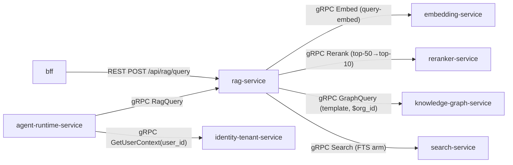
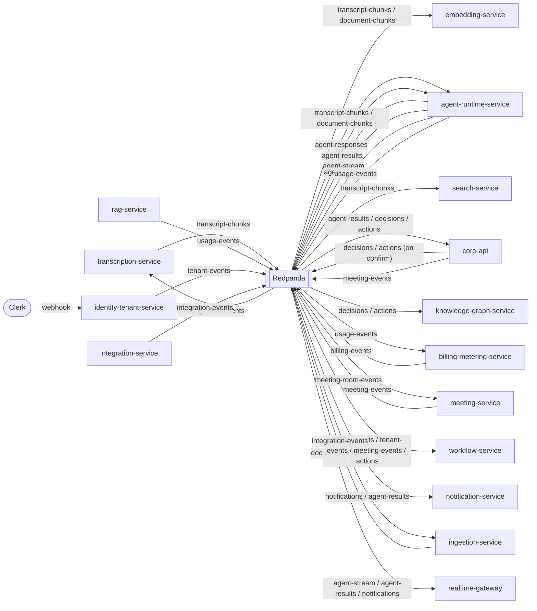
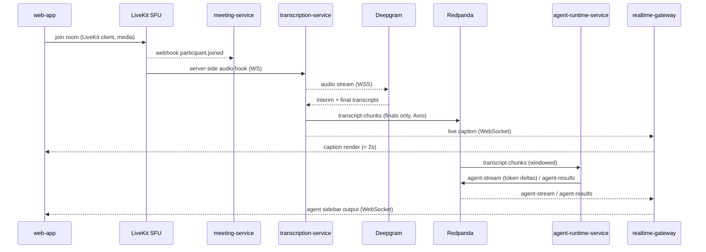
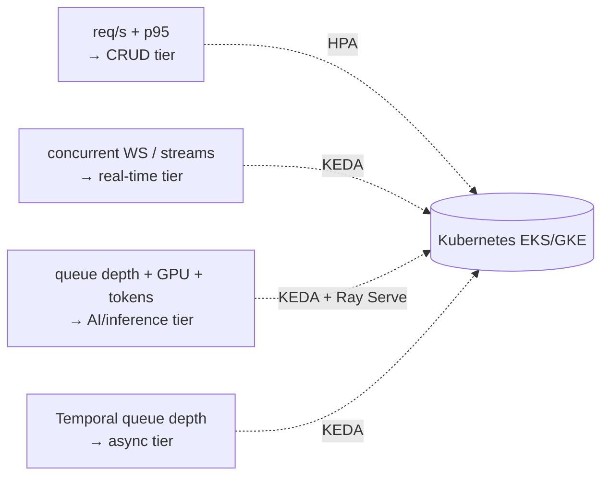

# Container Architecture (C4 Level 2)

The frozen container-level view of NEXUS: every service from the canonical service catalog, every data store, and the exact communication style (synchronous REST/gRPC, asynchronous Redpanda events, or WebSocket) on every edge between them.

## Related documents

- [Service Catalog](_canon/01-service-catalog.md) — the single naming authority for services.
- [Canonical Data Model](_canon/02-data-model.md) — entity/table names, owning services, stores, tenant keys.
- [Capacity & Scaling Math](_canon/05-capacity-math.md) — frozen load and cost numbers imported by reference.
- [Locked Tech & Architecture Decisions](_canon/06-tech-decisions.md) — every locked technology choice.
- [Multi-Tenancy & Isolation](06-multi-tenancy.md) — `org_id` injection, RLS, cell-based isolation.
- [Security & AuthZ](11-security-architecture.md) — JWT verification, agent-to-agent authz, WAF.
- [Data Architecture](05-data-architecture.md) — store selection, partitioning, retention, DR.
- [Event Streaming & Schema Registry](07-event-architecture.md) — topics, Avro subjects, outbox/inbox, DLQs.
- [Inference & LLM Pipeline](09-rag-and-inference-serving.md) — GPU inference tier, tiered LLM routing.
- [Agent Runtime & LangGraph](08-ai-agent-architecture.md) — the six agents, `BaseAgent`, `AgentState`.

---

## 1. Purpose and scope

This document is the **C4 Level 2 (container) view** of NEXUS. A "container" here is a separately deployable runtime unit — a service process, a data store, an event broker, or a managed third-party plane — not a Docker container per se (though every NEXUS-owned service ships as a Docker image, per the locked CI/CD decision).

It answers three questions and nothing else:

1. **What are the containers?** Every service in the [Service Catalog](_canon/01-service-catalog.md), every data store in the [Data Model](_canon/02-data-model.md), and the shared backbone planes (Redpanda, Temporal Cloud, Clerk, LiveKit, Deepgram, Stripe, the inference runtime).
2. **How do they talk?** The communication style on every edge — **synchronous** HTTP/gRPC, **asynchronous** Redpanda Avro events, or **WebSocket** — is labeled explicitly: every drawn edge carries its style and (for async) its topic name. Pure control-plane / observability topics that carry no cross-tier data-plane flow are intentionally not drawn here to keep the L2 view legible; they are enumerated in [Service Catalog](_canon/01-service-catalog.md) §5 and called out in §4.2.
3. **What does each own?** Every data store has exactly one owning service that writes it; everyone else reads via API or events. This is the container-level enforcement of the data-ownership rule frozen in the [Data Model](_canon/02-data-model.md).

Service names, store names, topic names, and capacity numbers are used **verbatim from the canon**. This document introduces no new names. Where the SaaS posture adds a container or an edge that the original PDF execution plan did not have, it is marked with a `[SaaS-scale adjustment]` callout.

> [SaaS-scale adjustment] The original PDF was a 13-phase, role-rotating plan for a 4-person team building a single deployable; it contained no container decomposition. This C4 L2 view imposes the bounded-context split from the [Service Catalog](_canon/01-service-catalog.md) so the three scaling families — CRUD/control plane, real-time, and AI/inference — each deploy and autoscale independently. In the early stage these containers run as a modular monolith on Railway/Render; the seams drawn here are the extraction points.

### 1.1 Communication-style legend

This legend is binding for every diagram below.

| Style | Notation in diagrams | Transport | When used |
| --- | --- | --- | --- |
| **Synchronous** | solid arrow `-->` labeled `REST` or `gRPC` | HTTPS (external), HTTP/1.1 or gRPC (internal mesh) | Request/response reads and commands where the caller needs the answer now. |
| **Asynchronous** | solid arrow `-->` labeled with a topic name | Redpanda (Kafka API), Avro + Schema Registry | Fire-and-forget, fan-out, and decoupled inter-tier flow. At-least-once with idempotency. |
| **WebSocket** | bidirectional arrow `<-->` labeled `WSS` / `WebSocket` | WSS (Socket.io or raw WS) | Long-lived, low-latency, bidirectional streams: live captions, agent output, audio. |
| **Managed-plane call** | dashed arrow `-.->` | Provider SDK/API over HTTPS/WSS | Calls to Clerk, Deepgram, LiveKit, Stripe, Temporal Cloud, Anthropic/OpenAI. |

> [SaaS-scale adjustment] The PDF mixed all inter-component calls into one in-process FastAPI app. At SaaS scale the **internal sync mesh standardizes on gRPC** for service-to-service calls in the AI/inference and real-time tiers (tight latency budgets — see [Capacity & Scaling Math](_canon/05-capacity-math.md) §11), while the `bff` and CRUD-tier services expose REST. External ingress is always HTTPS/WSS through `api-gateway`. The rationale is locked in [Inference & LLM Pipeline](09-rag-and-inference-serving.md): `rag-service` → `reranker-service` and `rag-service` → `embedding-service` are on the warm-RAG p95 < 500 ms path and cannot afford JSON/HTTP overhead.

---

## 2. The master C4 L2 container diagram

This is the canonical container view. Every NEXUS-owned service from the [Service Catalog](_canon/01-service-catalog.md) appears exactly once, grouped by its scaling family. Edge labels follow §1.1.

```mermaid
flowchart TB
  USER([User browser / mobile])

  subgraph EdgePlane["Edge plane (Cloudflare)"]
    CDN["Cloudflare CDN + WAF<br/>global rate limit"]
  end

  subgraph EdgeTier["Edge / client tier"]
    WEB["web-app<br/>(Next.js 14 App Router)"]
    GW["api-gateway<br/>(TLS, WAF, JWT pre-validate, org_id)"]
    BFF["bff<br/>(client aggregation)"]
  end

  subgraph CRUD["CRUD / control plane (scales on req/s)"]
    IDENT["identity-tenant-service"]
    CORE["core-api"]
    MEET["meeting-service"]
    INTEG["integration-service"]
    BILL["billing-metering-service"]
    ADMIN["admin-ops-service"]
    NOTIF["notification-service"]
  end

  subgraph RT["Real-time tier (scales on concurrent connections)"]
    RTGW["realtime-gateway"]
    TRANS["transcription-service"]
  end

  subgraph AI["AI / inference tier (scales on queue depth, GPU, tokens)"]
    INGEST["ingestion-service"]
    EMB["embedding-service<br/>(GPU / Ray Serve)"]
    RERANK["reranker-service<br/>(GPU / Ray Serve)"]
    AGENT["agent-runtime-service<br/>(6 LangGraph agents)"]
    RAG["rag-service"]
    KG["knowledge-graph-service"]
    SEARCH["search-service"]
  end

  subgraph WF["Async / orchestration"]
    FLOW["workflow-service<br/>(Temporal workers)"]
  end

  subgraph Stores["Data stores"]
    PG[("PostgreSQL (Supabase)<br/>RLS + Apache AGE nexus_knowledge")]
    QD[("Qdrant Cloud<br/>per-tenant collections")]
    RD[("Redis (Upstash)<br/>namespaced")]
    OBJ[("S3-compatible object storage")]
  end

  RP[["Redpanda<br/>(tenant-partitioned topics + Schema Registry)"]]

  subgraph Managed["Managed third-party planes"]
    CLERK(["Clerk<br/>auth / SSO / SCIM"])
    DG(["Deepgram"])
    LK(["LiveKit SFU"])
    TMP(["Temporal Cloud"])
    STRIPE(["Stripe"])
    LLM(["Anthropic / OpenAI<br/>via LiteLLM"])
  end

  %% Edge ingress
  USER -->|HTTPS / WSS| CDN
  CDN -->|HTTPS| GW
  CDN -->|"static / RSC"| WEB
  WEB -->|"WSS (Socket.io)"| GW
  WEB -->|REST| GW
  GW -->|REST| BFF
  GW <-->|WSS| RTGW

  %% BFF fan-out (sync REST)
  BFF -->|REST| IDENT
  BFF -->|REST| CORE
  BFF -->|REST| MEET
  BFF -->|REST| INTEG
  BFF -->|REST| BILL
  BFF -->|REST| ADMIN
  BFF -->|REST| RAG
  BFF -->|REST| SEARCH

  %% Identity / auth
  CLERK -.->|webhook| IDENT
  GW -.->|JWT verify| CLERK
  AGENT -->|"gRPC /context"| IDENT

  %% Meeting + real-time + transcription
  MEET -.->|"mint token / room API"| LK
  LK -.->|"webhook + audio hook"| MEET
  MEET -->|"server-side audio hook (WS)"| TRANS
  TRANS -.->|"WSS audio"| DG
  WEB <-->|"WebSocket (captions, agent output)"| RTGW

  %% Async event backbone
  TRANS -->|transcript-chunks| RP
  INGEST -->|document-chunks| RP
  RP -->|transcript-chunks / document-chunks| EMB
  RP -->|transcript-chunks / document-chunks| AGENT
  RP -->|transcript-chunks| SEARCH
  AGENT -->|"agent-results / agent-stream / notifications / usage-events"| RP
  AGENT -->|agent-requests| RP
  RP -->|agent-responses| AGENT
  RP -->|agent-results / decisions / actions| CORE
  CORE -->|"decisions / actions (on confirm)"| RP
  RP -->|decisions / actions| KG
  RP -->|"agent-stream / agent-results / notifications"| RTGW
  RP -->|notifications / agent-results| NOTIF
  RP -->|usage-events| BILL
  BILL -->|billing-events| RP
  CORE -->|meeting-events| RP
  RP -->|meeting-events| MEET
  MEET -->|meeting-room-events| RP
  RP -->|meeting-room-events| TRANS
  IDENT -->|tenant-events| RP
  RP -->|"billing-events / tenant-events / meeting-events / actions"| FLOW
  INTEG -->|integration-events| RP
  RP -->|integration-events| INGEST

  %% Sync inference orchestration
  AGENT -->|"gRPC"| RAG
  RAG -->|"gRPC /embed"| EMB
  RAG -->|"gRPC /rerank"| RERANK
  RAG -->|"gRPC /graph/query"| KG
  RAG -->|"gRPC /search"| SEARCH

  %% Workflow drives CRUD
  FLOW -.->|task queue| TMP
  FLOW -->|REST| CORE
  FLOW -->|REST| INTEG
  FLOW -->|notifications| RP

  %% External integrations + billing
  INTEG -.->|"OAuth / webhook"| STRIPE
  BILL -.->|"billing / webhook"| STRIPE
  AGENT -.->|"tiered routing"| LLM
  RAG -.->|"query expansion"| LLM

  %% Store ownership (writes)
  IDENT -->|writes| PG
  CORE -->|writes| PG
  MEET -->|writes| PG
  TRANS -->|writes| PG
  INTEG -->|writes| PG
  BILL -->|writes| PG
  KG -->|"writes AGE"| PG
  SEARCH -->|"FTS indexes"| PG
  EMB -->|"upsert vectors"| QD
  INGEST -->|writes| PG
  INGEST -->|"orig blobs"| OBJ
  MEET -->|"recordings"| OBJ
  BILL -->|"invoice PDFs"| OBJ
  RAG -->|"answer cache"| RD
  RTGW -->|"pub/sub + presence"| RD
  AGENT -->|"budget / dedupe"| RD
  IDENT -->|"user_ctx cache"| RD
```



> Reading the diagram: solid arrows labeled `REST`/`gRPC` are synchronous; solid arrows labeled with a hyphenated topic name (e.g. `transcript-chunks`) are asynchronous Redpanda events; `<-->` `WSS`/`WebSocket` are long-lived bidirectional streams; dashed arrows reach managed third-party planes. The four stores at the bottom are written by exactly one service each per the ownership table in §5.

---

## 3. Container inventory

Every NEXUS-owned service container, its tier, the runtime it ships on, and its primary inbound surface. Names are verbatim from the [Service Catalog](_canon/01-service-catalog.md); responsibilities and owned data are summarized there in full.

| Container | Tier | Runtime | Primary inbound | Scales on |
| --- | --- | --- | --- | --- |
| `api-gateway` | Edge | Envoy/Nginx behind Cloudflare | External HTTPS/WSS | req/s + connections |
| `web-app` | Edge | Next.js 14 (Node, RSC streaming) | HTTPS from CDN | page req/s (mostly CDN-cached) |
| `bff` | Edge | FastAPI (Python 3.11+) | REST from `api-gateway` | UI req/s |
| `identity-tenant-service` | CRUD | FastAPI | REST + Clerk webhook + gRPC | auth + webhook req/s |
| `core-api` | CRUD | FastAPI | REST + Redpanda consume | req/s |
| `meeting-service` | CRUD/RT | FastAPI | REST + LiveKit webhook | concurrent rooms |
| `integration-service` | CRUD | FastAPI | OAuth callbacks + provider webhooks | webhook + sync req/s |
| `billing-metering-service` | CRUD | FastAPI | REST + Stripe webhook + Redpanda | metering ingest + req/s |
| `admin-ops-service` | CRUD | FastAPI | REST (RBAC-gated) | low traffic |
| `notification-service` | Async | FastAPI worker | Redpanda consume | `notifications` throughput |
| `realtime-gateway` | Real-time | Socket.io (Node) / FastAPI WS | WSS | concurrent WebSocket connections |
| `transcription-service` | Real-time | FastAPI WS proxy | Internal WS (audio) | concurrent live streams |
| `ingestion-service` | AI | FastAPI worker + unstructured.io | REST + Redpanda | ingestion backlog |
| `embedding-service` | AI | Ray Serve / vLLM (GPU) | gRPC + Redpanda consume | queue depth + GPU util |
| `reranker-service` | AI | Ray Serve / vLLM (GPU) | gRPC | rerank req/s + GPU util |
| `agent-runtime-service` | AI | FastAPI + LangGraph | Redpanda + internal control gRPC | token throughput + chunk backlog |
| `rag-service` | AI | FastAPI | REST + gRPC | query req/s |
| `knowledge-graph-service` | AI | FastAPI | gRPC (internal) | Cypher query req/s |
| `search-service` | AI | FastAPI | gRPC (internal) | search req/s + index size |
| `workflow-service` | Async | Temporal worker (Python) | Temporal task queues | task-queue depth |

> [SaaS-scale adjustment] `embedding-service` and `reranker-service` run on a **GPU runtime (Ray Serve / vLLM), off the API tier**. The PDF ran BGE-small via ONNX inside the FastAPI app. At the embed load of ~525 embeddings/sec peak (`EM2`) plus query-embed traffic — see [Capacity & Scaling Math](_canon/05-capacity-math.md) §9 — CPU inference cannot be coupled to request/s-bound serving. This decoupling is the container-level fix for PDF risks **R4** (LLM cost spiral) and **R5** (agent latency budget).

---

## 4. The three communication styles, in detail

NEXUS uses exactly three inter-container styles. This section pins down each so no future diagram or ADR is ambiguous.

### 4.1 Synchronous: REST (external/UI) and gRPC (internal mesh)

Synchronous calls are request/response where the caller blocks on the answer. There are two flavors:

- **REST over HTTPS** for everything client-facing: `web-app` → `api-gateway` → `bff` → CRUD services, and the `bff` → `rag-service`/`search-service` read paths. The full path-prefix ownership is frozen in [Service Catalog](_canon/01-service-catalog.md) §6; no two services share a prefix.
- **gRPC over the internal mesh** for tight-latency service-to-service calls, concentrated in the AI/inference tier where the warm-RAG p95 < 500 ms budget leaves no room for HTTP/JSON overhead.



The `rag-service` is the sync orchestrator of the hybrid-retrieval fan-out: it calls `embedding-service` (query-embed only), `reranker-service`, `knowledge-graph-service` (AGE topic-relations arm), and `search-service` (Postgres FTS arm), then fuses results with RRF — exactly the `expand → retrieve → rerank → assemble → cite` pipeline locked in [Tech Decisions](_canon/06-tech-decisions.md) §2.9. Every gRPC call carries the `org_id` in metadata so the callee's authz middleware and RLS scope apply identically to sync paths.

> [SaaS-scale adjustment] gRPC for the internal mesh is a SaaS-scale addition; the PDF had only in-process function calls. gRPC is chosen for the `rag-service` fan-out and `embedding-service`/`reranker-service` calls specifically because of the latency budgets in [Capacity & Scaling Math](_canon/05-capacity-math.md) §11.1 (rerank < 500 ms cold, agent end-to-end p50 < 2 s). REST is retained for the UI/CRUD surface, which is bound by the p95 < 300 ms API SLO and benefits from cache-friendly HTTP semantics through Cloudflare.

### 4.2 Asynchronous: Redpanda Avro events

The async backbone is **Redpanda** (Kafka API), **Avro + Schema Registry**, one subject per topic (`{topic}-value`), **BACKWARD** compatibility, every topic **partitioned by tenant**. The canonical topic set carried verbatim from the PDF is `transcript-chunks`, `document-chunks`, `agent-results`, `decisions`, `actions`, `notifications`, `agent-requests`, `agent-responses`, `agent-stream`.

> [SaaS-scale adjustment] The SaaS posture adds control-plane / metering / lifecycle topics not in the PDF: `tenant-events`, `meeting-events`, `meeting-room-events`, `integration-events`, `usage-events`, `billing-events`, `graph-events`, `embedding-events`, `presence-events`, `notification-delivery-events`, `user-sync-events`, `admin-events`. These are listed in [Service Catalog](_canon/01-service-catalog.md) §5 and detailed in [Event Streaming & Schema Registry](07-event-architecture.md).

Every async edge is **at-least-once with idempotency**: producers write through a transactional **outbox** in the same DB transaction as their state change; a relay publishes to Redpanda; consumers dedupe on `idempotency_key` via an **inbox** table plus the `nexus:{org_id}:dedupe:{topic}:{idempotency_key}` Redis cache (24h TTL, per [Data Model](_canon/02-data-model.md) §5); poison messages land in a per-topic **DLQ**. This is locked in [Tech Decisions](_canon/06-tech-decisions.md) §2.4.



Two confirmation rules are honored at the container edge, both carried from the PDF:

- The `decisions` / `actions` edges into `knowledge-graph-service` are produced **only on confirmation** — `agent-runtime-service` emits a candidate, the user confirms via `core-api`, and `core-api` (not the agent) is the producer of the confirmed `decisions`/`actions` events that create AGE edges. No silent graph writes.
- `agent-runtime-service` never writes Postgres directly; it emits `agent-results` and relies on `core-api`'s outbox semantics. This keeps the AI tier stateless against the relational heart.

Lifecycle topics drawn above: `core-api` produces `meeting-events` (created/updated/ended), consumed by `meeting-service` (open/close rooms) and `workflow-service` (`MeetingLifecycleWorkflow`); `meeting-service` produces `meeting-room-events` (joined/left/recording-ready), consumed by `transcription-service` for recording/audio start; `identity-tenant-service` produces `tenant-events` (provisioned/suspended/deleted) and consumes its `user-sync-events` inbox sourced from the Clerk webhook (dashed managed-plane edge, not a NEXUS-produced topic).

> [SaaS-scale adjustment] To keep this L2 view legible, the remaining pure control-plane / observability topics are **enumerated in [Service Catalog](_canon/01-service-catalog.md) §5 but not drawn here**: `graph-events` (`knowledge-graph-service` → `admin-ops-service` ops views), `embedding-events` (`embedding-service` upsert acks for lag tracking), `presence-events` (`realtime-gateway`), `notification-delivery-events` (`notification-service`), and `admin-events` (`admin-ops-service`). They carry no cross-tier data-plane flow, so omitting their edges does not hide an ambiguous data path.

### 4.3 WebSocket: live, bidirectional streams

Three WebSocket flows exist, all long-lived and latency-sensitive:

1. **Audio in** — the LiveKit server-side audio hook streams meeting audio to `transcription-service` over an internal WS; `transcription-service` proxies it to **Deepgram** over WSS (keeping the Deepgram key server-side), separating interim vs final and persisting **only finals** to `transcript_chunks`.
2. **Live captions out** — Deepgram finals fan out through `realtime-gateway` to the `web-app` within the 2 s caption budget.
3. **Agent output out** — `agent-stream` token deltas and `agent-results` are pushed by `realtime-gateway` to the `web-app` agent sidebar; Socket.io rooms are keyed by `meeting_id`, fanned across `realtime-gateway` instances via the `nexus:{org_id}:pubsub:meeting:{meeting_id}` Redis pub/sub channel.



> [SaaS-scale adjustment] The `realtime-gateway` is split out as its own container scaling on **concurrent WebSocket connections** (anchor `A6` = 100,000 peak concurrent participants — see [Capacity & Scaling Math](_canon/05-capacity-math.md) §2), distinct from `transcription-service` which scales on **concurrent live streams** (anchor `A5` = 20,000 peak concurrent meetings). The PDF ran Socket.io inside the single FastAPI app; at 100k sticky connections the fan-out plane must scale on a different signal than transcription, and the Redis pub/sub backbone (PDF Phase 11) is required to fan across instances.

---

## 5. Data-store ownership

Every store has exactly one **owning service** that writes it. Reads by other services go through that service's API or through events — never cross-writes. This table is the container-level projection of the ownership rules frozen in the [Data Model](_canon/02-data-model.md).

| Store | Container instance | Owning service(s) — writers | Key tenancy mechanism |
| --- | --- | --- | --- |
| PostgreSQL (Supabase) | Primary + read replica + PITR | `identity-tenant-service` (`users`, `organizations`, `tenants`, RBAC, `tenant_settings`, `data_residency`); `core-api` (`meetings`, `teams`, `team_members`, `departments`, `meeting_participants`, `meeting_speakers`, `worklogs`, `decisions`, `action_items`, `agent_suggestions`, `agent_collaborations`, `chat_messages`); `meeting-service` (`meeting_rooms`); `transcription-service` (`transcript_chunks`); `ingestion-service` (`document_chunks`, `document_elements`); `integration-service` (`integration_links`, `oauth_tokens`); `billing-metering-service` (`plans`, `subscriptions`, `usage_events`, `usage_aggregates`, `quotas`, `invoices`, `agent_budgets`); `notification-service` (`notification_log`, delivery receipts, user channel prefs); `admin-ops-service` (feature flags, ops audit log, `audit_logs`, support/impersonation grants) | RLS `USING (org_id = current_setting('app.current_org')::uuid)`; cell routing for enterprise |
| Apache AGE `nexus_knowledge` | Co-located in PostgreSQL | `knowledge-graph-service` only | Org-partitioned: every node carries `org_id`; every Cypher template parameterized by `$org_id` |
| Qdrant Cloud | Per-tenant collections | `embedding-service` only (upserts) | Physical per-tenant collection `transcript_chunks__{org_id}` / `document_chunks__{org_id}` / `decisions__{org_id}` + mandatory `org_id` payload filter |
| Redis (Upstash) | Single namespaced cluster | `rag-service` (answer cache), `realtime-gateway` (pub/sub + presence), `agent-runtime-service` (budget mirror + dedupe inbox), `identity-tenant-service` (`get_user_context` cache) | Every key prefixed `nexus:{org_id}:…` |
| S3-compatible object storage | Regional buckets | `meeting-service` (`nexus-recordings`), `ingestion-service` (`nexus-documents`, `nexus-attachments`), `billing-metering-service` (`nexus-invoices`), `admin-ops-service`/`workflow-service` (`nexus-exports`, `nexus-audit-archive`) | Per-tenant key prefix `{org_id}/…`; region from `data_residency.object_bucket_region` |

```mermaid
flowchart TB
  subgraph PGbox["PostgreSQL (Supabase) — RLS + AGE nexus_knowledge"]
    direction LR
    REL[("relational tables")]
    AGEG[("nexus_knowledge graph")]
  end

  IDENT["identity-tenant-service"] -->|"writes users/orgs/RBAC/tenant_settings/data_residency"| REL
  CORE["core-api"] -->|"writes meetings/decisions/actions/worklogs/chat"| REL
  MEET["meeting-service"] -->|writes meeting_rooms| REL
  TRANS["transcription-service"] -->|"writes transcript_chunks"| REL
  INGEST["ingestion-service"] -->|"writes document_chunks/document_elements"| REL
  INTEG["integration-service"] -->|"writes integration_links/oauth_tokens"| REL
  BILL["billing-metering-service"] -->|"writes plans/subscriptions/usage/invoices/agent_budgets"| REL
  NOTIF["notification-service"] -->|"writes notification_log/prefs"| REL
  ADMIN["admin-ops-service"] -->|"writes feature flags/audit_logs"| REL
  KG["knowledge-graph-service"] -->|"Cypher writes (on confirm)"| AGEG
  SEARCH["search-service"] -.->|"reads (FTS over core data)"| REL

  EMB["embedding-service"] -->|upsert vectors| QD[("Qdrant per-tenant")]
  RAG["rag-service"] -->|answer cache| RD[("Redis namespaced")]
  RTGW["realtime-gateway"] -->|pub/sub + presence| RD
  AGENT["agent-runtime-service"] -->|budget + dedupe| RD
  IDENT -->|user_ctx cache| RD
  MEET -->|recordings| OBJ[("Object storage")]
  INGEST -->|orig docs| OBJ
  BILL -->|invoice PDFs| OBJ
```



**Naming precedence (read this before using any name above).** This document uses the [Service Catalog](_canon/01-service-catalog.md) as the authority for **service decomposition and owns-data assignment**, and the [Data Model](_canon/02-data-model.md) as the authority for **entity/table naming**. The two canon docs disagree in a handful of places (the Service Catalog folds entities into different services and uses a few table names the Data Model does not define). Because §5 is a service-and-ownership table, it follows the Service Catalog where the two conflict; the complete set of inherited conflicts is listed here once so none is silently mixed:

| Conflict | Service Catalog (followed here) | Data Model | Resolution note |
| --- | --- | --- | --- |
| `document_chunks` owner | `ingestion-service` (catalog produces chunks) | `rag-service` | `ingestion-service` is the *producer* of typed chunks; `rag-service` reads them for retrieval. §5 lists the producer as writer. |
| `teams` / `team_members` / `departments` owner | `core-api` | `identity-service` (Data Model service map) | The Data Model's `identity-service` ≈ this doc's `identity-tenant-service`; the Service Catalog reassigns org-hierarchy CRUD to `core-api`. §5 follows the catalog. |
| `meeting_speakers` owner | `core-api` | `transcription-service` | `transcription-service` emits the diarized `speaker_id`; `core-api` persists the confirmed `speaker_id → user_id` mapping. §5 lists `core-api` as writer. |
| `integration_links` (catalog-only table name) | `integration-service` | Data Model defines `integration_connections` (no `integration_links`) | Catalog-only name. The canonical entity in the Data Model is `integration_connections` (+ `oauth_tokens`); a future rename to `integration_links → integration_connections` must land in the Glossary first. |
| `document_elements` (catalog-only) | `ingestion-service` | Data Model defines only `document_chunks` | Catalog-only name; no Data Model entity row. |
| `usage_aggregates` / `quotas` (catalog-only) | `billing-metering-service` | Data Model defines `usage_events`, `subscriptions`, `invoices`, `plans` (and `agent_budgets`) | Catalog-only names for derived/aggregate stores; the Data Model's billing entities are the canonical row-level tables. |
| `tenants` (catalog-only) | `identity-tenant-service` | Data Model: `organizations` **is** the tenant root (`id` = `org_id`); no `tenants` table | Catalog-only name; `organizations` is the canonical tenant entity. |

Where the Data Model defines a canonical entity name (e.g. `oauth_tokens`, `tenant_settings`, `data_residency`, `agent_budgets`, `plans`, `audit_logs`), §5 uses that exact name; where only the Service Catalog names a store (e.g. `integration_links`, `document_elements`, `usage_aggregates`, `quotas`, `tenants`, `meeting_rooms`, `notification_log`), §5 uses the catalog name and flags it above.

> [SaaS-scale adjustment] The PDF had one shared PostgreSQL, one shared Qdrant store, one global `nexus_knowledge` graph, and unscoped Redis keys. Tenant isolation at every store boundary — RLS + cell routing on Postgres, per-tenant Qdrant collections, org-partitioned AGE, `nexus:{org_id}:` Redis namespacing, per-tenant object prefixes — is the locked SaaS posture from [Tech Decisions](_canon/06-tech-decisions.md) §2.2. `search-service` and `knowledge-graph-service` start as libraries inside `rag-service` and split out last (Wave 4), per the extraction order in [Service Catalog](_canon/01-service-catalog.md) §7.

---

## 6. The edge: Cloudflare → api-gateway → bff/services

All external traffic enters through Cloudflare and is funneled into a single ingress, `api-gateway`. Nothing reaches an internal service except through `api-gateway` (HTTP/WSS) or the Redpanda bus.

```mermaid
sequenceDiagram
  participant U as User browser
  participant CF as Cloudflare CDN + WAF
  participant GW as api-gateway
  participant CK as Clerk
  participant BFF as bff
  participant SVC as CRUD/AI service
  participant DB as PostgreSQL (RLS)

  U->>CF: HTTPS request + Clerk JWT
  CF->>CF: WAF rules, edge cache, global rate limit
  CF->>GW: forward (TLS terminated / re-terminated)
  GW->>CK: verify JWT (cached JWKS)
  GW->>GW: extract org_id + role, pre-validate
  GW->>BFF: REST (org_id in context header)
  BFF->>SVC: REST/gRPC (org_id propagated)
  SVC->>DB: SET app.current_org = :org_id; query
  DB->>DB: RLS filters by org_id
  DB-->>SVC: tenant-scoped rows
  SVC-->>BFF: response
  BFF-->>U: aggregated, screen-shaped payload
```

Edge responsibilities, in order:

1. **Cloudflare CDN + WAF** — serves cached `web-app` static/RSC assets, applies WAF rules, and enforces global rate limiting at L7 before any origin compute is spent.
2. **`api-gateway`** — the single ingress: TLS termination, WAF passthrough, **global rate limiting**, **Clerk JWT pre-validation**, **`org_id` extraction**, and routing to `bff` (UI traffic) or directly to the WebSocket plane (`realtime-gateway`). It holds **no business logic and owns no data**.
3. **`bff`** — the backend-for-frontend: aggregates and denormalizes reads for screens, fans out to CRUD and AI services over REST/gRPC, shapes payloads, and is the **only** caller of the screen-shaped `/bff/*` endpoints. It owns no domain data and keeps only a short read-through Redis cache.
4. **`web-app` ↔ `realtime-gateway`** — the WebSocket leg bypasses `bff`: the `web-app` opens a WSS connection (through `api-gateway`) directly to `realtime-gateway` for live captions, presence, chat, and agent output. This is the only path where the client holds a long-lived bidirectional connection.

> [SaaS-scale adjustment] The `api-gateway` (WAF + global rate limit + JWT pre-validation + `org_id` extraction) and the dedicated `bff` are SaaS-scale containers; the PDF served the Next.js app and FastAPI backend directly with Clerk middleware inline. The gateway is the single chokepoint where the **`org_id` injection** contract (locked in [Tech Decisions](_canon/06-tech-decisions.md) §2.2 and [Multi-Tenancy & Isolation](06-multi-tenancy.md)) is established before any request touches a tenant-scoped store; it **fails closed** if `org_id` cannot be resolved.

---

## 7. Managed third-party planes

These containers are not NEXUS-owned but are first-class in the L2 view because services depend on them at runtime. All access is via provider SDK/API over HTTPS/WSS (dashed edges in §2).

| Plane | Used by | Style | Purpose |
| --- | --- | --- | --- |
| **Clerk** | `api-gateway` (JWT verify), `identity-tenant-service` (webhook user-sync) | HTTPS + webhook | Auth, SSO/SAML/SCIM, source-of-truth user sync (outbox + reconciliation) |
| **LiveKit SFU** | `meeting-service` (token mint, room API, webhooks, audio hook) | HTTPS + WSS | Meeting transport, behind the transport adapter |
| **Deepgram** | `transcription-service` | WSS | Streaming ASR + diarization; key kept server-side |
| **Temporal Cloud** | `workflow-service` | Task-queue gRPC | Durable `MeetingLifecycleWorkflow`, `ActionFollowUpWorkflow`, RTBF + dunning sagas |
| **Stripe** | `billing-metering-service`, `integration-service` | HTTPS + webhook | Subscriptions, seats, dunning, tax |
| **Anthropic / OpenAI (via LiteLLM)** | `agent-runtime-service`, `rag-service` | HTTPS | Tiered LLM routing (Haiku → Sonnet → Opus), query expansion |

> [SaaS-scale adjustment] LiveKit is the locked meeting SDK (resolving PDF risk R2), kept behind a transport adapter inside `meeting-service` so the choice stays swappable — see [Tech Decisions](_canon/06-tech-decisions.md) §2.7. Stripe and the full SaaS billing plane are wholly added vs. the PDF.

---

## 8. Scaling families at the container level

The three diagrams above are cut along the three scaling families so each container deploys with its own Kubernetes HPA/KEDA signal. This is the architectural payoff of the container split: the AI/inference cost center bills and scales independently of CRUD traffic.

| Family | Containers | Autoscaler signal | Cost driver | Anchor (see [Capacity & Scaling Math](_canon/05-capacity-math.md)) |
| --- | --- | --- | --- | --- |
| CRUD / control plane | `api-gateway`, `web-app`, `bff`, `identity-tenant-service`, `core-api`, `meeting-service`, `integration-service`, `billing-metering-service`, `admin-ops-service`, `notification-service` | HTTP req/s, p95 latency | CPU + Postgres connections | API p95 < 300 ms |
| Real-time | `realtime-gateway`, `transcription-service` | Concurrent WS connections / live streams | Long-lived connections, Deepgram minutes | `A6` 100k participants / `A5` 20k meetings |
| AI / inference | `ingestion-service`, `embedding-service`, `reranker-service`, `agent-runtime-service`, `rag-service`, `knowledge-graph-service`, `search-service` | Queue depth, GPU util, token throughput | GPU + LLM tokens | `L9` ~8,930 LLM calls/sec peak; `EM2` ~525 embeds/sec peak |
| Async / orchestration | `workflow-service` | Temporal task-queue depth | Worker CPU | ~1.34B state transitions/mo |



> [SaaS-scale adjustment] Kubernetes (EKS/GKE) + Terraform IaC is the production substrate; Railway/Render runs the early-stage modular monolith where all containers above are modules in one deployable. The seams in §2 are the extraction points, peeled off in the order frozen in [Service Catalog](_canon/01-service-catalog.md) §7 (Wave 1: GPU + real-time + workers; Wave 2: CRUD core; Wave 3: SaaS business; Wave 4: retrieval stores).

---

## 9. Cross-cutting container rules

These bind every container and edge above; they are enforced in code, not by convention.

1. **`org_id` on every hop.** `api-gateway` extracts it from the Clerk JWT; it is propagated in REST headers and gRPC metadata, set on every Postgres session (`app.current_org`), filtered on every Qdrant query, parameterized into every AGE Cypher template, and prefixed onto every Redis key. See [Multi-Tenancy & Isolation](06-multi-tenancy.md).
2. **One writer per store.** §5 is exhaustive; any new write path requires a [Data Model](_canon/02-data-model.md) edit first.
3. **At-least-once + idempotency on every async edge.** Outbox on produce, inbox/dedupe on consume, DLQ per topic. See [Event Streaming & Schema Registry](07-event-architecture.md).
4. **No silent commits.** `decisions`/`actions` graph edges are created only after user confirmation, with `core-api` as the confirmed-event producer.
5. **Deny-by-default agent-to-agent authz.** `agent-requests`/`agent-responses` carry `requester_agent_id`, `responder_target`, `correlation_id`, and `deadline`; every cross-agent call is org/role scope-checked and audited. See [Security & AuthZ](11-security-architecture.md).
6. **Stateless services, durable stores.** Every NEXUS service container is horizontally scalable and holds no durable state outside the four stores in §5 and Temporal (which owns workflow state). `realtime-gateway` holds only ephemeral connection state backed by Redis pub/sub.
