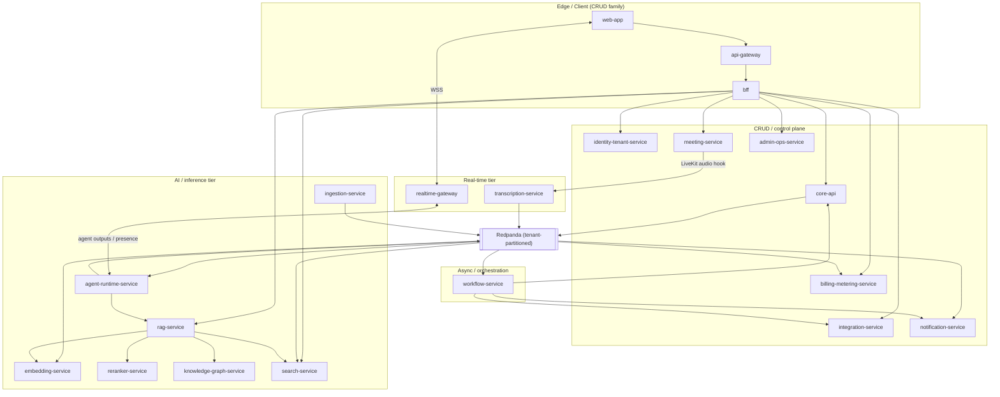
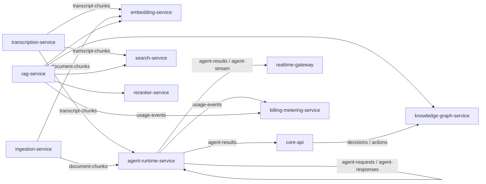
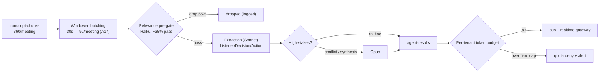
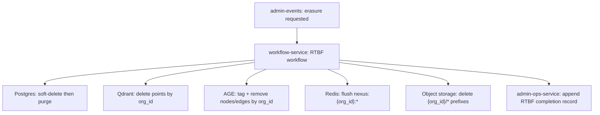
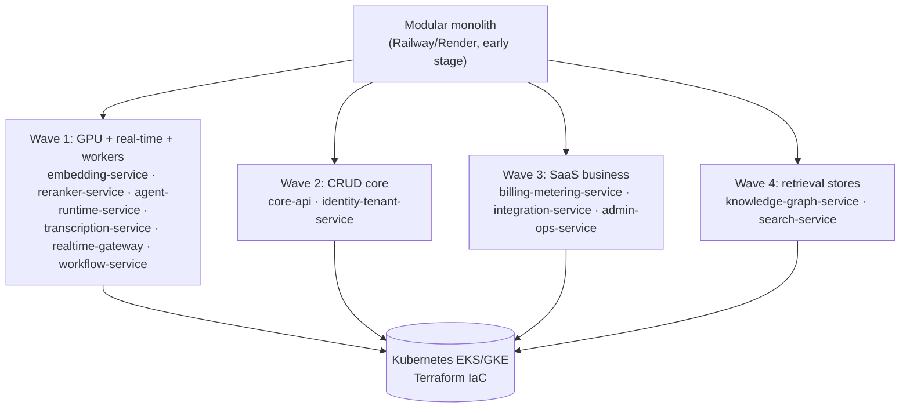

# Service Catalog & Bounded Contexts

The production-grade expansion of every NEXUS microservice — responsibility, owned data, API surface, events, dependencies, scaling profile, and failure/degradation modes — held 1:1 consistent with the frozen canon.

## Related documents

- [Service Catalog (canon)](_canon/01-service-catalog.md) — the frozen authoritative service list this document expands.
- [Data Model (canon)](_canon/02-data-model.md) — entity names, columns, tenant keys, stores, partitioning/retention.
- [Capacity & Scaling Math (canon)](_canon/05-capacity-math.md) — frozen load/cost numbers cited by symbol.
- [Tech & Architecture Decisions (canon)](_canon/06-tech-decisions.md) — locked tech choices and topic→schema table.
- [Data Architecture](05-data-architecture.md) — store selection, partitioning, backups/PITR, regional placement.
- [Multi-Tenancy & Isolation](06-multi-tenancy.md) — RLS, cells, `org_id` injection.
- [Security & AuthZ](11-security-architecture.md) — agent-to-agent authz, audit, edge security.
- [Event Streaming & Schema Registry](07-event-architecture.md) — Avro subjects, outbox/inbox, DLQs.

---

## 1. Purpose, scope, and the naming authority

This catalog turns each of the **20 canonical services** in [Service Catalog (canon)](_canon/01-service-catalog.md) into a full subsection. It adds nothing to the service list and renames nothing. The canon service catalog self-declares as **the single source of truth for service names** in kebab-case; this document obeys that verbatim.

> [SaaS-scale adjustment] The original NEXUS PDF was phase-and-domain organized (13 phases, role-agnostic, 4-person team) and named no services. The bounded-context decomposition below exists because the agent/inference tier scales and costs completely differently from the CRUD tier and **must scale independently**. Service seams are drawn so the early modular monolith (Railway/Render) peels into services without re-cutting any domain boundary.

Two cross-cutting invariants bind every service and are repeated in each subsection's failure-mode analysis rather than re-derived:

1. **Tenant isolation at every layer.** An authz middleware injects `org_id` (from the Clerk-verified JWT) into every query; Postgres uses Row-Level Security (RLS) for the pooled long tail and cell-based isolation for large/enterprise tenants; events are tenant-partitioned; Qdrant is per-tenant collections; Apache AGE `nexus_knowledge` is org-partitioned; Redis keys are `nexus:{org_id}:…`-namespaced. See [Multi-Tenancy & Isolation](06-multi-tenancy.md).
2. **At-least-once event delivery with idempotency.** Every producer writes a transactional **outbox** in the same DB transaction as its state change; every consumer dedupes on `idempotency_key` via an **inbox** table + Redis dedupe cache (`nexus:{org_id}:dedupe:{topic}:{idempotency_key}`, 24h TTL); poison messages land in a per-topic **DLQ**. Avro + Schema Registry, **BACKWARD** compatibility, one subject per topic (`{topic}-value`). See [Event Streaming & Schema Registry](07-event-architecture.md).

### 1.1 The four scaling families

Service subsections are grouped by the four scaling families from canon §4, because the family determines the autoscaler signal, the cost center, and the split order.

| Family | Services | Autoscaler signal | Cost driver |
|---|---|---|---|
| CRUD / control plane | `api-gateway`, `web-app`, `bff`, `identity-tenant-service`, `core-api`, `integration-service`, `billing-metering-service`, `admin-ops-service`, `notification-service` | HTTP req/s, p95 latency | CPU + Postgres connections |
| Real-time | `realtime-gateway`, `transcription-service` | Concurrent WebSocket connections / live audio streams | Long-lived connections, Deepgram minutes |
| AI / inference | `ingestion-service`, `embedding-service`, `reranker-service`, `agent-runtime-service`, `rag-service`, `knowledge-graph-service`, `search-service` | Queue depth, GPU utilization, token throughput | GPU + LLM tokens (separate cost center) |
| Async / orchestration | `workflow-service` | Temporal task-queue depth | Worker CPU |

> [SaaS-scale adjustment] `meeting-service` sits in the canon "CRUD/control plane" autoscaler family by req/s, but functionally bridges into the real-time tier (LiveKit room hooks feed `transcription-service`). It is documented under §3 (CRUD) per canon §4 and cross-referenced from §4.

---

## 2. How to read each service subsection

Each subsection carries seven facets in a fixed order. The first six are pure lookups against the canon and stay terse/tabular; **failure modes / degradation** is the analytical value-add and is tied to a concrete canon mechanism or PDF risk ID (R1–R8) in every case.

- **Responsibility** — canon §3 "Responsibility".
- **Owned data** — *which* tables from canon §3 "Owns data"; columns/keys/store/partition from [Data Model (canon)](_canon/02-data-model.md).
- **API surface** — canon §3 "Sync API" + §6 ownership table.
- **Events** — canon §3 consumes/produces + §5 flows; schemas from [Tech Decisions (canon)](_canon/06-tech-decisions.md) §2.4.
- **Dependencies** — canon §2 context map + §5.
- **Scaling profile** — canon §4 + capacity symbols (A5 20k meetings, A6 100k participants, E12 ~17,900 ev/s, L9 ~8,930 LLM calls/s, EM2 ~525 embed/s).
- **Failure modes / degradation** — this document's addition.

---

## 3. CRUD / control-plane services

Family autoscaler signal: HTTP req/s + p95 latency. Cost driver: CPU + Postgres connections. SLO: REST p95 < 300 ms, p99 < 800 ms (canon 05 §11.1). Pooled + RLS for the long tail; cell-routed for enterprise.

### 3.1 `api-gateway`

- **Responsibility.** Single ingress: TLS termination, WAF, global rate limiting, Clerk JWT pre-validation, `org_id` extraction, routing to `bff`/services. No business logic.
- **Owned data.** None (stateless; config only).
- **API surface.** All external HTTPS/WSS ingress; reverse-proxies to internal services. Owns no path prefix of its own — it is the front of every prefix in canon §6.
- **Events.** Produces none, consumes none. Off the event bus entirely.
- **Dependencies.** Upstream: `web-app` and external API/WS clients. Downstream: `bff` (HTTP), `realtime-gateway` (WSS upgrade), Clerk (JWKS for JWT verification).
- **Scaling profile.** Horizontal, edge; scales on req/s + concurrent connections. Multi-region active-passive → active-active. Cloudflare CDN + WAF in front (canon 06 §2.1).

> [SaaS-scale adjustment] `api-gateway` is wholly added vs the PDF, which exposed FastAPI directly. The gateway is the single chokepoint that resolves `org_id` from the Clerk JWT and applies global, tenant-aware rate limiting before any service is touched.

**Failure modes / degradation.**

| Mode | Behavior | Mitigation / canon anchor |
|---|---|---|
| Clerk JWKS unreachable | Cannot verify JWTs; fail **closed** (reject) for protected routes | Cache JWKS with short TTL; serve cached keys during a Clerk blip; `org_id` injection chokepoint fails closed (06 §2.2). |
| Rate-limit store (Redis) down | Falls back to per-pod local token buckets (coarser, still bounded) | Global limit degrades to per-instance; never disabled — prevents a tenant from saturating a downstream tier. |
| Downstream `bff` 5xx | Returns 502/503 with `Retry-After`; circuit-breaks the unhealthy upstream | WAF + gateway absorb retries so the CRUD tier is not stampeded. |

### 3.2 `web-app`

- **Responsibility.** Next.js 14 App Router UI: dashboard, meeting room, agent sidebar, transcript view, RAG context panel, admin/tenant consoles, integration settings. Server components + RSC streaming.
- **Owned data.** None (CDN-cached assets via Cloudflare).
- **API surface.** Serves HTML/RSC; calls `bff` only.
- **Events.** None.
- **Dependencies.** Upstream: browser. Downstream: `bff` (data), `realtime-gateway` (Socket.io client for chat/presence/agent outputs), LiveKit React client (media, via `meeting-service` tokens).
- **Scaling profile.** Horizontal, edge/CDN; scales on page req/s. Static-heavy, cheap.

**Failure modes / degradation.**

| Mode | Behavior | Mitigation / canon anchor |
|---|---|---|
| `bff` unavailable | RSC streams render shells with skeleton states; client retries | Read-path degradation only; meeting media (LiveKit) is independent of `bff`. |
| `realtime-gateway` socket drop | Sidebar shows "reconnecting"; Save-for-later queue persists locally and on the server (`agent_suggestions.status`) | Calm-animation discipline; no lost suggestions across reconnect (PDF sidebar spec). |

### 3.3 `bff`

- **Responsibility.** Backend-for-frontend: aggregates/denormalizes reads for screens, fans out to services, shapes payloads, handles client-session concerns. Thin, no domain ownership.
- **Owned data.** None (read-through; short Redis cache).
- **API surface.** `GET/POST /bff/*` (screen-shaped), consumed only by `web-app` (canon §6).
- **Events.** None.
- **Dependencies.** Downstream: `identity-tenant-service`, `core-api`, `integration-service`, `billing-metering-service`, `admin-ops-service`, `rag-service`, `search-service` (canon §2). Reads through `nexus:{org_id}:…` Redis.
- **Scaling profile.** Horizontal; scales on UI req/s. Co-located with CRUD tier.

> [SaaS-scale adjustment] The `bff` is wholly added. The PDF's Next.js shell called FastAPI directly; at SaaS scale a thin aggregation layer keeps screen payloads stable while services split behind it.

**Failure modes / degradation.**

| Mode | Behavior | Mitigation / canon anchor |
|---|---|---|
| One downstream service slow | Partial-screen rendering: return the panels that resolved, mark the slow panel as degraded | Per-call timeouts + bulkheads; screen is never fully blocked by one service. |
| Stale Redis read-through | Serves slightly stale aggregate; writes go direct to owning service | Short TTL; owning service is always the write authority. |

### 3.4 `identity-tenant-service`

- **Responsibility.** Identity & tenancy control plane: Clerk webhook user-sync (outbox + reconciliation, Clerk as source of truth), org/tenant provisioning & lifecycle, RBAC, SSO/SAML/SCIM, agent-to-agent authorization grants (deny-by-default), `get_user_context(user_id)` source-of-record for role/skills/team.
- **Owned data.** From canon §3 plus [Data Model (canon)](_canon/02-data-model.md) §2.1/§2.2:

| Table | Tenant key | Key fields | Store / note |
|---|---|---|---|
| `organizations` | tenant root (`id` = `org_id`) | `id`, `name`, `slug`, `plan_id` | Postgres; tenant root, never partitioned away. |
| `users` | `org_id` | `clerk_user_id`, `email`, `role`, `skills text[]`, `bio`, `avatar_url` | Postgres RLS; soft-delete on RTBF. |
| `teams` | `org_id` | `name`, `department_id` | Postgres RLS. |
| `team_members` | `org_id` (denorm.) | PK `(team_id, user_id)`, `role` | Postgres RLS join table. |
| `departments` | `org_id` | `name`, `parent_id` | Postgres RLS; self-referential org tree. |
| `tenant_settings` | `org_id` (PK) | `retention_days_*`, `agent_confidence_overrides jsonb`, `pii_redaction_enabled`, `sso_config jsonb` | Postgres RLS; one row per tenant. |
| `data_residency` | `org_id` (PK) | `region`, `db_cell`, `qdrant_region`, `object_bucket_region`, `locked_at` | Postgres RLS; immutable after `locked_at`. |

  Plus RBAC roles/grants, SSO config, SCIM state, agent-authz scopes.

> [SaaS-scale adjustment] `identity-tenant-service` owns the full identity-and-tenancy surface — `users/organizations/teams/team_members/departments` plus the new `tenant_settings`/`data_residency`. The SaaS-added control-plane tables and the RBAC/SSO/SCIM and agent-authz state did not exist in the PDF.

- **API surface (canon §6).** `POST /clerk/webhook`, `GET/POST /orgs`, `/rbac/*`, `/scim/v2/*`, `GET /context/{user_id}`.
- **Events.** Consumes `user-sync-events` (Clerk inbox). Produces `tenant-events` (provisioned/suspended/deleted), `notifications`.
- **Dependencies.** Upstream: `bff`, `api-gateway`, Clerk (webhooks). Downstream consumers of `tenant-events`: `billing-metering-service`, `workflow-service`, `admin-ops-service`. `get_user_context` is cached at `nexus:{org_id}:user_ctx:{user_id}` (5-min TTL) and read heavily by `agent-runtime-service`.
- **Scaling profile.** Horizontal; scales on auth + webhook req/s. Control-plane critical path; HA, low latency.

> [SaaS-scale adjustment] User-sync hardening (outbox + reconciliation, Clerk as source of truth) replaces the PDF's plain webhook so dropped Clerk webhooks self-heal. SSO/SAML/SCIM and agent-to-agent authz grants are added for Enterprise tenants (06 §2.11).

**Failure modes / degradation.**

| Mode | Behavior | Mitigation / canon anchor |
|---|---|---|
| Clerk webhook dropped | User-sync reconciliation loop re-pulls Clerk state and replays into the outbox | Outbox + reconciliation; Clerk is source of truth (06 §2.11). |
| `get_user_context` Redis miss/stale | Recompute from Postgres; agent personalization still proceeds | 5-min TTL `nexus:{org_id}:user_ctx:{user_id}` (02 §5); cache is an optimization, not a dependency. |
| Agent-authz grant lookup fails | Deny-by-default — the requesting agent's `agent-requests` call is refused and audited | Deny-by-default agent-to-agent authz (06 §2.6); never fail open across tenants. |

### 3.5 `core-api`

- **Responsibility.** Domain CRUD and the relational heart: meetings, teams/departments read paths, meeting participants/speakers, chat persistence, worklogs, decisions/actions read models, profiles/org-chart. Holds the **outbox** that emits `decisions`/`actions` on confirmation.
- **Owned data.** From canon §3 plus [Data Model (canon)](_canon/02-data-model.md):

| Table | Tenant key | Notable fields | Store / partition note |
|---|---|---|---|
| `meetings` | `org_id` | `livekit_room`, `status`, `scheduled_start/end`, `created_by` | Postgres RLS; monthly range-partition candidate by `scheduled_start`. |
| `meeting_participants` | `org_id` | PK `(meeting_id, user_id)`, `role_in_meeting` | Postgres RLS; drives `get_user_context`. |
| `meeting_speakers` | `org_id` | `speaker_id` (diarized), `user_id`, `confidence`, `assignment` (`manual`/`suggested`) | Postgres RLS (R7: manual is source of truth). |
| `worklogs` | `org_id` | `content`, `relevance_score`, `created_by_agent`, `source_chunk_ids uuid[]` | Postgres RLS; per-user PersonalListenerAgent notes. |
| `decisions` | `org_id` | `content`, `rationale`, `confidence`, `status`, `confirmed_by` | Postgres RLS; on confirm → AGE `PRODUCED` edge. |
| `action_items` | `org_id` | `content`, `assignee_id`, `due_date`, `confidence`, `status` | Postgres RLS; on confirm → AGE `ASSIGNED_TO` edge. |
| `agent_suggestions` | `org_id` | `question`, `priority` (1–3), `status` (Ask/Dismiss/Save-for-later) | Postgres RLS; Save-for-later persists into next meeting. |
| `agent_collaborations` | `org_id` | `requester`, `responder`, `query`, `result`, `success`, `latency` | Postgres RLS; ContextGapAgent A2A logs (R5/R6 dashboards). |
| `chat_messages` | `org_id` | `user_id`, `content`, `created_at` | Postgres RLS; monthly range-partition by `created_at`. |
| `teams`, `team_members`, `departments` | `org_id` | (read models / org-chart) | Postgres RLS. |

Note one boundary: `core-api` owns the full relational heart — including `worklogs`, `decisions`, `action_items`, `agent_suggestions`, `agent_collaborations` — but **not** `transcript_chunks`, which belongs to `transcription-service`; `core-api` only serves its read view via FTS.

- **API surface (canon §6).** `GET/POST/PATCH /meetings`, `/teams`, `/departments`, `/worklogs`, `/decisions`, `/actions`, `/chat`. The transcript read endpoint `GET /meetings/:id/transcript` is served via `core-api` FTS over `transcription-service`-owned data.
- **Events.** Consumes `decisions`, `actions`, `agent-results` (to update read models). Produces `meeting-events` (created/updated/ended) and, via transactional **outbox**, `decisions`/`actions` **on confirmation** — never speculatively.
- **Dependencies.** Upstream: `bff`, `workflow-service`. Downstream: `knowledge-graph-service` (consumes `decisions`/`actions` to build edges), `realtime-gateway` (agent outputs to sidebar), `meeting-service` (consumes `meeting-events` to open/close rooms).
- **Scaling profile.** Horizontal stateless; scales on req/s. Pooled + RLS long tail, cell-routed for enterprise. p95 < 300 ms (05 §11.1).

**Failure modes / degradation.**

| Mode | Behavior | Mitigation / canon anchor |
|---|---|---|
| Outbox relay lag | `decisions`/`actions` emit late; graph edges and follow-up workflows lag, no data loss | Transactional outbox guarantees eventual emit; consumer-lag alert (06 §2.4). |
| Duplicate `agent-results` consumed | Read-model update is idempotent on `idempotency_key` | Inbox + `nexus:{org_id}:dedupe:*` cache (02 §7). |
| Confirmation without persisted decision | Edge creation is gated on confirmed row only | "No silent commits" — edges created only on confirmation (02 §2.1, 06 §2.10). |
| Hot table bloat (`chat_messages`, `meetings`) | Query latency rises before mitigation | Monthly declarative range partitions; retention drops partitions (02 §2.1). |

### 3.6 `meeting-service`

- **Responsibility.** LiveKit transport adapter: mints room tokens with participant verification, receives LiveKit webhooks, bridges server-side audio hooks to `transcription-service`. SDK abstracted behind the transport adapter.
- **Owned data.** `meeting_rooms` (LiveKit room ↔ meeting map, egress/recording refs). Store: Postgres, RLS by `org_id`.
- **API surface (canon §6).** `POST /api/meetings/:id/token`, `POST /livekit/webhook`.
- **Events.** Consumes `meeting-events` (to open/close rooms). Produces `meeting-room-events` (joined/left/recording-ready). The raw-audio handoff to `transcription-service` is a **server-side LiveKit hook, not a topic**.
- **Dependencies.** Upstream: `bff`, `core-api` (`meeting-events`), LiveKit (webhooks). Downstream: `transcription-service` (server-side LiveKit audio hook). On the LiveKit `recording.ready` webhook, the recording artifact is written to the `nexus-recordings` object-storage bucket (`{org_id}/{meeting_id}/`, 02 §6) and referenced via `meeting_rooms` egress/recording refs — it does **not** flow into `ingestion-service`, which handles unstructured.io document ingestion (PDF/DOCX/PPTX/HTML/MD/EML) triggered only by `integration-events` (calendar attachments) and direct `/ingest` uploads.
- **Scaling profile.** Canon §4 places it in the CRUD/req-s autoscaler family; functionally scales on concurrent rooms (A5 = 20k peak concurrent meetings). Real-time-adjacent; audio hook fan-out.

> [SaaS-scale adjustment] The PDF left the meeting SDK open (R2: evaluate ≥2 in Phase 1). Canon locks **LiveKit** (self-hostable SFU caps per-minute cost, no per-participant ceiling, strong server-side audio hooks) — always behind the transport adapter so the pick stays swappable (06 §2.7).

**Failure modes / degradation.**

| Mode | Behavior | Mitigation / canon anchor |
|---|---|---|
| Token-mint slow | Join path stalls | p95 < 250 ms SLO on token-mint (05 §11.1); verify participant before issuing. |
| LiveKit webhook lost | Room lifecycle state drifts | LiveKit egress/recording refs reconciled; `meeting-room-events` is at-least-once with dedupe. |
| LiveKit SFU outage | Media down for affected rooms; non-AV (chat/presence) on `realtime-gateway` survives | Transport adapter isolates the SDK; chat/presence ride Socket.io, not the SFU (06 §2.7). |

### 3.7 `integration-service`

- **Responsibility.** External integrations: Google Calendar OAuth (auto-create meetings, match participants by email, route attachments to `ingestion-service`), Slack bot OAuth (Block Kit prep briefs, summaries), Jira (default)/Linear (alt) OAuth bidirectional action-item sync + status webhooks. **Guardrail R8: Calendar + Slack + one of Jira/Linear only.**
- **Owned data.** From [Data Model (canon)](_canon/02-data-model.md) §2.2:

| Table | Tenant key | Notable fields | Store / note |
|---|---|---|---|
| `integration_connections` | `org_id` | `provider` (`google_calendar`/`slack`/`jira`/`linear`), `external_account_id`, `status`, `scopes text[]`, `installed_by` | Postgres RLS; one row per installed integration. |
| `oauth_tokens` | `org_id` | `connection_id`, `access_token_enc`, `refresh_token_enc`, `expires_at`, `token_version` | Postgres RLS; **envelope-encrypted at rest (per-tenant KMS data key)**; never returned by API. |

  Plus external↔NEXUS id maps and webhook cursors.

> [SaaS-scale adjustment] Canon 01 prose names this map "`integration_links`"; the frozen data-model table names are `integration_connections` and `oauth_tokens` (02 §2.2). Those exact table names are used here. Envelope encryption of OAuth tokens is a SaaS-scale addition.

- **API surface (canon §6).** OAuth callbacks `/oauth/{provider}`, `/webhooks/{provider}`.
- **Events.** Consumes `actions` (push NEXUS action → external ticket), `meeting-events`, `notifications`. Produces `integration-events` (event→meeting, attachment-to-ingest, external status → action update) and `actions` (status sync back).
- **Dependencies.** Upstream: external OAuth providers, `bff`. Downstream: `ingestion-service` (consumes `integration-events` for calendar attachments), `core-api` (action status updates), `workflow-service`/`notification-service` for follow-ups.
- **Scaling profile.** Horizontal; scales on webhook + sync req/s. Bursty; CRUD tier.

**Failure modes / degradation.**

| Mode | Behavior | Mitigation / canon anchor |
|---|---|---|
| Provider rate-limit / 429 | Back off with webhook cursor; resume from last cursor | Cursor-tracked sync; at-least-once with idempotency on `actions`. |
| Scope creep beyond R8 | Hard-blocked at the connection layer | Guardrail R8: exactly Calendar + Slack + one PM; `integration_connections.provider` enumerated. |
| OAuth token expiry/refresh fails | Connection marked degraded; user re-auth prompted via `notifications` | `token_version` + refresh loop; tokens never logged or returned. |
| External status webhook duplicate | Action update idempotent | Inbox dedupe on `idempotency_key`. |

### 3.8 `billing-metering-service`

- **Responsibility.** SaaS monetization: Stripe billing/subscriptions/seats/dunning/tax, usage metering (`usage-events` → aggregation → quota enforcement), plans/tiers (Free/Pro/Enterprise), **per-tenant token budgets & hard quotas**, billing read models.
- **Owned data.** From [Data Model (canon)](_canon/02-data-model.md) §2.2:

| Table | Tenant key | Notable fields | Store / retention |
|---|---|---|---|
| `plans` | global (no `org_id`) | `code` (`free`/`pro`/`enterprise`), `seat_price_cents`, `included_meeting_minutes`, `included_agent_tokens`, `features jsonb` | Postgres; versioned for invoice reproducibility. |
| `subscriptions` | `org_id` | `stripe_subscription_id`, `seats`, `status`, `current_period_*`, `trial_ends_at` | Postgres RLS; one active per tenant. |
| `usage_events` | `org_id` | `event_type` (`meeting_minute`/`agent_token`/`transcription_second`/`storage_gb`), `quantity`, `occurred_at`, `idempotency_key` | Postgres RLS; append-only, daily range-partition; raw 90d then summarized. |
| `invoices` | `org_id` | `stripe_invoice_id`, `amount_due_cents`, `tax_cents`, `status`, `pdf_url` | Postgres RLS; immutable once finalized; 7-year retention. |
| `agent_budgets` | `org_id` | `period` (`YYYY-MM`), `token_quota`, `tokens_consumed`, `hard_cap`, `alert_80_sent`, `alert_95_sent`, `state` (`ok`/`throttled`/`blocked`) | Postgres RLS; one row per (tenant, month); enforces R4. |

> [SaaS-scale adjustment] `billing-metering-service` owns the per-tenant `agent_budgets` that enforce R4 token hard caps, alongside the entire billing/metering surface — all wholly added vs the PDF (06 §2.12).

- **API surface (canon §6).** `GET/POST /billing/*`, `POST /stripe/webhook`, `GET /usage`.
- **Events.** Consumes `usage-events`, `tenant-events`. Produces `billing-events` (quota-exceeded, dunning, plan-changed), `notifications`.
- **Dependencies.** Upstream: `agent-runtime-service` and `rag-service` (emit `usage-events` for LLM tokens), Stripe (webhooks), `identity-tenant-service` (`tenant-events`). Downstream: `workflow-service` (dunning sagas consume `billing-events`), `notification-service`. Hot quota mirror at `nexus:{org_id}:budget:{period}` (02 §5) for fast checks.
- **Scaling profile.** Horizontal; scales on metering ingest + req/s. Aggregation is write-heavy. At capacity: `usage-events` is the highest-volume billing input — sourced from L7 = 5.79B LLM calls/month worth of token metering (05 §8).

**Failure modes / degradation.**

| Mode | Behavior | Mitigation / canon anchor |
|---|---|---|
| Token budget breached | `agent_budgets.state` → `throttled` → `blocked`; quota deny + alert; agents stop spending | Per-tenant hard quota, deny-by-default (R4; 05 §11.3 enforces 100%). |
| Duplicate `usage-events` | Aggregation idempotent on `idempotency_key`; no double-bill | Append-only + idempotency key (02 §7). |
| Stripe webhook outage | Subscription state lags; reconciliation job re-pulls Stripe | Stripe is source of truth for payment state; dunning sagas in `workflow-service`. |
| Metering ingest backlog | Quota checks use the Redis hot mirror; nightly aggregation catches up | `nexus:{org_id}:budget:{period}` fast path; raw retained 90d. |

### 3.9 `admin-ops-service`

- **Responsibility.** Two consoles: **tenant admin** (org-scoped self-serve: members, plan, integrations, data export/erasure requests) and **internal ops** (cross-tenant support, feature flags, tenant suspend/migrate, consumer-lag & cost dashboards, audit-log access).
- **Owned data.** Feature flags, ops audit log, support/impersonation grants. Plus the compliance audit trail from [Data Model (canon)](_canon/02-data-model.md) §2.2:

| Table | Tenant key | Notable fields | Store / note |
|---|---|---|---|
| `audit_logs` | `org_id` | `actor_id`, `actor_type` (`user`/`agent`/`system`), `action`, `target_type`, `target_id`, `metadata jsonb`, `ip`, `occurred_at` | Postgres RLS; **append-only, no UPDATE/DELETE** (tamper-evident); monthly range-partition; 1y hot then `nexus-audit-archive`. |

> [SaaS-scale adjustment] `admin-ops-service` owns the compliance `audit_logs` trail and the ops audit log; the entire tenant-admin / internal-ops console surface is SaaS-added — the PDF had no tenant administration or cross-tenant ops tooling.

- **API surface (canon §6).** `GET/POST /admin/tenant/*`, `/admin/ops/*` (RBAC-gated, audited).
- **Events.** Consumes `tenant-events`, `billing-events`, `graph-events` (ops views). Produces `admin-events` (flag changed, tenant suspended, erasure requested).
- **Dependencies.** Upstream: `bff`. Downstream: `workflow-service` (consumes `admin-events` to run tenant-suspend, migrate, and right-to-be-forgotten deletion workflows), every tier for dashboards.
- **Scaling profile.** Horizontal; low traffic. Control-plane; strict authz + full audit.

**Failure modes / degradation.**

| Mode | Behavior | Mitigation / canon anchor |
|---|---|---|
| Audit write fails | Operation that requires audit fails closed (no silent unaudited action) | `audit_logs` append-only, tamper-evident (02 §2.2). |
| Impersonation misuse | Every support/impersonation grant is logged with `actor_type=user` | Strict RBAC + full audit; deny-by-default. |
| Erasure request | Emits `admin-events`; `workflow-service` runs the RTBF Temporal workflow across all six stores | Single RTBF workflow by `org_id`/`user_id` (02 §7). |

### 3.10 `notification-service`

- **Responsibility.** Unified delivery fabric: in-app (via `realtime-gateway`), email, Slack DM/channel. Templating, per-user priority queue (urgent alerts pre-empt notes), dedupe, delivery receipts. **Sole consumer authorized to fan `notifications` to external channels.**
- **Owned data.** `notification_log`, delivery receipts, user channel prefs. Postgres, RLS by `org_id`.
- **API surface (canon §6).** `GET /notifications`, `PATCH /notifications/:id` (read/dismiss).
- **Events.** Consumes `notifications`, `agent-results` (priority alerts). Produces `notification-delivery-events`.
- **Dependencies.** Upstream: every producer of `notifications` (`agent-runtime-service`, `identity-tenant-service`, `billing-metering-service`, `workflow-service`, `integration-service`). Downstream: `realtime-gateway` (in-app fan-out), Slack/email providers. Priority queue at `nexus:{org_id}:queue:agent:{user_id}` (02 §5).
- **Scaling profile.** Horizontal; scales on `notifications` topic throughput (E6 ≈ 8 notifications/meeting; 05 §6). Async tier.

> [SaaS-scale adjustment] Making `notification-service` the **sole** authorized external-channel fan-out point is a SaaS-scale consolidation; the PDF emitted Slack/email from multiple features. Centralizing enforces dedupe, delivery receipts, and per-tenant channel prefs.

**Failure modes / degradation.**

| Mode | Behavior | Mitigation / canon anchor |
|---|---|---|
| External channel (Slack/email) down | In-app delivery via `realtime-gateway` still works; external retried with backoff | Multi-channel fabric; delivery receipts track which channel succeeded. |
| Notification storm | Per-user priority queue ensures urgent alerts pre-empt routine notes | `nexus:{org_id}:queue:agent:{user_id}` priority queue (PDF Phase 11). |
| Duplicate `notifications` | Dedupe on idempotency key before send | Inbox dedupe (02 §7). |

---

## 4. Real-time services

Family autoscaler signal: concurrent WebSocket connections / live audio streams. Anchors: A6 = 100k peak concurrent participants (connection sizing), A5 = 20k peak concurrent meetings (one diarized stream per meeting). SLOs: live captions p95 < 2 s; agent end-to-end p50 < 2 s / p95 < 4 s (05 §11.1).

### 4.1 `realtime-gateway`

- **Responsibility.** WebSocket/Socket.io fan-out for non-AV events: chat, presence, live captions, agent sidebar outputs, streamed agent tokens, priority alert queue. Redis pub/sub backbone for fan-out across instances. Socket.io rooms keyed by `meeting_id`.
- **Owned data.** None (ephemeral connection state; Redis pub/sub channels `nexus:{org_id}:pubsub:meeting:{meeting_id}`, presence sets `nexus:{org_id}:presence:{meeting_id}`).
- **API surface (canon §6).** Socket.io / WSS rooms per `meeting_id`; live caption + agent output channels.
- **Events.** Consumes `agent-stream`, `agent-results`, `notifications` (fan to sockets). Produces `presence-events`.
- **Dependencies.** Upstream: `web-app` (Socket.io client), `agent-runtime-service` (agent outputs/streamed tokens), `transcription-service` (live captions), `notification-service`. Downstream: Redis pub/sub for cross-instance fan-out.
- **Scaling profile.** Horizontal; scales on **concurrent WebSocket connections** (A6 = 100k peak). Sticky/Redis-backed. Real-time tier.

> [SaaS-scale adjustment] The Redis pub/sub backbone for cross-instance Socket.io fan-out is the PDF's Phase 11 mechanism, now load-bearing at 100k concurrent connections (A6). Streamed LLM token deltas ride `agent-stream` (E8 ≈ 1,260/meeting — the highest-count topic; 05 §6).

**Failure modes / degradation.**

| Mode | Behavior | Mitigation / canon anchor |
|---|---|---|
| Pod loss | Sticky sessions re-establish; Redis pub/sub re-subscribes the room | Connection state is ephemeral; no durable loss. |
| Redis pub/sub down | Fan-out degrades to per-pod; cross-instance delivery pauses | Backbone is the scaling mechanism; alert + failover Redis. |
| `agent-stream` backlog | Token deltas arrive late; final `agent-results` still delivered | Streaming is best-effort; the durable result is the source of truth. |

### 4.2 `transcription-service`

- **Responsibility.** Deepgram WebSocket proxy: keeps the API key server-side, streams audio from the LiveKit hook, speaker diarization, interim vs final separation, merges utterances by speaker turn, persists **only finals** to `transcript_chunks`, emits chunks to the bus.
- **Owned data.** `transcript_chunks` (`org_id`, `meeting_id`, `speaker_id`, `start_ms`, `end_ms`, `text`, `is_final`, `confidence`). Postgres, RLS by `org_id`, **index on `(meeting_id, start_ms)`**, monthly range-partition by `created_at` (hot 90d → cold tier). Only finals persisted (02 §2.1).
- **API surface.** Internal WS audio in; the read view `GET /meetings/:id/transcript` is served via `core-api` FTS (canon §6).
- **Events.** Consumes `meeting-room-events` (recording/audio start). Produces `transcript-chunks` (Avro `TranscriptChunk`).
- **Dependencies.** Upstream: `meeting-service` (server-side LiveKit audio hook), Deepgram (WS). Downstream consumers of `transcript-chunks`: `embedding-service`, `agent-runtime-service`, `search-service`. Live captions fan to `realtime-gateway`.
- **Scaling profile.** Horizontal; scales on **concurrent live streams** (A5 = 20k; one diarized stream per meeting, not per participant — a 6× cost lever, 05 §7). Sub-2s caption budget.

> [SaaS-scale adjustment] At 360 finals/meeting (T2) and 4.8M meetings/month (R4), `transcript_chunks` is a ~1.73B rows/month flow (T3); the PDF's single indexed table becomes monthly range partitions with 90-day hot/cold tiering (05 §4, 02 §2.1). One diarized Deepgram stream per meeting (not per participant) holds D1 at 216M min/month vs 1.3B (05 §7).

**Failure modes / degradation.**

| Mode | Behavior | Mitigation / canon anchor |
|---|---|---|
| Deepgram WS drop | Auto-reconnect within 2 s; interims discarded, finals resume | Reconnect success > 99.9% within 2 s (05 §11.3; R5). |
| Diarization wrong speaker | `meeting_speakers.assignment=suggested` with `confidence`; manual override is authoritative | Manual is source of truth; confidence-scored suggestion only (R7; 02 §2.1). |
| Caption latency > 2 s | Captions degrade but finals still persist | Live-caption p95 < 2 s SLO; persistence decoupled from caption render. |
| Persisting interims by mistake | Only `is_final=true` rows written | Hard rule: interims never persisted (02 §2.1). |

---

## 5. AI / inference services

Family autoscaler signal: queue depth (chunk backlog), GPU utilization, token throughput. **Off the API tier**, separate cost center (LLM = 94% of variable cost, 05 §10.1). Anchors: EM2 ≈ 525 embeds/s peak, L9 ≈ 8,930 LLM calls/s peak, E12 ≈ 17,900 events/s peak.

### 5.1 `ingestion-service`

- **Responsibility.** Document ingestion via unstructured.io: PDF/DOCX/PPTX/HTML/MD/EML → typed elements (Title/NarrativeText/Table/ListItem), LangChain `RecursiveCharacterTextSplitter` (600/60) + `SemanticChunker` for narrative docs, PII redaction pass, emits document chunks.
- **Owned data.** `document_chunks` (`org_id`, `document_id`, `element_id`, `element_type`, `text`, `position`) + `document_elements` (typed) + ingestion job state. Postgres, RLS by `org_id`; mirrors Qdrant `document_chunks` payload for citation (02 §2.1, §3).
- **API surface (canon §6).** `POST /ingest` (file/url), `GET /ingest/jobs/:id`.
- **Events.** Consumes `integration-events` (calendar attachments to ingest). Produces `document-chunks` (Avro).
- **Dependencies.** Upstream: `integration-service` (calendar attachments), direct uploads via `bff`. Downstream consumers of `document-chunks`: `embedding-service`, `agent-runtime-service`. Source docs in `nexus-documents`/`nexus-attachments` buckets (02 §6).
- **Scaling profile.** Horizontal + queue-driven; scales on ingestion backlog. Bursty; AI tier. Document attach rate A15 = 30% of meetings, ~27.8 vectors/doc (V3).

> [SaaS-scale adjustment] `ingestion-service` owns `document_chunks` (`rag-service` reads it). A PII-redaction pass on ingest is added for compliance (06 §2.11).

**Failure modes / degradation.**

| Mode | Behavior | Mitigation / canon anchor |
|---|---|---|
| unstructured.io parse failure | Job marked failed with element-level diagnostics; partial elements retained | `GET /ingest/jobs/:id` surfaces status; idempotent re-run. |
| Ingestion backlog spike | Queue-driven autoscale; documents searchable before meeting "best effort" | Bursty AI-tier autoscale on backlog. |
| PII leak through ingest | Redaction pass before chunk emit; `tenant_settings.pii_redaction_enabled` gate | Per-tenant PII redaction (02 §2.2). |

### 5.2 `embedding-service`

- **Responsibility.** Dedicated autoscaling inference for **BGE-small-en 384-dim** via ONNX runtime. Embed-on-ingest (batch 32, sub-100ms) and query-embed only. Upserts to per-tenant Qdrant collections. **OFF the API tier.**
- **Owned data.** None in Postgres; writes Qdrant vectors: `transcript_chunks__{org_id}`, `document_chunks__{org_id}`, `decisions__{org_id}` (logical names `transcript_chunks`/`document_chunks`/`decisions`; physical append `__{org_id}`, 02 §3).
- **API surface (canon §6).** `POST /embed` (query-embed, internal-only).
- **Events.** Consumes `transcript-chunks`, `document-chunks` (the embedding consumer: consume → split → embed → upsert). Produces `embedding-events` (upsert acks for lag tracking).
- **Dependencies.** Upstream: `transcription-service`, `ingestion-service`, `rag-service` (query-embed). Downstream: Qdrant per-tenant collections.
- **Scaling profile.** Horizontal **GPU / Ray Serve / vLLM**; scales on embed queue depth + GPU util. EM2 ≈ 525 embeds/s ingest peak, EM3 ≈ 16.4 batches/s, EM4 ≈ 700 query-embeds/s peak. Stock: V7 = 4.42B vectors / ~17 TB at A18 = 13-month hot retention (05 §5, §9).

> [SaaS-scale adjustment] The PDF ran BGE-small via ONNX on the API service. Canon moves embeddings to a dedicated GPU/Ray Serve/vLLM tier off the API tier; per-tenant Qdrant collections + int8 quantization manage the 17 TB stock (05 §5, 06 §2.5). Fixes R4/R5 coupling.

**Failure modes / degradation.**

| Mode | Behavior | Mitigation / canon anchor |
|---|---|---|
| GPU saturation / queue depth | Consumer lag rises; autoscale GPU replicas | Lag SLO < 5 s, alert at 30 s (05 §11.3). |
| Qdrant upsert failure | Retry; chunk re-embedded on redelivery (idempotent upsert by chunk id) | At-least-once + idempotent point id (02 §7). |
| Cross-tenant vector leak | Impossible at query time: per-tenant collection + mandatory `org_id` payload filter | Defense-in-depth isolation (02 §3). |
| Embed batch > 100 ms | Throughput drops; batch-32 budget breached | Embed batch 32 sub-100ms SLO (05 §11.3). |

### 5.3 `reranker-service`

- **Responsibility.** Dedicated autoscaling inference for **BGE-reranker-base** cross-encoder. Reranks top-50 → top-10 for `rag-service`, under-500ms-cold latency budget. **OFF the API tier.**
- **Owned data.** None.
- **API surface (canon §6).** `POST /rerank` (passages → scored top-k, internal-only).
- **Events.** None (synchronous request/response only).
- **Dependencies.** Upstream: `rag-service`. Downstream: none.
- **Scaling profile.** Horizontal **GPU / Ray Serve / vLLM**; scales on rerank req/s + GPU util. Cold latency budget < 500 ms over top-50 → top-10 (06 §2.9, 05 §11.1).

**Failure modes / degradation.**

| Mode | Behavior | Mitigation / canon anchor |
|---|---|---|
| Reranker down | `rag-service` degrades to **RRF-fusion-only** ranking (vector + FTS + AGE, no cross-encoder) | Graceful degradation; recall preserved, precision reduced. |
| Cold-start latency | First request > 500 ms; warm pool keeps replicas hot | RAG cold p95 < 1.5 s, warm < 500 ms (05 §11.1). |
| GPU saturation | Rerank req/s autoscale; queue bounded | Independent GPU autoscaler; never shares the API tier. |

### 5.4 `agent-runtime-service`

- **Responsibility.** Hosts the **six LangGraph agents** on the shared `BaseAgent` lifecycle (spawn/process/terminate) + `AgentState` dataclass + versioned prompt-template loader: PersonalListenerAgent, DecisionAgent, ActionAgent, QuestionAgent, ContextGapAgent, ProactiveAgent. Cost-controlled LLM pipeline (pre-gate → windowed batching → tiered routing → caching). Multi-agent collaboration over the bus.
- **Owned data.** **None.** Stateless inference; writes via `core-api` outbox semantics; reads context. (Canon 01 is explicit — `agent-runtime-service` owns no Postgres tables; the agent outputs `worklogs`/`decisions`/`action_items`/`agent_suggestions`/`agent_collaborations` are owned by `core-api`.)
- **API surface (canon §6).** Internal control: `POST /agents/spawn`, `POST /agents/{id}/terminate`; emits to bus + `realtime-gateway`.
- **Events.** Consumes `transcript-chunks`, `document-chunks`, `agent-requests`, `agent-responses`. Produces `agent-results`, `agent-requests`, `agent-responses`, `agent-stream`, `notifications`, `usage-events`. It *detects* decisions and action items, but the `decisions`/`actions` topics that `knowledge-graph-service` consumes are emitted by the `core-api` transactional outbox **on confirmation** (no silent commits) — agent-runtime surfaces them via `agent-results` to the sidebar for confirmation first.
- **Dependencies.** Upstream: `transcription-service`, `ingestion-service`. Downstream: `core-api` (read models/outbox), `rag-service` (context fill), `realtime-gateway` (sidebar/stream), `billing-metering-service` (`usage-events`), `notification-service`, `knowledge-graph-service` (via confirmed `decisions`/`actions`). Reads `get_user_context` from `identity-tenant-service` (`nexus:{org_id}:user_ctx:{user_id}`).
- **Scaling profile.** Horizontal, independent autoscaler on **token throughput + chunk backlog**. Distinct cost center; per-tenant token budgets. L9 ≈ 8,930 LLM calls/s peak; L6 ≈ 1,206 LLM calls/meeting under the cost-controlled pipeline (86% reduction vs naive per-chunk; 05 §8).

> [SaaS-scale adjustment] The PDF's agents "processed every transcript chunk" (the R4 cost bomb: N1 = 8,640 calls/meeting). Canon replaces this with **relevance pre-gating (Haiku) → windowed batching (30 s, A17) → tiered routing (Haiku → Sonnet → Opus) → semantic + Anthropic prompt caching → per-tenant token budgets** — L6 ≈ 1,206 calls/meeting, an 86% reduction (L10) before caching savings (05 §8, 06 §2.5).

**Failure modes / degradation.**

| Mode | Behavior | Mitigation / canon anchor |
|---|---|---|
| Tenant token budget exhausted | `agent_budgets.state` `ok`→`throttled`→`blocked`; agent emits quota deny, stops spending | Per-tenant hard quota deny-by-default (R4; 05 §11.3). |
| ContextGapAgent peer timeout | Fall-through chain: **peer-agents → related-meeting agents → RAG → silent** | Correlation-ID + deadline; descope to RAG-only authorized (R6; 06 §2.6). |
| Agent-to-agent request crosses tenant | Refused: deny-by-default org/role scope check, audited | Agent-to-agent authz (06 §2.6); `agent_collaborations` logs latency/success. |
| LLM provider 5xx / rate-limit | LiteLLM reroutes provider/tier; degrades to cheaper model or queues | LiteLLM routing + per-user rate limits (06 §2.5). |
| Latency budget miss | Streamed tokens + priority queue keep p50 < 2 s / p95 < 4 s | R5 budget; streaming + prioritized queues load-bearing (05 §11.1). |
| Low-confidence output | >0.7 surface, 0.4–0.7 silent log to `worklogs`, <0.4 drop | Confidence thresholds, overridable via `tenant_settings.agent_confidence_overrides` (02 §7). |

### 5.5 `rag-service`

- **Responsibility.** `RAGService` pipeline: **expand → retrieve → rerank → assemble → cite**. Query expansion (2–3 variants), hybrid retrieval (Qdrant vector + Postgres FTS + AGE topic-relations, RRF fusion), calls `reranker-service`, citation tracking, Redis cache `(user_id, query_hash)` 10-min TTL.
- **Owned data.** None (Redis answer cache only, `nexus:{org_id}:rag:{user_id}:{query_hash}`, 10-min TTL, 02 §5).
- **API surface (canon §6).** `POST /api/rag/query` → passages + citations.
- **Events.** Consumes none from the bus. Produces `usage-events` (LLM tokens for query expansion).
- **Dependencies.** Upstream: `bff`, `agent-runtime-service` (ContextGapAgent RAG fallback). Downstream: `embedding-service` (query-embed), `reranker-service`, `knowledge-graph-service` (AGE topic-relations), `search-service` (FTS arm), `billing-metering-service` (`usage-events`).
- **Scaling profile.** Horizontal; scales on query req/s. AI tier; orchestrates embedding/reranker/KG/search. RAG p95 warm < 500 ms, cold < 1.5 s (05 §11.1).

> [SaaS-scale adjustment] `rag-service` is stateless retrieval orchestration over other services' stores — it owns only the Redis answer cache; `document_chunks` is owned by `ingestion-service`.

**Failure modes / degradation.**

| Mode | Behavior | Mitigation / canon anchor |
|---|---|---|
| `reranker-service` down | Degrade to RRF-fusion-only top-k (skip cross-encoder) | Recall preserved; see §5.3. |
| One retrieval arm down (FTS or AGE) | RRF fuses remaining arms (e.g. vector-only) | Three complementary signals; partial-source resilience (06 §2.9). |
| Cache miss storm | Recompute; cache repopulates | 10-min TTL `(user_id, query_hash)` (02 §5). |
| Citation integrity | Every passage carries `meeting_id`+`chunk_id`+`speaker` or `document_id`+`element_id` | Frozen citation contract (02 §3, 06 §2.9). |

### 5.6 `knowledge-graph-service`

- **Responsibility.** Owns the Apache AGE graph **`nexus_knowledge`**: node labels **Person/Meeting/Decision/Action/Topic**; edges **ATTENDED/PRODUCED/ASSIGNED_TO/RELATES_TO/FOLLOWS_FROM**. Pre-built Cypher templates (related decisions for a topic, decisions by a person, actions blocked on a decision, decision lineage). Org-partitioned graph; edges created on confirmation; soft delete.
- **Owned data.** AGE graph `nexus_knowledge` (org-partitioned; every node carries `org_id`, every template parameterized with `$org_id`, 02 §4). Backing relational tables (`users`/`meetings`/`decisions`/`action_items`) are owned elsewhere; the graph is the projection.
- **API surface (canon §6).** `POST /graph/query/{template}`, `/graph/cypher` (internal).
- **Events.** Consumes `decisions`, `actions` (create edges **on confirm only**). Produces `graph-events` (edge created/lineage updated).
- **Dependencies.** Upstream: `core-api` (emits confirmed `decisions`/`actions`). Downstream: `rag-service` (AGE topic-relations arm of hybrid retrieval), `agent-runtime-service` ProactiveAgent (conflict detection via graph query), `admin-ops-service` (`graph-events` ops views).
- **Scaling profile.** Horizontal read replicas; scales on Cypher query req/s.

> [SaaS-scale adjustment] The PDF had one global `nexus_knowledge`; canon makes it org-partitioned with `$org_id` on every template so traversals never cross tenants. A documented migration path to Amazon Neptune / Neo4j Aura + a relational materialized-view fallback honors R1 and adds the at-scale exit (02 §4, 06 §2.3).

**Failure modes / degradation.**

| Mode | Behavior | Mitigation / canon anchor |
|---|---|---|
| AGE awkward/slow on managed Supabase | Migrate to Neptune/Neo4j Aura, or fall back to relational materialized views | R1 exit path locked (06 §2.3). |
| Edge written without confirmation | Prevented: edges created only on confirmed `decisions`/`actions` | No silent graph writes (02 §2.1, 06 §2.10). |
| Cross-tenant traversal | Impossible: `$org_id` parameter on every template + `org_id` node property | Org-partitioned graph (02 §4). |
| Soft-deleted node surfaced | Filtered: templates exclude `deleted_at`-tagged nodes/edges | Soft delete supported (02 §4). |

### 5.7 `search-service`

- **Responsibility.** Keyword/lexical retrieval surface: Postgres FTS over `transcript_chunks` and `chat_messages`, in-page transcript search, FTS arm of hybrid retrieval for `rag-service`.
- **Owned data.** FTS indexes / `tsvector` materializations (read models over `core-api`/`transcription-service` data — owns indexes, not source rows).
- **API surface (canon §6).** `GET /search` (FTS); internal FTS arm for `rag-service`.
- **Events.** Consumes `transcript-chunks` (index updates). Produces none.
- **Dependencies.** Upstream: `transcription-service` (`transcript-chunks`), `core-api` (`chat_messages`). Downstream: `rag-service`, `web-app` transcript view (via `bff`).
- **Scaling profile.** Horizontal; scales on search req/s + index size. AI/data tier.

> [SaaS-scale adjustment] Canon 01 §7 starts `search-service` as a library inside `rag-service` and splits it last (Wave 4), once FTS index volume warrants dedicated ops — at T3 ≈ 1.73B `transcript_chunks` rows/month the index becomes its own scaling concern (05 §4).

**Failure modes / degradation.**

| Mode | Behavior | Mitigation / canon anchor |
|---|---|---|
| Index lag behind `transcript-chunks` | Recent utterances briefly unsearchable; vector arm still covers RAG | At-least-once index update; lag-monitored. |
| FTS arm down | `rag-service` fuses vector + AGE only | RRF partial-source resilience (see §5.5). |
| Cross-tenant result | RLS `org_id` filter on every FTS query | RLS backstop (02 §7). |

---

## 6. Async / orchestration

### 6.1 `workflow-service`

- **Responsibility.** Temporal Cloud workers: `MeetingLifecycleWorkflow`, `ActionFollowUpWorkflow` (reminder day 1/3/7; escalation to manager via Slack DM at day 10), tenant-provisioning and **right-to-be-forgotten** deletion workflows, billing dunning sagas. Durable orchestration only.
- **Owned data.** None (Temporal owns workflow state; this service is the worker fleet).
- **API surface (canon §6).** Temporal task queues (no public HTTP); admin `POST /workflows/*`.
- **Events.** Consumes `meeting-events`, `actions`, `tenant-events`, `billing-events`. Produces `notifications`, `actions` (reminders), `integration-events`.
- **Dependencies.** Upstream: `core-api` (`meeting-events`/`actions`), `identity-tenant-service` (`tenant-events`), `billing-metering-service` (`billing-events`), `admin-ops-service` (`admin-events` → RTBF/suspend). Downstream: `core-api`, `integration-service`, `notification-service`.
- **Scaling profile.** Horizontal worker pool; scales on Temporal task-queue depth. Async tier. ~1.34B state transitions/month (05 §10).

> [SaaS-scale adjustment] Tenant-provisioning, right-to-be-forgotten deletion, and billing dunning sagas are SaaS-added Temporal workflows; the PDF had only `MeetingLifecycleWorkflow` and `ActionFollowUpWorkflow`. The RTBF workflow deletes by `org_id`/`user_id` across all six stores in one orchestration (02 §7).

**Failure modes / degradation.**

| Mode | Behavior | Mitigation / canon anchor |
|---|---|---|
| Worker fleet down | Workflows pause durably; resume on worker recovery — no lost timers | Temporal durable execution (06 §2.1). |
| Reminder mis-fire | Idempotent activity; duplicate reminder deduped downstream by `notification-service` | At-least-once + inbox dedupe (02 §7). |
| RTBF partial failure | Workflow retries the failed store-deletion activity until all six complete; audit record written only on full completion | Single RTBF orchestration; tamper-evident completion record (02 §7). |
| Day-10 escalation path | Manager resolved via org graph; Slack DM via `notification-service` | `ActionFollowUpWorkflow` (06 §2.13). |

---

## 7. Synchronous API ownership (no overlap)

Each path prefix is owned by exactly one service (canon §6); `bff` and `api-gateway` route to these and nothing else calls them directly except through the bus.

| Path / surface | Owner |
|---|---|
| `/clerk/webhook`, `/orgs`, `/rbac/*`, `/scim/v2/*`, `/context/{user_id}` | `identity-tenant-service` |
| `/meetings`, `/teams`, `/departments`, `/worklogs`, `/decisions`, `/actions`, `/chat` | `core-api` |
| `/api/meetings/:id/token`, `/livekit/webhook` | `meeting-service` |
| Socket.io / WSS meeting rooms, live captions, agent output channels | `realtime-gateway` |
| Internal audio WS in, transcript finals | `transcription-service` |
| `/ingest`, `/ingest/jobs/:id` | `ingestion-service` |
| `/embed` (internal) | `embedding-service` |
| `/rerank` (internal) | `reranker-service` |
| `/agents/spawn`, `/agents/{id}/terminate` (internal) | `agent-runtime-service` |
| `/api/rag/query` | `rag-service` |
| `/graph/query/{template}`, `/graph/cypher` (internal) | `knowledge-graph-service` |
| `/search` | `search-service` |
| `/oauth/{provider}`, `/webhooks/{provider}` | `integration-service` |
| Temporal task queues, `/workflows/*` (admin) | `workflow-service` |
| `/billing/*`, `/stripe/webhook`, `/usage` | `billing-metering-service` |
| `/notifications`, `/notifications/:id` | `notification-service` |
| `/admin/tenant/*`, `/admin/ops/*` | `admin-ops-service` |
| `/bff/*` (screen-shaped, web-app only) | `bff` |
| All external HTTPS/WSS ingress | `api-gateway` |

---

## 8. Event topics by service (producer → consumer)

Canon topics carried verbatim from the PDF: `transcript-chunks`, `document-chunks`, `agent-results`, `decisions`, `actions`, `notifications`, `agent-requests`, `agent-responses`, `agent-stream`. All topics are **partitioned by tenant** with Avro + Schema Registry (BACKWARD compat, subject `{topic}-value`). Avro schemas: `TranscriptChunk`, `AgentResult`, `Decision`, `Action`, `Notification`, `AgentRequest`, `AgentResponse` (06 §2.4).

> [SaaS-scale adjustment] These topics are **added** for SaaS scale and are not in the PDF: `tenant-events`, `meeting-events`, `meeting-room-events`, `integration-events`, `usage-events`, `billing-events`, `graph-events`, `embedding-events`, `presence-events`, `notification-delivery-events`, `user-sync-events`, `admin-events`. They carry control-plane, metering, and lifecycle signals the single-team phasing handled in-process.

| Topic | Avro schema | Producer(s) | Consumer(s) |
|---|---|---|---|
| `transcript-chunks` | `TranscriptChunk` | `transcription-service` | `embedding-service`, `agent-runtime-service`, `search-service` |
| `document-chunks` | (chunk envelope) | `ingestion-service` | `embedding-service`, `agent-runtime-service` |
| `agent-results` | `AgentResult` | `agent-runtime-service` | `core-api`, `realtime-gateway`, `notification-service` |
| `decisions` | `Decision` | `core-api` outbox (on confirm) | `knowledge-graph-service`, `core-api` (read model) |
| `actions` | `Action` | `core-api` outbox (on confirm) | `knowledge-graph-service`, `core-api` (read model), `workflow-service`, `integration-service` |
| `notifications` | `Notification` | `agent-runtime-service`, `identity-tenant-service`, `billing-metering-service`, `workflow-service` | `notification-service` (external channels), `realtime-gateway` (in-app fan-out) |
| `agent-requests` | `AgentRequest` | `agent-runtime-service` (ContextGapAgent) | `agent-runtime-service` (peer agents) |
| `agent-responses` | `AgentResponse` | `agent-runtime-service` (peer agents) | `agent-runtime-service` (ContextGapAgent) |
| `agent-stream` | (token-delta envelope) | `agent-runtime-service` | `realtime-gateway` |
| `tenant-events` | (SaaS-add) | `identity-tenant-service` | `billing-metering-service`, `workflow-service`, `admin-ops-service` |
| `meeting-events` | (SaaS-add) | `core-api` | `meeting-service`, `workflow-service` |
| `meeting-room-events` | (SaaS-add) | `meeting-service` | `transcription-service` |
| `integration-events` | (SaaS-add) | `integration-service`, `workflow-service` | `ingestion-service` |
| `usage-events` | (SaaS-add) | `agent-runtime-service`, `rag-service` | `billing-metering-service` |
| `billing-events` | (SaaS-add) | `billing-metering-service` | `workflow-service`, `admin-ops-service` |
| `graph-events` | (SaaS-add) | `knowledge-graph-service` | `admin-ops-service` |
| `embedding-events` | (SaaS-add) | `embedding-service` | consumer-lag monitoring (admin-ops-service dashboards / Prometheus) |
| `presence-events` | (SaaS-add) | `realtime-gateway` | presence-state monitoring (admin-ops-service dashboards / Prometheus) |
| `notification-delivery-events` | (SaaS-add) | `notification-service` | delivery-receipt monitoring (admin-ops-service dashboards / Prometheus) |
| `user-sync-events` | (SaaS-add) | Clerk (inbox) | `identity-tenant-service` |
| `admin-events` | (SaaS-add) | `admin-ops-service` | `workflow-service` |

**Delivery invariant.** Every arrow is **at-least-once**: producers write a transactional outbox in the same DB transaction as their state change; a relay publishes to Redpanda; consumers dedupe on `idempotency_key` via an inbox + Redis cache; poison messages land in a per-topic DLQ. The `decisions`/`actions` → `knowledge-graph-service` edges are created **only on confirmation** (no silent commits) — the PDF agent confirmation rule preserved.

---

## 9. Modular-monolith → services split order

The seams above are real from day one, but deployment consolidates early (Railway/Render). Extraction order as load arrives (canon §7):

1. **Always separate** (different runtime/scaling from the start): `embedding-service`, `reranker-service` (GPU), `agent-runtime-service` (token-scaled), `transcription-service` + `realtime-gateway` (connection-scaled), `workflow-service` (Temporal workers).
2. **Extract next** under CRUD load: `core-api` from `bff`, then `identity-tenant-service`.
3. **Extract on SaaS-business pressure**: `billing-metering-service`, `integration-service`, `admin-ops-service`.
4. **Extract last** (start as a library inside `rag-service`): `knowledge-graph-service`, `search-service`.

Every split is aligned to a single scaling family and a single team-ownership boundary, so no extraction re-cuts a domain seam. This is why the failure modes above are stated per service rather than per deployment: a degradation in the embedding GPU tier never throttles CRUD req/s, and a CRUD outage never blocks live captions — the seams are also the blast-radius boundaries.
