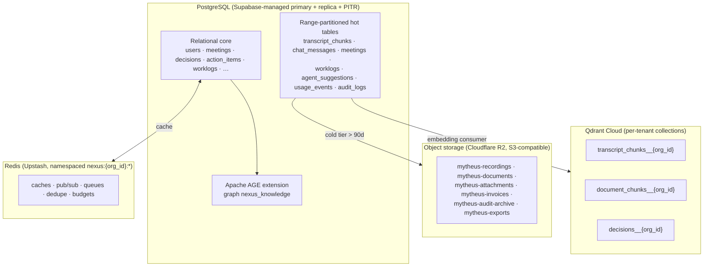
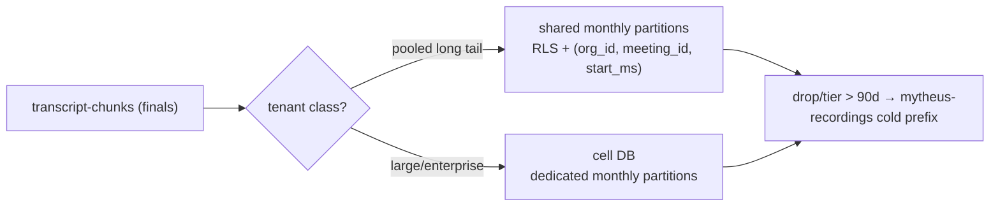
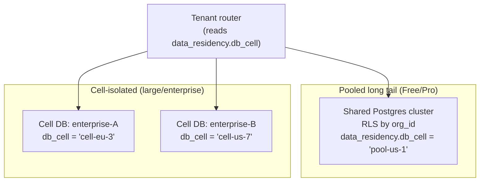
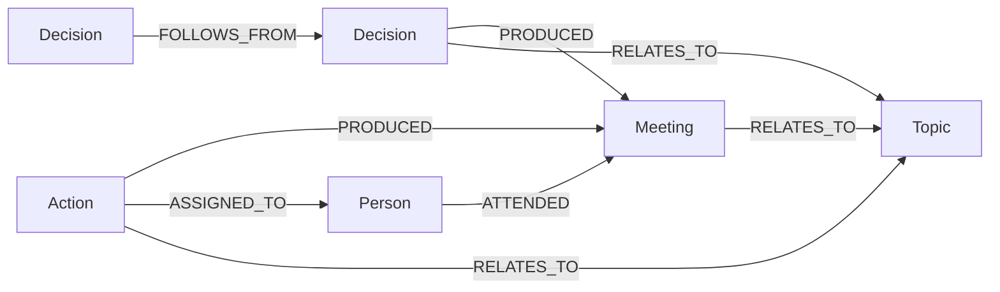
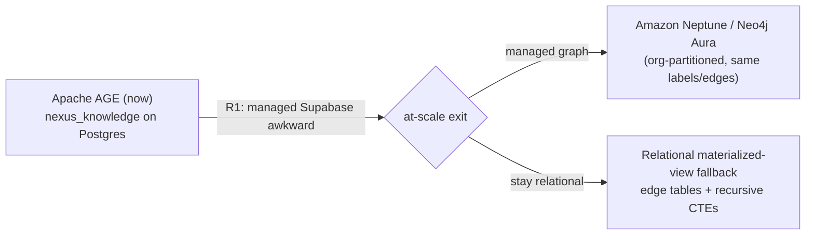
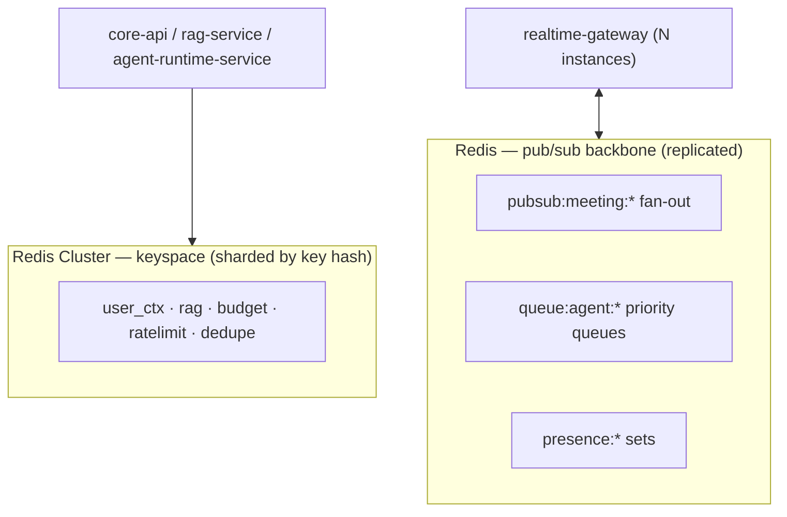
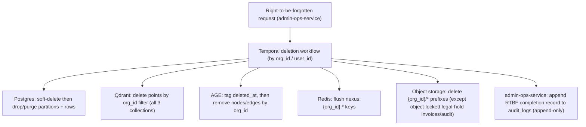

# NEXUS Data Architecture

The frozen, production-grade specification of how every NEXUS entity is physically stored, isolated, partitioned, indexed, replicated, cached, archived, and retired across PostgreSQL, Qdrant, Apache AGE, Redis, and object storage.

## Related documents

- [Service Catalog](_canon/01-service-catalog.md) — canonical service names, data ownership, scaling families.
- [Canonical Data Model](_canon/02-data-model.md) — frozen entity/table/column naming authority.
- [Capacity & Scaling Math](_canon/05-capacity-math.md) — every load and stock number this document imports by symbol.
- [Locked Tech & Architecture Decisions](_canon/06-tech-decisions.md) — store selections and their rationale.
- [Event Architecture](07-event-architecture.md) — Redpanda topics, outbox/inbox, DLQs, idempotency keys.
- [Multi-Tenancy & Isolation](06-multi-tenancy.md) — pooled + RLS for the long tail, cell-based isolation for large tenants, `org_id` injection.
- [Security Architecture](11-security-architecture.md) — RLS policy code, authz, audit.
- [Compliance & Privacy](12-compliance-and-privacy.md) — PII redaction, right-to-be-forgotten, SOC2.
- [SaaS Business Architecture](18-saas-business-architecture.md) — usage metering, plans, retention drivers.

---

## 1. Scope, conventions, and the numbers we import

This document is the storage-layer authority. It does not re-name entities (that is [02 Data Model](_canon/02-data-model.md)), re-derive load (that is [05 Capacity Math](_canon/05-capacity-math.md)), or re-decide stores (that is [06 Tech Decisions](_canon/06-tech-decisions.md)). It specifies the **physical schema, isolation enforcement, partition strategy, indexing, replication, pooling, sharding path, and lifecycle** for each store, citing the canon by symbol.

Conventions carried verbatim from [02 Data Model](_canon/02-data-model.md):

| Convention | Rule |
| --- | --- |
| Table / column names | `snake_case`, plural tables, names frozen in the data model. |
| Tenant key | `org_id UUID` referencing `organizations(id)` on every tenant-scoped row. |
| Primary keys | `id UUID DEFAULT gen_random_uuid()` unless a composite PK is called out. |
| Timestamps | `created_at`, `updated_at` `timestamptz` (UTC); soft delete via `deleted_at timestamptz NULL`. |
| Owning service | The single microservice that writes a table; all others read via API or events. |

The capacity anchors this document is sized against (imported, never re-derived):

| Symbol | Quantity | Value |
| --- | --- | --- |
| A5 | Peak concurrent meetings | 20,000 |
| A6 | Peak concurrent participants | 100,000 |
| A16 | Embedding model / dim | BGE-small-en / 384-dim (1,536 B/vector raw) |
| A18 | Qdrant hot retention | 13 months |
| R4 | Meetings / month | 4,800,000 |
| T3 | `transcript_chunks` / month | 1,728,000,000 |
| T4 | `transcript_chunks` / year | 21,024,000,000 |
| V6 | Qdrant vectors / month (flow) | 340,000,000 |
| V7 | Qdrant live stock (13-mo) | 4,420,000,000 |
| V9 | Indexed storage (HNSW + payload, ~2.5×) | ~17 TB |
| E12 | Redpanda events / sec (peak) | ~17,900 |

> [SaaS-scale adjustment] The PDF treated NEXUS as a single-app, single-tenant data model with one indexed `transcript_chunks` table, one Qdrant collection, one `nexus_knowledge` graph, and unscoped Redis keys. This document re-bases every store on the [05 Capacity Math](_canon/05-capacity-math.md) anchors — 1.728B transcript rows/month, 4.42B live vectors, ~17.9k events/sec peak — which the seeder (`2 orgs x 10 users x 5 meetings`) never exercised. The seeder remains the dev/test fixture only.

---

## 2. Full entity ERD (PDF + SaaS)

Every entity from the canon, PDF-original and SaaS-added, with its physical store annotated. PDF-original tables keep their exact names; SaaS additions are marked in the callout that follows.

```mermaid
erDiagram
  organizations ||--o{ users : "employs"
  organizations ||--o{ departments : "owns"
  departments ||--o{ departments : "parent of"
  departments ||--o{ teams : "contains"
  teams ||--o{ team_members : "has"
  users ||--o{ team_members : "belongs to"
  organizations ||--o{ meetings : "hosts"
  meetings ||--o{ meeting_participants : "includes"
  users ||--o{ meeting_participants : "attends"
  meetings ||--o{ transcript_chunks : "produces"
  meetings ||--o{ meeting_speakers : "diarizes"
  users ||--o{ meeting_speakers : "mapped to"
  meetings ||--o{ chat_messages : "carries"
  meetings ||--o{ worklogs : "yields"
  users ||--o{ worklogs : "owns"
  meetings ||--o{ decisions : "produces"
  meetings ||--o{ action_items : "produces"
  users ||--o{ action_items : "assigned"
  users ||--o{ agent_suggestions : "receives"
  meetings ||--o{ agent_suggestions : "context for"
  organizations ||--o{ document_chunks : "stores"
  organizations ||--o{ agent_collaborations : "logs"

  organizations ||--|| subscriptions : "has active"
  plans ||--o{ subscriptions : "priced by"
  organizations ||--o{ usage_events : "emits"
  organizations ||--o{ invoices : "billed via"
  subscriptions ||--o{ invoices : "generates"
  organizations ||--o{ agent_budgets : "scoped per month"
  organizations ||--|| tenant_settings : "configures"
  organizations ||--|| data_residency : "pinned to region"
  organizations ||--o{ integration_connections : "installs"
  integration_connections ||--o{ oauth_tokens : "secured by"
  organizations ||--o{ audit_logs : "records"
  users ||--o{ audit_logs : "acts in"

  organizations {
    uuid id PK
    text slug
    uuid plan_id FK
    timestamptz deleted_at
  }
  users {
    uuid id PK
    uuid org_id FK
    text clerk_user_id
    text role
    text_array skills
  }
  meetings {
    uuid id PK
    uuid org_id FK
    text title
    text livekit_room
    text status
    timestamptz scheduled_start
  }
  transcript_chunks {
    uuid id PK
    uuid org_id FK
    uuid meeting_id FK
    text speaker_id
    int start_ms
    int end_ms
    bool is_final
    float confidence
  }
  worklogs {
    uuid id PK
    uuid org_id FK
    uuid meeting_id FK
    uuid user_id FK
    float relevance_score
    bool created_by_agent
    uuid_array source_chunk_ids
  }
  decisions {
    uuid id PK
    uuid org_id FK
    uuid meeting_id FK
    float confidence
    text status
    uuid confirmed_by
  }
  action_items {
    uuid id PK
    uuid org_id FK
    uuid meeting_id FK
    uuid assignee_id FK
    date due_date
    text status
  }
  agent_suggestions {
    uuid id PK
    uuid org_id FK
    uuid user_id FK
    uuid meeting_id FK
    int priority
    text status
  }
  document_chunks {
    uuid id PK
    uuid org_id FK
    uuid document_id
    text element_id
    text element_type
    int position
  }
  usage_events {
    uuid id PK
    uuid org_id FK
    text event_type
    numeric quantity
    text idempotency_key
    timestamptz occurred_at
  }
  agent_budgets {
    uuid id PK
    uuid org_id FK
    text period
    bigint token_quota
    bigint tokens_consumed
    text state
  }
  audit_logs {
    uuid id PK
    uuid org_id FK
    uuid actor_id
    text action
    timestamptz occurred_at
  }
  data_residency {
    uuid org_id PK
    text region
    text db_cell
    timestamptz locked_at
  }
```



> [SaaS-scale adjustment] The following entities are wholly new vs the PDF and appear in the ERD above: `plans`, `subscriptions`, `usage_events`, `invoices`, `audit_logs`, `integration_connections`, `oauth_tokens`, `tenant_settings`, `data_residency`, `agent_budgets`. They make NEXUS a multi-tenant commercial SaaS (billing, metering, compliance, integration tokens, per-tenant budgets). All PDF-original tables (`organizations`, `users`, `teams`, `team_members`, `departments`, `meetings`, `meeting_participants`, `transcript_chunks`, `meeting_speakers`, `worklogs`, `decisions`, `action_items`, `agent_suggestions`, `agent_collaborations`, `chat_messages`, `document_chunks`) keep their names verbatim; the only physical change is the addition of the `org_id` tenant column to every tenant-scoped table.

### 2.1 Store placement at a glance



---

## 3. PostgreSQL: multi-tenant relational core

PostgreSQL via Supabase is the system of record. SQLAlchemy 2.0 async + asyncpg + Pydantic v2; schema evolution via Alembic. The relational store carries the PDF core (`users`, `meetings`, `transcript_chunks`, `decisions`, `action_items`, `worklogs`, …) plus the SaaS-added billing/compliance/integration tables, and hosts the Apache AGE extension for `nexus_knowledge` (§5).

### 3.1 Row-Level Security: the isolation backstop

Every tenant-scoped table carries `org_id UUID NOT NULL` and a force-enabled RLS policy. The authz middleware injects `org_id` from the Clerk-verified JWT and sets it on the connection per request; the RLS policy is the defense-in-depth backstop if an application query forgets the predicate.

```sql
-- Per-request, set by the authz middleware before any query runs.
SET LOCAL app.current_org = '00000000-0000-0000-0000-000000000000';

-- Applied to every tenant-scoped table (transcript_chunks shown).
ALTER TABLE transcript_chunks ENABLE ROW LEVEL SECURITY;
ALTER TABLE transcript_chunks FORCE ROW LEVEL SECURITY;   -- applies to table owner too

CREATE POLICY tenant_isolation ON transcript_chunks
  USING      (org_id = current_setting('app.current_org')::uuid)
  WITH CHECK (org_id = current_setting('app.current_org')::uuid);
```

`SET LOCAL` scopes the org to the transaction, so a pooled connection cannot leak a previous request's tenant. `WITH CHECK` blocks cross-tenant INSERT/UPDATE; `FORCE ROW LEVEL SECURITY` ensures even the table-owning role is filtered.

> [SaaS-scale adjustment] The PDF had no tenant column and no RLS. RLS keyed on `org_id` is the locked DB-isolation mechanism for the pooled long tail; large/enterprise tenants additionally get cell-based isolation (§3.7). See [Multi-Tenancy](06-multi-tenancy.md) for the cell-routing layer and [Security Architecture](11-security-architecture.md) for the full policy set and audit.

```mermaid
sequenceDiagram
  participant MW as Authz middleware
  participant PB as PgBouncer (transaction pooling)
  participant PG as Postgres (RLS)
  MW->>PB: BEGIN; SET LOCAL app.current_org = :org_id
  PB->>PG: bind pooled backend to this transaction
  MW->>PG: SELECT ... FROM transcript_chunks WHERE meeting_id = :m
  PG->>PG: RLS appends org_id = current_setting('app.current_org')
  PG-->>MW: tenant-scoped rows only
  MW->>PB: COMMIT (SET LOCAL reset; backend returned to pool clean)
```

### 3.2 Declarative range partitioning of high-volume tables

Seven tables dominate write volume and must be PostgreSQL declarative range partitions so retention and right-to-be-forgotten purges **drop partitions** instead of scanning billions of rows. At T3 = 1.728B `transcript_chunks` rows/month, a non-partitioned table is unmanageable.

| Table | Partition key | Period | Driver | Volume |
| --- | --- | --- | --- | --- |
| `transcript_chunks` | `created_at` | monthly | T3 = 1.728B/mo, T4 = 21.024B/yr | highest |
| `chat_messages` | `created_at` | monthly | per-meeting chat | high |
| `meetings` | `scheduled_start` | monthly | dashboard listing + lifecycle | medium |
| `worklogs` | `created_at` | monthly | per-meeting per-user notes (roster 6 × 4.8M mtgs/mo) | high |
| `agent_suggestions` | `created_at` | monthly | QuestionAgent output per meeting | medium-high |
| `usage_events` | `occurred_at` | **daily** | append-only metering feed, aggregated nightly | very high |
| `audit_logs` | `occurred_at` | monthly | tamper-evident, append-only | medium |

`usage_events` partitions by **day** (not month) because it is aggregated nightly and raw rows retained only 90d before summarization — a daily grain lets the nightly job and the 90-day purge each operate on a single small partition. `meetings` partitions by **`scheduled_start`** (not `created_at`) per the canon partition key, because the dashboard listing, lifecycle queries, and retention are all keyed on when a meeting occurs, not when its row was inserted.

```sql
-- transcript_chunks: monthly range partition on created_at, composite PK includes the key.
CREATE TABLE transcript_chunks (
  id           uuid        NOT NULL DEFAULT gen_random_uuid(),
  org_id       uuid        NOT NULL,
  meeting_id   uuid        NOT NULL,
  speaker_id   text        NOT NULL,
  start_ms     integer     NOT NULL,
  end_ms       integer     NOT NULL,
  text         text        NOT NULL,
  is_final     boolean     NOT NULL DEFAULT true,   -- only finals persisted
  confidence   real        NOT NULL,
  created_at   timestamptz NOT NULL DEFAULT now(),
  deleted_at   timestamptz,
  PRIMARY KEY (id, created_at)                       -- partition key must be in PK
) PARTITION BY RANGE (created_at);

CREATE TABLE transcript_chunks_2026_05
  PARTITION OF transcript_chunks
  FOR VALUES FROM ('2026-05-01') TO ('2026-06-01');

-- The PDF-mandated index, created per partition (local index).
CREATE INDEX ON transcript_chunks_2026_05 (meeting_id, start_ms);
```

Partition management is automated with `pg_partman` (premake 3 months ahead, retention drop after the per-tenant window). A nightly `workflow-service` Temporal job calls `pg_partman.run_maintenance()` and tiers cold partitions to object storage (§7, §8).

> [SaaS-scale adjustment] The PDF specified a single indexed `transcript_chunks` table with an index on `(meeting_id, start_ms)`. That holds for the seeder, not for 21B rows/year. We add monthly declarative range partitioning on `created_at`, recreate the PDF index as a per-partition **local** index, and tier partitions older than 90 days to cold/object storage. This is the storage realization of capacity §4 (T3/T4). The same monthly range-partition treatment is applied to the other high-volume tables the canon mandates as range partitions — `chat_messages` and `meetings` (keyed on `scheduled_start` per [Data Model](_canon/02-data-model.md)) — plus the SaaS-added `worklogs`, `agent_suggestions`, `usage_events`, and `audit_logs`.

### 3.3 Tenant-aware partitioning: composite locality

Time alone is the partition key; **tenant locality within a partition** comes from indexing and (for cells) physical placement, not a second partition dimension. Sub-partitioning by `org_id` hash inside each month would explode partition count (12 months × hundreds of hash buckets) and break `pg_partman` retention drops. Instead:

- Pooled long-tail tenants share monthly partitions; the `(org_id, meeting_id, start_ms)` index gives per-tenant locality, and RLS guarantees isolation.
- Large/enterprise tenants are physically separated by **cell** (§3.7), so their high-volume tables live in a dedicated database, not a shared partition.



### 3.4 Index strategy

Indexes are sized to the read patterns in the [Service Catalog](_canon/01-service-catalog.md) sync APIs. All composite indexes lead with the access predicate; `org_id` is added where it improves selectivity (RLS already filters, but a leading `org_id` helps cross-meeting scans).

| Table | Index | Serves |
| --- | --- | --- |
| `transcript_chunks` | `(meeting_id, start_ms)` (PDF, local per partition) | transcript view ordered playback, timestamp jump |
| `transcript_chunks` | `(org_id, meeting_id)` | per-meeting tenant scans |
| `transcript_chunks` | GIN `to_tsvector('english', text)` | in-page FTS (search-service arm of hybrid retrieval) |
| `meetings` | `(org_id, scheduled_start DESC)` | dashboard listing |
| `meeting_participants` | PK `(meeting_id, user_id)` + `(org_id, user_id)` | `get_user_context` recent meetings |
| `decisions` | `(org_id, meeting_id)`, `(org_id, status)` | decision history, conflict scans |
| `action_items` | `(org_id, assignee_id, status)`, `(org_id, due_date)` | My Tasks, workload sums, follow-up workflow |
| `agent_suggestions` | `(org_id, user_id, status)` | Save-for-later queue into next meeting |
| `worklogs` | `(org_id, user_id, meeting_id)` | My Notes panel |
| `usage_events` | `(org_id, occurred_at)`, UNIQUE `(org_id, idempotency_key)` | metering aggregation + dedupe |
| `audit_logs` | `(org_id, occurred_at)`, `(org_id, target_type, target_id)` | SOC2 audit queries |
| `chat_messages` | `(org_id, meeting_id, created_at)`, GIN FTS on `content` | chat replay + search |

The UNIQUE constraint on `usage_events (org_id, idempotency_key)` is the at-least-once dedupe backstop for the metering stream; see [Event Architecture](07-event-architecture.md).

### 3.5 Connection pooling: PgBouncer in transaction mode

At the CRUD tier's req/s, raw Postgres connections are the scarce resource. PgBouncer fronts every service in **transaction pooling** mode.

| Setting | Value | Reason |
| --- | --- | --- |
| `pool_mode` | `transaction` | Connection returned to pool at COMMIT; maximizes reuse. |
| `default_pool_size` | 25 per (db, user) | Bounded backends per service identity. |
| `max_client_conn` | 10,000 | Absorbs the fan-in from horizontally scaled API pods. |
| `server_reset_query` | `DISCARD ALL` | Clears `SET LOCAL` / prepared statements between leases. |
| `statement_timeout` | 30s (CRUD), 2s (token-mint path) | Bounds tail latency to the SLOs. |

Transaction pooling forbids session-scoped state, which is exactly why RLS uses `SET LOCAL app.current_org` inside the transaction (§3.1) rather than a session `SET` — the org binding lives and dies with the transaction and cannot bleed across leases.

> [SaaS-scale adjustment] Wholly added: the PDF had no pooling layer. PgBouncer transaction pooling is required because the modular monolith fans out into many CRUD pods (`core-api`, `bff`, `identity-tenant-service`, `billing-metering-service`) all hitting one primary; without it, Postgres `max_connections` is exhausted long before CPU.

### 3.6 Read replicas and read/write routing

| Replica | Purpose | Lag tolerance |
| --- | --- | --- |
| Primary | All writes; read-after-write paths (token mint, confirm decision) | 0 |
| Read replica (async streaming) | Dashboard reads, transcript view, search, RAG FTS arm, analytics | < 5s |
| PITR / backup target | Continuous WAL archiving, point-in-time recovery | n/a |

Routing rule: writes and read-your-write paths go to the primary; everything in the `bff`/`search-service`/`rag-service` FTS read path goes to the replica. `data_residency.db_cell` pins which primary/replica pair a tenant resolves to.

> [SaaS-scale adjustment] The PDF specified "production Postgres backups/PITR/read replica" as a Phase 13 hardening item. Here it is a day-one data-architecture property with explicit read/write routing, because the read-heavy dashboard and FTS load must not contend with the write-heavy transcript ingest path on the primary.

### 3.7 Cell-based isolation and the sharding path

Two isolation tiers, selected by tenant class and pinned in `data_residency`:



The single-primary pooled cluster has a finite write ceiling. The locked exit, in escalation order:

1. **Vertical + read replicas first** — cheapest, no app change. Covers the long tail.
2. **More cells** — peel the largest tenants into dedicated cell databases via the RTBF-grade migration workflow (lock `data_residency`, dual-write, cut over). Linear blast-radius reduction with zero re-cut of schema.
3. **Horizontal sharding by `org_id`** when even the pooled cluster's aggregate write rate is the wall. Candidates, in preference order:

| Option | Shard key | Fit | Trade-off |
| --- | --- | --- | --- |
| **Citus** (distributed Postgres) | `org_id` distribution column | Best fit: keeps Postgres, RLS, AGE-adjacent, SQLAlchemy unchanged; `org_id` is already on every row | AGE extension is not distributed — graph stays on a coordinator/reference node (see §5 migration path) |
| **Amazon Aurora (limitless / multi-writer)** | `org_id` | Managed, PITR built in, regional | Vendor lock-in; AGE not supported on Aurora |
| **CockroachDB** | `org_id` prefix | Geo-partitioning aligns to `data_residency.region` | Postgres-compatible but not 100%; AGE unavailable; re-test SQLAlchemy edge cases |

Citus is the primary path because every tenant-scoped table already carries `org_id` as the natural distribution column and co-locates a tenant's `meetings`, `transcript_chunks`, `decisions`, and `action_items` on one shard — joins stay local. The graph (`nexus_knowledge`) does not distribute under Citus and follows its own migration path (§5).

> [SaaS-scale adjustment] Cell-based isolation and the Citus/Aurora/Cockroach sharding path are wholly added vs the PDF, which was a single managed Postgres. `org_id` was introduced precisely so it can double as the shard/distribution key, making the pooled → cell → sharded escalation mechanical rather than a schema rewrite.

---

## 4. Qdrant: per-tenant vector collections

Vector store is **Qdrant Cloud**, 384-dim **BGE-small-en** (A16), cosine distance, embedded on ingest by the dedicated inference tier (`embedding-service`), query-embed only at read time. Three logical collections mirror their relational counterparts.

### 4.1 Collections, tenancy, and payload (citation contract)

| Logical collection | Physical (pooled) | Payload (citation-bearing) | Source |
| --- | --- | --- | --- |
| `transcript_chunks` | `transcript_chunks__{org_id}` | `org_id`, `meeting_id`, `chunk_id`, `speaker`, `start_ms`, `is_final` | `transcript-chunks` topic → embedding consumer |
| `document_chunks` | `document_chunks__{org_id}` | `org_id`, `document_id`, `element_id`, `element_type`, `meeting_id?` | `document-chunks` topic → embedding consumer |
| `decisions` | `decisions__{org_id}` | `org_id`, `decision_id`, `meeting_id`, `status`, `confidence` | `decisions` topic on confirmation |

The logical names are exactly `transcript_chunks`, `document_chunks`, `decisions`; the physical per-tenant collection appends `__{org_id}`. The transport adapter and `rag-service` resolve logical → physical from `data_residency.qdrant_region` + `org_id`. The payload shape is **frozen** and matches the Postgres rows so every retrieved passage carries clickable provenance (`meeting_id` + `chunk_id` + `speaker` for transcripts, `document_id` + `element_id` for documents).

> [SaaS-scale adjustment] The PDF described one shared Qdrant store. At SaaS scale we use **per-tenant collections** (collection-per-tenant for the pooled long tail; dedicated Qdrant clusters for cell-isolated enterprise tenants) AND a mandatory `org_id` payload filter on every query — defense in depth. No cross-tenant vector leakage is possible at query time even if a collection name is mis-resolved.

### 4.2 Sizing from canon capacity math

Imported directly from [05 Capacity Math](_canon/05-capacity-math.md) §5:

| Symbol | Quantity | Value |
| --- | --- | --- |
| V5 | Vectors / meeting | 70.8 |
| V6 | Vectors ingested / month (flow) | 340,000,000 |
| V7 | Qdrant live **stock** (V6 × A18=13mo) | 4,420,000,000 |
| V8 | Raw vector storage (V7 × 1,536 B) | ~6.8 TB raw |
| V9 | Indexed storage (HNSW + payload, ~2.5×) | ~17 TB |

**Vectors are a stock, not a flow.** The 13-month hot retention window (A18) bounds the live set at 4.42B; older points are purged in lockstep with the Postgres cold tier and object archive (§8).

### 4.3 Quantization, HNSW, and resident-RAM control

At 4.42B vectors, raw float32 (V8 ~6.8 TB) is too expensive to keep RAM-resident. The locked configuration:

```jsonc
// Per-tenant collection config (pooled tenant).
{
  "vectors": { "size": 384, "distance": "Cosine" },
  "quantization_config": {
    "scalar": { "type": "int8", "always_ram": true }   // ~4x RAM cut vs float32
  },
  "hnsw_config": { "m": 16, "ef_construct": 128, "on_disk": false },
  "optimizers_config": { "memmap_threshold": 50000 },  // large collections mmap original vectors
  "on_disk_payload": true
}
```

- **int8 scalar quantization** keeps the quantized vectors RAM-resident (`always_ram`) for fast ANN, cutting resident RAM ~4×; original float32 vectors live on disk (memmap) and are used only for rescoring.
- **Hot/cold split aligned to A18**: the most recent ~90 days stay in fully-optimized collections; older-but-in-window points move to memmap-heavy cold collections; beyond 13 months they are deleted with the Postgres/object purge.

> [SaaS-scale adjustment] The PDF specified one Qdrant Cloud collection with raw 384-dim vectors. At 4.42B vectors / ~17 TB indexed, production uses **per-tenant collections + int8 scalar quantization + hot/cold split**, sized verbatim from V7/V8/V9. Embedding is **embed-on-ingest, query-embed only** on the dedicated `embedding-service` (GPU / Ray Serve / vLLM), off the API tier — see [RAG & Inference Serving](09-rag-and-inference-serving.md) for the inference detail, locked per [Tech Decisions](_canon/06-tech-decisions.md) §2.5.

```mermaid
flowchart LR
  TC["transcript-chunks topic"] --> EC["embedding-service<br/>(consume → split → embed batch 32, sub-100ms)"]
  DC["document-chunks topic"] --> EC
  EC -->|upsert| QH["Qdrant hot<br/>transcript_chunks__{org_id}<br/>document_chunks__{org_id}<br/>(int8 in RAM)"]
  QH -->|age out > 90d, < 13mo| QC["Qdrant cold<br/>(memmap)"]
  QC -->|> 13mo (A18)| PURGE["delete points by org_id filter"]
  DECT["decisions topic (on confirm)"] --> EC
  EC --> QD["decisions__{org_id}"]
  QH --> RAG["rag-service: hybrid retrieve (RRF)"]
  QD --> PROACT["ProactiveAgent: conflict detection"]
```

---

## 5. Apache AGE: the `nexus_knowledge` graph

Graph store is **Apache AGE** (Cypher over PostgreSQL), graph named **`nexus_knowledge`** verbatim, owned by `knowledge-graph-service`. Edges are created **on confirmation only**, never speculatively — matching the PDF agent confirmation rule (no silent commits).

### 5.1 Nodes and edges (verbatim)

| Node label | Backed by | Key properties |
| --- | --- | --- |
| `Person` | `users` | `user_id`, `org_id`, `role` |
| `Meeting` | `meetings` | `meeting_id`, `org_id`, `title` |
| `Decision` | `decisions` | `decision_id`, `org_id`, `status`, `confidence` |
| `Action` | `action_items` | `action_id`, `org_id`, `status` |
| `Topic` | role→topics taxonomy | `name`, `org_id` |

| Edge label | From → To | Created when |
| --- | --- | --- |
| `ATTENDED` | `Person` → `Meeting` | Participant joins a meeting |
| `PRODUCED` | `Decision` → `Meeting` (also `Action` → `Meeting`) | Decision/Action confirmed |
| `ASSIGNED_TO` | `Action` → `Person` | Action confirmed with assignee |
| `RELATES_TO` | `Decision`/`Action`/`Meeting` → `Topic` | Topic extraction links entity to taxonomy |
| `FOLLOWS_FROM` | `Decision` → `Decision` | Decision lineage / supersession |



### 5.2 Org partitioning and indexing

Every node carries an `org_id` property and every pre-built Cypher template is parameterized by `$org_id` so traversals never cross tenant boundaries. AGE stores nodes/edges in per-label Postgres tables under the `nexus_knowledge` schema; we index the `org_id` property on every label's vertex/edge table so the partition predicate is index-backed.

```sql
-- AGE materializes each label as a Postgres table; index the org_id agtype property.
CREATE INDEX person_org_idx
  ON nexus_knowledge."Person" USING btree (agtype_access_operator(properties, '"org_id"'));
CREATE INDEX meeting_org_idx
  ON nexus_knowledge."Meeting" USING btree (agtype_access_operator(properties, '"org_id"'));
-- Repeated for Decision, Action, Topic and the edge tables.
```

Pre-built templates remain named functions, each `$org_id`-scoped: related decisions for a topic, decisions by a person, actions blocked on a decision, decision lineage. Soft delete is supported (nodes/edges tagged `deleted_at`, filtered out of templates).

```cypher
-- Decision lineage template, org-scoped (illustrative).
MATCH (d:Decision {org_id: $org_id})-[:FOLLOWS_FROM*1..10]->(prior:Decision {org_id: $org_id})
WHERE d.decision_id = $decision_id AND prior.deleted_at IS NULL
RETURN prior
```

### 5.3 Query budget

`knowledge-graph-service` scales on Cypher query req/s with read replicas. Per the SLOs, graph queries backing live agent features (ProactiveAgent conflict detection, ContextGapAgent fallback) must fit inside the agent latency budget (end-to-end p50 < 2s). Templates are bounded-depth (`FOLLOWS_FROM*1..10`, single-org subgraph) so traversal cost is governed by one tenant's confirmed-decision count, not the global graph.

### 5.4 Migration path (R1) and relational fallback



The graph schema (5 node labels, 5 edge labels) is store-agnostic by design. The two exits, both honoring **R1**:

- **Amazon Neptune / Neo4j Aura** — lift the same labels/edges into a dedicated managed graph, keep `$org_id`-scoped templates. Chosen when Cypher query req/s outgrows a Postgres-coupled graph or when Citus sharding (§3.7) makes AGE-on-coordinator the bottleneck.
- **Relational materialized-view fallback** — model edges as plain Postgres edge tables and answer the four templates with recursive CTEs. Lowest-novelty exit; sacrifices arbitrary Cypher for predictable SQL when graph traffic is light.

> [SaaS-scale adjustment] The PDF described one global `nexus_knowledge` graph and flagged R1 (AGE awkward on managed Supabase, fallback self-host or Neo4j Aura). We add org-partitioning (`$org_id` on every node and template), per-label `org_id` indexes, and an explicit at-scale exit to Neptune/Neo4j Aura plus a relational materialized-view fallback. Under Citus sharding the graph stays on a coordinator/reference node, which is the trigger for the managed-graph exit.

---

## 6. Redis: cache, pub/sub, queues — namespaced and clustered

Cache/pub-sub is **Redis (Upstash)**. Every key is tenant-namespaced `nexus:{org_id}:…` so eviction, isolation, and per-tenant flush (on RTBF / plan change) are clean.

| Namespace pattern | Purpose | TTL |
| --- | --- | --- |
| `nexus:{org_id}:user_ctx:{user_id}` | `get_user_context()` result (role/skills/team/recent meetings/topics) | 5 min (PDF) |
| `nexus:{org_id}:rag:{user_id}:{query_hash}` | RAG result cache (passages + citations) | 10 min (PDF) |
| `nexus:{org_id}:presence:{meeting_id}` | Socket.io presence set | meeting-lifetime |
| `nexus:{org_id}:pubsub:meeting:{meeting_id}` | Pub/sub fan-out channel for Socket.io across `realtime-gateway` instances | n/a (channel) |
| `nexus:{org_id}:queue:agent:{user_id}` | Per-user priority queue (urgent alerts pre-empt notes) | session |
| `nexus:{org_id}:dedupe:{topic}:{idempotency_key}` | At-least-once consumer dedupe (inbox cache) | 24h |
| `nexus:{org_id}:budget:{period}` | Hot mirror of `agent_budgets.tokens_consumed` for fast quota checks | period-end |
| `nexus:{org_id}:ratelimit:{user_id}` | Per-user LiteLLM rate-limit counters | sliding window |

### 6.1 Clustering: separate cache and pub/sub responsibilities



- **Keyspace caches** run on a sharded Redis Cluster; the `{org_id}` prefix is part of the hash tag region so a tenant's keys co-locate and per-tenant flush is a single `SCAN`+`UNLINK` over one slot range.
- **Pub/sub + presence + priority queues** run on a replicated backbone because pub/sub does not shard cleanly; `realtime-gateway` instances subscribe to `nexus:{org_id}:pubsub:meeting:{meeting_id}` to fan agent outputs and captions across pods.

> [SaaS-scale adjustment] The PDF used unscoped Redis keys (the `get_user_context` cache, the RAG cache) on a single instance. All keys are now `nexus:{org_id}:…` namespaced, the cache keyspace is Redis-Cluster sharded, and pub/sub runs on a replicated backbone so the Phase-11 Socket.io fan-out scales horizontally across `realtime-gateway` instances. Namespacing also makes RTBF cache invalidation a clean per-tenant flush (§8).

---

## 7. Object storage: cold transcript archive, recordings, and compliance blobs

Object storage is **S3-compatible**, regionally placed per tenant via `data_residency.object_bucket_region`. Six buckets, per-tenant key prefixes, lifecycle-managed.

| Bucket | Contents | Key prefix | Lifecycle / retention |
| --- | --- | --- | --- |
| `mytheus-recordings` | Meeting recordings (LiveKit `recording.ready`) + **cold transcript partitions** | `{org_id}/{meeting_id}/` | Per-tenant `retention_days_transcripts`; cold tier after 30d; purge on RTBF |
| `mytheus-documents` | Source docs ingested via unstructured.io | `{org_id}/{document_id}/` | Tenant retention; kept while `document_chunks` exist |
| `mytheus-attachments` | Calendar event attachments routed through ingestion | `{org_id}/{meeting_id}/` | Tenant retention; deleted with parent meeting |
| `mytheus-invoices` | Finalized invoice PDFs (`invoices.pdf_url`) | `{org_id}/{invoice_id}.pdf` | 7-year legal retention; object lock (immutable) |
| `mytheus-audit-archive` | Cold-archived `audit_logs` partitions | `{org_id}/{YYYY-MM}/` | SOC2 retention; write-once object lock |
| `mytheus-exports` | GDPR data-export bundles (right-of-access) | `{org_id}/{export_id}.zip` | Auto-expire 7 days after generation |

**Cold transcript archive.** At T4 = 21B `transcript_chunks` rows/year, hot Postgres holds only the most recent 90 days. When a monthly partition ages past 90 days, the nightly Temporal job exports it to Parquet under `mytheus-recordings/{org_id}/_cold/transcript_chunks/{YYYY-MM}/` (columnar, compressed, queryable by Athena/DuckDB for rare historical access) and then drops the Postgres partition. The transcript view reads hot partitions from Postgres FTS; historical/legal access reads the Parquet cold tier.

> [SaaS-scale adjustment] The PDF stored recordings/attachments implicitly and kept all `transcript_chunks` in one Postgres table. We define explicit region-pinned, lifecycle-managed buckets with per-tenant prefixes, and add a **cold Parquet transcript archive** so the hot Postgres relation stays bounded at ~90 days while T4-scale history remains durable, residency-correct, and purge-able.

---

## 8. Data lifecycle, retention, and hot/cold tiering

Retention is **per-tenant and partition-aligned**: `tenant_settings.retention_days_transcripts` / `retention_days_worklogs` drive Postgres partition drops, Qdrant point deletes, and bucket lifecycle rules. The tiering ladder per store:

| Store | Hot | Warm/cold | Purge trigger |
| --- | --- | --- | --- |
| Postgres `transcript_chunks` | recent 90d partitions (RAM/SSD) | Parquet in `mytheus-recordings/_cold` | beyond `retention_days_transcripts` / RTBF |
| Qdrant | ~90d int8-in-RAM | ≤13mo memmap cold collection | beyond A18 (13mo) / RTBF |
| AGE `nexus_knowledge` | live confirmed graph | soft-deleted (`deleted_at`) tagged | scheduled hard purge / RTBF |
| Redis | TTL'd live keys | — | TTL expiry / per-tenant flush |
| Object storage | standard tier | cold/glacier after 30d | bucket lifecycle / RTBF |

### 8.1 Cross-store right-to-be-forgotten

A single Temporal workflow deletes a tenant (or user) across all six stores in one durable saga, ending with an audit record. Soft delete hides rows immediately; the scheduled purge enforces retention and RTBF hard deletion.



Note the one exception: `mytheus-invoices` (7-year tax retention, object lock) and `mytheus-audit-archive` (SOC2, write-once) are under legal hold and survive RTBF; the workflow records the legal-hold carve-out in the audit log.

> [SaaS-scale adjustment] Wholly added vs the PDF. Per-tenant retention windows, partition-drop-based purges, the A18-aligned Qdrant tiering, and the single cross-store Temporal RTBF saga are all SaaS-scale and compliance requirements (GDPR/CCPA, SOC2). The PDF had soft delete on individual entities but no tenant-wide, multi-store deletion guarantee. See [Compliance & Privacy](12-compliance-and-privacy.md) and [SaaS Business Architecture](18-saas-business-architecture.md).

---

## 9. Cross-cutting data rules (enforced in code, not convention)

1. **`org_id` injection.** Authz middleware injects `org_id` from the Clerk JWT into every query; RLS `USING (org_id = current_setting('app.current_org')::uuid)` is the backstop (§3.1).
2. **At-least-once + idempotency.** Every event-sourced write (`usage_events`, agent outputs, embedding upserts) carries an `idempotency_key`; the `nexus:{org_id}:dedupe:*` inbox cache plus UNIQUE constraints prevent double-apply. Transactional outbox tables shadow each owning service — see [Event Architecture](07-event-architecture.md).
3. **Tenant partitioning at every layer.** Postgres by RLS/cell, Qdrant by collection, AGE by `$org_id`, Redpanda by tenant-keyed partition, Redis by namespace, object storage by key prefix.
4. **Retention is per-tenant and partition-aligned.** `tenant_settings.retention_days_*` drive partition drops and bucket lifecycle; RTBF deletes by `org_id` across all six stores in one Temporal workflow (§8.1).
5. **Soft delete then hard purge.** `deleted_at` hides rows immediately; a scheduled purge enforces retention and RTBF including AGE nodes/edges and Qdrant points.
6. **Confidence thresholds gate persistence.** Agent outputs: `>0.7` surface, `0.4–0.7` silent-log to `worklogs`, `<0.4` drop — overridable per tenant via `tenant_settings.agent_confidence_overrides`.

These rules bind every entity in §2 and are the storage-layer contract every NEXUS service depends on.
