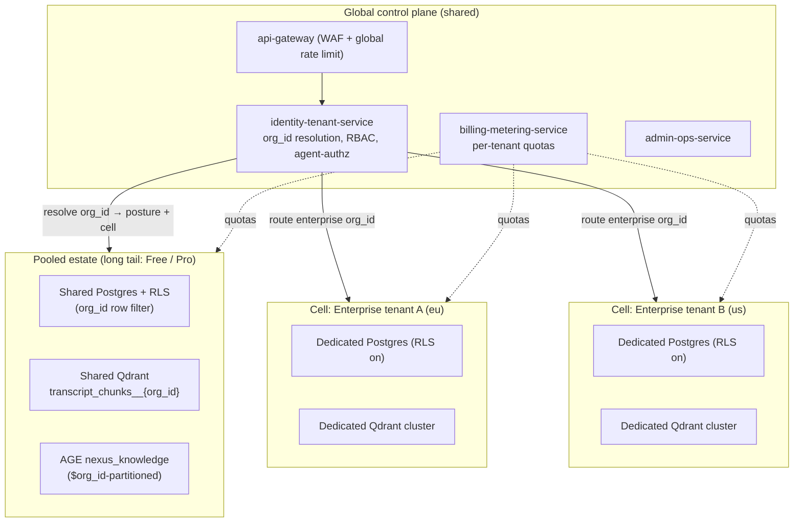
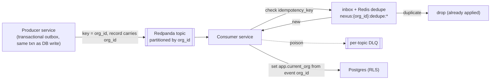
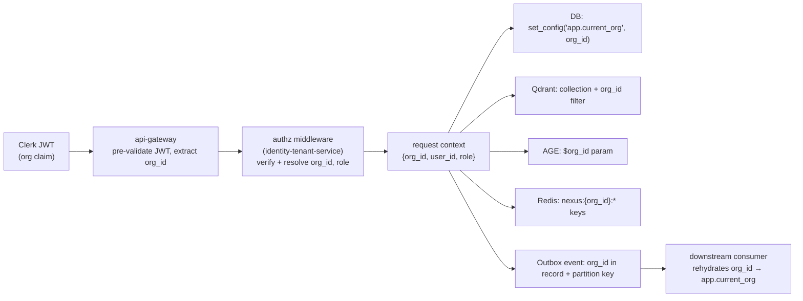
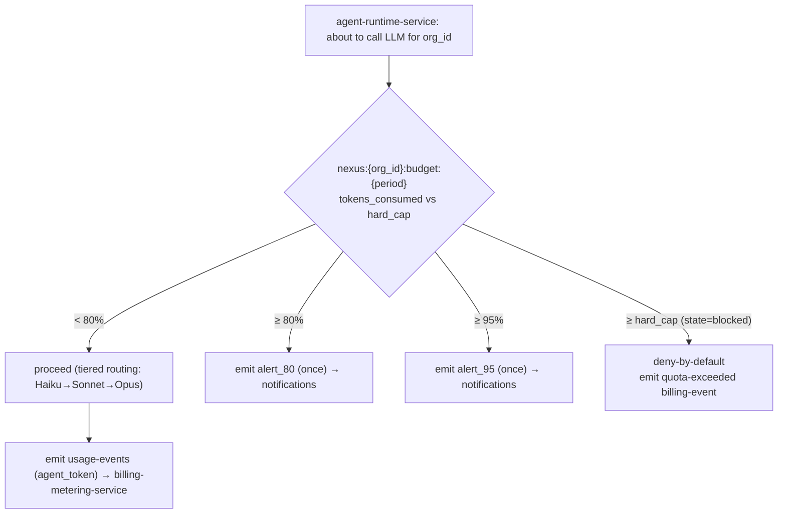
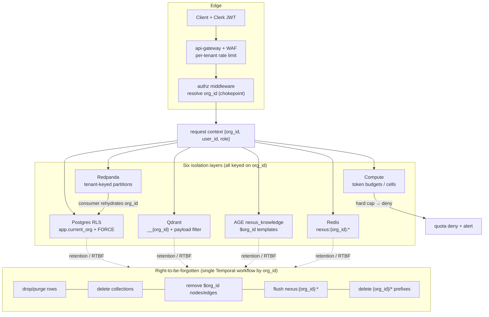

# Multi-Tenancy & Tenant Isolation

How NEXUS isolates thousands of paying tenant organizations across every layer — Postgres RLS, per-tenant Qdrant collections, an org-partitioned AGE graph, tenant-keyed Redpanda partitions, namespaced Redis, and tenant-scoped compute — and how tenant context propagates safely across services, events, and the agent-to-agent path.

## Related documents

- [Service Catalog](_canon/01-service-catalog.md) — canonical service names, ownership, and event contracts.
- [Data Model](_canon/02-data-model.md) — frozen entity/table names, tenant keys, stores, RLS notes.
- [Capacity & Scaling Math](_canon/05-capacity-math.md) — frozen anchors (tenants, users, meetings, vectors, events).
- [Tech & Architecture Decisions](_canon/06-tech-decisions.md) — the locked decision register cited throughout.
- [Data Architecture](05-data-architecture.md) — store selection, partitioning, backups/PITR, regional placement.
- [Security & AuthZ](11-security-architecture.md) — JWT verification, RBAC, agent-to-agent authorization, audit.
- [SaaS Business: Billing, Metering, Tenant Lifecycle](18-saas-business-architecture.md) — provisioning, quotas, plans/tiers.

---

## 1. Scope and the tenancy contract

This document is the authority for **how NEXUS keeps one tenant's data, compute, and cost completely separate from every other tenant's**, at the scale fixed in [Capacity & Scaling Math](_canon/05-capacity-math.md): **A4 = 3,000 paying tenant organizations**, **A1 = 5,000,000 registered users**, **A5 = 20,000 peak concurrent meetings**, **A6 = 100,000 peak concurrent participants**. The decisions here are not negotiable per service; they are the substrate every service inherits.

> [SaaS-scale adjustment] The original PDF (NEXUS Execution Plan v2.1) was a single-deployment app with **no tenancy concept** — its data model carried no tenant column, its seeder was `2 orgs x 10 users x 5 meetings`, and isolation was implicit. Everything in this document — the tenant key, RLS, cells, per-tenant Qdrant collections, the org-partitioned graph, tenant-keyed partitions, namespaced Redis, tenant context propagation, and noisy-neighbor controls — is a SaaS-scale addition. The PDF tech stack and entity names survive verbatim; multi-tenancy wraps them.

The contract has one term that binds every other:

> **The tenant key is `org_id UUID`, references `organizations(id)`, and is present on every tenant-scoped row, vector payload, graph node, event record, cache key, and object-storage prefix.** The tenant root is the `organizations` table; `organizations.id` *is* the `org_id`. There is no second tenant identifier and no alternative name.

Two cross-cutting principles from the [Service Catalog](_canon/01-service-catalog.md) and [Tech Decisions](_canon/06-tech-decisions.md) are restated here because tenancy depends on both:

1. **An authz middleware injects `org_id` on every query** (resolved from the Clerk-verified JWT), and Postgres RLS is the fail-closed backstop. The injection chokepoint is the load-bearing control of the whole model.
2. **At-least-once event delivery with idempotency**, where every topic is **partitioned by tenant** so one tenant's burst cannot starve another's ordering or throughput.

---

## 2. The tenancy model: pooled + RLS for the long tail, cells for enterprise

NEXUS uses a **hybrid tenancy model**, locked in the Tech Decisions register (`Tenancy model`): **pooled multi-tenancy with PostgreSQL Row-Level Security for the long tail, and cell-based isolation for large/enterprise tenants.** Cell-based isolation is the tenancy strategy *within* the event-driven microservices style — not a competing architecture.

The two postures map to plan tiers and align with the per-plan availability SLOs in [Capacity & Scaling Math §11.2](_canon/05-capacity-math.md):

| Posture | Who | DB | Qdrant | Region/availability | Blast radius |
|---|---|---|---|---|---|
| **Pooled + RLS** | Free / Pro tenants (the long tail — the vast majority of the 3,000 orgs) | Shared Postgres clusters, RLS keyed on `org_id` | Per-tenant **collection** in a shared Qdrant cluster (`transcript_chunks__{org_id}`) | Free single-region (99.5%); Pro multi-region active-passive (99.9%) | Logical; a bug bypassing RLS is the only cross-tenant path — hence defense-in-depth |
| **Cell-based** | Enterprise tenants (and any tenant by contract) | Dedicated DB **cell** (own Postgres instance/cluster), still RLS-enabled | Dedicated Qdrant **cluster** | Cell pinned to region; active-active candidate (99.95%) | Physical; a cell failure or noisy-neighbor event is contained to one tenant |

A **cell** is a fully provisioned, regionally-placed slice of the platform — its own Postgres instance, Qdrant cluster, and (for the largest tenants) dedicated Redpanda capacity and inference node pools — sharing only the global control plane and CI/CD pipeline. Cell membership is recorded in `data_residency.db_cell` (see [Data Model §2.2](_canon/02-data-model.md)); the same row pins `region`, `qdrant_region`, and `object_bucket_region` and is **immutable after `locked_at`** without a migration workflow.

> [SaaS-scale adjustment] The PDF had no plans, no tenants, and no region pinning. The pooled/cell split, the `data_residency` table, and the binding of posture to Free/Pro/Enterprise tiers are wholly added. See [SaaS Business §tenant-lifecycle](18-saas-business-architecture.md) for how provisioning chooses a posture and writes `data_residency`.



The key property: **RLS is on even inside a cell.** A cell reduces blast radius and removes the noisy-neighbor problem, but it never replaces the row-level backstop. Defense-in-depth means a missed app-layer check still fails closed at the database.

---

## 3. Isolation at every layer

Tenant isolation is enforced at six layers. Each is independently sufficient to scope a tenant; together they are defense-in-depth. The table summarizes; the subsections specify each.

| Layer | Mechanism | Tenant key form | Backstop |
|---|---|---|---|
| Relational DB | PostgreSQL RLS policies | `org_id` row column | RLS `USING` clause + cell for enterprise |
| Vector store | Per-tenant Qdrant collections | `__{org_id}` collection suffix | Mandatory `org_id` payload filter on every query |
| Knowledge graph | Org-partitioned Apache AGE `nexus_knowledge` | `org_id` node property + `$org_id` Cypher param | Every template parameterized; no unparameterized Cypher in prod |
| Event stream | Tenant-keyed Redpanda partitions | `org_id` as partition key | Consumer re-asserts `org_id` from event header before any write |
| Cache / pub-sub | Namespaced Redis keys | `nexus:{org_id}:…` prefix | Key builder rejects unprefixed keys |
| Compute | Tenant-scoped quotas + cell node pools | `org_id` in request context | Per-tenant token budgets, rate limits, KEDA isolation |

### 3.1 Database: PostgreSQL Row-Level Security

Every tenant-scoped table in [Data Model §2](_canon/02-data-model.md) carries `org_id UUID`. RLS is enabled and **forced** on every such table so even the table owner is subject to policy. The canonical policy form (frozen in [Data Model §7](_canon/02-data-model.md)) is:

```sql
-- Run once per tenant-scoped table, e.g. transcript_chunks, decisions, worklogs, …
ALTER TABLE transcript_chunks ENABLE ROW LEVEL SECURITY;
ALTER TABLE transcript_chunks FORCE ROW LEVEL SECURITY;

CREATE POLICY tenant_isolation ON transcript_chunks
  USING (org_id = current_setting('app.current_org')::uuid)
  WITH CHECK (org_id = current_setting('app.current_org')::uuid);
```

The `USING` clause filters reads/updates/deletes; the `WITH CHECK` clause prevents a tenant from inserting or moving a row into another `org_id`.

> [SaaS-scale adjustment] Two refinements to the literal form above, both frozen in [ADR-0002](adr/0002-multi-tenancy-model.md) D3. First, the implemented predicate wraps the GUC read as `org_id = NULLIF(current_setting('app.current_org', true), '')::uuid`: the bare form **raises** when the GUC is unset, whereas the wrapped form yields NULL, so the predicate is false and the query returns **zero rows**. Fail-closed by returning nothing is stricter than fail-closed by erroring under a pooled connection. Second, the mandate is scoped to tables that actually carry `org_id`. The tenant root `organizations` has no such column (its `id` **is** the `org_id`) and is deliberately unpolicied, alongside the global `plans`. That exemption is what makes the rule exceptionless and enforceable by machine rather than by memory: **every table with an `org_id` column MUST carry a `tenant_isolation` policy**, asserted in CI over `information_schema.columns` and `pg_policies`, together with an assertion that no request-path role holds `rolsuper` or `rolbypassrls`.

The session GUC `app.current_org` is set per request, inside the transaction, from the injected context (see §4):

```sql
-- Set by the data layer at the start of every request transaction
SELECT set_config('app.current_org', :org_id_from_jwt, true);  -- true = transaction-local
```

> [SaaS-scale adjustment] The session-setting name is canonical: **`app.current_org`** (per [Data Model §7](_canon/02-data-model.md)). It is set transaction-locally (`set_config(..., true)`) so a pooled connection (PgBouncer/Supabase pooler) can never leak one tenant's GUC into another tenant's reuse of the connection. This connection-pool hazard does not exist in the single-tenant PDF; it is the single most important RLS operational rule at SaaS scale.

Three RLS rules bind the relational layer:

1. **No service connects as a superuser or RLS-bypassing role in the request path.** The application role has no `BYPASSRLS`. Migrations and the right-to-be-forgotten purge run as a separate elevated role, never reachable from request handlers.
2. **Join tables denormalize `org_id`** (`team_members`, `meeting_participants`) so the policy is a simple column comparison, not a subquery — critical for the high-volume tables. [Data Model §2.1](_canon/02-data-model.md) notes this verbatim.
3. **High-volume tables are range-partitioned by time** (`transcript_chunks`, `chat_messages`, `meetings`, `usage_events`, `audit_logs`). At **T3 = 1.728B `transcript_chunks` rows/month** ([Capacity §4](_canon/05-capacity-math.md)) the RLS predicate runs against monthly partitions, and right-to-be-forgotten drops partitions instead of scanning. Partitioning is orthogonal to RLS — the policy is inherited by every partition.

```mermaid
sequenceDiagram
    participant C as Client
    participant GW as api-gateway + WAF
    participant MW as Authz middleware
    participant SVC as core-api (FastAPI)
    participant DB as Postgres (RLS forced)
    C->>GW: request + Clerk JWT
    GW->>MW: forward (rate-limited, JWT pre-validated)
    MW->>MW: verify JWT → resolve org_id + role
    MW->>SVC: inject org_id into request context
    SVC->>DB: BEGIN; set_config('app.current_org', org_id, true)
    SVC->>DB: SELECT … FROM transcript_chunks WHERE meeting_id = :m
    DB->>DB: RLS USING (org_id = app.current_org) filters
    DB-->>SVC: tenant-scoped rows only
    SVC-->>C: response
```

### 3.2 Vector store: per-tenant Qdrant collections

Qdrant Cloud holds **384-dim BGE-small-en** vectors. The logical collection names are exactly `transcript_chunks`, `document_chunks`, and `decisions`; the **physical** per-tenant collection appends `__{org_id}` ([Data Model §3](_canon/02-data-model.md)):

| Logical | Physical (pooled tenant) | Physical (cell tenant) |
|---|---|---|
| `transcript_chunks` | `transcript_chunks__{org_id}` (shared cluster) | same name, dedicated cluster |
| `document_chunks` | `document_chunks__{org_id}` | same name, dedicated cluster |
| `decisions` | `decisions__{org_id}` | same name, dedicated cluster |

Isolation is **defense-in-depth at the collection boundary AND a mandatory `org_id` payload filter on every query** — even though the collection already physically separates tenants, every search still passes a `must` filter on `org_id`. The `rag-service` and the transport adapter resolve logical → physical names from `data_residency.qdrant_region` + `org_id` before any call.

```python
# Every Qdrant query is org-scoped twice: by collection AND by payload filter.
collection = f"transcript_chunks__{org_id}"          # physical isolation
search = client.search(
    collection_name=collection,
    query_vector=query_vec,                           # query-embed only (inference tier)
    query_filter=Filter(must=[                        # defense-in-depth
        FieldCondition(key="org_id", match=MatchValue(value=str(org_id))),
        FieldCondition(key="is_final", match=MatchValue(value=True)),
    ]),
    limit=50,                                          # top-50 → reranker top-10
)
```

> [SaaS-scale adjustment] The PDF described one shared Qdrant store. At **V7 = 4.42B live vectors / ~17 TB** ([Capacity §5](_canon/05-capacity-math.md)) NEXUS uses per-tenant collections with **scalar int8 quantization** (cuts resident RAM ~4x) and a hot/cold split aligned to the **A18 = 13-month** retention window. A tenant's entire vector footprint is dropped by deleting its `__{org_id}` collections — the RTBF fast path.

### 3.3 Knowledge graph: org-partitioned Apache AGE

The graph store is **Apache AGE** (Cypher over Postgres), graph named **`nexus_knowledge`** (verbatim), owned by `knowledge-graph-service`. Node labels are **Person, Meeting, Decision, Action, Topic**; edge labels are **ATTENDED, PRODUCED, ASSIGNED_TO, RELATES_TO, FOLLOWS_FROM** ([Data Model §4](_canon/02-data-model.md)). Edges are created **only on confirmation**, never speculatively — matching the PDF agent confirmation rule.

> [SaaS-scale adjustment] The PDF described one global `nexus_knowledge` graph. At SaaS scale the graph is **org-partitioned**: every node carries an `org_id` property and every pre-built Cypher template is parameterized with **`$org_id`** so a traversal can never cross a tenant boundary. There is one logical graph; the partition key is on every node.

Every named template carries `$org_id` on every matched node, so no path can leave the tenant's subgraph:

```cypher
-- Template: "decisions by a person" — decisions produced in meetings the
-- person attended; org-scoped on EVERY matched node.
SELECT * FROM cypher('nexus_knowledge', $$
  MATCH (p:Person {user_id: $user_id, org_id: $org_id})
        -[:ATTENDED]->(m:Meeting {org_id: $org_id})
        <-[:PRODUCED]-(d:Decision {org_id: $org_id})
  WHERE d.deleted_at IS NULL
  RETURN d.decision_id, d.status, m.meeting_id
$$, $params) AS (decision_id agtype, status agtype, meeting_id agtype);
```

Operational rules: **no ad-hoc, unparameterized Cypher reaches production** — the `/graph/cypher` surface is internal-only and gated so that all production traffic flows through the named templates (related decisions for a topic, decisions by a person, actions blocked on a decision, decision lineage). Soft delete tags nodes/edges with `deleted_at` and templates filter them out. Because AGE rides on Postgres, the graph also benefits from the same cell isolation — an enterprise cell's graph lives in that cell's Postgres. The documented at-scale exit (Amazon Neptune / Neo4j Aura + relational materialized-view fallback) preserves the `$org_id` partition contract; see [Data Architecture](05-data-architecture.md).

### 3.4 Event stream: tenant-keyed Redpanda partitions

All canon topics — `transcript-chunks`, `document-chunks`, `agent-results`, `decisions`, `actions`, `notifications`, `agent-requests`, `agent-responses`, `agent-stream`, plus the SaaS-scale topics (`tenant-events`, `meeting-events`, `usage-events`, `billing-events`, etc.) — are **partitioned by tenant**. The partition key is `org_id` on 19 of the 21 topics; `transcript-chunks` and `agent-stream` use the composite `{org_id}:{meeting_id}` ([ADR-0017](adr/0017-transcript-chunks-composite-partition-key.md)) instead. Avro + Schema Registry with **BACKWARD** compatibility, one subject per topic (`{topic}-value`), is preserved verbatim from the PDF.

> [SaaS-scale adjustment] The PDF used the Redpanda Serverless 30-day trial with unkeyed topics. At **E12 ≈ 17,900 events/sec peak** ([Capacity §6](_canon/05-capacity-math.md)) production runs a BYOC/dedicated multi-AZ cluster, tenant-partitioned on every topic - `org_id` alone on 19 of 21, and the composite `org_id`-leading key `{org_id}:{meeting_id}` on `transcript-chunks`/`agent-stream` ([ADR-0017](adr/0017-transcript-chunks-composite-partition-key.md)) - so per-tenant **ordering**, **replay**, and **throughput isolation** are guaranteed and a noisy tenant cannot starve others.

Partition-key choice is `org_id`, not `meeting_id`, for tenant isolation; within a tenant, per-meeting ordering is preserved by including `meeting_id` in a composite key for topics where intra-meeting order matters (`transcript-chunks`, `agent-stream`). Two rules bind the stream layer:

1. **`org_id` travels in the Avro record/header, and every consumer re-asserts it** before any write — the partition key is not trusted alone. A consumer sets `app.current_org` from the event's `org_id` exactly as a request handler does, so the same RLS backstop applies to event-sourced writes.
2. **At-least-once + idempotency.** Producers write through a transactional **outbox** in the same DB transaction as their state change; consumers dedupe on `idempotency_key` via an inbox table + the Redis dedupe cache `nexus:{org_id}:dedupe:{topic}:{idempotency_key}`; poison messages land in a per-topic **DLQ**. Idempotency keys are tenant-scoped, so two tenants can never collide on a key.



### 3.5 Cache / pub-sub: namespaced Redis

Redis (Upstash) keys are **all** prefixed `nexus:{org_id}:…` ([Data Model §5](_canon/02-data-model.md)), so eviction, isolation, and per-tenant flush (on RTBF or plan change) are clean.

| Namespace pattern | Purpose | TTL |
|---|---|---|
| `nexus:{org_id}:user_ctx:{user_id}` | `get_user_context()` result | 5 min |
| `nexus:{org_id}:rag:{user_id}:{query_hash}` | RAG passages + citations cache | 10 min |
| `nexus:{org_id}:presence:{meeting_id}` | Socket.io presence set | meeting-lifetime |
| `nexus:{org_id}:pubsub:meeting:{meeting_id}` | Socket.io fan-out channel across `realtime-gateway` instances | channel |
| `nexus:{org_id}:queue:agent:{user_id}` | Per-user priority queue (urgent alerts pre-empt notes) | session |
| `nexus:{org_id}:dedupe:{topic}:{idempotency_key}` | At-least-once consumer dedupe (inbox) | 24h |
| `nexus:{org_id}:budget:{period}` | Hot mirror of `agent_budgets.tokens_consumed` for fast quota checks | period-end |
| `nexus:{org_id}:ratelimit:{user_id}` | Per-user LiteLLM rate-limit counters | sliding window |

> [SaaS-scale adjustment] The PDF used unscoped Redis keys (e.g. the `get_user_context` cache, the RAG cache). All keys are now `org_id`-prefixed. A single key-builder utility is the only sanctioned path to construct a Redis key; it raises if `org_id` is absent, so an unprefixed key cannot be written. The pub/sub channel `nexus:{org_id}:pubsub:meeting:{meeting_id}` keeps one tenant's Socket.io fan-out off another tenant's subscribers even though instances are shared.

### 3.6 Compute: tenant-scoped quotas and cell node pools

Compute isolation differs by scaling family ([Service Catalog §4](_canon/01-service-catalog.md)):

- **CRUD / control-plane tier** (`api-gateway`, `bff`, `core-api`, `identity-tenant-service`, …): pooled pods; tenant isolation is logical via `org_id` injection + per-tenant rate limits at the gateway.
- **AI / inference tier** (`agent-runtime-service`, `embedding-service`, `reranker-service`, `rag-service`): the cost-dominant tier (C3 = **94% of variable cost**, [Capacity §10.1](_canon/05-capacity-math.md)). Isolated by **per-tenant token budgets and hard quotas** (`agent_budgets`, `nexus:{org_id}:budget:{period}`) rather than by pod, so a tenant's LLM spend is capped regardless of which pod serves it.
- **Cell tenants** additionally get dedicated node pools (Kubernetes taints/affinity) for the inference and DB workloads, removing CPU/GPU noisy-neighbor entirely.

---

## 4. Tenant context propagation

`org_id` originates from the Clerk-verified JWT at the edge and must reach every store and every event without re-derivation or loss. The propagation path is a single chain; breaking any link fails closed.



**Synchronous (HTTP/WS).** The `api-gateway` pre-validates the Clerk JWT and extracts `org_id`; the authz middleware in `identity-tenant-service` fully verifies it and resolves `org_id` + role into the request context. Internal service-to-service calls (via `bff`) forward `org_id` in a signed internal header that the receiver re-verifies — internal calls are never implicitly trusted.

**Asynchronous (events).** The producing service stamps `org_id` into the Avro record and uses it as the Redpanda partition key. The consumer rehydrates `org_id` from the record and sets `app.current_org` before any write — so the **same RLS backstop covers event-sourced writes** (`usage_events`, agent outputs, embedding upserts, graph edges) as covers synchronous requests. A consumer that finds no `org_id` in a record dead-letters the message rather than guessing.

**Workflows.** `workflow-service` (Temporal) carries `org_id` in the workflow input and every activity input; the right-to-be-forgotten and tenant-provisioning workflows are parameterized solely by `org_id`.

> [SaaS-scale adjustment] The PDF passed no tenant context because there were no tenants. The propagation chain — JWT → gateway → middleware → `app.current_org` / Qdrant filter / `$org_id` / Redis prefix / Avro `org_id` + partition key → consumer rehydration — is wholly added and is the mechanism that makes the six isolation layers actually fire on every operation, not just on the ones a developer remembered to scope.

---

## 5. Noisy-neighbor controls, quotas, and rate limits

At 3,000 tenants on shared infrastructure, one tenant's spike must not degrade another's. Controls operate at three levels.

| Control | Where | Limit basis | Enforcement | Source |
|---|---|---|---|---|
| Edge rate limiting | `api-gateway` (WAF) | Per-tenant req/s and connection caps by plan tier | 429 / shed at the edge before any service is touched | [Tech Decisions §2.11](_canon/06-tech-decisions.md) |
| Per-user LLM rate limit | LiteLLM | Sliding window per `user_id` | `nexus:{org_id}:ratelimit:{user_id}` counters | [Tech Decisions §2.5](_canon/06-tech-decisions.md) |
| Per-tenant token budget | `agent-runtime-service` + `billing-metering-service` | Monthly `token_quota` / `hard_cap` from `agent_budgets` | Soft alert at 80%/95%; **hard deny-by-default at cap** | [Data Model §2.2](_canon/02-data-model.md) |
| Stream throughput isolation | Redpanda | Per-tenant partition | One tenant's lag/backlog stays on its partitions | §3.4 |
| Quota / usage metering | `billing-metering-service` | `usage-events` → aggregation → quota | `quota-exceeded` `billing-events`; enforced 100% | [Capacity §11.3](_canon/05-capacity-math.md) |

The per-tenant token budget is the most important noisy-neighbor and cost control, because LLM is 94% of variable cost. Enforcement is a hot path: the agent runtime checks `nexus:{org_id}:budget:{period}` (a hot mirror of `agent_budgets.tokens_consumed`) before each call and **denies-by-default** once `state` is `blocked` — the [Capacity §11.3](_canon/05-capacity-math.md) "quota-breach enforcement = 100% (hard cap)" SLO.



> [SaaS-scale adjustment] The PDF had per-*user* token budgets and Phase-7 budget alerts. SaaS adds per-*tenant* hard caps (`agent_budgets`, one row per `(org_id, period)`), edge per-tenant rate limiting, and tenant-keyed stream partitions — the full noisy-neighbor and cost-safety story. See [SaaS Business §usage-metering](18-saas-business-architecture.md).

---

## 6. Cross-tenant access prevention

Cross-tenant access is prevented at every plane. The threat is not a malicious tenant reaching the DB directly (they cannot); it is an application bug that omits a scope. Every layer is designed so the *default* is scoped and the *omission* fails closed.

| Plane | Default-deny mechanism | What an omission does |
|---|---|---|
| Synchronous API | RLS `FORCE` + `app.current_org`; if the GUC is unset, the policy matches nothing | Query returns **zero rows**, never another tenant's rows |
| Vector | Collection `__{org_id}` + payload filter | Wrong/missing `org_id` → empty collection or empty result |
| Graph | `$org_id` on every matched node | Missing param → Cypher binds null → no path matches |
| Event | Consumer rehydrates `org_id`; missing → DLQ | Message dead-lettered, not applied to a random tenant |
| Cache | Key builder requires `org_id` prefix | Raises before a key is written |

### 6.1 The agent-to-agent path

The most novel cross-tenant risk is **multi-agent collaboration** (the PDF's R6): `ContextGapAgent` asks *other users' agents* over `agent-requests` / `agent-responses` (correlation IDs, deadline, fall-through; fallback chain peer-agents → related-meeting agents → RAG → silent). An agent reaching across tenants would be a catastrophic leak.

> [SaaS-scale adjustment] In the PDF, agents requested context freely. SaaS locks **agent-to-agent authorization: deny-by-default, org/role scope checks, audited** ([Tech Decisions §2.6](_canon/06-tech-decisions.md)). A personal agent is authorization-bound to its tenant so an `agent-request` can **never** cross an `org_id` boundary.

Three controls make this hold:

1. **Tenant-scoped partitions.** `agent-requests` / `agent-responses` are partitioned by `org_id`; a responder only ever consumes requests on its own tenant's partitions. The `correlation_id` envelope (`requester_agent_id`, `responder_target`, `query`, `deadline`, `correlation_id`) carries `org_id`, and a responder that sees a foreign `org_id` drops to DLQ.
2. **Authz grants in `identity-tenant-service`.** Agent-to-agent authorization grants are deny-by-default and stored as agent-authz scopes; a request is authorized only if requester and responder share `org_id` **and** the requester's role/scope permits the query. The grant check happens before the responder agent processes the request.
3. **Audit.** Every collaboration is logged to `agent_collaborations` (`requester`, `responder`, `query`, `result`, `success`, `latency`) under RLS by `org_id`, and to the append-only `audit_logs` (`actor_type = 'agent'`). The A2A round-trip SLO (p95 < 1.5s, [Capacity §11.1](_canon/05-capacity-math.md)) and `success`/`latency` feed the R5/R6 dashboards.

```mermaid
sequenceDiagram
    participant CGA as ContextGapAgent (org A)
    participant RP as agent-requests (partitioned by org_id)
    participant AZ as identity-tenant-service (agent-authz)
    participant PEER as Peer agent (org A)
    participant AUD as audit_logs / agent_collaborations
    CGA->>RP: AgentRequest{org_id=A, correlation_id, deadline}
    RP->>PEER: deliver (org A partition only)
    PEER->>AZ: authorize(requester, responder, org_id=A, scope)
    AZ-->>PEER: grant (deny-by-default; same org + scope OK)
    PEER->>RP: AgentResponse{org_id=A, correlation_id, result}
    PEER->>AUD: log collaboration (RLS org_id=A)
    Note over RP,PEER: A request bearing a foreign org_id is dropped to DLQ — never served.
```

If authorization fails or the deadline lapses, the fallback chain falls through to related-meeting agents → RAG (itself org-scoped per §3.2) → silent — never to a cross-tenant source. The pre-authorized R6 descope (RAG-only context fill) stays inside the tenant by construction.

---

## 7. The composite isolation model

The diagram below shows all six layers fired by one request, with the `org_id` injection chokepoint feeding each. This is the picture an engineer should hold: one tenant key, propagated once, enforced six times.



Two whole-system properties close the model:

- **Right-to-be-forgotten is a single `org_id`-parameterized Temporal workflow** that deletes across all six stores — Postgres (drop partitions/rows), Qdrant (drop `__{org_id}` collections), AGE (remove `$org_id` nodes/edges), Redis (flush `nexus:{org_id}:*`), object storage (delete `{org_id}/*` prefixes), and an append to `audit_logs` ([Data Model §7](_canon/02-data-model.md)). Because every layer is `org_id`-keyed, deletion is mechanical and complete.
- **Retention is per-tenant and partition-aligned.** `tenant_settings.retention_days_*` drive partition drops and bucket lifecycle rules; the same `org_id` keying makes both retention and RTBF cheap. See [Data Architecture](05-data-architecture.md) and [Security & AuthZ](11-security-architecture.md).

---

## 8. Summary

| Concern | Decision | Origin |
|---|---|---|
| Tenant key | `org_id UUID` on every tenant-scoped row, vector, node, event, key, prefix | SaaS-add |
| Tenancy model | Pooled + RLS for the long tail; cells for enterprise | SaaS-add |
| DB isolation | RLS `FORCE`, `app.current_org` set transaction-locally | SaaS-add |
| Vector isolation | Per-tenant Qdrant collections `__{org_id}` + mandatory payload filter | SaaS-add |
| Graph isolation | Org-partitioned `nexus_knowledge`, `$org_id` on every template | SaaS-add |
| Stream isolation | Tenant-keyed Redpanda partitions; consumer rehydrates `org_id` | SaaS-add |
| Cache isolation | Namespaced Redis `nexus:{org_id}:*` | SaaS-add |
| Compute isolation | Per-tenant token budgets/hard caps + cell node pools | SaaS-add |
| Context propagation | JWT → gateway → middleware → all six layers + event rehydration | SaaS-add |
| Noisy-neighbor | Edge rate limit + per-tenant token budget (deny-by-default at cap) | SaaS-add |
| Cross-tenant prevention | Default-deny at every plane; agent-to-agent deny-by-default + audited | SaaS-add |

The PDF's stack, entity names, agents, and topics are carried verbatim; multi-tenancy is the SaaS-scale wrapper that lets one NEXUS deployment safely serve 3,000 organizations and 5,000,000 users. For the threat model and authorization internals see [Security & AuthZ](11-security-architecture.md); for provisioning, plans, and quota economics see [SaaS Business](18-saas-business-architecture.md).
