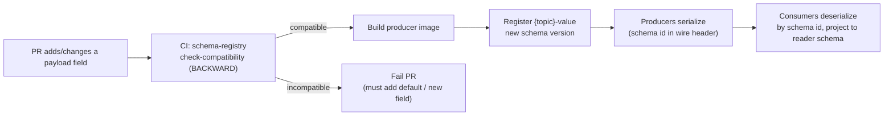
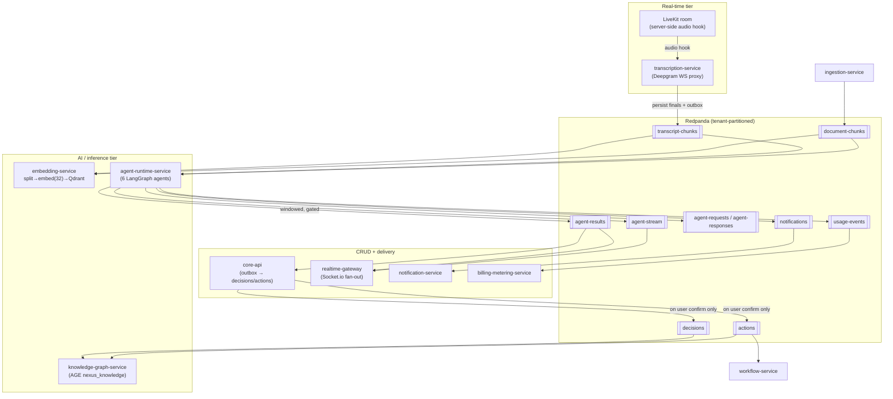
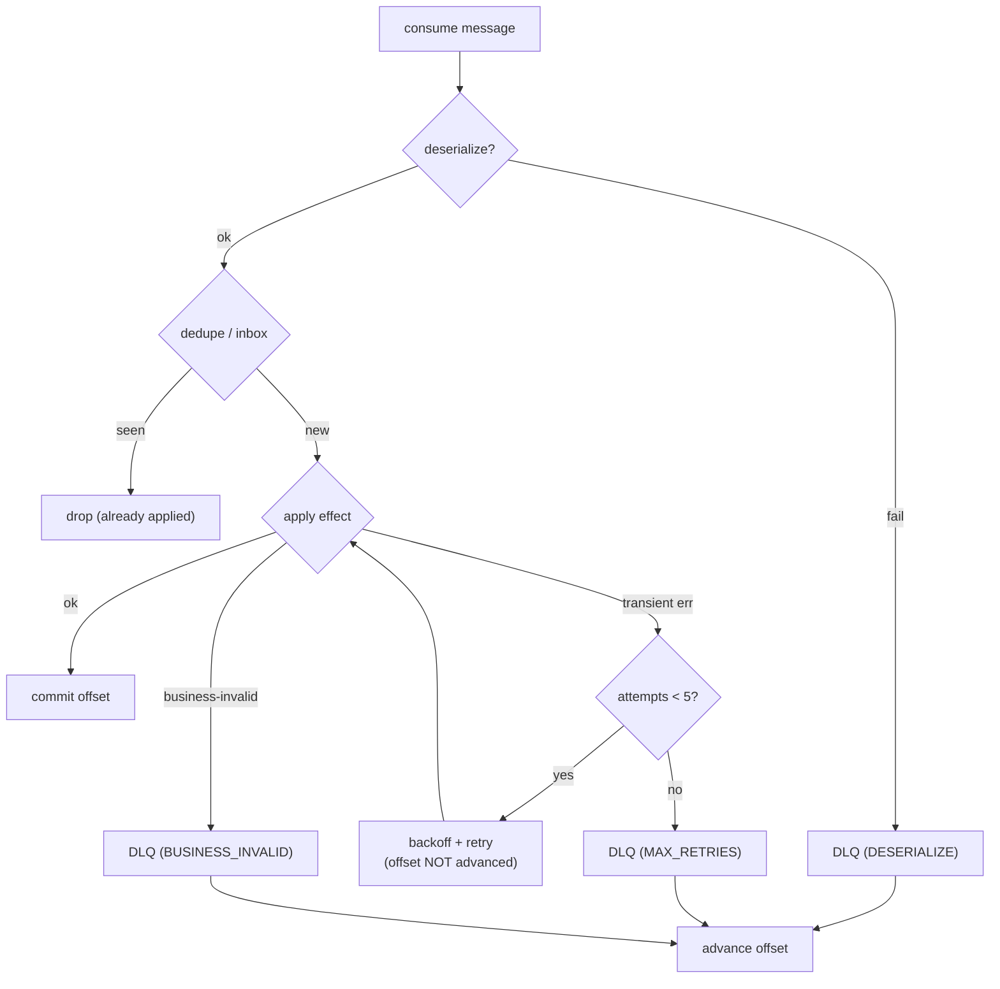
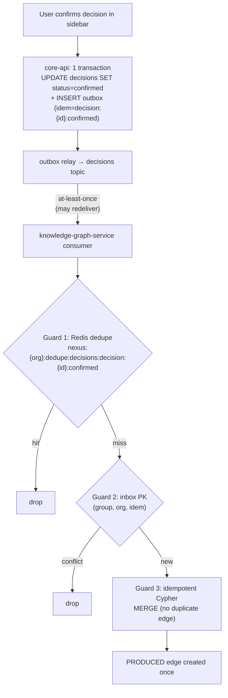
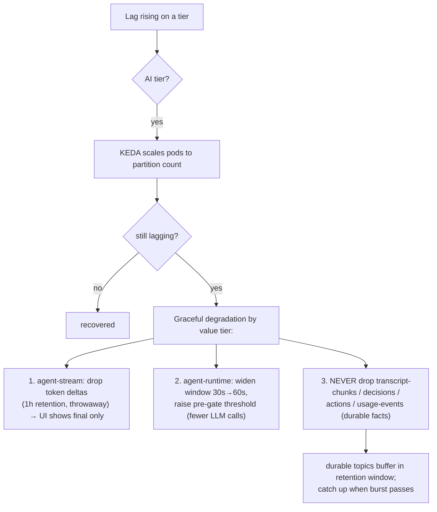

# Event-Driven Architecture

The frozen contract for every NEXUS Redpanda topic, its Avro envelope and Schema Registry rules, tenant partitioning, retention, and the at-least-once delivery machinery (transactional outbox/inbox, dedupe cache, DLQs, consumer-lag backpressure) that makes the event backbone exactly-once *in effect*.

## Related documents

- [Service Catalog](_canon/01-service-catalog.md) — service names, ownership, producer/consumer map.
- [Canonical Data Model](_canon/02-data-model.md) — entity names, owning services, Redis dedupe namespace.
- [Capacity & Scaling Math](_canon/05-capacity-math.md) — the event volume/throughput numbers this doc imports verbatim.
- [Locked Tech & Architecture Decisions](_canon/06-tech-decisions.md) — the locked event-streaming decision rows.
- [Multi-Tenancy & Isolation](06-multi-tenancy.md) — tenant partition keys, RLS, cell isolation.
- [Data Architecture](05-data-architecture.md) — store selection, partitioning, retention enforcement.
- [Inference & LLM Pipeline](09-rag-and-inference-serving.md) — embedding consumer, windowed batching, tiered routing.
- [Agent Runtime & LangGraph](08-ai-agent-architecture.md) — the six agents, confirmation rule, A2A collaboration.
- Glossary — canonical terms and any recorded `old → new` rename. (No glossary file exists in this set; renames are recorded in the canon docs and superseding ADRs.)

---

## 1. Principles and scope

NEXUS is **event-driven microservices with an explicit modular-monolith → services evolution path** (see [Tech Decisions §2.1](_canon/06-tech-decisions.md)). The event backbone is the load-bearing seam between the three scaling families — CRUD/control plane, real-time, and AI/inference — so the agent/inference tier can scale and bill independently of CRUD traffic. This document specifies the bus itself, not the services on either end.

Five invariants bind every topic and every arrow in the system:

1. **One bus, Kafka API.** Redpanda (Kafka API compatible), Avro values, Redpanda Schema Registry. One subject per topic, named `{topic}-value`, **BACKWARD** compatibility (carried verbatim from the PDF).
2. **Partition key = tenant.** Every topic is partitioned by `org_id`. Per-tenant ordering, isolation, replay, and throughput control. A noisy tenant cannot starve or reorder another's stream.
3. **At-least-once, idempotent in effect.** Producers write through a **transactional outbox** in the same DB transaction as their state change. Consumers dedupe through an **inbox** table plus a Redis dedupe cache keyed by `idempotency_key`. Net effect is exactly-once application of every event.
4. **Poison messages quarantine, never block.** Every topic has a paired **DLQ** with a bounded retry policy; a single bad message never wedges a partition.
5. **No silent commits.** `decisions` and `actions` are emitted **only on user confirmation**, matching the PDF agent rule. The graph and downstream read models mirror confirmed truth only.

> [SaaS-scale adjustment] The PDF described a single-team modular monolith where producing and consuming were in-process function calls with implicit "consume → process" (effectively at-most-once-ish) semantics. At SaaS scale — **~11.58B events/month, ~17,900 events/sec peak** ([Capacity §6, E10/E12](_canon/05-capacity-math.md)) — the bus is the integration contract between independently deployed, independently scaled services, and delivery must be at-least-once with idempotency, outbox/inbox, dedupe, and DLQs.

---

## 2. Topic catalog

All topics are listed once here; the [Service Catalog](_canon/01-service-catalog.md) owns producer/consumer assignment and this doc must not contradict it. Names are kebab-case, verbatim.

### 2.1 PDF-original topics (names carried verbatim)

| Topic | Avro value schema | Purpose | Primary producer | Primary consumers |
|---|---|---|---|---|
| `transcript-chunks` | `TranscriptChunk` | Finalized diarized utterances from the live meeting | `transcription-service` | `embedding-service`, `agent-runtime-service`, `search-service` |
| `document-chunks` | `DocumentChunk` † (chunk envelope) | Typed, split document elements from ingestion | `ingestion-service` | `embedding-service`, `agent-runtime-service` |
| `agent-results` | `AgentResult` | Agent output (notes, scores, suggestions) | `agent-runtime-service` | `core-api`, `realtime-gateway`, `notification-service` |
| `decisions` | `Decision` | Confirmed decisions only | `core-api` (outbox, on confirm) | `knowledge-graph-service`, `notification-service` |
| `actions` | `Action` | Confirmed action items only | `core-api` (outbox, on confirm) | `knowledge-graph-service`, `workflow-service`, `integration-service` |
| `notifications` | `Notification` | Cross-channel notification intents | multiple | `notification-service`, `realtime-gateway` |
| `agent-requests` | `AgentRequest` | A2A context-fill requests (ContextGapAgent) | `agent-runtime-service` | `agent-runtime-service` (peer agents) |
| `agent-responses` | `AgentResponse` | A2A context-fill responses | `agent-runtime-service` | `agent-runtime-service` (requester) |
| `agent-stream` | `AgentStreamDelta` † (token-delta envelope) | Streamed LLM token deltas to the UI | `agent-runtime-service` (LiteLLM stream bridge) | `realtime-gateway` → WebSocket |

> **† Net-new schema names.** Canon ([Tech Decisions §4](_canon/06-tech-decisions.md) and its topic table) freezes only **seven** Avro schema names — `TranscriptChunk`, `AgentResult`, `Decision`, `Action`, `Notification`, `AgentRequest`, `AgentResponse` — and deliberately leaves `document-chunks` as a "(chunk envelope)" and `agent-stream` as a "(token-delta envelope)". `DocumentChunk` and `AgentStreamDelta` are **net-new concrete names introduced by this document** for those two envelopes; they are not frozen canon. The `TenantEvent`/`MeetingEvent`/… names for the SaaS-scale topics in §2.2 are likewise net-new, but acceptable since canon names no schemas for those topics. Any of these names that becomes load-bearing must be ratified back into [Tech Decisions §4](_canon/06-tech-decisions.md).

### 2.2 SaaS-scale topics (added vs PDF)

> [SaaS-scale adjustment] The following twelve topics are **added** for SaaS scale and are not in the PDF. They carry control-plane, metering, lifecycle, and delivery-receipt signals that the original single-team phasing handled in-process. They are listed in the [Service Catalog §5](_canon/01-service-catalog.md); this table is the canonical schema/retention authority for them.

| Topic | Avro value schema | Purpose | Primary producer | Primary consumers |
|---|---|---|---|---|
| `tenant-events` | `TenantEvent` | Tenant provisioned / suspended / deleted | `identity-tenant-service` | `billing-metering-service`, `admin-ops-service`, `workflow-service` |
| `meeting-events` | `MeetingEvent` | Meeting created / updated / ended | `core-api` | `meeting-service`, `workflow-service`, `integration-service` |
| `meeting-room-events` | `MeetingRoomEvent` | LiveKit joined / left / recording-ready | `meeting-service` | `transcription-service`, `core-api` |
| `integration-events` | `IntegrationEvent` | Calendar→meeting, attachment-to-ingest, external status → action update | `integration-service` | `ingestion-service`, `core-api` |
| `usage-events` | `UsageEvent` | Metered units (tokens/minutes/seconds/storage) | `agent-runtime-service`, `rag-service` | `billing-metering-service` |
| `billing-events` | `BillingEvent` | Quota-exceeded / dunning / plan-changed | `billing-metering-service` | `workflow-service`, `notification-service`, `admin-ops-service` |
| `graph-events` | `GraphEvent` | Edge created / lineage updated | `knowledge-graph-service` | `admin-ops-service` |
| `embedding-events` | `EmbeddingEvent` | Upsert acks for lag tracking | `embedding-service` | (lag/metrics) |
| `presence-events` | `PresenceEvent` | Socket.io presence join/leave | `realtime-gateway` | `core-api` (analytics) |
| `notification-delivery-events` | `NotificationDeliveryEvent` | Delivery receipts | `notification-service` | `admin-ops-service`, `core-api` |
| `user-sync-events` | `UserSyncEvent` | Clerk webhook user-sync inbox | `identity-tenant-service` (Clerk inbox) | `identity-tenant-service` |
| `admin-events` | `AdminEvent` | Flag changed / tenant suspended / erasure requested | `admin-ops-service` | `workflow-service`, `admin-ops-service` (audit-log write) |

> **Producer/consumer notes (reconciled to the [Service Catalog](_canon/01-service-catalog.md), the single source of truth for service names):**
> - **`usage-events` producers are `agent-runtime-service` and `rag-service` only** (Service Catalog §5; transcription-service's `Produces` column lists only `transcript-chunks`). The `transcription_second` metered unit in the [Data Model §2.2](_canon/02-data-model.md) is **not** emitted by `transcription-service` to this topic; transcription minutes are metered by `billing-metering-service`, which aggregates meeting minutes (`meetings.scheduled_start`/`scheduled_end` and `transcript_chunks` durations) into `usage_aggregates`. Should direct emission from `transcription-service` ever be required, it must first be added to the Service Catalog §3/§5 producer map.
> - **`admin-events` audit-log write is `admin-ops-service`.** The Service Catalog folds audit-log access into `admin-ops-service` ("ops audit log", "audit-log access"); there is no `audit-service` in the catalog. The [Data Model §2.2](_canon/02-data-model.md) names an `audit-service` as the owning service of the `audit_logs` table — that is a Data-Model-only name not present in the catalog. Per the catalog's naming rule, this doc uses the catalog name `admin-ops-service` and flags the discrepancy rather than introducing `audit-service` here.

---

## 3. The Avro event envelope and Schema Registry

### 3.1 Standard envelope

Every event value, regardless of topic, opens with the same **header block** and then carries a topic-specific `payload`. The header is what idempotency, tenancy, tracing, and schema evolution all key off. This is locked across all 21 topics.

> [SaaS-scale adjustment] The PDF defined per-topic Avro schemas (`TranscriptChunk`, `AgentResult`, …) but no shared header. The envelope header below — `org_id`, `idempotency_key`, `correlation_id`, `causation_id`, `schema_version`, `producer`, `occurred_at` — is added so tenant partitioning, dedupe, distributed tracing, and outbox correlation work uniformly on every topic.

```json
{
  "type": "record",
  "name": "EventEnvelopeHeader",
  "namespace": "io.nexus.events",
  "doc": "Shared header prepended to every NEXUS event value. Frozen field order; new fields append-only with defaults (BACKWARD).",
  "fields": [
    { "name": "event_id",       "type": { "type": "string", "logicalType": "uuid" },
      "doc": "Unique per emitted event. Distinct from idempotency_key." },
    { "name": "idempotency_key", "type": "string",
      "doc": "Business dedupe key. Stable across producer retries of the SAME logical fact. See §6." },
    { "name": "org_id",          "type": { "type": "string", "logicalType": "uuid" },
      "doc": "Tenant root. Also the Kafka partition key. RLS/cell scoping anchor." },
    { "name": "schema_version",  "type": "int", "default": 1,
      "doc": "Producer's payload schema version, for observability; Registry enforces compat independently." },
    { "name": "producer",        "type": "string",
      "doc": "Owning service name (kebab-case, from the Service Catalog)." },
    { "name": "occurred_at",     "type": { "type": "long", "logicalType": "timestamp-micros" },
      "doc": "When the fact happened (UTC). Not enqueue time." },
    { "name": "correlation_id",  "type": ["null", "string"], "default": null,
      "doc": "Ties a causal chain across topics (e.g. one meeting window's fan-out)." },
    { "name": "causation_id",    "type": ["null", "string"], "default": null,
      "doc": "event_id of the direct cause; null for root events." }
  ]
}
```

A concrete topic value composes the header with a payload record. Example for `transcript-chunks` (the `TranscriptChunk` schema, carried verbatim, now enveloped):

```json
{
  "type": "record",
  "name": "TranscriptChunk",
  "namespace": "io.nexus.events",
  "doc": "transcript-chunks value. Subject: transcript-chunks-value. Compat: BACKWARD.",
  "fields": [
    { "name": "header", "type": "io.nexus.events.EventEnvelopeHeader" },
    { "name": "meeting_id",  "type": { "type": "string", "logicalType": "uuid" } },
    { "name": "chunk_id",    "type": { "type": "string", "logicalType": "uuid" } },
    { "name": "speaker_id",  "type": "string", "doc": "Diarized speaker label, mapped to user via meeting_speakers." },
    { "name": "start_ms",    "type": "int" },
    { "name": "end_ms",      "type": "int" },
    { "name": "text",        "type": "string" },
    { "name": "is_final",    "type": "boolean", "doc": "Only finals are ever produced; interims never hit the bus." },
    { "name": "confidence",  "type": "float" }
  ]
}
```

> Note the field set mirrors the `transcript_chunks` Postgres table in the [Data Model §2.1](_canon/02-data-model.md) exactly (`meeting_id, speaker_id, start_ms, end_ms, text, is_final, confidence`), and the citation payload frozen in the [Data Model §3](_canon/02-data-model.md) for Qdrant (`meeting_id`, `chunk_id`, `speaker`). The bus, the relational row, and the vector payload agree on names by construction.

### 3.2 Subject strategy and BACKWARD compatibility

| Rule | Value |
|---|---|
| Subject naming | `{topic}-value` (one subject per topic). No key schemas — the partition key is the raw `org_id` UUID string. |
| Compatibility | **BACKWARD** (a new consumer schema can read data written by the previous producer schema). |
| Allowed changes | Add a field **with a default**; remove a field that **had a default**; widen via union with `null` + default; add enum symbols only at the tail with a default. |
| Forbidden changes | Add a required field with no default; remove a field that had no default; rename a field (that is a remove+add); narrow a type; reorder is irrelevant to Avro but the header field order is frozen by convention. |
| Enforcement | CI gate runs `check-compatibility` against the registered subject before any producer image is built. Incompatible PRs fail before merge. |



The Confluent wire format prepends a magic byte + 4-byte schema id to every value, so consumers resolve the exact writer schema from the Registry and project it onto their (possibly newer) reader schema. Producers cache schema ids; the Registry is not on the hot path after warm-up.

> [SaaS-scale adjustment] The PDF's BACKWARD compatibility rule is preserved verbatim, but the **CI compatibility gate** and the **append-only/default-only evolution discipline** are formalized here because, at SaaS scale, ~20 services upgrade independently and a single non-defaulted required field would break every lagging consumer on a partition.

---

## 4. Partitioning, ordering, and retention

### 4.1 Partition key = tenant

The partition key for **every** topic is the `org_id` UUID (the same value carried in the envelope header). Consequences, all intentional:

- **Per-tenant ordering.** All events for one tenant on one topic land on one partition and are consumed in offset order. A meeting's `transcript-chunks` arrive in speech order at the embedding consumer and the agent runtime.
- **Per-tenant replay.** Reprocessing one tenant means replaying its partition slice, not the whole topic.
- **Noisy-neighbor isolation.** A tenant generating a burst saturates its own partition's lag, observable per tenant, without head-of-line-blocking another tenant on a different partition.

> [SaaS-scale adjustment] The PDF had no tenant concept and therefore no partition key strategy. Partitioning by `org_id` is locked in [Tech Decisions §2.4](_canon/06-tech-decisions.md) and is the bus-level half of the same isolation story as RLS, per-tenant Qdrant collections, and the org-partitioned `nexus_knowledge` graph (see [Multi-Tenancy](06-multi-tenancy.md)).

The locked partition key for **every** topic is `org_id` (per [Tech Decisions §2.4](_canon/06-tech-decisions.md) "All topics partitioned by tenant" and [Data Model §7 rule 3](_canon/02-data-model.md) "Redpanda by tenant-keyed partition"). The table below states the frozen key for each topic class.

| Topic class | Partition key | Ordering guarantee | Why |
|---|---|---|---|
| High-volume meeting (`transcript-chunks`, `agent-results`, `agent-stream`) | `org_id` | Per-tenant | Locked tenant-partitioning; per-tenant ordering and replay |
| Documents (`document-chunks`) | `org_id` | Per-tenant | `document_chunks` has no mandatory `meeting_id` ([Data Model §2.1](_canon/02-data-model.md)); keyed by tenant |
| Confirmed truth (`decisions`, `actions`) | `org_id` | Per-tenant | Graph edges and follow-ups apply in per-tenant order; idempotent `MERGE` (see §9) |
| A2A (`agent-requests`, `agent-responses`) | `org_id` | Per-tenant | Correlation by `correlation_id`, not partition; deny-by-default authz scopes to one org |
| Control plane / metering (`tenant-events`, `billing-events`, `usage-events`, `meeting-events`, `integration-events`, `graph-events`, `admin-events`, `user-sync-events`, `notification-delivery-events`, `presence-events`, `embedding-events`, `notifications`) | `org_id` | Per-tenant | Lifecycle/metering must apply in order per tenant |

> [SaaS-scale adjustment] **Proposed (NOT yet ratified) hot-tenant sub-key.** A single enterprise tenant running thousands of concurrent meetings can exceed one partition's throughput, because keying solely on `org_id` hashes that tenant onto a single partition. A natural mitigation for the high-volume meeting topics (`transcript-chunks`, `agent-results`, `agent-stream`) is a composite key `"{org_id}:{meeting_id}"` that spreads one tenant's load across partitions while preserving ordering **within a meeting** — the only ordering scope agents and the embedding consumer actually require. This is a sound extension but it **changes the locked partition-key semantics** ("partitioned by tenant" → "partitioned by tenant+meeting"). It is therefore recorded here as a proposal only and must be ratified in [Tech Decisions §2.4](_canon/06-tech-decisions.md) and [Data Model §7](_canon/02-data-model.md) **before** any topic uses it. Until then, the frozen key for every topic is `org_id` as in the table above. (`document-chunks` could not use this sub-key in any case, since it carries no mandatory `meeting_id`; a hot-tenant spread for documents would key on `"{org_id}:{document_id}"`.)

### 4.2 Partition counts and retention

Partition counts are sized from peak throughput (Capacity [§6, E12 ~17,900 events/sec peak](_canon/05-capacity-math.md)) with headroom for replay and consumer parallelism (one partition feeds at most one consumer in a group). Retention is per-topic: durable facts retain long; ephemeral streams expire fast.

| Topic | Partitions (prod) | Retention | Cleanup policy | Rationale |
|---|---:|---|---|---|
| `transcript-chunks` | 180 | 7 days | delete | Re-derivable from `transcript_chunks` table (system of record); 7d covers replay/backfill of embeddings |
| `document-chunks` | 24 | 7 days | delete | Re-derivable from `document_chunks` + object storage |
| `agent-results` | 120 | 3 days | delete | Read models persist in `core-api`; bus is transient transport |
| `agent-stream` | 120 | **1 hour** | delete | Token deltas are throwaway after the UI renders; highest count, lowest value (Capacity E8) |
| `decisions` | 24 | **30 days** | delete | Durable in `decisions` table; 30d for graph rebuild/audit |
| `actions` | 24 | 30 days | delete | Durable in `action_items` table; feeds follow-up workflows |
| `notifications` | 24 | 3 days | delete | Delivery is the receipt; intent is short-lived |
| `agent-requests` / `agent-responses` | 12 / 12 | 1 day | delete | Synchronous-ish round-trips with deadlines; no value past the deadline |
| `usage-events` | 48 | **7 days** | delete | Aggregated nightly into `usage_aggregates`; 7d buffer for re-aggregation |
| `billing-events` | 12 | 30 days | delete | Dunning/quota sagas; durable in billing tables |
| `tenant-events` | 6 | **retain (compacted)** | compact | Latest tenant lifecycle state per `org_id` key |
| `meeting-events` | 24 | 7 days | delete | Durable in `meetings` table |
| `meeting-room-events` | 24 | 3 days | delete | Drives transcription start; transient |
| `integration-events` | 12 | 7 days | delete | OAuth/sync; idempotent re-drive within window |
| `graph-events` | 6 | 7 days | delete | Ops views; graph is the system of record |
| `embedding-events` | 12 | 1 day | delete | Lag/metrics acks only |
| `presence-events` | 12 | 1 hour | delete | Ephemeral presence |
| `notification-delivery-events` | 6 | 30 days | delete | Delivery audit |
| `user-sync-events` | 6 | 7 days | delete | Clerk inbox; reconciliation backstops drops |
| `admin-events` | 6 | retain (compacted) | compact | Latest flag/state per key; also mirrored to `audit_logs` |

A paired **`<topic>.dlq`** exists for every topic above (**21 in total** — one per topic), each with **14-day** retention so a human has time to triage and replay. DLQs are single-partition unless volume demands more.

> [SaaS-scale adjustment] The PDF specified topics but no partition counts, no per-topic retention, and no DLQ topics — it ran on the Redpanda Serverless 30-day trial. Production runs a **BYOC/dedicated multi-AZ Redpanda cluster** ([Capacity §6](_canon/05-capacity-math.md)); the counts and retentions above are sized from the frozen capacity numbers. `tenant-events` and `admin-events` use **log compaction** (keyed latest-state) rather than time retention.

---

## 5. End-to-end event flow

The canonical hot path: speech becomes a transcript chunk, fans out to embedding and agents, agents emit results and (on confirmation) decisions/actions, which write read models, build the graph, and stream to the UI.



Two facts in this diagram are load-bearing and frozen elsewhere:

1. **Agents consume `transcript-chunks` but do not run per chunk.** The `agent-runtime-service` applies **windowed batching (30s windows, Capacity A17)** and **relevance pre-gating** before any LLM call — the fix for the R4 cost bomb (see [Inference & LLM Pipeline](09-rag-and-inference-serving.md), [Capacity §8](_canon/05-capacity-math.md)). The bus delivers 360 chunks/meeting; the pipeline collapses that to ~90 windows and ~35% gate-pass.
2. **`decisions`/`actions` are emitted by `core-api`, not the agent.** The agent surfaces a candidate via `agent-results`; only after the user confirms in the sidebar does `core-api` write the row **and** the outbox record in one transaction, which relays to the `decisions`/`actions` topics. This is the structural enforcement of the PDF "no silent commits" rule and the anchor of the duplicate-decision fix in §9.

---

## 6. At-least-once delivery: outbox, inbox, dedupe, idempotency

At-least-once is the only honest guarantee across a network with retries, rebalances, and at-least-once offset commits. We make it *exactly-once in effect* by pairing it with idempotency on both ends.

### 6.1 Transactional outbox (producer side)

A producer must never do "write DB, then publish" as two independent steps — a crash between them loses the event or publishes a fact that rolled back. Instead, the state change and the outbox row commit in **one** Postgres transaction; a separate relay publishes the outbox row to Redpanda.

```sql
-- Per owning service. RLS-scoped by org_id like every tenant table.
CREATE TABLE outbox (
  id              BIGSERIAL PRIMARY KEY,
  org_id          UUID        NOT NULL,
  topic           TEXT        NOT NULL,
  partition_key   TEXT        NOT NULL,          -- the org_id UUID string (locked tenant key)
  idempotency_key TEXT        NOT NULL,          -- copied into the Avro header
  schema_subject  TEXT        NOT NULL,          -- "{topic}-value"
  payload         JSONB       NOT NULL,          -- serialized to Avro by the relay
  created_at      TIMESTAMPTZ NOT NULL DEFAULT now(),
  published_at    TIMESTAMPTZ NULL,
  attempts        INT         NOT NULL DEFAULT 0
);
CREATE INDEX outbox_unpublished_idx ON outbox (created_at) WHERE published_at IS NULL;
CREATE UNIQUE INDEX outbox_idem_uq ON outbox (topic, idempotency_key);
```

```python
# Inside the same transaction that confirms a decision (core-api).
async def confirm_decision(session, org_id, decision_id, confirmed_by):
    async with session.begin():                      # one transaction
        await session.execute(
            update(Decision)
            .where(Decision.id == decision_id, Decision.org_id == org_id)
            .values(status="confirmed", confirmed_by=confirmed_by)
        )
        session.add(Outbox(
            org_id=org_id,
            topic="decisions",
            partition_key=str(org_id),                        # locked tenant key = org_id
            idempotency_key=f"decision:{decision_id}:confirmed",   # see §9
            schema_subject="decisions-value",
            payload=decision_event_payload(decision),
        ))
    # commit atomic: row + outbox land together or not at all
```

The **relay** is a small worker (one per service, or the shared library polling that service's `outbox`):

```python
# Outbox relay: poll → produce → mark published. At-least-once to the bus.
async def relay_loop(producer, session):
    while True:
        rows = await fetch_unpublished(session, limit=500)        # FOR UPDATE SKIP LOCKED
        for row in rows:
            producer.produce(
                topic=row.topic,
                key=row.partition_key.encode(),
                value=avro_serialize(row.schema_subject, row.payload),
                on_delivery=ack(row.id),
            )
        producer.flush()
        await mark_published(session, [r.id for r in acked])      # idempotent re-publish if crash
```

A crash after produce but before `mark_published` re-publishes on restart — that is the at-least-once duplicate the consumer side must absorb.

> [SaaS-scale adjustment] The transactional outbox + relay is wholly added vs the PDF, which produced inline from request handlers. It is locked in [Tech Decisions §2.4](_canon/06-tech-decisions.md) and is what makes "DB row and event are both committed, or neither is" true under crashes.

### 6.2 Inbox + dedupe cache (consumer side)

Every consumer is idempotent against the envelope `idempotency_key`. Two layers: a fast Redis dedupe cache (cheap reject of obvious replays) and a durable inbox table (authoritative, survives cache eviction).

```sql
CREATE TABLE inbox (
  org_id          UUID        NOT NULL,
  consumer_group  TEXT        NOT NULL,           -- same fact, different consumers each apply once
  idempotency_key TEXT        NOT NULL,
  processed_at    TIMESTAMPTZ NOT NULL DEFAULT now(),
  PRIMARY KEY (consumer_group, org_id, idempotency_key)
);
```

The Redis dedupe key is the canonical namespace from the [Data Model §5](_canon/02-data-model.md):

```
nexus:{org_id}:dedupe:{topic}:{idempotency_key}    TTL 24h
```

```python
# Base consumer dedupe gate (see §8 for the full base class).
async def handle(self, evt: EventEnvelope):
    key = f"nexus:{evt.org_id}:dedupe:{self.topic}:{evt.idempotency_key}"
    if not await redis.set(key, "1", nx=True, ex=86_400):     # 24h, matches canon
        return  # seen recently → drop, do not reprocess

    async with self.session.begin():
        inserted = await try_insert_inbox(                     # durable backstop
            self.session, self.group, evt.org_id, evt.idempotency_key)
        if not inserted:                                       # cache evicted but already applied
            return
        await self.apply(evt)                                  # business effect + (optional) outbox
    # inbox row + business effect commit together: exactly-once application
```

The inbox insert and the business effect commit in the **same transaction**, so a crash after the effect but before marking processed cannot double-apply: either both committed or the redelivery re-runs cleanly and the unique inbox key absorbs it.

> [SaaS-scale adjustment] The PDF's base consumer was "AvroDeserializer + offset commit + retry policy" with no dedupe. The inbox table and the `nexus:{org_id}:dedupe:*` Redis cache (24h TTL) are added and locked in [Tech Decisions §2.4](_canon/06-tech-decisions.md) and the [Data Model §5/§7](_canon/02-data-model.md). The 24h cache TTL covers practical redelivery windows; the inbox table is the unbounded authority.

### 6.3 Idempotency-key construction

The key must be **stable across producer retries of the same logical fact** and **distinct across genuinely different facts**. It is never random.

| Topic | `idempotency_key` formula | Stable because |
|---|---|---|
| `transcript-chunks` | `chunk:{chunk_id}` | One row per finalized utterance |
| `document-chunks` | `docchunk:{document_id}:{element_id}` | One chunk per element |
| `agent-results` | `agentresult:{meeting_id}:{window_id}:{user_id}:{agent}` | One result per agent per window per participant |
| `decisions` | `decision:{decision_id}:confirmed` | **One confirmation per decision** (see §9) |
| `actions` | `action:{action_id}:confirmed` | One confirmation per action |
| `usage-events` | `usage:{org_id}:{event_type}:{occurred_at}:{source_id}` | Matches `usage_events.idempotency_key` in the [Data Model §2.2](_canon/02-data-model.md) |
| `agent-requests` | `areq:{correlation_id}` | One request per correlation id |
| `notifications` | `notif:{source_event_id}:{channel}:{user_id}` | One delivery intent per source per channel per user |

```mermaid
sequenceDiagram
    participant P as Producer (outbox relay)
    participant RP as Redpanda
    participant C as Consumer (base class)
    participant RD as Redis dedupe
    participant DB as Inbox + state (1 txn)
    P->>RP: produce(key=org_id, value=Avro)
    Note over P,RP: crash here → re-publish on restart (at-least-once)
    RP->>C: deliver (maybe twice)
    C->>RD: SET nexus:{org}:dedupe:{topic}:{idem} NX EX 86400
    alt key already present
        RD-->>C: not set → DROP
    else first time
        RD-->>C: set
        C->>DB: BEGIN; INSERT inbox (PK idem); apply(); COMMIT
        DB-->>C: ok (or inbox PK conflict → DROP)
        C->>RP: commit offset (after effect)
    end
```

---

## 7. DLQ and retry policy

A consumer failure is one of two kinds, handled differently:

- **Transient** (deserialization OK, downstream timeout / 5xx / lock): retry in place with backoff, do **not** advance the offset. Bounded attempts.
- **Poison** (schema-incompatible despite BACKWARD, business-invalid, persistent failure after max attempts): publish to the topic's DLQ with full failure context, advance the offset, keep the partition moving.

```python
RETRY = dict(max_attempts=5, base_ms=200, factor=2.0, max_ms=10_000, jitter=True)
# 200ms, 400, 800, 1600, 3200 (+jitter) → then DLQ
```

The DLQ message wraps the original value plus failure metadata so it is replayable without forensic guesswork:

```json
{
  "type": "record", "name": "DlqEnvelope", "namespace": "io.nexus.events",
  "fields": [
    { "name": "original_topic",     "type": "string" },
    { "name": "original_partition", "type": "int" },
    { "name": "original_offset",    "type": "long" },
    { "name": "org_id",             "type": "string" },
    { "name": "idempotency_key",    "type": "string" },
    { "name": "consumer_group",     "type": "string" },
    { "name": "failure_class",      "type": { "type": "enum", "name": "FailureClass",
              "symbols": ["DESERIALIZE", "SCHEMA_INCOMPAT", "BUSINESS_INVALID", "MAX_RETRIES"] } },
    { "name": "error",              "type": "string" },
    { "name": "attempts",           "type": "int" },
    { "name": "first_seen_at",      "type": { "type": "long", "logicalType": "timestamp-micros" } },
    { "name": "raw_value_b64",      "type": "string", "doc": "Original Avro bytes, base64, for byte-exact replay." }
  ]
}
```



**DLQ replay** is an `admin-ops-service` operation: a tool reads `<topic>.dlq`, optionally edits/patches, and re-produces to the original topic with the **original `idempotency_key`** so the consumer's dedupe/inbox decides whether it is genuinely new. Replaying a poison message that was actually applied is therefore safe — it dedupes out. SLO target: **DLQ rate < 0.1% of events** ([Capacity §11.3](_canon/05-capacity-math.md)).

> [SaaS-scale adjustment] The PDF's base consumer carried a "retry policy" but defined no DLQ topics, no poison/transient distinction, and no replay tooling. The DLQ envelope, the 5-attempt exponential-backoff-with-jitter policy, and the idempotency-preserving replay are added so a single bad payload at SaaS volume never wedges a tenant's partition.

---

## 8. The producer utility and base consumer (PDF Phase 6)

These two are the **only** sanctioned ways to touch the bus. No service hand-rolls a Kafka client. Both are carried over from the PDF Phase 6 spec and hardened with the outbox/inbox/dedupe machinery above.

### 8.1 Producer utility

Locked stack: **confluent-kafka-python + AvroSerializer**, schema-validated against the Registry, rejecting unregistered/incompatible payloads ([Tech Decisions §2.4](_canon/06-tech-decisions.md)). Services do not call it directly in request handlers — they write the outbox; the **relay** is the only caller of `produce()`.

```python
class NexusProducer:
    """Sanctioned producer. Avro-serializes against {topic}-value, keys by tenant.
    Used by the outbox relay only — never inline in a request handler."""

    def __init__(self, bootstrap, schema_registry_url):
        self._sr = SchemaRegistryClient({"url": schema_registry_url})
        self._serializers: dict[str, AvroSerializer] = {}   # cache per subject
        self._p = Producer({
            "bootstrap.servers": bootstrap,
            "enable.idempotence": True,        # producer-level dedupe within a session
            "acks": "all",                     # all in-sync replicas (multi-AZ durability)
            "compression.type": "zstd",
            "linger.ms": 20, "batch.size": 256 * 1024,
        })

    def produce(self, topic, key: str, value: dict, on_delivery):
        ser = self._serializer_for(f"{topic}-value")        # raises if subject unregistered
        self._p.produce(
            topic=topic,
            key=key.encode(),                                # org_id (locked tenant partition key)
            value=ser(value, SerializationContext(topic, MessageField.VALUE)),
            on_delivery=on_delivery,
        )
```

`acks=all` + `enable.idempotence=True` give per-session producer idempotence (no duplicates from broker retries within one relay run); the outbox + consumer inbox cover the across-restart duplicates that producer idempotence cannot.

### 8.2 Base consumer class

Locked stack: **AvroDeserializer, offset commit semantics, retry policy** ([Tech Decisions §2.4](_canon/06-tech-decisions.md)), extended with the dedupe gate (§6.2) and DLQ routing (§7). Subclasses implement only `apply()`.

```python
class BaseConsumer:
    """One consumer group per (service, topic). Subclass implements apply()."""
    topic: str
    group: str

    def __init__(self, bootstrap, sr_url, redis, session_factory):
        self._c = Consumer({
            "bootstrap.servers": bootstrap,
            "group.id": self.group,
            "enable.auto.commit": False,        # commit only AFTER effect (§6.2)
            "auto.offset.reset": "earliest",
            "max.poll.interval.ms": 300_000,
            "isolation.level": "read_committed",
        })
        self._deser = AvroDeserializer(SchemaRegistryClient({"url": sr_url}))
        self._redis = redis
        self._sf = session_factory
        self._dlq = NexusProducer(bootstrap, sr_url)

    async def run(self):
        self._c.subscribe([self.topic])
        while True:
            msg = self._c.poll(1.0)
            if msg is None: continue
            if msg.error(): self._observe_error(msg); continue
            try:
                evt = self._deser(msg.value(), ctx(self.topic))
            except SerializationError as e:
                await self._to_dlq(msg, "DESERIALIZE", str(e)); self._c.commit(msg); continue
            try:
                await self._handle_with_dedupe(evt)          # §6.2 dedupe + inbox + apply
                self._c.commit(msg)                          # offset AFTER effect
            except TransientError as e:
                if not await self._retry(evt):               # backoff up to 5x
                    await self._to_dlq(msg, "MAX_RETRIES", str(e)); self._c.commit(msg)
            except BusinessInvalid as e:
                await self._to_dlq(msg, "BUSINESS_INVALID", str(e)); self._c.commit(msg)

    async def apply(self, evt): raise NotImplementedError    # subclass: the business effect
```

The **embedding consumer** is the canonical subclass and the PDF's flagship: `consume → split (LangChain) → embed batch (32, sub-100ms) → upsert to per-tenant Qdrant` ([Tech Decisions §2.9](_canon/06-tech-decisions.md), [Inference & LLM Pipeline](09-rag-and-inference-serving.md)). It runs on the AI tier, autoscaled on chunk-backlog/queue depth, off the API tier — at peak **~525 embeds/sec, ~16.4 batches/sec** (Capacity [§9, EM2/EM3](_canon/05-capacity-math.md)).

---

## 9. The duplicate-decisions risk, fixed explicitly

At-least-once delivery means the `decisions` (and `actions`) topic **will** redeliver. Naively, a redelivered confirmed-decision event creates a second `decisions` row, a second `PRODUCED` edge in `nexus_knowledge`, and a duplicate notification. This is the single most damaging duplicate in NEXUS because it corrupts the knowledge graph — the source of truth for the ProactiveAgent's conflict detection (a decision could appear to "contradict" its own duplicate). We close it with **four independent guards**, any one of which is sufficient; together they are belt-and-suspenders.



**Guard 1 — stable idempotency key.** The key is `decision:{decision_id}:confirmed`, derived from the immutable `decisions.id` and the terminal `confirmed` state — **not** from `event_id`, timestamp, or a retry counter. Every redelivery of the same confirmation carries the identical key. (See §6.3.)

**Guard 2 — outbox emits exactly once per confirmation.** `core-api` writes the `decisions` event to its `outbox` inside the **same transaction** that flips `decisions.status` to `confirmed` (§6.1). A unique index `outbox_idem_uq (topic, idempotency_key)` means a double-confirm (impatient double-click, retried request) cannot enqueue a second event. The fact is produced once; only the *transport* can duplicate it.

**Guard 3 — consumer inbox + dedupe absorb transport duplicates.** The `knowledge-graph-service` consumer runs the §6.2 gate: the Redis dedupe cache rejects the obvious replay; the durable `inbox` PK `(consumer_group, org_id, idempotency_key)` is the authority if the cache evicted. Each of `knowledge-graph-service`, `notification-service`, and `core-api`'s own read-model updater is a **separate consumer group**, so each applies the confirmation exactly once independently.

**Guard 4 — idempotent graph writes.** Even if guards 1–3 were bypassed, the Cypher template uses `MERGE`, not `CREATE`, so the edge is created at most once:

```cypher
-- knowledge-graph-service, on confirmed decision. $org_id scopes the org-partitioned graph.
MERGE (d:Decision {decision_id: $decision_id, org_id: $org_id})
  ON CREATE SET d.status = $status, d.confidence = $confidence
MERGE (m:Meeting {meeting_id: $meeting_id, org_id: $org_id})
MERGE (d)-[:PRODUCED]->(m)        -- PRODUCED edge: idempotent, never duplicated
```

The same pattern protects `ASSIGNED_TO` on `actions`. Edge labels are the canonical `PRODUCED` / `ASSIGNED_TO` from the [Data Model §4.2](_canon/02-data-model.md) and [Tech Decisions §2.10](_canon/06-tech-decisions.md), and edges are created **only on confirmation**, never speculatively — the PDF rule, now also duplicate-proof.

> [SaaS-scale adjustment] The PDF emitted `decisions`/`actions` "on confirmation" but, as an in-process monolith, never faced bus redelivery. The four-guard stack (stable key → outbox-unique → inbox/dedupe → `MERGE`) is the explicit at-least-once duplicate fix and is what lets the agents/inference tier and the graph tier scale apart while the graph stays clean. The duplicate-delivery SLO is **~0 post-dedupe** ([Capacity §11.3](_canon/05-capacity-math.md)).

---

## 10. Consumer-lag monitoring and backpressure

The bus is healthy when consumers keep up. We monitor lag per `(topic, partition, consumer_group)` and per tenant, and we shed load gracefully under burst — never by dropping durable facts.

### 10.1 What is measured

| Metric | Source | Alert | SLO |
|---|---|---|---|
| Consumer lag (records behind end offset) | Redpanda group metadata → Prometheus | warn 10s-equivalent, page 30s | embedding consumer lag **< 5s**, alert at 30s ([Capacity §11.3](_canon/05-capacity-math.md)) |
| Embedding batch latency | `embedding-service` histogram | page > 100ms p95 | batch of 32 **< 100ms** |
| DLQ rate | DLQ produce counter / total consume | page > 0.1% | **< 0.1%** of events |
| Duplicate-delivery rate (post-dedupe) | dedupe-cache hit counter | informational | **~0** |
| End-to-end agent latency (speech→sidebar) | trace span (`correlation_id`) | page p95 > 4s | **p50 < 2s, p95 < 4s** |
| Per-tenant lag | lag tagged by `org_id` | page on single-tenant runaway | isolate noisy neighbor |

Lag is exported via `kafka_consumer_lag` gauges to Prometheus and dashboarded in Grafana ([Tech Decisions §2.14](_canon/06-tech-decisions.md)); the `admin-ops-service` exposes the cross-tenant consumer-lag dashboard.

### 10.2 Backpressure handling

The autoscaler is the first line of defense. KEDA scales each AI-tier consumer on **queue depth / chunk backlog** (the AI/inference autoscaler signal from the [Service Catalog §4](_canon/01-service-catalog.md)); the embedding and agent consumers add partitions' worth of parallelism by adding pods up to the partition count.

When scale-out cannot keep up (GPU saturation, downstream LLM rate limit), we degrade by **value tier**, never by dropping durable facts:



The ordering of what we shed is deliberate and maps to the retention/value table in §4.2: `agent-stream` (1h, throwaway) is sacrificed first; the LLM call rate is throttled next via the windowing/pre-gate levers that already exist for cost control; durable facts (`transcript-chunks`, `decisions`, `actions`, `usage-events`) are **never** shed — they sit in their retention window and the consumer catches up after the burst. Because every consumer is idempotent (§6), catch-up replay is always safe.

> [SaaS-scale adjustment] The PDF had consumer-lag monitoring + alerts (carried over) but no backpressure strategy because an in-process monolith has no consumer lag. The KEDA-on-queue-depth autoscaling and the value-tiered graceful degradation are added; they reuse the *same* windowing/pre-gating knobs built for the R4 cost pipeline, so cost control and backpressure control are one mechanism.

---

## 11. Summary — what this document freezes

| Concern | Locked value |
|---|---|
| Bus | Redpanda (Kafka API), Avro values, Schema Registry, subject `{topic}-value`, **BACKWARD** compat |
| Partition key | `org_id` on **every** topic (locked tenant partitioning). A hot-tenant `{org_id}:{meeting_id}` sub-key is proposed but **not** ratified — see §4.1. |
| Delivery | At-least-once + idempotency keys; **exactly-once in effect** |
| Producer | Transactional **outbox** + relay; `NexusProducer` (confluent-kafka-python + AvroSerializer, `acks=all`, idempotent) |
| Consumer | `BaseConsumer` (AvroDeserializer, manual offset commit after effect) + **inbox** + Redis dedupe `nexus:{org_id}:dedupe:{topic}:{key}` (24h) |
| Failure | Per-topic `<topic>.dlq`, 5-attempt exponential backoff + jitter, idempotency-preserving replay |
| Duplicate decisions | Four guards: stable key → outbox-unique index → inbox/dedupe → `MERGE` Cypher |
| Topics | 9 PDF + 12 SaaS-added, all tenant-partitioned, per-topic retention (§4.2) |
| Volume | ~11.58B events/mo, ~17,900 ev/s peak, ~13.9 TB/mo ([Capacity §6](_canon/05-capacity-math.md)) |
| SLOs | embedding lag < 5s, DLQ < 0.1%, dup-rate ~0, agent e2e p50 < 2s / p95 < 4s |

Every name, schema, topic, and number above is consistent with the [Service Catalog](_canon/01-service-catalog.md), [Data Model](_canon/02-data-model.md), [Capacity Math](_canon/05-capacity-math.md), and [Tech Decisions](_canon/06-tech-decisions.md). Any change to a frozen value must land in those canon docs first and be recorded in the glossary.
