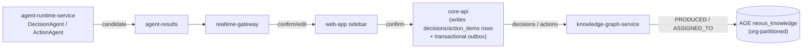
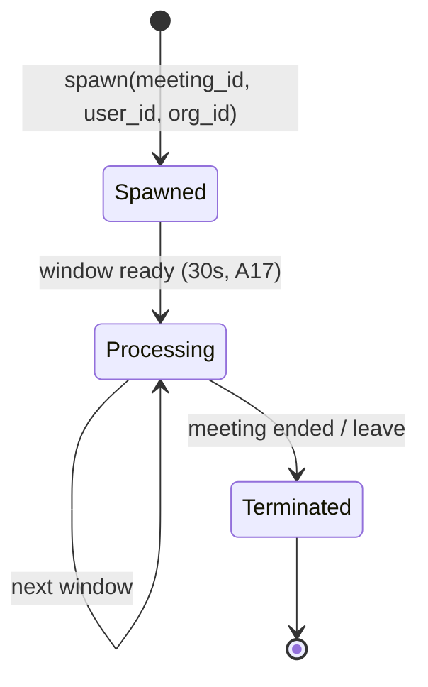
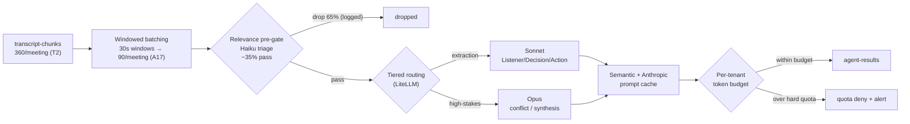
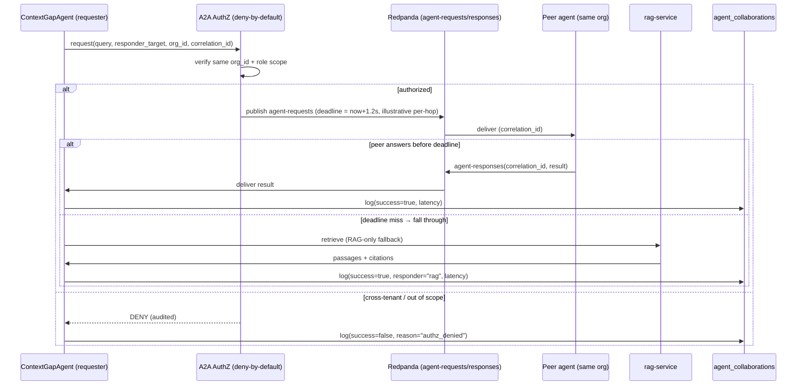
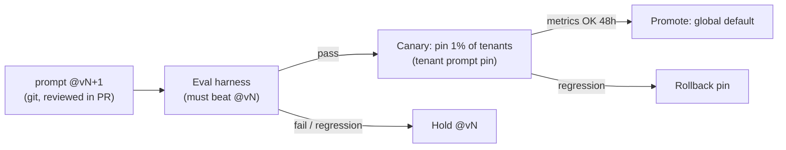
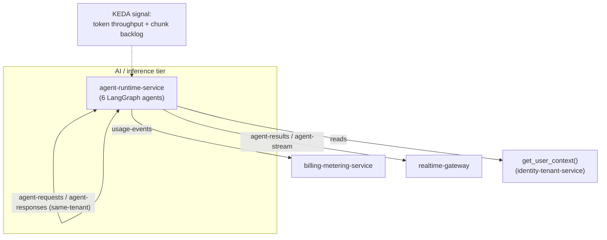

# AI Agent Architecture

How NEXUS runs its seven LangGraph agents on a shared lifecycle, processes live meetings through a cost-controlled LLM pipeline, and lets per-participant agents collaborate across meetings under deny-by-default tenant authorization.

## Related documents

- [Service Catalog](04-service-catalog.md) — `agent-runtime-service` ownership, scaling family, and event contracts (naming authority).
- [Multi-Tenancy & Isolation](06-multi-tenancy.md) — pooled + RLS long tail, cell-based isolation, `org_id` injection.
- [Security Architecture](11-security-architecture.md) — Clerk, RBAC, agent-to-agent authorization, audit logging.
- [Data Architecture](05-data-architecture.md) — store selection, retention, the `agent_collaborations` / `worklogs` / `decisions` / `action_items` tables.
- [Event Architecture](07-event-architecture.md) — Redpanda topics, Avro subjects, outbox/inbox, DLQs.
- [RAG Pipeline & Inference Serving](09-rag-and-inference-serving.md) — embedding/reranker inference tier, LiteLLM tiered routing, prompt caching.
- [SaaS Business: Billing, Metering, Tenancy Lifecycle](18-saas-business-architecture.md) — per-tenant token budgets, usage metering, plans/tiers.
- [Capacity & Scaling Math](_canon/05-capacity-math.md) — frozen load/cost anchors (`A5`, `A17`, `L1`–`L10`, `N1`–`N3`) imported by reference.
- [Locked Tech & Architecture Decisions](_canon/06-tech-decisions.md) — the decision register cited throughout.

---

## 1. Purpose and scope

This document specifies the **agent tier**: the seven LangGraph agents that turn a live meeting into personal notes, confirmed decisions and actions, real-time questions, cross-meeting context fills, proactive alerts, and live agenda tracking. It is owned end-to-end by the `agent-runtime-service` (per the [Service Catalog](04-service-catalog.md), the single naming authority). That service owns **no Postgres tables** — it reads context and emits events; durable agent output reaches the relational core via the `core-api` transactional outbox.

> [SaaS-scale adjustment] The PDF placed all six agents in-process inside a single-tenant FastAPI app, invoked once per raw `transcript_chunks` row, with per-user (not per-tenant) budgets and no agent-to-agent authorization. This document hosts them in a dedicated `agent-runtime-service` that autoscales independently on token throughput + chunk backlog (its own cost center), runs them on **30-second windows not raw chunks** (`A17`), and binds every cross-agent call to a deny-by-default tenant authorization check. The six agent names, their behaviors, the `BaseAgent`/`AgentState` contract, the confidence thresholds, the `ContextGapAgent` fallback chain, `get_user_context`, and the topic names are all carried over verbatim from the PDF.

What is **out of scope** here and lives elsewhere: the embedding/reranker GPU services and the LiteLLM router internals ([RAG Pipeline & Inference Serving](09-rag-and-inference-serving.md)); the RAG retrieval pipeline that `ContextGapAgent` falls through to ([RAG Pipeline & Inference Serving](09-rag-and-inference-serving.md)); the Redpanda outbox/inbox/DLQ machinery ([Event Architecture](07-event-architecture.md)); and the Stripe-backed budget enforcement that the per-tenant token quotas feed ([SaaS Business](18-saas-business-architecture.md)).

---

## 2. The seven agents

The first six are PDF-original (names verbatim, phases 7 to 11); the seventh, `MeetingAgent`, is a SaaS addition ([ADR-0038](adr/0038-agent-personas-profiles-agendas-and-meeting-agent.md)). Each is a LangGraph graph built on the shared `BaseAgent` (§3). One PersonalListenerAgent is spawned **per participant per meeting**; the others are spawned per meeting and fan their reasoning across the roster. `MeetingAgent` is one per meeting and follows the meeting as a whole rather than any one participant.

| Agent | Phase | Trigger / input | Output (topic) | Surfacing | Origin |
|---|---|---|---|---|---|
| `PersonalListenerAgent` | P7 | `transcript-chunks` window, filtered by `get_user_context()` role/skills | `worklogs` rows via `agent-results`; relevance-scored notes | My Notes sidebar (live) | PDF |
| `DecisionAgent` | P8 | `transcript-chunks` window | `agent-results` **decision candidate** | Decision-detected card (confirm/edit/dismiss) | PDF |
| `ActionAgent` | P8 | `transcript-chunks` window | `agent-results` **action candidate** | New-task toast | PDF |
| `QuestionAgent` | P9 | `transcript-chunks` window, context-gap heuristic | `agent_suggestions` via `agent-results` | Suggestion card, priority 1–3 (Ask/Dismiss/Save) | PDF |
| `ContextGapAgent` | P10 | Reference to context a participant lacks | `agent-requests` → peers; logs `agent_collaborations` | Context-fill card ("Context added from X agent") | PDF |
| `ProactiveAgent` | P11 | Confirmed `decisions`/`actions`; AGE graph queries | `notifications` via `agent-results` | Conflict banner, workload warning, stakeholder/dependency card | PDF |
| `MeetingAgent` | ADR-0038 | `transcript-chunks` window, only when the meeting has at least one agenda item; the agenda (`meeting_agenda_items`) and the previous meeting's open items | One `agent-results` record per meeting per window, `kind = meeting_update` (agenda `updates` plus an optional `nudge`), `user_id` = the host | Shared live agenda panel (every participant); nudges to the host only | SaaS-add |

### 2.1 Per-agent contract

- **PersonalListenerAgent (P7).** Subscribes to `transcript-chunks` for meetings the user is in. Calls `get_user_context(user_id)` (role/skills/team/recent meetings/topics; Redis-cached 5-min TTL) and scores each window's **relevance 0–1** to that user. Above the per-tenant relevance threshold it produces worklog content via `agent-results` (persisted to `worklogs` by `core-api`: `content`, `relevance_score`, `created_by_agent = true`, `source_chunk_ids`). The relevance score is the *pre-gate* signal (does this matter to this user); it is distinct from the *confidence* surfacing thresholds in §6.
- **DecisionAgent (P8).** Detects decisions, extracts `rationale`, stakeholders, and a `confidence` score. It **never silently commits**: it emits a *decision candidate* on `agent-results` and surfaces a confirm/edit/dismiss card. The `decisions` topic event — and the AGE `PRODUCED` edge — happen only on user confirmation (§2.2).
- **ActionAgent (P8).** Detects action items, extracts `assignee_id`, `due_date`, dependencies, and `confidence`. Same candidate-then-confirm rule; on confirmation the `actions` event and the AGE `ASSIGNED_TO` edge are created.
- **QuestionAgent (P9).** Detects context gaps in live conversation and proposes role-specific questions with `priority` 1–3 and `status` in {Ask, Dismiss, Save-for-later}. Save-for-later persists into the next meeting (`agent_suggestions`).
- **ContextGapAgent (P10).** The novel multi-agent piece (R6). When the conversation references context the participant lacks, it queries **other users' agents** over `agent-requests`/`agent-responses` with correlation IDs and a deadline, falling through the chain peer-agents → related-meeting agents → RAG → silent (§5). Every round-trip is logged to `agent_collaborations`.
- **ProactiveAgent (P11).** Three detectors: **conflict** (a new confirmed decision contradicting a past one, via an AGE `nexus_knowledge` query through `knowledge-graph-service`), **workload** (sum of open `action_items` per assignee, flagged at 80%/95% of capacity), and **missing-stakeholder** (org-graph traversal over `departments`/`teams`). Outputs ride `notifications`.
- **MeetingAgent (SaaS-add, [ADR-0038](adr/0038-agent-personas-profiles-agendas-and-meeting-agent.md) D7).** One per meeting, on the same 30-second windows, and only when the meeting has at least one agenda item. Input: the window transcript (speakers as "Participant N"), the agenda with current statuses and how long the in-progress item has run, and the previous meeting's open items as plain strings (from the internal caller-token route `GET /internal/meetings/{id}/agenda` on `core-api`). Output: at most **one** `agent-results` record per meeting per window, `agent = MeetingAgent`, `user_id` = the host, `kind = meeting_update`, with `payload_json = {updates: [{item_id, status, note}], nudge: {id, type, item_id, content} | null, surfaced: true}`. One record, because the canonical idempotency key `agentresult:{meeting_id}:{window_id}:{user_id}:{agent}` allows one result per agent per window per participant; this is the batching pattern of ADR-0032 and ADR-0034. An update moves an item to `in_progress` or `covered` (at most one per item per window). A nudge is `over_time` (computed: an item in progress longer than its `duration_minutes`, once per item), `off_agenda` (confidence at least 0.75), or `unaddressed` (a carried-forward open item nobody has raised after 70% of the scheduled time); at most one nudge per meeting per 5 minutes. Fast tier (Haiku), metered against the tenant budget and skipped when the budget is `blocked`. It never writes Postgres: `core-api` applies each update to `meeting_agenda_items` (never over a host-set status, never `covered` back to `in_progress`), and the nudge is not persisted.

> [SaaS-scale adjustment] `MeetingAgent` is net-new relative to the PDF, which had no agenda and no agent that follows the meeting as a whole. It adds one agent class and one `agent-results` kind (`meeting_update`) and changes nothing about the six PDF agents ([ADR-0038](adr/0038-agent-personas-profiles-agendas-and-meeting-agent.md)).

### 2.1.1 Agent persona and working profile

Each person's agent has a persona: `users.agent_name` (NULL shows "{first name}'s agent"), `users.agent_avatar_seed` (a doodle seed), `users.agent_personality` (`balanced`, `concise`, `detailed`, `direct`, `friendly`) and `users.agent_instructions` (up to 500 chars). The persona is a display label and a wording preference over `PersonalListenerAgent` and `QuestionAgent` output; it is **not** an agent class, never appears in events, logs or metrics as an agent identifier, and never changes what is captured, the confidence bands, or who can see what. The working profile adds `users.listen_for` and `users.ignore_topics` beside `role`, `skills` and `bio`. `get_user_context` returns `listen_for`, `ignore_topics`, `agent_name`, `agent_personality` and `agent_instructions` (not the avatar seed). `PersonalListenerAgent` renders them in its profile block ("Listen especially for", "Ignore") and a voice line; `QuestionAgent` uses the same block and voice. `agent_instructions` is user text, placed in a delimited block that may change wording only ([ADR-0038](adr/0038-agent-personas-profiles-agendas-and-meeting-agent.md) D1, D2, D4, D10).

> [SaaS-scale adjustment] The agent persona and the `listen_for` / `ignore_topics` working profile are net-new relative to the PDF, whose agents had no person-facing identity. Onboarding now asks for `role` and `bio`, so a new person's `PersonalListenerAgent` is not silent until they find Settings.

### 2.2 No silent commits — the candidate → confirm → edge path

Decisions and actions are *proposed* by agents and *committed* by users. The flow is uniform and is the canonical reading across the doc set:



The agent emits a confidence-scored *candidate* only; `core-api` writes the `decisions`/`action_items` row and publishes the `decisions`/`actions` event through its transactional outbox; `knowledge-graph-service` creates the `PRODUCED` / `ASSIGNED_TO` edge — **only on confirmation**, matching the PDF "no silent commits" rule. The `agent-runtime-service` itself owns no Postgres ([Service Catalog](04-service-catalog.md)).

> Note (producer reconciliation): the [Service Catalog](04-service-catalog.md) lists `agent-runtime-service` among the producers of the `decisions` and `actions` topics. The authoritative producer of those topic events **on confirmation** is `core-api` via its transactional outbox; `agent-runtime-service` emits only confidence-scored *candidates* on `agent-results`. The two read as consistent — the agent tier proposes, `core-api` commits — so the "no silent commits" rule holds and the catalog's producer column should be understood as "originates the candidate," not "publishes the confirmed `decisions`/`actions` event."

---

## 3. BaseAgent lifecycle, AgentState, and the versioned prompt loader

All seven agents share one LangGraph contract (PDF): a `BaseAgent` lifecycle (`spawn` / `process` / `terminate`), the shared `AgentState` dataclass, and a versioned prompt-template loader.



### 3.1 AgentState

`AgentState` carries exactly the PDF fields, plus the tenant key and identifiers required for isolation and authorization:

```python
from dataclasses import dataclass, field
from uuid import UUID

@dataclass
class AgentState:
    # PDF-original fields
    meeting_id: UUID
    user_id: UUID
    chunk: "TranscriptWindow"          # a 30s window, not a single raw chunk (A17)
    context: dict                      # get_user_context() result (role/skills/team/topics)
    retrieved_facts: list[dict] = field(default_factory=list)  # RAG / peer-agent fills

    # SaaS-scale additions (tenant isolation + cost control)
    org_id: UUID = None                # tenant key, injected by authz middleware
    agent_id: str = ""                 # stable per-agent identity for A2A authz + audit
    relevance_score: float | None = None   # PersonalListener pre-gate (0-1)
    confidence: float | None = None        # surfacing gate (0-1), see §6
    prompt_version: str = ""           # resolved template version (staged rollout)
    token_budget_remaining: int = 0    # mirror of agent_budgets for fast quota check
    correlation_id: str | None = None  # set when this state is part of a collaboration
```

> [SaaS-scale adjustment] `chunk` holds a **30-second window** (`A17`) of speaker-merged utterances, not a single `transcript_chunks` row — this is the per-window-not-per-chunk reconciliation that defeats R4 (§4). `org_id`, `agent_id`, `relevance_score`, `prompt_version`, `token_budget_remaining`, and `correlation_id` are added for tenant isolation, authorization, staged prompt rollout, and quota enforcement; the PDF `AgentState` had `meeting_id`, `user_id`, `chunk`, `context`, `retrieved_facts` only.

### 3.2 BaseAgent

```python
class BaseAgent:
    """Shared LangGraph lifecycle for all seven agents."""
    name: str
    prompt_key: str          # e.g. "decision_agent"

    def __init__(self, loader: PromptLoader, router: LiteLLMRouter):
        self._loader, self._router = loader, router
        self._graph = self._build_graph()   # subclass-defined LangGraph

    async def spawn(self, state: AgentState) -> None:
        assert state.org_id is not None, "org_id required (fail-closed)"
        state.prompt_version = self._loader.resolve(self.prompt_key, state.org_id)

    async def process(self, state: AgentState) -> "AgentResult | None":
        if state.token_budget_remaining <= 0:
            return None                       # hard quota: deny-by-default (§4.4)
        return await self._graph.ainvoke(state)

    async def terminate(self, state: AgentState) -> None:
        ...                                   # flush partial worklogs, drop subscriptions
```

### 3.3 Versioned prompt-template loader

Prompts are version-controlled artifacts (PDF: "versioned prompt-template loader"). Each template is keyed `{prompt_key}@{version}` and resolved per tenant so a staged rollout (§6.2) can pin a tenant to a known-good version:

```python
class PromptLoader:
    def resolve(self, prompt_key: str, org_id: UUID) -> str:
        # tenant pin overrides the global default; both are reviewable in git
        return self._tenant_pins.get((org_id, prompt_key)) \
            or self._global_default[prompt_key]   # e.g. "decision_agent@v7"
```

---

## 4. The cost-controlled processing pipeline

This is the architectural heart of the agent tier and the fix for **R4 (the LLM cost spiral)**. The pipeline is **relevance pre-gating → windowed batching → tiered model routing (Haiku/Sonnet/Opus) → semantic + Anthropic prompt caching → per-tenant token budgets and hard quotas**.



> [SaaS-scale adjustment] Every stage above except the model calls themselves is a SaaS-scale addition. The PDF ran each agent on each raw `transcript_chunks` row with no pre-gate, no windowing, no tiering, no caching layer, and per-user (not per-tenant) budgets. The five levers below are the locked decision in [Locked Tech §2.5](_canon/06-tech-decisions.md).

### 4.1 The five levers

1. **Relevance pre-gating (Haiku triage).** One cheap Haiku call per window per participant scores relevance; ~35% pass (gate-pass 0.35, Capacity §8.2). The 65% that fail are logged and dropped — no extraction call is ever made for them.
2. **Windowed batching (`A17` = 30s).** Deepgram utterances are merged by speaker turn and batched into 30-second windows: 90 windows/meeting versus 360 raw `transcript_chunks` (`T2`). Agents run **per window, not per raw chunk**.
3. **Tiered model routing (LiteLLM).** Haiku triages/scores, Sonnet extracts (Listener/Decision/Action/Question), Opus is reserved for confirmed high-stakes reasoning (ProactiveAgent conflict, ContextGap fallback synthesis). The router picks the cheapest model that can do the job.
4. **Semantic + Anthropic prompt caching.** Stable prefixes (role taxonomy, system prompt, prior-window context) are Anthropic-prompt-cached; semantically near-duplicate windows hit a semantic cache. Caching is applied *after* tiering and shows up in the effective per-call token counts in Capacity §10. In P7 the semantic half is an exact-match cache on normalized input, `nexus:{org_id}:llmcache:{prompt_ref}:{input_hash}`, with embedding similarity deferred ([ADR-0030](adr/0030-plan-7-llm-response-cache-and-personal-listener-gating.md) D1).
5. **Per-tenant token budgets + hard quotas.** Every call checks `agent_budgets` (mirrored hot in Redis `nexus:{org_id}:budget:{period}`). At 80%/95% an alert fires; at the `hard_cap` the call is denied (`state` → `blocked`), deny-by-default. Token usage is emitted on `usage-events` to `billing-metering-service` ([SaaS Business](18-saas-business-architecture.md)).

### 4.2 Per-meeting tier breakdown (Capacity §8.2, imported verbatim)

The cost model maps directly onto the roster. These are the frozen numbers; cite the symbol, never re-derive.

| Symbol | Stage (tier) | Per meeting | Agents |
|---|---|---:|---|
| `L1` | Triage / pre-gating (**Haiku**) | 540 | windows(90) × roster(6) |
| `L2` | Extraction — Listener/Decision/Action (**Sonnet**) | 567 | windows(90) × roster(6) × gate-pass(0.35) × agents(3) |
| `L3` | QuestionAgent (**Sonnet**) | 81 | windows × roster × 0.15 |
| `L4` | ContextGapAgent synthesis (**Sonnet**) | 12 | collaboration round-trips |
| `L5` | High-stakes reasoning (**Opus**) | 6 | ProactiveAgent conflict / ContextGap fallback |
| `L6` | **Total LLM calls / meeting** | **~1,206** | sum L1..L5 |

Tier mix by call volume: **Haiku 45%, Sonnet 55%, Opus <1%** (Capacity §8.2). Triage is the highest-volume, cheapest tier by design; Opus is reserved for confirmed high-stakes reasoning only.

### 4.3 Before / after — the R4 cost math (cite, do not re-derive)

| Path | Calls / meeting | Calls / month | Calls / sec (peak) | Source |
|---|---:|---:|---:|---|
| **Naive per-chunk (AVOIDED)** | `N1` = 8,640 | `N2` = **41,472,000,000** | `N3` ≈ 64,000 | Capacity §8.1 |
| **Cost-controlled (BUILT)** | `L6` ≈ 1,206 | `L7` ≈ **5,789,000,000** | `L9` ≈ 8,930 | Capacity §8.2 |

The reduction is `L10` = **86%** in call volume *before* any caching savings ([Capacity §8](_canon/05-capacity-math.md)). In dollars, the controlled LLM subtotal is ~**$18.29M/mo** versus a naive all-Sonnet per-chunk figure of ≈ **$224M/mo** that is explicitly avoided (Capacity §10). LLM is **94%** of variable cost (`C3`), so these levers — not infra rightsizing — are the dominant margin driver. The PDF's Phase-13 ~30% optimization target (`C4`) brings the LLM subtotal to ~$12.8M/mo and cost/MAU from ~$9.73 (`C2`) to ~$6.99.

### 4.4 Budget enforcement (deny-by-default)

```python
async def check_budget(org_id: UUID, est_tokens: int) -> Literal["ok", "throttle", "block"]:
    b = await redis.get(f"nexus:{org_id}:budget:{period()}")  # hot mirror of agent_budgets
    if b.tokens_consumed + est_tokens >= b.hard_cap:
        await emit("billing-events", quota_exceeded(org_id))   # → billing-metering-service
        return "block"                                          # deny-by-default
    if b.tokens_consumed >= 0.95 * b.token_quota and not b.alert_95_sent:
        await emit("notifications", budget_alert(org_id, 95))   # 95% alert (§4.1 lever 5)
    elif b.tokens_consumed >= 0.80 * b.token_quota and not b.alert_80_sent:
        await emit("notifications", budget_alert(org_id, 80))   # 80% alert (§4.1 lever 5)
    return "ok"
```

---

## 5. Multi-agent collaboration protocol

`ContextGapAgent` (P10, R6) is the novel cross-meeting piece: a participant's agent can ask **other users' agents** for context it lacks, over the `agent-requests` / `agent-responses` topics.

### 5.1 Envelope

The `AgentRequest` / `AgentResponse` Avro envelopes carry (PDF, names verbatim): `requester_agent_id`, `responder_target`, `query`, `deadline`, `correlation_id`. Full schemas live in [Event Architecture](07-event-architecture.md).

```python
@dataclass
class AgentRequest:
    requester_agent_id: str     # stable agent identity (carries org_id, role scope)
    responder_target: str       # peer agent / related-meeting agent / "rag"
    query: str
    deadline: int               # epoch ms; p95 round-trip budget < 1.5s
    correlation_id: str         # matches AgentResponse; also keys agent_collaborations
    org_id: UUID                # SaaS-add: tenant key, validated by authz (§5.3)
```

### 5.2 Fallback chain (PDF, verbatim) + collaboration sequence

The chain is **peer-agents → related-meeting agents → RAG → silent**. Each hop has a deadline; on miss the agent falls through. If everything misses, the agent stays silent (no fabricated fill). The p95 round-trip budget is **< 1.5s** (Capacity §11.1) so a fill lands inside the live conversation.



The `now+1.2s` per-hop deadline in the diagram is **illustrative**, not a frozen canon number: it is one example budget that leaves headroom for fall-through under the frozen end-to-end constraint, the **p95 < 1.5s** collaboration round-trip budget (Capacity §11.1). Per-hop deadlines are tuned operationally against that p95 envelope.

Every round-trip — success, fallthrough, or denial — is logged to `agent_collaborations` (`requester`, `responder`, `query`, `result`, `success`, `latency`); latency feeds the R5/R6 dashboards ([Data Architecture](05-data-architecture.md)).

> [SaaS-scale adjustment] R6 pre-authorizes a descope: if collaboration proves unreliable, the chain collapses to **RAG-only** context fill and peer-agent collaboration ships as v2. The fallback chain itself is PDF-original.

### 5.3 Authorization model — the cross-tenant-leak fix

> [SaaS-scale adjustment] In the PDF, agents requested context freely — there was no tenant boundary, so a request could in principle reach any agent. At SaaS scale that is a cross-tenant data leak. Agent-to-agent authorization is **deny-by-default with org + role scope checks and full audit logging**, the central security fix for the collaboration protocol ([Locked Tech §2.6](_canon/06-tech-decisions.md), [Security Architecture](11-security-architecture.md)).

The authorization middleware enforces three rules on every `agent-requests` message, fail-closed:

1. **Same-tenant only.** `request.org_id` must equal the requester agent's bound `org_id` (derived from `requester_agent_id`, not from the payload). A request whose `responder_target` resolves to a different tenant is denied — agents can **never** cross org boundaries.
2. **Role scope.** The requester's role (from `get_user_context`) must be authorized to query the target's scope; grants are stored as agent-authz scopes in `identity-tenant-service` and are deny-by-default (no grant ⇒ deny).
3. **Audit.** Every grant and every denial is appended to `audit_logs` (`actor_type = 'agent'`, append-only, tamper-evident) and reflected in `agent_collaborations.success`.

Because all topics are **tenant-partitioned** ([Event Architecture](07-event-architecture.md)), a request is physically constrained to its tenant's partitions; the authz check is defense-in-depth on top of that partitioning.

---

## 6. Confidence, prompt versioning, evaluation, and hallucination controls

### 6.1 Confidence thresholds (PDF, verbatim)

Agent output is gated by a uniform surfacing policy on the **confidence** score (distinct from PersonalListener's relevance pre-gate in §2.1):

| Confidence | Action |
|---|---|
| `> 0.7` | **Surface** to the user (sidebar card / toast) |
| `0.4 – 0.7` | **Silent log** to `worklogs` (no surfacing) |
| `< 0.4` | **Drop** |

> [SaaS-scale adjustment] Thresholds are overridable per tenant via `tenant_settings.agent_confidence_overrides` ([Data Architecture](05-data-architecture.md)); the default `0.7 / 0.4` cutoffs are PDF-original and applied when no override exists.

### 6.2 Prompt versioning + staged rollout

The PDF gives us the versioned prompt-template loader (§3.3). Production layers a staged rollout on top:

> [SaaS-scale adjustment] Staged rollout, the eval harness (§6.3), and the hallucination controls beyond confidence gating are net-new. The PDF versioned prompts but had no rollout gate, eval suite, or canary mechanism.



Rollout is gated on the eval suite and a 48-hour canary on ~1% of tenants (via tenant prompt pins, §3.3) before the global default advances. A regression rolls the pin back instantly without redeploying the service.

### 6.3 Eval harness

A golden-set evaluation runs in CI (GitHub Actions) on every prompt change. Per agent it scores against labeled meeting transcripts:

| Agent | Primary metric | Gate |
|---|---|---|
| PersonalListenerAgent | relevance precision/recall vs role labels | no regression vs current default |
| DecisionAgent / ActionAgent | extraction F1 + confidence calibration (Brier) | F1 ≥ baseline, calibration not worse |
| QuestionAgent | question usefulness (Ask-rate proxy) | ≥ baseline |
| ContextGapAgent | fill correctness + citation validity | citations resolve 100% |
| ProactiveAgent | conflict precision (false-positive rate) | FP rate ≤ baseline |

### 6.4 Hallucination controls

Grounded in existing canon mechanisms, layered:

1. **Confidence gating** (§6.1) — low-confidence output is silently logged or dropped, never surfaced.
2. **Citation contract** — every RAG/peer-agent fill carries `meeting_id` + `chunk_id` + `speaker` (transcripts) or `document_id` + `element_id` (documents); the eval harness verifies citations resolve, and an unresolvable citation blocks surfacing ([RAG Pipeline & Inference Serving](09-rag-and-inference-serving.md)).
3. **Confirmation before commit** — decisions/actions are candidates until a user confirms (§2.2); the graph and the system of record never hold an unconfirmed agent claim.
4. **PII redaction before LLM egress** — windows are redacted before they leave for Anthropic via LiteLLM ([Security Architecture](11-security-architecture.md), [Data Architecture](05-data-architecture.md)).
5. **Silent-on-empty** — `ContextGapAgent` returns nothing rather than fabricating when the fallback chain exhausts (§5.2).

---

## 7. How the agent tier scales and bills

The `agent-runtime-service` is in the **AI / inference** scaling family ([Service Catalog §4](04-service-catalog.md)): it autoscales on **token throughput + chunk backlog** via KEDA, as a distinct cost center from the CRUD tier. At the frozen anchors it carries `L7` ≈ 5.79B LLM calls/month at `L9` ≈ 8,930 calls/sec peak, against `A5` = 20,000 peak concurrent meetings ([Capacity & Scaling Math](_canon/05-capacity-math.md)). Its end-to-end agent-output latency budget is **p50 < 2s, p95 < 4s** (Deepgram ~1s + LLM ~0.8s + network, R5) and the collaboration round-trip budget is **p95 < 1.5s** (Capacity §11.1) — both load-bearing on streaming output and the per-user priority queue.



The per-tenant token budget (§4.4) ties the agent tier to the SaaS business platform: usage is metered on `usage-events`, aggregated and quota-enforced, and surfaced in the tenant admin console ([SaaS Business](18-saas-business-architecture.md)). This closes the loop from the R4 cost levers (§4) to billable, capped tenant spend.
