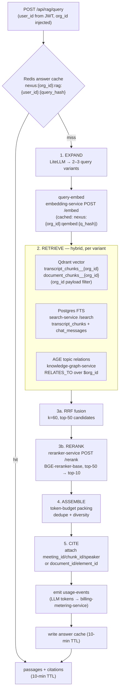
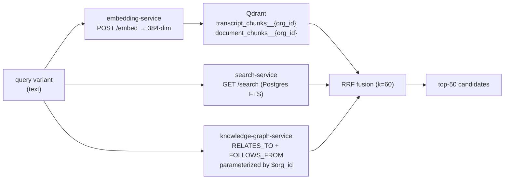
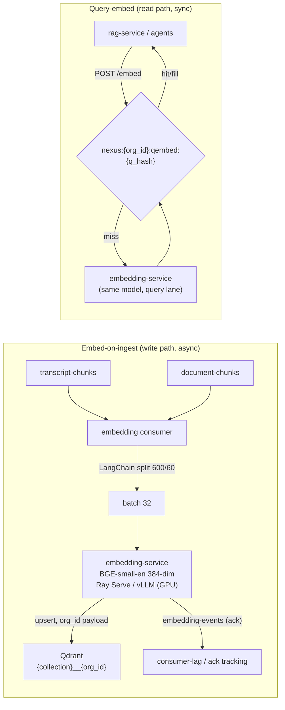
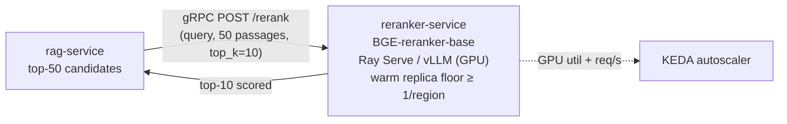
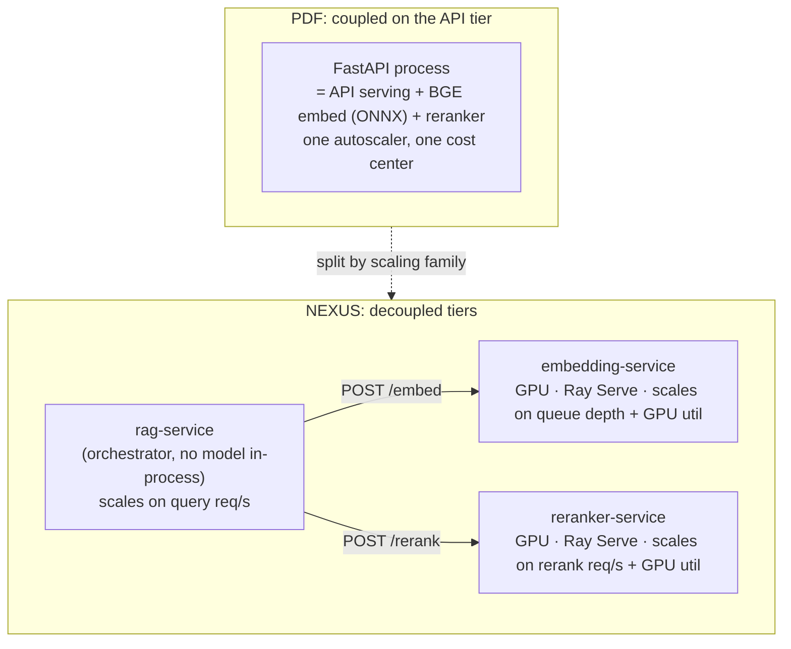
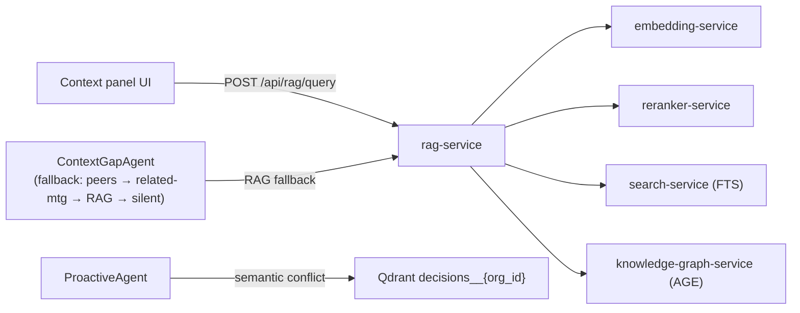

# RAG Pipeline & Inference Serving

How NEXUS answers a retrieval query end-to-end — query expansion, hybrid retrieval, RRF fusion, cross-encoder rerank, token-budgeted context assembly, and citation tracking — and how the dedicated `embedding-service` and `reranker-service` run the BGE models on a GPU inference tier completely off the API tier.

## Related documents

- [Service Catalog](_canon/01-service-catalog.md) — canonical names and ownership for `rag-service`, `embedding-service`, `reranker-service`, `search-service`, `knowledge-graph-service`.
- [Canonical Data Model](_canon/02-data-model.md) — `document_chunks`, `transcript_chunks`, Qdrant collections, Redis namespaces, the citation contract.
- [Capacity & Scaling Math](_canon/05-capacity-math.md) — frozen anchors (`EM2`, `EM4`, `V6`, `V7`) and SLOs imported by reference, never re-derived.
- [Locked Tech & Architecture Decisions](_canon/06-tech-decisions.md) — locked RAG pipeline shape, BGE models, hybrid retrieval, citation rule.
- [Data Architecture](05-data-architecture.md) — store selection, Qdrant quantization, AGE graph, FTS index placement, retention.
- [Event Streaming & Schema Registry](07-event-architecture.md) — `transcript-chunks` / `document-chunks` topics, the embedding consumer, `usage-events`, idempotency/DLQs.
- [Multi-Tenancy & Isolation](06-multi-tenancy.md) — per-tenant Qdrant collections, `org_id` injection, namespaced Redis, org-partitioned graph.
- [Inference & LLM Pipeline](08-ai-agent-architecture.md) — the cost-controlled *agent* LLM pipeline (windowed batching, tiered Haiku/Sonnet/Opus routing) that this document's query-expansion step shares.
- [Agent Runtime & LangGraph](08-ai-agent-architecture.md) — `ProactiveAgent` semantic conflict detection over the `decisions` Qdrant collection; agents that call `POST /api/rag/query`.

---

## 1. Scope and the two responsibilities

This document owns two adjacent but distinct things, both locked in [Tech & Architecture Decisions](_canon/06-tech-decisions.md) §2.5 and §2.9:

1. **The `rag-service` pipeline** — the five-stage `RAGService` (`expand -> retrieve -> rerank -> assemble -> cite`) behind `POST /api/rag/query`. This is request-time orchestration: it calls out to the inference tier, the vector store, Postgres FTS, and the knowledge graph, fuses the results, and returns cited passages.
2. **The dedicated inference services** — `embedding-service` (BGE-small-en, 384-dim) and `reranker-service` (BGE-reranker-base cross-encoder). Both run on GPU via **Ray Serve / vLLM**, autoscale on their own signals, and are **off the API tier**. They are stateless model servers with no Postgres ownership.

What this document does **not** cover: the cost-controlled *agent* LLM pipeline (relevance pre-gating, windowed batching, tiered Haiku/Sonnet/Opus routing for the six LangGraph agents) lives in [Inference & LLM Pipeline](08-ai-agent-architecture.md) and [Agent Runtime](08-ai-agent-architecture.md). The one overlap — RAG query expansion is itself a small LLM call routed through LiteLLM — is described here only as a pipeline stage; its routing and quota mechanics are defined there.

> [SaaS-scale adjustment] The PDF ran the BGE-small embedding model "via ONNX runtime" inside the FastAPI service and described the reranker as a step in `RAGService`, implicitly on the same API process. That couples CPU/GPU-bound inference to request/s-bound API serving: one tier's load profile is queue depth and GPU utilization, the other's is HTTP req/s and Postgres connections. NEXUS splits them. `embedding-service` and `reranker-service` are separate deployments with their own autoscalers and their own cost center. This is the architectural fix for the PDF's inference-on-API-tier coupling and is the substrate for defeating R4 (LLM cost spiral) and R5 (agent latency budget). §6 makes the fix explicit.

---

## 2. The RAGService pipeline at a glance

The pipeline shape is frozen: `expand -> retrieve -> rerank -> assemble -> cite`. Every retrieval flows through all five stages; there is no shortcut path that skips citation tracking.



| Stage | What it does | Calls | Latency budget contribution (warm) |
|---|---|---|---|
| **0. Cache** | Look up `(user_id, query_hash)` in Redis | Redis `GET` | ~2 ms (hit returns immediately) |
| **1. Expand** | LLM returns 2–3 query variants to widen recall | LiteLLM (Haiku) | ~120 ms (skippable; see §3.1) |
| **2. Retrieve** | Three arms run in parallel per variant | `embedding-service`, Qdrant, `search-service`, `knowledge-graph-service` | ~80 ms (parallel, bounded by slowest arm) |
| **3a. Fuse** | Reciprocal Rank Fusion → top-50 candidates | in-process | ~5 ms |
| **3b. Rerank** | Cross-encoder scores top-50, keeps top-10 | `reranker-service` | ~120 ms (warm) |
| **4. Assemble** | Token-budget packing, dedupe, source diversity | in-process | ~10 ms |
| **5. Cite** | Bind every passage to its provenance | in-process | ~5 ms |

The warm p95 budget is **< 500 ms** and the cold p95 budget is **< 1.5 s** ([Capacity & Scaling Math](_canon/05-capacity-math.md) §11.1). The reranker cross-encoder is the long pole on a cold path (cross-encoder cold start), which is why §5 specifies a warm-pool floor.

---

## 3. Stage detail

### 3.1 Stage 1 — query expansion

Query expansion takes the raw user query and produces **2–3 variants** (locked, `06-tech-decisions.md` §2.9). The variants are paraphrases and decompositions that widen recall before fusion — e.g. *"what did we decide about the pricing model?"* expands to *"pricing model decision"*, *"pricing tier rationale"*, *"who confirmed the pricing change"*.

The expansion call is routed through **LiteLLM on the Haiku tier** — it is a short, cheap, latency-sensitive call, and Haiku is the correct tier (the same tier the agent pipeline uses for triage; see [Inference & LLM Pipeline](08-ai-agent-architecture.md)). The prompt is loaded through the versioned prompt-template loader so expansion behavior is reviewable and reproducible.

```python
# rag-service: expansion stage (illustrative)
async def expand(query: str, org_id: UUID, user_id: UUID) -> list[str]:
    ctx = await get_user_context(user_id)        # role/skills/team/recent topics, Redis-cached 5 min
    variants = await litellm_complete(
        model="claude-haiku",                     # triage tier; per-tenant token budget enforced upstream
        template="rag/query_expansion@v3",        # versioned prompt-template loader
        vars={"query": query, "role": ctx.role, "topics": ctx.topics},
        max_tokens=120,
    )
    return [query, *variants.parsed[:2]]          # original + up to 2 variants = 3 total
```

> [SaaS-scale adjustment] Expansion is gated by the per-tenant token budget (`agent_budgets`, [Data Model](_canon/02-data-model.md) §2.2). If a tenant is in `state = throttled`/`blocked`, expansion is **skipped** and retrieval runs on the raw query only — RAG degrades to single-query recall rather than failing. The PDF had no token budget; expansion always ran.

`get_user_context(user_id)` (PDF utility, name verbatim) personalizes expansion to the asker's role and recent topics, so a designer and an engineer asking the same words get role-tuned variants. The result is cached at `nexus:{org_id}:user_ctx:{user_id}` (5-min TTL).

### 3.2 Stage 2 — hybrid retrieval (three arms)

Hybrid retrieval is locked: **Qdrant vector + Postgres FTS + AGE topic relations**, fused by RRF (`06-tech-decisions.md` §2.9). The three arms are complementary signals and are issued **in parallel** so the stage is bounded by the slowest arm, not their sum.

| Arm | Owner | Surface | Returns | Tenant isolation |
|---|---|---|---|---|
| **Vector** | `embedding-service` + Qdrant | `embedding-service POST /embed` then Qdrant search | top-k semantic neighbors from `transcript_chunks__{org_id}` and `document_chunks__{org_id}` | Per-tenant collection **and** mandatory `org_id` payload filter (defense in depth) |
| **Lexical (FTS)** | `search-service` | `GET /search` | top-k keyword matches over `transcript_chunks` + `chat_messages` (tsvector) | RLS by `org_id` on the underlying tables |
| **Graph (topic relations)** | `knowledge-graph-service` | `POST /graph/query/{template}` | entities linked by `RELATES_TO` to the query's topics, plus `FOLLOWS_FROM` lineage | Every Cypher template parameterized by `$org_id`; org-partitioned `nexus_knowledge` |

**Vector arm.** The query is embedded **once per variant** by `embedding-service` (query-embed only — see §4), then each variant vector searches the relevant per-tenant Qdrant collection. The payload returned carries the frozen citation fields: for transcripts `meeting_id`, `chunk_id`, `speaker`, `start_ms`, `is_final`; for documents `document_id`, `element_id`, `element_type` ([Data Model](_canon/02-data-model.md) §3). The `org_id` payload filter is applied **even though** the collection is already per-tenant — a belt-and-suspenders rule from [Multi-Tenancy](06-multi-tenancy.md).

**Lexical arm.** `search-service` owns the Postgres FTS (`tsvector`) materializations over `transcript_chunks` and `chat_messages` and is the FTS arm of hybrid retrieval for `rag-service` ([Service Catalog](_canon/01-service-catalog.md)). FTS catches exact terms, names, and identifiers that dense vectors blur — product codenames, ticket IDs, person names.

**Graph arm.** The query's topics (from `get_user_context` and lightweight extraction) seed a `RELATES_TO` traversal in `nexus_knowledge`. This surfaces decisions/actions/meetings connected to the topic even when their text never lexically matched the query, and pulls `FOLLOWS_FROM` decision lineage so a query about a superseded decision also returns its successor. Node labels (`Person`, `Meeting`, `Decision`, `Action`, `Topic`) and edge labels (`ATTENDED`, `PRODUCED`, `ASSIGNED_TO`, `RELATES_TO`, `FOLLOWS_FROM`) are used verbatim.



### 3.3 Stage 3 — RRF fusion then cross-encoder rerank

**3a. RRF fusion.** The three arms (across all variants) return ranked lists; Reciprocal Rank Fusion merges them into a single ranking without needing comparable scores across arms. The fused score for a candidate document `d`:

```
RRF(d) = Σ_over_lists  1 / (k + rank_list(d))     with k = 60
```

`k = 60` is the standard RRF constant; it damps the influence of any single arm's top-1 so a strong lexical hit cannot bury a strong semantic-plus-graph consensus. Fusion produces the **top-50** candidates that go to the reranker.

**3b. Cross-encoder rerank.** `reranker-service` runs **BGE-reranker-base**, scoring each `(query, passage)` pair jointly (a cross-encoder, unlike the bi-encoder embedding model), and returns the **top-10** (locked: top-50 → top-10, `06-tech-decisions.md` §2.5). The cross-encoder is far more accurate than vector cosine for final ordering but too expensive to run over the whole corpus — hence the funnel: cheap recall (vector/FTS/graph) → RRF → expensive precision (cross-encoder) over only 50 pairs.

```python
# rag-service → reranker-service (gRPC on the warm path; see Container Architecture §4.1)
reranked = await reranker.rerank(
    query=original_query,                 # rerank against the user's actual query, not variants
    passages=[c.text for c in top50],     # 50 candidates from RRF
    top_k=10,
    org_id=org_id,                        # passed for audit + per-tenant rate accounting
)
```

The rerank stage is the dominant latency contributor and the reason for the `< 500 ms` warm vs `< 1.5 s` cold split: a cold cross-encoder (no warm GPU replica) blows the budget, so §5 keeps a warm floor.

### 3.4 Stage 4 — context assembly with a token budget

The top-10 reranked passages are packed into a context window under an explicit **token budget**, not blindly concatenated. Assembly enforces three rules:

1. **Hard token cap.** The assembled context is capped (default **3,000 tokens** of passages, configurable per calling agent/surface). Passages are added in reranked order until the budget is hit; the cap protects downstream LLM cost (every token is metered to `usage-events`) and keeps the prompt within the cheapest viable model tier.
2. **Dedupe.** Near-duplicate passages (the same utterance retrieved by both the vector and FTS arms, or overlapping 600/60 chunks) are collapsed so the budget isn't spent twice on one fact.
3. **Source diversity.** Assembly avoids packing all 10 passages from one meeting; it caps per-source contribution so a single dominant meeting cannot monopolize the answer when the question spans several.

> [SaaS-scale adjustment] An explicit assembly token budget is a SaaS-scale addition. The PDF described "assemble" abstractly; at production scale every assembled token is billed downstream (LLM input tokens → `usage-events` → `billing-metering-service`), so the cap is a cost-control surface, not just a quality knob. The cap is tightened automatically when a tenant approaches its `agent_budgets` hard quota.

### 3.5 Stage 5 — citation tracking

Every passage that survives assembly carries its provenance, and the contract is **frozen** ([Data Model](_canon/02-data-model.md) §3, [Tech Decisions](_canon/06-tech-decisions.md) §2.9):

- **Transcript passage** → `meeting_id`, `chunk_id`, `speaker`.
- **Document passage** → `document_id`, `element_id`.

This payload shape matches the `transcript_chunks` / `document_chunks` Postgres rows and the Qdrant payloads exactly, so a citation is round-trippable: the UI context panel renders source cards, and clicking a transcript citation jumps to the timestamp in `/meetings/:id/transcript`; clicking a document citation opens the typed element. The response contract:

```json
{
  "answer_passages": [
    {
      "text": "We locked the Pro seat price at $25/seat/month.",
      "rerank_score": 0.94,
      "citation": {
        "kind": "transcript",
        "meeting_id": "8f3c...",
        "chunk_id": "a1b2...",
        "speaker": "Priya Nair",
        "start_ms": 1843200
      }
    },
    {
      "text": "Tax handling deferred to Stripe Tax per the billing RFC.",
      "rerank_score": 0.88,
      "citation": {
        "kind": "document",
        "document_id": "doc_77a...",
        "element_id": "el_0093",
        "element_type": "NarrativeText"
      }
    }
  ],
  "expanded_queries": ["pricing model decision", "pro seat price rationale"],
  "cache": "miss"
}
```

> [SaaS-scale adjustment] [ADR-0033](adr/0033-plan-9-rag-retrieval-upgrades.md) adds, inside the same five stages: participant-scoped retrieval (D1); date, person and source filters returned by the expansion call (D2); `decisions__{org_id}` as a source with `decision` and `action` citation kinds (`decision_id` or `action_id` plus `meeting_id`), so graph-arm results can be cited (D3); neighbouring-chunk context at assembly (D4); a meeting/speaker header in the embedded text (D5); and, with `generate: true`, a streamed answer whose every sentence cites a returned passage, or a fixed abstention (D6). Each is measured by the RAG eval harness (D7).

A passage that cannot be bound to a citation is **dropped before return** — uncited text never reaches the answer. This enforces the PDF's traceable-provenance rule and is the reason `chunk_id`/`element_id` are propagated unbroken from ingestion through Qdrant payload to the API response.

### 3.6 Answer cache

The whole pipeline result is cached in Redis at `nexus:{org_id}:rag:{user_id}:{query_hash}` with a **10-minute TTL** (PDF value, verbatim). The key is per-user (the same words yield role-tuned expansion and personalized graph traversal, so the cache must not be shared across users) and per-tenant-namespaced.

> [SaaS-scale adjustment] The PDF key was `(user_id, query_hash)` with no tenant prefix. The `nexus:{org_id}:` prefix (from [Data Model](_canon/02-data-model.md) §5) makes the cache tenant-isolated and lets a per-tenant flush run on RTBF or plan change without scanning. Caching is also *defense against cost spikes*: a hot query answered from cache costs one Redis `GET`, not an expand+embed+retrieve+rerank cycle.

---

## 4. The embedding-service (BGE-small-en, 384-dim)

`embedding-service` is a dedicated, GPU-backed, autoscaling inference service. It owns **no Postgres tables**; it writes Qdrant vectors and answers query-embed requests. It serves **two and only two** call patterns, both locked in [Tech Decisions](_canon/06-tech-decisions.md) §2.5 — *embed-on-ingest* and *query-embed only*:

| Call pattern | Trigger | Path | Batch | Latency target |
|---|---|---|---|---|
| **Embed-on-ingest** | consume `transcript-chunks` / `document-chunks` from Redpanda | the embedding consumer (consume → split → embed → upsert) | **batch 32** | **sub-100 ms / batch** (per PDF, `EM3 ≈ 16.4 batches/s peak`) |
| **Query-embed** | `rag-service` expansion stage; agent retrieval | `POST /embed` (internal-only) | 1–3 (query variants) | embedded in the < 500 ms warm RAG budget |



### 4.1 Why embed-on-ingest, query-embed only

The bulk of embedding work happens **once, at ingest**, never at query time. A transcript chunk or document element is embedded when it lands on the bus and the vector is stored; retrieval only ever embeds the (short) query. This is what keeps the read path inside the < 500 ms budget — the heavy embedding flow (`V6 = 340M vectors/month`, `EM2 ≈ 525 embeds/s peak`, [Capacity §9](_canon/05-capacity-math.md)) is on the async write path, decoupled from the synchronous query path.

Capacity, imported by reference (do not re-derive — see [Capacity & Scaling Math](_canon/05-capacity-math.md)):

| Symbol | Quantity | Value |
|---|---|---|
| `EM2` | Embeddings / sec (peak, ingest) | **~525** |
| `EM3` | Peak batches / sec (batch 32) | **~16.4** |
| `EM4` | Query embeddings / sec (peak) | **~700** |
| `V6` | Vectors ingested / month (flow) | **340,000,000** |
| `V7` | Qdrant live stock (13-mo retention) | **4,420,000,000 (~17 TB)** |

Note `EM4 (~700 query-embeds/s) > EM2 (~525 ingest embeds/s)` at peak — query-embed is not free, which is exactly why query embeddings are cached (§4.2). The two lanes share the model but get separate Ray Serve deployments so a query-embed burst (driven by RAG/agent read traffic) never starves the ingest lane (driven by meeting volume), and vice versa.

### 4.2 Query-embedding Redis cache

Query embeddings are cached in Redis so repeated or near-repeated queries (a popular question, an agent re-querying within a window) skip the GPU round-trip.

> [SaaS-scale adjustment] Caching the **query embedding** is a SaaS-scale addition not in the PDF. It **extends the canonical Redis namespace table** ([Data Model](_canon/02-data-model.md) §5) with one new key, `nexus:{org_id}:qembed:{query_hash}` (short TTL ~10 min, aligned with the answer cache), introduced for the query-embed-only read path defined here; it follows the existing `nexus:{org_id}:…` tenant-namespacing rule verbatim. It sits *below* the answer cache: an answer-cache miss can still be a query-embed hit (same words, different `user_id`, so different answer cache key but identical embedding). At `EM4 ≈ 700/s` peak this measurably trims GPU load and tail latency.

### 4.3 Runtime, batching, and quantization

- **Runtime:** BGE-small-en on **Ray Serve** with dynamic batching; the model is small (384-dim output) so a single GPU replica serves a high request rate. vLLM is reserved for the larger LLM serving paths; for the BGE bi-encoder, Ray Serve's micro-batching is the right tool.
- **Ingest batching:** batch size **32**, sub-100 ms per batch (PDF, verbatim). The consumer accumulates a batch from `transcript-chunks`/`document-chunks` (or flushes on a short timer so tail chunks aren't stranded).
- **Output:** 384-dim float32 (1,536 bytes raw/vector). Vectors are **int8 scalar-quantized** in Qdrant (cuts resident RAM ~4×) — a storage decision owned by [Data Architecture](05-data-architecture.md), referenced here because it is what keeps `V7 ≈ 17 TB` affordable.

> [SaaS-scale adjustment] The PDF embedded "via ONNX runtime" on the API service. NEXUS keeps the **same model and the same 384-dim output** but moves execution to a GPU Ray Serve deployment off the API tier. The model contract is unchanged; only its placement and autoscaler change.

---

## 5. The reranker-service (BGE-reranker-base cross-encoder)

`reranker-service` runs **BGE-reranker-base**, a cross-encoder, and exposes one internal-only surface: `POST /rerank` (passages → scored top-k). It owns no data. Its sole job is to take the top-50 RRF candidates from `rag-service` and return the top-10 by joint `(query, passage)` relevance, under the **< 500 ms cold** budget for the rerank step (PDF reranker budget, [Capacity §11.1](_canon/05-capacity-math.md)).



### 5.1 Cross-encoder vs bi-encoder — why a separate service

The embedding model is a **bi-encoder**: query and document are encoded independently, so document vectors are precomputed at ingest and the query is cheap. The reranker is a **cross-encoder**: it concatenates `(query, passage)` and runs a full forward pass per pair, which is far more accurate for final ordering but cannot be precomputed and is ~50× more work per pair. Running it over the whole corpus is impossible; running it over 50 RRF survivors per query is exactly affordable. The two models have opposite cost profiles and opposite scaling signals, so they are **separate deployments** even though both are "BGE on GPU."

### 5.2 Warm-pool floor and the cold/warm SLO

The single biggest reranker latency risk is a **cold cross-encoder** — a scaled-to-zero replica forced to cold-start mid-query. The SLOs split precisely on this: **warm p95 < 500 ms**, **cold p95 < 1.5 s**. To keep p95 on the warm side, `reranker-service` runs a **minimum warm replica floor of ≥ 1 per active region** (never scales to zero while any tenant is in business hours) and autoscales up on GPU utilization + rerank req/s. The cold budget exists only to bound the worst case (a region waking up), not as the steady state.

> [SaaS-scale adjustment] A warm-replica floor and an explicit cold/warm SLO split are SaaS-scale additions. The PDF stated a single "< 500 ms cold" reranker budget for a single-app build; at production query rates a scale-to-zero reranker would routinely miss it, so NEXUS pins a warm floor and treats < 1.5 s as the cold-start ceiling rather than the target.

---

## 6. The fix: inference OFF the API tier

This is the central architectural correction relative to the PDF, and it is worth stating without hedging.

**PDF coupling.** The PDF ran BGE-small "via ONNX runtime" and the reranker as in-line `RAGService` steps — both on the FastAPI process. That single process then had to absorb three load profiles at once: HTTP req/s (CRUD + RAG API), GPU-bound embedding throughput at ingest, and GPU-bound cross-encoder bursts at query time. They share nothing in their scaling math:

| Tier | Autoscaler signal | Cost driver |
|---|---|---|
| CRUD / API (`rag-service`'s HTTP surface, `bff`, `core-api`) | HTTP req/s, p95 latency | CPU + Postgres connections |
| AI / inference (`embedding-service`, `reranker-service`) | Queue depth, **GPU utilization**, batch throughput | **GPU** (separate cost center) |

Coupling them means an ingest backlog (meeting volume) throttles API request serving, and an API traffic spike steals GPU cycles from embedding — the worst of both worlds, and the direct cause of the PDF's R4 (cost spiral) and R5 (latency budget) being so tight.

**NEXUS fix.** `embedding-service` and `reranker-service` are dedicated GPU services on Ray Serve/vLLM with their own KEDA autoscalers, in the AI/inference scaling family ([Service Catalog](_canon/01-service-catalog.md) §4). `rag-service` stays in the AI tier as an *orchestrator* (it scales on query req/s, holds no model in-process) and reaches the model servers over the internal gRPC mesh ([Container Architecture](03-container-architecture.md) §4.1). The result:



- The inference cost center scales and bills **independently** of CRUD traffic, which is what makes per-tenant token budgets and the C2 cost/MAU model in [Capacity §10](_canon/05-capacity-math.md) meaningful.
- An ingest surge consumes embedding GPU capacity without touching API p95.
- The reranker can hold a warm GPU floor for latency without paying to keep the entire API fleet GPU-backed.

This decoupling is the precondition for both R4 (the cost-controlled LLM agent pipeline, owned by [Inference & LLM Pipeline](08-ai-agent-architecture.md)) and R5 (the < 2 s agent / < 500 ms RAG budgets) being achievable at the §2 capacity anchors.

---

## 7. Tenant isolation across the RAG path

Every stage enforces `org_id`, so a query can never retrieve another tenant's data:

| Stage | Isolation mechanism |
|---|---|
| Entry | `api-gateway` validates the Clerk JWT; authz middleware injects `org_id` into the request context. |
| Expand | `get_user_context` keyed by `org_id`; budget check against this tenant's `agent_budgets`. |
| Vector | Per-tenant Qdrant collection `{collection}__{org_id}` **and** mandatory `org_id` payload filter. |
| FTS | `search-service` queries run under RLS (`USING (org_id = current_setting('app.current_org'))`). |
| Graph | Cypher templates parameterized by `$org_id`; traversal cannot leave the org subgraph. |
| Meeting scope | Inside the org, transcript, chat and decision passages are restricted to meetings the asker is a participant of (`meeting_participants`), in every arm; documents stay org-wide ([ADR-0033](adr/0033-plan-9-rag-retrieval-upgrades.md) D1). |
| Cache | Answer + query-embed caches namespaced `nexus:{org_id}:…`. |
| Meter | `usage-events` partitioned by tenant key; cost attributed to the right org. |

See [Multi-Tenancy & Isolation](06-multi-tenancy.md) for the full isolation contract and [Security & AuthZ](11-security-architecture.md) for `org_id` injection internals.

---

## 8. Consumers of the RAG pipeline

`POST /api/rag/query` (owned by `rag-service`, [Service Catalog](_canon/01-service-catalog.md) §6) is called by:

- **The context panel UI** — direct user retrieval, rendered as source cards with clickable citations.
- **`ContextGapAgent`** — RAG is the **third link in its fallback chain** (`peer-agents -> related-meeting agents -> RAG -> silent`). When peer agents and related-meeting agents fail to fill a context gap within the deadline, ContextGapAgent falls through to `POST /api/rag/query`. This is also the pre-authorized R6 descope target: if multi-agent collaboration is shelved, context fill ships **RAG-only**. See [Agent Runtime](08-ai-agent-architecture.md).
- **`ProactiveAgent`** — uses the **`decisions__{org_id}` Qdrant collection** for semantic conflict detection (a new decision semantically contradicting a past one), complementing the AGE `FOLLOWS_FROM` lineage query. The `decisions` collection is embedded on confirmation ([Data Model](_canon/02-data-model.md) §3).



---

## 9. SLOs and observability

All targets imported verbatim from [Capacity & Scaling Math](_canon/05-capacity-math.md) §11 — not restated as new numbers:

| Surface | Metric | Target |
|---|---|---|
| `POST /api/rag/query` | p95 (warm) | **< 500 ms** |
| `POST /api/rag/query` | p95 (cold) | **< 1.5 s** |
| `embedding-service` embed | per batch of 32 | **< 100 ms** |
| Embedding consumer | consumer lag | **< 5 s** (alert at 30 s) |
| `reranker-service` | warm p95 (top-50 → top-10) | **< 500 ms** |
| Per-tenant token budget | quota-breach enforcement | **100% (hard cap, deny-by-default)** |

Per-stage metrics emitted to Prometheus (tenant-tagged, structured JSON logs): cache hit rate (answer + query-embed), expand/retrieve/fuse/rerank/assemble stage latencies, RRF candidate count, reranker GPU utilization and warm-replica count, embedding consumer lag, and `usage-events` token volume per tenant. Dashboards live in Grafana; consumer-lag and per-tenant budget panels are owned jointly with [Event Streaming](07-event-architecture.md) and [SaaS Business](18-saas-business-architecture.md).

---

## 10. Summary

- The `rag-service` pipeline is **frozen** at `expand -> retrieve -> rerank -> assemble -> cite`, answered behind `POST /api/rag/query`, with a per-user/per-tenant 10-min Redis answer cache.
- Hybrid retrieval fuses **Qdrant vector + Postgres FTS + AGE `RELATES_TO` topic relations** via **RRF (k=60)** into top-50, then a **BGE-reranker-base cross-encoder** funnels to top-10.
- Context assembly is **token-budgeted** (cost-aware), and every returned passage carries the **frozen citation contract** (`meeting_id`/`chunk_id`/`speaker` or `document_id`/`element_id`); uncited text is dropped.
- `embedding-service` (BGE-small-en, 384-dim) and `reranker-service` (BGE-reranker-base) run on **GPU via Ray Serve/vLLM, off the API tier**, with their own autoscalers and cost center — the explicit fix for the PDF's inference-on-API-tier coupling, and the precondition for R4 and R5.
- Embedding is **embed-on-ingest, query-embed only**; query embeddings are Redis-cached; the reranker holds a **warm-replica floor** to keep p95 on the warm side of the SLO.
- Tenant isolation is enforced at **every** stage via `org_id`. Numbers are imported from [Capacity & Scaling Math](_canon/05-capacity-math.md) by reference; names are used verbatim from the canon.
