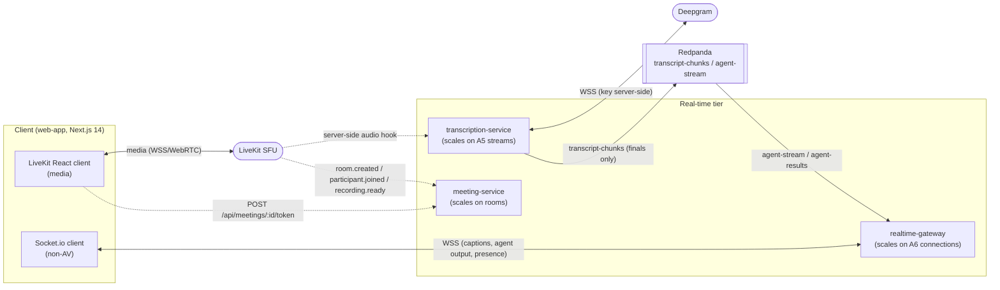
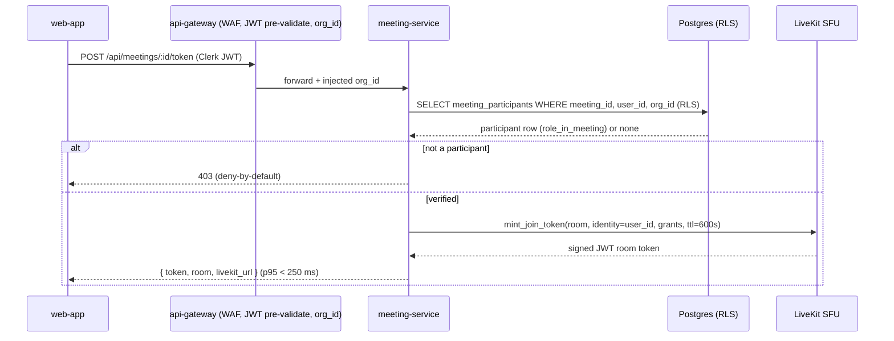
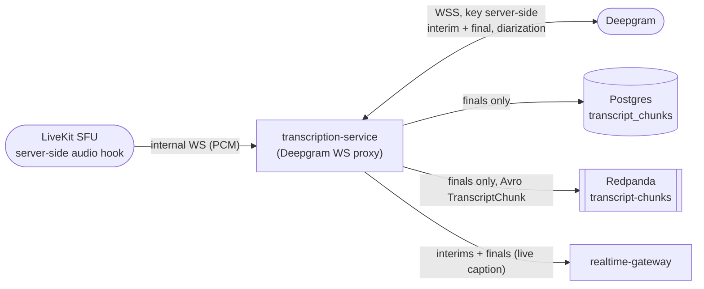
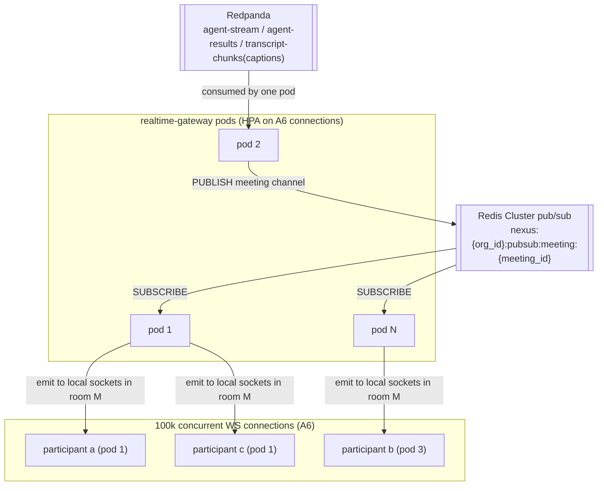
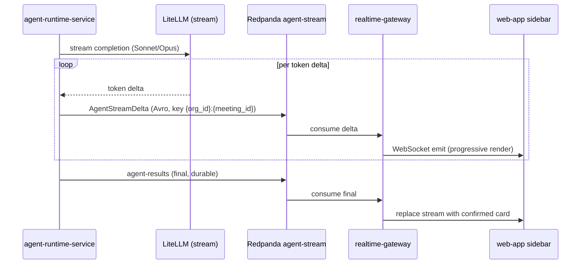

# Real-time & Transcription

The frozen, production-grade specification of the NEXUS real-time tier — LiveKit transport, the Deepgram transcription pipeline, the independently-scaled `realtime-gateway` fan-out plane, streamed agent output, and the per-path latency budget that replaces the PDF's fragile flat "under 2s."

## Related documents

- [Container Architecture](03-container-architecture.md) — the C4 L2 view; `realtime-gateway`, `transcription-service`, and `meeting-service` containers and their edges.
- [Data Architecture](05-data-architecture.md) — `transcript_chunks` partitioning/retention, `nexus-recordings` bucket, Redis namespaces.
- [Multi-Tenancy & Tenant Isolation](06-multi-tenancy.md) — `org_id` injection, namespaced Redis, tenant-keyed partitions.
- [Event-Driven Architecture](07-event-architecture.md) — authority for `transcript-chunks`, `agent-stream`, `meeting-room-events`, `presence-events` schemas, partition keys, and retention.
- [Service Catalog](_canon/01-service-catalog.md) — canonical service names, ownership, and sync-API boundaries.
- [Canonical Data Model](_canon/02-data-model.md) — entity names (`transcript_chunks`, `meeting_speakers`, `meeting_rooms`), stores, tenant keys.
- [Capacity & Scaling Math](_canon/05-capacity-math.md) — frozen anchors (A5, A6, A8, A12, D1) and the §11 SLO targets imported by reference.
- [Locked Tech & Architecture Decisions](_canon/06-tech-decisions.md) — §2.7 (real-time meeting & transcription) and §2.5 (inference/LLM) decision rows.

---

## 1. Scope and the three real-time services

This document owns the **live path**: from a participant joining a LiveKit room, through server-side audio capture and Deepgram transcription, to live captions and streamed agent output landing in the agent sidebar. It does not re-name entities (that is [Data Model](_canon/02-data-model.md)), re-derive load (that is [Capacity Math](_canon/05-capacity-math.md)), or redefine event schemas (that is [Event-Driven Architecture](07-event-architecture.md)); it cites those by reference and specifies the **runtime, protocol, scaling, and latency** of the real-time tier.

Three canonical services divide this path, and the boundary between them is deliberate — each scales on a different signal and must never be coupled:

| Service | Responsibility (this doc) | Sync surface owned | Autoscaler signal |
|---|---|---|---|
| `meeting-service` | LiveKit transport adapter: token minting, room lifecycle, webhook receiver, server-side audio hook handoff. Owns `meeting_rooms`. | `POST /api/meetings/:id/token`, `POST /livekit/webhook` | Concurrent rooms |
| `transcription-service` | Deepgram WebSocket proxy: key stays server-side, diarization, interim-vs-final separation, persists **only finals** to `transcript_chunks`, emits the `transcript-chunks` topic. | Internal audio WS in; transcript finals | Concurrent **live streams** (anchor `A5` = 20,000 peak meetings) |
| `realtime-gateway` | Socket.io / WSS fan-out for non-AV events: live captions, presence, chat, agent sidebar outputs, streamed agent tokens, priority alert queue. Redis-cluster pub/sub backbone. | Socket.io / WSS rooms per `meeting_id` | Concurrent **WebSocket connections** (anchor `A6` = 100,000 peak participants) |

The split between `transcription-service` (scales on `A5` = 20,000 meetings, one diarized stream each) and `realtime-gateway` (scales on `A6` = 100,000 participant connections) is the single most important structural decision in this document. They sit in the same **real-time scaling family** ([Container Architecture §6](03-container-architecture.md)) but on opposite anchors.

> [SaaS-scale adjustment] The PDF ran Socket.io and the Deepgram proxy *inside* the single FastAPI application. At `A6` = 100,000 sticky WebSocket connections fanning out agent output, the connection plane must scale on connection count while transcription scales on stream count; coupling them forces one to over-provision for the other's load. `realtime-gateway` and `transcription-service` are therefore separate containers with separate HPAs — see [Container Architecture §6](03-container-architecture.md) and [Tech Decisions §2.1](_canon/06-tech-decisions.md).



---

## 2. LiveKit: the locked meeting transport

### 2.1 The decision and the cost rationale

The PDF deferred the meeting SDK (risk **R2**: evaluate ≥2 in Phase 1, switching costs non-trivial after Phase 3). The SaaS posture **locks LiveKit** — see [Tech Decisions §2.7](_canon/06-tech-decisions.md).

The decisive factor is per-minute economics at scale. Capacity fixes `D1` = **216,000,000 meeting-minutes/month** ([Capacity §7](_canon/05-capacity-math.md)). A vendor that bills per participant-minute multiplies that by the roster; at the locked anchors that is the difference between billing 216M minutes and billing `D1 × 6` participant-minutes.

| Property | Why it decides the lock |
|---|---|
| Open-source self-hostable SFU | An SFU forwards each participant's stream once per subscriber instead of re-encoding (MCU); self-hosting on the Kubernetes substrate ([Tech Decisions §2.1](_canon/06-tech-decisions.md)) removes any per-participant vendor ceiling — cost tracks our own compute, not a seat meter. |
| Strong server-side audio hooks | LiveKit exposes a server-side track subscription so `transcription-service` taps room audio without a client uplink — the Deepgram key never leaves the backend (§3). |
| One diarized stream per meeting | We subscribe to the **mixed room audio** server-side and run a single Deepgram session per meeting with diarization — the 6× cost lever locked in [Capacity §7](_canon/05-capacity-math.md), consistent with `meeting_speakers` mapping diarized `speaker_id → user_id`. |

> [SaaS-scale adjustment] LiveKit is wholly locked here (PDF R2 resolved). The PDF named LiveKit/Daily/Stream/Agora as candidates and deferred. The self-hostable SFU is what makes `D1` = 216M minutes/month affordable; a per-participant-billed managed SDK does not survive the capacity math.

### 2.2 The transport adapter abstraction

LiveKit is always reached through a **transport adapter** inside `meeting-service` — the PDF's "abstract the SDK" stance, preserved so the lock stays swappable. No other service imports the LiveKit SDK; they call the adapter interface.

```python
# meeting-service: transport adapter — the ONLY place the LiveKit SDK is imported.
class MeetingTransport(Protocol):
    async def mint_join_token(
        self, *, org_id: UUID, meeting_id: UUID, user_id: UUID,
        role_in_meeting: str, ttl_seconds: int = 600,
    ) -> str: ...
    async def start_egress(self, *, org_id: UUID, meeting_id: UUID, room: str) -> str: ...
    async def subscribe_room_audio(self, *, org_id: UUID, room: str) -> AudioTrackHandle: ...
    def verify_webhook(self, *, body: bytes, auth_header: str) -> WebhookEvent: ...

class LiveKitTransport(MeetingTransport):
    """Concrete LiveKit binding. Swappable per Tech Decisions §2.7."""
```

The adapter is the seam that keeps the LiveKit lock reversible: a future SFU swap reimplements this interface and touches nothing in `core-api`, `transcription-service`, or the agent tier.

### 2.3 Token minting — `POST /api/meetings/:id/token`

Joining a room requires a short-lived, participant-verified LiveKit grant. The endpoint is owned exclusively by `meeting-service` ([Service Catalog §6](_canon/01-service-catalog.md)). The flow is server-mediated: the client never holds LiveKit API credentials, only a scoped, expiring room token.



Rules enforced at mint time:

- **Participant verification.** The caller must have a `meeting_participants` row for `(meeting_id, user_id)` within the JWT-resolved `org_id`. RLS is the backstop; the explicit check is the deny-by-default gate.
- **Tenant binding.** `org_id` comes only from the Clerk-verified JWT via the authz middleware ([Multi-Tenancy](06-multi-tenancy.md)); it is never read from the request body.
- **Short TTL.** Tokens default to a 600 s TTL with grants scoped to exactly one room and one identity (`user_id`). Reconnects re-mint.
- **Latency.** This is on the meeting-join critical path; SLO is **p95 < 250 ms** ([Capacity §11.1](_canon/05-capacity-math.md)).

### 2.4 Webhooks — `POST /livekit/webhook`

LiveKit drives meeting lifecycle state via signed webhooks, received only by `meeting-service`. Signatures are verified through the adapter (`verify_webhook`) before any state change.

| LiveKit event | `meeting-service` action | Emits |
|---|---|---|
| `room.created` | Mark `meetings.status = active`; ensure the `meeting_rooms` (LiveKit room ↔ meeting) map row exists. | `meeting-room-events` |
| `participant.joined` | Confirm presence; signal the audio hook to start the Deepgram stream if this is the first participant. | `meeting-room-events` |
| `recording.ready` (egress) | Persist the recording/egress reference into `meeting_rooms`; the object lands in `nexus-recordings` at `{org_id}/{meeting_id}/`. | `meeting-room-events` |

`meeting-room-events` is owned and partitioned by [Event-Driven Architecture §4](07-event-architecture.md) (`MeetingRoomEvent`, 24 partitions, 3-day retention, key `org_id`) — consumed by `transcription-service` (to open/close streams) and `core-api`. This document does not redefine that schema.

> [SaaS-scale adjustment] Webhook handling uses the at-least-once inbox: every LiveKit webhook carries an idempotency key (`{room}:{event}:{participant_sid}`) deduped via `nexus:{org_id}:dedupe:livekit:{key}` so a redelivered `recording.ready` cannot double-write `meeting_rooms` ([Data Model §5](_canon/02-data-model.md), [Event-Driven Architecture §6](07-event-architecture.md)). The PDF had a plain webhook receiver with no dedupe.

---

## 3. The Deepgram transcription pipeline

### 3.1 Server-side audio path

Audio never leaves the backend trust boundary to reach Deepgram. The LiveKit server-side audio hook delivers mixed room audio to `transcription-service` over an internal WS; `transcription-service` opens a single Deepgram WebSocket session per meeting and proxies the audio, keeping the Deepgram API key server-side.



### 3.2 Diarization, interim vs final, persist finals only

The Deepgram session is configured for streaming ASR with **speaker diarization** and **interim + final** results. Two rules, carried verbatim from the PDF, govern what survives:

1. **Interim vs final are separated.** Interims drive live captions in the UI (low-latency, mutable). They are **never persisted** and never emitted to the bus. Only `is_final` results become durable.
2. **Persist finals only.** Each final utterance is merged by speaker turn and written as one `transcript_chunks` row, then emitted to the `transcript-chunks` topic.

The persisted row matches the canonical `transcript_chunks` schema ([Data Model §2.1](_canon/02-data-model.md)) — `org_id`, `meeting_id`, `speaker_id`, `start_ms`, `end_ms`, `text`, `is_final`, `confidence`, indexed on `(meeting_id, start_ms)`. Diarized `speaker_id` is mapped to `user_id` through `meeting_speakers` (reliable manual assignment plus a confidence-scored suggestion, per PDF risk **R7**); the transcription stage emits the diarized label and the mapping is resolved downstream, never guessed at write time.

The emitted bus message is the `TranscriptChunk` Avro value enveloped per [Event-Driven Architecture §3](07-event-architecture.md). At `A12` = 8 finals/minute over a 45-minute meeting this is **360 `transcript_chunks`/meeting** (`T2`) — this document consumes that number, it does not re-derive it.

> [SaaS-scale adjustment] The bus message is enveloped (`org_id`, `idempotency_key = chunk:{chunk_id}`, `correlation_id`, `schema_version`) and the topic is partitioned by the composite key `{org_id}:{meeting_id}` so a hot enterprise tenant spreads across partitions while within-meeting speech order is preserved ([Event-Driven Architecture §4.1](07-event-architecture.md)). The PDF had no envelope and no tenant partition key.

### 3.3 Provider abstraction and the Whisper cost tier

Deepgram is the **locked default** transcription provider ([Tech Decisions §2.7](_canon/06-tech-decisions.md)). To control cost on low-value paths without renegotiating that lock, transcription sits behind a provider adapter — the same pattern as the LiveKit transport adapter.

```python
class TranscriptionProvider(Protocol):
    async def open_stream(self, *, org_id: UUID, meeting_id: UUID,
                          diarize: bool = True) -> TranscriptStream: ...

class DeepgramProvider(TranscriptionProvider):
    """LOCKED DEFAULT. Streaming WSS, diarization, interim+final."""

class WhisperProvider(TranscriptionProvider):
    """Optional cost tier: self-hosted faster-whisper on the GPU inference tier."""
```

> [SaaS-scale adjustment] A **Whisper cost tier** is added as an optional provider behind the adapter; it does not displace Deepgram. Self-hosted `faster-whisper` runs on the dedicated GPU inference tier (Ray Serve / vLLM, [Tech Decisions §2.5](_canon/06-tech-decisions.md)) where embeddings and the reranker already live. Routing policy: Deepgram for all **live** transcription (its sub-second interim latency is load-bearing for the caption SLO); Whisper is eligible only for **batch/post-hoc** transcription of recordings and for **Free-plan** tenants where the per-minute saving outweighs slightly higher latency — gated by `tenant_settings` and per-tenant token/cost budgets ([Data Model §2.2](_canon/02-data-model.md)). Live diarized streaming stays on Deepgram. The PDF named only Deepgram and had no tiering.

The provider boundary also satisfies a subprocessor-substitution requirement: a tenant with a DPA constraint forbidding a US ASR subprocessor can be pinned to the self-hosted Whisper tier without code changes elsewhere.

---

## 4. `realtime-gateway`: independent fan-out plane

### 4.1 What it carries and why it is separate

`realtime-gateway` is the WebSocket/Socket.io fan-out plane for every **non-AV** real-time signal. It carries no media (that is LiveKit) and owns no durable data — only ephemeral connection state. Socket.io rooms are keyed by `meeting_id`.

| Channel | Source | Direction |
|---|---|---|
| Live captions | `transcription-service` (interims + finals) | server → client |
| Agent sidebar output | `agent-results` topic | server → client |
| Streamed agent tokens | `agent-stream` topic | server → client (§5) |
| In-meeting chat | `web-app` ↔ `chat_messages` via `core-api` | bidirectional |
| Presence | join/leave → `presence-events` | bidirectional |
| Priority alert queue | per-user queue `nexus:{org_id}:queue:agent:{user_id}` | server → client |

It scales on **concurrent WebSocket connections** — anchor `A6` = 100,000 peak participants — independently of `transcription-service` (`A5` = 20,000 streams). The `A8` = 5.0 effective-occupancy reconciliation ([Capacity §2.1](_canon/05-capacity-math.md)) is exactly why the two anchors are not interchangeable: 20,000 meetings carry ~100,000 live connections, not `20,000 × 6` nominal.

### 4.2 Redis-cluster pub/sub fan-out

A connection for meeting `M` may land on any `realtime-gateway` pod, but an `agent-results` or caption event for `M` arrives at one pod from the bus. Cross-pod fan-out uses a **Redis-cluster pub/sub backbone** (the Socket.io Redis adapter), publishing on the canonical channel `nexus:{org_id}:pubsub:meeting:{meeting_id}` ([Data Model §5](_canon/02-data-model.md)).



> [SaaS-scale adjustment] The PDF specified Redis pub/sub for Socket.io fan-out in Phase 11 but as a single Redis instance inside the monolith. At `A6` = 100,000 connections the backbone is a **Redis Cluster** with channels namespaced `nexus:{org_id}:…` so fan-out, eviction, and per-tenant flush are tenant-isolated ([Multi-Tenancy](06-multi-tenancy.md)). Presence is published as `presence-events` ([Event-Driven Architecture §4](07-event-architecture.md), `PresenceEvent`, 12 partitions, 1h retention) for analytics; the live presence set lives in `nexus:{org_id}:presence:{meeting_id}`.

### 4.3 Sticky vs stateless connections

The connection itself is **sticky**; the application state behind it is **stateless**.

- **Sticky at the edge.** A WebSocket is a long-lived TCP connection — it must stay pinned to the pod that owns it for its lifetime. The `api-gateway` / ingress uses connection-hash (or `sid` cookie) affinity so a participant's socket stays on one `realtime-gateway` pod. This is connection stickiness, not session stickiness.
- **Stateless behind it.** A pod holds no authoritative state: room membership and fan-out flow through Redis Cluster pub/sub, presence sets, and the per-user priority queue. Any pod can serve any meeting; losing a pod loses only its live sockets, which reconnect elsewhere with no data loss because every durable fact is in Postgres/Redpanda.

This is why `realtime-gateway` is in the stateless-services-durable-stores invariant ([Container Architecture](03-container-architecture.md)) despite holding live connections: the connection is ephemeral, the state is not on the pod.

### 4.4 Reconnect and backpressure

| Concern | Mechanism |
|---|---|
| Reconnect | Socket.io auto-reconnect with exponential backoff; on reconnect the client re-mints its LiveKit token (§2.3) and re-joins the `meeting_id` room. Caption/agent history is re-hydrated from `core-api` (finals are durable), so a dropped socket never loses transcript or confirmed agent output. The Deepgram WS proxy targets **reconnect success > 99.9% within 2 s** ([Capacity §11.3](_canon/05-capacity-math.md)). |
| Per-connection backpressure | Each socket has a bounded outbound buffer. Under client slow-consume, **`agent-stream` token deltas are dropped first** (1h retention, throwaway — the UI still receives the final `agent-results` message); captions and confirmed agent outputs are preserved. This mirrors the bus-level load-shedding order in [Event-Driven Architecture §8](07-event-architecture.md). |
| Priority pre-emption | The per-user queue `nexus:{org_id}:queue:agent:{user_id}` lets urgent alerts (conflict banner, workload warning) pre-empt routine note deltas on a congested connection — the PDF Phase 11 priority queue. |

---

## 5. Streamed agent output

The agent sidebar shows tokens as the LLM produces them, so a suggestion or detected decision renders progressively rather than appearing all at once. The path is: LiteLLM stream → `agent-stream` topic → `realtime-gateway` → WebSocket → UI.



- The `agent-stream` topic, `AgentStreamDelta` envelope, **120 partitions, 1-hour retention**, and `{org_id}:{meeting_id}` partition key are owned by [Event-Driven Architecture §4](07-event-architecture.md). This document references them; it does not redefine them.
- `agent-stream` is the highest-*count* topic in the system (Capacity `E8` ≈ 1,260/meeting) and the lowest-*value* — deltas are disposable once rendered. It is the first thing shed under backpressure (§4.4) and the first dropped under bus load ([Event-Driven Architecture §8](07-event-architecture.md)).
- The **durable** truth is `agent-results` (and, on confirmation, `decisions`/`actions`). A client that misses every delta still receives the final card. Streaming is a UX latency optimization, never a system of record.

> [SaaS-scale adjustment] Routing token deltas through a dedicated tenant-partitioned `agent-stream` topic (rather than pushing straight from the agent process to the socket) decouples the agent tier's autoscaling from the connection tier's: `agent-runtime-service` scales on token throughput, `realtime-gateway` on `A6` connections, and the bus absorbs the impedance mismatch. The PDF described "LiteLLM stream → Redpanda agent-stream Avro deltas → WebSocket → UI" in Phase 11 for a single instance; the tenant partition key and the cross-pod Redis fan-out are the SaaS additions.

---

## 6. The revised latency budget

### 6.1 Why the flat "under 2s" was fragile

The PDF stated a single end-to-end target of "under 2s." That number is fragile because it collapses paths with fundamentally different cost structures into one figure:

- The **caption** path has no LLM in it — it is Deepgram-bound.
- The **interactive agent** path includes an LLM first-token and is network- and model-bound.
- The **join (token-mint)** path is a single DB read.
- The **agent-to-agent** path is a cross-agent round-trip with its own deadline.
- And critically, **batched extraction** (worklog notes, decisions, actions) runs on **30-second windows** (Capacity `A17`, `§8`), not per utterance — so it *cannot* be a sub-2s live number, by construction.

A single threshold either over-promises on the batched path or under-utilizes the windowing that defeats the R4 cost bomb. The realistic budget is **per-path**, and it distinguishes *latency* (how fast a triggered response renders) from *freshness cadence* (how often a windowed pipeline emits).

> [SaaS-scale adjustment] The replacement of the flat 2s with per-path percentiles is already locked in [Capacity §11](_canon/05-capacity-math.md); this section presents those frozen rows as the budget, decomposes them by stage, draws the **latency-vs-cadence** line, and extends the table to **p99** (which the canon does not specify — see §6.4).

### 6.2 Per-path latency SLOs (imported from Capacity §11.1, verbatim)

| Path | Metric | Target | Profile |
|---|---|---|---|
| Token-mint (`POST /api/meetings/:id/token`) | p95 | **< 250 ms** | One RLS DB read + LiveKit mint; join critical path |
| Live captions (Deepgram final → UI) | p95 | **< 2 s** | No LLM; Deepgram-bound + fan-out |
| End-to-end **interactive** agent output (speech → sidebar) | p50 | **< 2 s** | Deepgram ~1s + LLM ~0.8s + network (R5) |
| End-to-end **interactive** agent output | p95 | **< 4 s** | LLM tail + network |
| Agent-to-agent collaboration round-trip | p95 | **< 1.5 s** | `ContextGapAgent` deadline before fall-through |
| RAG search (`POST /api/rag/query`) | p95 (warm) | **< 500 ms** | Reranker budget |

Stage decomposition for the interactive agent path (the PDF R5 budget, made explicit):

```
speech → [Deepgram final ~1.0s] → [bus + window-fire] → [LLM first meaningful token ~0.8s] → [agent-stream + fan-out ~0.1s] → sidebar
                                                                                                     p50 < 2s  ·  p95 < 4s
```

### 6.3 Latency vs cadence: the windowed-batching reconciliation

This is the distinction the flat 2s hid, and it is the load-bearing part of "realistic." Agent outputs fall into two classes with two different contracts:

| Class | Examples | Trigger | Contract | Number |
|---|---|---|---|---|
| **Interactive** | live caption, streamed suggestion/alert tokens, conflict/workload alert | event-triggered (a final utterance, a detected conflict) | **Latency SLO** measured from speech → first meaningful sidebar token | p50 < 2s, p95 < 4s |
| **Batched extraction** | worklog notes, decisions, actions, role-relevance scoring | **30s windowed batching** (Capacity `A17`/`§8` L2) — agents run per window, not per chunk | **Freshness cadence**: window cadence (≤30 s) + processing, NOT the live latency SLO | window-fire + agent processing |

The reconciliation: **"speech → sidebar p95 < 4s" is measured from window-fire, not from the utterance that first opened the window.** An utterance may wait up to ~30 s for its window to close; the sub-4s budget then governs the interval from the window firing to the sidebar render. Batched extraction is therefore held to a *freshness* target (a note appears within roughly one window cadence of the speech that triggered it), explicitly **not** the sub-4s live latency budget. Interactive surfaces — captions and the streamed tokens of a triggered suggestion or alert — are the ones held to the sub-2s/sub-4s SLO.

> [SaaS-scale adjustment] The PDF's per-participant agents "processed every transcript chunk," which made a flat speech→sidebar 2s superficially coherent. Production runs windowed batching + relevance pre-gating ([Capacity §8](_canon/05-capacity-math.md), [Tech Decisions §2.5](_canon/06-tech-decisions.md)) — the R4 fix — which means the *batched* class trades sub-2s-per-utterance latency for a ≤30s cadence and an 86% LLM call-volume reduction. Stating the latency-vs-cadence split is what makes the budget honest; a single number cannot describe both classes.

### 6.4 p99: extending the canon

The canon §11 stops at p95 for the real-time paths. Production alerting needs a p99 ceiling so the tail is bounded and not merely "whatever p95 allows." These rows are **originated here** (monotone above the frozen p95 values) and are an extension, not a renegotiation, of the canon.

> [SaaS-scale adjustment] The p99 column below extends [Capacity §11.1](_canon/05-capacity-math.md), which specifies only p50/p95 for real-time paths. Values are set one tier above the frozen p95 to bound the tail; they do not alter any p50/p95 commitment.

| Path | p50 (canon) | p95 (canon) | p99 (this doc) |
|---|---|---|---|
| Token-mint | — | < 250 ms | **< 600 ms** |
| Live captions | — | < 2 s | **< 3 s** |
| Interactive agent output (speech → sidebar) | < 2 s | < 4 s | **< 6 s** |
| A2A collaboration round-trip | — | < 1.5 s | **< 2.5 s** (then fall-through to RAG, never blocks) |

The A2A p99 is bounded by design, not by hope: `ContextGapAgent` carries a deadline and **falls through** the chain peer-agents → related-meeting agents → RAG → silent ([Tech Decisions §2.6](_canon/06-tech-decisions.md)), so a slow peer degrades gracefully instead of inflating the tail unboundedly.

### 6.5 Pipeline-health SLOs (imported from Capacity §11.3)

| Subsystem | Metric | Target |
|---|---|---|
| Deepgram WS proxy | Reconnect success | **> 99.9% within 2 s** |
| Embedding consumer | Consumer lag | **< 5 s** (alert at 30 s) |
| Live caption | Deepgram final → UI | **p95 < 2 s** |

---

## 7. End-to-end meeting lifecycle

The full live path, from join through transcription, agent output, and recording, exercising all three real-time services and the bus.

```mermaid
sequenceDiagram
    autonumber
    participant U as web-app
    participant MEET as meeting-service
    participant LK as LiveKit SFU
    participant TR as transcription-service
    participant DG as Deepgram
    participant RP as Redpanda
    participant AG as agent-runtime-service
    participant RT as realtime-gateway

    U->>MEET: POST /api/meetings/:id/token (verify participant, RLS)
    MEET-->>U: room token (p95 < 250ms)
    U->>LK: join room (media, WSS/WebRTC)
    LK->>MEET: webhook room.created / participant.joined
    MEET->>RP: meeting-room-events
    RP->>TR: meeting-room-events (start stream)
    LK-->>TR: server-side audio hook (internal WS)
    TR<<->>DG: stream audio (WSS, key server-side)
    DG-->>TR: interim (caption) + final (persist)
    TR-->>RT: interim caption (WebSocket, p95 < 2s)
    TR->>RP: transcript-chunks (finals only, Avro)
    RP->>AG: transcript-chunks (windowed 30s, pre-gated)
    AG->>RP: agent-stream (token deltas) + agent-results (final)
    RP->>RT: agent-stream / agent-results
    RT-->>U: live captions + streamed agent sidebar output
    Note over U,RT: interactive p50 < 2s / p95 < 4s; batched extraction on ≤30s cadence
    LK->>MEET: webhook recording.ready
    MEET->>MEET: persist egress ref → meeting_rooms; object → nexus-recordings/{org_id}/{meeting_id}/
```

Lifecycle invariants:

1. **Three services, three boundaries.** Token mint and webhooks are `meeting-service`; the Deepgram proxy and `transcript_chunks` are `transcription-service`; Socket.io fan-out and `agent-stream` are `realtime-gateway`. No service crosses into another's surface ([Service Catalog §6](_canon/01-service-catalog.md)).
2. **Finals are the system of record.** Interims are throwaway; only finals reach Postgres and the bus. A reconnect re-hydrates from durable finals.
3. **Agents run on windows, not chunks.** The bus delivers 360 chunks/meeting; the agent tier collapses that to ~90 windows with ~35% gate-pass ([Capacity §8](_canon/05-capacity-math.md)). The live path is fast for *interactive* surfaces and fresh-within-cadence for *batched* extraction.
4. **Everything is tenant-scoped.** `org_id` is injected at the gateway, partitions are keyed `{org_id}:{meeting_id}`, Redis channels are `nexus:{org_id}:…`, and recordings are prefixed `{org_id}/…` ([Multi-Tenancy](06-multi-tenancy.md)).

---

## 8. Summary

| Decision | Choice | Origin |
|---|---|---|
| Meeting SDK | LiveKit self-hostable SFU behind a transport adapter; one diarized stream per meeting | PDF→SaaS (R2 resolved) |
| Token minting | `POST /api/meetings/:id/token`, participant-verified, p95 < 250 ms, `meeting-service` | PDF |
| Webhooks | `room.created` / `participant.joined` / `recording.ready` → `meeting-room-events`, deduped inbox | PDF→SaaS |
| Transcription | Deepgram WSS proxy, key server-side, diarization, interim vs final, persist finals only | PDF |
| Provider abstraction | Transcription provider adapter; Deepgram default, **Whisper cost tier** for batch/Free-plan | SaaS-add |
| Fan-out plane | `realtime-gateway`, scales on `A6` connections, Redis-cluster pub/sub, sticky connections / stateless state | PDF→SaaS |
| Streamed output | LiteLLM stream → `agent-stream` (120p, 1h) → `realtime-gateway` → WebSocket; `agent-results` is durable | PDF→SaaS |
| Latency budget | Per-path p50/p95 (canon §11) + p99 extension; latency-vs-cadence split for windowed extraction | PDF→SaaS |

The real-time tier is cut so transcription (`A5` = 20,000 streams) and fan-out (`A6` = 100,000 connections) scale on their own anchors, the Deepgram key never leaves the backend, agent output streams progressively without becoming a system of record, and the latency budget tells the truth about which surfaces are interactive and which are batched.
