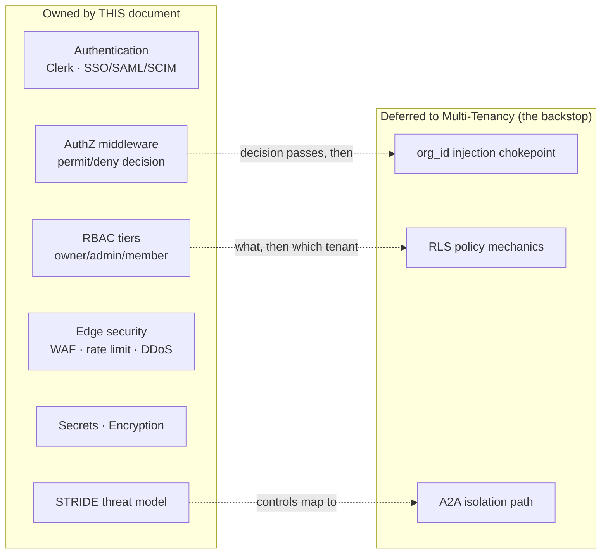
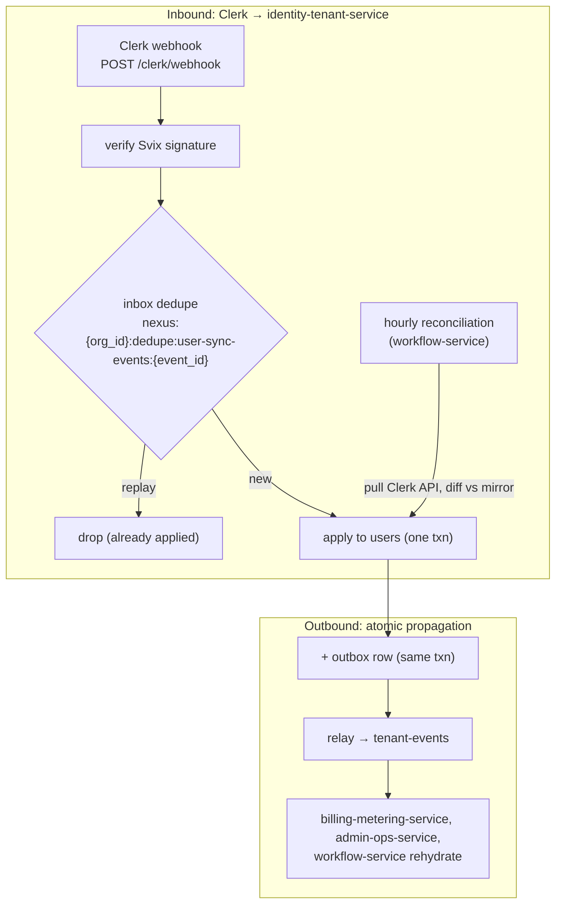
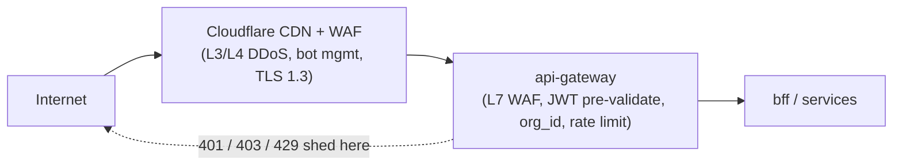
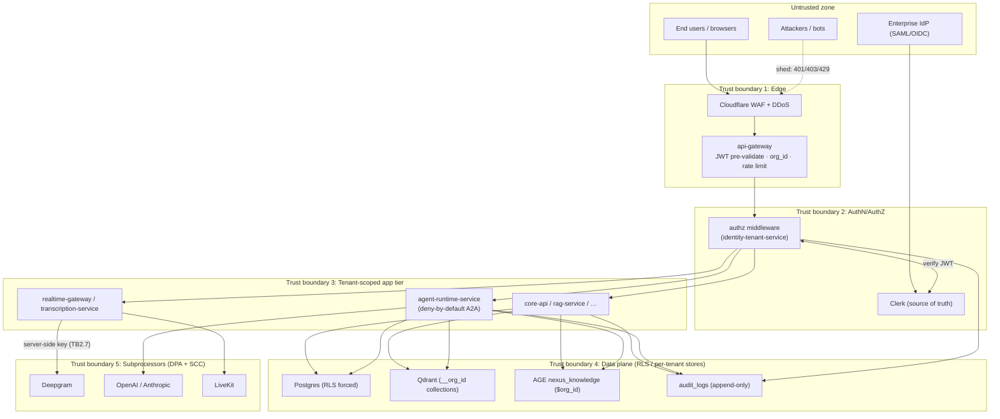
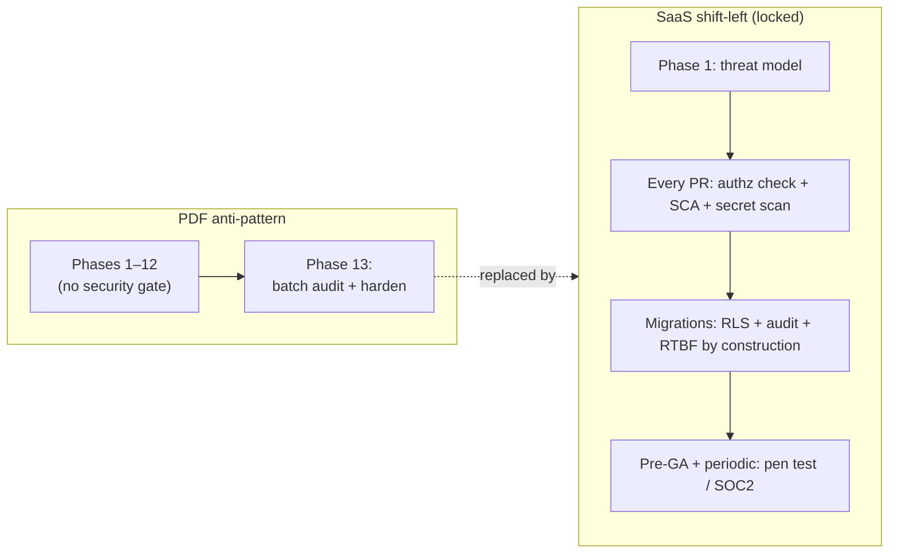

# NEXUS Security Architecture

The single authority for how NEXUS authenticates and authorizes every actor, hardens the Clerk user-sync, secures the edge and secrets, encrypts data in transit and at rest, and threat-models its attack surface as a multi-tenant SaaS.

## Related documents

- [Service Catalog](_canon/01-service-catalog.md) — the naming authority for services (`api-gateway`, `identity-tenant-service`, `agent-runtime-service`, …) and their data/event ownership.
- [Canonical Data Model](_canon/02-data-model.md) — frozen entity/table names: `users`, `audit_logs`, `oauth_tokens`, `tenant_settings`, RBAC grants, and Redis namespaces.
- [Capacity & Scaling Math](_canon/05-capacity-math.md) — the load and SLO numbers this document imports by symbol (req/s, event peaks, latency budgets).
- [Locked Tech & Architecture Decisions](_canon/06-tech-decisions.md) — §2.11 (auth/security/compliance), §2.6 (agent-to-agent authz), §2.7 (server-side Deepgram key).
- [Multi-Tenancy & Isolation](06-multi-tenancy.md) — the `org_id` injection chokepoint, RLS mechanics (§3.1), and the agent-to-agent isolation path (§6.1) that this document treats as the defense-in-depth backstop.
- [Data Architecture](05-data-architecture.md) — store selection, PII redaction, right-to-be-forgotten, backups/PITR, regional placement.
- [Event-Driven Architecture](07-event-architecture.md) — transactional outbox/inbox, idempotency keys, DLQs (the substrate the hardened user-sync rides on).
- [Container Architecture](03-container-architecture.md) — C4 L2 container view that this document overlays trust boundaries onto.
- [AI Agent Architecture](08-ai-agent-architecture.md) — the six LangGraph agents and `ContextGapAgent` collaboration (forward reference; the load-bearing agent-authz lock lives in [Tech Decisions §2.6](_canon/06-tech-decisions.md)).

> [SaaS-scale adjustment] The original PDF treated security as **Phase 13** — a single audit batched at the end of a 13-phase, 36-week plan. This document specifies the locked **shift-left** replacement ([Tech Decisions §2.11](_canon/06-tech-decisions.md)): a threat model in Phase 1, an authorization check reviewed in every PR, dependency + secret scanning from day one, and compliance designed in rather than bolted on. The PDF's auth primitives (Clerk, JWT verification, webhook user-sync) survive verbatim; everything around them — enterprise identity, RBAC tiers, edge WAF, secrets rotation, encryption posture, and the STRIDE model — is added for production multi-tenant scale.

---

## 1. Scope and the security contract

NEXUS serves millions of users across 3,000 paying tenant organizations ([Capacity A1/A4](_canon/05-capacity-math.md)). One leaked transcript, one cross-tenant agent query, or one mis-scoped API call is an existential incident. The security contract is therefore three sentences:

1. **Every request is authenticated by Clerk and carries a tenant.** No anonymous path reaches a service that touches tenant data; `org_id` is resolved at the edge and propagated, never re-derived ([Multi-Tenancy §4](06-multi-tenancy.md)).
2. **Authorization is two questions, answered separately.** *What can this role do?* (RBAC owner/admin/member, owned here) and *Which tenant's rows?* (`org_id` isolation + RLS, owned by [Multi-Tenancy](06-multi-tenancy.md)). Both must pass; either failing fails closed.
3. **Defense-in-depth, fail-closed by default.** Omitting a scope returns zero rows, not another tenant's rows; a missing secret crashes the pod rather than running insecure; a foreign `org_id` on the bus is dead-lettered, not served.

This document **owns**: authentication (Clerk + SSO/SAML/SCIM), RBAC permission tiers, the hardened user-sync, the authorization middleware's *permit/deny decision*, edge security, secrets, encryption, and the STRIDE threat model. It **defers** the tenant-isolation *mechanics* (RLS policy SQL, per-tenant Qdrant collections, the A2A isolation sequence) to [Multi-Tenancy](06-multi-tenancy.md), citing them as the backstop rather than re-deriving them.



---

## 2. Authentication

### 2.1 Clerk as the identity provider (PDF, verbatim)

Identity is **Clerk** ([Tech Decisions §2.11](_canon/06-tech-decisions.md)): Next.js front-channel sign-in, backend JWT verification, and webhook-driven user sync. This is carried over from the PDF unchanged. The front-channel issues a short-lived session JWT; every backend request presents it as a bearer token.

The JWT verification path is split between the edge and the service tier for performance and safety:

| Stage | Where | What it does |
|---|---|---|
| **Pre-validation** | `api-gateway` | Verifies signature against Clerk's JWKS (cached, rotated), checks `exp`/`nbf`/`iss`/`aud`, extracts the `org` claim → `org_id`. Rejects malformed/expired tokens at the edge with `401` before any service is touched. |
| **Full verification** | authz middleware in `identity-tenant-service` | Re-verifies the token (never trusts the gateway blindly), resolves `org_id` + RBAC role into the request context, loads the agent-authz scope set. |

> [SaaS-scale adjustment] The PDF verified the JWT once, in the FastAPI service. At edge scale ([Capacity §11.1](_canon/05-capacity-math.md): CRUD p95 < 300 ms) signature verification is pushed to `api-gateway` so that the overwhelming majority of forged/expired tokens never consume a service worker. The service tier still re-verifies - the gateway's pre-validation is an optimization and a DDoS shield, not a trust delegation. The JWKS is cached with Clerk's rotation honored so key rollover never causes a verification outage. This applies to every service tier, not only the one in `mytheus-backend`: [ADR-0019](adr/0019-ai-tier-verifies-jwt-and-reads-resolved-org-claim.md) records `mytheus-intelligence` implementing the same re-verification for its own REST routes, and what went wrong for three bands while it did not.

```mermaid
sequenceDiagram
    participant U as Browser (web-app)
    participant CK as Clerk
    participant GW as api-gateway + WAF
    participant MW as authz middleware<br/>(identity-tenant-service)
    participant SVC as Service (core-api / rag-service / …)
    U->>CK: sign in (password / SSO / SAML)
    CK-->>U: session JWT (org claim, short TTL)
    U->>GW: request + Bearer JWT
    GW->>GW: verify sig vs cached JWKS; check exp/iss/aud; extract org_id
    GW->>MW: forward (pre-validated, rate-limited)
    MW->>MW: full verify; resolve org_id + RBAC role; load agent-authz scopes
    MW->>SVC: inject {org_id, user_id, role} into request context
    SVC-->>U: response (RLS-scoped by org_id)
```

### 2.2 Enterprise SSO / SAML / SCIM

> [SaaS-scale adjustment] Enterprise SSO/SAML/SCIM is wholly added vs the PDF — it is table-stakes for selling to Enterprise-tier tenants ([Tech Decisions §2.11](_canon/06-tech-decisions.md)).

Clerk fronts the enterprise identity surface; NEXUS configures it per tenant via `tenant_settings.sso_config jsonb` ([Data Model §2.2](_canon/02-data-model.md)):

- **SAML 2.0 / OIDC SSO.** An Enterprise tenant connects its IdP (Okta, Azure AD, Google Workspace). Clerk handles the SAML assertion/OIDC exchange; the resulting NEXUS session JWT carries the same `org` claim as a password user, so downstream authz is identical regardless of how the user authenticated.
- **SCIM 2.0 provisioning.** The IdP pushes user lifecycle (create/update/deactivate) to `/scim/v2/*`, owned by `identity-tenant-service` ([Service Catalog §6](_canon/01-service-catalog.md)). SCIM deactivation is a hard requirement: when an enterprise offboards an employee, that user must lose NEXUS access within the SCIM push, not on next token expiry. SCIM writes flow through the **same hardened user-sync** as Clerk webhooks (§3) so SCIM and webhook events converge on one reconciled state.
- **Just-in-time provisioning.** First SSO login for a known-domain tenant provisions the `users` row JIT, scoped to that tenant's `org_id`, with the default `member` RBAC tier (§4).

`sso_config` is encrypted at rest with the tenant's KMS data key (§7) because it carries IdP metadata and signing certs.

---

## 3. RBAC and the authorization middleware

### 3.1 Two roles, never conflated — `users.role` is not a permission tier

This is the single most important correctness rule in NEXUS authorization, and it is a frequent source of bugs:

| Concept | Field / store | Purpose | Owner |
|---|---|---|---|
| **Domain role** | `users.role` + `users.skills text[]` ([Data Model §2.1](_canon/02-data-model.md)) | Job/domain identity (e.g. "Backend Engineer", "PM"). Feeds the **role→topics taxonomy** and `get_user_context(user_id)` so the `PersonalListenerAgent` filters chunks by relevance. **Has nothing to do with permissions.** | `identity-tenant-service` (`users` table) |
| **RBAC permission tier** | `rbac_grants.tier` ([Data Model §2.2](_canon/02-data-model.md)) | `owner` / `admin` / `member` — what a user may *do* in the tenant (billing, member management, integration install, data export/erasure). | `identity-tenant-service` (`rbac_grants`, distinct from `users.role`) |

> [SaaS-scale adjustment] The PDF had only `users.role` (a domain/skills attribute for agent relevance) and no permission model. The `owner`/`admin`/`member` RBAC tier is a SaaS-add ([Tech Decisions §2.11](_canon/06-tech-decisions.md)) stored as **RBAC grants in `identity-tenant-service`, never as `users.role`**. Overloading `users.role` with permissions would silently couple agent relevance filtering to authorization — a tenant renaming a job title could grant or revoke access. They are kept in separate stores by design.

The three RBAC tiers and their permitted operations:

| Tier | Can do | Cannot do |
|---|---|---|
| `owner` | Everything `admin` can, plus: manage billing/subscription (`/billing/*`), transfer ownership, delete the tenant (triggers RTBF workflow), approve data-residency changes. | — |
| `admin` | Manage members + RBAC grants, install/revoke integrations (`/oauth/{provider}`), configure `tenant_settings` (retention, confidence overrides, SSO), request data export/erasure, view audit log. | Touch billing, delete tenant. |
| `member` | Create/join meetings, view own worklogs/decisions/actions, use agents and RAG, manage own notifications and Save-for-later queue. | Manage other members, integrations, settings, billing, or audit log. |

RBAC grants are themselves tenant-scoped rows under RLS; a grant can only reference a `user_id` within the same `org_id`.

### 3.2 The authorization middleware — the permit/deny decision

The authz middleware in `identity-tenant-service` runs on every request after JWT verification. It answers **"what can this role do?"** — the RLS layer answers **"which tenant's rows?"** as the defense-in-depth backstop ([Multi-Tenancy §3.1](06-multi-tenancy.md)). The middleware does **not** own the RLS policy SQL or the `app.current_org` GUC mechanics; those are frozen in [Multi-Tenancy §3.1](06-multi-tenancy.md) and [Data Model §7](_canon/02-data-model.md). It owns the decision and its fail-closed semantics.

```python
# Authorization middleware (identity-tenant-service). Runs after JWT verification.
# Owns the RBAC permit/deny decision; org_id isolation is the RLS backstop (see Multi-Tenancy §3.1).
async def authorize(ctx: RequestContext, route: Route) -> None:
    # 1. Tenant must be resolved. No org_id => fail closed (never "match all").
    if ctx.org_id is None:
        raise Forbidden("no tenant in context")          # 403, audited

    # 2. RBAC: does this tier permit this operation?
    required = route.required_tier                        # e.g. {"admin", "owner"} for /billing/*
    if ctx.rbac_tier not in required:
        await audit(ctx, action="authz.deny", target=route.path, reason="rbac_tier")
        raise Forbidden(f"requires one of {required}")    # 403

    # 3. Object-level checks for member self-scope (a member may read only own worklogs).
    if route.self_scoped and ctx.rbac_tier == "member":
        ctx.enforce_owner_filter = True                   # downstream adds WHERE user_id = ctx.user_id

    # 4. Stamp app.current_org for the RLS backstop — set transaction-local downstream.
    ctx.bind_db_org(ctx.org_id)                           # SELECT set_config('app.current_org', :org, true)
```

Two non-negotiable middleware properties:

1. **Fail closed.** An unset `org_id`, an unknown route, or a missing RBAC tier raises `403` — never a default-allow. This pairs with RLS, where an unset `app.current_org` GUC matches **zero rows** ([Multi-Tenancy §6](06-multi-tenancy.md)), so an authz bug degrades to "user sees nothing," never "user sees everything."
2. **Authz in every PR (shift-left).** Every PR touching a route asserts its `required_tier` and self-scope in tests; CI fails a route with no authz assertion. This is the locked replacement for the PDF's Phase-13 audit ([Tech Decisions §2.11](_canon/06-tech-decisions.md)).

### 3.3 Agent-to-agent authorization (cross-reference)

The novel surface is the `ContextGapAgent` asking *other users' agents* over `agent-requests` / `agent-responses` (the PDF's R6). The lock is **deny-by-default, org/role scope checks, audited** ([Tech Decisions §2.6](_canon/06-tech-decisions.md)); the isolation mechanics — tenant-keyed partitions, the grant check before a responder processes, and DLQ-on-foreign-`org_id` — are specified with a sequence diagram in [Multi-Tenancy §6.1](06-multi-tenancy.md) and detailed in [AI Agent Architecture](08-ai-agent-architecture.md). This document does not re-derive that path; it incorporates the control into the STRIDE model (§8, multi-agent surface) where the failure mode and audit trail matter. The grant store is the same RBAC store in `identity-tenant-service`: an agent inherits its principal user's tenant and a deny-by-default scope, and a request is authorized only if requester and responder share `org_id` **and** the scope permits the query.

---

## 4. Hardened user-sync — fixing webhook flakiness

Clerk is the **source of truth** for identity; NEXUS keeps a local `users` mirror so authz and `get_user_context` do not call Clerk on the hot path. The PDF synced via a single Clerk webhook — and webhooks drop. A dropped `user.created` webhook means a user who can authenticate (valid Clerk JWT) but has no local `users` row, so authz fails closed and they are locked out; a dropped `user.deleted` means a deactivated user lingers with access. Neither is acceptable at SaaS scale.

> [SaaS-scale adjustment] The PDF used a plain webhook. SaaS locks **outbox + reconciliation, Clerk as source of truth** ([Tech Decisions §2.11](_canon/06-tech-decisions.md)). The fix has three distinct pieces, and they solve three distinct problems — they are not the same mechanism under three names.

| Piece | Direction | Problem it solves | Substrate |
|---|---|---|---|
| **Inbox dedupe** | Inbound (Clerk → NEXUS) | Webhook **replays** and at-least-once redelivery applying the same change twice | `inbox` table + `nexus:{org_id}:dedupe:{topic}:{key}` ([Event Architecture §6.2](07-event-architecture.md)) |
| **Hourly reconciliation** | Inbound (NEXUS pulls Clerk API) | **Dropped/lost webhooks** — the actual flakiness fix; converges local mirror to Clerk's truth | Scheduled `workflow-service` job vs Clerk API |
| **Transactional outbox** | Outbound (NEXUS → downstream services) | **Atomic propagation** of the identity change to other services as events | `outbox` → `tenant-events` ([Event Architecture §6.1](07-event-architecture.md)) |

The inbound Clerk path is an **inbox** problem, not an outbox one — calling it "outbox" mislabels the direction. The `identity-tenant-service` **consumes** `user-sync-events` (the Clerk webhook inbox) and **produces** `tenant-events` ([Service Catalog §3](_canon/01-service-catalog.md)).

### 4.1 The flow



- **Webhook receiver.** `POST /clerk/webhook` verifies the Svix signature (Clerk's webhook HMAC) before anything else — an unsigned or mis-signed payload is a Spoofing attempt and is rejected. Verified events dedupe on the Clerk `event_id` via the inbox, then apply to `users` in one transaction.
- **Hourly reconciliation.** A `workflow-service` (Temporal) scheduled job pulls the Clerk user list per tenant and diffs it against the local `users` mirror. Users present in Clerk but missing locally are created; users deactivated in Clerk but still active locally are soft-deleted; drift is logged. This is the piece that actually recovers from dropped webhooks — Clerk is authoritative, so the mirror always converges to it within the hour. Reconciliation is idempotent (it computes a diff, not a replay) and runs under an elevated read role against Clerk plus the normal RLS-scoped write role locally.
- **Transactional outbox (outbound).** When a user change applies, the same transaction writes an `outbox` row ([Event Architecture §6.1](07-event-architecture.md)) so the change propagates atomically to `tenant-events` only; downstream consumers of `tenant-events` (`billing-metering-service` seat counts, `admin-ops-service` ops views, `workflow-service` lifecycle sagas — [Event Architecture line 59](07-event-architecture.md)) rehydrate from the event. The inbound `user-sync-events` topic is the Clerk webhook inbox (producer and consumer both `identity-tenant-service`, per line 171 above) and is never an outbound/propagation topic. "DB row and event both commit, or neither does."

> [SaaS-scale adjustment] The reconciliation cadence is **hourly** as the steady-state convergence bound; SCIM deactivations (§2.2) are pushed immediately and do not wait for reconciliation, so enterprise offboarding is near-real-time while the hourly job is the safety net for missed webhooks. Origin: user-sync hardening is **PDF→SaaS** — the webhook is the PDF's, the inbox+reconciliation+outbox hardening is the SaaS addition.

---

## 5. Edge security

`api-gateway` is the single ingress: TLS termination, WAF, global rate limiting, JWT pre-validation, and `org_id` extraction ([Service Catalog §3](_canon/01-service-catalog.md)). It holds no business logic and no tenant data. This section details what the catalog summarizes.

### 5.1 The edge stack



- **Cloudflare CDN + WAF + custom domain** ([Tech Decisions §2.1](_canon/06-tech-decisions.md)) terminates TLS 1.3 at the edge, absorbs volumetric L3/L4 DDoS, and runs bot management. Static assets (`web-app`) are CDN-cached; the API path is proxied to `api-gateway`.
- **`api-gateway`** runs the L7 WAF ruleset (OWASP CRS: SQLi, XSS, path traversal, oversized-body), pre-validates the Clerk JWT (§2.1), extracts `org_id`, and applies rate limits before routing to `bff`/services. Malformed, expired, and over-limit requests are shed here as `401`/`429` so no service worker is consumed.

> [SaaS-scale adjustment] The PDF specified Cloudflare CDN only; the **WAF + API-gateway role with global and per-tenant rate limiting** is a SaaS-add ([Tech Decisions §2.11](_canon/06-tech-decisions.md)). At [Capacity](_canon/05-capacity-math.md) CRUD scale (millions of users) the gateway is the tenant-aware throttle that keeps one tenant's spike off another's latency.

### 5.2 Rate limiting: global, per-tenant, per-user

Three tiers, each with a distinct purpose; per-tenant is the noisy-neighbor control whose *mechanics* live in [Multi-Tenancy §5](06-multi-tenancy.md) — here we state the edge enforcement.

| Tier | Scope | Basis | Action |
|---|---|---|---|
| **Global** | Whole platform | Aggregate req/s + connection ceiling | Protects the fleet from systemic overload; sheds at the edge. |
| **Per-tenant** | `org_id` | Plan-tier req/s + concurrent-connection caps (Free < Pro < Enterprise) | `429` at the gateway before any service; a Free tenant cannot exhaust shared capacity. |
| **Per-user** | `user_id` (LLM path) | Sliding window via `nexus:{org_id}:ratelimit:{user_id}` ([Data Model §5](_canon/02-data-model.md)) | LiteLLM per-user rate limit; pairs with per-tenant token budgets. |

The per-tenant limit and the per-tenant token budget (`agent_budgets`, [Multi-Tenancy §5](06-multi-tenancy.md)) are complementary: the gateway caps *request rate*, the agent runtime caps *token spend* — a tenant within its request limit can still hit a hard token cap, and is denied-by-default at the cap.

### 5.3 DDoS and bot protection

- **L3/L4 volumetric** — absorbed by Cloudflare; never reaches origin.
- **L7 application-layer (HTTP flood)** — global + per-tenant rate limits shed at `api-gateway`; the realtime path (`realtime-gateway` WebSockets, [Capacity A6](_canon/05-capacity-math.md): 100k concurrent connections) enforces per-tenant connection caps so a tenant cannot exhaust the connection-scaled tier.
- **Credential stuffing / bot sign-in** — Clerk bot detection + Cloudflare bot management on the auth path; failed-auth attempts are rate-limited per source and audited.

---

## 6. Secrets management

> [SaaS-scale adjustment] Centralized secrets management with rotation and secret scanning is a SaaS-add; the PDF stored provider keys as environment config. Secret scanning is **PDF→SaaS** shift-left ([Tech Decisions §2.11](_canon/06-tech-decisions.md)) — moved from the Phase-13 audit to day one.

### 6.1 The secret store

Service-level secrets — Deepgram, OpenAI/Anthropic (via LiteLLM), LiveKit API keys, Clerk backend keys, Redpanda credentials, Stripe keys, the Svix webhook secret — live in a managed secret manager (HashiCorp Vault, or the cloud provider's Secrets Manager on EKS/GKE per [Tech Decisions §2.1](_canon/06-tech-decisions.md)). Rules:

1. **No secret in source, image, or env file.** Pods fetch secrets at startup from the secret manager via workload identity (IRSA / GKE Workload Identity) — never a long-lived static credential baked into an image.
2. **Fail closed on missing secret.** A pod that cannot fetch a required secret crashes on startup rather than running degraded/insecure.
3. **Rotation.** Provider API keys rotate on a schedule (and on suspected compromise) without redeploy: the secret manager versions the secret, pods re-fetch on a lease TTL. Stripe and Clerk keys follow each provider's rotation API; LiveKit/Deepgram keys rotate via dual-key overlap (new key live before old key revoked) so streams are never interrupted.

### 6.2 Per-tenant integration tokens are NOT platform secrets

A critical distinction: **platform** secrets (above) are global to NEXUS; **per-tenant integration tokens** (a tenant's Google Calendar / Slack / Jira / Linear OAuth grant) are tenant data, stored in `oauth_tokens` ([Data Model §2.2](_canon/02-data-model.md)), **not** in the secret manager.

```text
oauth_tokens (RLS by org_id):
  access_token_enc      -- envelope-encrypted with the tenant's KMS data key
  refresh_token_enc     -- envelope-encrypted with the tenant's KMS data key
  expires_at, token_version
```

`oauth_tokens` uses **envelope encryption with a per-tenant KMS data key** ([Data Model §2.2](_canon/02-data-model.md)): the column ciphertext is decryptable only by `integration-service` resolving that tenant's data key from KMS. Tokens are **never returned by any API**, refreshed by `integration-service`, and dropped on RTBF when the tenant's KMS key is destroyed (crypto-shredding, §7).

### 6.3 Secret scanning (shift-left)

- **Pre-commit** — `gitleaks` (or equivalent) hook blocks a commit containing a key pattern, so secrets never enter history locally.
- **CI** — GitHub Actions ([Tech Decisions §2.14](_canon/06-tech-decisions.md)) runs secret scanning + dependency scanning (SCA) on every PR; a detected secret or a known-vulnerable dependency fails the build. This is the shift-left replacement for the Phase-13 batched audit.
- **Rotation on leak** — any scanner hit on a real credential triggers immediate rotation (§6.1) and an audit-log entry.

---

## 7. Encryption

| Plane | Mechanism | Notes |
|---|---|---|
| **In transit — external** | TLS 1.3 terminated at Cloudflare/`api-gateway`; HSTS; WSS for all WebSocket (`realtime-gateway`, Deepgram proxy) | No plaintext ingress. |
| **In transit — internal** | mTLS between services (service mesh on EKS/GKE); TLS to Redpanda, Postgres, Qdrant, Redis | Internal hops are not implicitly trusted ([Multi-Tenancy §4](06-multi-tenancy.md): signed internal `org_id` header re-verified). |
| **At rest — Postgres** | Provider-managed volume encryption (Supabase/managed Postgres) | Covers `transcript_chunks`, `decisions`, `worklogs`, etc. RLS, not encryption, is the tenant boundary. |
| **At rest — application-layer** | Envelope encryption with **per-tenant KMS data key** for `oauth_tokens` and `tenant_settings.sso_config` | The fields too sensitive for volume encryption alone ([Data Model §2.2](_canon/02-data-model.md)). |
| **At rest — Qdrant / object storage / Redpanda** | Provider-managed encryption; object buckets (`nexus-recordings`, `nexus-invoices`, `nexus-audit-archive`) encrypted, invoices/audit under object lock | [Data Model §6](_canon/02-data-model.md). |

> [SaaS-scale adjustment] The PDF named no encryption posture. The **per-tenant KMS data key** ([Data Model §2.2](_canon/02-data-model.md)) is the load-bearing addition: it makes **crypto-shredding** the RTBF fast path — destroying a tenant's data key renders its `oauth_tokens` and `sso_config` ciphertext permanently unreadable in one operation, complementing the row/partition/collection deletes in the Temporal RTBF workflow ([Data Architecture](05-data-architecture.md), [Data Model §7](_canon/02-data-model.md)). Data residency ([Data Model `data_residency`](_canon/02-data-model.md)) pins each tenant's KMS key, DB cell, Qdrant region, and object bucket to its `region` for GDPR.

---

## 8. STRIDE threat model

The threat model covers the six attack surfaces named in scope — **auth, transcripts, multi-agent context, APIs, integrations, subprocessors** — against the six STRIDE categories. Every control maps to a mechanism that already exists in canon; a control with no canonical mechanism behind it is not a control.

> [SaaS-scale adjustment] A STRIDE threat model produced in **Phase 1** is the shift-left replacement for the PDF's Phase-13 security audit ([Tech Decisions §2.11](_canon/06-tech-decisions.md)). The PDF batched all security review at the end; here the model is authored before code and reviewed as the architecture evolves.

### 8.1 Trust-boundary diagram



The boundaries crossed by an attacker, in order: Edge (1) → AuthN/AuthZ (2) → tenant-scoped app (3) → RLS data plane (4). Subprocessors (5) sit behind server-side keys, never reachable by a client.

### 8.2 STRIDE × surface matrix

| Surface | Spoofing | Tampering | Repudiation | Info disclosure | Denial of service | Elevation of privilege |
|---|---|---|---|---|---|---|
| **Auth** (Clerk, SSO, sessions) | Clerk JWT signature verified at edge **and** middleware (§2.1); Svix HMAC on webhooks (§4); SAML assertion validation via Clerk | Short-TTL JWT; signature covers all claims incl. `org`; no client-mutable role claim | `audit_logs` records sign-in, `authz.deny`, SCIM/webhook applies (append-only, §8.3) | JWKS-verified tokens only; no PII in JWT beyond `sub`/`org` | Edge rate limit on auth path; Clerk bot detection; credential-stuffing throttle (§5.3) | RBAC tier from server-side grant store, **not** `users.role` (§3.1); fail-closed middleware (§3.2) |
| **Transcripts** (`transcript_chunks`) | Deepgram reached only via the **server-side WS proxy** ([Tech Decisions §2.7](_canon/06-tech-decisions.md)); key never client-side | Only **finals** persisted ([Capacity §4](_canon/05-capacity-math.md)); RLS `WITH CHECK` blocks cross-`org_id` insert ([Multi-Tenancy §3.1](06-multi-tenancy.md)); outbox idempotency on emit | Audit of speaker remap (`meeting_speakers`); confirmed decisions/actions carry `confirmed_by` | RLS `FORCE` + per-tenant Qdrant collection + payload filter ([Multi-Tenancy §3.2](06-multi-tenancy.md)); TLS/WSS in transit; volume encryption at rest | `transcript_chunks` monthly range partitions + per-tenant token budget caps downstream agent load | Member self-scope filter; transcript read via `org_id`-scoped FTS only |
| **Multi-agent context** (`agent-requests`/`agent-responses`) | `correlation_id` envelope + responder verifies requester within own `org_id` ([Multi-Tenancy §6.1](06-multi-tenancy.md)) | Tenant-keyed partitions; record carries `org_id`, consumer re-asserts before write | Every collaboration logged to `agent_collaborations` + `audit_logs` (`actor_type='agent'`) | **A2A deny-by-default, org/role scope** ([Tech Decisions §2.6](_canon/06-tech-decisions.md)); **foreign `org_id` → DLQ, never served** | Collaboration `deadline` + fall-through (peer → related-meeting → RAG → silent); per-tenant token budget | Agent inherits principal's tenant + deny-by-default scope; grant check before processing |
| **APIs** (`core-api`, `rag-service`, …) | JWT required on every route; internal calls re-verify signed `org_id` header ([Multi-Tenancy §4](06-multi-tenancy.md)) | Pydantic v2 validation; RLS `WITH CHECK` on writes; Avro schema validation on events | Structured JSON audit log per mutating call; immutable invoices | RLS + `org_id` injection; unset GUC ⇒ zero rows ([Multi-Tenancy §6](06-multi-tenancy.md)) | WAF + global/per-tenant rate limit (§5.2); CRUD p95 < 300 ms SLO ([Capacity §11.1](_canon/05-capacity-math.md)) | Authz middleware permit/deny (§3.2); fail-closed; CI asserts authz per route |
| **Integrations** (Calendar/Slack/Jira/Linear) | OAuth signed callbacks; provider webhook signatures verified at `/webhooks/{provider}` | `integration_connections` id-map validated; bidirectional sync idempotent (outbox/inbox) | `audit_logs` records install/revoke (`admin` action) and external status syncs | `oauth_tokens` envelope-encrypted, per-tenant KMS key, never API-returned (§6.2); guardrail R8 scope cap | Per-tenant webhook rate limit; bursty sync queue-driven, isolated from CRUD | Only `admin`/`owner` may install/revoke; tokens scoped to least OAuth scope set |
| **Subprocessors** (Deepgram/OpenAI/Anthropic/LiveKit) | Server-side keys only; no client ever holds a subprocessor credential | Avro/JSON contracts validated on return; citations re-anchored to `meeting_id`/`chunk_id` | DPA + audit of data sent; PII redaction pass before egress | **DPAs + SCCs** ([Tech Decisions §2.11](_canon/06-tech-decisions.md)); PII redaction ([Data Architecture](05-data-architecture.md)); regional placement | One Deepgram stream/meeting (not per-participant, [Capacity §7](_canon/05-capacity-math.md)) caps cost/exposure; LiteLLM provider failover | Subprocessor responses are data, never code; no eval of returned content |

### 8.3 Repudiation: the append-only audit log

Non-repudiation rests on `audit_logs` ([Data Model §2.2](_canon/02-data-model.md)), owned by `audit-service` ([Data Model §1.1](_canon/02-data-model.md); the Service Catalog folds audit into the control plane and does not separately name it — the entity name `audit_logs` is the frozen authority):

```text
audit_logs (RLS by org_id; APPEND-ONLY — no UPDATE, no DELETE):
  actor_id, actor_type ('user'|'agent'|'system'),
  action, target_type, target_id, metadata jsonb, ip, occurred_at
  -- monthly range partitions; 1y hot, archived to nexus-audit-archive (object lock) for SOC2
```

Tamper-evidence comes from the table being **append-only** (no `UPDATE`/`DELETE` grant to any request-path role) and cold partitions archived under **object lock** ([Data Model §6](_canon/02-data-model.md)). Auth denials, RBAC grant changes, SCIM/webhook applies, integration install/revoke, agent collaborations, and RTBF completions are all audited — the trail an attacker cannot quietly rewrite.

---

## 9. Shift-left security practice — fixing the Phase-13 anti-pattern

> [SaaS-scale adjustment] The PDF batched the security audit and hardening into **Phase 13** (the last of 13 phases). Tech Decisions §2.11 locks the replacement: **security is continuous, not a phase.** This section names the anti-pattern explicitly and the practices that replace it.

The Phase-13 batching anti-pattern fails three ways at SaaS scale: (1) auth/tenant-isolation bugs written in Phase 2 are not caught until Phase 13, after the architecture has calcified around them; (2) a multi-tenant data leak discovered at the end is far costlier to fix than one prevented in the middleware design; (3) compliance (GDPR/CCPA, SOC2 readiness) cannot be retrofitted — RLS, audit logging, and RTBF must be load-bearing from the first migration.

The locked shift-left practices, each cited to its canonical lock:

| Practice | When | Mechanism | Replaces |
|---|---|---|---|
| **Threat model** | Phase 1 | This STRIDE model (§8), authored before code | Phase-13 audit |
| **Authz in every PR** | Continuous | CI fails a route with no `required_tier`/self-scope assertion (§3.2) | Phase-13 review |
| **Dependency + secret scanning** | Day one, every PR | GitHub Actions SCA + `gitleaks` (§6.3) | Phase-13 scan |
| **Compliance by construction** | From Phase 2 migrations | RLS, append-only `audit_logs`, RTBF workflow, PII redaction, DPAs/SCCs | Phase-13 hardening |
| **Pen test / external audit** | Before Enterprise GA, then periodic | SOC2 readiness review against the controls above | Phase-13 one-shot |



---

## 10. Summary — what this document freezes

| Concern | Locked decision | Origin |
|---|---|---|
| Identity | Clerk (JWT verify at edge + middleware) | PDF |
| Enterprise identity | SSO/SAML/SCIM via Clerk, per-tenant `sso_config` | SaaS-add |
| Permission model | RBAC `owner`/`admin`/`member` in `identity-tenant-service` grants — **not** `users.role` | SaaS-add |
| AuthZ decision | Fail-closed middleware (RBAC permit/deny); RLS is the `org_id` backstop | SaaS-add (RLS mechanics in [Multi-Tenancy](06-multi-tenancy.md)) |
| User-sync | Inbox dedupe + **hourly reconciliation** (flakiness fix) + outbox propagation; Clerk source of truth | PDF→SaaS |
| Edge | Cloudflare CDN/WAF + `api-gateway` (JWT pre-validate, `org_id`, global/per-tenant/per-user rate limit, DDoS/bot) | PDF→SaaS |
| Secrets | Vault/Secrets Manager, workload identity, rotation, fail-closed; per-tenant OAuth tokens envelope-encrypted (not platform secrets) | SaaS-add |
| Secret scanning | Pre-commit + CI (shift-left) | PDF→SaaS |
| Encryption | TLS 1.3 + mTLS internal; volume + per-tenant KMS data key (crypto-shredding on RTBF) | SaaS-add |
| Threat model | STRIDE over 6 surfaces × 6 categories, controls tied to canon | SaaS-add |
| Security process | Shift-left replacing Phase-13 batched audit | PDF→SaaS |
| Audit | `audit_logs` append-only, RLS, archived under object lock | SaaS-add |

No alternative names for any service, table, topic, agent, or threshold are introduced; every name traces to [Service Catalog](_canon/01-service-catalog.md), [Data Model](_canon/02-data-model.md), or [Tech Decisions](_canon/06-tech-decisions.md).
