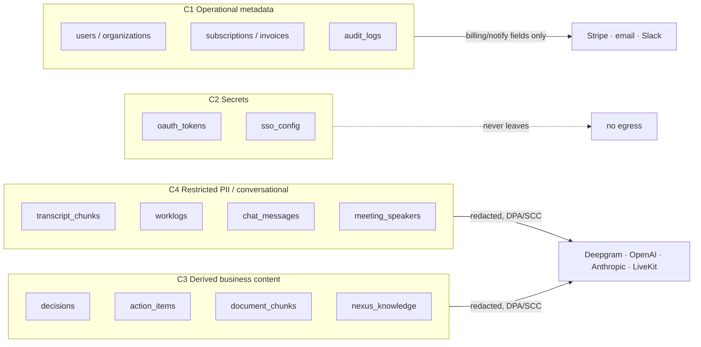
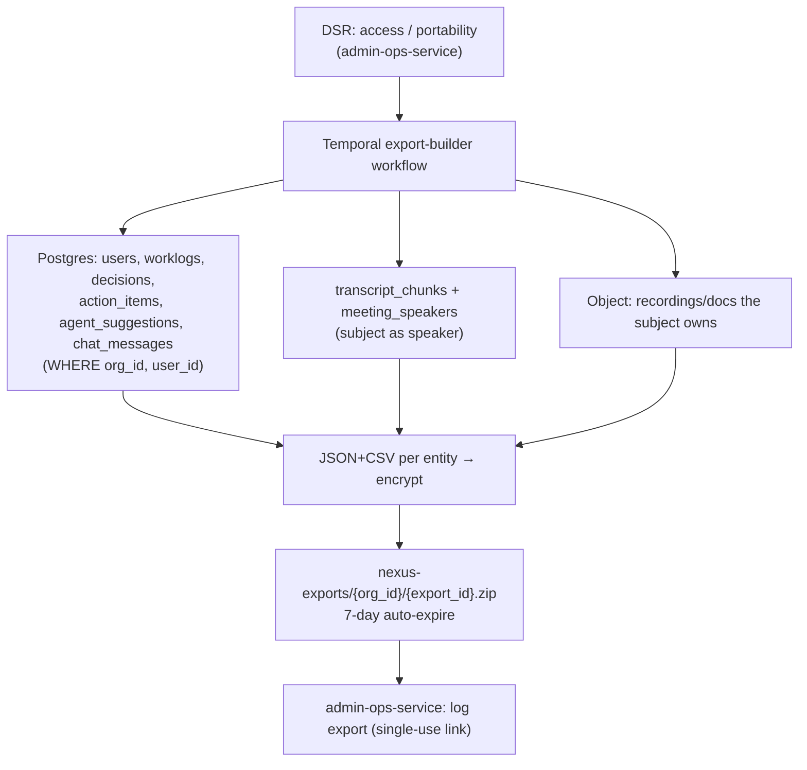
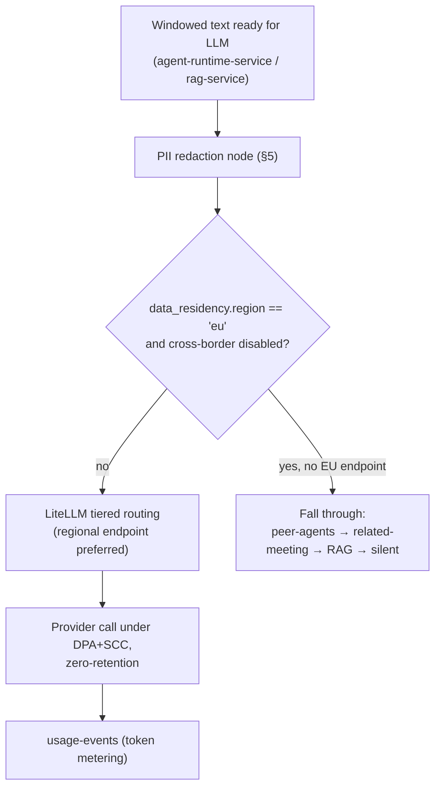
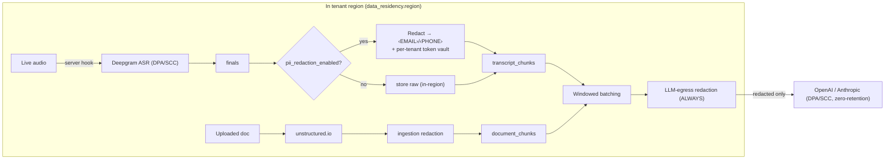
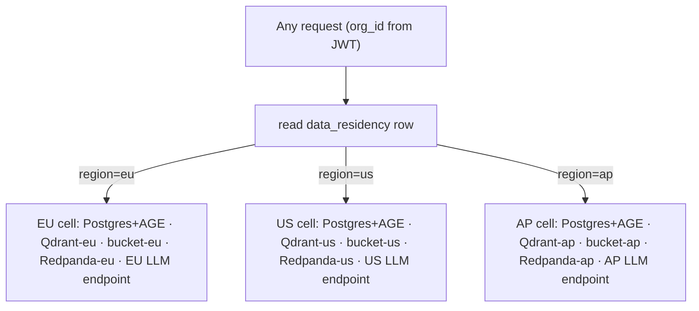
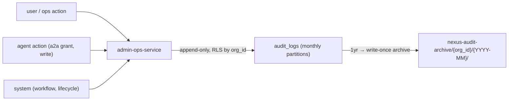
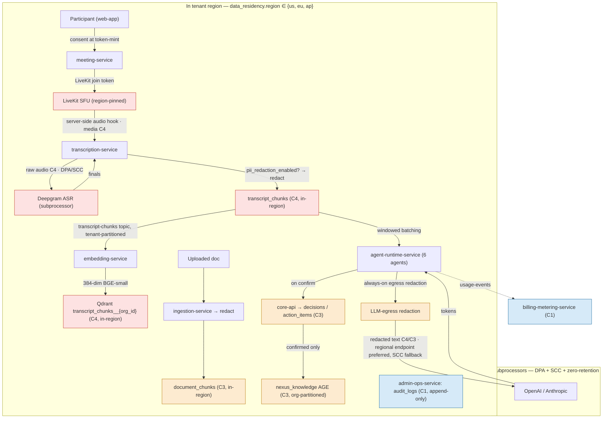

# Compliance & Data Privacy

The frozen, production-grade specification of how NEXUS classifies data, satisfies GDPR/CCPA data-subject rights, governs subprocessors (Deepgram/OpenAI/Anthropic/LiveKit) with DPAs and SCCs, pins data to a region, redacts PII before storage and third-party send, enforces per-tenant retention and right-to-be-forgotten, audit-logs every privileged action, and maps it all to a SOC2 control set.

## Related documents

- [Service Catalog](_canon/01-service-catalog.md) — canonical service names, ownership, event contracts.
- [Canonical Data Model](_canon/02-data-model.md) — frozen entity/table names, `audit_logs`, `data_residency`, `tenant_settings`, `oauth_tokens`, `nexus-*` buckets.
- [Capacity & Scaling Math](_canon/05-capacity-math.md) — the volume numbers compliance must scale to.
- [Locked Tech & Architecture Decisions](_canon/06-tech-decisions.md) — the compliance decision rows this doc cites.
- [Data Architecture](05-data-architecture.md) — physical stores, retention/partitioning, the cross-store RTBF Temporal saga (§8.1) this doc references rather than re-derives.
- [Multi-Tenancy & Tenant Isolation](06-multi-tenancy.md) — pooled+RLS / cells, `org_id` injection, regional placement.
- [Event-Driven Architecture](07-event-architecture.md) — Redpanda topics, Avro envelopes, `usage-events`, `tenant-events`, `admin-events`.
- [Security & AuthZ](11-security-architecture.md) — JWT verification, RBAC, agent-to-agent authz, envelope encryption, the shared `audit_logs` writer.
- [SaaS Business: Billing, Metering, Tenant Lifecycle](18-saas-business-architecture.md) — provisioning that writes `data_residency`, plan-gated residency.

---

## 1. Scope and posture

> [SaaS-scale adjustment] This entire document is wholly added relative to the NEXUS Execution Plan v2.1 PDF. The PDF was a single-deployment, single-tenant MVP (seeder `2 orgs x 10 users x 5 meetings`) with no tenant column, no subprocessor governance, no residency model, no consent capture, and no retention/erasure machinery — its only privacy-adjacent note was per-entity soft delete. Selling a meeting-intelligence platform that ships raw human conversation to third-party LLM and ASR vendors, across thousands of paying tenants in regulated jurisdictions, makes the compliance program in this document table-stakes, not optional. Every section below is therefore a SaaS-scale addition; we reserve inline `[SaaS-scale adjustment]` callouts for the design decisions that go *beyond* what the canon already records.

NEXUS processes the most sensitive payload a SaaS can hold: **verbatim transcripts of private human conversation** (`transcript_chunks`), the per-person notes derived from them (`worklogs`), and the decisions/actions extracted from them. That data is then forwarded, by design, to four external subprocessors (Deepgram for ASR, OpenAI/Anthropic for LLM inference, LiveKit for media transport). The compliance posture is built around that single uncomfortable fact.

Five locked principles bind this document:

1. **Lawful third-party processing.** Every subprocessor that sees tenant content is bound by a Data Processing Agreement (DPA); every cross-border transfer of EU data is covered by Standard Contractual Clauses (SCCs) plus zero-retention vendor configuration. See [Tech Decisions §2.11](_canon/06-tech-decisions.md) (`Compliance`).
2. **Residency is pinned and immutable.** A tenant's data lives in exactly one region — `data_residency.region ∈ {us, eu, ap}` — and that pin is immutable after `data_residency.locked_at` without a migration workflow ([Data Model §2.2](_canon/02-data-model.md)).
3. **PII is redacted at the boundary**, not best-effort after the fact — before durable storage when a tenant opts in, and always before LLM-provider egress.
4. **Erasure is provable and cross-store.** Right-to-be-forgotten is a single durable Temporal saga that deletes a subject across all six stores and writes an append-only completion record. The mechanics are owned by [Data Architecture §8.1](05-data-architecture.md); this doc owns the *legal* framing.
5. **Everything privileged is audited.** `audit_logs` is append-only, tamper-evident, and is the evidence base for SOC2 and for every data-subject request response.

---

## 2. Data classification

Every NEXUS data class maps to a handling regime: where it may be stored, whether it may leave to a subprocessor, how it is encrypted, and its default retention. Classification is by **canon entity name** so there is exactly one authoritative mapping; no service invents its own labels.

> [SaaS-scale adjustment] The classification taxonomy itself is new. The canon entities it classifies (`transcript_chunks`, `oauth_tokens`, `audit_logs`, …) are already defined in [Data Model](_canon/02-data-model.md); what is added here is the four-tier sensitivity scheme and the handling rules each tier imposes.

| Class | Definition | Canon entities (verbatim) | Third-party egress | Encryption | Default retention |
|---|---|---|---|---|---|
| **C4 — Restricted PII / conversational** | Verbatim human conversation and personal notes derived from it; the crown jewels. | `transcript_chunks`, `worklogs`, `chat_messages`, `meeting_speakers`, transcript audio in `nexus-recordings`, transcript vectors in Qdrant `transcript_chunks` | Deepgram (audio→text), OpenAI/Anthropic (windowed text on the LLM path), LiveKit (media transport) — **all under DPA/SCC + PII redaction** | TLS 1.3 in transit; AES-256 at rest; tenant-scoped | `tenant_settings.retention_days_transcripts` (per-tenant) |
| **C3 — Derived business content** | Extracted, lower-density artifacts and uploaded source docs. | `decisions`, `action_items`, `agent_suggestions`, `agent_collaborations`, `document_chunks`, `nexus-documents`, `nexus-attachments`, `decisions`/`document_chunks` Qdrant collections, AGE `nexus_knowledge` nodes/edges | LLM path (extraction/RAG) under DPA/SCC; PM integrations (Jira/Linear) per `integration_connections` scope | AES-256 at rest; tenant-scoped | Tenant retention; AGE soft-delete then purge |
| **C2 — Secrets / credentials** | Material that grants access; never logged, never returned by API. | `oauth_tokens` (`access_token_enc`/`refresh_token_enc`), `tenant_settings.sso_config`, Clerk JWT material, Deepgram/LLM API keys | Never | **Envelope encryption, per-tenant KMS data key** ([Data Model §2.2](_canon/02-data-model.md)); secret-scanned in CI | Until rotated/revoked |
| **C1 — Operational / tenant metadata** | Identity, org structure, billing, telemetry needed to run the service. | `users`, `organizations`, `teams`, `team_members`, `departments`, `meetings`, `meeting_participants`, `subscriptions`, `invoices`, `usage_events`, `plans`, `audit_logs`, `data_residency`, `tenant_settings`, `agent_budgets`, `integration_connections` | Stripe (billing fields), email/Slack (notification fields) under DPA | AES-256 at rest; `invoices`/`audit_logs` immutable/object-locked | Mixed: `invoices` 7yr, `audit_logs` 1yr hot + SOC2 archive, rest per tenant lifetime |

Handling rules derived from the table:

- **C4 may never be embedded into a log line, an exception payload, or an analytics event.** Structured JSON logs ([Tech Decisions §2.14](_canon/06-tech-decisions.md)) carry IDs (`meeting_id`, `chunk_id`, `org_id`) and never transcript text. Sentry breadcrumbs are scrubbed of C4/C3/C2 by a pre-send hook.
- **C2 is never returned by any API** (`oauth_tokens` rule is canon) and is excluded from data-export bundles by class, not by allowlist.
- **Every C4/C3 egress to a subprocessor passes the redaction node** (§5) and is gated by `tenant_settings.pii_redaction_enabled` for the at-rest path.



---

## 3. GDPR / CCPA data-subject rights

NEXUS is a **processor** of tenant content on behalf of the tenant organization (the controller), and a **controller** of its own account/billing data. Data-subject requests (DSRs) therefore arrive on two paths: an end user inside a tenant requests through their tenant admin (controller-mediated), or directly to NEXUS for account data. Both resolve through `admin-ops-service` and a Temporal workflow.

> [SaaS-scale adjustment] The DSR machinery — request intake, the four GDPR right handlers, the consent model, and the legal-hold carve-out — is wholly new. The PDF had no notion of a data subject.

### 3.1 The four rights and how each is served

| Right | GDPR | CCPA | NEXUS mechanism | Owning surface | SLA |
|---|---|---|---|---|---|
| **Access** (right to know) | Art 15 | §1798.110/.115 | Generate an export bundle of all rows keyed to the subject across stores → `nexus-exports/{org_id}/{export_id}.zip` (auto-expire 7 days, [Data Model §6](_canon/02-data-model.md)) | `admin-ops-service` → `workflow-service` | ≤ 30 days |
| **Erasure** (right to be forgotten) | Art 17 | §1798.105 | Cross-store deletion Temporal saga ([Data Architecture §8.1](05-data-architecture.md)); soft-delete immediate, hard purge scheduled | `admin-ops-service` → `workflow-service` | ≤ 30 days (soft-delete immediate) |
| **Portability** | Art 20 | §1798.130 | Same `nexus-exports` bundle, in machine-readable JSON + CSV per entity; C2 excluded | `admin-ops-service` → `workflow-service` | ≤ 30 days |
| **Consent / objection** | Art 6/7, 21 | §1798.120 (opt-out of sale — N/A, NEXUS does not sell) | Recording/transcription consent at meeting join (§3.3); processing-purpose flags in `tenant_settings` | `meeting-service` + `identity-tenant-service` | At capture / immediate |

### 3.2 Access & portability: one bundle, two rights

Both rights are served by the same builder workflow, differing only in framing (human-readable vs. machine-readable). The builder queries every store for rows where `org_id` = tenant and (for a single user) `user_id` = subject, writes JSON + CSV per entity into a zip, encrypts it, and lands it in `nexus-exports` with a 7-day lifecycle expiry. The download link is single-use and audit-logged.



Excluded from every bundle by classification: **C2 secrets** (`oauth_tokens`, `sso_config`, keys) and other tenant members' C4 data the subject has no relationship to. The export resolves "the subject's data," not "the tenant's data."

### 3.3 Recording & transcription consent

> [SaaS-scale adjustment] There was **no canon consent entity** — a genuine design gap this document identified, grounded in the existing token-mint / join flow rather than a new store. Two-party-consent jurisdictions (e.g. several US states, EU) require an affirmative, recorded acknowledgment before a participant is transcribed.

> [SaaS-scale adjustment] **The consent schema is ratified canon, landed schema-first and defaulted off** ([ADR-0018](adr/0018-consent-entity-behind-flag.md)). `meeting_participants.consented_at timestamptz NULL` / `consent_version text NULL` and `tenant_settings.consent_required boolean NOT NULL DEFAULT false` are amended into [Data Model §2.1/§2.2](_canon/02-data-model.md). Both previously-frozen tables now carry these columns; no other column changed. `consent_required` defaults `false`, so no tenant's join behavior changes as a result of this landing — flipping it for a tenant is a legal/compliance decision, not an engineering one ([ADR-0018](adr/0018-consent-entity-behind-flag.md)). **Out of scope for this landing:** the migration adding these columns and the `meeting-service` application code enforcing the 428 check below are later tasks that depend on the schema landing first; a consent-exempt internal-meeting-type flag remains a separate, still-unratified proposal not covered by ADR-0018.

Consent is captured at the **token-mint boundary** that already gates joining a meeting (`POST /api/meetings/:id/token`, owned by `meeting-service`, [Tech Decisions §2.7](_canon/06-tech-decisions.md)). The token endpoint will not mint a join token until the participant acknowledges that the meeting is recorded and transcribed by AI agents. The acknowledgment is persisted on the now-canon `meeting_participants.consented_at`/`consent_version` (`consented_at timestamptz`, `consent_version`) and emitted on `meeting-room-events` (the topic `meeting-service` produces — `meeting-events` is owned by `core-api`) for the audit trail.

```mermaid
sequenceDiagram
  participant U as Participant (web-app)
  participant M as meeting-service
  participant T as identity-tenant-service
  participant AUD as admin-ops-service
  U->>M: POST /api/meetings/:id/token
  M->>T: read tenant_settings (default_locale; consent_required)
  alt consent_required = true and consent not yet given this meeting
    M-->>U: 428 Precondition Required (consent prompt + version)
    U->>M: acknowledge consent (version)
    M->>M: meeting_participants.consented_at = now()
    M->>AUD: append consent record (actor=user)
  end
  M-->>U: mint LiveKit join token
```

If a participant declines, they are not admitted to the recorded session; the tenant admin may configure a consent-exempt internal meeting type via a proposed `tenant_settings` field — this field is **not** part of [ADR-0018](adr/0018-consent-entity-behind-flag.md)'s ratified schema, remains a proposal, and requires its own ADR + canon amendment before implementation.

### 3.4 Erasure and the legal-hold carve-out

Erasure reuses the cross-store RTBF Temporal saga in [Data Architecture §8.1](05-data-architecture.md) — Postgres partition/row purge, Qdrant point delete by `org_id` filter across all three collections, AGE `deleted_at`-tag-then-remove, Redis `nexus:{org_id}:*` flush, object-prefix delete — ending with an append-only `audit_logs` record. This document adds only the **legal basis for what survives erasure**:

> Under **GDPR Article 17(3)(b)/(e)**, erasure does not apply where processing is necessary for compliance with a legal obligation or the establishment/exercise/defence of legal claims. Accordingly `nexus-invoices` (7-year tax retention, object-locked) and `nexus-audit-archive` (SOC2 evidence, write-once) are **carved out of erasure** and survive an RTBF request. The carve-out is itself recorded in the audit log so the gap is provably intentional, not a deletion failure.

---

## 4. Subprocessors: DPAs and SCCs

NEXUS sends C4/C3 data to four subprocessors. Each is bound by a DPA; each EU-data transfer to a US-incorporated subprocessor relies on SCCs plus a zero-data-retention vendor configuration so transient processing leaves no residual copy in a non-EU region.

> [SaaS-scale adjustment] Subprocessor governance is wholly new. The PDF named these vendors as technology choices ([Tech Decisions §2.5/§2.7](_canon/06-tech-decisions.md)) but assigned them no data-protection obligations. NEXUS publishes this list as its subprocessor register (a GDPR Art 28 transparency requirement) and notifies tenants before adding a new one.

### 4.1 Subprocessor register

| Subprocessor | Data sent (class) | Purpose | Processing region (per tenant) | Transfer mechanism | Retention config |
|---|---|---|---|---|---|
| **Deepgram** | Live meeting **audio** → text; C4 derived | Streaming ASR + diarization (one stream/meeting) | US or EU endpoint chosen by `data_residency.region` | DPA + SCCs (Module 2/3) for `eu` tenants on US endpoint fallback | Zero-retention / no-model-training flag set |
| **Anthropic** | Windowed transcript/doc **text**, redacted (C4/C3) | LLM extraction, triage, high-stakes reasoning (Haiku→Sonnet→Opus) | Regional API where available; else US under SCC | DPA + SCCs; zero-retention enterprise terms | No training on inputs; ephemeral processing |
| **OpenAI** | Windowed text, redacted (C4/C3) | LLM routing alternative via LiteLLM | US under SCC | DPA + SCCs; zero-retention | No training; no retention beyond abuse window (disabled) |
| **LiveKit** | Real-time **media** (audio/video tracks) | SFU transport; server-side audio hook | Self-hostable SFU pinned to tenant region | First-party (self-hosted) or DPA+SCC if managed | Media not persisted by SFU; recordings land in tenant-region `nexus-recordings` |

Supporting (controller-side, C1 only): **Stripe** (billing under DPA), **Clerk** (identity under DPA), email/Slack delivery (`notification-service`).

### 4.2 The EU-tenant egress question

The hard question a GDPR reviewer asks: *when a `region=eu` tenant's transcript reaches a US-based LLM, what makes it lawful?* The answer is a three-layer control, applied on the LiteLLM path inside `agent-runtime-service` and `rag-service`:

1. **Prefer a regional endpoint.** LiteLLM routing reads `data_residency.region`; for `eu` tenants it routes to an EU-resident model endpoint where the provider offers one (Anthropic/OpenAI regional inference), keeping the transfer in-region.
2. **If only a US endpoint exists, the transfer rides SCCs + zero-retention.** The data is redacted of direct identifiers (§5), processed ephemerally (no training, no logging by the vendor), and the SCC + DPA establish the legal basis under GDPR Chapter V.
3. **A tenant may hard-disable cross-border inference** via `tenant_settings`. With it set, an `eu` tenant whose only model option is US-resident gets the **descope path**: the agent falls through to RAG-only / silent rather than transmit out of region — reusing the ContextGapAgent fallback chain (peer-agents → related-meeting agents → RAG → silent) from [Tech Decisions §2.6](_canon/06-tech-decisions.md).



---

## 5. PII redaction pipeline

Redaction runs at **two architecturally honest boundaries**, plus an optional at-rest pass. It is critical to be precise about *where*, because a common mistake is to claim "redact before Deepgram" — Deepgram receives **raw audio**, not text, so there is nothing to redact pre-ASR. The audio→Deepgram leg is governed by DPA/SCC and Deepgram-side redaction features, not by a NEXUS text-redaction node.

> [SaaS-scale adjustment] The redaction pipeline is new. The canon contributes only the toggle `tenant_settings.pii_redaction_enabled` and the document-ingestion home in `ingestion-service` ([Service Catalog §3](_canon/01-service-catalog.md), which lists "PII redaction pass" as an `ingestion-service` responsibility). The transcript and LLM-egress redaction stages are designed here.

### 5.1 Where redaction runs

| Boundary | Owning service | Input | What is redacted | Gated by |
|---|---|---|---|---|
| **Document ingestion** | `ingestion-service` | unstructured.io typed elements before `document_chunks` write | Direct identifiers in uploaded docs (emails, phones, SSNs, card numbers, secrets) | Always on for C3 docs |
| **Transcript-at-rest** | `transcription-service` | Deepgram finals before persisting `transcript_chunks` | Configurable PII categories, replaced with typed placeholders `‹EMAIL›`, `‹PHONE›` | `tenant_settings.pii_redaction_enabled` |
| **LLM egress** | `agent-runtime-service`, `rag-service` | Windowed text immediately before any LiteLLM provider call | Direct identifiers, regardless of at-rest setting | **Always on** |

The LLM-egress pass is **always on** even when at-rest redaction is off, because at-rest-off means a tenant accepts storing raw transcripts in their own region — it does not mean they accept shipping raw identifiers to a third-party model. The two settings are independent on purpose.

### 5.2 Detection and reversibility

Redaction uses a layered detector: deterministic regex/validators for structured PII (email, phone, IBAN, card via Luhn, government IDs) and a lightweight NER model run on the dedicated inference tier — never on the API tier, consistent with [Tech Decisions §2.5](_canon/06-tech-decisions.md). Detected spans are replaced with **typed, reversible placeholders** keyed to a per-tenant token vault so that an agent extraction referring to "the customer" stays coherent, while the raw value never leaves the tenant region. Reversal is only ever performed in-region, in-tenant, for display back to authorized members.

> The vault and the NER placement above are ratified by [ADR-0020](adr/0020-pii-token-vault-and-ner-placement.md). The vault is the table `pii_tokens` in [Data Model §2.2](_canon/02-data-model.md), owned and written **only** by `identity-tenant-service`; all three boundaries in §5.1 call its mint/resolve API rather than writing it, so one shared token space per tenant does not become three writers of one table. **What ships today is the deterministic layer only, and its placeholders are irreversible.** ADR-0020 blocks the vault's implementation on key custody, which no part of the program provides yet: `oauth_tokens` is described here and in canon as envelope-encrypted under a per-tenant KMS data key, but it has no migration, no encryption helper exists in `mytheus-backend`, and `mytheus-platform`'s `secrets` Terraform module contains no `.tf` files at all. Both tables need the same substrate, so it lands once and both use it. ADR-0020 also leaves one question open for this document's owners: what a tenant with `pii_redaction_enabled` should do when the NER service is unreachable, namely drop the final or persist it regex-only and flag it as partially redacted.



---

## 6. Data residency and regional placement

A tenant's data is pinned to one region by `data_residency.region ∈ {us, eu, ap}` (`ap` = APAC). The single `data_residency` row also pins `db_cell`, `qdrant_region`, and `object_bucket_region`, and is **immutable after `locked_at`** without a migration workflow ([Data Model §2.2](_canon/02-data-model.md)). The placement is chosen at provisioning by [SaaS Business / tenant-lifecycle](18-saas-business-architecture.md) and is enforced, not advisory.

> [SaaS-scale adjustment] The scope brief refers to this as `org_region` (EU/US/APAC); the **canonical field is `data_residency.region` with enum `us`/`eu`/`ap`** — there is no `org_region` field. APAC maps to `ap`. Using the canon name keeps this doc consistent with [Data Model](_canon/02-data-model.md) and [Multi-Tenancy](06-multi-tenancy.md).

| Layer | How region is enforced | Resolves from |
|---|---|---|
| Postgres | Tenant routed to a region-local primary/replica pair (or a cell in-region) | `data_residency.db_cell` |
| Qdrant | Per-tenant collection on a region-local cluster | `data_residency.qdrant_region` |
| AGE `nexus_knowledge` | Co-located with the region-local Postgres | `data_residency.db_cell` |
| Object storage | Region-pinned bucket, `{org_id}/…` prefix | `data_residency.object_bucket_region` |
| Redpanda | Region-local cluster; topics tenant-partitioned | `data_residency.region` |
| LLM / Deepgram egress | Regional endpoint preferred; SCC fallback (§4.2) | `data_residency.region` |

Because the pin is immutable, changing a tenant's region is the same blast-radius-controlled migration as moving them into a cell ([Data Architecture §6](05-data-architecture.md)): lock `data_residency`, dual-write to the target region, verify, cut over, purge source — run as a Temporal workflow with an audit trail.



---

## 7. Retention and deletion workflows

Retention is **per-tenant and partition-aligned**, driven by `tenant_settings.retention_days_transcripts` / `retention_days_worklogs` and the per-bucket lifecycle rules. The enforcement mechanics — declarative monthly range partitions dropped by `pg_partman`, Qdrant point deletes aligned to the 13-month hot window (A18), AGE soft-delete-then-purge, object-storage lifecycle — are **owned by [Data Architecture §8](05-data-architecture.md) and are not re-derived here.** This section owns the *policy* and the *legal retention floors*.

### 7.1 Retention policy matrix

| Data | Default retention | Floor / ceiling | Driver |
|---|---|---|---|
| `transcript_chunks`, `nexus-recordings` audio | `retention_days_transcripts` | Tenant-configurable; hot 90d then cold tier | `tenant_settings` |
| `worklogs` | `retention_days_worklogs` | Tenant-configurable | `tenant_settings` |
| Qdrant vectors (all collections) | 13 months hot (A18) | Bounded stock, purged in lockstep with Postgres | A18 + RTBF |
| `decisions`, `action_items`, AGE graph | Tenant lifetime; soft-delete then purge on RTBF | — | Tenant policy + RTBF |
| `invoices` | **7 years** | Legal floor (tax) — survives RTBF | Compliance |
| `audit_logs` | **1 year hot + SOC2 archive** | Legal floor (SOC2) — survives RTBF | Compliance |
| `usage_events` | 90d raw, then summarized | Aggregated nightly | Billing |
| `nexus-exports` bundles | **7 days** | Auto-expire | Privacy hygiene |

### 7.2 The single RTBF saga (referenced)

Deletion across all six stores is the one Temporal saga specified in [Data Architecture §8.1](05-data-architecture.md). The compliance contract layered on top:

- **Soft-delete is immediate** (the data subject stops seeing/being processed at once); **hard purge is scheduled** within the 30-day GDPR window.
- The saga is **idempotent and resumable** (Temporal durable execution) — a partial failure mid-purge resumes, never leaves a store half-deleted silently.
- The terminal step is an **append-only `audit_logs` completion record** including the legal-hold carve-out (`invoices`, `audit-archive` retained under Art 17(3)).

---

## 8. Audit logging

`audit_logs` is the compliance evidence base. It is owned by `admin-ops-service` — the canonical [Service Catalog](_canon/01-service-catalog.md) folds the compliance `audit_logs` trail into `admin-ops-service` (which also routes ops audit-log access); the cross-store saga mechanics live in [Data Architecture §8.1](05-data-architecture.md). The table is **append-only with no UPDATE/DELETE** (tamper-evident), RLS-scoped by `org_id`, range-partitioned monthly, retained 1 year hot, and archived write-once to `nexus-audit-archive` for SOC2.

> [SaaS-scale adjustment] Centralized, tamper-evident audit logging is new. The PDF had structured logs but no immutable audit trail, no actor taxonomy, and no archive.

The schema is canon; what compliance adds is the **set of actions that MUST be logged**:

| Action category | Examples | `actor_type` |
|---|---|---|
| Data-subject requests | access/portability export generated, RTBF requested/completed, consent given/withdrawn | `user`, `system` |
| Privileged access | ops impersonation grant, cross-tenant support view, feature-flag change | `user` (ops) |
| Tenant lifecycle | tenant provisioned/suspended/deleted, `data_residency` lock/migration | `system` |
| Security events | SSO/SCIM config change, RBAC grant change, agent-to-agent authz grant | `user`, `agent` |
| Subprocessor egress policy | cross-border inference enabled/disabled, redaction toggle | `user` |
| Integration & secrets | `oauth_tokens` rotation, integration installed/revoked | `user`, `system` |

`audit_logs.actor_type ∈ {user, agent, system}` (canon) means **agent actions are first-class auditable events** — every agent-to-agent collaboration grant and every privileged agent action is attributable, which is the evidence backing the deny-by-default agent-to-agent authz in [Security & AuthZ](11-security-architecture.md).



---

## 9. SOC2 readiness control map

NEXUS targets SOC2 Type II across the Security, Availability, Processing Integrity, and Confidentiality Trust Services Criteria. Every control maps to an architectural mechanism already specified in the canon — SOC2 readiness is an *evidence-gathering* exercise over the existing design, not a separate build.

> [SaaS-scale adjustment] SOC2 readiness is wholly new. The PDF had no compliance program; the controls below are satisfied by the multi-tenancy, security, event, and data layers added for SaaS scale.

| SOC2 criterion | Control | NEXUS mechanism (canon) | Evidence source |
|---|---|---|---|
| CC6.1 Logical access | Tenant isolation, least privilege | `org_id` injection + RLS; per-tenant Qdrant; org-partitioned `nexus_knowledge`; deny-by-default agent-to-agent authz | [Multi-Tenancy](06-multi-tenancy.md), [Security & AuthZ](11-security-architecture.md) |
| CC6.1 Authentication | Managed identity + enterprise SSO | Clerk + SSO/SAML/SCIM; backend JWT verification | [Tech Decisions §2.11](_canon/06-tech-decisions.md) |
| CC6.6 Boundary protection | Edge security | API gateway + WAF + global rate limiting | [Tech Decisions §2.1/§2.11](_canon/06-tech-decisions.md) |
| CC6.7 Data in transit/rest | Encryption | TLS 1.3; AES-256 at rest; envelope encryption for `oauth_tokens` | §2, [Data Model §2.2](_canon/02-data-model.md) |
| CC7.2 Monitoring | Detection, lag/budget alerts | Prometheus + Grafana, consumer-lag alerts, per-tenant token budget alerts | [Tech Decisions §2.14](_canon/06-tech-decisions.md), [Capacity §11.3](_canon/05-capacity-math.md) |
| CC7.3/CC7.4 Incident response | Audit trail, DLQs | Append-only `audit_logs`; per-topic DLQs; Sentry | §8, [Event Architecture](07-event-architecture.md) |
| CC8.1 Change management | Reviewed, scanned changes | GitHub Actions CI; authz check in every PR; dependency + secret scanning (shift-left) | [Tech Decisions §2.11/§2.14](_canon/06-tech-decisions.md) |
| A1.2 Availability | Backups, multi-region | Postgres PITR + read replica; multi-region active-passive→active-active; per-plan availability SLOs (99.5/99.9/99.95%) | [Data Architecture](05-data-architecture.md), [Capacity §11.2](_canon/05-capacity-math.md) |
| PI1 Processing integrity | Exactly-once-in-effect | At-least-once + idempotency keys + transactional outbox/inbox + dedupe + DLQs; agent confidence thresholds (>0.7 surface / 0.4–0.7 log / <0.4 drop); no silent commits | [Event Architecture](07-event-architecture.md) |
| C1.1/C1.2 Confidentiality | Classification, redaction, residency, disposal | Data classification (§2); PII redaction (§5); `data_residency` pinning (§6); RTBF disposal (§7) | This document |
| P-series Privacy | DSR fulfillment, consent, subprocessors | GDPR/CCPA rights (§3); consent capture (§3.3); subprocessor register + DPA/SCC (§4) | This document |

---

## 10. End-to-end data-flow with classification & residency

The annotated flow below traces conversational data from capture to subprocessor egress, tagging each hop with its **data class** (§2) and showing where it stays **in the tenant region** (`data_residency.region`) versus where it crosses a subprocessor boundary under DPA/SCC. This is the diagram a privacy reviewer reads first.



Reading the diagram:

- **C4 (red)** — raw audio and transcript text — is captured, redacted (if enabled), stored, and embedded **entirely inside the tenant region**. The only C4 boundary crossings are to **Deepgram** (audio, under DPA/SCC) and, after **always-on redaction**, to the **LLM subprocessors** (text, under DPA/SCC with regional-endpoint preference).
- **C3 (amber)** — derived decisions/actions/documents — stays in-region; confirmed-only writes reach the org-partitioned `nexus_knowledge` graph (no silent commits).
- **C1 (blue)** — audit and billing metadata — never leaves except billing fields to Stripe.
- The redaction node (`REDX`) sits **on the egress arrow to subprocessors**, not before Deepgram, because Deepgram is the producer of the text — the architecturally honest placement (§5).

---

## 11. Summary of decisions this document freezes

| Decision | Value |
|---|---|
| Data classes | C4 conversational PII · C3 derived content · C2 secrets · C1 operational metadata |
| Residency field | `data_residency.region ∈ {us, eu, ap}` (not `org_region`), immutable after `locked_at` |
| Subprocessors | Deepgram, OpenAI, Anthropic, LiveKit — all under DPA; EU transfers under SCC + zero-retention |
| Redaction boundaries | `ingestion-service` (docs), `transcription-service` (at-rest, gated), LLM-egress (always-on) |
| DSR SLA | 30 days; access/portability via `nexus-exports`; erasure via the [§8.1](05-data-architecture.md) RTBF saga |
| Consent | Captured at `meeting-service` token-mint; recorded on `meeting_participants` + audit. Schema ratified ([ADR-0018](adr/0018-consent-entity-behind-flag.md)) — `consented_at`/`consent_version` on `meeting_participants` and `consent_required` on `tenant_settings`, defaulted `false`. Migration and 428 application code are later tasks |
| Legal-hold carve-out | `nexus-invoices` (7yr) + `nexus-audit-archive` (SOC2) survive erasure under GDPR Art 17(3) |
| Audit | Append-only `audit_logs` (`actor_type ∈ {user, agent, system}`), 1yr hot + write-once archive |
| SOC2 | Type II readiness over Security/Availability/Processing Integrity/Confidentiality, mapped to canon mechanisms |
