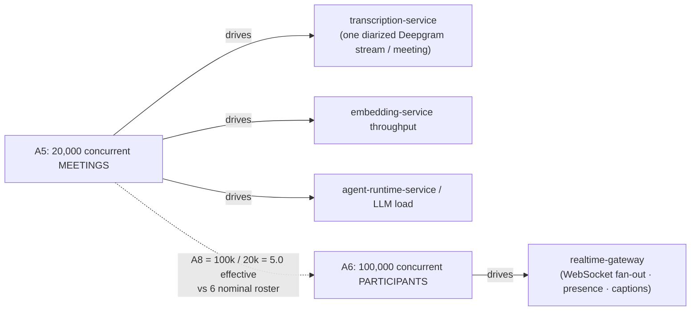
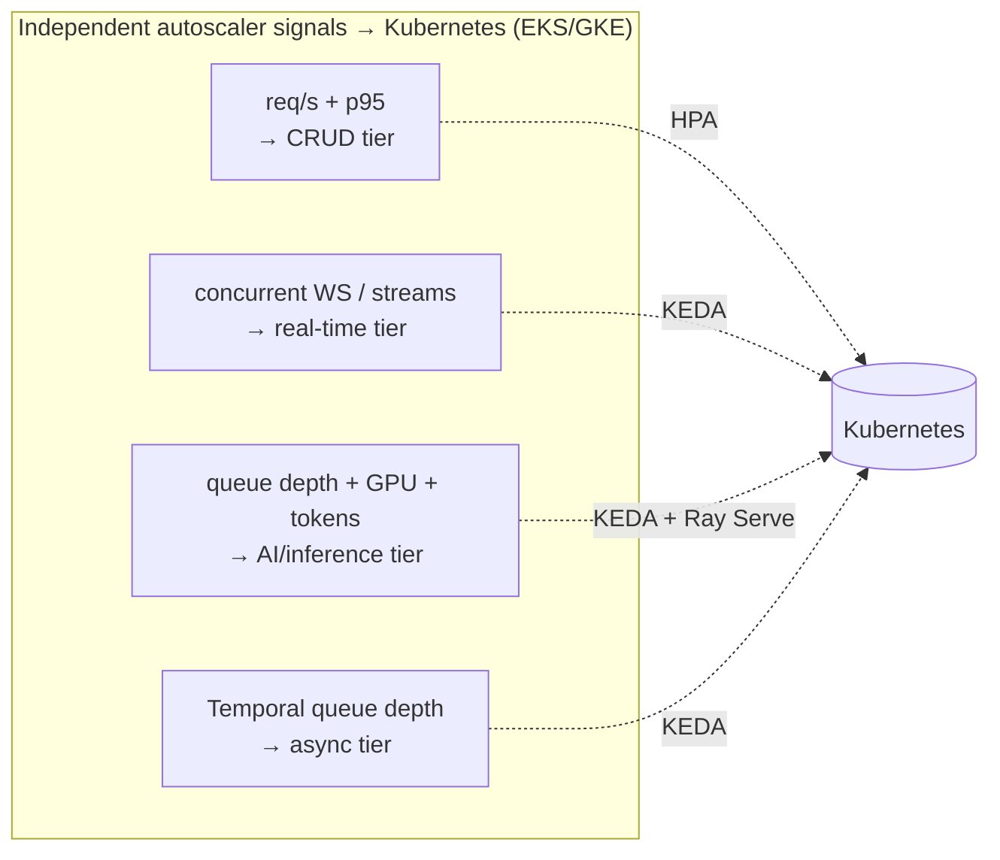
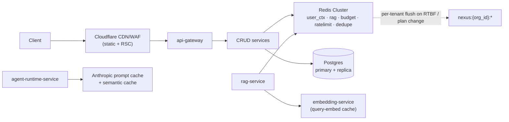
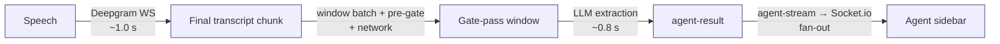
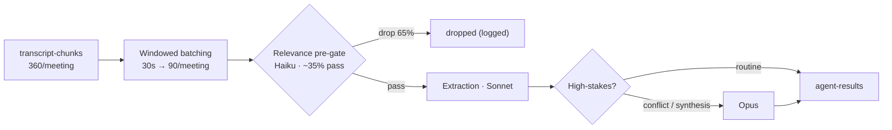
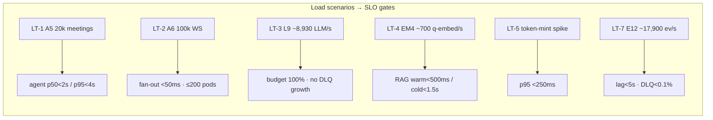

# NEXUS Scalability & Performance

The single lens that makes every tier's scaling strategy, autoscaler signal, performance budget, and load-test target visible at once, anchored on the frozen capacity model.

## Related documents

- [Architecture Overview & Principles](01-architecture-overview-and-principles.md) — the three scaling families and the modular-monolith → services path.
- [Container Architecture](03-container-architecture.md) — container inventory, communication styles, and the per-family autoscaler table (§8).
- [Data Architecture](05-data-architecture.md) — Postgres partitioning/replicas/shard path, Qdrant sizing, Redis clustering, object-storage cold tiering.
- [Multi-Tenancy & Tenant Isolation](06-multi-tenancy.md) — pooled + RLS / cells, noisy-neighbor controls, per-tenant quotas.
- [Event-Driven Architecture](07-event-architecture.md) — topic partition counts, retention, outbox/inbox, consumer-lag handling.
- [RAG Pipeline & Inference Serving](09-rag-and-inference-serving.md) — embedding/reranker GPU autoscaling and the inference-off-the-API-tier fix.
- [Capacity & Scaling Math](_canon/05-capacity-math.md) — the frozen anchors and derived numbers this document imports by symbol.
- [Service Catalog](_canon/01-service-catalog.md) — canonical service names and scaling profiles.
- [Data Model](_canon/02-data-model.md) — canonical entity, Qdrant collection, and Redis namespace names.
- [Tech & Architecture Decisions](_canon/06-tech-decisions.md) — locked technology choices cited throughout.

---

## 1. Scope and the one rule

This document does **not** re-derive what its siblings own. Postgres partitioning DDL, the Citus shard key, Qdrant int8 quantization sizing, and the inference GPU autoscalers are authored in depth in [Data Architecture](05-data-architecture.md) and [RAG & Inference Serving](09-rag-and-inference-serving.md). Here they are **summarized and linked**. The unique value of this document is twofold:

1. **The cross-tier lens** — one place where the autoscaler signal, scaling ceiling, and cost driver of every service family are legible together, so an SRE sizing a region or a reviewer reasoning about a capacity change sees the whole machine.
2. **The genuinely new material** — concrete HPA/KEDA configurations, the cross-tier caching strategy, the continuous load-testing program, the consolidated SLO/budget tables, and a bottleneck analysis tied to the PDF risk IDs.

Every capacity number is **imported by symbol** from [Capacity & Scaling Math](_canon/05-capacity-math.md) and never re-derived. If this doc needs a number not present there, the canon is edited first. The frozen anchors are restated once, verbatim, in §2 for reference; everything downstream cites the symbol (e.g. "at `A5` = 20,000 concurrent meetings").

> [SaaS-scale adjustment] The PDF treated scalability as a Phase-13 hardening item (k6/Locust, cost optimization, mobile responsive) layered onto a 4-person MVP whose entire fixture was the `2 orgs × 10 users × 5 meetings` seeder. This document instead treats scalability as a day-one architectural property: per-tier autoscaling, performance budgets, and continuous load testing are designed in from Phase 1, sized against the production anchors, not deferred.

---

## 2. The capacity model — imported verbatim

These are the frozen anchors and derived numbers from [Capacity & Scaling Math](_canon/05-capacity-math.md) §12. They are the ground truth for every sizing and SLO decision below.

| Canonical quantity | Symbol | Value |
|--------------------|:------:|------:|
| Registered users | A1 | 5,000,000 |
| MAU / DAU | A2 / A3 | 2,000,000 / 1,000,000 |
| Paying tenant organizations | A4 | 3,000 |
| **Peak concurrent meetings** (throughput anchor) | A5 | **20,000** |
| **Peak concurrent participants** (fan-out anchor) | A6 | **100,000** |
| Effective concurrent participants / meeting | A8 | 5.0 |
| Peak : average concurrency ratio | A10 | 4 : 1 |
| Windowed batching window | A17 | 30 s |
| Qdrant hot retention | A18 | 13 months |
| Meetings / month | R4 | 4,800,000 |
| Meetings / user / month (vs MAU) | R7 | 14.4 |
| `transcript_chunks` / month (flow) | T3 | 1,728,000,000 |
| `transcript_chunks` / year | T4 | 21,024,000,000 |
| Qdrant vectors / month (flow) | V6 | 340,000,000 |
| Qdrant live stock (13-mo) | V7 | 4,420,000,000 (~17 TB indexed) |
| Redpanda events / month | E10 | 11,580,000,000 |
| Redpanda events / sec (peak) | E12 | ~17,900 |
| `agent-stream` events / meeting (count-dominant) | E8 | 1,260 |
| Deepgram minutes / month | D1 | 216,000,000 |
| LLM calls / month (cost-controlled) | L7 | 5,789,000,000 |
| LLM calls / sec (peak) | L9 | ~8,930 |
| LLM reduction vs naive per-chunk | L10 | 86% |
| Embeddings / sec (peak, ingest) | EM2 | ~525 |
| Query embeddings / sec (peak) | EM4 | ~700 |
| Total variable infra cost | C-total | ~$19.5M/mo |
| Cost / MAU / month | C2 | ~$9.73 |

### 2.1 Two anchors, two domains

The single most important reconciliation in the model: throughput and fan-out are driven by **different** anchors and are not interchangeable.



Use **`A5` = 20,000** for transcription, embedding, and agent/LLM sizing (one diarized stream per *meeting*). Use **`A6` = 100,000** for `realtime-gateway` connection-count sizing (one WebSocket per *participant*). Conflating them oversizes one tier and undersizes the other.

---

## 3. Per-tier scaling strategy

Service boundaries are cut along three scaling families (plus async orchestration) precisely so each gets an independent autoscaler signal and its own cost center — this is the structural payoff of the decomposition in the [Service Catalog](_canon/01-service-catalog.md) §4 and [Container Architecture](03-container-architecture.md) §8. The families and their signals:

| Family | Services | Autoscaler signal | Cost driver | Anchor |
|---|---|---|---|---|
| CRUD / control plane | `api-gateway`, `bff`, `identity-tenant-service`, `core-api`, `meeting-service`, `integration-service`, `billing-metering-service`, `admin-ops-service`, `notification-service` | HTTP req/s + p95 latency | CPU + Postgres connections | API p95 < 300 ms |
| Real-time | `realtime-gateway`, `transcription-service` | Concurrent WS connections / live audio streams | Long-lived connections, Deepgram minutes | `A6` 100k participants / `A5` 20k meetings |
| AI / inference | `ingestion-service`, `embedding-service`, `reranker-service`, `agent-runtime-service`, `rag-service`, `knowledge-graph-service`, `search-service` | Queue depth (chunk backlog) + GPU util + token throughput | GPU + LLM tokens (separate cost center) | `L9` ~8,930 LLM calls/sec; `EM2` ~525 embeds/sec |
| Async / orchestration | `workflow-service` | Temporal task-queue depth | Worker CPU | ~1.34B state transitions/mo |



> [SaaS-scale adjustment] The PDF ran every service as one FastAPI process on Railway/Render with a single deployment and no autoscaler. NEXUS runs the early-stage modular monolith on a self-hosted single-node VPS running Docker Compose ([ADR-0016](adr/0016-self-hosted-vps-mvp-substrate.md)), Railway and Render being struck entirely, and runs production on Kubernetes (EKS/GKE) + Terraform IaC, with four independent autoscaler signals so the GPU-bound inference cost center scales and bills separately from request/s-bound CRUD serving. This is the locked architecture-style decision in [Tech Decisions §2.1](_canon/06-tech-decisions.md).

### 3.1 CRUD / control plane — HPA on req/s + p95

Stateless FastAPI services scale horizontally on a Kubernetes HPA driven by request rate and CPU, with a Prometheus-adapter custom metric for p95 latency so the fleet scales out before the SLO is breached, not after.

```yaml
# HPA: core-api (representative of the CRUD family)
apiVersion: autoscaling/v2
kind: HorizontalPodAutoscaler
metadata: { name: core-api }
spec:
  scaleTargetRef: { apiVersion: apps/v1, kind: Deployment, name: core-api }
  minReplicas: 4              # never below 4 for HA across 2 AZs
  maxReplicas: 120
  metrics:
    - type: Resource
      resource: { name: cpu, target: { type: Utilization, averageUtilization: 65 } }
    - type: Pods
      pods:
        metric: { name: http_requests_per_second }
        target: { type: AverageValue, averageValue: "150" }   # 150 rps/pod
    - type: Pods
      pods:
        metric: { name: http_request_p95_seconds }
        target: { type: AverageValue, averageValue: "0.25" }   # scale out before 300ms SLO
  behavior:
    scaleUp:   { stabilizationWindowSeconds: 30,  policies: [{ type: Percent, value: 100, periodSeconds: 30 }] }
    scaleDown: { stabilizationWindowSeconds: 300, policies: [{ type: Percent, value: 25,  periodSeconds: 60 }] }
```

The hard ceiling on this tier is not pod count but **Postgres connections**. Every CRUD pod fronts the primary through **PgBouncer in transaction-pooling mode** (`default_pool_size` 25 per (db, user), `max_client_conn` 10,000) so the HPA can fan out without exhausting `max_connections` — see [Data Architecture §3.5](05-data-architecture.md). Read-heavy paths (`bff` dashboard reads, `search-service` FTS, the `rag-service` FTS arm) route to the async read replica; only writes and read-your-write paths (token mint, decision confirm) touch the primary ([Data Architecture §3.6](05-data-architecture.md)).

### 3.2 Inference tier — KEDA on queue depth, GPU util, and token throughput

The inference services run on GPU via Ray Serve / vLLM and autoscale on KEDA, **off the API tier**. This is the central correction relative to the PDF and is authored in full in [RAG & Inference Serving §6](09-rag-and-inference-serving.md); summarized here:

| Service | KEDA scaler | Floor | Why |
|---|---|---|---|
| `embedding-service` | Redpanda consumer lag on `transcript-chunks` + `document-chunks`, GPU util | scale-to-zero off-peak permitted | Embed-on-ingest; sized to `EM2` ~525 embeds/sec peak (batch 32 → ~16.4 batches/sec) |
| `reranker-service` | rerank req/s + GPU util | **≥ 1 warm replica per active region** | Cross-encoder cold start is the latency risk; warm floor keeps RAG p95 on the warm side |
| `agent-runtime-service` | token throughput + `transcript-chunks` window backlog | min 2 per region | Token-scaled, its own cost center; per-tenant budgets gate spend |
| `rag-service` | query req/s (orchestrator, no model in-process) | min 2 per region | Scales on HTTP, reaches model servers over the internal gRPC mesh |

```yaml
# KEDA ScaledObject: embedding-service (consume → split → embed(32) → upsert Qdrant)
apiVersion: keda.sh/v1alpha1
kind: ScaledObject
metadata: { name: embedding-service }
spec:
  scaleTargetRef: { name: embedding-service }
  minReplicaCount: 0           # may idle off-peak; cold start absorbed by lag buffer
  maxReplicaCount: 40
  triggers:
    - type: kafka              # Redpanda is Kafka-API compatible
      metadata:
        bootstrapServers: redpanda.internal:9092
        consumerGroup: embedding-consumer
        topic: transcript-chunks
        lagThreshold: "2000"   # scale out when per-replica lag > 2k messages
    - type: prometheus
      metadata: { query: "avg(gpu_utilization{svc='embedding-service'})", threshold: "70" }
```

> [SaaS-scale adjustment] The PDF ran BGE-small "via ONNX runtime" and the reranker as in-line `RAGService` steps on the FastAPI process, coupling CPU/GPU-bound inference with request/s-bound API serving. NEXUS runs both as dedicated GPU services with their own KEDA autoscalers and cost center. This decoupling is the precondition for both R4 (the cost-controlled LLM pipeline) and R5 (the latency budgets) — see [RAG & Inference Serving §6](09-rag-and-inference-serving.md).

### 3.3 Real-time tier — connection-count scaling

`transcription-service` scales on **concurrent live audio streams** (one diarized Deepgram session per meeting, anchored on `A5` = 20,000) and `realtime-gateway` scales on **concurrent WebSocket connections** (anchored on `A6` = 100,000). The latter is the most operationally distinct tier: connections are long-lived, sticky, and Redis-backed for cross-pod fan-out.

```yaml
# KEDA ScaledObject: realtime-gateway (Socket.io WebSocket fan-out)
apiVersion: keda.sh/v1alpha1
kind: ScaledObject
metadata: { name: realtime-gateway }
spec:
  scaleTargetRef: { name: realtime-gateway }
  minReplicaCount: 6           # HA + headroom; never cold
  maxReplicaCount: 200         # 100k peak conns / ~600 conns per pod (see §3.3 / §6.6)
  triggers:
    - type: prometheus
      metadata: { query: "sum(socketio_active_connections) / count(up{svc='realtime-gateway'})", threshold: "600" }
    - type: cpu
      metadata: { type: Utilization, value: "60" }
```

At `A6` = 100,000 peak connections and a conservative ~600 connections per pod, the fleet is ~167 pods at peak (A6 is the peak anchor; average concurrency ~`A6`/`A10` = 25k connections → ~42 pods), sized to a 200-pod ceiling with headroom. Fan-out across pods uses the **Redis pub/sub backbone** (`nexus:{org_id}:pubsub:meeting:{meeting_id}`), not in-process state — see §6.6 and [Data Architecture §6.1](05-data-architecture.md). `transcription-service` is sized separately to `A5` = 20,000 streams: a single Deepgram session per meeting (the **6× cost lever**, `D3` avoided) means the stream count tracks meetings, not participants.

### 3.4 Async / orchestration tier

`workflow-service` (Temporal Cloud workers) scales on **Temporal task-queue depth** via KEDA. Temporal owns workflow state, so the worker fleet is stateless and horizontally scalable; it runs `MeetingLifecycleWorkflow`, `ActionFollowUpWorkflow` (reminders day 1/3/7, manager escalation via Slack DM at day 10), the cross-store right-to-be-forgotten saga, and dunning sagas — sized to ~1.34B state transitions/month.

### 3.5 Data-tier scaling — summarized, owned elsewhere

The stateful stores do not autoscale like the stateless tiers; their scaling ladders are authored in [Data Architecture](05-data-architecture.md) and summarized here so the lens is complete.

| Store | Scaling strategy | Ceiling / exit | Owner |
|---|---|---|---|
| **PostgreSQL** | PgBouncer transaction pooling → async read replica (lag < 5s) → monthly declarative range partitions on `transcript_chunks`/`chat_messages`/`meetings`/`audit_logs` + daily on `usage_events` (T3 = 1.728B rows/mo, T4 = 21B/yr) → cells for enterprise | Single-primary write ceiling → **cells**, then **Citus sharding by `org_id`** | [Data Architecture §3.2/3.6/3.7](05-data-architecture.md) |
| **Qdrant** | Per-tenant collections (`{collection}__{org_id}`) → **int8 scalar quantization** (~4× resident-RAM cut) → hot ~90d in RAM / cold ≤13mo memmap | `V7` = 4.42B vectors / ~17 TB indexed at A18=13mo; dedicated clusters for cell-isolated tenants | [Data Architecture §4](05-data-architecture.md) |
| **Apache AGE** (`nexus_knowledge`) | Org-partitioned graph, read replicas for Cypher read load | Migration path to Amazon Neptune / Neo4j Aura + relational materialized-view fallback (R1) | [Data Architecture §5](05-data-architecture.md) |
| **Redis** (Upstash) | Sharded **Redis Cluster** for keyspace caches (hash-tagged by `{org_id}`); replicated backbone for pub/sub + presence + priority queues | Per-tenant flush is a single slot-range `SCAN`+`UNLINK` | [Data Architecture §6](05-data-architecture.md) |
| **Object storage** | S3-compatible, region-pinned per tenant, lifecycle to cold/glacier after 30d; cold Parquet transcript archive past 90d | Effectively unbounded; T4 history lives here | [Data Architecture §7](05-data-architecture.md) |

The Postgres escalation order is **vertical + read replicas → more cells → Citus sharding by `org_id`** (every tenant-scoped table already carries `org_id` as the natural distribution column, so the escalation is mechanical, not a schema rewrite). The graph does not distribute under Citus and follows its own Neptune/Aura migration path. See [Data Architecture §3.7](05-data-architecture.md) for the full shard decision.

### 3.6 Redpanda partition strategy — summarized, owned elsewhere

All topics are tenant-partitioned; the partition **key** and **count** are authored in [Event Architecture §4](07-event-architecture.md). The key insight for scalability: high-volume meeting topics key on **`{org_id}:{meeting_id}`** (not `org_id` alone) so a hot enterprise tenant's load spreads across partitions while ordering is still guaranteed *within a meeting* — the only ordering scope the embedding consumer and agents require.

| Topic | Partitions (prod) | Partition key | Retention | Scaling note |
|---|---:|---|---|---|
| `transcript-chunks` | 180 | `{org_id}:{meeting_id}` | 7 days | Highest durable volume; re-derivable from `transcript_chunks` table |
| `agent-results` | 120 | `{org_id}:{meeting_id}` | 3 days | Read models persist in `core-api` |
| `agent-stream` | 120 | `{org_id}:{meeting_id}` | **1 hour** | **Count-dominant** (E8 = 1,260/meeting, throwaway token deltas) |
| `decisions` / `actions` | 24 / 24 | `{org_id}:{meeting_id}` | 30 days | Durable in Postgres; feed graph + follow-ups |
| `usage-events` | 48 | `org_id` | 7 days | Metering; aggregated nightly |
| control-plane topics | 6–24 | `org_id` | varies | Per-tenant lifecycle ordering |

Partition counts are sized from `E12` ~17,900 events/sec peak with headroom for replay and consumer parallelism (one partition feeds at most one consumer in a group). `agent-stream` dominates event **count** but carries the lowest value (1-hour retention); `transcript-chunks` dominates durable **volume**. See [Event Architecture §4.2](07-event-architecture.md) for all 22 topics and their DLQs.

> [SaaS-scale adjustment] The PDF ran on the Redpanda Serverless 30-day trial with no partition counts and no per-topic retention. Production runs a BYOC/dedicated multi-AZ Redpanda cluster with the partition counts above, sized from the frozen `E12` peak — see [Capacity §6](_canon/05-capacity-math.md).

---

## 4. Caching strategy across tiers

Caching is the cheapest scalability lever NEXUS has: every cache hit is a Postgres query, a Qdrant search, an LLM call, or a GPU forward pass that did not happen. Caches are layered from edge to model, every keyspace cache is **tenant-namespaced** so RTBF and plan-change invalidation is a clean per-tenant flush.

| Layer | What | Key / namespace | TTL | Effect |
|---|---|---|---|---|
| Edge / CDN | Static assets, RSC payloads | Cloudflare CDN (custom domain) | asset-versioned | `web-app` serves HTML/RSC from edge; near-zero origin load |
| User context | `get_user_context()` (role/skills/team/recent meetings/topics) | `nexus:{org_id}:user_ctx:{user_id}` | **5 min** (PDF) | Called per chunk-window by agents; the 5-min TTL keeps it nearly free |
| RAG answers | Passages + citations | `nexus:{org_id}:rag:{user_id}:{query_hash}` | **10 min** (PDF) | Skips the entire expand→retrieve→rerank pipeline on repeat queries |
| Query embeddings | BGE-small query vectors | (query-embed cache, namespaced) | short | Avoids re-embedding repeated query text on the embedding GPU |
| Consumer dedupe (inbox) | At-least-once delivery guard | `nexus:{org_id}:dedupe:{topic}:{consumer_group}:{idempotency_key}` | **24h** | Idempotent consume; the dedupe backstop for the bus |
| Budget hot mirror | `agent_budgets.tokens_consumed` | `nexus:{org_id}:budget:{period}` | period-end | Fast per-tenant quota check without a Postgres round-trip |
| LLM rate limit | Per-user LiteLLM counters | `nexus:{org_id}:ratelimit:{user_id}` | sliding window | Per-user throttling at the LLM router |
| Prompt cache | Anthropic prompt caching + semantic cache | (LLM tier) | provider-managed | The dominant LLM-cost lever; cached input tokens are billed at a fraction (see §6) |

> [SaaS-scale adjustment] The PDF used unscoped Redis keys (the `get_user_context` cache, the RAG cache) on a single instance. All keys are now `nexus:{org_id}:…` namespaced on a sharded Redis Cluster; the pub/sub backbone is separate and replicated. Anthropic prompt caching and a semantic cache in the LLM pipeline are the heaviest cost levers and are wholly added for SaaS scale — they are the difference between the `~$18.3M/mo` cost-controlled LLM bill and the `~$224M/mo` naive figure. Namespace names are carried verbatim from [Data Model §5](_canon/02-data-model.md).



---

## 5. SLOs, SLIs, and performance budgets

All targets are imported verbatim from [Capacity & Scaling Math §11](_canon/05-capacity-math.md). They are not restated as new numbers; they are the contract every scaling decision above must keep.

### 5.1 Latency SLOs

| Surface | SLI | Target | Source |
|---|---|---:|---|
| CRUD / REST API (`/api/...`) | p95 latency | **< 300 ms** | API tier |
| CRUD / REST API | p99 latency | **< 800 ms** | API tier |
| Live captions (Deepgram final → UI) | p95 | **< 2 s** | PDF "within 2s of speech" |
| End-to-end agent output (speech → sidebar) | **p50** | **< 2 s** | PDF R5 budget |
| End-to-end agent output | **p95** | **< 4 s** | PDF R5 budget |
| RAG search (`POST /api/rag/query`) | p95 (warm) | **< 500 ms** | PDF reranker budget |
| RAG search | p95 (cold) | **< 1.5 s** | Cross-encoder cold start |
| Token-mint (`POST /api/meetings/:id/token`) | p95 | **< 250 ms** | Realtime join path |
| Agent-to-agent collaboration round-trip | p95 | **< 1.5 s** | ContextGapAgent deadline before fall-through |

### 5.2 The end-to-end agent latency budget (R5)

The tightest budget in the system. It is a waterfall, and streaming + the priority queue are load-bearing — the UI begins rendering streamed token deltas (over `agent-stream`) before the full result lands, so perceived latency is the first-token time, not the last.



Budget: Deepgram ~1.0 s + LLM ~0.8 s + windowing/network. `p50 < 2 s`, `p95 < 4 s`. The 30-second windowing (`A17`) batches chunks but does **not** add 30 s of latency — agents process a rolling window and emit on speaker-turn boundaries; the window bounds *cost* (90 windows/meeting instead of 360 chunks), not freshness. Urgent alerts (conflict, workload) pre-empt notes in the per-user priority queue (`nexus:{org_id}:queue:agent:{user_id}`).

### 5.3 Availability SLOs (per plan tier)

| Plan tier | Monthly availability | Allowed downtime / mo | Posture |
|---|---:|---:|---|
| Free | **99.5%** | ~3h 39m | Single-region, pooled + RLS |
| Pro | **99.9%** | ~43m | Multi-region active-passive |
| Enterprise | **99.95%** | ~22m | Cell-based isolation, active-active candidate |

> [SaaS-scale adjustment] Per-plan availability tiers and the supporting multi-region posture (active-passive → active-active) are wholly added vs the PDF, which had a single deployment and no availability target.

### 5.4 Pipeline-health SLOs

| Subsystem | SLI | Target |
|---|---|---:|
| Embedding consumer | consumer lag | **< 5 s** (alert at 30 s) |
| Embedding latency | per batch of 32 | **< 100 ms** |
| Redpanda | DLQ rate | **< 0.1%** of events |
| Event delivery | duplicate-delivery rate (post-dedupe) | **~0** (idempotency keys) |
| Deepgram WS proxy | reconnect success | **> 99.9%** within 2 s |
| Per-tenant token budget | quota-breach enforcement | **100%** (hard cap, deny-by-default) |

### 5.5 Per-service performance budgets

Component budgets that compose into the SLOs above. Each is enforced with a Prometheus alert and a `statement_timeout` / deadline where applicable.

| Path | Budget | Enforcement |
|---|---:|---|
| Postgres CRUD query | < 30 ms p95 | `statement_timeout = 30s` (CRUD), 2s (token-mint path) |
| Qdrant vector search (top-50) | < 80 ms p95 | int8 quantized, HNSW; `org_id`-scoped collection |
| `reranker-service` (top-50 → top-10) | < 500 ms warm p95 | warm-replica floor ≥ 1/region |
| `embedding-service` batch (32) | < 100 ms | GPU batching; ingest queue absorbs bursts |
| RRF fusion + assembly | < 40 ms | in-process in `rag-service` (k=60) |
| LLM triage (Haiku) | < 400 ms | tier routing; cheapest model first |
| Socket.io fan-out hop | < 50 ms | Redis pub/sub backbone |

---

## 6. Bottleneck analysis and mitigations

Each bottleneck below is tied to a PDF risk ID and a capacity number, with the locked mitigation and where it is owned.

### 6.1 LLM cost & throughput — the dominant constraint (R4)

LLM is **94% of variable cost** (`C3`) and the single most architecturally important number in the system. The naive design — every realtime agent on every raw `transcript_chunk` — is `N2` = **41.5B calls/month** (~$224M/mo all-Sonnet), the R4 cost bomb. NEXUS does not build it.

The cost-controlled pipeline — **relevance pre-gating → windowed batching (`A17`, 30s, NOT per raw chunk) → tiered routing (Haiku triage → Sonnet extraction → Opus high-stakes) → semantic + Anthropic prompt caching → per-tenant token budgets & hard quotas** — collapses this to `L7` = **5.789B calls/month**, `L9` ~8,930 calls/sec peak, an **`L10` = 86% reduction** *before* any caching savings. Tier mix by volume: Haiku 45%, Sonnet 55%, Opus < 1%.



**Mitigation owner:** the cost-controlled pipeline is locked in [Tech Decisions §2.5](_canon/06-tech-decisions.md) and sized in [Capacity §8](_canon/05-capacity-math.md). Per-tenant token budgets (`agent_budgets`, hard cap, deny-by-default) are the billing-safety backstop. The Phase-13 ~30% optimization target (`C4`) takes LLM to ~$12.8M/mo and cost/MAU to ~$6.99.

### 6.2 Postgres single-primary write ceiling

At `T3` = 1.728B `transcript_chunks` rows/month plus all CRUD writes, the single primary is the relational write ceiling. **Mitigation, in escalation order** (owned by [Data Architecture §3.7](05-data-architecture.md)): PgBouncer transaction pooling + async read replicas → monthly range partitioning so retention/RTBF *drop partitions* instead of scanning → cell isolation for the largest tenants → Citus sharding by `org_id`. Because `org_id` is on every tenant-scoped row, the escalation is mechanical.

### 6.3 Reranker cold-start (R5)

A scaled-to-zero cross-encoder forced to cold-start mid-query is the single biggest RAG latency risk. **Mitigation:** `reranker-service` holds a **warm-replica floor of ≥ 1 per active region** and never scales to zero during business hours; the SLO splits warm p95 < 500 ms from cold p95 < 1.5 s, treating cold as the worst-case ceiling, not the target. Owned by [RAG & Inference Serving §5.2](09-rag-and-inference-serving.md).

### 6.4 Qdrant resident RAM

`V7` = 4.42B vectors / ~17 TB indexed (HNSW + payload, ~2.5×). Holding all of that in RAM is uneconomical. **Mitigation:** **int8 scalar quantization** (~4× resident-RAM cut) + a hot/cold split aligned to `A18` (13-month retention) — hot ~90d in RAM, cold ≤13mo memmap. Per-tenant collections cap any single tenant's index size. Owned by [Data Architecture §4.3](05-data-architecture.md).

### 6.5 Redpanda hot tenant + `agent-stream` count

`agent-stream` dominates event **count** (`E8` = 1,260/meeting; total `E10` = 11.58B/mo, `E12` ~17,900/sec peak). A single enterprise tenant could saturate one partition. **Mitigation:** high-volume topics key on `{org_id}:{meeting_id}` so load spreads across 120–180 partitions while per-meeting order holds; `agent-stream` carries 1-hour retention (throwaway token deltas) so its dominance is in count, not durable volume. Tenant-keyed partitions give per-tenant lag observability and prevent head-of-line blocking. Owned by [Event Architecture §4](07-event-architecture.md).

### 6.6 realtime-gateway connection ceiling

`A6` = 100,000 concurrent WebSocket connections is the fan-out wall (A6 is the peak anchor). **Mitigation:** horizontal scaling on connection count (~600 conns/pod → ~167 pods at peak, ~42 pods at average concurrency, 200 ceiling) with the **Redis pub/sub backbone** for cross-pod fan-out so any pod can deliver an agent output or caption to any connection. Connection state is ephemeral; no pod holds durable state. Owned by §3.3 and [Data Architecture §6.1](05-data-architecture.md).

### 6.7 Deepgram cost (the 6× lever)

**Mitigation already locked:** one diarized Deepgram stream per *meeting*, not per *participant*. `D1` = 216M minutes/month; per-participant billing (`D3`) would be 1.296B minutes — a **6× cost multiplier, deliberately avoided**. Diarization maps `speaker_id` → `user_id` in `meeting_speakers` (PDF R7: reliable manual + confidence-scored suggestion). Owned by [Capacity §7](_canon/05-capacity-math.md).

| Bottleneck | Risk ID | Capacity anchor | Mitigation | Owner |
|---|---|---|---|---|
| LLM cost/throughput | R4 | N2→L7 (86% cut) | pre-gate → batch → tier → cache → quota | [Tech Decisions §2.5](_canon/06-tech-decisions.md) |
| Postgres write ceiling | — | T3 = 1.728B/mo | pooling → replicas → partitions → cells → Citus | [Data Architecture §3.7](05-data-architecture.md) |
| Reranker cold-start | R5 | RAG p95 < 500ms | warm-replica floor ≥ 1/region | [RAG & Inference §5.2](09-rag-and-inference-serving.md) |
| Qdrant RAM | — | V7 = 4.42B / ~17TB | int8 quantization + hot/cold | [Data Architecture §4.3](05-data-architecture.md) |
| Redpanda hot tenant | — | E12 ~17,900/sec | `{org_id}:{meeting_id}` key, 120–180 partitions | [Event Architecture §4](07-event-architecture.md) |
| WS connection ceiling | R5 | A6 = 100,000 | conn-count scaling + Redis pub/sub | §3.3 |
| Deepgram cost | R7 | D1 = 216M min | one stream/meeting (6× avoided) | [Capacity §7](_canon/05-capacity-math.md) |

---

## 7. Load-testing strategy (k6 / Locust)

> [SaaS-scale adjustment] The PDF scheduled k6/Locust load tests as a single Phase-13 hardening activity. NEXUS runs load testing **continuously from Phase 1**: every scaling-family service ships with a load profile in its repo, a nightly k6 run in GitHub Actions gates the staging deploy against the §5 SLOs, and a quarterly full-scale soak validates the production anchors. Load testing is a CI gate, not a one-time pre-launch event.

Two tools, by fit: **k6** (JavaScript, high-RPS HTTP + WebSocket, scriptable in CI) for the CRUD, RAG, token-mint, and `realtime-gateway` paths; **Locust** (Python, complex stateful user journeys) for the multi-step meeting lifecycle and agent-pipeline scenarios that mirror real participant behavior.

### 7.1 Scenarios, anchors, and pass/fail targets

Each scenario is pinned to a capacity anchor and an §5 SLO. A run **fails the build** if the target p95 is breached or error rate exceeds 0.1%.

| # | Scenario | Tool | Anchor | Load shape | Pass target |
|---|---|---|---|---|---|
| LT-1 | Meeting throughput (transcription + agent path) | Locust | `A5` = 20,000 concurrent meetings | ramp to 20k diarized streams, 45-min holds | agent end-to-end p50 < 2s / p95 < 4s; captions p95 < 2s |
| LT-2 | Realtime fan-out | k6 (WS) | `A6` = 100,000 concurrent WS | ramp to 100k persistent connections, broadcast storms | fan-out hop < 50 ms; zero dropped connections; pod count ≤ 200 |
| LT-3 | LLM / agent pipeline | Locust | `L9` ~8,930 LLM calls/sec peak | sustained gate-passing window load | token budget enforced 100%; no DLQ growth; tier mix Haiku 45% / Sonnet 55% / Opus <1% |
| LT-4 | RAG query | k6 | `EM4` ~700 query-embeds/sec | warm + cold cross-encoder mix | warm p95 < 500 ms; cold p95 < 1.5 s |
| LT-5 | Token-mint (join path) | k6 | `A5` join bursts | spike: 20k joins in 60s | p95 < 250 ms |
| LT-6 | CRUD API | k6 | DAU `A3` browse load | steady dashboard/My-Tasks reads | p95 < 300 ms; p99 < 800 ms |
| LT-7 | Event-bus soak | k6 + Redpanda gen | `E12` ~17,900 events/sec | 24h sustained at peak | consumer lag < 5s; DLQ rate < 0.1%; duplicate rate ~0 |
| LT-8 | Embedding ingest backpressure | Locust | `EM2` ~525 embeds/sec | burst 4× then drain | batch < 100 ms; lag recovers < 30s; embedding-service scales on lag |
| LT-9 | Multi-tenant noisy-neighbor | Locust | one tenant at 10× its share | hot tenant burst alongside long tail | no SLO regression for other tenants (partition + quota isolation) |



### 7.2 The noisy-neighbor test is the SaaS-defining one

LT-9 validates the property that makes NEXUS multi-tenant-safe: one tenant generating 10× its share must not degrade any other tenant's SLO. It exercises every isolation layer at once — tenant-keyed Redpanda partitions (no head-of-line blocking), per-tenant `agent_budgets` hard caps (the burst tenant gets throttled, not its neighbors), namespaced Redis, and RLS-scoped Postgres. A regression in any other tenant's p95 during LT-9 is a release blocker. See [Multi-Tenancy §5](06-multi-tenancy.md).

### 7.3 Cost as a load-test assertion

Because LLM is 94% of variable cost, LT-3 asserts not just latency but **cost shape**: the observed tier mix must hold (Haiku 45% / Sonnet 55% / Opus < 1%) and gate-pass rate must stay near 35%. A drift toward more Sonnet/Opus calls is a cost regression caught in CI, long before it shows up on the `C-total` ~$19.5M/mo bill.

---

## 8. Summary — what this document freezes

- **One rule:** numbers are imported by symbol from [Capacity & Scaling Math](_canon/05-capacity-math.md); owned subsystems are summarized and linked, never re-derived.
- **Four independent autoscaler signals:** CRUD on req/s + p95 (HPA), inference on queue depth + GPU util + token throughput (KEDA + Ray Serve), real-time on WebSocket connections (KEDA), async on Temporal queue depth — so the GPU cost center scales separately from CRUD serving.
- **Two anchors, never conflated:** `A5` = 20,000 meetings drives transcription/embedding/LLM; `A6` = 100,000 participants drives `realtime-gateway` fan-out.
- **Caching is the cheapest lever:** Cloudflare edge → tenant-namespaced Redis (`user_ctx` 5min, `rag` 10min, `dedupe` 24h) → Anthropic/semantic prompt cache (the dominant LLM-cost lever).
- **SLOs are the contract:** CRUD p95 < 300 ms, captions < 2s, agent end-to-end p50 < 2s / p95 < 4s, RAG warm < 500 ms / cold < 1.5 s, token-mint p95 < 250 ms — imported verbatim.
- **The dominant bottleneck is LLM cost (R4):** the pre-gate → batch → tier → cache → quota pipeline delivers an 86% (`L10`) call-volume reduction; every other bottleneck (Postgres primary, reranker cold-start, Qdrant RAM, Redpanda hot tenant, WS ceiling, Deepgram 6×) has a locked, owned mitigation.
- **Load testing is continuous from Phase 1,** not a Phase-13 event: nine k6/Locust scenarios pinned to the anchors gate every staging deploy against the §5 SLOs, with the noisy-neighbor and cost-shape tests as the SaaS-defining assertions.
