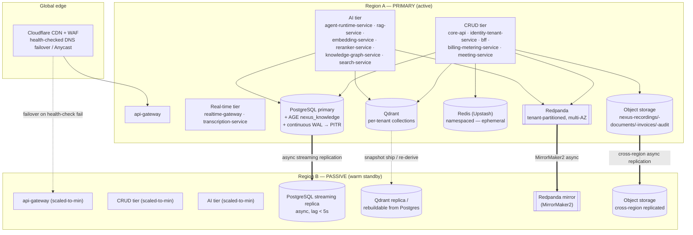
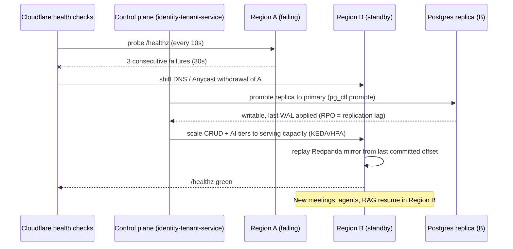
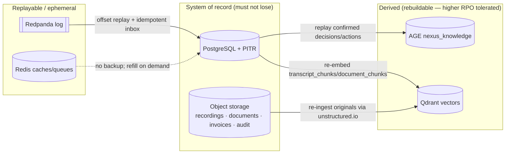
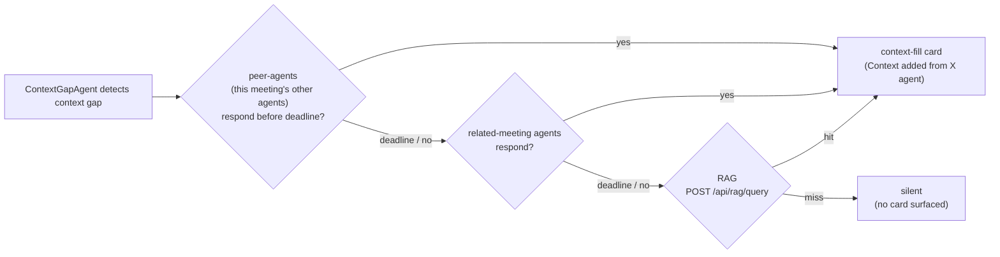
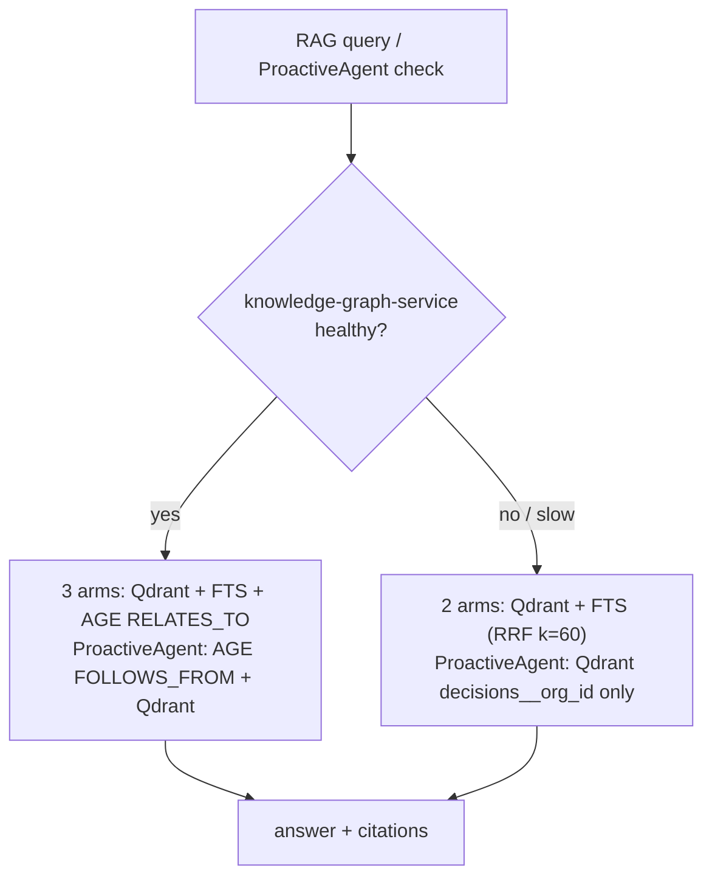
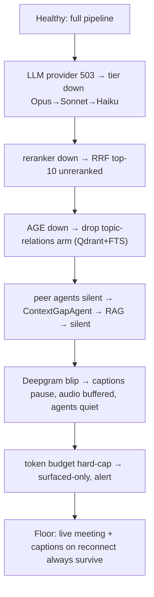
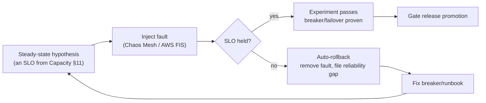

# NEXUS Reliability & Disaster Recovery

The frozen, production-grade specification of how NEXUS meets its per-tier availability targets, recovers every store after a regional or component failure, degrades gracefully under partial outage, and proves it all with chaos engineering.

## Related documents

- [Service Catalog](_canon/01-service-catalog.md) — canonical service names, scaling families, and the producer/consumer event map.
- [Canonical Data Model](_canon/02-data-model.md) — frozen entity/table names, stores, and the `data_residency` region/cell pin.
- [Capacity & Scaling Math](_canon/05-capacity-math.md) — the SLO and availability numbers (§11) this document imports by reference, never re-derives.
- [Locked Tech & Architecture Decisions](_canon/06-tech-decisions.md) — region strategy, backups/PITR, the descope/fallback chains (R1/R6/R8).
- [Data Architecture](05-data-architecture.md) — PostgreSQL PITR, read replicas, per-tenant Qdrant collections, the `nexus_knowledge` graph, object-storage buckets, cold tiering.
- [Multi-Tenancy & Isolation](06-multi-tenancy.md) — pooled + RLS for the long tail, cell-based isolation, the binding of posture to availability tier.
- [Event Architecture](07-event-architecture.md) — Redpanda topics, transactional outbox/inbox, idempotency keys, DLQs, consumer-lag alerts.
- [Container Architecture](03-container-architecture.md) — the deployable units, Kubernetes topology, and autoscaler signals.
- [RAG & Inference Serving](09-rag-and-inference-serving.md) — hybrid retrieval arms (Qdrant + FTS + AGE), the reranker, `ProactiveAgent` conflict detection.

---

## 1. Scope and the reliability contract

This document specifies **availability**, **disaster recovery**, **graceful degradation**, and **chaos engineering** for NEXUS at the capacity-math anchors: millions of users across thousands of paying tenants, 20k peak concurrent meetings (A5), 100k peak concurrent participants (A6). It does not re-derive load or cost numbers — those are frozen in [Capacity & Scaling Math](_canon/05-capacity-math.md) and imported here by symbol and by SLO.

> [SaaS-scale adjustment] The PDF (NEXUS Execution Plan v2.1) treated reliability as a single Phase-13 hardening item — "production Postgres backups/PITR/read replica" plus a "security audit." It had no tenant tiers, no multi-region posture, no RPO/RTO targets, and no runtime degradation contract. Everything in this document except the carried-over latency budget (live captions < 2s; agent end-to-end p50 < 2s / p95 < 4s) and the named descope fallbacks (R1/R6/R8, whose *IDs and chain names are verbatim*) is a SaaS-scale addition. The PDF descopes were authored as *project-scope* decisions; this document re-expresses them as *runtime* and *operational* behavior, and marks that reframe explicitly.

Two principles govern everything below:

1. **Postgres is the system of record; every other store is derivable or ephemeral.** Qdrant vectors and the Apache AGE `nexus_knowledge` graph are *derived* data — rebuildable from Postgres plus object storage. Redis is *ephemeral* — cache, pub/sub, and queues, never backed up. Redpanda is a *replayable log*, not a store of record. This single fact reshapes the RPO/RTO story per store (§4).
2. **Every recovery and degradation number closes against a downtime budget.** The per-tier availability SLOs ([Capacity §11.2](_canon/05-capacity-math.md)) set a monthly downtime budget; no RTO in this document is allowed to exceed the budget of the tier it serves (§3.3, verified arithmetic).

---

## 2. Availability targets by tier

The availability SLOs are frozen in [Capacity & Scaling Math §11.2](_canon/05-capacity-math.md) and bound to tenancy posture in [Multi-Tenancy §2](06-multi-tenancy.md). They are reproduced here as the contract this document must satisfy — not re-derived.

| Plan tier | Monthly availability | Allowed downtime / month | Posture | Tenancy |
| --- | ---: | ---: | --- | --- |
| Free | **99.5%** | **~3h 39m** (216 min) | Single-region, pooled + RLS | Pooled long tail |
| Pro | **99.9%** | **~43m** (43.2 min) | Multi-region active-passive | Pooled long tail |
| Enterprise | **99.95%** | **~22m** (21.6 min) | Cell-based isolation, active-active candidate | Dedicated cell |

The downtime budgets above are computed as `(1 - availability) × 30 days`. They are the hard ceiling against which §3.3 sizes the RTO ladder.

> [SaaS-scale adjustment] Per-plan availability tiers and the multi-region posture are wholly added vs the PDF, which was a single deployment with no SLA. The tiers are not arbitrary: they fall directly out of the tenancy model — Free shares a single-region pooled cluster (cheapest, weakest SLA), Pro rides active-passive multi-region, Enterprise gets a dedicated cell that is an active-active candidate. Availability is therefore a *product packaging* lever, metered and enforced through the same `data_residency` row that pins region and cell.

These availability SLOs sit alongside the latency SLOs ([Capacity §11.1](_canon/05-capacity-math.md)) which this document treats as **circuit-breaker thresholds** (§5): CRUD p95 < 300ms / p99 < 800ms, live captions p95 < 2s, agent end-to-end p50 < 2s / p95 < 4s, RAG p95 < 500ms warm / < 1.5s cold, token-mint p95 < 250ms, A2A round-trip p95 < 1.5s. And the pipeline-health SLOs ([Capacity §11.3](_canon/05-capacity-math.md)): embedding consumer lag < 5s (alert at 30s), Redpanda DLQ rate < 0.1%, dedupe duplicate-delivery ~0, Deepgram WS proxy reconnect > 99.9% within 2s, per-tenant token-budget enforcement 100%.

---

## 3. Multi-region topology and failover

### 3.1 The active-passive → active-active evolution

The region strategy is locked: **multi-region active-passive, evolving to active-active** ([Tech Decisions §2.1](_canon/06-tech-decisions.md)). The three scaling families ([Service Catalog §4](_canon/01-service-catalog.md)) fail over as units because they share a region and a data plane, not because they are coupled in logic.

In **active-passive** (the posture for the pooled Pro tier; Free is also pooled but runs single-region with no passive, and Enterprise cells are the active-active candidate), Region A serves all traffic. Region B runs the CRUD and AI tiers scaled to minimum replicas (warm, not cold) and holds an async PostgreSQL streaming replica, a Redpanda mirror, and cross-region-replicated object storage. Cloudflare health-checked DNS swings traffic to Region B on primary failure.

> [SaaS-scale adjustment] The real-time tier (`realtime-gateway`, `transcription-service`) is deliberately **not** kept warm in the passive region. Live meetings are stateful, sub-2s-latency connections; a meeting in flight during a region loss cannot be transparently migrated — the SDK clients reconnect to the surviving region and the LiveKit room is re-established there. We optimize the passive region for fast *resumption of new meetings*, not for zero-loss in-flight meeting migration, because the latter would require synchronous cross-region audio replication that blows the live-caption budget.

### 3.2 Failover mechanics by tier

- **Enterprise (cell-based, active-active candidate):** the cell's blast radius is one tenant. An active-active cell serves both regions concurrently with conflict-free writes scoped to `org_id`; a single-region cell promotes its in-region replica. RTO target near-zero (active-active) to ≤ 15m (single-cell promotion).
- **Pro (active-passive, pooled):** controlled region failover — promote the streaming replica, scale Region B, redirect DNS. RTO ≤ 30m.
- **Free (single-region, pooled):** no passive region; recovery is restore-from-backup within the single region. RTO can run into hours — within the 3h 39m budget.

### 3.3 RPO / RTO targets and the budget-closure check

> [SaaS-scale adjustment] RPO/RTO targets and the cross-region replication posture are wholly added vs the PDF, which named only "backups/PITR/read replica" with no recovery objectives.

| Tier | RPO (data loss) | RTO (time to restore) | Mechanism | Fits downtime budget? |
| --- | ---: | ---: | --- | --- |
| Free | ≤ 5 min | ≤ 2h | In-region PITR restore | ✅ 2h < 3h 39m |
| Pro | ≤ 5s (async replica lag) | ≤ 30m | Cross-region replica promotion | ✅ one failover/mo < 43m |
| Enterprise | ~0 (active-active) / ≤ 5s (single-cell) | ~0 / ≤ 15m | Active-active cell, or cell-replica promotion | ✅ 15m < 22m |

**Closure check (the consistency backbone).** Each tier's RTO must leave headroom inside its monthly downtime budget for at least one unplanned event:

- Enterprise 99.95% = 21.6 min/mo. A single-cell promotion at **≤ 15m** consumes one event and stays inside budget; the active-active candidate eliminates the failover entirely. ✅
- Pro 99.9% = 43.2 min/mo. One active-passive failover at **≤ 30m** fits with ~13 min spare for the month. A second failover in one month breaches the budget — which is why Pro is the threshold at which active-active becomes worth the cost. ✅
- Free 99.5% = 216 min/mo. A restore-from-backup at **≤ 2h (120 min)** fits comfortably; Free has no warm standby precisely because the budget tolerates a slower recovery. ✅

**RPO anchoring.** The ≤ 5s Pro/Enterprise RPO is the **async streaming-replication lag**, held consistent with the read-replica lag tolerance already frozen in [Data Architecture §3.6](05-data-architecture.md) (`< 5s`) and the pipeline-health SLO ([Capacity §11.3](_canon/05-capacity-math.md)). In-region PITR RPO is effectively seconds (continuous WAL archiving). Cross-region object replication is async, so recordings/invoices written in the final seconds before a region loss carry the same ≤ 5s RPO; object-lock immutability (invoices, audit) is preserved across the replica.

---

## 4. Backups and disaster recovery per store

This is the section most "DR" treatments get wrong by covering only Postgres. NEXUS spans **five physical storage technologies** (Apache AGE rides on PostgreSQL) across **six logical stores**, each with **radically different recovery semantics** because most of them hold *derived* or *ephemeral* data.

> [SaaS-scale adjustment] The per-store DR matrix is a SaaS-scale addition. The PDF's single line ("Postgres backups/PITR/read replica") covers exactly one of the six logical stores below. The load-bearing insight: Qdrant and AGE are rebuildable from Postgres + object storage, so they tolerate a *higher* RPO and recover by re-derivation rather than by point-in-time restore.

> [SaaS-scale adjustment] One loss class falls outside the "everything derives from Postgres + object storage" guarantee: the **per-tenant KMS data keys** that envelope-encrypt `oauth_tokens` (`access_token_enc` / `refresh_token_enc`, per the [Canonical Data Model](_canon/02-data-model.md)). You can restore the ciphertext but cannot decrypt it without the key material, so key material is backed up and recoverable per the key-management DR posture in [Security Architecture](11-security-architecture.md) — it is the one non-derivable exception to the re-derivation guarantee in §4.1. Blast radius is modest: OAuth tokens are re-obtainable via integration re-consent, so a key-material loss degrades to re-authorization, not permanent data loss.

| Store | Role | Backup mechanism | RPO | RTO | Recovery method |
| --- | --- | --- | ---: | ---: | --- |
| **PostgreSQL** (Supabase-managed) | **System of record** — `users`, `meetings`, `transcript_chunks`, `decisions`, `action_items`, `worklogs`, all tenant rows | Continuous WAL archiving + PITR; cross-region async streaming replica | ≤ 5s (replica) / seconds (PITR) | ≤ 30m (promote) / ≤ 2h (PITR restore) | Promote replica, or restore to point-in-time before incident |
| **Apache AGE** `nexus_knowledge` (rides on Postgres) | **Derived** — confirmed Decision/Action/Person/Meeting/Topic edges | Same WAL/PITR as Postgres (co-located); **also fully rebuildable** by replaying confirmed `decisions`/`actions` rows | ≤ 5s (PITR) / unbounded if rebuilt | Minutes (PITR) / hours (full re-derive) | Restore with Postgres; or re-run edge creation from `decisions`/`action_items` on confirmation |
| **Qdrant** (per-tenant collections) | **Derived** — BGE-small vectors from transcripts/docs/decisions | Periodic collection snapshots; **fully rebuildable** by re-embedding from Postgres `transcript_chunks` / `document_chunks` + object originals | Snapshot interval (e.g. 6h) / unbounded if rebuilt | ≤ 1h (snapshot) / per-tenant minutes, global days at EM2 ~525/s (§4.1) | Restore snapshot (the global DR path), or re-embed via the embedding consumer from the durable source rows |
| **Redis** (Upstash, namespaced) | **Ephemeral** — `get_user_context` cache, RAG cache, presence, pub/sub, priority queues, dedupe cache | **None — not backed up by design** | n/a (lossy) | Seconds (cold caches refill) | Recreate empty; caches repopulate on demand; in-flight pub/sub fan-out is reconstructed from Redpanda + Socket.io reconnect |
| **Redpanda** (tenant-partitioned, multi-AZ) | **Replayable log** — all topics | Multi-AZ replication + topic retention + MirrorMaker2 to passive region | 0 within-AZ / mirror lag cross-region | Minutes (consumer offset replay) | Consumers replay from last committed offset; idempotent inbox dedupes redelivery |
| **Object storage** (S3-compatible) | **Durable blobs** — `nexus-recordings`, `nexus-documents`, `nexus-attachments`, `nexus-invoices`, `nexus-audit-archive`, `nexus-exports` | Cross-region async replication; **object-lock** (WORM) on `nexus-invoices` (7-yr) and `nexus-audit-archive` | ≤ 5s | Seconds (replica is live) | Failover to replica bucket; object-lock prevents tamper/early-delete |

### 4.1 The re-derivation guarantee

A complete loss of Qdrant or the AGE graph is **not a data-loss event** — it is a recompute event. This is what makes the system cheap to make durable:

- **Qdrant rebuild:** the embedding consumer ([Event Architecture](07-event-architecture.md)) re-reads `transcript_chunks` and `document_chunks` from Postgres (the durable source rows that mirror the Qdrant payload, per the frozen citation contract), re-splits with LangChain (600/60), re-embeds at BGE-small, and re-upserts. At the steady-state peak embed rate of ~525 embeds/s (EM2) the inference tier rebuilds a tenant's collection in minutes (a tenant slice is tiny), but the global 4.42B-vector stock (V7) takes **days** at that rate (V7 / EM2 = 4.42B / 525 ≈ 8.4M s ≈ ~97 days); a faster global rebuild requires an explicitly provisioned burst scale-out of the `embedding-service` GPU fleet well above EM2, which is a planned-capacity decision, not an assumed default. The realistic DR path is therefore snapshot restore (RTO ≤ 1h, per §4) for the global store, with re-embedding reserved for per-tenant rebuilds or as the snapshot-loss floor.
- **AGE rebuild:** every edge is created **only on confirmation** ([Tech Decisions §2.10](_canon/06-tech-decisions.md)). Replaying confirmed `decisions` and `action_items` rows reconstructs the `PRODUCED`, `ASSIGNED_TO`, `ATTENDED`, `RELATES_TO`, and `FOLLOWS_FROM` edges deterministically. No graph state exists that is not derivable from confirmed relational rows.

The corollary: backups for Qdrant and AGE exist purely to shorten RTO (snapshot restore beats re-derive), never to prevent data loss. Postgres and object storage are the only stores where a backup gap is true loss — and both carry PITR / cross-region replication / object-lock accordingly.

### 4.2 Right-to-be-forgotten interacts with DR

RTBF deletion ([Data Architecture §8.1](05-data-architecture.md)) runs as a Temporal workflow across the canon RTBF store set — **Postgres, Qdrant, AGE `nexus_knowledge`, Redis, object storage, and an `audit-service` completion record** ([Canonical Data Model §7](_canon/02-data-model.md)). Note this set is **not** the same as the §4 backup matrix: Redpanda is *not* an RTBF deletion target — it is a replayable log whose tenant-partitioned data ages out by retention-based expiry, not by point-delete — and `audit-service` *is* a target (it appends the mandatory RTBF-completion record). DR must not resurrect deleted data: PITR restores and replica promotions replay the deletion tombstones, and the object-lock retention windows (`nexus-invoices` 7yr, `nexus-audit-archive` SOC2) are the *only* data that survives an RTBF by legal exception. A restore that predates an RTBF completion triggers a re-run of the deletion workflow against the restored state — this reconciliation step is mandatory in the runbook.

---

## 5. Circuit breakers and graceful degradation

NEXUS degrades along two distinct axes that the source descopes (R1/R6/R8) conflate. This document separates them:

- **Hot runtime degradation** — a circuit breaker trips *during* a live meeting/query and the system silently falls through to a lesser-but-functional path within the latency budget. Per-request, automatic, self-healing.
- **Cold operational fallback** — an operator-driven migration or scope decision taken over hours/days when a dependency is structurally unfit. Not a per-request failover.

> [SaaS-scale adjustment] The PDF authored R1/R6/R8 as *project-scope* descopes ("ship Calendar+Slack only," "descope multi-agent to RAG-only," "Neo4j Aura if AGE awkward"). Re-expressing them as runtime circuit-breaker chains vs operational fallbacks is a SaaS-scale addition. The R-IDs and the chain names (`peer-agents → related-meeting agents → RAG → silent`) are carried over verbatim; their classification as hot vs cold is new.

### 5.1 Circuit-breaker policy

Every cross-service call rides a circuit breaker anchored to the **latency SLOs already frozen in [Capacity §11.1/§11.3](_canon/05-capacity-math.md)** — no new thresholds are invented.

| Breaker | Trips on | Threshold (from canon SLO) | Open-state behavior |
| --- | --- | --- | --- |
| LLM (LiteLLM → provider) | 503 / timeout / rate-limit | Agent end-to-end p95 budget 4s | Tier down (Opus→Sonnet→Haiku), then queue/skip window |
| `reranker-service` | timeout / GPU saturation | RAG rerank < 500ms cold | Skip rerank; return RRF top-10 unreranked |
| `knowledge-graph-service` (AGE) | timeout / unavailable | A2A / RAG arm latency | Drop AGE arm from RRF; ProactiveAgent → Qdrant semantic path |
| Deepgram WS proxy | disconnect | reconnect > 99.9% within 2s | Reconnect; buffer audio; captions pause, agents quiet |
| `embedding-service` | queue depth / lag | consumer lag < 5s (alert 30s) | Backpressure; query-embed prioritized over ingest-embed |
| Redpanda producer | broker unavailable | DLQ rate < 0.1% | Outbox retains; relay retries; poison → DLQ |
| Per-tenant token budget | quota breach | 100% hard-cap enforcement | Deny-by-default; alert; degrade to surfaced-only |

Breakers use the standard closed → open → half-open cycle with exponential backoff. Open state is **fail-functional, not fail-error**: the user always gets a meeting, captions, notes, and a RAG answer — just from a shorter pipeline.

### 5.2 R6 — multi-agent collaboration: a hot fallback chain (verbatim)

`ContextGapAgent`'s collaboration over `agent-requests` / `agent-responses` is the cleanest hot-degradation example in the system, and the PDF already specified it as a fall-through chain with correlation IDs and a deadline ([Tech Decisions §2.6](_canon/06-tech-decisions.md)). This is a **runtime** circuit breaker, carried over verbatim:

The chain is `peer-agents → related-meeting agents → RAG → silent`. The deadline (A2A round-trip p95 < 1.5s, [Capacity §11.1](_canon/05-capacity-math.md)) is the breaker: if peers don't answer in time the agent falls through rather than blocking the meeting. The pre-authorized **cold** descope is to ship RAG-only context fill (skip peer collaboration entirely) if the A2A layer proves unstable in production — distinct from the per-request fall-through above.

### 5.3 R1 — graph unavailability: hot drop vs cold migration

This is the case the source most easily gets wrong. There are **two** R1 behaviors:

- **Hot runtime degradation (per-request):** when `knowledge-graph-service` (AGE) is slow or down, the hybrid retrieval RRF fusion simply **drops the AGE topic-relations arm** and continues on the **Qdrant vector + Postgres FTS** arms ([RAG & Inference §3.2](09-rag-and-inference-serving.md)). RRF with `k=60` over two arms still returns a ranked top-50; recall degrades modestly, the query succeeds inside budget. In parallel, `ProactiveAgent` conflict detection falls back from the AGE `FOLLOWS_FROM` lineage query to the **`decisions__{org_id}` Qdrant semantic path** it already uses as a complement ([RAG & Inference §8 "Consumers of the RAG pipeline"](09-rag-and-inference-serving.md)). No graph, no outage — just a thinner signal.

- **Cold operational fallback (migration):** if Apache AGE proves structurally awkward on managed Supabase (the actual R1 concern), the operator migrates the graph to **Amazon Neptune / Neo4j Aura**, with a **relational materialized-view fallback** as the floor ([Data Architecture §5.4](05-data-architecture.md), [Tech Decisions §2.3](_canon/06-tech-decisions.md)). Every Cypher template stays parameterized by `$org_id`, so the migration preserves the partition contract. **This is not a live failover** — switching graph engines mid-request would be wrong; it is a planned cutover taken over hours with dual-write and verification.

### 5.4 R8 — integrations off the critical path

> [SaaS-scale adjustment] R8 in the PDF is a *scope guardrail* — "ship Calendar + Slack + one of Jira/Linear only." Reframing it as runtime degradation is a SaaS-scale operational addition; the PDF did not specify R8 as a degradation behavior.

The reliability consequence of the R8 guardrail is that **integrations are architecturally off the meeting/transcription/agent critical path**. `integration-service` consumes and produces events (`integration-events`, `actions`) asynchronously; nothing in the live meeting loop blocks on Google Calendar, Slack, or Jira/Linear. So a provider outage degrades to: outbound syncs queue in the outbox and retry with backoff; inbound webhooks are absorbed when the provider returns; the user sees "integration temporarily unavailable," never a degraded meeting. The `ActionFollowUpWorkflow` (Temporal: day 1/3/7 reminders, day-10 manager escalation) is durable and simply resumes its timers after the outage. Calendar-attachment ingestion (`integration-events` → `ingestion-service`) backlogs and drains; pre-meeting searchability is delayed, not lost.

### 5.5 Degradation ladder summary

The invariant: **the floor is a working meeting with live captions and chat.** Everything above the floor is intelligence that degrades gracefully and silently, never an error surfaced to the participant.

---

## 6. Chaos engineering

> [SaaS-scale adjustment] Chaos engineering is wholly added vs the PDF, which specified only k6/Locust load tests in Phase 13. Compute is locked to Kubernetes (EKS/GKE) + Terraform ([Tech Decisions §2.1](_canon/06-tech-decisions.md)), so experiments run on a K8s-native fault-injection tool: **Chaos Mesh** for in-cluster faults (pod/network/IO/stress) and **AWS FIS** for cloud-level faults (AZ/region, managed-service throttling).

### 6.1 Method

Every experiment follows the same contract:

1. **Steady-state hypothesis** — a measurable SLO that must hold throughout (e.g. "live-caption p95 stays < 2s," "RAG p95 stays < 1.5s," "DLQ rate stays < 0.1%").
2. **Blast radius** — scoped to a single staging cell or one canary tenant cell; never the pooled production long tail. Enterprise cells let us blast one tenant's slice without touching others — the same isolation that bounds incidents bounds experiments.
3. **Rollback** — automatic abort if the steady-state metric breaches its SLO, with the fault removed and the experiment marked failed.

### 6.2 The experiment catalog (each ties to a §5 breaker / §3 failover)

| Experiment | Tool | Injected fault | Validates | Steady-state hypothesis |
| --- | --- | --- | --- | --- |
| **Region kill** | AWS FIS | Terminate Region A | §3.2 failover, RPO/RTO | Pro RTO ≤ 30m; ≤ 5s data loss; new meetings resume in B |
| **Postgres primary kill** | Chaos Mesh + FIS | Kill primary; force replica promote | §4 PITR / promotion | Writes resume ≤ 30m; read-your-write correct post-promote |
| **Deepgram outage** | Chaos Mesh (network partition to Deepgram) | Drop the WS proxy upstream | §5.1 caption breaker | Reconnect > 99.9% within 2s; captions pause then resume; no agent errors |
| **knowledge-graph-service kill** | Chaos Mesh (pod kill) | Take AGE service down | §5.3 hot AGE-arm drop | RAG p95 < 1.5s on Qdrant+FTS; ProactiveAgent uses Qdrant decisions path |
| **LLM 503 storm** | Chaos Mesh (HTTP fault inject) | Force provider 503/timeout | §5.1 LLM tier-down breaker | Agent end-to-end p95 < 4s via Haiku fallback; no surfaced errors |
| **Redpanda consumer lag** | Chaos Mesh (IO/latency on broker) | Inject broker latency | §5.1 + consumer-lag alert | Lag alert fires at 30s; embedding lag < 5s recovers; DLQ < 0.1% |
| **Token-budget saturation** | Load harness (k6) | Drive a tenant past its hard cap | §5.1 quota deny | 100% hard-cap enforcement; degrade to surfaced-only; alert at 80/95% |
| **Redis flush** | Chaos Mesh (pod kill on cache shard) | Wipe a cache shard | §4 ephemeral-store recovery | Caches refill on demand; no correctness change; latency blip only |
| **Peer-agent silence** | Chaos Mesh (drop agent-responses) | Black-hole `agent-responses` | §5.2 R6 fall-through | ContextGapAgent falls peer→related→RAG→silent within deadline |
| **AZ kill** | AWS FIS | Kill one AZ | Redpanda multi-AZ, Qdrant/Postgres HA | Zero data loss; no SLO breach (multi-AZ absorbs) |

### 6.3 Cadence and ownership

GameDays run quarterly against staging cells; the region-kill and Postgres-promotion experiments run before every major release. Automated chaos (Deepgram blip, LLM 503, KG-service kill, Redis flush) runs continuously in staging via Chaos Mesh schedules, gating promotion to production. Results feed the Grafana reliability dashboard alongside the consumer-lag, budget, and latency-SLO panels ([RAG & Inference §observability](09-rag-and-inference-serving.md), [Event Architecture](07-event-architecture.md)).

---

## 7. Summary — the reliability invariants other docs import

| Invariant | Value | Origin |
| --- | --- | --- |
| Availability — Free / Pro / Enterprise | 99.5% / 99.9% / 99.95% | Capacity §11.2 |
| Downtime budget / month | 216m / 43.2m / 21.6m | Derived from above |
| RTO — Free / Pro / Enterprise | ≤ 2h / ≤ 30m / ≤ 15m (or ~0 active-active) | SaaS-add |
| RPO — Pro / Enterprise | ≤ 5s (async replica lag) | SaaS-add, aligned to Data Arch §3.6 |
| System of record | PostgreSQL (+ object storage for blobs) | Principle |
| Derived/rebuildable stores | Qdrant, AGE `nexus_knowledge` | Principle |
| Ephemeral store (no backup) | Redis | Principle |
| Replayable log | Redpanda (offset replay + idempotent inbox) | Event Architecture |
| R6 hot fallback chain | `peer-agents → related-meeting agents → RAG → silent` | PDF verbatim |
| R1 hot degradation | drop AGE topic-relations arm (Qdrant + FTS continue) | SaaS-add reframe |
| R1 cold fallback | AGE → Neptune / Neo4j Aura + relational MV | PDF (R1) |
| R8 reliability stance | integrations off the critical path; queue + retry | SaaS-add reframe |
| Degradation floor | working meeting + live captions + chat always survive | Principle |
| Chaos tooling | Chaos Mesh (in-cluster) + AWS FIS (cloud) | SaaS-add |

Any document needing a reliability target cites the row here (e.g. "Pro RTO ≤ 30m") rather than restating a literal, so a single edit propagates.
