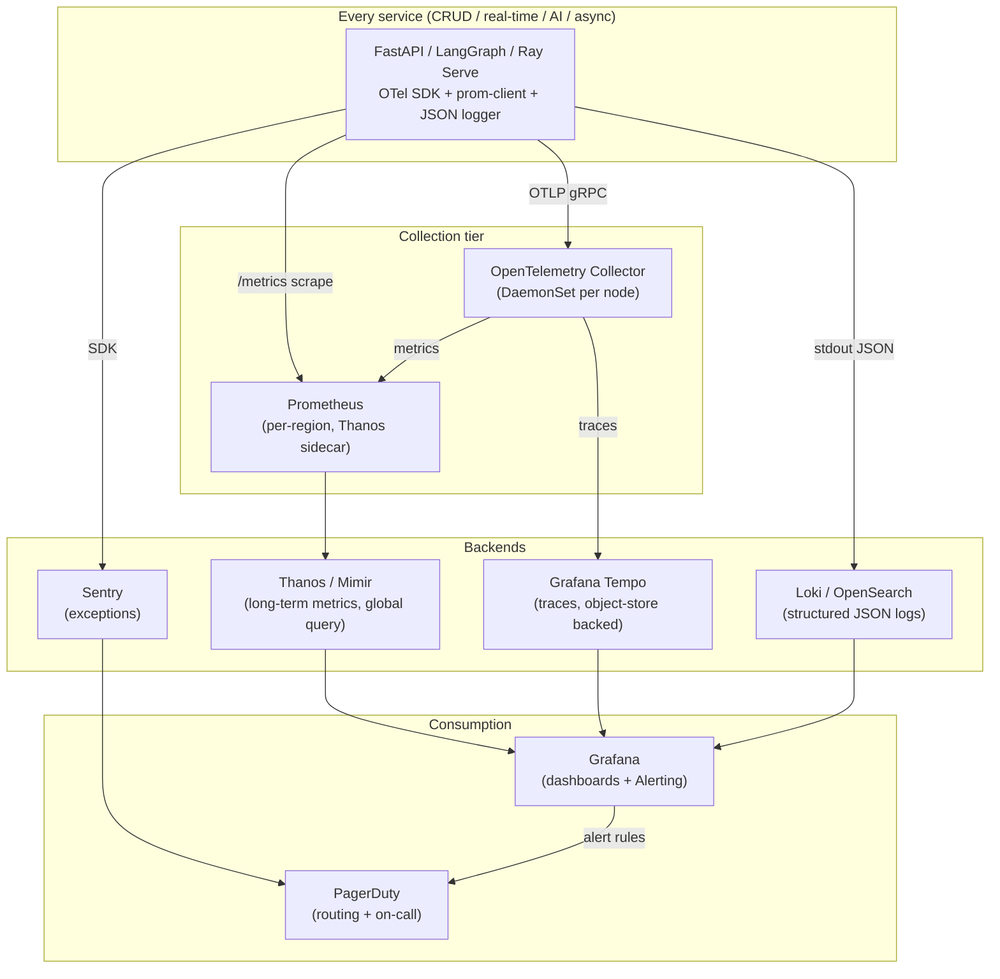
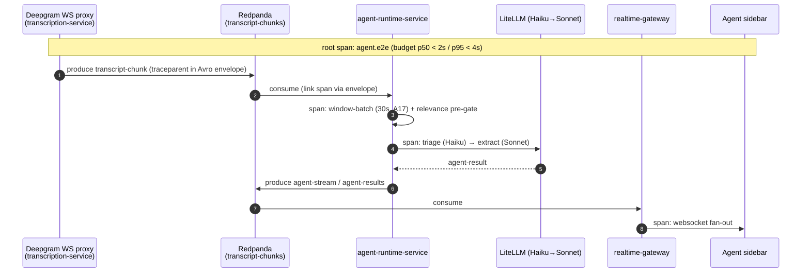
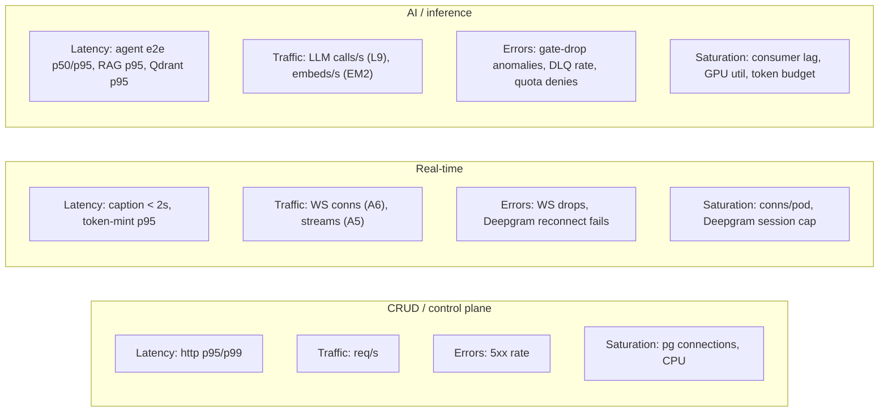
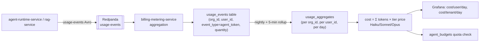
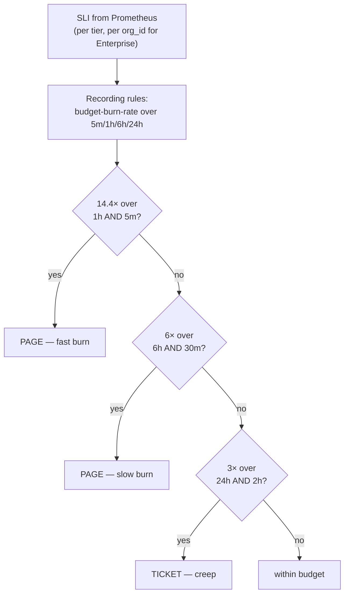
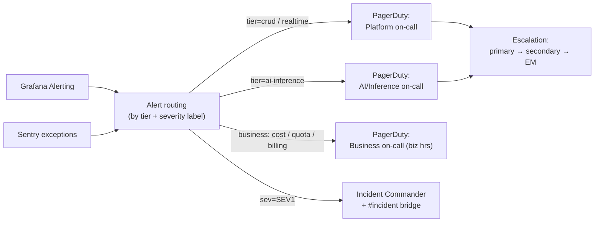
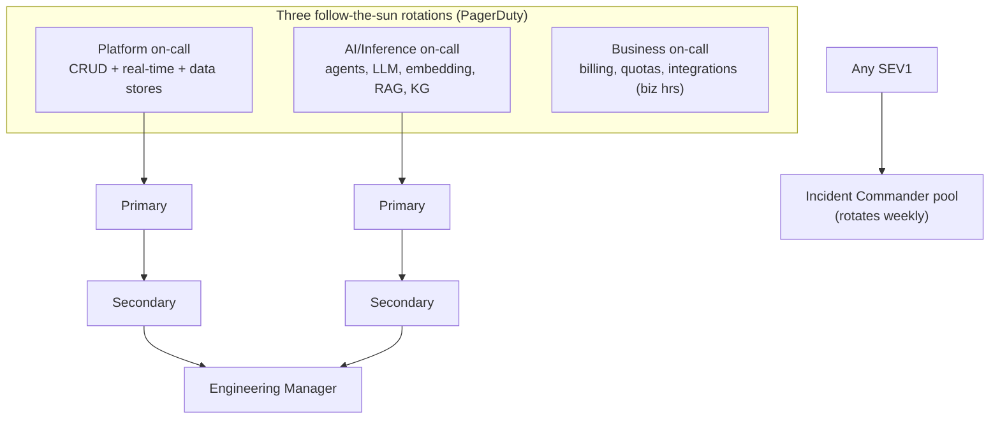

# Observability & SRE

How NEXUS instruments, alerts on, and operates a multi-tenant SaaS at the frozen capacity anchors — metrics (Prometheus), tenant-correlated structured logs, OpenTelemetry distributed tracing, golden-signal and domain dashboards (LLM cost/user/day, agent latency, Redpanda consumer lag, Qdrant query latency, transcription minutes, per-tenant usage), SLO-bound error budgets, PagerDuty on-call, runbooks, and game-day exercises.

## Related documents

- [Service Catalog](_canon/01-service-catalog.md) — canonical service names, scaling families, and per-service autoscaler signals every metric is tagged by.
- [Canonical Data Model](_canon/02-data-model.md) — entity names (`usage_events`, `agent_budgets`, `audit_logs`), Redis namespaces, and the per-tenant token-budget tables that feed cost dashboards.
- [Capacity & Scaling Math](_canon/05-capacity-math.md) — the frozen SLO table (§11) and load/cost anchors (`A5`, `L7`, `L9`, `C1`, `C2`, `E12`) this document imports by symbol, never re-derives.
- [Locked Tech & Architecture Decisions](_canon/06-tech-decisions.md) — Prometheus + Grafana, Sentry, structured JSON logs, k6/Locust (§2.14) cited verbatim.
- [Service Catalog & Bounded Contexts](04-service-catalog.md) — the 20 services, their failure/degradation modes, and the `admin-ops-service` dashboards.
- [Data Architecture](05-data-architecture.md) — store-level health (Postgres PITR, Qdrant quantization, AGE), retention, regional placement.
- [Multi-Tenancy & Tenant Isolation](06-multi-tenancy.md) — `org_id` injection, the chokepoint every metric/log/span inherits its tenant tag from.
- [Event-Driven Architecture](07-event-architecture.md) — consumer-lag monitoring, DLQ rate, backpressure (§10) jointly owned with this document.
- [AI Agent Architecture](08-ai-agent-architecture.md) — the seven agents, windowed batching, tiered routing, the agent latency budget instrumented here.
- [RAG Pipeline & Inference Serving](09-rag-and-inference-serving.md) — per-stage RAG metrics and the embedding/reranker GPU tier SLOs.

---

## 1. Scope and the observability contract

This document is the authority for **how NEXUS is observed and operated in production**. It does not invent SLO numbers — those are frozen in [Capacity & Scaling Math §11](_canon/05-capacity-math.md) and imported here by symbol. It specifies the **instrumentation stack, the telemetry data model, the dashboards, the alert rules and their routing, the error-budget policy, the on-call structure, the runbooks, and the game-day program** that turn those SLOs into an operable system.

Three principles bind every signal below.

1. **Every signal is tenant-attributable.** Every metric series, log line, and trace span carries `org_id`. This is not optional telemetry hygiene — at the frozen scale of **A4 = 3,000 paying tenant organizations** and **A1 = 5,000,000 registered users**, an incident is almost always *a tenant's* incident, and the first question on every page is "which tenant(s)?" The `org_id` is sourced from the same authz-middleware chokepoint that injects it into every query ([Multi-Tenancy §org_id injection](06-multi-tenancy.md)).
2. **The three scaling families have three observability profiles.** CRUD/control plane, real-time, and AI/inference each scale on a different signal ([Service Catalog §4](_canon/01-service-catalog.md)), so each gets a different golden-signal definition and a different on-call escalation. A `rag-service` p95 regression and an `agent-runtime-service` token-budget breach are different incident classes with different responders.
3. **Cost is a first-class signal.** LLM spend is **94% of variable infra cost** (`C3`) and the dominant margin driver. NEXUS treats *LLM cost per tenant per day* as a monitored, alertable, error-budgeted metric on equal footing with latency and availability — because a runaway agent loop is an availability-of-margin incident.

> [SaaS-scale adjustment] The PDF specified the *tools* — Prometheus + Grafana, Sentry, structured JSON logs ([Tech Decisions §2.14](_canon/06-tech-decisions.md)) — and a Phase-13 "observability everywhere" line, but no telemetry data model, no tenant correlation, no error-budget policy, no on-call structure, and no cost-as-a-signal discipline. A single-team MVP watches a handful of dashboards by eye. A SaaS serving 3,000 tenants needs `org_id` on every series, error budgets that gate releases, and a PagerDuty rotation. This document is that operational layer; the tool choices below are carried over verbatim.

### 1.1 The telemetry pipeline at a glance



> [SaaS-scale adjustment] Thanos/Mimir (long-term, global-query metrics) and Tempo (trace store) are SaaS-scale additions beyond the PDF's bare "Prometheus + Grafana." At `E12 ≈ 17,900 events/sec peak` and ~20 services across multiple regions, a single local-disk Prometheus cannot retain 13 months of per-tenant series or answer a cross-region query; a horizontally-sharded, object-store-backed metrics layer is required. Loki/OpenSearch replaces "structured JSON logs go somewhere" with a queryable, tenant-indexed log store.

---

## 2. The three pillars

### 2.1 Metrics — Prometheus

Every service exposes a Prometheus `/metrics` endpoint scraped on a 15s interval. Metrics follow Prometheus naming conventions (`<namespace>_<subsystem>_<unit>`), and **every series that can be tenant-scoped carries an `org_id` label**. To bound cardinality (3,000 tenants × N metrics is large but tractable; per-`user_id` labels are not — 5M users would explode the series count), the labeling rule is strict:

| Label | Allowed cardinality | Rule |
|---|---|---|
| `org_id` | ~3,000 (A4) | Allowed on tenant-scoped business/cost metrics. Bounded. |
| `service`, `tier`, `region`, `route`, `method`, `status_class` | low | Always allowed. |
| `model` (`haiku`/`sonnet`/`opus`), `agent` (the six), `topic`, `consumer_group`, `qdrant_collection` | low–medium | Allowed; enumerable. |
| `user_id` | 5,000,000 (A1) | **Never a Prometheus label.** Per-user breakdowns live in logs/usage-events aggregation, not metric series. |
| `meeting_id`, `chunk_id`, `request_id`, `trace_id` | unbounded | **Never a Prometheus label.** These are trace/log dimensions. |

> [SaaS-scale adjustment] The `user_id`-and-`meeting_id`-never-a-label rule is a SaaS-scale cardinality discipline absent from the PDF. The PDF's seeder is `2 orgs × 10 users × 5 meetings`; you can label freely. At A1/A5 scale, an unbounded label is a self-inflicted outage of the metrics tier itself. Per-*user* cost (the headline cost metric of this doc, §4.1) is therefore computed from the `usage_events` aggregation pipeline, not from a Prometheus series.

A representative slice of the canonical metric catalog (full catalog lives in the service READMEs; names are frozen here):

```
# Golden signals (every HTTP service)
http_requests_total{service,route,method,status_class,org_id}
http_request_duration_seconds_bucket{service,route,le,org_id}   # histogram → p50/p95/p99
http_inflight_requests{service}

# Real-time tier
realtime_ws_connections{service="realtime-gateway",region}      # vs A6 = 100k
transcription_active_streams{service="transcription-service"}    # vs A5 = 20k
deepgram_ws_reconnects_total{result}

# AI / inference tier
llm_calls_total{model,agent,org_id}
llm_tokens_total{model,direction="in|out|cached_in",org_id}
agent_end_to_end_seconds_bucket{agent,le,org_id}                # speech → sidebar
rag_query_duration_seconds_bucket{stage,le}                     # expand/retrieve/rerank/...
embedding_consumer_lag_records{topic,partition,consumer_group}
qdrant_query_duration_seconds_bucket{qdrant_collection,le}
reranker_warm_replicas{region}

# Event backbone
kafka_consumer_lag{topic,partition,consumer_group,org_id}
dlq_messages_total{topic}

# SaaS business
usage_event_quantity_total{event_type,org_id}                  # meeting_minute/agent_token/...
agent_budget_tokens_consumed{org_id,period}                    # mirrors agent_budgets
agent_budget_state{org_id,period}                              # 0=ok 1=throttled 2=blocked
```

### 2.2 Structured logs — `request_id` / `user_id` / `org_id` correlation

Logs are **structured JSON**, one event per line, emitted to stdout and shipped to Loki/OpenSearch ([Tech Decisions §2.14](_canon/06-tech-decisions.md), carried over verbatim). Every log line carries the **correlation triplet** plus the trace context, so a single request can be reconstructed across all services it touched and pivoted from any of: a tenant, a user, a request, or a trace.

```json
{
  "ts": "2026-05-29T14:03:11.482Z",
  "level": "INFO",
  "service": "agent-runtime-service",
  "tier": "ai-inference",
  "region": "eu",
  "org_id": "8f3c…",
  "user_id": "a91d…",
  "request_id": "req_01HZ…",
  "trace_id": "4bf92f3577b34da6a3ce929d0e0e4736",
  "span_id": "00f067aa0ba902b7",
  "event": "agent.window.processed",
  "agent": "PersonalListenerAgent",
  "meeting_id": "c2e7…",
  "model": "sonnet",
  "tokens_in": 512, "tokens_out": 188,
  "relevance_score": 0.81,
  "gate": "pass",
  "duration_ms": 742
}
```

Correlation rules:

- **`request_id`** is minted at `api-gateway` (or `realtime-gateway` for WS) on ingress and propagated via the `X-Request-Id` header and the event envelope. It is the join key across synchronous hops.
- **`org_id`** is injected by the authz middleware from the Clerk-verified JWT ([Multi-Tenancy](06-multi-tenancy.md)). A log line **without** `org_id` from a tenant-scoped service is itself an alertable anomaly (it implies a code path that skipped the chokepoint).
- **`user_id`** is present where a user is the actor; system/agent actors set `actor_type` consistent with `audit_logs.actor_type` (`user`/`agent`/`system`) from the [Data Model](_canon/02-data-model.md).
- **`trace_id`/`span_id`** tie the log to the OpenTelemetry trace (§2.3) so Grafana can jump log ↔ trace.
- **PII discipline.** Transcript `text`, worklog `content`, decision `rationale`, and OAuth tokens are **never logged**. Logs reference `chunk_id`/`decision_id`/`meeting_id` only. This is enforced by a logging filter and is part of the PII-redaction posture ([Data Architecture](05-data-architecture.md)).

> [SaaS-scale adjustment] The correlation triplet and the cross-service `request_id` propagation are SaaS-scale additions. The PDF's "structured JSON logs" had no defined correlation keys because an in-process monolith has one process to grep. With ~20 services and at-least-once event fan-out, a request that fails in `agent-runtime-service` may have originated three services upstream; without a propagated `request_id` and `trace_id`, the failure is unattributable. The PII-redaction logging filter is also a SaaS/compliance addition.

### 2.3 Distributed tracing — OpenTelemetry → Tempo/Jaeger/Datadog

All services use the **OpenTelemetry SDK** to emit spans over OTLP to the OpenTelemetry Collector, which exports to **Grafana Tempo** (primary backend; Jaeger and Datadog are drop-in OTLP-compatible alternatives behind the same Collector, so the exporter is a config change, not a code change). Trace context propagates over W3C `traceparent` headers on HTTP/WS and inside the **Avro event envelope** so a trace survives the async hop across Redpanda.

> [SaaS-scale adjustment] Distributed tracing is wholly added vs the PDF (which had Sentry for exceptions and Prometheus for metrics, but no tracing). At SaaS scale the load-bearing latency budgets — agent end-to-end **p50 < 2s / p95 < 4s** and RAG **p95 warm < 500 ms** ([Capacity §11.1](_canon/05-capacity-math.md)) — span multiple async services (transcription → Redpanda → agent-runtime → realtime-gateway). You cannot debug a p95 regression in a budget that crosses a message bus without trace propagation through the bus. Propagating `traceparent` in the Avro envelope is the mechanism.

The single most important trace is the **agent end-to-end span** — the budget the PDF flagged as R5 — which crosses the bus twice:



Sampling policy (cost control — traces are not free at `E10 ≈ 11.58B events/month`):

| Trace class | Sampling | Why |
|---|---|---|
| Errors (any span with `status=ERROR`) | **100%** (tail-based) | Every failure is kept. |
| Agent e2e spans over budget (> 4s p95 ceiling) | **100%** (tail-based) | The R5 budget is the thing we tune. |
| RAG queries over warm budget (> 500 ms) | **100%** (tail-based) | The R5/reranker tail. |
| Healthy CRUD/agent/RAG traffic | **1% head + tail-based top-up** | Statistical baseline without paying for 11.58B/month. |
| Per-tenant override | configurable | An incident tenant can be raised to 100% for the incident window. |

Tail-based sampling runs in the Collector so the *decision* to keep a trace can be made after the whole trace completes (i.e., after we know it errored or breached budget).

---

## 3. Golden signals

Each scaling family gets golden signals defined in its own terms. The four golden signals (latency, traffic, errors, saturation) map onto the three families as follows; every panel below is also sliceable by `org_id`.



| Family | Latency | Traffic | Errors | Saturation |
|---|---|---|---|---|
| CRUD / control plane | `http_request_duration_seconds` p95 **< 300 ms**, p99 **< 800 ms** ([Capacity §11.1](_canon/05-capacity-math.md)) | `http_requests_total` rate | `status_class="5xx"` ratio | Postgres connection pool util, CPU, HPA replica headroom |
| Real-time | live captions **< 2 s**, token-mint **p95 < 250 ms** | `realtime_ws_connections` (vs `A6 = 100k`), `transcription_active_streams` (vs `A5 = 20k`) | WS disconnect rate, Deepgram reconnect-success **> 99.9% within 2s** | connections/pod, Deepgram concurrent-session ceiling |
| AI / inference | agent e2e **p50 < 2s / p95 < 4s**, RAG **p95 warm < 500 ms / cold < 1.5 s**, Qdrant query p95 | `llm_calls_total` rate (vs `L9 ≈ 8,930/s` peak), `embeddings/s` (vs `EM2 ≈ 525/s`) | gate-drop-rate drift, `dlq_messages_total` rate (**< 0.1%**), quota-deny rate | `embedding_consumer_lag_records` (**< 5s**, alert 30s), GPU utilization, `agent_budget_state` |
| Async / orchestration | workflow task latency | Temporal task-queue depth | workflow failure rate | worker CPU, queue backlog |

All latency targets above are imported verbatim from [Capacity & Scaling Math §11](_canon/05-capacity-math.md); this document does not redefine them.

---

## 4. Domain metrics

These are the NEXUS-specific signals that the generic golden signals do not capture, and they are where most production incidents actually surface.

### 4.1 LLM cost per user per day (the headline cost metric)

LLM is **94% of variable cost** (`C3`); a single tenant with a misconfigured high-volume integration, or an agent caught in a collaboration loop, can move the monthly bill measurably. NEXUS meters this continuously.

The cost figure is **derived from `usage_events`**, not from a Prometheus series (per the cardinality rule in §2.1 — `user_id` is never a metric label). The pipeline:



- **Per-tenant cost/day** *is* exposed as `agent_budget_tokens_consumed{org_id,period}` (bounded by A4 ≈ 3,000) and converted to dollars by tier price (Haiku `$0.80/$4.00`, Sonnet `$3.00/$15.00`, Opus `$15.00/$75.00` per MTok, from [Capacity §10](_canon/05-capacity-math.md)).
- **Per-user cost/day** is queried from `usage_aggregates` in the `billing-metering-service` store (see [Data Model §2.2](_canon/02-data-model.md) `usage_events`), surfaced in the `admin-ops-service` cost dashboard, and is the drill-down when a tenant's cost is anomalous.
- **Sanity anchors for alerting baselines** (imported, not re-derived): variable infra **`C1 ≈ $4.06/meeting`**, **`C2 ≈ $9.73/MAU/month`** (→ ~$6.99 post Phase-13 optimization, `C4`). A per-tenant daily cost that implies a cost/MAU materially above `C2` for that tenant is the anomaly threshold.

> [SaaS-scale adjustment] LLM-cost-as-a-monitored-signal is wholly added vs the PDF, which had only a Phase-13 "~30% reduction" target and Phase-7 budget *alerts*. Continuous per-tenant/per-user cost metering, dollarized dashboards, and cost anomaly alerting are required because at `L7 ≈ 5.79B calls/month` and 94% cost share, cost regression is the most likely "incident" that is invisible to latency/error monitoring. The `agent_budgets` hard-cap enforcement (R4) is the control; this section is the *observability* of it.

### 4.2 Agent latency

The agent end-to-end budget (R5) is the hardest real-time SLO. We instrument it as the root trace span in §2.3 and as a histogram `agent_end_to_end_seconds_bucket{agent,le,org_id}`, decomposed into its three canonical contributors so a breach is immediately attributable:

| Sub-span | Budget contribution | Source |
|---|---|---|
| Deepgram final → chunk on bus | ~1 s | [Capacity §11](_canon/05-capacity-math.md), PDF R5 |
| Window batch (A17, 30s) + relevance pre-gate + LLM | ~0.8 s LLM | windowed batching defeats per-chunk cost ([AI Agent Architecture](08-ai-agent-architecture.md)) |
| Bus → realtime-gateway → sidebar | network | [Service Catalog](_canon/01-service-catalog.md) `realtime-gateway` |
| **Total** | **p50 < 2s / p95 < 4s** | frozen |

Note the windowed-batching trade-off: A17's 30s window is a deliberate latency-for-cost exchange already accounted for in the budget — the per-window LLM call replaces 360 per-chunk calls. The latency SLO is measured from *speech* to *sidebar*, and the window is part of that path, so the dashboard must not be misread as "the LLM is slow" when the window is filling.

### 4.3 Redpanda consumer lag

Owned jointly with [Event-Driven Architecture §10](07-event-architecture.md); thresholds are frozen there and in [Capacity §11.3](_canon/05-capacity-math.md). Surfaced as `kafka_consumer_lag{topic,partition,consumer_group,org_id}` and the embedding-specific `embedding_consumer_lag_records`.

| Signal | Target | Alert |
|---|---|---|
| Embedding consumer lag | **< 5 s** | warn at 10s-equiv, **page at 30s** |
| DLQ rate | **< 0.1%** of events | page above threshold |
| Per-tenant lag (tagged `org_id`) | no single-tenant runaway | page on noisy-neighbor saturation of one partition |

The per-tenant lag tag is what makes a noisy-neighbor incident *isolable*: a burst on tenant X's partition is visible without head-of-line-blocking another tenant ([Event Architecture](07-event-architecture.md)).

### 4.4 Qdrant query latency

`qdrant_query_duration_seconds_bucket{qdrant_collection,le}` over the logical collections `transcript_chunks`, `document_chunks`, `decisions` (physical per-tenant `…__{org_id}`, see [Data Model §3](_canon/02-data-model.md)). The vector arm of hybrid retrieval feeds the RAG **p95 warm < 500 ms** budget; a Qdrant latency regression (e.g., int8-quantized hot set spilling to disk as the `V7 ≈ 4.42B`-vector stock grows) is an early indicator of a RAG SLO breach before the user-facing `rag-service` p95 moves.

### 4.5 Transcription minutes

`transcription_active_streams` and the metered `usage_event_quantity_total{event_type="transcription_second",org_id}` track Deepgram consumption against the **one-diarized-stream-per-meeting** billing decision (`D1 ≈ 216M min/month`; per-participant would be the avoided `D3 = 6×`). A divergence between `transcription_active_streams` and `A5`-implied expectations, or a stream count > 1 per `meeting_id`, is a billing-correctness alert — it would mean the 6× cost lever is leaking.

### 4.6 Per-tenant usage

The `usage_events` event-types (`meeting_minute`, `agent_token`, `transcription_second`, `storage_gb`) roll up per tenant and drive both billing and quota enforcement. `agent_budget_state{org_id,period}` (0=ok / 1=throttled / 2=blocked) is the operational view of R4 hard quotas; a tenant flipping to `throttled`/`blocked` is a customer-facing event that must be visible to support before the customer files a ticket.

---

## 5. Grafana dashboards

Dashboards are version-controlled JSON (Grafana provisioning), deployed via GitOps alongside the services, and organized by audience. Every dashboard has an `org_id` template variable (default: all tenants) so any panel drills to a single tenant.

| Dashboard | Audience | Key panels | Primary source |
|---|---|---|---|
| **Platform Golden Signals** | on-call SRE | per-family latency/traffic/errors/saturation (§3), SLO burn-rate gauges | Prometheus/Thanos |
| **Agent & LLM** | AI on-call | agent e2e p50/p95 by agent, tier-mix (Haiku 45% / Sonnet 55% / Opus <1%), gate-pass rate (~35%), LLM calls/s vs `L9` | metrics + traces |
| **LLM Cost** | AI on-call + finance | cost/tenant/day, cost/user/day drill-down, cost/meeting vs `C1`, cost/MAU vs `C2`, projected-monthly vs budget | `usage_aggregates` |
| **Event Backbone** | platform on-call | consumer lag by group/tenant, DLQ rate, throughput vs `E12`, outbox-relay lag | Redpanda + Prometheus |
| **Real-time** | real-time on-call | WS connections vs `A6`, active streams vs `A5`, caption latency, Deepgram reconnect success | metrics |
| **RAG & Inference** | AI on-call | per-stage RAG latency, reranker warm replicas, Qdrant p95, embedding lag, cache hit rate | [RAG doc §9](09-rag-and-inference-serving.md) |
| **Data Stores** | platform on-call | Postgres connections/replication lag/PITR status, AGE query time, Qdrant resident-RAM vs `V9 ≈ 17TB` | exporters |
| **Per-Tenant Health** (in `admin-ops-service`) | internal ops + support | one tenant's error rate, latency, cost, quota state, lag — the "is tenant X healthy?" view | cross-source |
| **SLO / Error Budget** | eng leadership + on-call | error-budget remaining per SLO, burn-rate, freeze status | recording rules |

> [SaaS-scale adjustment] The **Per-Tenant Health** and **LLM Cost** dashboards are SaaS-scale additions surfaced inside the `admin-ops-service` internal-ops console ([Service Catalog](_canon/01-service-catalog.md), which already declares it owns "consumer-lag & cost dashboards"). The PDF's Grafana was a single global view; at 3,000 tenants, support and ops need a per-tenant lens, and finance needs the cost lens, neither of which a global dashboard provides.

---

## 6. SLOs and error budgets

### 6.1 The SLO set (frozen)

The SLO numbers below are **imported verbatim from [Capacity & Scaling Math §11](_canon/05-capacity-math.md)** — this document operationalizes them, it does not set them.

**Latency SLOs (§11.1):**

| Surface | Metric | Target |
|---|---|---|
| CRUD / REST API | p95 / p99 | **< 300 ms / < 800 ms** |
| Live captions (Deepgram final → UI) | p95 | **< 2 s** |
| End-to-end agent output (speech → sidebar) | p50 / p95 | **< 2 s / < 4 s** |
| RAG search (`POST /api/rag/query`) | p95 warm / cold | **< 500 ms / < 1.5 s** |
| Token-mint (`POST /api/meetings/:id/token`) | p95 | **< 250 ms** |
| Agent-to-agent collaboration round-trip | p95 | **< 1.5 s** |

**Availability SLOs per plan tier (§11.2):**

| Plan tier | Monthly availability | Allowed downtime / mo | Posture |
|---|---|---|---|
| Free | **99.5%** | ~3h 39m | Single-region, pooled + RLS |
| Pro | **99.9%** | ~43m | Multi-region active-passive |
| Enterprise | **99.95%** | ~22m | Cell-based isolation, active-active candidate |

**Pipeline health SLOs (§11.3):** embedding lag < 5s (alert 30s); embedding batch-of-32 < 100ms; DLQ rate < 0.1%; post-dedupe duplicate-delivery ~0; Deepgram reconnect > 99.9% within 2s; per-tenant token-budget breach enforcement 100% (hard cap, deny-by-default).

> [SaaS-scale adjustment] The **per-plan availability tiers** (99.5 / 99.9 / 99.95) are a SaaS-scale addition ([Capacity §11.2](_canon/05-capacity-math.md)). The PDF, being single-app, had a single implied availability and no notion of differentiated SLAs. Error budgets below are therefore computed *per plan tier* — an Enterprise tenant's budget is the tightest.

### 6.2 Error budgets and burn-rate alerting

Each availability SLO defines an error budget = `(1 − SLO) × period`. Budgets are tracked per plan tier (and, for Enterprise cells, per tenant). We alert on **burn rate**, not raw error count, using multi-window multi-burn-rate alerts (Google SRE method) so a fast catastrophic burn pages immediately while a slow leak pages before the month is gone.

| Severity | Burn-rate condition (vs the SLO budget) | Window | Action |
|---|---|---|---|
| **Page (fast burn)** | **14.4×** budget burn | 1h **and** 5m | Page on-call immediately; ~2% of monthly budget in 1h. |
| **Page (slow burn)** | **6×** budget burn | 6h **and** 30m | Page; on track to exhaust budget in days. |
| **Ticket (creep)** | **3×** budget burn | 24h **and** 2h | Ticket; investigate next business day. |



### 6.3 Error-budget policy (release gating)

The budget is a contract between reliability and velocity:

- **Budget healthy (> 25% remaining):** normal release cadence; ship features.
- **Budget low (< 25% remaining):** reliability work prioritized over features for the affected tier; new risky changes require SRE sign-off.
- **Budget exhausted (≤ 0):** **release freeze** for that tier — only reliability fixes and rollbacks deploy until the budget recovers over a full SLO window. The freeze status is a panel on the SLO dashboard and a label on the deploy pipeline (GitHub Actions, [Tech Decisions §2.14](_canon/06-tech-decisions.md)).
- **Cost budget is co-equal:** if monthly LLM spend tracks materially above `C2`/`C4`, the same freeze-and-prioritize policy applies to cost-regressing changes — cost is an error budget too (§4.1).

> [SaaS-scale adjustment] Error-budget-gated releases are wholly added vs the PDF. The PDF had no SLOs to budget against and a single 4-person team with no freeze concept. At SaaS scale the budget is the mechanism that prevents "ship fast" from silently consuming an Enterprise tenant's 99.95% SLA.

---

## 7. Alerting and PagerDuty

### 7.1 Routing

Grafana Alerting (and Sentry, for exceptions) routes to **PagerDuty**, which owns escalation and on-call schedules. Routing keys map to the three scaling families plus business/cost, so the right responder pages for the right class of incident.



| Alert label | Routes to | Examples |
|---|---|---|
| `tier=crud`, `tier=realtime` | Platform on-call (24/7) | 5xx burn, token-mint p95 breach, WS-drop spike, Postgres connection saturation |
| `tier=ai-inference` | AI/Inference on-call (24/7) | agent e2e p95 breach, embedding lag > 30s, DLQ rate, reranker cold-start storm, GPU saturation |
| `business` | Business on-call (business hours, escalates to platform off-hours) | cost/tenant anomaly, mass quota-block, Stripe webhook failures |
| `sev=SEV1` (customer-facing outage) | adds Incident Commander + bridge | region down, auth outage, total transcription failure |

### 7.2 Severity definitions

| Sev | Definition | Response | Example |
|---|---|---|---|
| **SEV1** | Customer-facing outage or data-integrity risk affecting many tenants or any Enterprise tenant's SLA | Page IC + on-call, open bridge, status-page update | `api-gateway`/auth down; a region down; cross-tenant data leak suspicion |
| **SEV2** | Major degradation, one SLO actively burning fast | Page on-call | agent e2e p95 > 4s sustained; embedding lag > 30s; RAG p95 > 1.5s warm |
| **SEV3** | Minor / single-tenant / slow burn | Ticket, next business day | one tenant throttled unexpectedly; 3× creep burn |
| **SEV4** | Informational / no user impact | Async note | non-paging cost-trend warning |

### 7.3 Alert hygiene

- **Symptom-based, not cause-based.** Page on "agent e2e p95 > 4s" (a symptom users feel), not on "GPU at 80%" (a cause that may be benign). Cause metrics inform the runbook, they don't page.
- **Every paging alert has a runbook link** in its annotation (§9). An alert without a runbook is a bug filed against the alert.
- **Tenant-scoped where possible.** An Enterprise-cell alert pages with the `org_id` so the responder knows the blast radius immediately.
- **Tuned against the canon baselines.** Thresholds derive from the frozen numbers (e.g., LLM calls/s alert references `L9 ≈ 8,930`, lag references the §11.3 5s/30s), not from gut feel, so alerts neither flap nor go silent as load scales toward the anchors.

---

## 8. On-call rotation



- **Three rotations** mirror the three on-call routing keys (§7.1): Platform, AI/Inference, Business. Follow-the-sun across regions where staffing allows; otherwise weekly primary/secondary with the EM as final escalation.
- **Incident Commander** pool (separate from technical responders) is paged on any SEV1 to run the bridge, own comms, and update the status page — so responders debug while the IC coordinates.
- **Handoff** is a written checklist at rotation change: open incidents, in-flight error-budget burns, current freeze status, tenants under watch, and any silenced alerts (with expiry).
- **No-blame postmortems** within 48h for every SEV1/SEV2, with action items tracked to closure; recurring postmortem themes seed the next game day (§10).

> [SaaS-scale adjustment] A structured multi-rotation on-call with an IC pool is wholly added vs the PDF's 4-person team (where "on-call" was implicit). The three-rotation split exists because the failure domains genuinely differ — a GPU autoscaling incident and a Postgres connection-pool incident need different expertise — and matches the three scaling families the architecture is already cut along ([Service Catalog §4](_canon/01-service-catalog.md)).

---

## 9. Runbooks for common incidents

Every paging alert links to a runbook. Runbooks are version-controlled Markdown next to the service code and follow a fixed shape: **Symptom → Dashboards → Likely causes → Diagnosis steps → Mitigation → Verification → Escalation**. The common ones:

### 9.1 Embedding consumer lag > 30s (SEV2, AI/Inference)

- **Symptom:** `embedding_consumer_lag_records` past 30s; RAG recall on recent meetings degrading (new chunks not yet vectorized).
- **Dashboards:** Event Backbone, RAG & Inference.
- **Likely causes:** meeting-volume burst (approaching `A5 = 20k`), GPU under-provisioned, a poison message stuck in the embedding consumer, Qdrant upsert latency.
- **Diagnosis:** check KEDA replica count vs queue depth; check `dlq_messages_total` for the topic; check `qdrant_query_duration` and Qdrant resident RAM vs `V9 ≈ 17TB`; check GPU utilization on `embedding-service`.
- **Mitigation:** confirm KEDA scaled out on chunk-backlog; if blocked on a poison message, route to DLQ and continue ([Event Architecture §10](07-event-architecture.md)); if GPU-bound, raise the embedding replica ceiling; the windowed-batching/pre-gating knobs are the same levers used for backpressure (the value-tiered graceful degradation in [Event Architecture](07-event-architecture.md)).
- **Verify:** lag back under 5s; DLQ rate < 0.1%.

### 9.2 Agent e2e p95 > 4s (SEV2, AI/Inference)

- **Symptom:** `agent_end_to_end_seconds` p95 over budget; sidebar suggestions arriving late.
- **Diagnosis (use the decomposed trace, §2.3/§4.2):** which sub-span blew — Deepgram (~1s), LLM, or fan-out? Check LiteLLM provider latency by tier; check whether windowed-batch (A17) timing is being misattributed; check `realtime-gateway` WS fan-out.
- **Mitigation:** if LLM tier is the long pole, confirm tiered routing isn't over-escalating to Opus (tier mix should be Haiku 45% / Sonnet 55% / Opus <1%); shed to streaming earlier; if provider-side, fail LiteLLM over to the alternate provider.
- **Verify:** p50 < 2s, p95 < 4s.

### 9.3 LLM cost anomaly for a tenant (SEV3→SEV2, AI/Inference + Business)

- **Symptom:** cost/tenant/day on the LLM Cost dashboard spikes above the `C2`-implied baseline; or `agent_budget_state` flips to `throttled`.
- **Diagnosis:** drill cost/user/day from `usage_aggregates`; identify the agent/model driving tokens; check for an agent-collaboration loop on `agent-requests`/`agent-responses` (ContextGapAgent fall-through not firing); check gate-pass rate drift (a regression that stops dropping the ~65%).
- **Mitigation:** the **hard cap** in `agent_budgets` is the safety net (R4, deny-by-default, enforced 100% per §11.3) — confirm it engaged; if a loop, fix the correlation-ID/deadline handling; tighten the tenant's confidence override via `tenant_settings.agent_confidence_overrides`.
- **Verify:** cost back to baseline; budget state `ok`.

### 9.4 RAG p95 over budget (SEV2, AI/Inference)

- **Symptom:** `POST /api/rag/query` warm p95 > 500 ms.
- **Diagnosis:** per-stage `rag_query_duration_seconds` (expand/retrieve/rerank/assemble); check `reranker_warm_replicas` (cold cross-encoder is the usual long pole — see [RAG §5.2](09-rag-and-inference-serving.md)); check Qdrant p95 and FTS latency.
- **Mitigation:** ensure reranker warm-replica floor ≥ 1 per active region held; check answer-cache and query-embed cache hit rates; scale reranker on GPU util + req/s.
- **Verify:** warm p95 < 500 ms.

### 9.5 Region failover (SEV1, Platform + IC)

- **Symptom:** a region's health checks fail; availability burning against Pro/Enterprise SLAs.
- **Diagnosis:** confirm scope (one region vs global); confirm data-residency constraints (`data_residency.region` — EU tenants must not fail over outside EU without an approved migration workflow).
- **Mitigation:** active-passive → promote passive region for Pro; Enterprise cells follow their cell DR; verify Postgres PITR/replica health and Redpanda multi-AZ ([Data Architecture](05-data-architecture.md)). IC owns status-page + tenant comms.
- **Verify:** SLIs recovered; reconcile any at-least-once replay (idempotency keys make replay safe).

### 9.6 Tenant-isolation alarm (SEV1, Platform + Security)

- **Symptom:** a log line from a tenant-scoped service **missing `org_id`**, or a cross-tenant query detected, or an RLS-policy denial spike.
- **Diagnosis:** identify the code path that bypassed the authz-middleware chokepoint ([Multi-Tenancy](06-multi-tenancy.md)); check whether RLS backstop caught it (it should have — fail-closed).
- **Mitigation:** treat as a potential data-isolation incident; quarantine the path; the RLS `USING (org_id = current_setting(...))` backstop is the second line of defense; engage Security and the compliance/audit posture ([Data Architecture](05-data-architecture.md)).
- **Verify:** no cross-tenant rows returned; root-cause the missing injection; postmortem mandatory.

---

## 10. Game-day exercises

We do not wait for real incidents to test the runbooks and the on-call muscle. Game days are scheduled fault-injection exercises in a production-like staging environment (or, for mature scenarios, controlled blast-radius experiments in production against an internal test tenant), run quarterly per scenario class.

| Game day | Injected fault | What it validates |
|---|---|---|
| **Consumer-lag storm** | Pause the embedding consumer; flood `transcript-chunks` to approach `A5 = 20k` | KEDA scale-out, backpressure/degradation, runbook §9.1, lag-alert thresholds |
| **LLM provider brownout** | Inject latency/5xx into one LiteLLM provider | Provider failover, agent e2e budget under degradation, tier-routing under stress, runbook §9.2 |
| **Cost-bomb tenant** | Drive one test tenant toward its `agent_budgets` hard cap | Quota enforcement (100%, R4), throttle→block transition, cost alert + runbook §9.3 |
| **Region failover** | Fail a region | Active-passive promotion, data-residency guardrails, PITR/replica, IC + status-page flow, runbook §9.5 |
| **Reranker cold-start** | Scale `reranker-service` to zero, then drive query load | Warm-floor protection, RAG cold/warm SLO split, runbook §9.4 |
| **Isolation drill** | Attempt a cross-tenant query in staging | RLS backstop fires, `org_id`-missing alert, runbook §9.6 |
| **Poison-message replay** | Inject a malformed Avro message | DLQ capture, idempotent replay, dedupe correctness ([Event Architecture](07-event-architecture.md)) |

Each game day produces: confirmation the alert fired within its window, the runbook's diagnosis steps were sufficient (gaps filed as runbook bugs), the responder hit MTTR targets, and the error-budget impact was as modeled. Findings feed the on-call handoff (§8) and the next quarter's load tests (k6/Locust, [Tech Decisions §2.14](_canon/06-tech-decisions.md)) so the system is continuously validated against the frozen anchors.

> [SaaS-scale adjustment] Game days are wholly added vs the PDF (which had load tests only, in Phase 13). At 3,000 tenants with per-plan SLAs and a 94%-LLM cost structure, the failure modes that matter — provider brownout, cost-bomb tenant, isolation breach, region failover — are precisely the ones that never occur in a 4-person MVP and must be rehearsed before a real customer triggers them.

---

## 11. Summary — what this document operationalizes

| Concern | Mechanism | Canon anchor |
|---|---|---|
| Metrics | Prometheus + Thanos/Mimir, `org_id`-labeled, `user_id`/`meeting_id` never labels | [Tech Decisions §2.14](_canon/06-tech-decisions.md) |
| Logs | Structured JSON, `request_id`/`user_id`/`org_id`/`trace_id` correlation, PII-filtered | [Tech Decisions §2.14](_canon/06-tech-decisions.md) |
| Tracing | OpenTelemetry → Tempo (Jaeger/Datadog drop-in), traceparent in Avro envelope, tail-sampling | SaaS-add |
| Cost signal | LLM cost/user/day & /tenant/day from `usage_events` → `usage_aggregates` | `C1`, `C2`, `C3`, `C4` |
| Golden + domain metrics | per scaling family; agent latency, lag, Qdrant, transcription, per-tenant usage | [Capacity §11](_canon/05-capacity-math.md) |
| SLOs | latency / per-plan availability / pipeline health, imported verbatim | [Capacity §11.1–11.3](_canon/05-capacity-math.md) |
| Error budgets | multi-window multi-burn-rate, release freeze on exhaustion, cost co-equal | SaaS-add (on §11.2 tiers) |
| Alerting | Grafana + Sentry → PagerDuty, three routing keys + SEV1 IC, symptom-based | SaaS-add |
| On-call | three rotations (Platform / AI-Inference / Business) + IC pool, no-blame postmortems | SaaS-add |
| Runbooks | seven common incidents, fixed shape, linked from every page | SaaS-add |
| Game days | seven scenarios quarterly, feed handoff + load tests | SaaS-add |

The discipline throughout: every number is imported from the frozen canon by symbol, every signal carries `org_id`, and cost is observed and budgeted as rigorously as latency — because at `L7 ≈ 5.79B LLM calls/month` and 94% cost share, margin is a reliability surface.
