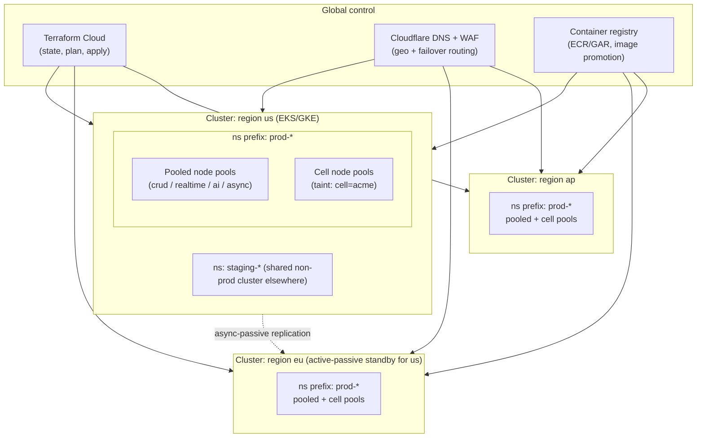
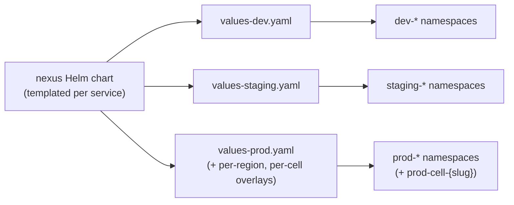
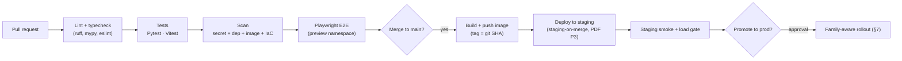
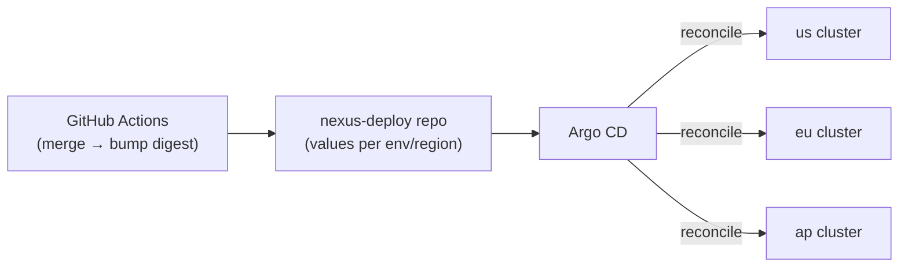
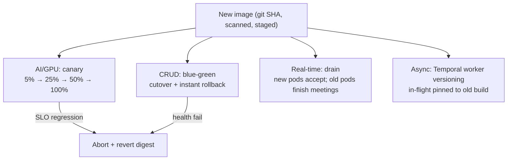
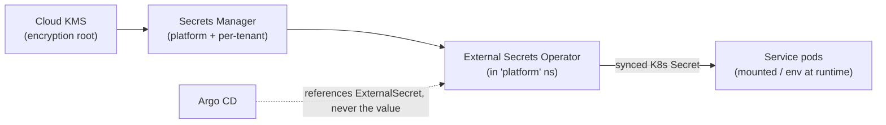
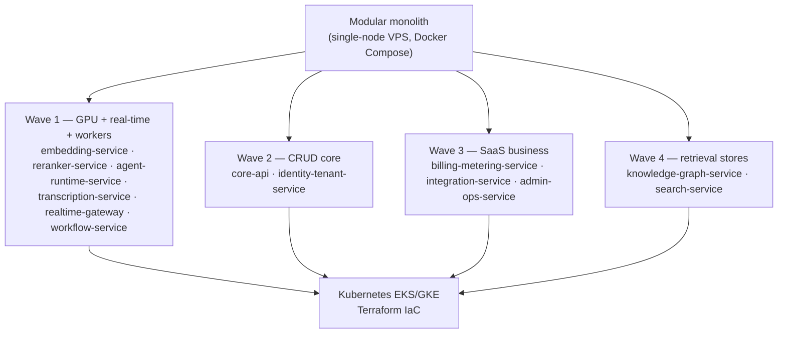
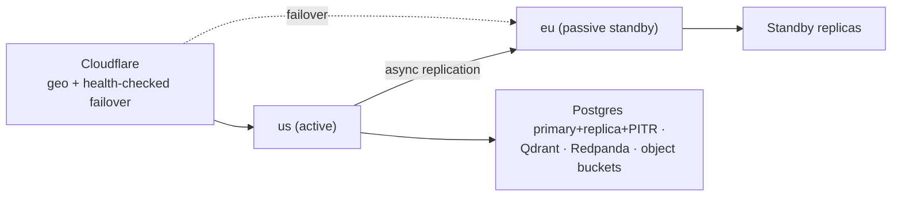

# Deployment & Infrastructure

How NEXUS runs in production: the Kubernetes (EKS/GKE) topology, Terraform IaC, GitHub Actions CI/CD, family-aware rollout strategy, secrets injection, the dev/staging/prod environment matrix, and the explicit path from the MVP single-node VPS modular monolith to multi-region Kubernetes.

## Related documents

- [Architecture Overview & Principles](01-architecture-overview-and-principles.md) — the four scaling families and the modular-monolith → services evolution.
- [Container Architecture](03-container-architecture.md) — C4 L2 containers, the internal gRPC/REST sync mesh, and per-family autoscaler signals.
- [Service Catalog](04-service-catalog.md) — the 20 canonical services, their ownership, and the Wave 1–4 extraction order.
- [Data Architecture](05-data-architecture.md) — Postgres partitioning, Qdrant, AGE, Redis, backups/PITR, regional placement.
- [Multi-Tenancy & Tenant Isolation](06-multi-tenancy.md) — pooled + RLS, cell-based isolation, dedicated cell node pools.
- [Event-Driven Architecture](07-event-architecture.md) — Redpanda topics, Avro BACKWARD compat, KEDA-on-lag, DLQs.
- [AI Agent Architecture](08-ai-agent-architecture.md) — the six agents and the *prompt-template* canary (orthogonal to the *container* rollout here).
- [RAG Pipeline & Inference Serving](09-rag-and-inference-serving.md) — `embedding-service` / `reranker-service` GPU autoscaling on Ray Serve/vLLM.
- [Real-time & Transcription](10-realtime-and-transcription.md) — `realtime-gateway` / `transcription-service` long-lived connection handling.
- [Service Catalog (canon)](_canon/01-service-catalog.md) — the single naming authority; §7 Wave 1–4 split order.
- [Canonical Data Model (canon)](_canon/02-data-model.md) — entity names, `oauth_tokens` envelope encryption, object buckets.
- [Capacity & Scaling Math (canon)](_canon/05-capacity-math.md) — every load number imported by symbol (A5, A6, E12, L9, EM2, …).
- [Locked Tech & Architecture Decisions (canon)](_canon/06-tech-decisions.md) — §2.1 compute/topology, §2.14 CI/CD/observability.

---

## 1. Scope and the numbers this document imports

This document specifies **where every NEXUS service runs, how it is built and shipped, and how the topology grows from the first deploy to multi-region scale**. It does not re-name services (that is the [Service Catalog](04-service-catalog.md)), redefine containers (that is [Container Architecture](03-container-architecture.md)), or re-derive load (that is [Capacity & Scaling Math](_canon/05-capacity-math.md)).

Per the cardinal rule of this set, **every load figure cited is a frozen symbol, not a restated literal**. The infra numbers this document *does* introduce — replica floors, HPA target utilizations, node-pool shapes, rollout step weights — are engineering specifics of the deployment substrate; they are derived from, and never contradict, the capacity anchors:

| Symbol | Meaning | Value | Drives in this doc |
| --- | --- | --- | --- |
| `A4` | Paying tenant organizations | 3,000 | Cell count ceiling, namespace fan-out |
| `A5` | Peak concurrent meetings | 20,000 | Transcription/agent pod floors |
| `A6` | Peak concurrent participants | 100,000 | `realtime-gateway` connection sizing |
| `A10` | Peak : average ratio | 4 : 1 | HPA headroom and surge budget |
| `E12` | Redpanda events/sec (peak) | ~17,900 | Bus consumer parallelism |
| `L9` | LLM calls/sec (peak) | ~8,930 | `agent-runtime-service` token-scaled HPA |
| `EM2` | Embeddings/sec (peak) | ~525 | `embedding-service` GPU pool floor |
| `EM4` | Query embeddings/sec (peak) | ~700 | Query-embed GPU headroom |

> [SaaS-scale adjustment] The PDF deployed a single application built by a 4-person team onto **Railway/Render**, with no Kubernetes, no Terraform, no multi-region story, and a `2 orgs × 10 users × 5 meetings` seeder. This document re-casts the compute substrate as **Kubernetes (EKS/GKE) + Terraform IaC, multi-region active-passive evolving to active-active**. The MVP substrate is **not** a PaaS: the whole backend and all four stores run self-hosted on a **single VPS under Docker Compose** ([ADR-0016](adr/0016-self-hosted-vps-mvp-substrate.md), [Tech Decisions §2.1](_canon/06-tech-decisions.md)). Railway and Render are struck entirely. The PDF's CI/CD stack (GitHub Actions, staging-on-merge, Sentry, Prometheus + Grafana, structured JSON logs, Docker Compose) survives verbatim and is the foundation the K8s pipeline extends.

---

## 2. Production topology: cluster, regions, cells

### 2.1 The three composition axes

Production placement resolves along **three orthogonal axes** that compose into a single coordinate for every workload:

1. **Region** — a Kubernetes cluster per region (`us`, `eu`, `ap`), matching the `data_residency.region` values frozen in the [Data Model](_canon/02-data-model.md). A tenant's compute runs in the region its data is pinned to.
2. **Environment** — a namespace prefix per environment (`dev`, `staging`, `prod`) within a cluster. `dev`/`staging` share a non-production cluster; `prod` is isolated.
3. **Cell** — within `prod`, the pooled long tail shares the default node pools and namespaces; large/enterprise tenants get a dedicated **cell** (node pool + namespace) per the isolation contract in [Multi-Tenancy §3](06-multi-tenancy.md).

> [SaaS-scale adjustment] The PDF had one environment on one host. The region × environment × cell composition is wholly added. It exists because (a) GDPR data residency pins tenant data and therefore compute to a region, and (b) the locked tenancy model gives large tenants **dedicated cell node pools (Kubernetes taints/affinity)** to remove noisy-neighbor entirely — see [Multi-Tenancy §3.6](06-multi-tenancy.md). Cells are not a competing architecture; they are placement *within* the same microservices style.



### 2.2 Namespace scheme per environment

Namespaces are the primary blast-radius and quota boundary inside a cluster. The naming is deterministic so Terraform, GitHub Actions, and on-call tooling can compute a namespace from `(env, family, cell)` without a lookup table.

| Namespace pattern | Scope | Contents |
| --- | --- | --- |
| `prod-crud` | Pooled CRUD/control plane | `api-gateway`, `bff`, `identity-tenant-service`, `core-api`, `meeting-service`, `integration-service`, `billing-metering-service`, `admin-ops-service`, `notification-service` |
| `prod-realtime` | Pooled real-time tier | `realtime-gateway`, `transcription-service` |
| `prod-ai` | Pooled AI/inference tier | `ingestion-service`, `embedding-service`, `reranker-service`, `agent-runtime-service`, `rag-service`, `knowledge-graph-service`, `search-service` |
| `prod-async` | Async/orchestration | `workflow-service` (Temporal workers) |
| `prod-cell-{slug}` | One per cell-isolated tenant | The cell's pinned services on tainted node pools (per [Multi-Tenancy §3.6](06-multi-tenancy.md)) |
| `platform` | Cluster-wide operators | External Secrets Operator, KEDA, ingress controller, cert-manager, Prometheus/Grafana, optional mesh control plane |
| `staging-{family}` | Staging (shared non-prod cluster) | Mirror of the four prod family namespaces |
| `dev-{family}` | Ephemeral PR/dev | Short-lived preview namespaces, TTL-reaped |

The four family namespaces map exactly onto the **four scaling families** locked in [Architecture Overview §2](01-architecture-overview-and-principles.md) and [Service Catalog §4](_canon/01-service-catalog.md). This is deliberate: a namespace boundary equals a scaling-family boundary equals an autoscaler-signal boundary, so `ResourceQuota`, `LimitRange`, and `NetworkPolicy` are scoped per family without splitting a family across namespaces.

### 2.3 Node pools and autoscaler signals per family

Each family runs on a distinct node-pool shape so the GPU cost center never shares hardware with CRUD pods, and each scales on the signal frozen in [Service Catalog §4](_canon/01-service-catalog.md).

| Family (namespace) | Node pool shape | Cluster-autoscaler / HPA driver | Autoscaler |
| --- | --- | --- | --- |
| CRUD (`prod-crud`) | General-purpose CPU (e.g. `m`-class), spot-tolerant for `bff`/`web-app` | HTTP req/s + p95 latency | HPA (CPU/RPS) |
| Real-time (`prod-realtime`) | Network-optimized, on-demand only (long-lived sockets) | Concurrent WebSocket connections / live audio streams (`A6`, `A5`) | KEDA (custom metric: active connections) |
| AI/inference (`prod-ai`) | GPU pool (e.g. L4/A10) for `embedding-service`/`reranker-service`; high-CPU for `agent-runtime-service`/`rag-service` | Queue depth / chunk backlog, GPU util, token throughput (`L9`, `EM2`, `EM4`) | KEDA + Ray Serve autoscale |
| Async (`prod-async`) | General-purpose CPU, spot-tolerant | Temporal task-queue depth | KEDA (Temporal scaler) |

> [SaaS-scale adjustment] The PDF ran BGE-small embeddings via ONNX *on the API service*. Here the GPU pool is physically separate hardware in `prod-ai`, autoscaled independently on GPU utilization and queue depth, exactly as locked in [Tech Decisions §2.5](_canon/06-tech-decisions.md) and detailed in [RAG & Inference Serving §inference tier](09-rag-and-inference-serving.md). The cost-center separation is enforced at the node-pool boundary, not just logically.

HPA/KEDA tuning uses the `A10 = 4:1` peak:average ratio as the surge budget. A ~50–60% target utilization gives roughly **~2× burst headroom before scale-out** — it does not, on its own, ride the full `A10 = 4:1` surge. The remaining surge is absorbed by **adding replicas**, and that scale-out is precisely the moment cold-start stalls can occur; pre-warmed pods and over-provisioned floors *mitigate* but do not *eliminate* them. Floors are therefore sized to absorb average-to-moderate load so the autoscaler only adds replicas into the upper part of the 4× surge. Replica *floors* (engineering specifics, not capacity anchors):

| Service | Min replicas (prod) | Notes |
| --- | --- | --- |
| `api-gateway` | 3 (per region) | Edge; HA across AZs |
| `realtime-gateway` | 6 | HA floor across AZs (not a capacity number); KEDA scales out toward `A6` on active-connection count |
| `transcription-service` | 6 | HA minimum across AZs (not a capacity number); KEDA scales toward `A5` on live-stream count (one Deepgram WS proxy session per live meeting) |
| `embedding-service` | 2 GPU | Floor for `EM2`/`EM4`; scales on GPU util |
| `reranker-service` | 2 GPU | Cross-encoder under the <500 ms cold budget |
| `agent-runtime-service` | 4 | Token-throughput scaled toward `L9` |
| `core-api` | 3 | Pooled + RLS CRUD heart |
| `workflow-service` | 2 | Temporal worker fleet |

All other services floor at 2 replicas across AZs for HA.

---

## 3. Container strategy

### 3.1 Image build and contents

Every service ships as an OCI image built by GitHub Actions and pushed to the regional registry (Amazon ECR / Google Artifact Registry). The build is standardized:

- **Backend (FastAPI, Python 3.11+):** multi-stage Dockerfile — a builder stage resolves dependencies into a wheel cache, a slim runtime stage (`python:3.11-slim`) copies only the venv and app. Runs as non-root UID, read-only root filesystem, `tini` as PID 1.
- **GPU inference (`embedding-service`, `reranker-service`):** based on a CUDA runtime image with Ray Serve + the ONNX/vLLM runtime and the BGE-small-en / BGE-reranker-base weights baked in at build time (no model download at pod start — cold start is a load, not a fetch).
- **Frontend (`web-app`, Next.js 14):** standalone output (`next build` → `.next/standalone`) on a slim Node image; static assets fronted by Cloudflare CDN.

> [SaaS-scale adjustment] The PDF specified **Docker Compose for the repo** (carried over verbatim as the local-dev substrate) and Railway/Render build packs. At SaaS scale the same Compose file describes local dev, but production images are built once in CI and **promoted by digest** through environments ([Tech Decisions §2.14](_canon/06-tech-decisions.md)). Compose stays the source of truth for the local modular monolith; K8s manifests are generated from a Helm chart, not from Compose.

### 3.2 Packaging: one chart, per-service values

Services are packaged as a **single Helm umbrella chart** with one subchart template per service and per-environment `values-{env}.yaml` overlays. A service's deployment differs across environments only by values (replica floors, resources, autoscaler thresholds, image digest) — never by template — so a change cannot drift between staging and prod.



Every pod carries standard labels — `app`, `family` (`crud`/`realtime`/`ai`/`async`), `version` (git SHA), `tenant-cell` (or `pooled`) — so dashboards, `NetworkPolicy` selectors, and the rollout controller select by family and cell without bespoke wiring.

---

## 4. Terraform IaC

### 4.1 What Terraform owns

Terraform Cloud is the single control plane for **all cloud-provider state**; nothing is click-opped in production. Kubernetes *workloads* are Helm/GitOps (§6), but the cloud substrate beneath them is Terraform.

| Terraform layer | Manages |
| --- | --- |
| `network` | VPC, subnets (AZ-spread), NAT, private endpoints, peering for cross-region replication |
| `cluster` | EKS/GKE control plane, the four family node pools + per-cell tainted pools, IRSA/Workload Identity bindings |
| `data` | Supabase project refs, managed Postgres (primary + read replica + PITR config), Qdrant Cloud clusters (per-tenant collections live inside), Redis (Upstash), Redpanda BYOC cluster, Temporal Cloud namespace |
| `edge` | Cloudflare CDN/WAF, DNS, custom domain, geo-routing and failover policy |
| `secrets` | Cloud KMS keys (incl. **per-tenant KMS data keys** for `oauth_tokens`), Secrets Manager/Parameter Store entries, IAM roles for External Secrets |
| `observability` | Managed Prometheus/Grafana wiring, Sentry project, log sinks |

> [SaaS-scale adjustment] Terraform IaC, the multi-region cluster definitions, BYOC Redpanda, and per-tenant KMS data keys are wholly added. The PDF's only DR note was "production Postgres backups/PITR/read replica" (Phase 13) — preserved here as the `data` layer's responsibility — but the reproducible, multi-region, multi-account substrate around it is new ([Data Architecture §backups/DR](05-data-architecture.md)).

### 4.2 State and module layout

State is split per `(account, region, layer)` so a blast radius is bounded — a botched `prod/eu/data` apply cannot touch `prod/us/cluster`. Modules are versioned and reused across regions; a new region is a new `region` variable instantiation of the same `cluster` + `data` + `edge` modules, not a copy-paste.

```hcl
# environments/prod/us/main.tf  (illustrative; one of three regions)
module "cluster" {
  source       = "../../../modules/cluster"
  region       = "us-east-1"
  environment  = "prod"
  node_pools   = {
    crud     = { shape = "m6i.xlarge",  min = 3, max = 40,  spot = true  }
    realtime = { shape = "c6in.xlarge", min = 6, max = 60,  spot = false }   # long-lived sockets: no spot
    ai_cpu   = { shape = "c6i.2xlarge", min = 4, max = 80,  spot = false }
    ai_gpu   = { shape = "g6.xlarge",   min = 2, max = 24,  spot = false }   # L4 GPU; EM2/EM4 floor
    async    = { shape = "m6i.large",   min = 2, max = 20,  spot = true  }
  }
  cells = var.enterprise_cells   # taint+affinity node pools per cell tenant
}
```

Plans run on every PR that touches `terraform/`; `apply` is gated on review and runs from Terraform Cloud, never a laptop. The `spot = false` on the real-time pool is deliberate — spot reclamation would sever live WebSocket/transcription connections, which §7.2 explicitly cannot tolerate.

---

## 5. CI/CD with GitHub Actions

### 5.1 The pipeline

CI/CD is **GitHub Actions** ([Tech Decisions §2.14](_canon/06-tech-decisions.md)), with **staging deploy on merge** carried over verbatim from **PDF Phase 3**. The pipeline is one workflow with gated stages; nothing reaches `prod` without passing every gate.



### 5.2 Build / test / scan gates

| Stage | Tooling | Gate |
| --- | --- | --- |
| Lint / typecheck | `ruff`, `mypy`, `eslint`, `tsc` | Must pass |
| Backend tests | **Pytest** (PDF) | Unit + integration; coverage floor |
| Frontend tests | **Vitest** (PDF) | Component/unit |
| E2E | **Playwright** (PDF) | Meeting + dashboard flows in a preview namespace |
| **AuthZ check** | Custom lint asserting `org_id` injection on every new query path | Must pass — **authz reviewed in every PR** |
| Secret scanning | `gitleaks` (pre-commit + CI) | No secrets in diff |
| Dependency scanning | `pip-audit`, `npm audit`, Dependabot | No known-critical CVEs |
| Image scanning | Trivy/Grype on the built image | No critical OS/lib vulns |
| IaC scanning | `tfsec`/`checkov` on `terraform/` | No high-severity misconfig |
| Prompt eval | Golden-set eval (see [AI Agent Architecture §6.3](08-ai-agent-architecture.md)) | On prompt-template changes only |

> [SaaS-scale adjustment] The PDF batched a **security audit into Phase 13**. This pipeline implements the locked **shift-left** posture ([Tech Decisions §2.11](_canon/06-tech-decisions.md)): **secret scanning from day one**, dependency/image/IaC scanning on every PR, and an **authz check reviewed in every PR**. Security is a standing gate, not a phase. Sentry release tracking and the staging load gate (a k6/Locust smoke against the latency SLOs in [Capacity §11](_canon/05-capacity-math.md)) are likewise added.

### 5.3 Image promotion by digest

The image built once at merge (tagged with the git SHA and pinned by digest) is the *same* image promoted through staging → prod. Promotion changes only the Helm `image.digest` value per environment; it never rebuilds. This guarantees the artifact validated in staging is bit-for-bit the artifact that reaches `prod`.

---

## 6. GitOps delivery

Workloads are delivered **GitOps-style**: a separate `nexus-deploy` repository holds the rendered Helm values per `(env, region)`, and Argo CD reconciles each cluster against it. The GitHub Actions pipeline's "deploy" step is a commit to `nexus-deploy` (bump `image.digest`), not a direct `kubectl apply` — so the cluster state is always equal to git, drift is detected and auto-corrected, and a rollback is a git revert.

> [SaaS-scale adjustment] GitOps/Argo CD reconciliation is added. The PDF's "staging deploy on merge" was a push deploy from CI to Railway/Render. At multi-region SaaS scale, push-deploy to N clusters is fragile; pull-based reconciliation gives every cluster a single source of truth and makes "what is running in `prod/eu`?" answerable from git alone.



---

## 7. Rollout strategy — differentiated by scaling family

Deployment rollout is **family-aware**: a strategy that is correct for stateless CRUD pods is wrong for a GPU fleet or a wall of long-lived WebSockets. This section owns the **container/deployment rollout**.

> This is **orthogonal to the prompt-template canary** in [AI Agent Architecture §6](08-ai-agent-architecture.md). That canary pins a *new prompt version* to ~1% of tenants via tenant prompt pins, with no redeploy. The rollout here ships a *new container image*. The two can run independently and are gated separately.

### 7.1 Strategy per family

| Family | Strategy | Why |
| --- | --- | --- |
| CRUD / control plane | **Blue-green or rolling** | Stateless, cheap to double briefly; instant cutover/rollback. `api-gateway`, `bff`, `core-api`, etc. |
| AI / inference (GPU) | **Canary, not blue-green** | GPUs are expensive and capacity-constrained; doubling the `embedding-service`/`reranker-service` fleet for a blue-green swap is uneconomical. Shift 5% → 25% → 50% → 100% of traffic across pods. |
| Real-time (WS/transcription) | **Connection-drain / graceful shed** | Long-lived sockets break under naive blue-green. New pods take new connections; old pods stop accepting, drain existing meetings to completion, then terminate. |
| Async (`workflow-service`) | **Temporal Worker Versioning** | Running workflows must complete on the worker build that started them. New workers register a new build ID; in-flight `MeetingLifecycleWorkflow` / `ActionFollowUpWorkflow` executions pin to their build, new executions go to the new build. |



### 7.2 Real-time drain in detail

`realtime-gateway` and `transcription-service` hold connections for the duration of a meeting (`A9 ≈ 45 min`). On rollout, the old pod is marked `NotReady` for new connections (removed from the Service endpoints) but keeps serving its existing meetings; `terminationGracePeriodSeconds` is set above the worst-case meeting tail and a `preStop` hook waits for active sessions to reach zero. Sticky routing (Redis-backed, per [Service Catalog scaling profile](_canon/01-service-catalog.md)) ensures a participant stays on the pod that holds their socket throughout. This is why the real-time node pool is **on-demand, never spot** (§4.2).

### 7.3 Canary gating signals

The GPU/AI canary auto-aborts on regression against the frozen SLOs in [Capacity §11](_canon/05-capacity-math.md): RAG p95 warm < 500 ms, agent end-to-end p95 < 4 s, embedding batch < 100 ms, error rate, and saturation. Argo Rollouts evaluates these as analysis steps between traffic weights; a failed step reverts the `image.digest` commit automatically.

### 7.4 Database migrations must be expand/contract

Blue-green and canary both run **two app versions against one database simultaneously**. That is only safe if **Alembic** migrations ([Tech Decisions §2.3](_canon/06-tech-decisions.md)) follow **expand → deploy → contract**:

1. **Expand** — additive migration only (new nullable column, new table, new index `CONCURRENTLY`). Old and new code both run against it.
2. **Deploy** — roll the new image; both versions coexist.
3. **Contract** — once 100% is on the new version, a follow-up migration drops the now-unused column/constraint.

> [SaaS-scale adjustment] Expand/contract migrations are a hard requirement of the rollout strategy and are added. The PDF's single-deployment model could take a maintenance window and run a breaking migration. At SaaS scale with zero-downtime rollout, a destructive migration mid-rollout would break the version still serving traffic. This mirrors the **Avro BACKWARD compatibility** ethos already locked for events in [Event-Driven Architecture §schema evolution](07-event-architecture.md): a producer/schema change must never break a reader still on the old version — the same rule, applied to the relational schema.

---

## 8. Ingress and the optional service mesh

### 8.1 Ingress

All external traffic enters through **Cloudflare CDN + WAF** and is funneled into the single ingress, `api-gateway` ([Container Architecture §edge](03-container-architecture.md)). Inside the cluster, an ingress controller (NGINX or the cloud LB controller) terminates TLS for the gateway, which performs WAF passthrough, **global rate limiting**, **Clerk JWT pre-validation**, and **`org_id` extraction** before routing to `bff` (UI) or the WebSocket plane (`realtime-gateway`). Nothing reaches an internal service except through `api-gateway` or the Redpanda bus.

`NetworkPolicy` is default-deny per namespace: only `api-gateway` may ingress to `prod-crud`; only the bus and authorized internal callers may reach `prod-ai`/`prod-realtime`. This is the network-layer enforcement of the deny-by-default posture from [Multi-Tenancy](06-multi-tenancy.md) and [Tech Decisions §2.11](_canon/06-tech-decisions.md).

### 8.2 Optional service mesh

> [SaaS-scale adjustment] A service mesh (Linkerd preferred for its low overhead, Istio if richer traffic policy is required) is an **optional** layer and is **not** locked in canon. If adopted, it **carries the already-locked internal sync transport — gRPC for the AI/real-time tiers, REST for `bff`/CRUD** ([Container Architecture §internal mesh](03-container-architecture.md)) — and does **not** re-decide it.

The mesh, when enabled, adds three things on top of the locked transport, not in place of it:

- **mTLS** between all service-to-service calls (zero-trust intra-cluster), complementing the deny-by-default `NetworkPolicy`.
- **Traffic-shifting primitives** that the Argo Rollouts canary (§7) uses to weight the GPU/AI rollout precisely.
- **Uniform retries/timeouts/circuit-breaking** on the warm-RAG path (`rag-service` → `reranker-service` / `embedding-service`) that must hold the <500 ms budget.

If the mesh is *not* adopted, gRPC keepalive/retry config and Argo Rollouts' built-in traffic-splitting cover the same ground; the mesh is an operability upgrade, never a correctness dependency.

---

## 9. Secrets injection

### 9.1 Mechanism

Secrets are injected via the **External Secrets Operator (ESO)** reconciling from the cloud secret store (AWS Secrets Manager / GCP Secret Manager), with **cloud KMS** as the encryption root. No secret is ever committed to git, baked into an image, or set as a plaintext env var in a manifest.



### 9.2 Secret classes

| Secret class | Stored as | Consumed by |
| --- | --- | --- |
| Platform service credentials (Clerk API + JWKS, Deepgram key, LiteLLM provider key for Anthropic, Stripe keys, LiveKit API key/secret, Qdrant/Redis/Redpanda creds) | Secrets Manager → ESO → K8s Secret | The owning service only (e.g. Deepgram key never leaves `transcription-service`, matching the server-side-key rule in [Real-time & Transcription](10-realtime-and-transcription.md)) |
| **Per-tenant KMS data keys** for `oauth_tokens` envelope encryption | Cloud KMS data keys, referenced by `oauth_tokens.token_version` | `integration-service` only |
| Database / store connection strings | Secrets Manager → ESO; rotated via Terraform `secrets` layer | Per-service, least-privilege |

> [SaaS-scale adjustment] The [Data Model](_canon/02-data-model.md) locks **envelope encryption with a per-tenant KMS data key** for `oauth_tokens.access_token_enc` / `refresh_token_enc`. The secrets mechanism here is chosen to honor that verbatim: the per-tenant data keys live in cloud KMS, `integration-service` decrypts in-process, and tokens are never returned by any API. ESO + KMS is the SaaS-scale replacement for the PDF's implicit env-var configuration. The "no secret in git" rule is enforced by the **`gitleaks` gate from day one** (§5.2), closing the loop with the shift-left decision.

---

## 10. Environment matrix

| Dimension | dev | staging | prod |
| --- | --- | --- | --- |
| Cluster | Shared non-prod | Shared non-prod | Dedicated, per region (`us`/`eu`/`ap`) |
| Namespaces | `dev-{family}` (ephemeral, TTL-reaped) | `staging-{family}` | `prod-{family}` + `prod-cell-{slug}` |
| Data stores | Disposable Postgres/Qdrant/Redis; seeder fixture | Managed, prod-shaped but smaller; anonymized data | Managed Postgres (primary + replica + PITR), per-tenant Qdrant, Redpanda BYOC, Temporal Cloud |
| Tenancy | Synthetic orgs | Synthetic + a few internal orgs | Real tenants; pooled + RLS long tail, cells for enterprise |
| Deploy trigger | Per-PR preview (Playwright) | **On merge to main (PDF Phase 3)** | Manual approval after staging smoke + load gate |
| Rollout | Recreate (cheap) | Same strategy as prod (rehearsal) | Family-aware (§7) |
| Secrets | Dummy/sandbox keys | Sandbox keys (Stripe test mode, Deepgram dev) | Live keys via ESO + KMS |
| Observability | Console logs | Full Prometheus/Grafana/Sentry (prod-shaped) | Full stack + per-plan SLO alerting ([Capacity §11.2](_canon/05-capacity-math.md)) |
| Seeder | `2 orgs × 10 users × 5 meetings` (PDF dev fixture) | Scaled anonymized set | — |

> [SaaS-scale adjustment] The PDF had effectively one environment plus the seeder. The dev/staging/prod matrix, ephemeral PR previews, and the staging load gate are added. The **seeder is preserved as the canonical dev fixture only** ([Capacity §1](_canon/05-capacity-math.md)); production is sized at the A1–A6 anchors, never the seeder.

---

## 11. VPS → Kubernetes migration

The seams between services are real from day one, but the MVP build runs them as a **modular monolith on a single self-hosted VPS under Docker Compose** ([ADR-0016](adr/0016-self-hosted-vps-mvp-substrate.md), [Architecture Overview §2](01-architecture-overview-and-principles.md)). Migration to K8s peels services off in the **frozen Wave 1–4 order** from [Service Catalog §7](_canon/01-service-catalog.md) — not a new sequence.



| Wave | Extracted | Migration trigger | Why first/last |
| --- | --- | --- | --- |
| 1 | GPU inference, real-time, Temporal workers | GPU cost separation, connection scaling, durable-execution needs | Different runtime/scaling from the start; a single VPS has no GPU pool, no horizontal scale, and no KEDA-on-connections |
| 2 | `core-api`, `identity-tenant-service` | CRUD req/s pressure | The relational heart and control plane outgrow the shared deployable |
| 3 | `billing-metering-service`, `integration-service`, `admin-ops-service` | SaaS-business load (metering ingest, webhook bursts) | Bursty, monetization-critical; extract once paying tenants land |
| 4 | `knowledge-graph-service`, `search-service` | When AGE/FTS each warrant dedicated ops | Start as libraries inside `rag-service`; split last — they share read models with `core-api` |

### 11.1 Migration mechanics

Each wave moves with the **strangler-fig** pattern, and because every service is already a bounded context behind the locked sync transport and the Redpanda bus, extraction is mechanical:

1. **Cut over the bus first.** The monolith already produces/consumes the canonical topics (`transcript-chunks`, `agent-results`, `decisions`, …); pointing the extracted service at the same Redpanda topics requires no code change, only deployment. At-least-once + idempotency ([Event-Driven Architecture](07-event-architecture.md)) means a brief dual-running window is safe — duplicates dedupe on `idempotency_key`.
2. **Repoint sync calls** from in-process to gRPC/REST via the service's stable path prefix ([Service Catalog §6](_canon/01-service-catalog.md)).
3. **Run both, drain the monolith's copy**, then delete the module.

> [SaaS-scale adjustment] The migration *path* (single-node VPS → K8s) honors PDF Phase-13 production hardening, but the *ordering* (Wave 1–4) and the strangler-fig mechanics are SaaS-scale. The PDF never decomposed, so it had nothing to extract; the wave order exists because each wave is a single scaling family and a single ownership boundary, so no extraction re-cuts a domain seam.

---

## 12. Multi-region posture and disaster recovery

| Concern | Posture | Source |
| --- | --- | --- |
| Region strategy | Multi-region **active-passive → active-active** | [Tech Decisions §2.1](_canon/06-tech-decisions.md) |
| Data residency | Tenant compute + data pinned to `data_residency.region` (`us`/`eu`/`ap`) | [Data Model](_canon/02-data-model.md) |
| Postgres DR | Primary + read replica + **PITR**; async cross-region replication to the passive region | [Data Architecture](05-data-architecture.md) (PDF Phase 13) |
| Failover routing | Cloudflare health-checked DNS failover to the passive region | §2.1 |
| Object storage | **Cloudflare R2** buckets (`nexus-recordings`, `nexus-documents`, …) per `object_bucket_region` ([ADR-0023](adr/0023-object-storage-cloudflare-r2.md)); R2 has no S3-style cross-region replication, so DR beyond bucket durability is an explicit copy job | [Data Model §object buckets](_canon/02-data-model.md) |
| Availability SLOs | Free 99.5% (single-region), Pro 99.9% (active-passive), Enterprise 99.95% (cell, active-active candidate) | [Capacity §11.2](_canon/05-capacity-math.md) |



> [SaaS-scale adjustment] The per-plan availability tiers, the active-passive→active-active evolution, and Cloudflare failover routing are added. The PDF carried only "Postgres backups/PITR/read replica" (preserved). Enterprise-tier 99.95% leans on the cell isolation in [Multi-Tenancy](06-multi-tenancy.md): a cell's dedicated node pools and data placement make it the natural unit for an active-active candidate.

---

## 13. Observability of the deployment

The deployment is instrumented with the locked observability stack ([Tech Decisions §2.14](_canon/06-tech-decisions.md)) and tied to the SLOs:

- **Prometheus + Grafana** — per-family dashboards (CRUD req/s + p95, real-time concurrent connections, AI GPU util + token throughput + chunk backlog, async task-queue depth), plus **consumer-lag dashboards** ([Event-Driven Architecture](07-event-architecture.md)) and per-tenant cost dashboards surfaced in `admin-ops-service`.
- **Sentry** — release-tagged exception tracking; a canary's regression in error rate (§7.3) is visible per release.
- **Structured JSON logs** — every log line carries `org_id`, `family`, `version`, and request/trace IDs, so logs are queryable per tenant and per release.
- **Rollout health** — Argo CD sync status and Argo Rollouts analysis runs are first-class signals; a failed canary analysis step pages on-call and auto-reverts the `image.digest` commit.

This closes the loop: a deploy is observable per scaling family, per release, and per tenant, and the same KEDA signals that autoscale each family ([Architecture Overview §2](01-architecture-overview-and-principles.md)) are the signals that gate its rollout.
