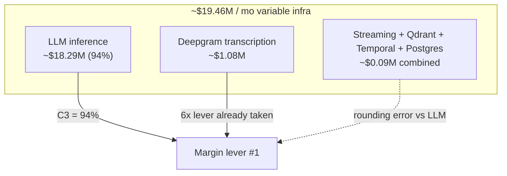
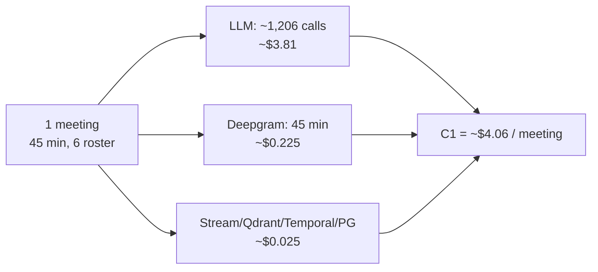
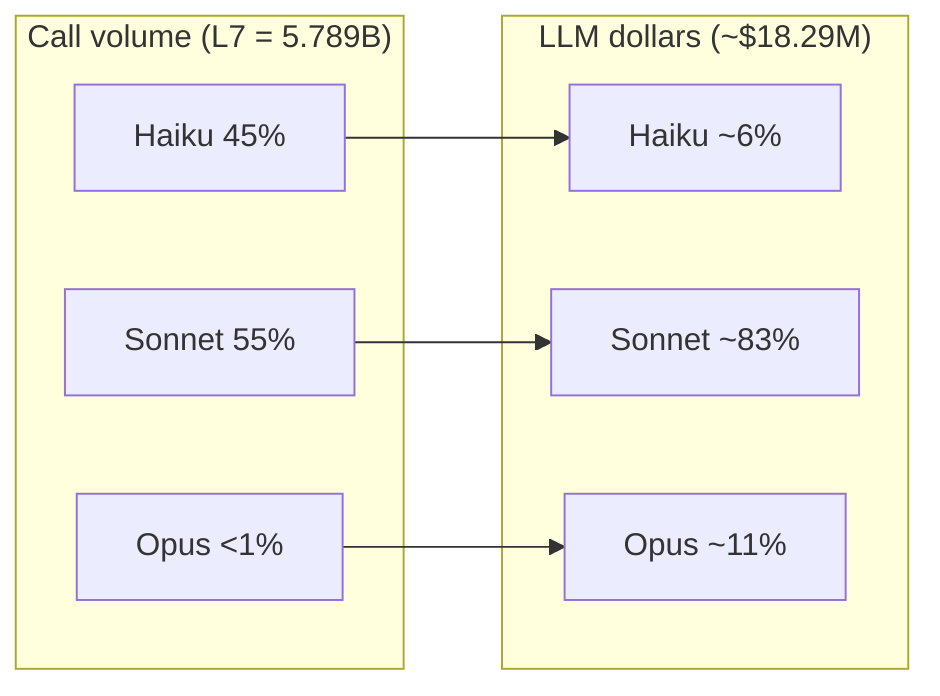
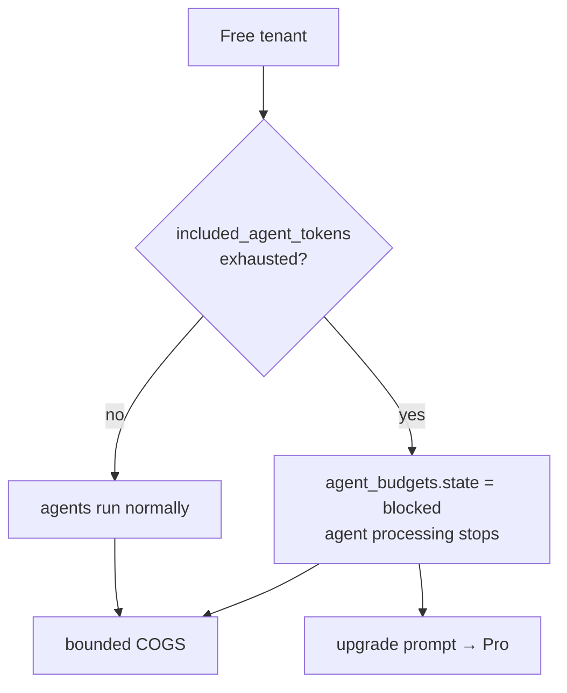
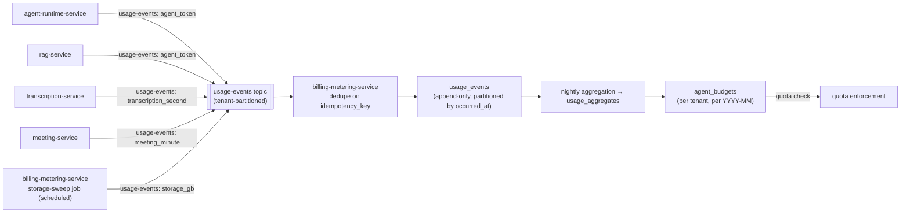
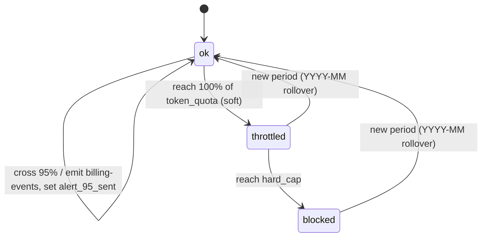
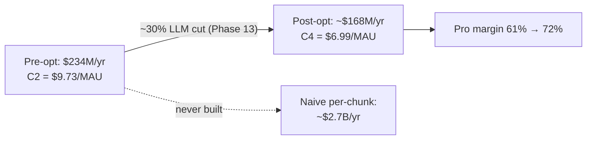
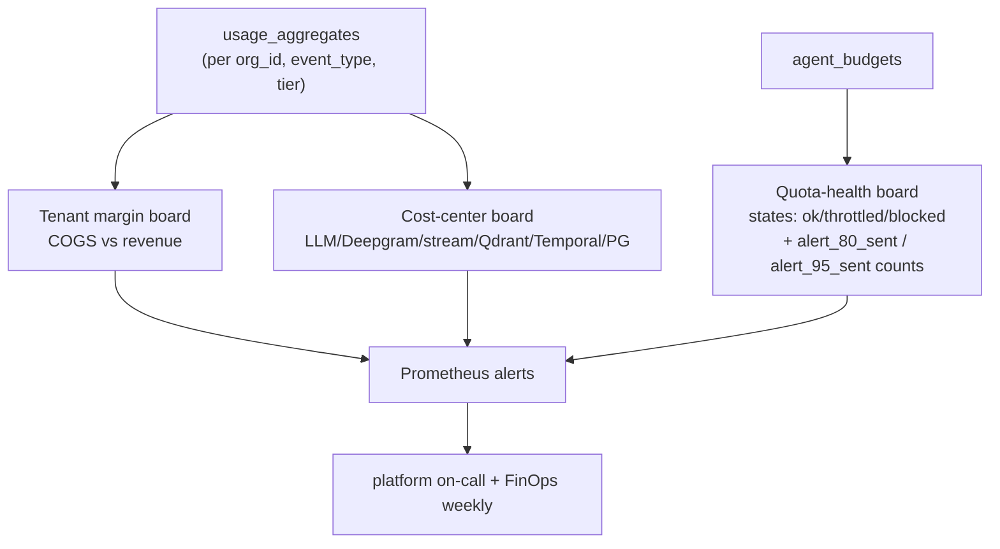

# Cost Architecture & FinOps

The frozen, production-grade model of what NEXUS costs to run — COGS per meeting derived from the canon capacity math, the gross-margin model against Free/Pro/Enterprise pricing, per-tenant cost attribution through `usage-events`, the budget alerts and hard quotas that enforce margin, and the FinOps practices and dashboards that keep the model honest in production.

## Related documents

- [Capacity & Scaling Math](_canon/05-capacity-math.md) — the single source of truth for every load and cost number; this document cites it by symbol and never re-derives a literal.
- [Service Catalog (canon)](_canon/01-service-catalog.md) — canonical service names, cost-center families, and the `usage-events` / `billing-events` producers/consumers.
- [Canonical Data Model](_canon/02-data-model.md) — `usage_events`, `agent_budgets`, `subscriptions`, `plans`, `invoices`, and the Redis budget mirror namespace.
- [Locked Tech & Architecture Decisions](_canon/06-tech-decisions.md) — the locked LLM cost pipeline, per-tenant quota, and `~30%` reduction-target rows cited throughout.
- [AI Agent Architecture](08-ai-agent-architecture.md) — the cost-controlled LLM pipeline (pre-gate → windowed batching → tiered routing → caching) whose output volume drives the LLM line item.
- [RAG Pipeline & Inference Serving](09-rag-and-inference-serving.md) — the dedicated GPU embedding/reranker inference tier and its separate cost center.
- [Real-time & Transcription](10-realtime-and-transcription.md) — the one-stream-per-meeting Deepgram billing decision.
- [Data Architecture](05-data-architecture.md) — Qdrant quantization, transcript partitioning/tiering, Postgres backups/PITR that set the storage line items.
- [Event-Driven Architecture](07-event-architecture.md) — Redpanda topics, `usage-events` delivery, idempotency keys that make metering correct.
- [Multi-Tenancy & Tenant Isolation](06-multi-tenancy.md) — `org_id` injection and tenant-keyed partitions that make per-tenant attribution possible.

> [SaaS-scale adjustment] The PDF had no cost architecture. Its only cost notes were a Phase-13 "~30% reduction" target and Phase-7 per-user budget alerts. This entire document — unit economics, gross-margin modeling, per-tenant attribution, hard quotas, FinOps practice — is a SaaS-scale addition required to run NEXUS as a commercial multi-tenant business. Every number it states is imported verbatim from [Capacity & Scaling Math](_canon/05-capacity-math.md); this document interprets those numbers into a financial operating model, it does not invent new ones.

---

## 1. Scope and the cost-model contract

This document is the **financial authority** for NEXUS. It does not re-derive capacity (that is [Capacity & Scaling Math](_canon/05-capacity-math.md)), re-decide stores or models (that is [Tech & Architecture Decisions](_canon/06-tech-decisions.md)), or re-specify the LLM pipeline (that is [AI Agent Architecture](08-ai-agent-architecture.md)). It takes the frozen capacity numbers as inputs and produces: COGS, unit economics, margin, attribution, enforcement, and the operating cadence.

Three contract rules bind everything below:

1. **Import by symbol, never re-derive.** Every cost figure traces to a capacity symbol (`A*`, `R*`, `D1`, `L7`, `V7`, `E10`, `C1`–`C4`). If a number is needed that is not in the capacity doc, it is added *there* first. This keeps the model self-reconciling: one edit in §10 of the capacity math propagates everywhere.
2. **LLM is the business.** Per [Capacity & Scaling Math](_canon/05-capacity-math.md) §10.1, **`C3` = 94%** of variable infra cost is LLM. Every FinOps decision is weighed against its LLM impact first; infra rightsizing is rounding error by comparison.
3. **Attribution is per-tenant, by `org_id`, sourced from `usage-events`.** Cost is not a global aggregate — it is decomposed to the tenant and metered through the `usage-events` topic into the `usage_events` table, so margin is known per tenant, not just in aggregate.

---

## 2. The cost stack: what each dollar buys

NEXUS variable infra cost decomposes into the same three scaling families the [Service Catalog (canon)](_canon/01-service-catalog.md) §4 uses, plus the async tier. Each family bills on a different signal, so each is a distinct cost center.

| Cost center | Driving services | Billing basis | Capacity anchor | Monthly cost |
|---|---|---|---|---:|
| **LLM (inference)** | `agent-runtime-service`, `rag-service` (query expansion) | Tokens in/out, per model tier | `L7` = 5.789B calls/mo | **~$18,290,000** |
| **Transcription** | `transcription-service` | Deepgram minutes (one stream/meeting) | `D1` = 216M min/mo | **~$1,081,000** |
| **Event streaming** | all topic producers/consumers | Throughput + ingress GB | `E10` = 11.58B ev/mo, `E13` ~13.9 TB | **~$28,000** |
| **Vector store** | `embedding-service` upserts, `rag-service` reads | Resident RAM + cold disk | `V7` = 4.42B vec (~17 TB) | **~$22,000** |
| **Workflow** | `workflow-service` | Temporal state transitions | ~1.34B transitions/mo | **~$33,600** |
| **Primary DB** | `core-api`, `transcription-service`, others | Rows + storage + replica + PITR | `T3` = 1.73B chunk rows/mo | **~$9,000** |
| **TOTAL (variable infra)** | | | | **~$19,460,000 / mo** |

These figures are imported verbatim from [Capacity & Scaling Math](_canon/05-capacity-math.md) §10. Compute (Kubernetes EKS/GKE, the GPU inference tier itself), egress, and CDN are **excluded** here and covered in the deployment/infra cost doc; this document models the variable, demand-driven cost that scales with meetings and tokens.

> [SaaS-scale adjustment] The PDF priced nothing — it was a 4-person MVP against a `2 orgs x 10 users x 5 meetings` seeder. The cost stack above exists only at the production anchors (`A1`–`A18`). The seeder remains the dev/test fixture; it has effectively zero variable cost and must never be used for pricing or margin decisions.

---

## 3. Unit economics: COGS per meeting

The meeting is the natural unit of NEXUS COGS — every dollar of variable cost is produced by a meeting (live transcription + agent processing) or by retention of what a meeting produced (vectors, rows, recordings). The canon fixes the per-meeting cost directly.

### 3.1 The headline unit

| Symbol | Metric | Value | Source |
|---|---|---:|---|
| `C1` | Variable infra cost / meeting | **~$4.06** | Capacity §10.1 |
| `C2` | Variable infra cost / MAU / month | **~$9.73** | Capacity §10.1 |
| `C3` | LLM share of variable cost | **94%** | Capacity §10.1 |
| `C4` | Post Phase-13 optimization cost / MAU | **~$6.99** | Capacity §10.1 |

`C1 = ~$4.06` is derived in the capacity math as `total variable cost / R4 meetings` (`$19.46M / 4.8M`). `C2 = ~$9.73` follows from `R7` (14.4 meetings/MAU/month) × `C1`. These are the two numbers every pricing and margin decision starts from.

### 3.2 Decomposing the $4.06

Per-meeting COGS decomposes by cost center using the per-meeting capacity quantities. The dominant term is LLM, as `C3 = 94%` requires.

| Cost center | Per-meeting driver | Per-meeting cost | Share |
|---|---|---:|---:|
| LLM (`L6` = ~1,206 calls/meeting) | tiered Haiku/Sonnet/Opus mix | **~$3.81** | ~94% |
| Deepgram (`D1`/`R4` = 45 min/meeting) | one diarized stream | **~$0.225** | ~5.5% |
| Streaming + Qdrant + Temporal + Postgres | events, vectors, transitions, rows | **~$0.025** | ~0.6% |
| **Total `C1`** | | **~$4.06** | 100% |

The LLM per-meeting figure is the `L6 = ~1,206` calls/meeting (capacity §8.2) routed across the tier mix (Haiku 45% / Sonnet 55% / Opus <1%, capacity §8.2) at the Anthropic prices and cached-input assumptions in capacity §10. Deepgram is the 45-minute meeting at ~$0.0077/min with the 35% volume discount — **one stream, not six** (capacity §7, `D3` avoided).

### 3.3 Why it is $4.06 and not $30: the two locked levers

Two architecture decisions, both locked in [Tech & Architecture Decisions](_canon/06-tech-decisions.md), are responsible for almost the entire gap between the naive cost and the real cost. Both are quantified in the capacity math; this document only states the financial consequence.

**Lever 1 — the cost-controlled LLM pipeline (defeats R4).** If every realtime agent ran on every raw `transcript_chunk` (the PDF's "process every chunk" design), the capacity math shows `N2` = 41.472B LLM calls/month. The built pipeline — relevance pre-gating → windowed batching (`A17` = 30s windows) → tiered routing → caching — produces `L7` = 5.789B calls/month, an **`L10` = 86% reduction in call volume** before any caching savings. In dollars: a naive all-Sonnet per-chunk design costs **~$224M/mo**; the built pipeline LLM subtotal is **~$18.29M/mo**. That single architectural decision is worth roughly **$206M/month**.

**Lever 2 — one Deepgram stream per meeting (R7-adjacent billing decision).** Audio is captured server-side via the LiveKit hook and proxied to a *single* diarized Deepgram session per meeting; `meeting_speakers` maps the diarized `speaker_id` → `user_id`. Per-participant transcription (`D3`) would be `D1 × 6` = 1.296B minutes — a 6× cost multiplier. We do not do this. The financial consequence: Deepgram stays at ~$1.08M/mo instead of ~$6.5M/mo.

> [SaaS-scale adjustment] Both levers are SaaS-scale hardenings of PDF intent. The PDF flagged the per-chunk cost spiral as **R4** but did not size it; the capacity math sizes it (`N2` vs `L7`) and this doc prices it. The one-stream-per-meeting decision is locked in [Real-time & Transcription](10-realtime-and-transcription.md) and is the reason transcription is 5.5% of COGS instead of ~30%.

---

## 4. The LLM cost line in detail

Because LLM is 94% of variable cost, it gets its own decomposition. The numbers are from [Capacity & Scaling Math](_canon/05-capacity-math.md) §10.

| Tier | Role | Calls/month | Token assumption (cached-in / out) | Price /MTok | Monthly cost |
|---|---|---:|---|---|---:|
| **Haiku** | triage / relevance pre-gating / scoring | 2.59B | ~250 / 60 | $0.80 / $4.00 | **~$1,140,000** |
| **Sonnet** | extraction (Listener/Decision/Action), QuestionAgent, ContextGapAgent synthesis | 3.17B | ~500 / 220 | $3.00 / $15.00 | **~$15,210,000** |
| **Opus** | high-stakes reasoning (ProactiveAgent conflict, ContextGap fallback synthesis) | 28.8M | ~1,500 / 600 | $15.00 / $75.00 | **~$1,944,000** |
| **LLM subtotal** | `L7` = 5.789B calls | | | | **~$18,290,000** |

Tier mix by call volume is **Haiku 45% / Sonnet 55% / Opus <1%** (capacity §8.2). Sonnet is the cost center: it is 55% of calls but **~83% of LLM dollars** because extraction is the expensive middle tier. Opus is <1% of calls and ~11% of dollars — reserved, by design, for confirmed high-stakes reasoning only.

The token assumptions already reflect **Anthropic prompt caching** (the cached-input price applies to the role/skills system prompt, the windowed-batch context, and the versioned prompt template — all repeated across calls). Semantic caching deduplicates near-identical windows before they ever reach a model.

**FinOps consequence:** the highest-leverage cost action is anything that moves a call *down* a tier (Sonnet→Haiku) or removes it (better pre-gating, broader caching). The Phase-13 `~30%` reduction target (`C4`) is modeled almost entirely as caching-hit-rate improvement and gate-tightening on the Sonnet tier — see §7.

> [SaaS-scale adjustment] The PDF used LiteLLM with per-user rate limits and token tracking but had no tier-mix model or caching cost assumption. Tiered routing (Haiku→Sonnet→Opus) with prompt caching and the resulting dollar decomposition is the SaaS-scale cost model that makes the $4.06/meeting unit possible. See [AI Agent Architecture](08-ai-agent-architecture.md).

---

## 5. Gross-margin model against pricing tiers

NEXUS sells Free / Pro / Enterprise seats (locked in [Tech & Architecture Decisions](_canon/06-tech-decisions.md) §2.12, entities in [Canonical Data Model](_canon/02-data-model.md) `plans`/`subscriptions`). Margin is modeled per MAU, since `C2 = ~$9.73/MAU/month` is the natural denominator.

### 5.1 The margin arithmetic

| Plan | List price | Cost basis (`C2`) | Gross margin (pre-opt) | Gross margin (post-opt `C4` = $6.99) |
|---|---:|---:|---:|---:|
| Free | $0 | ~$9.73/MAU | **negative** (quota-capped, see §5.2) | negative |
| Pro | $25 / seat / mo | ~$9.73/active seat | **~61%** | **~72%** |
| Enterprise | $40+ / seat / mo (contracted; **doc-assumed, not canon** — see note) | ~$9.73 + cell premium | **~70%+** | **~78%+** |

The capacity math's pricing implication (§10.1) is explicit: at ~$9.73/MAU (→ ~$6.99 post-optimization), **a Pro seat priced at $20–30/seat/month retains healthy gross margin**, and Free-tier usage *must* be quota-capped via the usage-metering pipeline. This document fixes Pro at $25 as the modeling midpoint; the actual list price is a go-to-market decision, but it must clear `C2` with margin.

> [SaaS-scale adjustment] Only the **Pro $20–30/seat/month** band is a canon figure ([Capacity & Scaling Math](_canon/05-capacity-math.md) §10.1); the $25 used here is correctly inside that band as a modeling midpoint. The **Enterprise `$40+`/seat/month** price is **not** a canon figure — canon prices no Enterprise tier. It is a doc-introduced modeling assumption used only to illustrate that the cell-isolation premium clears `C2` with margin; the real Enterprise price is a contracted go-to-market decision and should not be read as an imported canon number.

Two facts make the margin model robust:

1. **An active seat is not a billed seat for cost.** `C2` is per **MAU** (`A2` = 2M). Subscriptions bill per **seat** (`subscriptions.seats`). A tenant pays for provisioned seats whether or not each is active in a given month, so realized cost per *billed* seat is generally **below** `C2`. The $9.73 is the conservative (fully-active) cost.
2. **LLM cost is variable and quota-bounded.** Because LLM is 94% and is hard-capped per tenant via `agent_budgets` (§6), a tenant cannot run NEXUS into negative margin — the hard quota stops token spend before COGS exceeds the contracted envelope.

### 5.2 Free tier: capped by construction

Free is structurally unprofitable per active user (~$9.73 cost, $0 revenue), so it is **not** allowed to run at MAU-scale economics. The `plans` row for `free` sets `included_meeting_minutes` and `included_agent_tokens` low; the usage-metering pipeline (§6) enforces them as hard quotas via `agent_budgets`. For the `free` plan the budget is configured with `token_quota = hard_cap` — i.e. **no throttle band** — so the §7.1 state machine transitions `ok → blocked` directly with no intervening `throttled` step (Pro/Enterprise set `token_quota < hard_cap` to get the soft `throttled` Haiku-only degradation band). A Free tenant that exhausts its monthly `included_agent_tokens` is therefore moved straight to `agent_budgets.state = 'blocked'` and agent processing stops (transcription and CRUD continue) until the next period or an upgrade.

> [SaaS-scale adjustment] Free/Pro/Enterprise tiers, seat pricing, and the Free-tier hard cap are wholly added vs the PDF, which had no plans, seats, or quotas. The margin model is the reason the LLM cost levers (§3.3, §4) are non-negotiable: at $4.06/meeting and 14.4 meetings/MAU, only the locked pipeline keeps Pro above 60% gross margin.

---

## 6. Per-tenant cost attribution via `usage-events`

Aggregate COGS is not enough to run a SaaS — cost must be known *per tenant* to enforce quotas, price Enterprise contracts, and find unprofitable tenants. NEXUS attributes cost through the metering pipeline locked in [Service Catalog (canon)](_canon/01-service-catalog.md) and [Canonical Data Model](_canon/02-data-model.md).

### 6.1 The metering pipeline

Every cost-bearing operation emits a `usage-events` Avro message keyed by `org_id`. `billing-metering-service` consumes the topic, deduplicates on `idempotency_key`, and writes to the `usage_events` table (append-only, range-partitioned by `occurred_at` day). Nightly aggregation rolls raw events into `usage_aggregates`; raw is retained 90 days then summarized.

> [SaaS-scale adjustment] The canon service catalog ([Service Catalog](_canon/01-service-catalog.md)) lists `usage-events` only in the **Produces events** column of `agent-runtime-service` and `rag-service` (both emitting `agent_token`). The `usage_events.event_type` enum in [Canonical Data Model](_canon/02-data-model.md) §2.2, however, also defines `transcription_second`, `meeting_minute`, and `storage_gb`, which require producers the catalog does not yet name. This document therefore attributes those three event types to canon-defined services: `transcription_second` to `transcription-service`, `meeting_minute` to `meeting-service`, and `storage_gb` to a scheduled **storage-sweep job inside `billing-metering-service`** (a doc-introduced named component, not a new service). These producer edges **extend** the service-catalog producer set and are flagged for reconciliation into the catalog; no invented service names are used.

### 6.2 The `usage_events` event types and their cost weight

The `usage_events.event_type` enum (from [Canonical Data Model](_canon/02-data-model.md) §2.2) maps directly to the cost centers in §2:

| `event_type` | Emitting service | Cost center | Approx. share of COGS |
|---|---|---|---:|
| `agent_token` | `agent-runtime-service`, `rag-service` | LLM | ~94% |
| `transcription_second` | `transcription-service` | Deepgram | ~5.5% |
| `meeting_minute` | `meeting-service` | (plan entitlement metering) | — |
| `storage_gb` | `billing-metering-service` storage-sweep job (scheduled) | Qdrant + Postgres + object | ~0.4% |

`agent_token` is the event type that matters financially — it carries the token counts that, multiplied by tier price, reconstruct the per-tenant LLM bill. Because `agent-runtime-service` already knows which model tier served each call (via LiteLLM), the `usage-events` payload carries enough to attribute Haiku/Sonnet/Opus dollars per tenant, not just raw token totals.

### 6.3 Idempotent metering = correct billing

Metering rides the same **at-least-once + idempotency-key** delivery as every other topic (see [Event-Driven Architecture](07-event-architecture.md)). `usage_events.idempotency_key` plus the `nexus:{org_id}:dedupe:usage-events:{idempotency_key}` Redis inbox cache guarantee a token is never double-counted on consumer retry. This is a billing-correctness requirement, not just a delivery nicety: double-counting tokens over-bills the customer and corrupts the margin model.

> [SaaS-scale adjustment] The PDF tracked tokens per user in-process for rate limiting. Per-tenant cost attribution through a durable, idempotent `usage-events` → `usage_events` → `usage_aggregates` pipeline is wholly added — it is what makes per-tenant margin, Enterprise contract pricing, and hard quotas possible. See [SaaS Business / billing entities in the Data Model](_canon/02-data-model.md).

---

## 7. Budget alerts and hard quotas

Per-tenant token budgets with hard quotas are locked in [Tech & Architecture Decisions](_canon/06-tech-decisions.md) §2.5 and modeled on the `agent_budgets` table. This is the enforcement arm of the cost model: it is what *guarantees* a tenant cannot exceed its cost envelope.

### 7.1 The `agent_budgets` state machine

One `agent_budgets` row per `(org_id, period=YYYY-MM)` carries `token_quota`, `tokens_consumed`, `hard_cap`, `alert_80_sent`, `alert_95_sent`, and `state ∈ {ok, throttled, blocked}`.

The canon `agent_budgets.state` enum has exactly three members — `ok`, `throttled`, `blocked` — and the 80%/95% crossings are **not** states: they are actions that emit `billing-events` and set the boolean flags `alert_80_sent` / `alert_95_sent` while the state remains `ok`. The diagram below models them as self-transitions on `ok`, never as distinct states.

| Threshold | `state` | Behavior | Signal |
|---|---|---|---|
| < 80% of `token_quota` | `ok` | normal processing | — |
| ≥ 80% | `ok` (+ `alert_80_sent`) | warn tenant admin | `billing-events` → `notification-service` |
| ≥ 95% | `ok` (+ `alert_95_sent`) | warn again, suggest upgrade | `billing-events` → `notification-service` |
| ≥ 100% of `token_quota` | `throttled` | drop to Haiku-only / degrade to silent-log | `billing-events` |
| ≥ `hard_cap` | `blocked` | agent processing stops (deny-by-default) | `billing-events` |

The two budget alerts mirror the PDF's own 80/95-percent workload-warning thresholds (ProactiveAgent flags assignees at 80/95% capacity) — the same two-stage warn-then-act discipline, applied to spend.

### 7.2 Hot quota checks: Redis mirror

A hard quota that requires a Postgres read on every LLM call would itself be a cost and latency problem. The `agent_budgets.tokens_consumed` value is mirrored to the Redis key `nexus:{org_id}:budget:{period}` (from [Canonical Data Model](_canon/02-data-model.md) §5, TTL = period-end). `agent-runtime-service` checks this hot counter before dispatching to LiteLLM:

- `ok` (including the 80%/95% warning bands, where `state` stays `ok` and only `alert_80_sent`/`alert_95_sent` are set): dispatch normally.
- `throttled`: force tier = Haiku, suppress Sonnet/Opus, log the degradation.
- `blocked`: do not call any model; emit a `notifications` "budget exhausted" card to the sidebar and stop.

Enforcement is **deny-by-default**: if the Redis mirror is unreachable, the service reads through to `agent_budgets` in Postgres rather than fail open into unbounded spend.

### 7.3 SLO on enforcement

Per [Capacity & Scaling Math](_canon/05-capacity-math.md) §11.3, **per-tenant token-budget quota-breach enforcement is a 100% SLO (hard cap, deny-by-default)**. There is no "best effort" on the hard cap — a breach is a billing-safety incident.

> [SaaS-scale adjustment] The PDF had per-user budget *alerts* from Phase 7 but no tenant-level hard cap. The `agent_budgets` throttle→block state machine and the 100% enforcement SLO are wholly added; they convert the soft "be careful with tokens" posture into a billing-safety guarantee.

---

## 8. Cost line items per dependency

Each non-LLM dependency has a concrete cost shape and a concrete lever. The figures are from [Capacity & Scaling Math](_canon/05-capacity-math.md) §10.

### 8.1 Deepgram

| Driver | Value | Lever | Status |
|---|---|---|---|
| `D1` minutes/month | 216M | one stream/meeting (not 6) | **taken** (`D3` avoided) |
| Effective rate | ~$0.0077/min | 35% volume discount via committed tier | negotiated |
| Monthly | **~$1.081M** | finals-only persist; no re-transcription | locked |

Deepgram bills on minutes, and the one-stream-per-meeting decision (§3.3) already removed the 6× multiplier. The remaining lever is the committed-volume discount tier — at 216M min/mo NEXUS is firmly in enterprise-contract territory.

### 8.2 Redpanda

| Driver | Value | Lever | Status |
|---|---|---|---|
| `E12` events/sec peak | ~17,900 | BACKWARD-compat Avro keeps payloads tight | locked |
| `E13` ingress/month | ~13.9 TB | `agent-stream` dominates count, not bytes | locked |
| Monthly | **~$28,000** | BYOC/dedicated multi-AZ cluster, tenant-partitioned | locked |

At ~17.9k ev/s and ~13.9 TB/mo, production runs a **BYOC/dedicated multi-AZ Redpanda cluster** (not the PDF's 30-day Serverless trial). The cost lever is Avro compactness; `agent-stream` token deltas dominate event *count* but are tiny per message, so byte-cost stays low.

### 8.3 Qdrant

| Driver | Value | Lever | Status |
|---|---|---|---|
| `V7` live stock | 4.42B vectors (~17 TB raw / `V9` ~17 TB indexed) | scalar int8 quantization (~4× RAM cut) | locked |
| Retention | `A18` = 13-month hot window | converts unbounded flow to bounded stock | locked |
| Monthly | **~$22,000** | per-tenant collections, hot RAM + cold disk split | locked |

The single most important Qdrant cost decision is `A18` (13-month hot retention): it caps the otherwise-unbounded vector flow (`V6` = 340M/mo) into a finite, billable stock. int8 quantization then cuts the RAM-resident portion ~4×. See [Data Architecture](05-data-architecture.md) and [RAG Pipeline & Inference Serving](09-rag-and-inference-serving.md).

### 8.4 Temporal Cloud

| Driver | Value | Lever | Status |
|---|---|---|---|
| State transitions/month | ~1.34B | ~$25/M actions | locked |
| Monthly | **~$33,600** | MeetingLifecycleWorkflow + ActionFollowUpWorkflow | locked |

Temporal bills per state transition. The `ActionFollowUpWorkflow` (reminders day 1/3/7, manager escalation day 10) is the highest-volume workflow; its transition count is bounded by `R4` × confirmed actions/meeting (`E5` = 5).

### 8.5 PostgreSQL (Supabase-managed)

| Driver | Value | Lever | Status |
|---|---|---|---|
| `T3` chunk rows/month | 1.73B | monthly range partitions; 90-day hot, then cold/object tier | locked |
| Topology | primary + read replica + PITR | standard RPO/RTO | locked |
| Monthly | **~$9,000** | AGE `nexus_knowledge` co-located; RLS | locked |

Postgres carries the relational heart plus the AGE `nexus_knowledge` graph. The cost lever is partition tiering: `transcript_chunks` older than 90 days drop to cold/object storage so the hot relation stays small. See [Data Architecture](05-data-architecture.md).

---

## 9. The $234M/year picture and the optimization target

Annualized, variable infra is **~$234M/yr** at the §2 anchors. The Phase-13 `~30%` LLM optimization target (`C4`, locked in [Tech & Architecture Decisions](_canon/06-tech-decisions.md) §2.5) is the dominant margin driver.

| Scenario | LLM cost | Total variable | Cost / MAU | Pro gross margin @ $25 |
|---|---:|---:|---:|---:|
| Pre-optimization | ~$18.29M/mo | ~$19.46M/mo | `C2` = ~$9.73 | ~61% |
| Post Phase-13 (~30% LLM cut) | ~$12.8M/mo | ~$14.0M/mo | `C4` = ~$6.99 | ~72% |
| Naive per-chunk (AVOIDED) | ~$224M/mo | — | — | deeply negative |

The `~30%` reduction is achieved on the LLM line (94% of cost), via:

1. **Higher prompt-cache hit rate** — more of the system prompt, windowed context, and role taxonomy served from Anthropic prompt cache.
2. **Tighter relevance pre-gating** — pushing the gate-pass rate below the modeled 35% where precision allows, moving spend off the Sonnet tier.
3. **Tier downshifting** — routing more extraction to Haiku where confidence permits, reserving Sonnet for genuinely ambiguous windows.
4. **Semantic-cache widening** — deduplicating more near-identical windows before any model call.

> [SaaS-scale adjustment] The `~30%` target is the one PDF cost note (Phase 13). This document preserves it as `C4` and decomposes *how* it is achieved against the tier-mix model. The PDF could not have modeled this — it had no tiers, no caching cost line, and no margin to protect.

---

## 10. FinOps practices and the operating cadence

FinOps for NEXUS is not a quarterly review — it is a continuous control loop wired into the same observability stack (Prometheus + Grafana, structured JSON logs, locked in [Tech & Architecture Decisions](_canon/06-tech-decisions.md) §2.14) that runs the SLOs.

### 10.1 The four FinOps controls

| Control | Mechanism | Cadence | Owner |
|---|---|---|---|
| **Real-time spend visibility** | `usage-events` → Grafana cost dashboards, per tenant + per cost center | streaming (≤ nightly aggregate) | platform |
| **Per-tenant hard quotas** | `agent_budgets` state machine (§7) | per LLM call (Redis hot path) | `billing-metering-service` |
| **Anomaly detection** | alert on tenant token rate > N× its trailing 7-day p95 | per minute | platform on-call |
| **Unit-economics tracking** | `C1`/`C2`/`C4` recomputed from live `usage_aggregates` vs canon | weekly | FinOps + eng |

> [SaaS-scale adjustment] The operational alert thresholds introduced in this section — the **LLM-share band** (alert if `C3` drifts below 90% or above 96%, §10.2), the **anomaly threshold** (tenant token rate > N× its trailing-7-day p95, §10.1), and the **weekly C1-drift threshold** (> 15% above canon `$4.06`, §10.3) — are **doc-owned FinOps operating thresholds, not canon capacity numbers**. They are tuning knobs for the FinOps control loop and are not imported from [Capacity & Scaling Math](_canon/05-capacity-math.md); only the underlying anchors they compare against (`C1`, `C2`, `C3`, `C4`, the §11.3 SLOs) are canon. Adjust these thresholds operationally without touching canon.

### 10.2 Cost dashboards

Three Grafana dashboards make cost observable, all sourced from `usage_aggregates` and tagged by `org_id`, `event_type`, and model tier:

1. **Tenant margin board** — per-tenant COGS (from `usage_events`) vs revenue (from `subscriptions` × `plans`), sorted to surface negative-margin tenants. The signal: any non-Free tenant whose realized COGS approaches its contract value.
2. **Cost-center board** — the §2 stack live: LLM (split Haiku/Sonnet/Opus), Deepgram, streaming, Qdrant, Temporal, Postgres. Tracks `C3` (LLM share) — an alert fires if LLM share drifts *below* 90% or *above* 96%, since either indicates a modeling break or a runaway.
3. **Quota-health board** — `agent_budgets` states across tenants: count in each canon state `ok` / `throttled` / `blocked`, plus the 80%/95% warning bands tracked as alert-flag counts (rows with `alert_80_sent` set, rows with `alert_95_sent` set) rather than as states. Feeds the 100% enforcement SLO ([Capacity & Scaling Math](_canon/05-capacity-math.md) §11.3).

### 10.3 The reconciliation guardrail

The FinOps loop closes against the canon, not against itself. Each week, live unit economics computed from `usage_aggregates` are compared to the canon `C1`/`C2`/`C3`/`C4`:

- If realized `C1` drifts > 15% above canon `$4.06`, it is a **cost incident** — most likely a gate-pass-rate regression or a cache-hit-rate drop on the Sonnet tier, both directly traceable in the cost-center board.
- If realized `C1` drifts *below* canon, the model is too conservative — the win is banked into pricing/margin headroom, and the anchor is revisited in [Capacity & Scaling Math](_canon/05-capacity-math.md), never patched locally.

This is the §1 contract rule made operational: a number that diverges from canon is fixed *in the canon first*, so the financial model stays single-sourced.

> [SaaS-scale adjustment] Continuous FinOps — streaming cost dashboards, per-tenant margin boards, anomaly alerts, and a weekly canon-reconciliation guardrail — is wholly added vs the PDF. The PDF had a one-time Phase-13 cost-optimization pass; production needs a standing control loop because 94% of cost is variable LLM spend that moves daily with tenant behavior.

---

## 11. Summary — the numbers this document operates on

Every figure below is imported by symbol from [Capacity & Scaling Math](_canon/05-capacity-math.md); this document interprets them, it does not own them.

| Canonical quantity | Symbol | Value |
|---|:---:|---:|
| Variable infra cost / meeting | `C1` | ~$4.06 |
| Variable infra cost / MAU / month | `C2` | ~$9.73 |
| LLM share of variable cost | `C3` | 94% |
| Post-optimization cost / MAU | `C4` | ~$6.99 |
| LLM subtotal / month | — | ~$18.29M |
| Total variable infra / month | — | ~$19.46M |
| Total variable infra / year | — | ~$234M |
| LLM calls / month (cost-controlled) | `L7` | 5.789B |
| LLM reduction vs naive | `L10` | 86% |
| Naive all-Sonnet per-chunk (AVOIDED) | — | ~$224M/mo |
| Deepgram minutes / month | `D1` | 216M |
| Qdrant live stock | `V7` | 4.42B vec (~17 TB) |
| Redpanda events / month | `E10` | 11.58B |
| Quota-breach enforcement SLO | §11.3 | 100% (hard cap) |

The two decisions that produce these economics — the **cost-controlled LLM pipeline** (`L10` = 86% call reduction, ~$206M/mo saved) and **one Deepgram stream per meeting** (`D3` 6× multiplier avoided) — are locked in [Tech & Architecture Decisions](_canon/06-tech-decisions.md) and are the reason a Pro seat clears 60%+ gross margin at $25.
