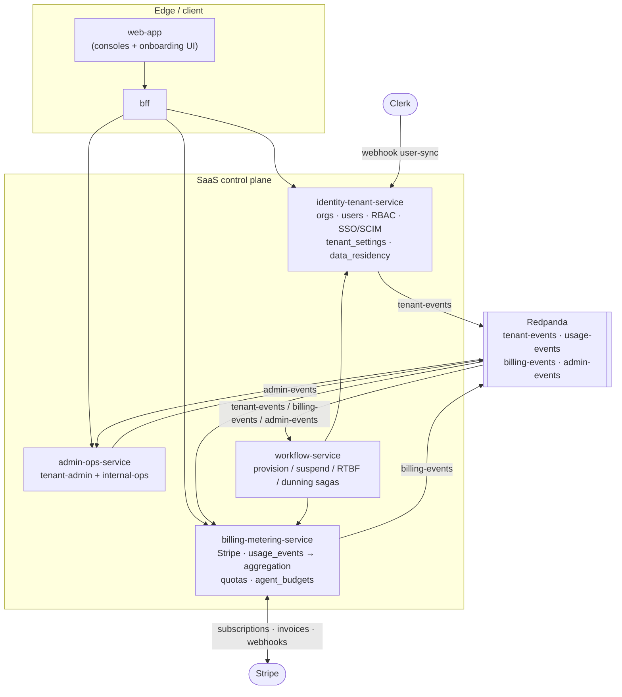
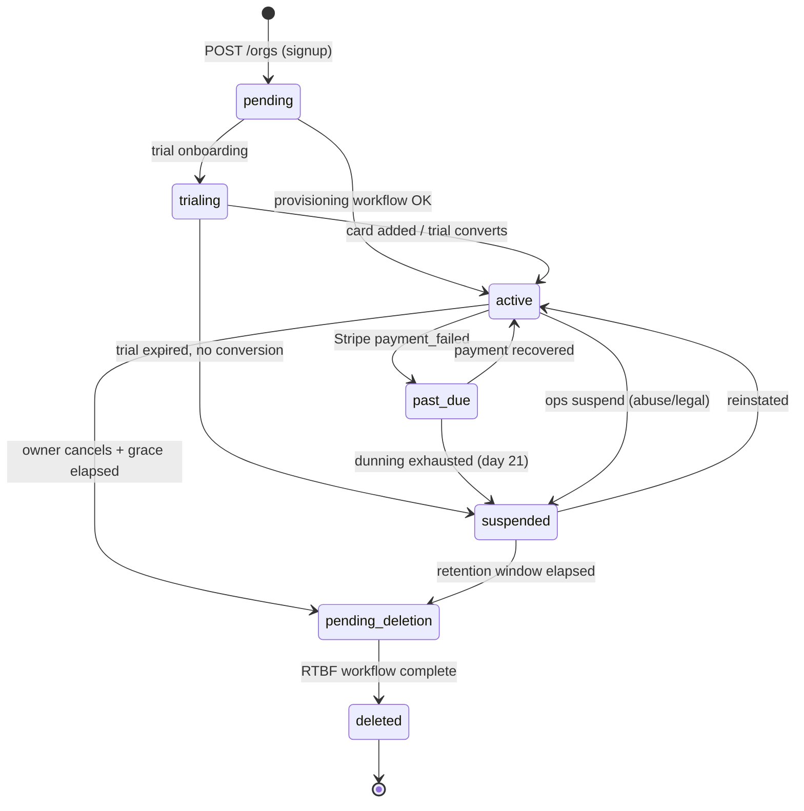
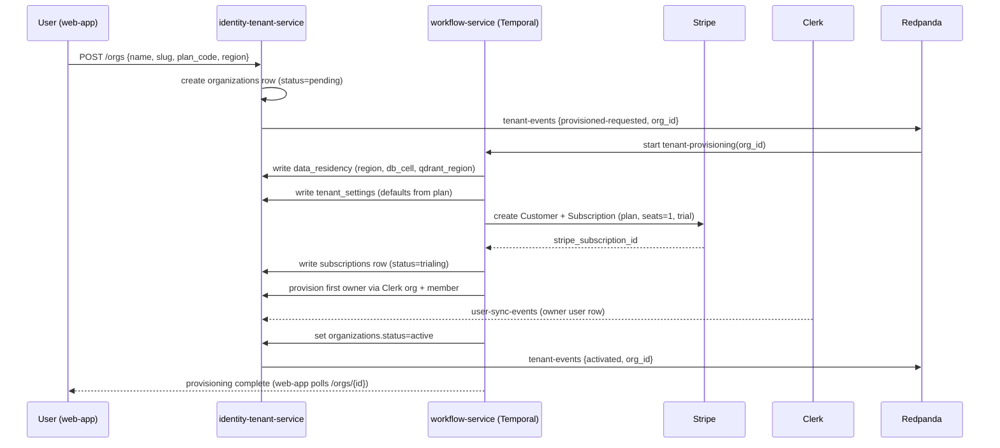
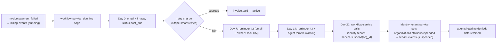
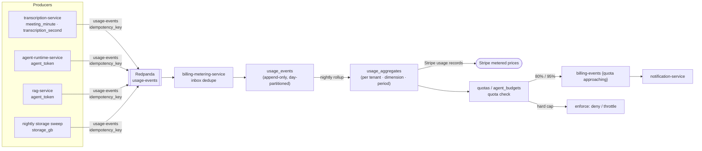
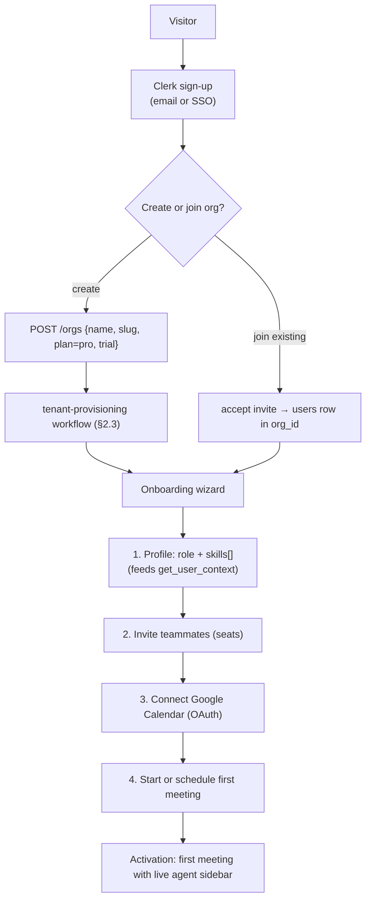

# NEXUS SaaS Business Architecture

The single authority for how NEXUS turns a meeting-intelligence engine into a commercial multi-tenant SaaS — tenant lifecycle, Stripe billing, usage metering and quota enforcement, plans/tiers, self-serve onboarding, and the tenant-admin and internal-ops consoles.

## Related documents

- [Service Catalog](04-service-catalog.md) — the bounded contexts that own every surface here: `identity-tenant-service`, `billing-metering-service`, `admin-ops-service`, `workflow-service`.
- [Service Catalog (canon)](_canon/01-service-catalog.md) — frozen service names, data ownership, and event contracts.
- [Canonical Data Model](_canon/02-data-model.md) — frozen entity names: `plans`, `subscriptions`, `usage_events`, `invoices`, `agent_budgets`, `tenant_settings`, `data_residency`.
- [Capacity & Scaling Math](_canon/05-capacity-math.md) — the unit economics and tier numbers imported by symbol (A1–A18, C1–C4).
- [Multi-Tenancy & Isolation](06-multi-tenancy.md) — pooled+RLS vs cell posture, `data_residency`, the `org_id` chokepoint that provisioning writes.
- [Security Architecture](11-security-architecture.md) — RBAC `owner`/`admin`/`member`, SSO/SAML/SCIM, the authorization middleware these consoles ride on.
- [Data Architecture](05-data-architecture.md) — partitioning and retention that metering and RTBF drive.
- [Event-Driven Architecture](07-event-architecture.md) — `tenant-events`, `usage-events`, `billing-events`, `admin-events` envelopes, partitioning, and idempotency keys.
- [Locked Tech & Architecture Decisions](_canon/06-tech-decisions.md) — §2.12 (SaaS business platform), §2.11 (compliance).

> [SaaS-scale adjustment] **The entire contents of this document are wholly new relative to the PDF.** The NEXUS Execution Plan v2.1 had no notion of tenants, plans, billing, metering, quotas, onboarding, or admin consoles — its world was a single deployment with a seeder of `2 orgs x 10 users x 5 meetings`. Every capability below exists to make one NEXUS deployment safely sell to **A4 = 3,000 paying tenant organizations** serving **A1 = 5,000,000 registered users** ([Capacity §2](_canon/05-capacity-math.md)). Because the whole document is a SaaS-scale addition, individual callouts below flag only the *non-obvious* decisions and the few places where a PDF primitive (the agent token budget, the confidence thresholds, the `ActionFollowUpWorkflow`) is reused or extended.

---

## 1. Scope and the ownership map

This document owns the **business semantics**: what a tenant is, how it moves through its lifecycle, what it is charged for, what it is allowed to consume, and the two consoles that operate it. It does **not** re-specify the isolation mechanics (that is [Multi-Tenancy](06-multi-tenancy.md)), the RLS policy SQL or RBAC permit/deny logic (that is [Security](11-security-architecture.md)), or the event envelopes' wire format (that is [Event Architecture](07-event-architecture.md)). It cites them.

Four services from the [Service Catalog](04-service-catalog.md) carry this domain. Their boundaries are frozen; this document only describes how they collaborate.

| Concern | Owning service | Owned data | Sync API surface | Events produced |
|---|---|---|---|---|
| Tenant lifecycle, RBAC, SSO/SCIM, Clerk user-sync | `identity-tenant-service` | `organizations`, `users`, RBAC grants, SSO config, SCIM state | `/orgs`, `/rbac/*`, `/scim/v2/*`, `/context/{user_id}`, `/clerk/webhook` | `tenant-events`, `notifications` |
| Per-tenant settings, residency | `identity-tenant-service` (writes `tenant_settings`, `data_residency`) | `tenant_settings`, `data_residency` | via `/orgs` provisioning + `/admin/tenant/*` | `tenant-events` |
| Stripe billing, subscriptions, seats, invoices, dunning, tax | `billing-metering-service` | `plans`, `subscriptions`, `seats`, `invoices`, Stripe id maps | `/billing/*`, `/stripe/webhook` | `billing-events`, `notifications` |
| Usage metering, aggregation, quota enforcement, token budgets | `billing-metering-service` | `usage_events`, `usage_aggregates`, `quotas`, `agent_budgets` | `/usage` | `billing-events` |
| Both consoles (tenant admin + internal ops) | `admin-ops-service` | feature flags, ops audit log, support/impersonation grants | `/admin/tenant/*`, `/admin/ops/*` | `admin-events` |
| Durable lifecycle orchestration | `workflow-service` (Temporal) | none (Temporal owns workflow state) | Temporal task queues, `/workflows/*` | `notifications`, `actions`, `integration-events` |

> [SaaS-scale adjustment] The canon [Data Model §1.1](_canon/02-data-model.md) decomposition diagram names a logical `budget-service` owning `agent_budgets` and a `tenant-service` owning `tenant_settings`/`data_residency`. In the authoritative [Service Catalog (canon)](_canon/01-service-catalog.md) — the single source of truth for service *names* — these are folded into `billing-metering-service` (token budgets & hard quotas) and `identity-tenant-service` (tenant settings & residency) respectively. This document uses the **service-catalog names** verbatim and treats `budget-service`/`tenant-service` as bounded-context sub-modules inside them, not as separately deployable services. No new service name is introduced.



---

## 2. The tenant: definition and lifecycle

### 2.1 What a tenant is

A **tenant** is one customer organization. The tenant root is the `organizations` row; **`organizations.id` *is* the `org_id`** that every tenant-scoped row, vector payload, graph node, event record, cache key, and object prefix carries ([Multi-Tenancy §1](06-multi-tenancy.md)). There is no second tenant identifier. A tenant has exactly one active `subscriptions` row, one `tenant_settings` row, one `data_residency` row, and one `agent_budgets` row per `YYYY-MM` period.

### 2.2 Lifecycle states

A tenant is a state machine. Transitions are driven by API calls (signup, plan change, cancel) or by `workflow-service` activities (provisioning completion, dunning escalation, scheduled offboarding), and **every transition emits a `tenant-events` record** (`TenantEvent` schema, keyed by `org_id`, log-compacted so the latest state per tenant is always replayable — [Event Architecture §4.2](07-event-architecture.md)).

| State | Meaning | Entered by | Effect on access |
|---|---|---|---|
| `pending` | Signup accepted; provisioning workflow running | `POST /orgs` (self-serve) or ops console | No service access yet; provisioning in flight |
| `active` | Fully provisioned and paid (or on trial) | provisioning workflow success | Full access within plan quotas |
| `trialing` | `active` with `subscriptions.trial_ends_at` in the future | self-serve onboarding | Full Pro-tier access, quota-capped, no card required |
| `past_due` | Invoice unpaid; dunning saga running | Stripe `invoice.payment_failed` webhook | Read access retained; agents throttled at grace expiry |
| `suspended` | Manually suspended (ops) or terminal dunning | `admin-events`/dunning saga | All write + agent access denied; data retained |
| `pending_deletion` | Offboarding requested; RTBF scheduled | cancel + retention window elapsed, or erasure request | Read-only export window, then purge |
| `deleted` | Right-to-be-forgotten purge complete across all six stores | RTBF Temporal workflow | No data in any store; `audit_logs` RTBF completion record only |



### 2.3 Provisioning — `signup -> provision -> activate`

Provisioning is a **durable Temporal workflow** in `workflow-service` (`tenant-provisioning`, a SaaS-added sibling of the PDF's `MeetingLifecycleWorkflow`/`ActionFollowUpWorkflow` — [Service Catalog §workflow-service](04-service-catalog.md)). It is durable because it touches six stores and three external systems (Clerk, Stripe, the chosen DB cell/region) and must be exactly-once-effecting even across retries.



Provisioning **chooses the isolation posture** by writing `data_residency` ([Multi-Tenancy §2](06-multi-tenancy.md)): Free/Pro tenants land in the **pooled + RLS** long tail (shared Postgres, shared Qdrant cluster with a per-tenant `__{org_id}` collection); Enterprise tenants are placed in a **cell** (`data_residency.db_cell`, dedicated Postgres instance and Qdrant cluster). The row is immutable after `locked_at` without a migration workflow, so residency and posture are decided once, at provisioning.

> [SaaS-scale adjustment] Provisioning is the moment the multi-tenancy substrate is materialized. The PDF's seeder created orgs by direct insert; here, creating a tenant is a fault-tolerant saga that allocates a region/cell, opens a Stripe subscription, syncs the owner through Clerk, and emits compacted `tenant-events` so every downstream consumer (`billing-metering-service`, `admin-ops-service`) converges on the new tenant's state.

### 2.4 Suspension and offboarding — `suspend -> offboard`

- **Suspend** is reversible. It is triggered by terminal dunning (§4.4) or by an ops action (`admin-events {tenant suspended}` → `workflow-service`). On suspend, the agent tier denies new spawns (deny-by-default authz still applies), the realtime path rejects new room tokens, but **all data is retained** and reads remain available so the customer can pay and recover.
- **Offboard** is the path to deletion. A cancellation moves the tenant to `pending_deletion` after a grace window (default 30 days, set in `tenant_settings`), during which the tenant admin can pull a full GDPR export (`mytheus-exports` bucket, auto-expiring 7 days after generation). When the window elapses — or on an explicit right-to-be-forgotten request — `admin-events {erasure requested}` triggers the **single `org_id`-parameterized RTBF Temporal workflow** that deletes across Postgres, Qdrant, AGE `nexus_knowledge`, Redis, and object storage, then appends an RTBF completion record to `audit_logs` ([Data Model §7](_canon/02-data-model.md), [Multi-Tenancy §RTBF](06-multi-tenancy.md)).

Because every store is `org_id`-keyed, deletion is mechanical: drop the tenant's monthly partitions and rows, drop its Qdrant `__{org_id}` collections, remove its `$org_id` AGE nodes/edges, flush `nexus:{org_id}:*` Redis keys, and delete the `{org_id}/*` object prefixes. `invoices` are the one exception — they are immutable and retained **7 years** for tax/compliance ([Data Model §2.2](_canon/02-data-model.md)), stored in `mytheus-invoices` under object lock, and excluded from the purge by policy.

---

## 3. Plans and tiers

Three plans, frozen in the canon as `free`/`pro`/`enterprise` ([Tech Decisions §2.12](_canon/06-tech-decisions.md), [Data Model §2.2](_canon/02-data-model.md)). The `plans` table is a **global, non-tenant catalog** (`plans` carries no `org_id`); plan rows are versioned and never hard-deleted so historical invoices reproduce exactly.

### 3.1 `plans` row shape

The canonical columns are `code`, `name`, `seat_price_cents`, `included_meeting_minutes`, `included_agent_tokens`, `features jsonb` ([Data Model §2.2](_canon/02-data-model.md)). Concrete catalog values:

| Field | Free | Pro | Enterprise |
|---|---|---|---|
| `code` | `free` | `pro` | `enterprise` |
| `seat_price_cents` | `0` | `2500` ($25/seat/mo) | negotiated (annual contract) |
| `included_meeting_minutes` (per tenant / mo) † | `300` | `3000` | pooled, custom |
| `included_agent_tokens` (per tenant / mo) † | `200000` | `4000000` | pooled, custom |
| Included storage | 1 GB / tenant | 50 GB / tenant | custom |
| Max seats | 5 | 100 | unlimited |
| Overage policy | hard cap (deny) | metered overage billed | metered overage, contractual |
| Isolation posture | pooled + RLS | pooled + RLS | **cell-based** ([Multi-Tenancy §2](06-multi-tenancy.md)) |
| Availability SLO | **99.5%** | **99.9%** | **99.95%** ([Capacity §11.2](_canon/05-capacity-math.md)) |
| SSO/SAML/SCIM | — | — | included |
| Data residency pin (`us`/`eu`/`ap`) | `us` only | region choice | region choice + cell |
| Agent confidence overrides | defaults | defaults | per-tenant (`tenant_settings`) |

† **Now canon.** [Data Model §2.2](_canon/02-data-model.md) freezes `included_meeting_minutes` and `included_agent_tokens` as **per-tenant monthly pools**, not per seat ([ADR-0029](adr/0029-plan-7-budget-scope-tier-mapping-and-metering-ownership.md) D1). `subscriptions.seats` drives the recurring seat charge only; it does not scale the allowances. An earlier version of this document read them per seat to match the per-seat margin model in [Cost & FinOps](17-cost-and-finops.md); that margin model is not re-derived for the pooled reading.

> [SaaS-scale adjustment] The Pro seat price of **$25/seat/mo** is set against the frozen unit economics: variable infra cost is **C2 ≈ $9.73/MAU/mo** (→ **C4 ≈ $6.99** after the Phase-13 ~30% LLM optimization) ([Capacity §10.1](_canon/05-capacity-math.md)). A $25 Pro seat clears that cost with healthy gross margin while leaving room for fixed compute (K8s/GPU) not in C-total. LLM is **94% of variable cost (C3)**, so plan limits are denominated in **agent tokens** first — `included_agent_tokens` is the lever that protects margin, not seat count.

### 3.2 `features jsonb`

Feature gating is data, not code branches. `plans.features jsonb` carries boolean and scalar capability flags read by the authz middleware and the `bff`:

```json
{
  "sso_saml": false,
  "scim_provisioning": false,
  "data_residency_choice": false,
  "cell_isolation": false,
  "integrations": ["google_calendar", "slack"],
  "pm_integration_choice": false,
  "context_gap_agent": true,
  "proactive_agent": false,
  "max_concurrent_meetings": 20,
  "retention_days_max": 90,
  "support_tier": "community"
}
```

Enterprise overrides set `sso_saml`, `scim_provisioning`, `cell_isolation`, `proactive_agent`, `pm_integration_choice` to `true`, allow `"integrations"` to include one of `jira`/`linear` (guardrail **R8**: Calendar + Slack + one of Jira/Linear — [Tech Decisions §2.13](_canon/06-tech-decisions.md)), and raise `retention_days_max`. A plan change writes a new `subscriptions.plan_id`, emits `billing-events {plan-changed}`, and — when it crosses the pooled↔cell boundary — schedules a residency migration workflow (the only sanctioned way to change `data_residency` after `locked_at`).

---

## 4. Billing (Stripe)

`billing-metering-service` is the sole owner of the Stripe relationship. NEXUS never stores raw card data; Stripe is the system of record for payment methods, tax calculation, and invoice PDFs, and NEXUS mirrors the minimum it needs into `subscriptions`, `seats`, and `invoices`.

### 4.1 Stripe object mapping

| NEXUS entity | Stripe object | Relationship | Notes |
|---|---|---|---|
| `organizations` | Customer | 1:1 | `stripe_customer_id` in Stripe id map; `org_id` in Customer metadata |
| `subscriptions` | Subscription | 1:1 active per tenant | `stripe_subscription_id`; status mirrored (`active`/`past_due`/`canceled`) |
| `seats` | Subscription quantity (per-seat price) | 1:1 with subscription quantity | seat count drives recurring charge |
| metered overage (minutes, tokens, storage) | Subscription metered price items | usage-based | reported via Stripe usage records from aggregation (§5) |
| `invoices` | Invoice | 1:many per subscription | immutable once finalized; PDF in `mytheus-invoices`, 7-yr retention |
| Tax / VAT | Stripe Tax | computed by Stripe | `invoices.tax_cents` mirrored; reverse-charge VAT for EU B2B handled by Stripe Tax |

> [SaaS-scale adjustment] **Tax/VAT is delegated to Stripe Tax**, not hand-rolled. Selling to 3,000 orgs across `us`/`eu`/`ap` ([Data Model §data_residency](_canon/02-data-model.md)) means VAT, GST, and US sales-tax nexus — automating this through Stripe Tax (with VAT-ID validation for EU B2B reverse-charge) is the only sane posture and keeps `invoices.tax_cents` authoritative for the customer's region.

### 4.2 Seats

A **seat** is a billable user slot. Seat count is `subscriptions.seats`; adding a member beyond `seats` either auto-increments the Stripe subscription quantity (proration on) or is blocked at `plans` `Max seats`, depending on plan. Removing a member frees a seat at the next billing period (no immediate credit; standard SaaS proration). Seat math is enforced at member-invite time by `identity-tenant-service`, which calls `billing-metering-service` to validate against `subscriptions.seats` and the plan cap before creating the `users`/membership row.

### 4.3 Webhooks (Stripe → NEXUS)

`POST /stripe/webhook` (owned by `billing-metering-service`) is the inbound control path. Every webhook is **signature-verified** (Stripe signing secret), **idempotent** (Stripe event id is the idempotency key, deduped via the inbox cache `nexus:{org_id}:dedupe:stripe:{event_id}` pattern — [Event Architecture §6](07-event-architecture.md)), and translated into internal `billing-events` where a state change matters.

| Stripe event | NEXUS effect | Emitted internal event |
|---|---|---|
| `customer.subscription.created/updated` | sync `subscriptions.status`, `seats`, period dates | `billing-events {plan-changed}` if plan/seats changed |
| `invoice.finalized` | write `invoices` row (status `open`), store PDF in `mytheus-invoices` | — |
| `invoice.paid` | mark `invoices.status=paid`; call `identity-tenant-service` to flip `organizations.status=active` if recovering | `billing-events {recovered}` (the `tenant-events {activated}` is emitted by `identity-tenant-service`, see note) |
| `invoice.payment_failed` | move tenant to `past_due`; start dunning saga | `billing-events {dunning}` |
| `customer.subscription.deleted` | invoke `identity-tenant-service` to move tenant toward `pending_deletion` after grace | `billing-events {canceled}` (the `tenant-events {pending_deletion}` is emitted by `identity-tenant-service`, see note) |

> [SaaS-scale adjustment] **`tenant-events` is never produced by `billing-metering-service`.** Per the frozen event contract ([Service Catalog (canon)](_canon/01-service-catalog.md), [Event Architecture §4](07-event-architecture.md)), `identity-tenant-service` is the **sole producer of `tenant-events`** because it owns `organizations.status`. `billing-metering-service` emits only its own `billing-events`; when a Stripe webhook implies a tenant-status transition, `billing-metering-service` (or `workflow-service` in the dunning saga) **calls `identity-tenant-service`**, which performs the `organizations.status` write and emits the corresponding `tenant-events` (`{activated}` on recovery, `{pending_deletion}` on cancellation, `{suspended}` on terminal dunning). This matches the §1 ownership table (lines 29–34) and the §1 mermaid's `WF --> IDENT` edge.

### 4.4 Dunning

Failed payments run a **dunning saga** in `workflow-service` (a SaaS-added billing saga — [Service Catalog §workflow-service](04-service-catalog.md)). It reuses the durable-timer pattern of the PDF's `ActionFollowUpWorkflow` (day-1/3/7 reminders) but for invoices:



Dunning notifications go through `notification-service` (in-app via `realtime-gateway`, email, and owner Slack DM) — the same delivery fabric the agents use; the dunning saga never sends directly. Throttling at day 14 lowers the `agent_budgets.state` to `throttled` for the tenant (§5.4) before hard suspension at day 21.

---

## 5. Usage metering

The metering pipeline is the canon's locked **`usage-events → aggregation → quota enforcement`** ([Tech Decisions §2.12](_canon/06-tech-decisions.md)). It exists to (a) bill metered overage and (b) enforce the per-tenant hard quotas that defend margin and the R4 LLM cost bomb.

### 5.1 Metered dimensions

Exactly four `usage_events.event_type` values, frozen in [Data Model §2.2](_canon/02-data-model.md):

| `event_type` | Unit | Emitted by | Drives |
|---|---|---|---|
| `meeting_minute` | minute of meeting (one diarized stream/meeting) | `transcription-service` | minutes quota; Deepgram cost ([Capacity §7](_canon/05-capacity-math.md)) |
| `transcription_second` | second of audio transcribed | `transcription-service` | fine-grained Deepgram metering |
| `agent_token` | LLM token consumed (Haiku/Sonnet/Opus) | `agent-runtime-service`, `rag-service` | `agent_budgets` token quota; 94% of variable cost (C3) |
| `storage_gb` | GB-month of recordings/documents/vectors | nightly storage sweep | storage quota; object-bucket lifecycle |

> [SaaS-scale adjustment] The PDF's only cost primitive was a *per-user* token budget with Phase-7 budget alerts and a Phase-13 ~30% reduction target. SaaS adds the *per-tenant* metered dimensions above and a hard-quota enforcement layer. Crucially, **`meeting_minute` is billed once per meeting, not per participant** — the diarization design (`meeting_speakers` maps diarized `speaker_id → user_id`) makes one Deepgram stream serve a 6-person call, a deliberate 6x cost lever ([Capacity §7](_canon/05-capacity-math.md), D3 "do not do this").

### 5.2 The pipeline: events → aggregation → enforcement

`usage-events` is a high-frequency append-only topic (`UsageEvent` schema), keyed by `org_id`, **7-day Redpanda retention** with a 7-day re-aggregation buffer ([Event Architecture §4.2](07-event-architecture.md)). Each record carries the canonical idempotency key **`usage:{org_id}:{event_type}:{occurred_at}:{source_id}`** ([Event Architecture §6](07-event-architecture.md)) so an at-least-once redelivery never double-counts.



1. **Ingest.** `billing-metering-service` consumes `usage-events`, dedupes on `idempotency_key` (inbox + `nexus:{org_id}:dedupe:usage-events:{idempotency_key}` cache, 24h TTL), and appends to `usage_events`. The table is **day-partitioned by `occurred_at`**, raw rows retained 90d then summarized ([Data Model §2.2](_canon/02-data-model.md)).
2. **Aggregate.** A nightly rollup collapses `usage_events` into `usage_aggregates` (one row per tenant × dimension × billing period). Aggregates are what Stripe metered usage records are reported from, and what the `/usage` API and tenant-admin dashboards read — never the raw 1.7B-row firehose.
3. **Enforce.** Quota state lives in `quotas` (general dimensions) and `agent_budgets` (the token dimension specifically). For real-time enforcement on the hot path, `agent_budgets.tokens_consumed` is mirrored to Redis `nexus:{org_id}:budget:{period}` ([Data Model §5](_canon/02-data-model.md)) so the agent tier checks budget in a single Redis read, not a Postgres round-trip.

### 5.3 `agent_budgets` — the token quota

`agent_budgets` (one row per tenant per `YYYY-MM`) carries `token_quota`, `tokens_consumed`, `hard_cap`, `alert_80_sent`, `alert_95_sent`, and `state` (`ok`/`throttled`/`blocked`) ([Data Model §2.2](_canon/02-data-model.md)).

> [SaaS-scale adjustment] `agent_budgets` is the per-tenant evolution of the PDF's per-user token budget. The 80%/95% alert thresholds and the hard cap are the billing-safety backstop for **R4 (LLM cost spiral)**; they sit *downstream* of the cost-controlled pipeline (relevance pre-gating → windowed batching → tiered routing → prompt caching — [Capacity §8.2](_canon/05-capacity-math.md)) so that even a tenant whose traffic defeats the gating cannot run an unbounded LLM bill.

### 5.4 Quota enforcement semantics

Enforcement is **deny-by-default and fail-closed** ([Security §1](11-security-architecture.md)). Quota state degrades agent behavior gracefully before it blocks:

| `agent_budgets.state` | Trigger | Agent-tier behavior |
|---|---|---|
| `ok` | `tokens_consumed < 80% × token_quota` | All seven agents run normally |
| `ok` + `alert_80_sent` | crosses 80% | `billing-events {quota approaching}` → notify owner/admin; no behavior change |
| `throttled` | crosses 95%, or dunning day-14 | Route **all** windows to Haiku triage only; suspend Sonnet/Opus extraction and `ProactiveAgent`; `ContextGapAgent` falls through to RAG-only (the PDF-authorized R6 descope) |
| `blocked` | `tokens_consumed ≥ hard_cap` (overage disabled, e.g. Free) | Agent spawns denied; transcription + captions continue (durable facts never dropped); UI surfaces an upgrade prompt |

Pro/Enterprise plans bill metered overage instead of blocking (`plans` overage policy, §3.1); Free hard-caps. The state machine ensures durable facts — `transcript-chunks`, `decisions`, `actions`, `usage-events` — are **never** shed for quota reasons ([Event Architecture §shedding](07-event-architecture.md)); only discretionary LLM work degrades.

---

## 6. Self-serve onboarding

Onboarding is the funnel from anonymous visitor to an `active`/`trialing` tenant with a first meeting. It is low-touch for the Free/Pro long tail and assisted (sales-led) for Enterprise.



Design decisions:

- **No credit card to start.** Self-serve creates a Pro **`trialing`** tenant (`subscriptions.trial_ends_at`); the card is requested before trial end via a dunning-adjacent reminder. This maximizes top-of-funnel for a product whose value is only visible after the first live meeting.
- **Role + skills capture is step 1** because `get_user_context(user_id)` — carried verbatim from the PDF — drives every agent's relevance filtering. An onboarded user with no role produces low-value worklogs, so the wizard makes role/skills the first required field, written to `users.role` and `users.skills text[]`.
- **Calendar connect is the activation accelerant.** Connecting Google Calendar (the locked Calendar integration — [Tech Decisions §2.13](_canon/06-tech-decisions.md)) auto-creates meetings from events and routes attachments through `ingestion-service` so the agent has context on the first call. This is the single highest-leverage onboarding step for time-to-value.
- **Activation = first meeting with a live agent sidebar.** The activation metric is not "signed up" but "completed one meeting where the agent sidebar produced a worklog or suggestion," because that is the moment the differentiator (personalized per-participant intelligence) is felt.

> [SaaS-scale adjustment] The PDF had no acquisition funnel — the seeder inserted users directly. The trial-first, card-later, role-capture-first, calendar-accelerated flow above is wholly added and is tuned to NEXUS's specific time-to-value: the product is invisible until a live meeting runs an agent, so onboarding optimizes for getting the user into that first meeting fast.

---

## 7. Tenant admin console

The tenant-admin console is the **org-scoped self-serve** surface of `admin-ops-service` (`/admin/tenant/*`), rendered by `web-app` through `bff`. Every action is **RBAC-gated and audited** ([Security §RBAC](11-security-architecture.md)): the tiers are `owner`/`admin`/`member`, held as RBAC grants in `identity-tenant-service` — **never** as `users.role`, which is the agent-relevance attribute. Every write appends to `audit_logs` (append-only, tamper-evident — [Data Model §2.2](_canon/02-data-model.md)).

| Console section | Reads | Writes / actions | Min RBAC tier |
|---|---|---|---|
| **Members** | `users`, RBAC grants, `seats` | invite/remove member, change RBAC tier, transfer ownership | `admin` (ownership transfer: `owner`) |
| **Billing** | `subscriptions`, `invoices`, Stripe portal link | change plan, update seats, download invoice PDFs, manage payment method (Stripe Customer Portal) | `owner` |
| **Usage** | `usage_aggregates`, `agent_budgets`, `quotas` (via `/usage`) | view consumption vs quota by dimension; set soft alert thresholds | `admin` |
| **Integrations** | `integration_connections` | install/revoke Calendar/Slack/Jira-Linear OAuth (guardrail R8) | `admin` |
| **SSO & SCIM** | `tenant_settings.sso_config`, SCIM state | configure SAML IdP, enable SCIM provisioning | `owner` (Enterprise only, gated by `features.sso_saml`) |
| **Settings** | `tenant_settings` | retention days, PII redaction, agent confidence overrides, default locale | `admin` |
| **Data export & erasure** | export job state | request GDPR export (→ `mytheus-exports`), request erasure (→ RTBF) | `admin` (erasure: `owner`) |

> [SaaS-scale adjustment] The Billing section delegates card and payment-method management to the **Stripe Customer Portal** (a hosted, PCI-scoped surface) rather than building a card form — NEXUS never touches PAN data. The Usage section reads `usage_aggregates`, never raw `usage_events`, so the console stays fast even at T3 = 1.728B chunk-rows/month-class volume ([Capacity §4](_canon/05-capacity-math.md)).

The console is the tenant-side trigger for the lifecycle workflows of §2: a plan change emits `billing-events`, an erasure request emits `admin-events {erasure requested}` to `workflow-service`, and a settings change to `retention_days_*` propagates into partition-drop and bucket-lifecycle policy ([Data Architecture](05-data-architecture.md)).

---

## 8. Internal NEXUS ops console

The internal-ops console is the **cross-tenant** surface of `admin-ops-service` (`/admin/ops/*`), available only to NEXUS staff. It is the most privileged surface in the system, so it is the most heavily controlled: **deny-by-default, full audit, time-boxed impersonation, and no standing cross-tenant data access**.

| Ops capability | Purpose | Control |
|---|---|---|
| **Tenant directory** | search/inspect any tenant's lifecycle state, plan, residency/cell | read-only; logged |
| **Suspend / reinstate** | abuse, legal hold, non-payment escalation | emits `admin-events {tenant suspended}` → `workflow-service`; logged |
| **Tenant migrate** | move a tenant between pooled↔cell or across regions | triggers residency-migration workflow; the only path to change `data_residency` after `locked_at` |
| **Feature flags** | per-tenant/per-cohort rollout of new agents/features | flag store; emits `admin-events {flag changed}` |
| **Cost & lag dashboards** | consumer-lag, per-tenant LLM cost, token-budget burn, DLQ rates | reads `billing-events`, `graph-events`, Prometheus/Grafana ([Capacity §11.3](_canon/05-capacity-math.md)) |
| **Audit-log access** | SOC2/incident investigation across tenants | read-only on `audit_logs`; access itself audited |
| **Support impersonation** | act as a tenant user to reproduce an issue | time-boxed grant, customer-consented, every impersonated action tagged `actor_type=system` in `audit_logs` |

> [SaaS-scale adjustment] The ops console is wholly added and is governed by the same `org_id`-injection chokepoint as every other path ([Multi-Tenancy §authz](06-multi-tenancy.md)) — there is **no superuser/RLS-bypass role reachable from the request path** ([Multi-Tenancy §RLS](06-multi-tenancy.md)). Cross-tenant reads for dashboards run as aggregate queries over control-plane events (`billing-events`, `tenant-events`), not by selecting tenant rows; impersonation is the only way to touch a specific tenant's data, and it is consented, time-boxed, and fully audited for SOC2 readiness ([Tech Decisions §2.11](_canon/06-tech-decisions.md)).

> [SaaS-scale adjustment] [ADR-0046](adr/0046-superadmin-ops-console.md) turns this table into the pages of `/ops`: an **Overview** (platform totals and weekly charts), **Workspaces** with a per-workspace **detail** panel (residency, usage, flags, grants, sessions, move requests, recent ops actions), **Feature flags**, **Costs**, **Health** (service probes and outbox backlog), **Audit** and **Staff** (the allowlist and its activity). A superadmin is a `users.id` listed in `MYTHEUS_STAFF_USER_IDS`, changed only by a deployment edit. Support impersonation is a Clerk actor-token session recorded in `support_sessions` under an `impersonate` grant; the server refuses the session once it ends, expires or loses its grant, and tags every audit row it writes `actor_type=system`. Tenant migrate records a request in `tenant_migrations`; the move is not automated while Mytheus runs one cell.

The ops console consumes `tenant-events`, `billing-events`, and `graph-events` to build its cross-tenant views and produces `admin-events` (`flag changed`, `tenant suspended`, `erasure requested`) that `workflow-service` turns into durable orchestrations ([Service Catalog §admin-ops-service](04-service-catalog.md)).

---

## 9. End-to-end: the billing + metering flow

This is the single picture tying the document together — a meeting generates metered usage, usage aggregates into billing, billing enforces quotas and charges Stripe, and the consoles observe it.

```mermaid
sequenceDiagram
  autonumber
  participant M as Meeting (transcription + agents)
  participant RP as Redpanda (usage-events)
  participant BM as billing-metering-service
  participant UA as usage_aggregates
  participant ST as Stripe
  participant WF as workflow-service
  participant ID as identity-tenant-service
  participant NS as notification-service
  participant AD as admin-ops-service (consoles)

  M->>RP: usage-events {meeting_minute, transcription_second, agent_token}<br/>idempotency: usage:{org_id}:{type}:{ts}:{src}
  RP->>BM: consume + inbox dedupe
  BM->>BM: append usage_events (day-partitioned)
  Note over BM,UA: nightly rollup
  BM->>UA: usage_aggregates (tenant × dimension × period)
  BM->>BM: quota check vs quotas / agent_budgets
  alt within budget
    BM->>ST: report metered usage record (overage)
    ST-->>BM: invoice.finalized / invoice.paid (webhook)
    BM->>BM: write invoices (immutable, → mytheus-invoices)
  else 80% / 95% threshold
    BM->>RP: billing-events {quota approaching}
    RP->>NS: notify owner/admin (in-app + email)
    BM->>BM: set agent_budgets.state=throttled
  else hard cap
    BM->>BM: set agent_budgets.state=blocked
    BM->>RP: billing-events {quota-exceeded}
    Note over M: agent spawns denied; captions continue
  end
  ST->>BM: invoice.payment_failed (webhook)
  BM->>RP: billing-events {dunning}
  RP->>WF: dunning saga (day 0/7/14/21)
  WF->>NS: reminders (email + owner Slack DM)
  WF->>ID: suspend(org_id) (day 21 if unpaid)
  ID->>RP: tenant-events {suspended}
  UA->>AD: /usage + cost dashboards (aggregates only)
```

The flow honors the two cross-cutting invariants of the whole architecture: **tenant isolation** (every event keyed by `org_id`, every query `org_id`-scoped) and **at-least-once delivery with idempotency** (the `usage:{org_id}:…` key and Stripe-event-id dedupe make redelivery a no-op). Durable facts are never sacrificed for quota; only discretionary LLM work degrades — which is exactly the design that lets NEXUS sell to 3,000 tenants without either leaking data across them or letting one tenant's bill run away.

---

## 10. Summary — what this layer guarantees

| Guarantee | Mechanism |
|---|---|
| Every tenant has a defined lifecycle | `organizations.status` state machine + compacted `tenant-events`; durable `tenant-provisioning` and RTBF Temporal workflows |
| Every tenant is billed correctly and tax-compliantly | `billing-metering-service` ↔ Stripe (subscriptions/seats/metered/Stripe Tax); immutable `invoices`, 7-yr retention |
| No tenant can run an unbounded cost | `usage-events → usage_aggregates → quotas/agent_budgets`; deny-by-default hard caps; graceful Haiku-only throttle |
| Pricing clears unit economics | Pro $25/seat vs C2 ≈ $9.73/MAU (C4 ≈ $6.99 post-optimization); token-denominated limits (C3 = 94% LLM) |
| Customers self-serve safely | trial-first onboarding, RBAC-gated tenant-admin console, Stripe Customer Portal for cards |
| NEXUS can operate the fleet safely | internal-ops console with no standing cross-tenant access, consented time-boxed impersonation, full `audit_logs` for SOC2 |

All entity names (`plans`, `subscriptions`, `usage_events`, `usage_aggregates`, `quotas`, `invoices`, `agent_budgets`, `tenant_settings`, `data_residency`), topic names (`tenant-events`, `usage-events`, `billing-events`, `admin-events`, `notifications`), service names (`identity-tenant-service`, `billing-metering-service`, `admin-ops-service`, `workflow-service`), and capacity symbols (A1, A4, C2, C3, C4) above are used verbatim from the canon. Any future rename must land in the Glossary as an explicit `old → new` entry and supersede the relevant canon row via an ADR.
