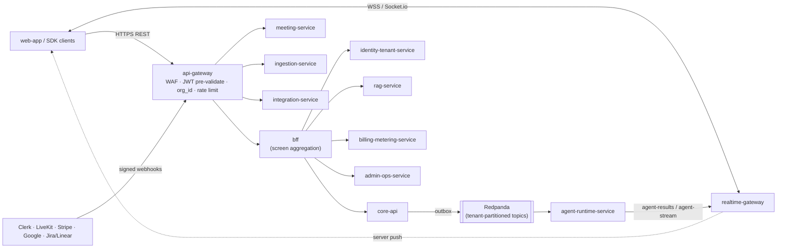
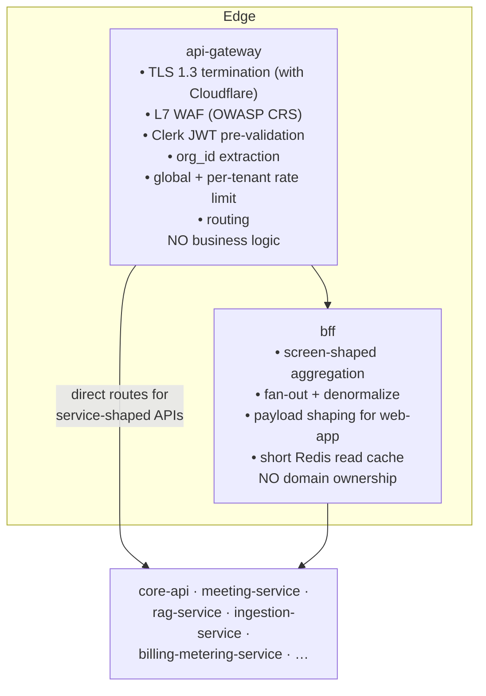
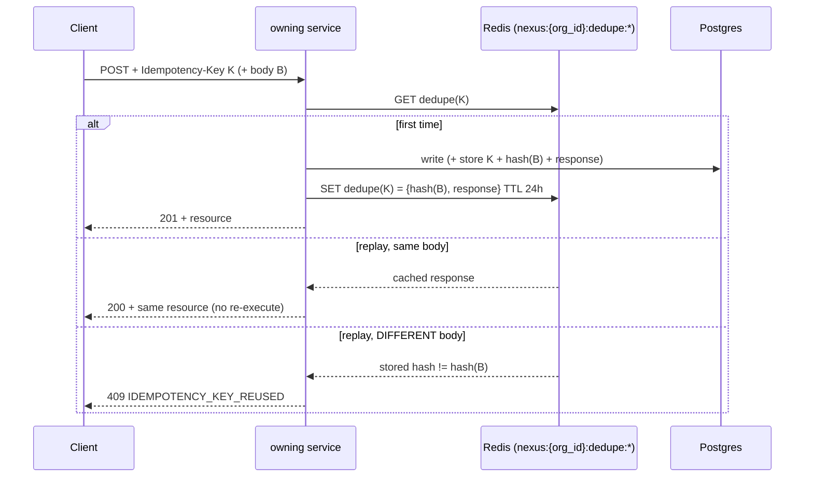
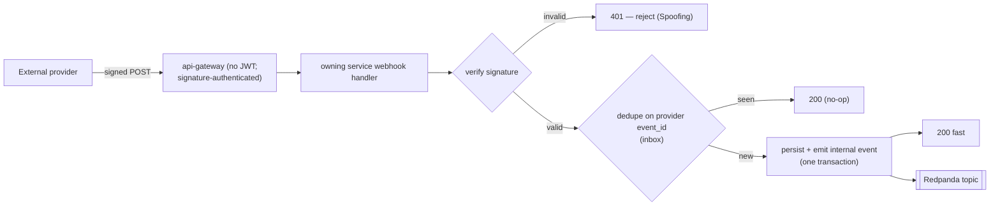
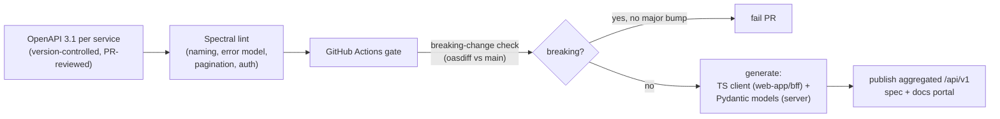

# API Architecture

The contract layer of NEXUS: how every client and service talks over REST, async events, and WebSocket — the gateway/BFF edge, the complete endpoint surface, versioning, pagination, the typed error model, idempotency, rate limiting, webhooks, and OpenAPI governance.

## Related documents

- [Service Catalog (canon)](_canon/01-service-catalog.md) — the frozen service names and the synchronous-API ownership table this document expands.
- [Data Model (canon)](_canon/02-data-model.md) — entity names, columns, tenant keys, Redis key namespaces, idempotency keys.
- [Capacity & Scaling Math (canon)](_canon/05-capacity-math.md) — frozen load/cost/SLO numbers cited by symbol.
- [Tech & Architecture Decisions (canon)](_canon/06-tech-decisions.md) — locked tech choices, topic→Avro table.
- [Service Catalog & Bounded Contexts](04-service-catalog.md) — per-service responsibility, owned data, and degradation modes.
- [Container Architecture](03-container-architecture.md) — the `api-gateway`/`bff`/service container topology.
- [Multi-Tenancy & Isolation](06-multi-tenancy.md) — `org_id` injection, RLS, cell routing.
- [Security Architecture](11-security-architecture.md) — JWT pre-validation, edge WAF, rate-limit tiers, webhook signature verification, secrets.
- [Event-Driven Architecture](07-event-architecture.md) — Redpanda topics, Avro subjects, outbox/inbox, DLQs, idempotency keys.
- [Real-time & Transcription](10-realtime-and-transcription.md) — Socket.io fan-out, token minting, streamed agent tokens.
- [RAG & Inference Serving](09-rag-and-inference-serving.md) — `POST /api/rag/query` pipeline and citation contract.

---

## 1. Purpose and the three API planes

NEXUS exposes exactly **three** communication planes, and the most common architectural mistake on a system like this is to blur them. Each plane has a different contract shape, a different latency budget, and a different failure model.

| Plane | Transport | Use | Contract authority | Latency SLO ([Capacity §11](_canon/05-capacity-math.md)) |
|---|---|---|---|---|
| **Synchronous request/response** | REST over HTTPS (JSON) | Reads, mutations, control-plane operations the client must wait on | OpenAPI 3.1 spec per service | CRUD p95 < 300 ms, p99 < 800 ms; RAG p95 < 500 ms warm; token-mint p95 < 250 ms |
| **Asynchronous events** | Redpanda (Avro + Schema Registry) | Everything that fans out, defers, or crosses a service boundary without a waiting caller | Avro schema per topic, subject `{topic}-value`, BACKWARD compat | Embedding consumer lag < 5 s; agent end-to-end p50 < 2 s / p95 < 4 s |
| **WebSocket / Socket.io** | WSS | Server-push of live captions, presence, agent sidebar output, streamed LLM token deltas | Socket.io event names + Avro payloads (`agent-stream`, `agent-results`) | Live captions < 2 s; streamed agent tokens ride the agent SLO |

The boundary rule is non-negotiable and is enforced in code review:

1. **A synchronous REST call never blocks on an LLM or on cross-service fan-out.** If a request triggers agent work, the REST call commits an intent (a confirmed decision, an ingestion job) and returns immediately with a resource the client can poll or subscribe to; the heavy work happens on the event plane. `POST /api/ingest/document` returns a job, not chunks. `POST /api/decisions/:id/confirm` returns the persisted row and emits a `decisions` event for the graph writer — it does not wait for the AGE edge.
2. **Events are the only legal cross-service write path.** No service writes another service's tables. A service that needs a fact owned elsewhere either calls that service's REST API (synchronous read) or consumes its events (async projection). See the ownership tables in [Service Catalog (canon)](_canon/01-service-catalog.md) §3 and §6.
3. **WebSocket carries no durable truth.** Anything pushed over a socket is also recoverable from REST (finals are persisted, confirmed agent output is in `core-api`). A dropped socket loses nothing.

> [SaaS-scale adjustment] The PDF described one FastAPI application that did REST, hosted Socket.io, and ran agents in-process. At [Capacity](_canon/05-capacity-math.md) scale (A5 = 20,000 concurrent meetings, A6 = 100,000 concurrent participants, L9 ≈ 8,930 LLM calls/sec peak) those three planes scale on three different signals and bill against three different cost centers, so they are separated into distinct tiers ([Tech Decisions §2.1](_canon/06-tech-decisions.md)). The REST contract below is the seam at which they re-converge for the client.



---

## 2. REST design principles

The REST surface is **resource-oriented, predictable, and uniform across services** so a client (or the `bff`) can reason about any endpoint from its shape alone.

### 2.1 Conventions

| Concern | Rule |
|---|---|
| Base path | `https://api.nexus.app/api/v1/...` (versioning, §3). Internal service-to-service calls use the same paths over the mesh, never the public host. |
| Resource naming | Plural nouns, kebab-free (`/meetings`, `/action-items` exposed as `/actions` per canon, `/worklogs`). Sub-resources nest one level: `/meetings/:id/participants`. |
| Methods | `GET` (safe, cacheable), `POST` (create / non-idempotent action), `PATCH` (partial update), `PUT` (full replace, used for profile), `DELETE` (soft-delete → sets `deleted_at`). No verbs in paths except for true actions that are not CRUD (`/meetings/:id/token`, `/decisions/:id/confirm`). |
| Content type | `application/json`; request and response bodies are Pydantic v2 models ([Tech Decisions §2.3](_canon/06-tech-decisions.md)). Errors are `application/problem+json` (§7). |
| Tenant scoping | Every authenticated request carries the Clerk JWT; `api-gateway` extracts `org_id` from the `org` claim and the authz middleware injects it ([Multi-Tenancy §3](06-multi-tenancy.md)). `org_id` is **never** a path or query parameter on tenant-scoped resources — it is always derived from the token, so a client cannot request another tenant's data by guessing an ID. |
| Timestamps | ISO-8601 UTC (`2026-05-29T14:03:00Z`), matching `timestamptz` columns. |
| IDs | UUID v4 strings, matching `id UUID DEFAULT gen_random_uuid()` ([Data Model §1](_canon/02-data-model.md)). |
| Field casing | `snake_case` in JSON, mirroring the column names exactly (`relevance_score`, `created_by_agent`, `source_chunk_ids`) so the wire contract matches the schema with no remapping. |
| Nullability | Explicit. Absent ≠ null; `PATCH` omits fields to leave them unchanged, sends `null` to clear them. |

### 2.2 Statelessness and read/write split

Every CRUD service is horizontally stateless ([Service Catalog (canon)](_canon/01-service-catalog.md) §4): no session affinity, no in-process cache of authoritative data. Session state lives in the Clerk JWT; ephemeral read caching lives in namespaced Redis (`nexus:{org_id}:...`, [Data Model §5](_canon/02-data-model.md)). This is what lets the CRUD tier autoscale on req/s.

Reads that aggregate across services go through the `bff` (§4); writes go to the owning service directly. A write returns the **canonical resource representation** (the row as persisted), never a partial echo of the request, so the client never has to guess server-applied defaults (status, `confidence`, `created_at`).

---

## 3. Versioning

> [SaaS-scale adjustment] The PDF shipped one app for one team and used unversioned `/api/...` paths. A multi-tenant SaaS with thousands of tenants and external integrators cannot break clients on deploy, so the public surface is versioned. The PDF endpoint paths are preserved verbatim under the `v1` prefix — `POST /api/meetings` becomes `POST /api/v1/meetings`; the path *suffix* the PDF specified is unchanged.

| Layer | Versioning strategy |
|---|---|
| **REST (external)** | URI-path major version: `/api/v1/...`. A new major (`/api/v2`) ships only on a breaking change and both run in parallel through a published deprecation window (minimum 6 months for Pro/Enterprise tenants). Non-breaking additions (new optional field, new endpoint) ship within `v1`. |
| **REST (breaking-change rules)** | Removing a field, renaming a field, tightening a type, changing an error shape, or changing default behavior is **breaking** and requires a major bump. Adding an optional request field, adding a response field, adding an enum value a client must already tolerate, or adding an endpoint is **non-breaking**. |
| **Events (Avro)** | Schema evolution is **BACKWARD-compatible**, one subject per topic (`{topic}-value`), enforced by the Schema Registry ([Tech Decisions §2.4](_canon/06-tech-decisions.md), [Event-Driven Architecture](07-event-architecture.md)). New fields are added with defaults; fields are never removed without a major topic, which is itself rare. Consumers upgrade independently of producers — this is the event-plane analogue of REST versioning. |
| **WebSocket** | Socket.io event names are versioned by namespace (`/v1`). Payloads reuse the Avro schemas (`AgentResult`, the `agent-stream` token-delta envelope), so the WebSocket plane inherits Avro BACKWARD compatibility. |
| **Webhooks (inbound)** | Each provider pins its own version (Stripe API version pinned per account; Clerk/Svix payload version; Google Calendar push channel; Jira/Linear webhook schema). NEXUS records the received version and normalizes into internal events. |

The version a request resolved to is echoed in the `X-NEXUS-API-Version` response header for observability and client debugging.

---

## 4. The api-gateway + bff pattern

Two distinct components sit between clients and services. They are **not** the same thing and conflating them is the second-most-common mistake on this architecture.



### 4.1 `api-gateway` — the single ingress

`api-gateway` is the only public entry point ([Service Catalog (canon)](_canon/01-service-catalog.md) §3). It is **stateless, config-only, and holds no business logic and no tenant data**. Its responsibilities are exactly: TLS termination (with Cloudflare at the edge), L7 WAF, Clerk JWT pre-validation against cached JWKS, `org_id` extraction from the `org` claim, global and per-tenant rate limiting, and routing to `bff` or to a service. Malformed, expired, and over-limit requests are shed here as `401`/`429` before any worker is consumed. The full edge security treatment — WAF ruleset, JWKS rotation, DDoS posture, rate-limit tiers — lives in [Security Architecture §5–§6](11-security-architecture.md); this document treats it as a given and focuses on the contract.

> [SaaS-scale adjustment] The gateway role (WAF + edge JWT pre-validation + tenant-aware rate limiting) is a SaaS-add over the PDF's "Cloudflare CDN" line ([Tech Decisions §2.11](_canon/06-tech-decisions.md)). The service tier still re-verifies the JWT — the gateway's pre-validation is a DDoS shield and an optimization, not a trust delegation.

### 4.2 `bff` — backend-for-frontend

`bff` exists so the `web-app` makes **one** call per screen instead of six. It aggregates and denormalizes reads, fans out to services, shapes payloads, and applies a short Redis read cache. It owns **no domain data** and is the only caller of `/bff/*` ([Service Catalog (canon)](_canon/01-service-catalog.md) §6). Example: the meeting-room screen needs the meeting, its participants, the user's worklog, open suggestions, and presence — `bff` issues those reads in parallel and returns one composite payload.

The split rule:

- **Client-facing, screen-shaped reads** → `bff` (`GET /bff/meeting-room/:id`, `GET /bff/dashboard`).
- **Resource-shaped reads/writes** (a client mutating a single resource, or any service-to-service call) → the owning service directly through `api-gateway` (`PATCH /api/v1/worklogs/:id`).
- **Webhooks and OAuth callbacks** → routed by `api-gateway` straight to the owning service, never through `bff` (they are not screen reads).

> [SaaS-scale adjustment] The PDF had no BFF — the Next.js app called the monolith directly. With the CRUD heart split into `core-api`, `identity-tenant-service`, `billing-metering-service`, etc., a thin BFF prevents the client from N+1-calling the service mesh and keeps screen latency inside the CRUD p95 < 300 ms budget ([Capacity §11.1](_canon/05-capacity-math.md)).

---

## 5. The full endpoint surface

This is the complete synchronous REST surface, organized by owning service per the canon ownership table ([Service Catalog (canon)](_canon/01-service-catalog.md) §6). **PDF-original endpoints are reproduced verbatim** (with the `/api/v1` version prefix from §3); SaaS-added endpoints are marked.

> Path note: the canon §6 ownership table lists path *suffixes* (`/meetings`, `/ingest`, `/billing/*`). The PDF wrote several with an `/api/...` prefix. The public surface unifies all of them as `/api/v1/{suffix}`; the canon suffix and the PDF prefix refer to the **same endpoint** — no rename, just the version prefix. The PDF endpoints carried verbatim here are: `POST /api/meetings`, `GET /api/meetings` (list), `POST /api/meetings/:id/token`, `GET /api/users/me`, `GET /api/orgs/:id`, `GET/PUT /api/users/:id/profile`, `GET /api/orgs/:id/teams`, `POST /api/teams`, `/api/worklogs`, `POST /api/rag/query`, and `POST /api/ingest/document` — each appears below as `/api/v1/{same suffix}`. Internal-only endpoints (`/embed`, `/rerank`, `/graph/cypher`, `/agents/spawn`) are not exposed through `api-gateway` and are omitted from the public surface.

> Prefix-ownership note: canon §6 assigns each path prefix to exactly one service. `/orgs` is owned by `identity-tenant-service`, but the PDF's `GET /api/orgs/:id/teams` is a teams read — it is served by `core-api` (the teams owner) and surfaced to screens via `bff` aggregation, so the read crosses no ownership boundary even though the path nests under `/orgs`.

### 5.1 Identity, users, orgs, teams — `identity-tenant-service` and `core-api`

| Method & path | Owner | Origin | Description |
|---|---|---|---|
| `GET /api/v1/users/me` | identity-tenant-service | **PDF (verbatim)** | Current user resolved from the JWT: `id`, `org_id`, `role`, `skills[]`, `bio`, `avatar_url`. The `UserProfile` also carries the working profile (`listen_for[]`, `ignore_topics[]`) and the agent persona (`agent_name`, `agent_avatar_seed`, `agent_personality`, `agent_instructions`) ([ADR-0038](adr/0038-agent-personas-profiles-agendas-and-meeting-agent.md) D3). |
| `GET /api/v1/users` | identity-tenant-service | **SaaS-add** | The org member list (`MemberList`); each item carries `agent_name` and `agent_avatar_seed` so a meeting room can label everyone's agent ([ADR-0038](adr/0038-agent-personas-profiles-agendas-and-meeting-agent.md) D3). |
| `PATCH /api/v1/users/:id` | identity-tenant-service | **SaaS-add** | Partial profile update: `role`, `skills[]`, `bio`, `listen_for[]`, `ignore_topics[]` (self, or admin and above) and `agent_name`, `agent_avatar_seed`, `agent_personality`, `agent_instructions` (**self only**, 403 otherwise). An empty string for `agent_name` / `agent_instructions` / `agent_avatar_seed` stores NULL; a validation failure is 422 naming the field. Any change evicts `nexus:{org_id}:user_ctx:{user_id}` ([ADR-0038](adr/0038-agent-personas-profiles-agendas-and-meeting-agent.md) D1 to D3). |
| `GET /api/v1/users/:id/profile` | identity-tenant-service | **PDF (verbatim)** | A user's profile within the caller's org (RLS-scoped). |
| `PUT /api/v1/users/:id/profile` | identity-tenant-service | **PDF (verbatim)** | Replace own profile (`role`, `skills[]`, `bio`, `avatar_url`); self or org-admin only. Invalidates `nexus:{org_id}:user_ctx:{user_id}` ([Data Model §5](_canon/02-data-model.md)). |
| `GET /api/v1/orgs/:id` | identity-tenant-service | **PDF (verbatim)** | Organization (tenant root): `name`, `slug`, `plan_id`. Must match the caller's `org_id`. |
| `GET /api/v1/orgs/:id/teams` | core-api | **PDF (verbatim)** | Teams in the org, with `department_id`. |
| `POST /api/v1/teams` | core-api | **PDF (verbatim)** | Create a team under a department. |
| `GET/PATCH /api/v1/teams/:id` | core-api | PDF→SaaS | Read/update a team. |
| `GET/POST /api/v1/departments` | core-api | PDF→SaaS | Org-hierarchy departments (`parent_id` self-reference). |
| `GET /api/v1/context/:user_id` | identity-tenant-service | PDF→SaaS | `get_user_context(user_id)` source-of-record (role/skills/team/recent meetings/topics), Redis-cached 5 min. Internal-leaning; used by the agent tier. Name carried verbatim. |
| `GET/POST /api/v1/orgs` | identity-tenant-service | **SaaS-add** | Tenant provisioning/listing (§5.6). |
| `/rbac/*`, `/scim/v2/*` | identity-tenant-service | **SaaS-add** | Org RBAC and SCIM 2.0 provisioning (see [Security §2.2, §3](11-security-architecture.md)). |

### 5.2 Meetings — `core-api` and `meeting-service`

| Method & path | Owner | Origin | Description |
|---|---|---|---|
| `POST /api/v1/meetings` | core-api | **PDF (verbatim)** | Create a meeting. Body: `title`, `scheduled_start`, `scheduled_end`, `participant_ids[]`, and (SaaS-add, [ADR-0038](adr/0038-agent-personas-profiles-agendas-and-meeting-agent.md) D5, D6) optional `host_user_id` (default the creator; must be the creator or a participant), `previous_meeting_id` (a visible meeting of the same tenant, not itself) and `agenda: [{title, owner_user_id?, duration_minutes?}]` (at most 20; owners must be participants); a rule failure is 422 naming the field. Returns the row incl. `status`, `created_by`, `host_user_id`, `previous_meeting_id`. Idempotent via `Idempotency-Key` (§8). |
| `GET /api/v1/meetings` | core-api | **PDF (verbatim, LIST)** | List the caller's meetings; cursor-paginated (§6), filterable by `status`, `from`, `to`. |
| `GET /api/v1/meetings/:id` | core-api | **PDF (verbatim)** | A single meeting with participants, plus `host_user_id`, `previous_meeting_id`, `previous_meeting: {id, title, scheduled_start} \| null` and `agenda: AgendaItem[]` ordered by `position` ([ADR-0038](adr/0038-agent-personas-profiles-agendas-and-meeting-agent.md) D6). |
| `PATCH /api/v1/meetings/:id` | core-api | PDF→SaaS | Update title/schedule/status; emits `meeting-events`. Also accepts `host_user_id` (must be a participant) and `previous_meeting_id` (create rules); only the current host or the creator may change either, 403 otherwise ([ADR-0038](adr/0038-agent-personas-profiles-agendas-and-meeting-agent.md) D6). |
| `PUT /api/v1/meetings/:id/agenda` | core-api | **SaaS-add** | Replace the agenda: `{items: [{id?, title, owner_user_id?, duration_minutes?}]}`. Host or creator; 409 after the meeting has ended. Items sent with an existing `id` keep their status, new ones start `pending`, items left out are deleted. Returns `AgendaItem[]` ([ADR-0038](adr/0038-agent-personas-profiles-agendas-and-meeting-agent.md) D6). |
| `PATCH /api/v1/meetings/:id/agenda/:item_id` | core-api | **SaaS-add** | `{status}` from the host or creator; sets `status_source = 'host'`, which the `MeetingAgent` never overrides. Returns `AgendaItem` ([ADR-0038](adr/0038-agent-personas-profiles-agendas-and-meeting-agent.md) D6). |
| `GET /api/v1/meetings/:id/carry-forward` | core-api | **SaaS-add** | What the previous meeting left open, for a caller who can see this meeting: `{previous_meeting \| null, decisions: [{id, content}], open_actions: [{id, title, owner_user_id, due_date}], saved_questions: [{id, question}]}`: its confirmed decisions, its action items not done, and the caller's own `saved` suggestions. Empty lists when there is no link ([ADR-0038](adr/0038-agent-personas-profiles-agendas-and-meeting-agent.md) D6). |
| `POST /api/v1/meetings/:id/token` | meeting-service | **PDF (verbatim)** | Mint a short-lived, participant-verified LiveKit room token (p95 < 250 ms). Returns `{ token, room, livekit_url }`. See [Real-time §2.3](10-realtime-and-transcription.md). |
| `GET /api/v1/meetings/:id/transcript` | core-api | **PDF (verbatim)** | Post-meeting transcript view over `transcript_chunks` (finals only), with in-page FTS via `search-service`. Ownership note: `transcription-service` owns `transcript_chunks` **writes** (finals only), while `core-api` serves this **read** endpoint via `search-service` FTS — the whole `/meetings` prefix is `core-api`'s per canon §6, so the §3 Sync API cell that lists this endpoint under `transcription-service` with the qualifier "(read via core-api FTS)" is reconciled, not contradicted. |
| `GET /api/v1/meetings/:id/chat` / `POST .../chat` | core-api | PDF→SaaS | In-meeting chat persistence (`chat_messages`); live delivery is over Socket.io ([Real-time §3](10-realtime-and-transcription.md)). |

`AgendaItem` = `{id, position, title, owner_user_id, duration_minutes, status, status_source, agent_note, updated_at}`, with `status` in `pending`, `in_progress`, `covered`, `skipped` and `status_source` in `agent`, `host` (rows of `meeting_agenda_items`, [Data Model (canon)](_canon/02-data-model.md)).

> [SaaS-scale adjustment] Explicit hosts, the follow-up link, agendas and carry-forward are net-new relative to the PDF, whose meetings had no agenda and only an implicit host. Every new field is optional, so existing clients are unaffected ([ADR-0038](adr/0038-agent-personas-profiles-agendas-and-meeting-agent.md)).

### 5.3 Agent outputs — worklogs, decisions, actions, suggestions — `core-api`

| Method & path | Owner | Origin | Description |
|---|---|---|---|
| `GET /api/v1/worklogs` | core-api | **PDF (verbatim)** | The caller's worklogs (PersonalListenerAgent output), filterable by `meeting_id`; includes `content`, `relevance_score`, `created_by_agent`, `source_chunk_ids`. |
| `POST /api/v1/worklogs` | core-api | **PDF (verbatim)** | Create a manual worklog entry (`created_by_agent = false`). |
| `PATCH /api/v1/worklogs/:id` | core-api | PDF→SaaS | Edit a worklog entry. |
| `GET /api/v1/decisions` | core-api | PDF→SaaS | Decisions for a meeting/org; `content`, `rationale`, `confidence`, `status`, `confirmed_by`. |
| `POST /api/v1/decisions/:id/confirm` | core-api | PDF→SaaS | Confirm a surfaced decision (no silent commits). Persists `status=confirmed`, emits the `decisions` event → `knowledge-graph-service` creates the `Decision`→`Meeting` `PRODUCED` edge ([Data Model §4.2](_canon/02-data-model.md)). |
| `GET /api/v1/actions` | core-api | PDF→SaaS | Action items (`assignee_id`, `due_date`, `confidence`, `status`); drives "My Tasks". |
| `POST /api/v1/actions/:id/confirm` | core-api | PDF→SaaS | Confirm an action; emits `actions` event → `Action`→`Person` `ASSIGNED_TO` edge, and (if integration installed) pushes to Jira/Linear via `integration-service`. |
| `GET /api/v1/suggestions` / `PATCH .../:id` | core-api | PDF→SaaS | QuestionAgent suggestions (`question`, `priority` 1–3, `status` Ask/Dismiss/Save-for-later); Save-for-later persists into the next meeting. |
| `GET /api/v1/collaborations` | core-api | PDF→SaaS | ContextGapAgent agent-to-agent collaboration logs (`agent_collaborations`: `requester`, `responder`, `query`, `result`, `success`, `latency`), filterable by `meeting_id`; backs the context-fill provenance and the R5/R6 latency dashboards. Read-only; canon §6 does not mandate a public path, surfaced here for read-model completeness alongside the other `core-api` agent read models. |

### 5.4 RAG and ingestion — `rag-service` and `ingestion-service`

| Method & path | Owner | Origin | Description |
|---|---|---|---|
| `POST /api/v1/rag/query` | rag-service | **PDF (verbatim)** | RAGService pipeline (expand → retrieve → rerank → assemble → cite). Body: `{ query, meeting_id? }`. Returns `passages[]` each with the frozen citation contract (`meeting_id`+`chunk_id`+`speaker` for transcripts, `document_id`+`element_id` for documents). Warm p95 < 500 ms; Redis-cached `(user_id, query_hash)` 10 min. See [RAG §1](09-rag-and-inference-serving.md). |
| `POST /api/v1/ingest/document` | ingestion-service | **PDF (verbatim)** | Submit a document (multipart file or `{ url }`) for unstructured.io ingestion. Returns a job: `{ job_id, status: "queued" }`. **Async** — chunks land via the `document-chunks` topic; the call never blocks on embedding. |
| `GET /api/v1/ingest/jobs/:id` | ingestion-service | **PDF (verbatim, suffix)** | Ingestion job status (`queued`/`processing`/`done`/`failed`), element/chunk counts. |
| `GET /api/v1/search` | search-service | PDF→SaaS | Keyword/FTS over `transcript_chunks` and `chat_messages` (the lexical arm; the public in-page transcript search surface). |

### 5.5 Billing, usage, plans — `billing-metering-service`

> [SaaS-scale adjustment] The entire billing/usage/plans surface is wholly added vs the PDF, which had no tenants, billing, or quotas ([Tech Decisions §2.12](_canon/06-tech-decisions.md), [Data Model §2.2](_canon/02-data-model.md)).

| Method & path | Owner | Origin | Description |
|---|---|---|---|
| `GET /api/v1/billing/subscription` | billing-metering-service | **SaaS-add** | The tenant's active `subscriptions` row: `plan_id`, `seats`, `status`, `current_period_*`, `trial_ends_at`. |
| `POST /api/v1/billing/subscription` | billing-metering-service | **SaaS-add** | Create/change subscription (plan, seat count). Drives Stripe; idempotent via `Idempotency-Key`. |
| `POST /api/v1/billing/checkout-session` | billing-metering-service | **SaaS-add** | Stripe Checkout session for self-serve upgrade. |
| `GET /api/v1/billing/invoices` | billing-metering-service | **SaaS-add** | Invoices (`status`, `amount_due_cents`, `tax_cents`, `pdf_url`); 7-year retention. |
| `GET /api/v1/plans` | billing-metering-service | **SaaS-add** | Plan catalog (Free/Pro/Enterprise): `seat_price_cents`, `included_meeting_minutes`, `included_agent_tokens`, `features`. Global, non-tenant. |
| `GET /api/v1/usage` | billing-metering-service | **SaaS-add** | Aggregated usage for the current period (meeting minutes, agent tokens, transcription seconds, storage GB) plus quota/budget state from `agent_budgets` (`ok`/`throttled`/`blocked`). |

### 5.6 Admin and tenant provisioning — `admin-ops-service` and `identity-tenant-service`

> [SaaS-scale adjustment] Tenant lifecycle and the two admin consoles (tenant admin, internal ops) are wholly added vs the PDF.

| Method & path | Owner | Origin | Description |
|---|---|---|---|
| `POST /api/v1/orgs` (provision) | identity-tenant-service | **SaaS-add** | Provision a new tenant org (self-serve onboarding). Emits `tenant-events` (provisioned). Idempotent. |
| `GET/POST /api/v1/admin/tenant/*` | admin-ops-service | **SaaS-add** | Tenant-admin console: members, plan, integrations, data export/erasure requests. Org-scoped, RBAC-gated, fully audited (`audit_logs`). |
| `GET/POST /api/v1/admin/ops/*` | admin-ops-service | **SaaS-add** | Internal ops console: cross-tenant support, feature flags, tenant suspend/migrate, consumer-lag & cost dashboards, audit-log access. Strict authz + full audit; cross-tenant by design and therefore the most tightly guarded surface. |
| `POST /api/v1/integrations/oauth/:provider` (callback `/oauth/:provider`) | integration-service | PDF→SaaS | OAuth install for Google Calendar / Slack / Jira / Linear (guardrail R8: Calendar + Slack + one of Jira/Linear). |

### 5.7 Notifications — `notification-service`

The in-app notification center: the durable read/dismiss companion to the realtime push plane. Live delivery of agent-sidebar alerts (conflict banners, workload warnings, stakeholder/dependency cards, urgent-vs-note priority) rides `realtime-gateway` over Socket.io (§1 plane 3) — that plane carries **no durable truth**. The persisted `notification_log` is read here, so a client that missed a socket push (reconnect, fresh page load, mobile background) recovers the full alert history and can mark items read. These are the two endpoints canon assigns to `notification-service` ([Service Catalog (canon)](_canon/01-service-catalog.md) §3, §6).

| Method & path | Owner | Origin | Description |
|---|---|---|---|
| `GET /api/v1/notifications` | notification-service | **SaaS-add** (sidebar alert/dismiss UX is PDF Phase 11) | List the caller's in-app notifications/alerts from `notification_log`; cursor-paginated (§6), filterable by `status` (read/unread). The durable read side of the agent-sidebar alert stream whose live push rides `realtime-gateway`. |
| `PATCH /api/v1/notifications/:id` | notification-service | **SaaS-add** (sidebar alert/dismiss UX is PDF Phase 11) | Mark a notification read / dismiss it (`status` update), persisting the dismissal so it does not re-surface on the next reconnect. |

> [SaaS-scale adjustment] The PDF delivered agent-sidebar alerts (Phase 11: conflict banner, workload warning, stakeholder/dependency cards, the per-user priority queue where urgent alerts pre-empt notes) in-process over Socket.io with no durable, queryable notification store. SaaS factors delivery into a unified `notification-service` fabric ([Service Catalog (canon)](_canon/01-service-catalog.md) §3) that owns `notification_log` and exposes this read/dismiss REST surface. The agent-sidebar alert/dismiss **UX** is PDF-original; the **service**, its persisted log, and these endpoints are the SaaS addition — reinforcing the §1 rule that WebSocket carries no durable truth (everything pushed over a socket is also recoverable from REST).

### 5.8 What is deliberately NOT in the public surface

These canon endpoints are **internal-only** and never routed by `api-gateway` from the public host — they are mesh-internal ([Service Catalog (canon)](_canon/01-service-catalog.md) §6): `POST /embed`, `POST /rerank` (inference tier), `POST /agents/spawn` and `/agents/:id/terminate` (`agent-runtime-service`), `POST /graph/query/{template}` and `/graph/cypher` (`knowledge-graph-service`), the Temporal task queues / admin `/workflows/*` (`workflow-service`), and the caller-token route `GET /internal/meetings/{id}/agenda` on `core-api` (caller `agent-runtime-service`; the agenda, host, follow-up link and the previous meeting's open decisions and actions as plain strings for the `MeetingAgent`, [ADR-0038](adr/0038-agent-personas-profiles-agendas-and-meeting-agent.md) D6). Exposing a raw Cypher endpoint to clients would be a tenant-isolation hole; it is reachable only by `rag-service`/`agent-runtime-service` within the org-partitioned graph contract.

---

## 6. Pagination

All list endpoints use **cursor (keyset) pagination**, not offset. At T3 = 1.73B `transcript_chunks`/month and millions of meetings ([Capacity §4](_canon/05-capacity-math.md)), `OFFSET` scans degrade linearly and skip/duplicate rows under concurrent writes; keyset pagination on an indexed key is O(log n) and stable.

> [SaaS-scale adjustment] The PDF, sized for the `2 orgs x 10 users x 5 meetings` seeder, had no pagination concern. At SaaS row counts, offset pagination on `transcript_chunks` (indexed on `(meeting_id, start_ms)`, [Data Model §2.1](_canon/02-data-model.md)) or `meetings` (range-partitioned by `scheduled_start`) is a footgun; keyset is mandated.

### 6.1 Request and response shape

```http
GET /api/v1/meetings?limit=50&cursor=eyJzIjoiMjAyNi0wNS0yOVQxNDowMzowMFoiLCJpZCI6IjkxYzgifQ
```

```jsonc
{
  "data": [ /* ...up to `limit` resources... */ ],
  "page": {
    "limit": 50,
    "next_cursor": "eyJzIjoiMjAyNi0wNS0yOFQwOTowMDowMFoiLCJpZCI6ImEwMmYifQ",
    "has_more": true
  }
}
```

| Rule | Detail |
|---|---|
| `cursor` | Opaque base64 of the keyset tuple (e.g. `{sort_key, id}`). Clients treat it as opaque and never construct it. |
| `limit` | Default 50, max 200. The gateway rejects `limit > 200` with `422`. |
| Ordering | Deterministic and stable, always including the PK as a tiebreaker (e.g. `ORDER BY scheduled_start DESC, id DESC`) so the cursor never straddles equal sort keys. |
| `has_more` | True iff a row exists beyond the page; `next_cursor` is null when `has_more` is false. |
| Total counts | **Not returned by default.** An exact `COUNT(*)` over a partitioned billion-row table is prohibitively expensive; an approximate count is available via a separate `?include=count_estimate` flag where a screen genuinely needs it. |

Cursor pagination is the same on the event-projection read models (`decisions`, `actions`, worklogs) because they sit on the same large Postgres tables under RLS.

---

## 7. The typed error model

> The PDF specified a **typed error model** as a Phase-1 deliverable. This is its concrete, frozen form.

Errors are **RFC 7807 `application/problem+json`**, extended with a stable machine-readable `code`, a `trace_id`, and (for validation) per-field detail. Every error a client can receive is one of a closed enum of `code`s — clients branch on `code`, never on the human-readable `title` or on the HTTP status alone.

### 7.1 Envelope

```jsonc
// Content-Type: application/problem+json
{
  "type": "https://errors.nexus.app/quota-exceeded",   // stable URI per code
  "title": "Agent token quota exceeded",                // human-readable, may change
  "status": 429,                                         // HTTP status (mirrors header)
  "code": "QUOTA_EXCEEDED",                              // STABLE machine enum — branch on this
  "detail": "Tenant monthly agent-token hard cap reached.",
  "trace_id": "01H*/* W3C trace id */",                 // correlates to structured JSON logs + Sentry
  "errors": [                                            // present only for 422 validation
    { "field": "scheduled_end", "code": "BEFORE_START",
      "message": "scheduled_end must be after scheduled_start" }
  ]
}
```

### 7.2 Status codes and the `code` enum

| HTTP | When | Representative `code` values |
|---|---|---|
| `400 Bad Request` | Malformed JSON, bad cursor | `MALFORMED_BODY`, `INVALID_CURSOR` |
| `401 Unauthorized` | Missing/expired/invalid JWT (shed at `api-gateway`) | `AUTH_REQUIRED`, `TOKEN_EXPIRED` |
| `403 Forbidden` | Authenticated but not authorized (RBAC / agent-to-agent deny / wrong tenant) | `FORBIDDEN_ROLE`, `CROSS_TENANT_DENIED` |
| `404 Not Found` | Resource absent **or** in another tenant (we do not leak existence) | `NOT_FOUND` |
| `409 Conflict` | Idempotency-key replay with a different body; concurrent edit | `IDEMPOTENCY_KEY_REUSED`, `VERSION_CONFLICT` |
| `422 Unprocessable Entity` | Validation failed (Pydantic v2); populates `errors[]` | `VALIDATION_FAILED` |
| `429 Too Many Requests` | Rate limit (gateway) or per-tenant token budget hard cap | `RATE_LIMITED`, `QUOTA_EXCEEDED` |
| `500 Internal Server Error` | Unhandled — never leaks internals; `trace_id` is the handle | `INTERNAL` |
| `503 Service Unavailable` | Dependency degraded / shed-load; carries `Retry-After` | `DEPENDENCY_UNAVAILABLE` |

> [SaaS-scale adjustment] `403 CROSS_TENANT_DENIED`, `429 QUOTA_EXCEEDED`, and the `404`-for-cross-tenant rule are SaaS-adds tied to multi-tenancy and per-tenant token budgets ([Tech Decisions §2.2, §2.5](_canon/06-tech-decisions.md)). A cross-tenant access attempt returns `404`, not `403`, so the API never confirms that a resource in another tenant exists — existence itself is tenant-confidential.

Rules: `429` always carries `Retry-After`; `4xx` is never retried by clients without changing the request; `503`/`429` are safe to retry with backoff and the **same** `Idempotency-Key` (§8). The `trace_id` is a W3C trace context id propagated to structured JSON logs ([Tech Decisions §2.14](_canon/06-tech-decisions.md)) and Sentry, so support can pivot from a client-reported error to the exact request.

---

## 8. Idempotency keys for mutations

Every **non-idempotent mutation** (`POST` that creates a resource or triggers an external side effect — create meeting, create subscription, confirm decision/action, submit ingestion, provision tenant) accepts a client-supplied `Idempotency-Key` header. This is the synchronous-plane twin of the event plane's at-least-once + idempotency-key dedupe ([Event-Driven Architecture](07-event-architecture.md), [Data Model §7.2](_canon/02-data-model.md)).

```http
POST /api/v1/meetings
Idempotency-Key: 5f1c0d2e-7a44-4d3a-9b6e-2c8f9a1b4e07
Content-Type: application/json
```

### 8.1 Semantics



| Rule | Detail |
|---|---|
| Scope | Keyed per `(org_id, endpoint, idempotency_key)` in `nexus:{org_id}:dedupe:{topic}:{consumer_group}:{idempotency_key}` ([Data Model §5](_canon/02-data-model.md)) plus a unique constraint on the owning table as the durable backstop. |
| Window | 24h Redis TTL; a uniqueness constraint persists beyond that for the durable record. |
| Replay, same body | Returns the **original** response and status; the write runs **once**. |
| Replay, different body | `409 IDEMPOTENCY_KEY_REUSED` — the key is bound to its first payload. |
| Required vs optional | Optional for the client to send, but **strongly recommended** for all create/charge operations; billing mutations that move money treat a missing key as a `400` to force safe retries. |
| Side effects | The dedupe wraps both the DB write and the outbox event in one transaction, so a retried `POST /api/v1/decisions/:id/confirm` produces the `decisions` event exactly once — the graph edge is never double-created. |

> [SaaS-scale adjustment] The PDF had no idempotency contract. At E12 ≈ 17,900 events/sec peak and millions of mutations, retries are routine (client timeouts, gateway 503s, mobile reconnects); without idempotency keys a retried "confirm action" double-pushes a Jira ticket and a retried checkout double-charges. This contract is locked alongside the event-plane idempotency ([Tech Decisions §2.4](_canon/06-tech-decisions.md)).

---

## 9. Rate limiting

Rate limiting is enforced at `api-gateway` (global + per-tenant) and on the LLM path (per-user); the policy, tiers, and DDoS posture are owned by [Security Architecture §6](11-security-architecture.md). This section specifies only the **client-facing contract**.

| Limit tier | Key | Surface | Response |
|---|---|---|---|
| Global edge | — | All ingress | `429 RATE_LIMITED` at the gateway before any service. |
| Per-tenant | `org_id` | Plan-tier req/s + concurrent-connection caps (Free < Pro < Enterprise) | `429 RATE_LIMITED`; a Free tenant cannot exhaust shared capacity. |
| Per-user LLM | `user_id` | Sliding window via `nexus:{org_id}:ratelimit:{user_id}` ([Data Model §5](_canon/02-data-model.md)) | LiteLLM per-user rate limit; pairs with per-tenant token budgets. |
| Per-tenant token budget | `org_id` + period | Agent/RAG LLM consumption against `agent_budgets` | `429 QUOTA_EXCEEDED` at hard cap; `state` visible via `GET /api/v1/usage`. |

Contract for clients: every rate-limited or quota response carries `Retry-After` (seconds) and the standard `RateLimit-Limit` / `RateLimit-Remaining` / `RateLimit-Reset` headers so a well-behaved client can self-throttle before being shed.

> [SaaS-scale adjustment] Per-tenant rate limits and per-tenant token-budget `429`s are SaaS-adds; the PDF had only LiteLLM per-user rate limits ([Tech Decisions §2.5, §2.11](_canon/06-tech-decisions.md)). The per-tenant tier is what isolates a noisy tenant's burst from every other tenant's latency.

---

## 10. Webhooks

NEXUS both **receives** webhooks (from Clerk, LiveKit, Stripe, Google Calendar, Jira/Linear) and **sends** them (status sync back to PM tools). Every inbound webhook follows the same three-step discipline: **verify signature → dedupe → normalize into an internal event**. The webhook handler does the minimum synchronously (verify + persist to inbox/outbox) and returns `2xx` fast; the real work happens on the event plane. A slow webhook handler is how you get a provider to disable your endpoint.



| Provider | Endpoint (owner) | Origin | Signature / auth | Events → internal effect |
|---|---|---|---|---|
| **Clerk** | `POST /clerk/webhook` (identity-tenant-service) | **PDF (verbatim)** | Svix HMAC signature ([Security §4](11-security-architecture.md)) | `user.created/updated/deleted` → `user-sync-events` inbox → `users` mirror; backed by hourly reconciliation. |
| **LiveKit** | `POST /livekit/webhook` (meeting-service) | **PDF (verbatim)** | LiveKit webhook signature (HMAC over body) | `room.created`, `participant.joined`, `recording.ready` → `meeting-room-events`; `recording.ready` → recording ref into `mytheus-recordings`. |
| **Stripe** | `POST /stripe/webhook` (billing-metering-service) | **SaaS-add** | Stripe-Signature (HMAC, pinned API version) | `invoice.*`, `customer.subscription.*`, `checkout.session.completed` → update `subscriptions`/`invoices`, drive dunning via `billing-events` → `workflow-service`. |
| **Google Calendar** | `POST /webhooks/google_calendar` (integration-service) | PDF→SaaS | Channel token + `X-Goog-*` validation | Push notification → pull changed events → auto-create meetings, match participants by email, route attachments to `ingestion-service` (`integration-events`). |
| **Jira / Linear** | `POST /webhooks/jira` / `/webhooks/linear` (integration-service) | **PDF (verbatim, suffix `/webhooks/{provider}`)** | Provider HMAC / shared secret | External ticket status change → `integration-events` → update the linked `action_items.status` (bidirectional sync). |

> [SaaS-scale adjustment] The Stripe webhook and the entire billing event flow are SaaS-adds. The Clerk, LiveKit, Calendar, and Jira/Linear webhooks are PDF-original; the **outbox + inbox + reconciliation** hardening around the Clerk path ([Security §4](11-security-architecture.md)) is the SaaS addition over the PDF's "plain webhook user-sync." Idempotency on inbound webhooks reuses the same dedupe substrate as §8, keyed on the provider's `event_id`.

Outbound: NEXUS → Jira/Linear ticket creation/update is **not** a fire-and-forget webhook; it is a durable, retried call from `integration-service` driven by the `actions` topic and (for follow-ups) the `ActionFollowUpWorkflow` (reminders day 1/3/7, manager escalation via Slack DM at day 10).

---

## 11. OpenAPI governance

The REST contract is **code-first**. Every service publishes an **OpenAPI 3.1** document, emitted from its FastAPI app and committed; the code is the source of truth and the document conforms to it by construction.

> [SaaS-scale adjustment] **Reversed by [ADR-0022](adr/0022-openapi-emitted-from-code.md).** This section previously specified spec-first, with FastAPI's generated schema "reconciled against it in CI, not the other way around". That reconciliation was never built, and in the eight months it was policy the hand-written specs drifted (`bff.yaml` still described a `Dashboard` shape `dashboard.py` had stopped returning), `spectral lint` was never run, `oasdiff` was never wired, and the spec set disagreed with the code about which services existed. Spec-first's correctness rests entirely on the reconciliation step, and that step is the part nobody builds: comparing a hand-written document to a generated one needs a differ that understands OpenAPI equivalence, and every such differ needs a suppression list, which is where real drift hides. Emitting needs no differ - regenerate and compare bytes. **The governance below is unchanged in full**; only the direction of authority is reversed, because Spectral and `oasdiff` lint a document regardless of who wrote it.



| Control | Mechanism |
|---|---|
| Single source | OpenAPI 3.1 YAML per service, **emitted from the app** and committed in the service repo. CI regenerates and fails the build on any difference, so a route change without a regeneration is a red build rather than a document that quietly stops being true. Services are discovered, not listed ([ADR-0022](adr/0022-openapi-emitted-from-code.md) D1). |
| Linting | Spectral ruleset enforces the conventions in this doc: `snake_case` fields, RFC 7807 errors with a `code` enum (§7), cursor pagination shape (§6), `Idempotency-Key` on mutating `POST`s (§8), `org_id`-never-in-path, security scheme present. A spec that violates a rule fails the PR. |
| Breaking-change gate | `oasdiff` compares the PR spec to `main`; a breaking change ([§3](#3-versioning) definition) without a major-version bump fails CI. This is the automated enforcement of the versioning policy. |
| Code generation | The TypeScript client for `web-app`/`bff` is **generated** from the emitted spec, so wire drift between client and server is structurally impossible. Not yet built: both clients still hold a hand-written types file, which was the correct call while the specs were hand-written and drifting, and is what emitting them unblocks. The Pydantic v2 models are the source rather than an output - they are what the document is emitted from. |
| Aggregation | `api-gateway` publishes no document of its own. It proxies, so its routes live in `edge.ROUTE_MAP` rather than its own decorators, and emitting it yields a zero-path document. A merged `/api/v1` spec and a docs portal remain the intent and are unbuilt; clients generate per service and point at the gateway origin ([ADR-0022](adr/0022-openapi-emitted-from-code.md) D6). |
| Authz-in-every-PR | Per the locked shift-left posture ([Tech Decisions §2.11](_canon/06-tech-decisions.md), [Security §3](11-security-architecture.md)), each endpoint's security requirement (Clerk JWT + RBAC scope, or signature-authenticated for webhooks) is declared in the spec and reviewed in every PR — an endpoint with no declared auth fails review. |

> [SaaS-scale adjustment] The PDF listed an "OpenAPI draft" as a Phase-1 artifact for a single app. At SaaS scale with ~20 services, external integrators, and a versioned public contract, OpenAPI becomes a **governed, linted, breaking-change-gated, client-generating** pipeline rather than a one-time draft. The spec-first discipline and the breaking-change gate are the additions; the choice of OpenAPI is the PDF's.

---

## 12. Summary

| Plane | Authority | Key contracts |
|---|---|---|
| REST | OpenAPI 3.1 per service, `/api/v1` | Resource-oriented, cursor-paginated, RFC 7807 typed errors with a stable `code` enum, `Idempotency-Key` on mutations |
| Events | Avro + Schema Registry, BACKWARD | One subject per topic `{topic}-value`; at-least-once + idempotency; see [Event-Driven Architecture](07-event-architecture.md) |
| WebSocket | Socket.io `/v1` + Avro payloads | `realtime-gateway` server push; carries no durable truth; see [Real-time](10-realtime-and-transcription.md) |

Every PDF endpoint is preserved verbatim under the `/api/v1` prefix; the SaaS additions (billing, usage, admin, tenant provisioning, the Stripe webhook) sit alongside them under the same gateway, the same typed error model, the same idempotency and pagination rules, and the same OpenAPI governance. The `api-gateway` is the one ingress; the `bff` is the one screen-aggregation layer; everything tenant-scoped derives `org_id` from the token and never from the path.
