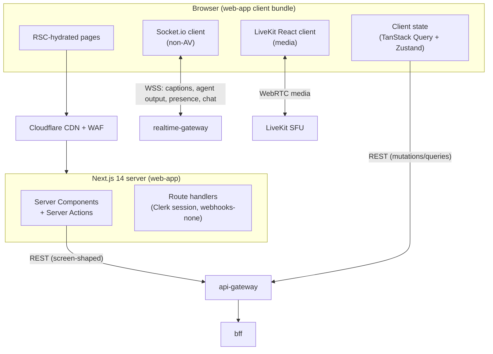
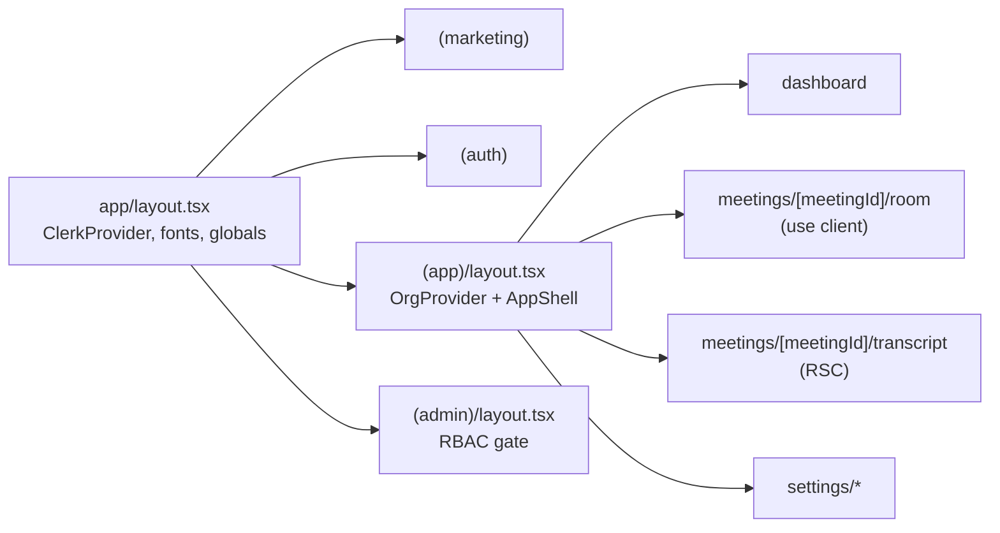
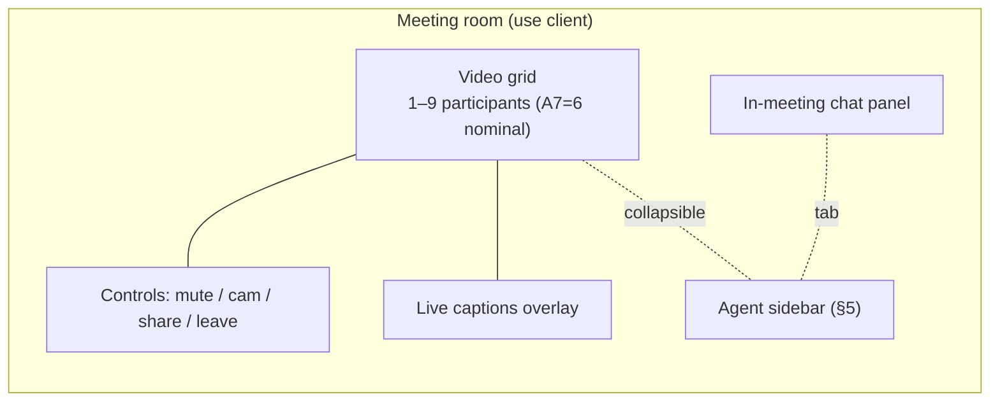
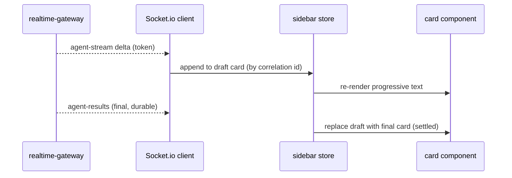
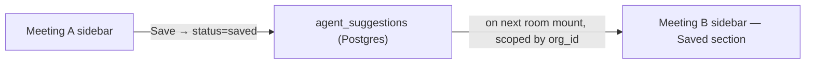
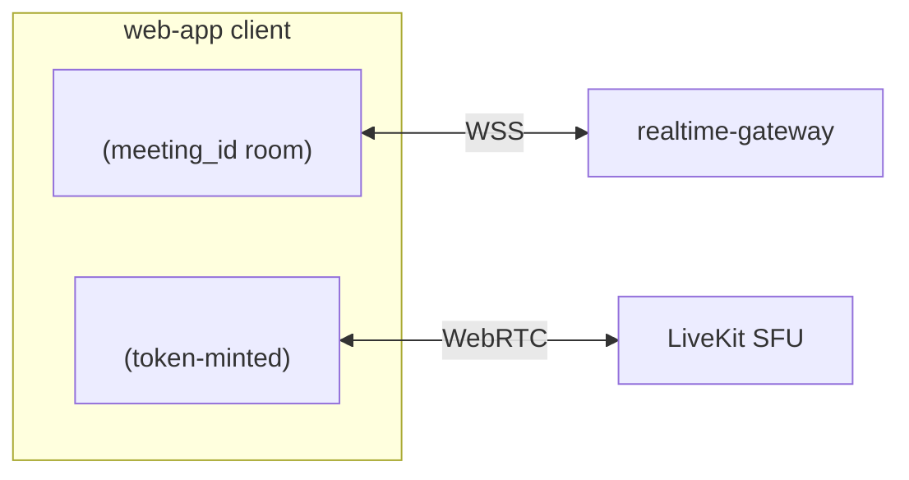
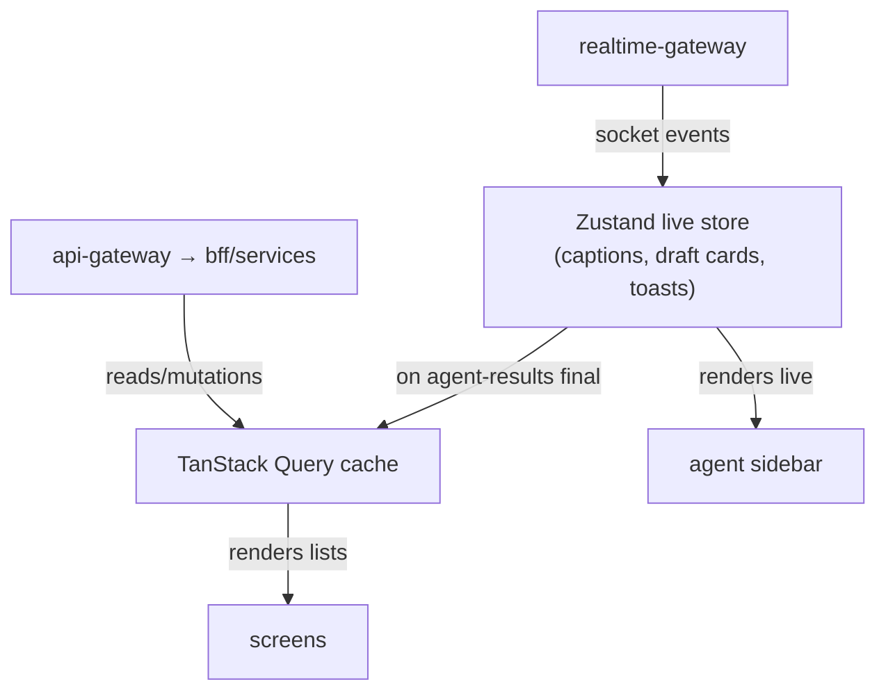
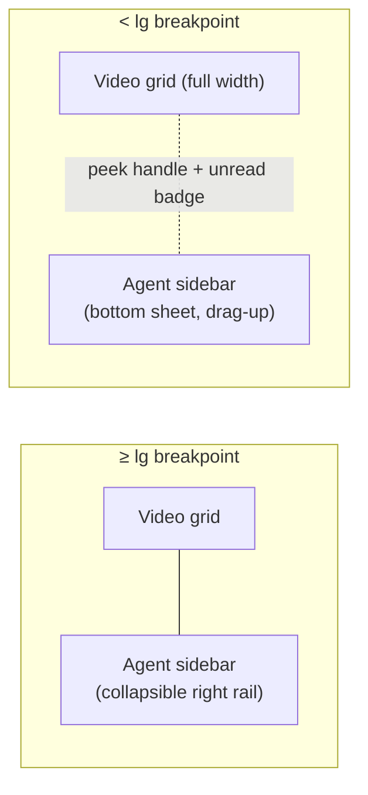

# Frontend Architecture

The frozen, production-grade specification of the NEXUS `web-app` — its Next.js 14 App Router topology, the Tailwind + shadcn/ui design system, the agent sidebar (the hardest UI surface in the product), the Socket.io + LiveKit React real-time client, state management, the screen inventory, and the performance and mobile-responsive budgets.

## Related documents

- [Service Catalog (canon)](_canon/01-service-catalog.md) — naming authority for `web-app`, `bff`, `api-gateway`, `realtime-gateway`, and the sync-API prefix ownership the client calls.
- [Canonical Data Model](_canon/02-data-model.md) — entity names the UI renders (`worklogs`, `decisions`, `action_items`, `agent_suggestions`, `agent_collaborations`, `chat_messages`), Redis namespaces, and the citation contract.
- [Capacity & Scaling Math](_canon/05-capacity-math.md) — frozen anchors (`A6` = 100k peak participants, `A7` = 6 roster) and the §11 latency SLOs imported by reference.
- [Locked Tech & Architecture Decisions](_canon/06-tech-decisions.md) — §2.8 (frontend, incl. the Socket.io real-time client and the LiveKit meeting client), §2.7 (server-side real-time transport/transcription), §2.6 (agents, confidence thresholds), §2.9 (RAG/citations).
- [Container Architecture](03-container-architecture.md) — the C4 L2 view: `web-app` ↔ Cloudflare → `api-gateway` → `bff`, and the `web-app` ↔ `realtime-gateway` WebSocket leg.
- [Real-time & Transcription](10-realtime-and-transcription.md) — authority for the **server-side** fan-out plane (`realtime-gateway`, `agent-stream`, `agent-results`, captions); this document owns the **client** consumption of it.
- [AI Agent Architecture](08-ai-agent-architecture.md) — the seven agents whose outputs the sidebar and agenda panel surface, confidence thresholds, and `get_user_context`.
- [RAG & Inference Serving](09-rag-and-inference-serving.md) — `POST /api/rag/query` contract and citation payload the context panel renders.
- [Security Architecture](11-security-architecture.md) — Clerk auth, JWT, `org_id` injection at the edge that the client trusts.
- [Multi-Tenancy & Isolation](06-multi-tenancy.md) — namespaced Redis, tenant-scoped data the UI never has to filter itself.

> [SaaS-scale adjustment] The PDF described the frontend as a single Next.js 14 app talking to one FastAPI backend with Clerk middleware inline. This document keeps every PDF frontend decision verbatim (Next.js 14 App Router, TypeScript, Tailwind, shadcn/ui, Socket.io client, the meeting-SDK React client, the agent sidebar spec, the Button/Input/Modal/Card/EmptyState/Avatar/Badge component set) and adds only what multi-tenant SaaS scale forces: the client now talks to a `bff` through `api-gateway`/Cloudflare rather than a monolith, the meeting-SDK client is pinned to **LiveKit** ([Tech Decisions §2.7](_canon/06-tech-decisions.md)), and the WebSocket leg connects to the independently-scaled `realtime-gateway` rather than to the API process.

---

## 1. Scope and boundaries

This document owns the **`web-app` container** ([Container Architecture §4](03-container-architecture.md)): everything that runs in the browser or in the Next.js server (RSC, route handlers, server actions). It specifies *how* the client renders NEXUS, *how* it consumes the live and CRUD planes, and *how* the agent sidebar is built. It does not:

- Rename any entity, topic, or service — those are frozen in [Data Model](_canon/02-data-model.md), [Event-Driven Architecture](07-event-architecture.md), and [Service Catalog](_canon/01-service-catalog.md).
- Define the server-side fan-out (`realtime-gateway`, `agent-stream`, Redis pub/sub backbone) — that is [Real-time & Transcription](10-realtime-and-transcription.md). This document consumes those contracts as a client.
- Define the BFF's screen-shaped endpoints' internal fan-out — that is the `bff` row in [Service Catalog §3](_canon/01-service-catalog.md). This document specifies which `/bff/*` and direct service endpoints each screen calls.

The clean split: **the server decides what is true; the client decides how it appears.** Every durable fact (a confirmed decision, a persisted worklog, a final caption) arrives over a server contract; the client owns rendering, optimistic UI, animation discipline, and offline/reconnect resilience.



---

## 2. Next.js 14 App Router architecture

### 2.1 Rendering strategy

NEXUS is a **React Server Components-first** app. The default is a server component; a component opts into the client only when it needs interactivity, browser APIs, or a live subscription. This keeps the client bundle small (the dashboard ships first paint with almost no client JS) and pushes data fetching to the server where the Clerk session and `org_id` are already resolved.

| Rendering mode | Used for | Why |
| --- | --- | --- |
| **RSC (default, server)** | Dashboard cards, transcript view, decision history, My Tasks, org chart, admin/tenant consoles, integration settings, billing pages | Data lives behind the `bff`/services; render on the server with the user's JWT, stream HTML, ship zero client JS for the static parts. |
| **`"use client"`** | Meeting room, agent sidebar, in-meeting chat, live captions, RAG context panel, any form with optimistic state | Needs Socket.io/LiveKit subscriptions, local interaction state, and animation. |
| **Server Actions** | Confirm/edit/dismiss a decision, assign/complete an action, dismiss/ask/save a suggestion, save integration settings, profile edits | Mutations that should run on the server with the session, revalidate the affected RSC cache tag, and degrade gracefully without client JS. |
| **Route handlers (`app/api/*`)** | Clerk session helpers, LiveKit token proxy passthrough to `meeting-service`, health checks | Thin server endpoints; no business logic (that lives in services). |

> [SaaS-scale adjustment] Server Actions are used for write paths that the PDF would have wired as ad-hoc `fetch` calls from client components. Each action calls the canonical service endpoint through the `bff`/`api-gateway` (never a service directly), then calls `revalidateTag()` so the RSC read model refreshes. This keeps the `org_id`-injection chokepoint ([Tech Decisions §2.2](_canon/06-tech-decisions.md)) on the only path the browser can write through, and it means a no-JS or slow-JS client can still confirm a decision via a progressively-enhanced form.

### 2.2 Route groups and directory layout

The App Router tree uses **route groups** to separate auth state, layout shells, and tenancy context without leaking path segments into the URL.

```
app/
  (marketing)/                 # unauthenticated: landing, pricing, self-serve signup
    page.tsx
    pricing/page.tsx
  (auth)/                      # Clerk sign-in / sign-up / SSO callback
    sign-in/[[...rest]]/page.tsx
    sign-up/[[...rest]]/page.tsx
  (app)/                       # authenticated app shell; org context resolved in layout
    layout.tsx                 # <OrgProvider> + <AppShell> (sidebar nav, top bar)
    dashboard/page.tsx
    meetings/
      page.tsx                 # meeting list
      [meetingId]/
        room/page.tsx          # "use client" meeting room + agent sidebar
        transcript/page.tsx    # RSC transcript view (FTS search)
        page.tsx               # meeting detail (pre/post)
    decisions/page.tsx         # decision history + lineage
    tasks/page.tsx             # My Tasks (action_items assigned to me)
    org/page.tsx               # org chart (departments/teams)
    search/page.tsx            # RAG + FTS search
    settings/
      profile/page.tsx
      integrations/page.tsx    # Calendar / Slack / Jira|Linear
      billing/page.tsx         # plan, seats, usage, invoices
  (admin)/                     # RBAC-gated consoles
    tenant/page.tsx            # tenant admin console
    ops/page.tsx               # internal ops console (feature-flagged)
  api/                         # route handlers only
    livekit-token/route.ts     # proxies POST /api/meetings/:id/token
    health/route.ts
components/                    # design system + feature components (§4, §5)
lib/                           # api clients, hooks, socket/livekit providers, query keys
```

The `(app)/layout.tsx` is the single place the org/tenant context is established for authenticated screens: it reads the Clerk session, resolves the active `org_id`, and renders the persistent nav shell. Children inherit a typed `OrgContext` so no screen re-derives tenancy.



### 2.3 Data fetching contract

- **RSC reads** fetch from the `bff` screen-shaped endpoints (`/bff/*`, owned only by `bff` per [Service Catalog §6](_canon/01-service-catalog.md)) or directly from a read endpoint the catalog assigns to `core-api`/`rag-service`/`search-service`. They run server-side with the forwarded JWT; the `api-gateway` injects `org_id`.
- **Client mutations** go through Server Actions or typed client calls, both terminating at `api-gateway`. The client never holds a service URL other than the gateway origin and the `realtime-gateway` WSS origin.
- **Caching:** RSC fetches use Next.js `fetch` cache tags keyed by resource (`meeting:{id}`, `tasks:{userId}`); Server Actions `revalidateTag` after a write. There is no client-side duplication of the `bff` read-through Redis cache — the client trusts the server's freshness.

> [SaaS-scale adjustment] The client knows exactly two origins: the `api-gateway` HTTPS origin and the `realtime-gateway` WSS origin. The PDF's monolith exposed everything from one host; here the gateway is the only place the browser authenticates, and the `bff` fan-out to 8+ services ([Container Architecture §6](03-container-architecture.md)) is invisible to the client. This is what lets the service mesh evolve (modular monolith → services, [Service Catalog §7](_canon/01-service-catalog.md)) without a single frontend change.

---

## 3. Design system

### 3.1 Foundations: Tailwind + shadcn/ui + tokens

The design system is **Tailwind CSS** for utility styling, **shadcn/ui** for accessible component primitives (copy-in, not a dependency black box), and a **design-token layer** (PDF Phase 1) expressed as CSS custom properties that Tailwind consumes. Tokens are the single source of visual truth so dark mode, density, and per-tenant theming flip by swapping a token set, never by touching component code.

```css
/* app/globals.css — token layer (CSS custom properties), consumed by tailwind.config */
:root {
  /* color — semantic, not raw hex, so themes remap centrally */
  --background: 0 0% 100%;
  --foreground: 222 47% 11%;
  --muted: 210 40% 96%;
  --primary: 222 47% 31%;
  --card: 0 0% 100%;
  --border: 214 32% 91%;
  /* agent priority strip — frozen mapping (§5.3) */
  --priority-high: 0 72% 51%;     /* red  — priority 1 */
  --priority-medium: 38 92% 50%;  /* yellow — priority 2 */
  --priority-low: 217 91% 60%;    /* blue — priority 3 */
  --conflict: 0 72% 51%;          /* red conflict banner */
  --radius: 0.5rem;
  /* spacing scale, type scale, elevation handled by tailwind theme extend */
}
.dark { --background: 222 47% 8%; --foreground: 210 40% 98%; /* … */ }
```

```ts
// tailwind.config.ts — tokens → utilities
export default {
  darkMode: ["class"],
  theme: {
    extend: {
      colors: {
        background: "hsl(var(--background))",
        foreground: "hsl(var(--foreground))",
        primary: "hsl(var(--primary))",
        card: "hsl(var(--card))",
        border: "hsl(var(--border))",
        priority: {
          high: "hsl(var(--priority-high))",
          medium: "hsl(var(--priority-medium))",
          low: "hsl(var(--priority-low))",
        },
        conflict: "hsl(var(--conflict))",
      },
      borderRadius: { lg: "var(--radius)", md: "calc(var(--radius) - 2px)" },
    },
  },
} satisfies import("tailwindcss").Config;
```

> [SaaS-scale adjustment] Per-tenant theming (an Enterprise-tier feature) is a token-set swap loaded from `tenant_settings` ([Data Model §2.2](_canon/02-data-model.md)) at the `(app)/layout.tsx` boundary, applied as inline `style` custom properties on the shell. Components never hard-code color; they read tokens. The PDF had a single global theme.

### 3.3 Localization and accessibility

- **Localization.** The app's locale is resolved from `tenant_settings.default_locale` ([Data Model §2.2](_canon/02-data-model.md)) at the `(app)/layout.tsx` boundary (the same boundary that resolves theming and `org_id`), so every screen renders in the tenant's default locale without per-screen wiring; user-level overrides layer on top. Strings are externalized rather than inlined so the meeting room, sidebar, and consoles are translatable without component changes.
- **Accessibility.** shadcn/ui primitives ship accessible-by-default (focus-trapped `Modal`, labeled `Input`, ARIA-correct `Badge`/`Avatar`), and `prefers-reduced-motion` is honored throughout (§5.4). Accessibility is verified as part of the Playwright E2E suite ([Tech Decisions §2.14](_canon/06-tech-decisions.md)) — keyboard-only navigation of the meeting room and sidebar, focus order, and contrast of the red/yellow/blue priority strip against both light and dark token sets — not left to manual spot-checks.

> [SaaS-scale adjustment] `tenant_settings.default_locale`-driven localization is a SaaS-scale addition; the PDF's single-app model assumed one locale. Wiring accessibility checks into the existing Playwright suite (rather than a separate Phase-13 audit) follows the shift-left posture ([Tech Decisions §2.11](_canon/06-tech-decisions.md)).

### 3.2 Component library (PDF-specified primitives)

The PDF froze a primitives set; these are wrapped shadcn/ui components with NEXUS tokens and consistent prop contracts. All are server-renderable except where interactivity demands `"use client"`.

| Component | Built on | Notable variants / props | Used by |
| --- | --- | --- | --- |
| `Button` | shadcn `Button` | `variant: primary \| secondary \| ghost \| destructive`, `size`, `loading` | everywhere |
| `Input` | shadcn `Input` + `Label` | `error`, `hint`, controlled/uncontrolled | forms, search |
| `Modal` | shadcn `Dialog` | `size`, focus-trap, ESC/overlay-dismiss | confirm dialogs, edit decision |
| `Card` | shadcn `Card` | `interactive`, `priorityStrip?: 1\|2\|3` | dashboard, sidebar cards |
| `EmptyState` | composed | `icon`, `title`, `description`, `action` | empty lists, no-results, first-run |
| `Avatar` | shadcn `Avatar` | falls back to initials; reads `users.avatar_url` | speaker labels, participants, nav |
| `Badge` | shadcn `Badge` | `tone: neutral \| success \| warning \| danger \| info` | statuses (decision/action `status`), plan tier |

These primitives are the only visual vocabulary; feature components (§5) compose them and never introduce ad-hoc styling. `Card` carries the optional `priorityStrip` because the priority strip recurs across suggestion, decision, and alert cards (§5.3) and must render identically everywhere.

---

## 4. The meeting room

The meeting room (`(app)/meetings/[meetingId]/room`) is the most demanding client screen: a LiveKit video grid, controls, screen share, in-meeting chat, live captions, and the agent sidebar — all live, all at once.

### 4.1 Layout



- **Video grid** renders 1–9 participant tiles (PDF), driven by LiveKit React hooks. Nominal roster is `A7` = 6 ([Capacity §2](_canon/05-capacity-math.md)); effective on-screen is the `A8` = 5.0 occupancy, so the grid is sized for 6 with graceful overflow to 9.
- **Pre-join device check** is a separate step (camera/mic test) before the room mounts, mirroring the LiveKit join flow.
- **Live captions** render within the **< 2 s** caption SLO ([Capacity §11](_canon/05-capacity-math.md)); they are interim-then-final (interims are mutable and never persisted — that distinction is enforced server-side by `transcription-service`, [Real-time §3](10-realtime-and-transcription.md)).
- The **agent sidebar** is collapsible and, on mobile, becomes a bottom sheet (§6.3).

### 4.2 Token minting and join

The client mints a LiveKit room token via the Next.js route handler `app/api/livekit-token/route.ts`, which proxies `POST /api/meetings/:id/token` (owned by `meeting-service`, [Service Catalog §6](_canon/01-service-catalog.md)). The route handler never holds LiveKit credentials — those are server-side in `meeting-service`. On reconnect, the client re-mints ([Real-time §4](10-realtime-and-transcription.md)).


### 4.3 Agent personas, the live agenda and nudges

Additions from [ADR-0038](adr/0038-agent-personas-profiles-agendas-and-meeting-agent.md) D9, D11, layered on the room without changing the frozen sidebar order (§5.1):

- **Your agent heads your sidebar.** The sidebar header shows your agent's doodle face (`users.agent_avatar_seed`, or one derived from your user id when NULL) and name (`users.agent_name`, or "{first name}'s agent" when NULL). Each participant tile carries a small badge of that participant's agent face, read from the `GET /api/v1/users` member list (`agent_name`, `agent_avatar_seed`). The persona is a label: it never changes which cards appear.
- **Shared live agenda panel.** When the meeting has an agenda, every participant sees it with item statuses (`pending`, `in_progress`, `covered`, `skipped`) and the `MeetingAgent`'s notes. Live changes arrive as the `agent-agenda` Socket.io event (`{meetingId, payload: {itemId, status, note}}`), which `realtime-gateway` sends to every socket on the meeting channel; on join or reconnect the panel re-hydrates from `GET /api/v1/meetings/{id}`. The host (or creator) can mark an item covered or skipped (`PATCH /api/v1/meetings/{id}/agenda/{item_id}`); a host-set status always wins over the agent.
- **Nudges reach the host only.** `agent-nudge` (`{meetingId, payload: {id, type, itemId, content}}`, `type` in `off_agenda`, `over_time`, `unaddressed`) is delivered only to the host's sockets and is not replayed after a reconnect.

> [SaaS-scale adjustment] Agent personas, the shared agenda panel and host nudges are net-new relative to the PDF, whose room had per-participant agent output only and no meeting agenda.

---

## 5. The agent sidebar (the hardest UI problem)

The agent sidebar is where NEXUS's per-participant intelligence becomes visible. It is a single collapsible panel in the meeting room with a fixed section order, a frozen priority-color language, streaming token updates, strict animation discipline, and a Save-for-later queue that survives across meetings.

### 5.1 Section anatomy (frozen order)

```mermaid
flowchart TB
  subgraph SB["Agent sidebar (collapsible)"]
    NOTES["1 · My Notes<br/>(live worklog, PersonalListenerAgent)"]
    SUGG["2 · Suggestion cards<br/>(QuestionAgent — red/yellow/blue strip, Ask/Dismiss/Save)"]
    DEC["3 · Decision detected card<br/>(DecisionAgent — Confirm / Edit / Dismiss)"]
    TASK["4 · New task toast<br/>(ActionAgent)"]
    CTX["5 · Context-fill card<br/>(ContextGapAgent — 'Context added from X agent')"]
    CONF["6 · Conflict banner (red)<br/>(ProactiveAgent)"]
    WL["7 · Workload warning toast<br/>(ProactiveAgent — 80% / 95%)"]
    STK["8 · Stakeholder suggestion card<br/>(ProactiveAgent — missing-stakeholder)"]
    DEP["9 · Dependency warning<br/>(ProactiveAgent / ActionAgent deps)"]
    SFL["Save-for-later queue (persists into next meeting)"]
  end
  NOTES --> SUGG --> DEC --> TASK --> CTX --> CONF --> WL --> STK --> DEP --> SFL
```



Each section maps to a specific agent and a specific data entity. The sidebar **renders** these; it never decides them — confidence gating (>0.7 surface) happens in `agent-runtime-service` ([Tech Decisions §2.6](_canon/06-tech-decisions.md)), so anything that reaches the sidebar is already above threshold.

| Section | Source agent | Backing entity / topic | Actions | Confidence note |
| --- | --- | --- | --- | --- |
| My Notes | `PersonalListenerAgent` | `worklogs` (via `agent-results`) | read-only stream, pin | only relevance ≥ threshold reaches UI |
| Suggestion card | `QuestionAgent` | `agent_suggestions` (`priority` 1–3, `status` Ask/Dismiss/Save-for-later) | **Ask / Dismiss / Save** | surfaced only > 0.7 |
| Decision detected | `DecisionAgent` | `decisions` (`status`, `confirmed_by`) | **Confirm / Edit / Dismiss** | **no silent commit**; confirm creates the AGE `PRODUCED` edge |
| New task toast | `ActionAgent` | `action_items` (`assignee_id`, `due_date`) | Confirm / Edit assignee+date / Dismiss | confirm creates AGE `ASSIGNED_TO` edge |
| Context-fill card | `ContextGapAgent` | `agent_collaborations` | open source meeting | renders "Context added from X agent" + source-meeting link |
| Conflict banner | `ProactiveAgent` | `decisions`; conflict detected by `ProactiveAgent` via AGE graph query over decision lineage (`FOLLOWS_FROM`) | view conflicting decision / dismiss | red; highest priority |
| Workload warning | `ProactiveAgent` | `action_items` sum per assignee | view tasks / dismiss | fires at 80% / 95% capacity |
| Stakeholder suggestion | `ProactiveAgent` | org-graph traversal | add stakeholder / dismiss | — |
| Dependency warning | `ProactiveAgent` | `action_items` dependencies | view blocking item / dismiss | — |

> The decision/action **confirmation** rule is load-bearing and carried verbatim from the PDF: the agent never silently writes. The card surfaces; the user clicks **Confirm**; only then does `core-api` emit on the `decisions`/`actions` topic and `knowledge-graph-service` creates the edge in `nexus_knowledge` ([Data Model §4](_canon/02-data-model.md), [Service Catalog §5](_canon/01-service-catalog.md)). The UI must make this irreversible-on-confirm clear; Edit opens a `Modal` pre-filled with the extracted `content`/`rationale`/`assignee`/`due_date`.

### 5.2 Streaming token updates

The sidebar renders LLM output **as it streams**, so a suggestion or detected decision materializes progressively rather than popping in fully formed. The client subscribes to two server channels over the Socket.io connection to `realtime-gateway`:

- `agent-stream` token deltas — disposable, progressive text (the `AgentStreamDelta` envelope, owned by [Event-Driven Architecture §4](07-event-architecture.md)).
- `agent-results` final messages — the durable card (the `AgentResult` schema).



Client rules that mirror the server-side contract ([Real-time §5](10-realtime-and-transcription.md)):

1. **Deltas are throwaway.** If the client misses every delta, the final `agent-results` message still renders the complete card. The UI must never treat a missing delta as data loss.
2. **Correlation-keyed drafts.** Deltas carry a correlation id; the client accumulates them into a draft card keyed by that id and swaps to the final on `agent-results`.
3. **Backpressure-aware.** Under a slow connection, `realtime-gateway` drops `agent-stream` deltas first; the client simply receives the final card slightly later with no progressive animation. Captions and confirmed outputs are never dropped.

### 5.3 The priority color language (frozen)

The red/yellow/blue strip is one mapping reused across every prioritized card so users learn it once.

| Priority | `agent_suggestions.priority` | Token | Meaning |
| --- | --- | --- | --- |
| High | `1` | `--priority-high` (red) | act now / urgent |
| Medium | `2` | `--priority-medium` (yellow) | worth attention |
| Low | `3` | `--priority-low` (blue) | informational |

The **red conflict banner** uses `--conflict` (same red as priority 1) and always renders above all other cards regardless of arrival order — it is the one section that pre-empts. The per-user priority queue (`nexus:{org_id}:queue:agent:{user_id}`, [Data Model §5](_canon/02-data-model.md)) is enforced server-side; the client renders the order it receives but additionally pins the conflict banner to the top.

### 5.4 Animation discipline

The PDF's directive is explicit: **calm, not flashy.** This is a behavioral contract, not a suggestion.

- New cards **fade + slide in** over ~150 ms; they never bounce, flash, or shake.
- Streaming text appends without layout thrash (reserved min-height per card so the panel does not jump as tokens arrive).
- At most **one** attention-grabbing motion at a time — the conflict banner's single subtle pulse on first appearance, then still.
- Toasts (new task, workload warning) auto-dismiss after a fixed dwell unless interacted with; they queue rather than stack chaotically.
- Respect `prefers-reduced-motion`: all entrance animations degrade to an instant, opacity-only transition.

> [SaaS-scale adjustment] Animation discipline is enforced with a small set of shared Framer Motion variants (`cardEnter`, `bannerPulseOnce`, `toastDwell`) so no feature component can invent its own motion. The PDF stated the principle; freezing it as reusable variants is what makes "calm" survive contact with many contributors.

### 5.5 Save-for-later queue (cross-meeting persistence)

The Save action on a suggestion sets `agent_suggestions.status = 'saved'` (the PDF's Save-for-later, stored as the lowercase code of [ADR-0032](adr/0032-plan-8-decision-and-action-candidates.md) D7). Because that status is durable in Postgres ([Data Model §2.1](_canon/02-data-model.md)), the queue is **not** client-local — it is re-hydrated when the user opens their **next** meeting room. On mount, the sidebar fetches saved suggestions for the user (scoped to `org_id` by the gateway) and renders them in a dedicated "Saved" sub-section, so a question parked in Monday's standup reappears in Wednesday's planning. Suggestions are private: only their owner reads or acts on them, and they reach only that user's sockets ([ADR-0034](adr/0034-plan-9-question-agent-suggestions.md) D6, D8).



### 5.6 Collapse / expand

The sidebar is collapsible to a thin rail showing only unread counts and the conflict indicator. Collapse state persists per user (localStorage + server preference) so it survives reloads. On collapse, live subscriptions stay open (the user still gets the conflict banner), but only badge counts update — full cards render on expand.

---

## 6. Real-time client, state, and performance

### 6.1 The two live transports

The browser holds exactly two long-lived connections, matching the two server planes:

| Transport | Library | Carries | Server endpoint |
| --- | --- | --- | --- |
| Non-AV real-time | **Socket.io client** (PDF) | live captions, agent sidebar output, streamed `agent-stream` tokens, presence, in-meeting chat | `realtime-gateway` (WSS via `api-gateway`) |
| Media | **LiveKit React client** (PDF meeting-SDK client, [Tech Decisions §2.8](_canon/06-tech-decisions.md)) | audio/video tracks, screen share, room events | LiveKit SFU |



Both providers wrap the meeting-room subtree. The Socket.io client joins the `meeting_id` room; the LiveKit client connects with the minted token. **Reconnect** is automatic on both: Socket.io uses exponential backoff and re-joins the room; on reconnect the client re-hydrates caption/agent history from `core-api` (finals are durable) so a dropped socket loses no transcript or confirmed output ([Real-time §4](10-realtime-and-transcription.md)).

> [SaaS-scale adjustment] The PDF ran Socket.io against the same FastAPI process that served the API. Here the Socket.io client connects to the independently-scaled `realtime-gateway`, which scales on `A6` = 100,000 concurrent WebSocket connections ([Capacity §2](_canon/05-capacity-math.md)) while the CRUD plane scales on req/s. The client is agnostic to the split — it just opens a WSS to the gateway origin — which is the point of the decoupling.

### 6.2 State management

A layered model keeps server truth and client UI state cleanly separated:

| Layer | Tool | Owns | Notes |
| --- | --- | --- | --- |
| Server cache | **RSC fetch cache** (Next.js) | server-rendered reads | tag-based revalidation on Server Action writes |
| Async client cache | **TanStack Query** | client reads/mutations of CRUD data | query keys mirror resources (`["tasks", userId]`, `["meeting", id]`); optimistic updates with rollback |
| Ephemeral UI state | **Zustand** | sidebar collapse, draft streaming cards, toast queue, device-check state | not persisted to server except where noted (collapse pref) |
| Live event state | **Socket.io subscriptions → Zustand** | captions, agent cards, presence | events reduce into the sidebar store; durable facts are reconciled against TanStack Query |
| Auth/session | **Clerk** | user/session, active `org_id` | source of identity; never stored in app state |

The reconciliation rule: a streamed `agent-results` card writes into both the Zustand live store (for immediate render) and is reconciled against the TanStack Query cache for the relevant list (e.g. a confirmed decision invalidates `["decisions", meetingId]`). The client never invents data that the server has not produced; optimistic UI (e.g. marking an action complete) always carries a rollback path keyed on the server's response.



### 6.3 Performance and mobile

Performance budgets, anchored to the SLOs other docs import:

| Surface | Budget | Source / technique |
| --- | --- | --- |
| Dashboard first contentful paint | < 1.5 s on a mid-tier device | RSC streaming, minimal client JS, CDN-cached assets |
| Route JS payload (non-meeting screens) | < 100 KB gzipped | RSC default, dynamic-import client islands |
| Live caption render | within the **< 2 s** caption SLO | [Capacity §11](_canon/05-capacity-math.md); captions arrive over Socket.io, render without layout shift |
| Streamed agent token render | p95 < 4 s speech→sidebar (interactive class) | [Capacity §11](_canon/05-capacity-math.md); progressive append |
| Video grid | 60 fps with 6–9 tiles | LiveKit adaptive simulcast; pause off-screen tiles |

Concrete techniques: route-level code splitting (the heavy LiveKit + Socket.io bundle loads only on the meeting room, not the dashboard); `next/image` for avatars and assets through Cloudflare; React `Suspense` boundaries so a slow `bff` aggregate streams in progressively rather than blocking the shell; virtualized lists for the transcript view (a meeting yields up to `T2` = 360 finals, [Capacity §4](_canon/05-capacity-math.md)) and for long decision/task lists.

**Mobile responsive — the bottom-sheet sidebar.** On viewports below the `lg` breakpoint the agent sidebar is not a side rail; it is a **bottom sheet** that the user drags up over the video grid.



- Collapsed, the bottom sheet shows a peek handle with unread counts and the conflict indicator; a red conflict banner auto-expands the sheet a notch so the user cannot miss it.
- The same priority language, streaming, and Save-for-later behavior apply; only the container changes. The frozen section order (§5.1) is preserved in the sheet's scroll.
- Live captions move to a compact overlay; controls collapse into an overflow menu. The whole app is usable one-handed on a phone, which matters because participants join meetings from mobile.

> [SaaS-scale adjustment] The bottom-sheet sidebar is the mobile-responsive expression of the PDF's desktop sidebar spec; the PDF named "mobile responsive" as a Phase 13 hardening item. Specifying it as a first-class container variant (not a separate codebase) keeps the agent UX identical across form factors and avoids a second implementation of the hardest screen.

---

## 7. Core screens inventory

Every screen, its route, render mode, primary data source, and the agents/entities it surfaces. Sources are cited to their canonical owner; the client always reaches them through `api-gateway` → `bff`/service.

| Screen | Route | Mode | Primary source(s) | Surfaces |
| --- | --- | --- | --- | --- |
| Dashboard | `/dashboard` | RSC | `bff` aggregate | upcoming meetings, open `action_items`, recent `worklogs` |
| Meeting list | `/meetings` | RSC | `core-api` `/meetings` | `meetings` (status, schedule) |
| New meeting | meeting scheduling form | client + Server Action | `core-api` `POST /api/v1/meetings` | "Follow-up to" a recent meeting (`previous_meeting_id`), host (`host_user_id`), and an agenda editor (title, owner, minutes; add, remove, reorder; at most 20) |
| Meeting detail | `/meetings/[id]` | RSC | `core-api` `GET /api/v1/meetings/{id}`, `/carry-forward` | host, follow-up link, the agenda with statuses and agent notes, and what was carried forward from the previous meeting |
| Meeting room | `/meetings/[id]/room` | client | `meeting-service` token, `realtime-gateway`, LiveKit | video, captions, chat, **agent sidebar** (headed by your agent's face and name), shared live agenda panel, host-only nudges (§4.3) |
| Transcript view | `/meetings/[id]/transcript` | RSC | `search-service` FTS over `transcript_chunks` | colored speaker labels (`meeting_speakers`), click-to-jump, in-page search |
| Decision history & lineage | `/decisions` | RSC | `core-api` + `knowledge-graph-service` templates | `decisions`, `FOLLOWS_FROM` lineage |
| My Tasks | `/tasks` | RSC | `core-api` `/actions` | `action_items` assigned to me (`ASSIGNED_TO`) |
| Org chart | `/org` | RSC | `core-api` `/teams`, `/departments` | `departments`/`teams` hierarchy |
| Search | `/search` | client | `rag-service` `POST /api/rag/query` + `search-service` | RAG passages + **citations** |
| Onboarding: About you, Meet your agent | after the workspace is chosen, before the dashboard | client + Server Action | `identity-tenant-service` `PATCH /api/v1/users/{user_id}` | "About you" asks `role`, "what you work on" (`bio`, at least 20 chars), focus areas (`skills`), listen for, ignore; "Meet your agent" sets name, doodle face, personality preset and optional instructions, skippable with defaults. A signed-in person with no `role` sees a dashboard prompt that opens "About you" ([ADR-0038](adr/0038-agent-personas-profiles-agendas-and-meeting-agent.md) D11) |
| Profile / settings | `/settings/profile` | RSC + Server Action | `identity-tenant-service` | `users` role/skills/bio/avatar, plus "what you work on" (`bio`), listen for (`listen_for`) and ignore (`ignore_topics`) |
| Your agent (settings) | settings, "Your agent" page | RSC + Server Action | `identity-tenant-service` `PATCH /api/v1/users/{user_id}` (self only) | `agent_name`, `agent_avatar_seed`, `agent_personality`, `agent_instructions` |
| Integrations | `/settings/integrations` | RSC + Server Action | `integration-service` `/oauth/{provider}` | `integration_connections` (Calendar/Slack/Jira\|Linear, R8) |
| Billing | `/settings/billing` | RSC | `billing-metering-service` `/billing`, `/usage` | plan/tier, seats, `usage_events`, `invoices` |
| Tenant admin console | `/tenant` | RSC (RBAC) | `admin-ops-service` `/admin/tenant/*` | members, plan, integrations, data export/erasure |
| Internal ops console | `/ops` | RSC (RBAC, flagged) | `admin-ops-service` `/admin/ops/*` | cross-tenant support, flags, lag/cost dashboards |

### 7.1 RAG context panel and citations

The search screen and the in-meeting context panel both render the `rag-service` response from `POST /api/rag/query` ([RAG & Inference §](09-rag-and-inference-serving.md)). Each passage is a **source card** that renders the frozen citation contract verbatim:

- **Transcript passage** → `meeting_id` + `chunk_id` + `speaker` (clicks jump to that timestamp in the transcript view).
- **Document passage** → `document_id` + `element_id` (clicks open the source element).

The client treats citations as opaque, trusted provenance; it does not re-rank or re-fuse (that is `rag-service` with `reranker-service`). It renders, links, and lets the user verify the source — the traceability the PDF requires.

---

## 8. Auth, tenancy, and the client's trust model

- **Clerk** is the identity provider ([Tech Decisions §2.11](_canon/06-tech-decisions.md)); `<ClerkProvider>` wraps the root layout, and middleware protects `(app)` and `(admin)` route groups.
- The client **never injects or trusts `org_id` from the browser.** The `api-gateway` extracts `org_id` from the Clerk-verified JWT and injects it server-side ([Tech Decisions §2.2](_canon/06-tech-decisions.md), [Security §](11-security-architecture.md)). The UI displays the active org but cannot widen its own scope.
- **RBAC gating** on `(admin)` routes is enforced server-side; the client hides/disables admin affordances as a UX courtesy, but the gateway is the real boundary (fail-closed).
- Because tenancy is enforced at every server layer (RLS, namespaced Redis, per-tenant Qdrant, org-partitioned `nexus_knowledge`), the client receives only its tenant's data and **never filters by tenant itself** — a deliberate simplification that removes a whole class of client-side leakage bugs.

> [SaaS-scale adjustment] The single most important frontend security property is that the browser is *not* a tenancy boundary. The PDF's single-app model could afford a looser stance; at thousands of tenants, the client treats every response as already-scoped and the gateway as the only place `org_id` is decided. Any client-side org switch re-authenticates through Clerk; it never mutates a header.

---

## 9. Summary

The NEXUS frontend is a Next.js 14 App Router app, RSC-first, talking to a `bff` through `api-gateway`/Cloudflare for CRUD and to `realtime-gateway` over Socket.io (plus LiveKit for media) for the live plane. The design system is Tailwind + shadcn/ui over a CSS-custom-property token layer with the PDF's frozen `Button/Input/Modal/Card/EmptyState/Avatar/Badge` primitives. The agent sidebar — the hardest surface — has a frozen nine-section order, a red/yellow/blue priority language, streaming token rendering reconciled against durable `agent-results`, calm animation discipline, and a Save-for-later queue that persists across meetings via durable `agent_suggestions` status. State is layered (RSC cache / TanStack Query / Zustand / Clerk), performance is budgeted to the imported SLOs, and the whole agent UX collapses into a bottom-sheet on mobile without a second implementation. The client trusts the server's tenancy enforcement absolutely: it renders truth, it does not decide it.
