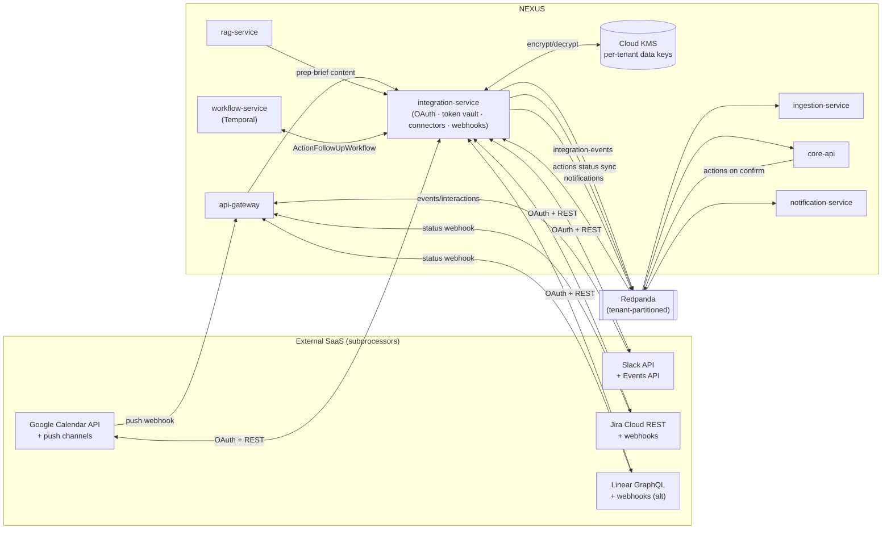
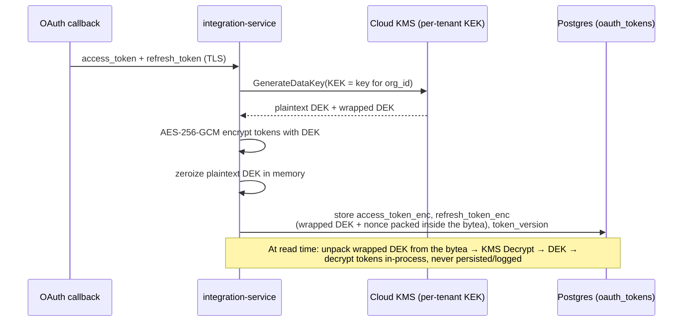
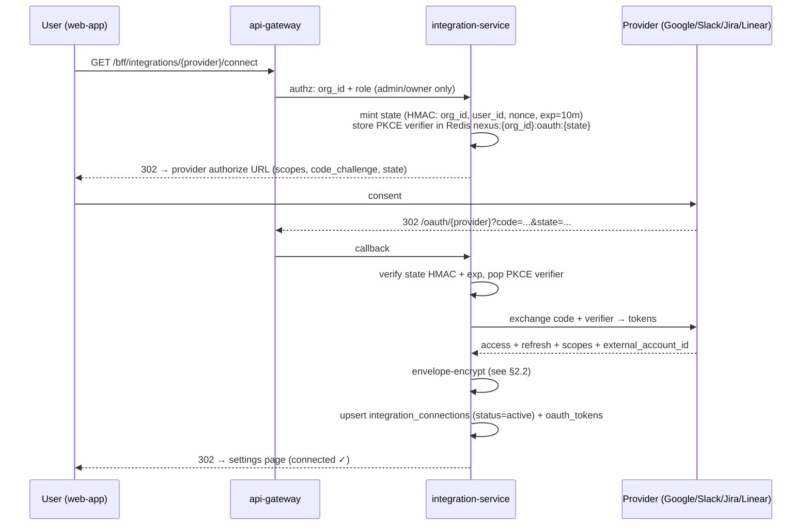
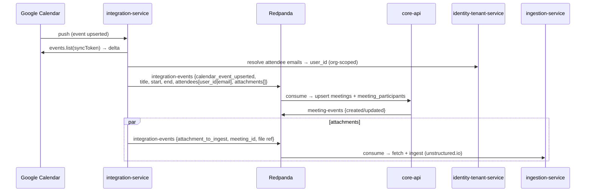
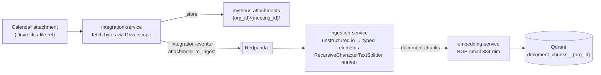
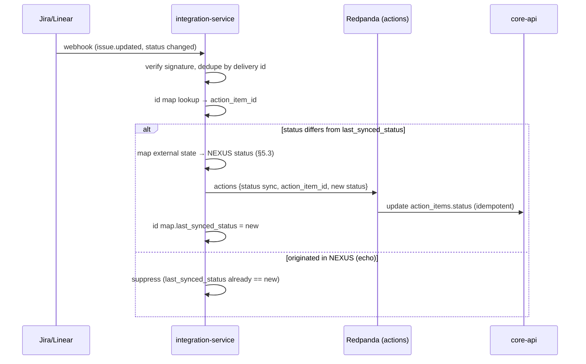
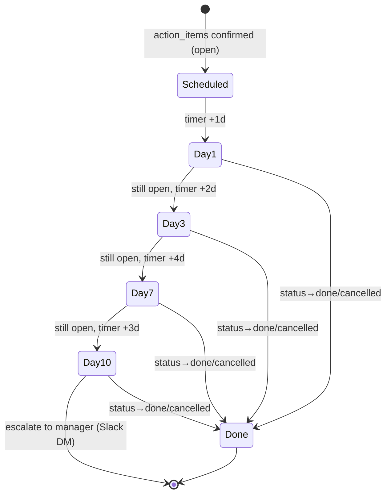
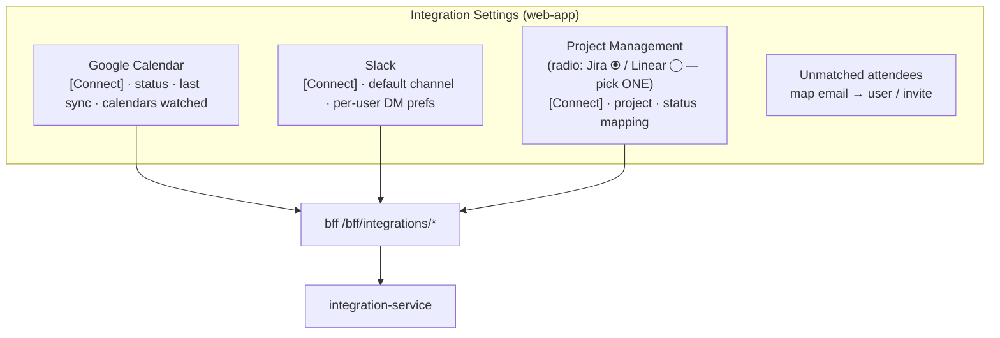

# Integration Architecture

The frozen, production-grade specification of the NEXUS `integration-service` — its OAuth framework, encrypted token vault, webhook receivers, Google Calendar / Slack / Jira-Linear connectors, the Temporal `ActionFollowUpWorkflow`, the integration settings UI, and the R8 scope guardrail that caps external integrations at Calendar + Slack + one project-management tool.

## Related documents

- [Service Catalog](04-service-catalog.md) — `integration-service`, `workflow-service`, `notification-service`, `ingestion-service` ownership, events, and failure modes (§3.7, §3.10, §3.13).
- [Data Architecture](05-data-architecture.md) — `integration_connections`, `oauth_tokens`, envelope encryption, `mytheus-attachments` bucket, retention.
- [Event-Driven Architecture](07-event-architecture.md) — authority for `integration-events`, `actions`, `notifications`, `meeting-events` schemas, the shared `EventEnvelopeHeader`, partition keys, retention, outbox/inbox, DLQ.
- [Multi-Tenancy & Tenant Isolation](06-multi-tenancy.md) — `org_id` injection, namespaced Redis, tenant-keyed partitions.
- [Security Architecture](11-security-architecture.md) — KMS envelope encryption, deny-by-default authz, secret handling.
- [Compliance & Privacy](12-compliance-and-privacy.md) — subprocessor DPAs, data residency, retention, right-to-be-forgotten.
- [AI / Agent Architecture](08-ai-agent-architecture.md) — `ActionAgent`, confirmation rule, `get_user_context`, role→topics taxonomy used in prep briefs.
- [RAG & Inference Serving](09-rag-and-inference-serving.md) — the RAG pipeline reused to assemble personalized prep briefs and summaries.
- [Real-time & Transcription](10-realtime-and-transcription.md) — `meeting-events`, `meetings.livekit_room`, the meeting lifecycle integrations hook into.
- [Service Catalog (canon)](_canon/01-service-catalog.md) — canonical service names and sync-API ownership.
- [Canonical Data Model](_canon/02-data-model.md) — `integration_connections`, `oauth_tokens`, `action_items`, `meetings`, `users`, `mytheus-attachments`.
- [Capacity & Scaling Math](_canon/05-capacity-math.md) — frozen anchors (R4, A15) and SLO targets.
- [Locked Tech & Architecture Decisions](_canon/06-tech-decisions.md) — §2.13 (integrations), §2.12 (SaaS business), §2.11 (security).

---

## 1. Scope and boundaries

This document owns the **outbound and inbound edges** between NEXUS and three classes of external SaaS system: a calendar (Google Calendar), a team-chat surface (Slack), and a project-management tracker (Jira default, Linear alternative). It specifies how OAuth is performed, how third-party credentials are stored and rotated, how external webhooks enter the system, how a calendar event becomes a NEXUS `meetings` row, how a personalized prep brief is built and delivered, how a confirmed NEXUS `action_items` row becomes an external ticket and stays in sync bidirectionally, and how the Temporal `ActionFollowUpWorkflow` chases overdue actions.

It does **not** re-define entity names (that is the [Canonical Data Model](_canon/02-data-model.md)), re-define event schemas or delivery semantics (that is the [Event-Driven Architecture](07-event-architecture.md)), or re-specify the meeting lifecycle (that is [Real-time & Transcription](10-realtime-and-transcription.md)). It cites those by reference and specifies the **connector runtime, OAuth flows, token security, sync state machines, and workflow timers**.

### 1.1 Owning service and its tier

All of this lives in one bounded context: **`integration-service`** (canonical name, [Service Catalog](_canon/01-service-catalog.md) §3). It is a CRUD-tier, horizontally scaled FastAPI service that scales on webhook + sync request rate; its load is bursty (calendar fan-in at the top of the hour, PM webhook storms during sprint rituals) rather than sustained.



> [SaaS-scale adjustment] The PDF placed integrations in a single Phase-12 feature block built by a role-rotating 4-person team. At SaaS scale they become a bounded `integration-service` with its own outbox, inbox, KMS envelope-encryption path, and a per-tenant connection registry — so a noisy tenant's webhook storm or a provider outage is isolated to this service's autoscaler and DLQs rather than degrading the CRUD core.

---

## 2. The integration-service framework

Every connector — Calendar, Slack, Jira, Linear — is built on the same four primitives: a **connection registry**, an **OAuth flow engine**, an **encrypted token vault**, and a **webhook receiver**. A connector is the provider-specific glue over these primitives; adding a future provider (post-R8) means implementing a `ProviderAdapter` interface, not re-plumbing auth or persistence.

### 2.1 Connection registry and token vault

`integration-service` owns exactly two tables, names carried verbatim from the [Canonical Data Model §2.2](_canon/02-data-model.md):

| Table | Tenant key | Key fields | Store / rule |
|---|---|---|---|
| `integration_connections` | `org_id` | `id`, `provider` (`google_calendar`/`slack`/`jira`/`linear`), `external_account_id`, `status`, `scopes text[]`, `installed_by` | Postgres RLS by `org_id`. One row per installed integration per tenant. |
| `oauth_tokens` | `org_id` | `id`, `connection_id`, `access_token_enc`, `refresh_token_enc`, `expires_at`, `token_version` | Postgres RLS by `org_id`. **Envelope-encrypted at rest; never returned by any API; never logged.** |

> [SaaS-scale adjustment] The canon Service Catalog prose informally calls the external↔NEXUS map "`integration_links`". The frozen names in the Data Model are `integration_connections` and `oauth_tokens` (recorded as `integration_links -> integration_connections / oauth_tokens` in the canon naming notes). Those exact table names are used everywhere here. Envelope encryption of OAuth tokens with a per-tenant KMS data key is a SaaS-scale addition; the PDF stored OAuth tokens with no at-rest encryption model.

Plus two internal, service-private maps it also owns (not tenant-public, carried in the same RLS-scoped Postgres):

- **External↔NEXUS id map** — joins `action_items.id` ↔ external ticket key (e.g. Jira `NEX-1421`, Linear issue UUID), and Google Calendar `event_id` ↔ `meetings.id`. One row per linked pair, `org_id`-scoped.
- **Webhook cursors** — per `(org_id, provider)` last-processed cursor/`syncToken`/`historyId` so an interrupted sync resumes exactly where it stopped.

### 2.2 Envelope encryption of OAuth tokens

Tokens are the crown jewels: a leaked Slack bot token or Jira refresh token is a tenant-wide compromise. NEXUS uses **envelope encryption with a per-tenant data key** (DEK) wrapped by a Cloud KMS key-encryption key (KEK), consistent with [Security Architecture](11-security-architecture.md).



Rules enforced in code, not by convention:

- `oauth_tokens.access_token_enc` / `refresh_token_enc` are `bytea` ciphertext (AES-256-GCM). The wrapped DEK and the GCM nonce are packed **inside** that bytea envelope (a self-describing `[wrapped_dek_len ‖ wrapped_dek ‖ nonce ‖ ciphertext ‖ tag]` layout), not as separate columns — the frozen `oauth_tokens` schema is exactly `id, org_id, connection_id, access_token_enc, refresh_token_enc, expires_at, token_version` and is not extended here. The KEK is per-tenant so an RTBF key-deletion makes a tenant's tokens cryptographically unrecoverable.
- No API path returns token material. `GET` endpoints expose `status`, `scopes`, `provider`, `external_account_id`, `installed_by` only.
- Structured JSON logs **redact** any field name matching `*token*`, `*secret*`, `code`, `client_secret` at the logging layer.
- `token_version` increments on every refresh; a refresh that fails N times marks the `integration_connections.status = 'degraded'` and emits a re-auth `notifications` event.

### 2.3 OAuth flow engine

All providers use OAuth 2.0 authorization-code with PKCE. The flow is server-mediated; the browser never holds the client secret or the authorization code.



Canonical sync surface ([Service Catalog](_canon/01-service-catalog.md) §6): the OAuth callback path is **`/oauth/{provider}`** and the inbound webhook path is **`/webhooks/{provider}`**, both owned exclusively by `integration-service`. `{provider}` is the enumerated set `google_calendar | slack | jira | linear`.

- **State** is an HMAC-signed token (key from KMS-managed secret) binding `org_id`, `user_id`, a random nonce, and a 10-minute expiry — defeats CSRF on the callback.
- **PKCE verifier** lives in `nexus:{org_id}:oauth:{state}` (Redis, 10-min TTL), never the browser.
- **Connect is RBAC-gated**: only a tenant owner/admin can install or remove an integration (the grant is checked at the `bff` and re-checked in `integration-service`).

### 2.4 Webhook receiver

`/webhooks/{provider}` is the single inbound door for provider callbacks. Every webhook is verified, deduped, and turned into an internal event before any business logic runs.

| Step | Mechanism | Provider specifics |
|---|---|---|
| 1. Signature verify | Provider HMAC/signature over raw body | Slack `v0` signing secret + timestamp (5-min skew); Jira/Linear shared-secret HMAC; Google push uses channel token + TLS. |
| 2. Replay guard | Reject if timestamp skew > 5 min; dedupe by provider delivery id | Slack `X-Slack-Request-Timestamp`; Jira `X-Atlassian-Webhook-Identifier`; Linear `Linear-Delivery`. |
| 3. Fast ACK | Persist raw payload to an inbox row, return `200` immediately | Keeps within provider ACK deadlines (Slack 3 s, Google ~10 s). |
| 4. Async process | A worker drains the inbox, applies idempotently, advances the cursor | Dedupe on `idempotency_key` per [Event Architecture §6](07-event-architecture.md). |

> [SaaS-scale adjustment] The PDF described a single "SDK webhook receiver" with no signature/replay/ACK-deadline discipline. At SaaS scale the receiver verifies provider signatures, ACKs within the provider's deadline, and processes asynchronously off an inbox table so a slow downstream (e.g. `ingestion-service` backlog) never causes a provider to disable the webhook for retries.

---

## 3. Google Calendar connector

Three capabilities, all carried verbatim from the PDF: **auto-create meetings from events**, **match participants by email**, and **route event attachments through unstructured.io ingestion so they are searchable before the meeting**.

### 3.1 Subscription and sync model

After OAuth, `integration-service` registers a **Google Calendar push channel** (`events.watch`) per connected calendar and stores the channel id + `resourceId` + initial `syncToken` in the webhook-cursor map. Pushes arrive at `/webhooks/google_calendar`; on each push the connector calls `events.list` with the stored `syncToken` (incremental sync), processes the delta, and advances the cursor. Channels are renewed before their ~7-day expiry by a periodic Temporal child workflow.

### 3.2 Event → `meetings` row

When a calendar event is created or updated, the connector materializes (or updates) a `meetings` row owned by `core-api` and a set of `meeting_participants`. `integration-service` does **not** write `meetings` directly — it owns no meeting data. It emits an `integration-events` message (`kind = calendar_event_upserted`) which `core-api` consumes to create/patch the meeting, then `core-api` emits `meeting-events` as normal.



The mapping rules:

| Calendar field | NEXUS target | Rule |
|---|---|---|
| `summary` | `meetings.title` | Verbatim; truncated to column limit. |
| `start.dateTime` / `end.dateTime` | `meetings.scheduled_start` / `scheduled_end` | Stored UTC (`timestamptz`). |
| `attendees[].email` | `meeting_participants.user_id` | Email-to-user matching (§3.3). Unmatched attendees recorded as external, not participants. |
| `conferenceData` / location | `meetings.livekit_room` | NEXUS mints its own LiveKit room ([Real-time & Transcription §2 — LiveKit transport; token minting §2.3](10-realtime-and-transcription.md)); the calendar link is replaced/augmented with the NEXUS join URL when the org opts in. |
| `attachments[]` | `mytheus-attachments` bucket + `document_chunks` | Routed to ingestion (§3.4). |
| `iCalUID` / `event_id` | external↔NEXUS id map | Idempotency anchor; one `meetings` row per calendar event per tenant. |

Idempotency: the upsert is keyed on `(org_id, calendar event_id)`, so redelivered pushes and full re-syncs never create duplicate meetings — they patch the existing row. This is the calendar arm of the at-least-once + idempotency contract in [Event Architecture §6](07-event-architecture.md).

### 3.3 Email-to-user matching

Attendee emails are resolved to NEXUS `users.id` **within the tenant only**. `integration-service` calls `identity-tenant-service` (the owner of `users` and `get_user_context`) — it never reads `users` cross-service.

- Match is on `users.email` scoped by `org_id` (the connection's tenant). A cross-tenant email match is impossible because the lookup is RLS-scoped to the connection's `org_id`.
- Matched attendees become `meeting_participants` (driving per-participant agents and `get_user_context`).
- Unmatched attendees (external guests, or org members who signed up under a different email) are stored as external attendees on the meeting and surface in the settings/meeting UI as "unmatched — invite or map". They do **not** get a personal agent.
- The organizer maps to `meetings.created_by` when matched.

> [SaaS-scale adjustment] Email-to-user matching is explicitly tenant-scoped. In the single-app PDF there was no tenant boundary to cross; here the match is bounded by the connection's `org_id` so a calendar shared across orgs (e.g. a vendor on two customers' invites) can never leak one tenant's user identity into another's meeting roster.

### 3.4 Attachment → unstructured.io ingestion (reuse)

Event attachments are **not** ingested by a bespoke path — they reuse the exact `ingestion-service` pipeline that handles direct uploads, so calendar docs become searchable in the tenant's Qdrant collection before the meeting starts.



- `integration-service` downloads the attachment bytes (Drive read scope), writes the original to the `mytheus-attachments` bucket under the per-tenant `{org_id}/{meeting_id}/` prefix ([Data Model §6](_canon/02-data-model.md)), and emits `integration-events {kind = attachment_to_ingest}`.
- `ingestion-service` consumes it and runs the **same** unstructured.io → typed-element (`Title`/`NarrativeText`/`Table`/`ListItem`) → LangChain `RecursiveCharacterTextSplitter` (600/60, `SemanticChunker` for narrative docs) pipeline, producing `document_chunks` rows and `document-chunks` events that `embedding-service` embeds into `document_chunks__{org_id}`.
- Capacity: per [Capacity Math §5](_canon/05-capacity-math.md), attachments are sized at A15 = 30% of meetings, ~15,000 chars each → ~27.8 document vectors per attached doc; the calendar path contributes to V4 (document vectors/meeting), not a separate budget.

> [SaaS-scale adjustment] Attachment ingestion **reuses** the `ingestion-service` and per-tenant Qdrant collection rather than the PDF's implicit single-store ingestion. The PII-redaction pass and per-tenant retention defined in [Data Architecture](05-data-architecture.md) apply automatically because the path is identical to direct uploads.

---

## 4. Slack connector

Two capabilities, verbatim from the PDF: **Block Kit prep briefs personalized per user** and **post-meeting summaries to channel/DM**. `integration-service` owns the Slack bot OAuth, the workspace/channel/user id maps, and **builds** Block Kit payloads; the actual send goes through `notification-service`.

### 4.1 Build-vs-deliver split

> [SaaS-scale adjustment] The PDF emitted Slack messages directly from the integration feature. At SaaS scale, `notification-service` is the **sole consumer authorized to fan `notifications` to external channels** ([Service Catalog §3.10](04-service-catalog.md)). Therefore `integration-service` *constructs* the Block Kit content (it owns the Slack id maps and templates) and hands it to `notification-service` via the `notifications` topic for *delivery, dedupe, delivery receipts, and per-user channel-preference enforcement*. This split is the authoritative reconciliation of the two canon statements.

```mermaid
flowchart LR
  subgraph Build["integration-service (builds content)"]
    PB["Prep-brief builder<br/>get_user_context + rag-service"]
    SUM["Summary builder<br/>meeting decisions/actions/worklogs"]
    MAP["Slack id map<br/>user_id↔slack_user_id,<br/>channel↔slack_channel_id"]
  end
  subgraph Deliver["notification-service (sole external fan-out)"]
    Q["per-user priority queue<br/>nexus:{org_id}:queue:agent:{user_id}"]
    SLACKAPI["Slack chat.postMessage<br/>DM / channel"]
  end
  PB -->|notifications<br/>{channel:slack, block_kit}| RP[["Redpanda"]]
  SUM -->|notifications| RP
  RP --> Q --> SLACKAPI
  MAP -.resolves slack ids.-> PB & SUM
```

The Slack bot token used by `notification-service` to call `chat.postMessage` is fetched (decrypted) from `oauth_tokens` via a narrow internal `integration-service` endpoint that returns a short-lived, scope-checked handle — `notification-service` never persists the raw token.

### 4.2 Prep brief (pre-meeting, personalized)

A prep brief is **per participant**, not one shared message — it honors the NEXUS differentiator of personalized per-participant intelligence. It is assembled from:

- `get_user_context(user_id)` (role/skills/team/recent meetings/topics) from `identity-tenant-service`.
- The meeting agenda/title and matched participants.
- A `rag-service` query (`POST /api/rag/query`) scoped to the user, retrieving role-relevant prior decisions/actions/worklogs and any ingested attachments — fully cited (`meeting_id`/`chunk_id`/`speaker` or `document_id`/`element_id`).

Trigger: a Temporal timer (child of `MeetingLifecycleWorkflow`) fires at T-minus-15 minutes for each matched participant; `integration-service` builds the Block Kit blocks (header, role-relevant talking points, "you have N open actions due", cited links back into NEXUS) and emits one `notifications` event per user with `channel = slack_dm`.

### 4.3 Post-meeting summary

On `meeting-events {ended}`, `integration-service` builds a channel summary (decisions confirmed, actions created with assignees/due dates, open questions) and per-user DM summaries ("your 3 action items"). Content comes from `core-api` read models (`decisions`, `action_items`, `worklogs`). Delivery again flows through `notification-service`. Summaries are gated on confirmation: only **confirmed** decisions/actions appear, consistent with the no-silent-commit rule.

---

## 5. Jira / Linear bidirectional action-item sync

The project-management connector keeps NEXUS `action_items` and an external tracker in lock-step in **both** directions: a confirmed NEXUS action becomes a ticket (NEXUS → external), and an external status change updates the NEXUS action (external → NEXUS via webhook). **Jira is the default; Linear is the alternative** — a tenant picks exactly one (R8).

### 5.1 The two directions and the id map

```mermaid
flowchart LR
  subgraph NEXUS
    AA["ActionAgent → action_items<br/>(confirmed)"]
    CORE["core-api"]
    INTEG["integration-service"]
    MAP["external↔NEXUS id map<br/>action_items.id ↔ ticket key"]
  end
  subgraph PM["Jira (default) / Linear (alt)"]
    TICKET["Issue / ticket"]
  end

  AA -->|actions on confirm| RP1[["actions topic"]]
  RP1 --> INTEG
  INTEG -->|create issue (REST/GraphQL)| TICKET
  TICKET -.delivery id.-> MAP
  TICKET -->|status webhook| INTEG
  INTEG -->|actions status sync| RP2[["actions topic"]]
  RP2 --> CORE
  CORE -->|update action_items.status| DB[("Postgres action_items")]
```

The external↔NEXUS id map is the linchpin: it stores `(org_id, action_item_id, provider, external_key, external_url, last_synced_status, last_synced_at)`. Both directions consult and update it, so a status change that originated in NEXUS is not echoed back as an external change (loop-suppression — see §5.4).

### 5.2 NEXUS action → external ticket (outbound)

1. `ActionAgent` detects an action item; on **user confirmation** (no silent commits), `core-api` writes `action_items` and emits an `actions` event via its transactional **outbox** ([Event Architecture §6](07-event-architecture.md)).
2. `integration-service` consumes `actions`, checks the tenant's PM connection, and creates the external issue: Jira `POST /rest/api/3/issue` or Linear `issueCreate` GraphQL mutation.
3. Field mapping:

| NEXUS `action_items` | Jira field | Linear field |
|---|---|---|
| `content` | `summary` | `title` |
| `content` (long form) + back-link | `description` (ADF) | `description` (markdown) |
| `assignee_id` → external account | `assignee` (accountId) | `assigneeId` |
| `due_date` | `duedate` | `dueDate` |
| `status` | mapped status (§5.3) | mapped workflow state |
| `id` | label `nexus:{id}` + remote link | label + attachment link |

4. The returned external key/URL is written to the id map. The create call carries `actions.header.idempotency_key` so a redelivered `actions` event does not create a duplicate ticket (the connector first looks up the id map, then falls back to a provider-side idempotent search on the `nexus:{id}` label).

Assignee resolution: `assignee_id` (a NEXUS `users.id`) is mapped to the provider account via the Slack/PM account map built at install plus email match; if no external account exists the ticket is created unassigned and a `notifications` re-map prompt is emitted.

### 5.3 Status mapping (integration-service-defined, both directions)

A small, frozen state machine bridges NEXUS `action_items.status` and external workflow states. NEXUS statuses are the vocabulary each provider's states map onto.

> [SaaS-scale adjustment] The canon does **not** enumerate `action_items.status` values nor `integration_connections.status` values. The `open` / `in_progress` / `done` / `cancelled` vocabulary for `action_items.status` and the `active` / `degraded` / `disconnected` vocabulary for `integration_connections.status` are **defined by this document** (integration-service-owned), not frozen in the canon. They are authoritative for the integration sync state machine; if reused by another service they must be registered in the canon Glossary first.

| NEXUS `action_items.status` | Jira status category | Linear state type |
|---|---|---|
| `open` | To Do (`indeterminate`/`new`) | `unstarted` / `backlog` |
| `in_progress` | In Progress (`indeterminate`) | `started` |
| `done` | Done (`done`) | `completed` |
| `cancelled` | Won't Do / Cancelled | `cancelled` |

Unmapped external states fall through to `open` and raise a low-priority `notifications` "review status mapping" so a tenant's custom workflow never silently drops an action.

### 5.4 External status → NEXUS (inbound) and loop suppression



**Loop suppression** is the critical correctness property of bidirectional sync. The id map's `last_synced_status` records the last value NEXUS wrote *or* received. When a webhook arrives whose status already equals `last_synced_status`, the change was caused by NEXUS's own write echoing back, and it is dropped — preventing an infinite NEXUS↔external ping-pong. Both arms are idempotent and deduped on `idempotency_key` per [Event Architecture §6](07-event-architecture.md).

> [SaaS-scale adjustment] Loop suppression via a `last_synced_status` watermark in the id map is made explicit here. The PDF described "bidirectional sync" without an echo-suppression mechanism; at scale, with at-least-once delivery and provider webhook retries, an unsuppressed loop would generate runaway `actions` traffic and flapping ticket states.

### 5.5 Sync reliability

| Mode | Behavior | Mitigation |
|---|---|---|
| Provider 429 / rate-limit | Back off, resume from webhook cursor | Cursor-tracked; at-least-once on `actions` with idempotency. |
| External webhook duplicate | Idempotent action update | Inbox dedupe on `idempotency_key`. |
| Token expiry / refresh fail | Connection → `degraded`; re-auth prompt | `token_version` + refresh loop; tokens never logged/returned. |
| Poison external payload | Lands in per-topic DLQ after retry budget | DLQ per [Event Architecture §7](07-event-architecture.md). |
| Provider outage | Outbound queued in `actions`; drained on recovery | Durable Redpanda; `integration-events` 7-day retention covers re-drive. |

---

## 6. Follow-up workflows — `ActionFollowUpWorkflow`

Overdue confirmed actions are chased by the Temporal **`ActionFollowUpWorkflow`** (canonical name) hosted in `workflow-service`. Schedule carried verbatim from the PDF: **reminder day 1, day 3, day 7; escalation to the assignee's manager via Slack DM at day 10.**



- **Trigger.** On `actions {confirmed}`, `workflow-service` starts one `ActionFollowUpWorkflow` per action, with the workflow id `actionfollowup-{action_item_id}` (dedupes duplicate starts).
- **Reminders (day 1/3/7).** Each timer activity re-reads `action_items.status` via `core-api`. If `done`/`cancelled`, the workflow completes early. Otherwise it emits a `notifications` event (assignee DM/in-app) through `notification-service`.
- **Escalation (day 10).** The assignee's **manager** is resolved from the tenant org structure — the `departments` tree (`departments.parent_id`) plus team membership (`teams.department_id`, `team_members`). If no manager is resolvable from that structure, the workflow escalates to the meeting organizer (`meetings.created_by`), and failing that to a tenant admin, as a documented fallback. The escalation is a Slack DM, delivered via `notification-service`.
- **Cancellation.** A status change to `done`/`cancelled` (from either sync direction) signals the workflow to complete; Temporal durable timers guarantee no missed or duplicate reminder even across worker restarts.
- **Idempotency.** Each reminder activity is idempotent and deduped downstream by `notification-service`, so an at-least-once timer never double-pings.

> [SaaS-scale adjustment] The day-10 manager lookup is derived per-tenant from the org structure (`departments.parent_id` tree + `teams.department_id` + `team_members`). Note: the frozen org model encodes no direct manager / reports-to relationship — neither the `nexus_knowledge` graph (nodes Person/Meeting/Decision/Action/Topic; edges ATTENDED/PRODUCED/ASSIGNED_TO/RELATES_TO/FOLLOWS_FROM, none of which is a reporting edge) nor any relational column (`departments` has only `parent_id`; `teams` has `department_id`; `team_members` has a `role` but no manager link). Manager resolution is therefore best-effort over the department hierarchy with the organizer / tenant-admin fallback above; a first-class `manager_id` / reports-to field is a future org-model addition that must land in the Data Model and Glossary before it can be cited as authoritative. The PDF assumed a flat team and an ad-hoc Slack call; here escalation routes through the single `notification-service` fan-out.

---

## 7. `integration-events` and the events `integration-service` touches

`integration-service` is wired into the bus exactly as the canon specifies. All topics are Avro + Schema Registry (BACKWARD compat, subject `{topic}-value`), tenant-partitioned, at-least-once with the shared `EventEnvelopeHeader` ([Event Architecture §3](07-event-architecture.md)).

| Topic | Direction | Purpose | Canon ref |
|---|---|---|---|
| `integration-events` | **produce** | `calendar_event_upserted`, `attachment_to_ingest`, `external_status_changed` | 07 §2 topic table (`IntegrationEvent`), 12 partitions, 7-day retention |
| `actions` | **consume** | NEXUS action confirmed → create external ticket | 07 §2 topic table (`Action`) |
| `actions` | **produce** | external status → NEXUS action update | 07 §2 topic table (`Action`) |
| `meeting-events` | **consume** | meeting ended → build/post summary; meeting created → schedule prep brief | 07 §2 topic table (`MeetingEvent`) |
| `notifications` | **produce** | prep briefs, summaries, re-auth prompts, re-map prompts | 07 §2 topic table (`Notification`) → delivered by `notification-service` |

The `IntegrationEvent` payload (composed under the shared header) carries a discriminating `kind` and a `kind`-specific body:

```json
{
  "type": "record",
  "name": "IntegrationEvent",
  "namespace": "io.nexus.events",
  "doc": "integration-events value. Subject: integration-events-value. Compat: BACKWARD.",
  "fields": [
    { "name": "header", "type": "io.nexus.events.EventEnvelopeHeader" },
    { "name": "provider", "type": { "type": "enum", "name": "Provider",
        "symbols": ["google_calendar", "slack", "jira", "linear"] } },
    { "name": "kind", "type": { "type": "enum", "name": "IntegrationKind",
        "symbols": ["calendar_event_upserted", "attachment_to_ingest", "external_status_changed"] } },
    { "name": "connection_id", "type": { "type": "string", "logicalType": "uuid" } },
    { "name": "meeting_id",   "type": ["null", { "type": "string", "logicalType": "uuid" }], "default": null },
    { "name": "external_ref", "type": ["null", "string"], "default": null,
      "doc": "Calendar event_id, file ref, or external ticket key depending on kind." },
    { "name": "body_json",    "type": ["null", "string"], "default": null,
      "doc": "kind-specific JSON body (attendees, attachment ref, status map)." }
  ]
}
```

> [SaaS-scale adjustment] `integration-events` (the topic, its `IntegrationEvent` schema, the 12-partition/7-day retention, and the producer→consumer wiring to `ingestion-service` and `core-api`) is a SaaS-scale addition. The single-team PDF handled calendar→meeting, attachment ingestion, and status sync **in-process**; decoupling them onto the bus lets the bursty integration load and the AI-tier ingestion load scale and fail independently.

---

## 8. Integration settings UI

A single **Integration settings page** in the `web-app`, served via `bff`, RBAC-gated to tenant owners/admins. It is the human surface over `integration_connections`.



The page shows, per provider: connection `status` (`active`/`degraded`/`disconnected`), `scopes`, `installed_by`, and last successful sync (from the webhook cursor). It surfaces **only the one PM tool the tenant has chosen** — selecting Jira disables Linear and vice-versa (§9). It never displays token material (§2.2). Calendar sub-section lists watched calendars and unmatched attendees (§3.3) with map/invite affordances. Slack sub-section exposes default summary channel and a link to per-user notification/channel preferences (owned by `notification-service`).

---

## 9. The R8 scope guardrail — Calendar + Slack + one PM tool

R8 is a **hard, enforced cap**, not a guideline: NEXUS ships exactly **Google Calendar + Slack + one of Jira/Linear** ([Locked Decisions §2.13](_canon/06-tech-decisions.md)).

Enforcement is layered so the guardrail cannot be bypassed:

| Layer | Enforcement |
|---|---|
| Data model | `integration_connections.provider` is the closed enum `{google_calendar, slack, jira, linear}` — no other provider is representable. |
| Connection rule | A tenant may hold **at most one** PM connection. Installing Jira while Linear is `active` (or vice-versa) is rejected; the existing PM connection must be disconnected first. Calendar and Slack are independent single-instance connections. |
| UI | The settings page renders the PM connector as a single radio choice (Jira default-selected); the unselected option's `Connect` is disabled. |
| API | `/oauth/{provider}` validates `{provider}` against the enum and the one-PM rule before minting the authorize redirect; out-of-scope providers 404 at the gateway. |
| Code review | New provider integrations are out of scope by policy; adding one requires a superseding ADR and a Glossary entry, not a feature PR. |

> [SaaS-scale adjustment] R8 was a scope note for a 4-person team in the PDF. Here it is encoded as a closed provider enum, a one-PM-connection invariant, and gateway/UI enforcement — so "integration creep" is structurally impossible rather than merely discouraged, protecting the roadmap and the subprocessor/DPA surface ([Compliance & Privacy §4 — Subprocessors: DPAs and SCCs](12-compliance-and-privacy.md)).

---

## 10. End-to-end integration + bidirectional-sync diagram

The full picture: a calendar event seeds a meeting and ingests its attachment; the meeting produces a confirmed action; the action becomes a ticket and stays in two-way sync; an overdue action is chased and escalated.

```mermaid
sequenceDiagram
  autonumber
  participant GCAL as Google Calendar
  participant INTEG as integration-service
  participant CORE as core-api
  participant ING as ingestion-service
  participant AGENT as agent-runtime-service
  participant PM as Jira/Linear
  participant WF as workflow-service (Temporal)
  participant NOTIF as notification-service

  Note over GCAL,ING: 1) Inbound — calendar → meeting + searchable attachment
  GCAL->>INTEG: push (event + attachment)
  INTEG->>CORE: integration-events → upsert meetings + participants (email match)
  INTEG->>ING: integration-events → ingest attachment (unstructured.io → Qdrant)

  Note over INTEG,NOTIF: 2) Pre-meeting — personalized prep brief
  CORE->>WF: meeting-events (created) → schedule prep-brief timer
  WF->>INTEG: T-15 → build Block Kit brief (get_user_context + rag-service)
  INTEG->>NOTIF: notifications {slack_dm, per user}
  NOTIF->>PM: (n/a) -- Slack DM via Slack API

  Note over AGENT,PM: 3) Outbound — confirmed action → ticket
  AGENT->>CORE: ActionAgent detects action (confidence-scored)
  CORE->>INTEG: actions (on confirm, via outbox)
  INTEG->>PM: create issue; store external↔NEXUS id map

  Note over PM,CORE: 4) Inbound — external status → NEXUS (loop-suppressed)
  PM->>INTEG: webhook (status changed)
  INTEG->>CORE: actions (status sync) — dropped if echo of NEXUS write
  CORE->>CORE: update action_items.status

  Note over WF,NOTIF: 5) Follow-up — ActionFollowUpWorkflow
  CORE->>WF: actions (confirmed) → start ActionFollowUpWorkflow
  WF->>NOTIF: day 1/3/7 reminders (if still open)
  WF->>NOTIF: day 10 escalation → manager Slack DM (departments-tree lookup, organizer/admin fallback)

  Note over INTEG,NOTIF: 6) Post-meeting — summary
  CORE->>INTEG: meeting-events (ended)
  INTEG->>NOTIF: notifications {channel summary + per-user DM}
```

---

## 11. Summary — what this document freezes

| Concern | Locked decision |
|---|---|
| Owning service | `integration-service` (CRUD tier, scales on webhook + sync req/s) |
| Owned tables | `integration_connections`, `oauth_tokens` (+ id map, webhook cursors) — RLS by `org_id` |
| Token security | Envelope encryption, per-tenant KMS DEK, AES-256-GCM; tokens never returned/logged |
| OAuth | Auth-code + PKCE, HMAC state, server-mediated; callbacks at `/oauth/{provider}` |
| Webhooks | Single `/webhooks/{provider}` door; signature-verified, replay-guarded, fast-ACK, async-processed |
| Calendar | Event → `meetings` via `integration-events`→`core-api`; tenant-scoped email match; attachments reuse `ingestion-service` |
| Slack | `integration-service` builds Block Kit; `notification-service` delivers (sole external fan-out) |
| PM sync | Bidirectional `action_items`↔ticket via `actions` topic; canonical status map; `last_synced_status` loop suppression |
| Follow-up | `ActionFollowUpWorkflow`: reminders day 1/3/7, manager escalation day 10 (departments-tree lookup; organizer/admin fallback) |
| Topics | produce `integration-events`, `actions`, `notifications`; consume `actions`, `meeting-events` |
| Scope | R8 hard cap: Calendar + Slack + one of Jira/Linear, enforced at enum/connection/UI/API layers |

Every service name, table name, topic name, agent name, workflow name, and bucket name above is used exactly as frozen in the [canonical Service Catalog](_canon/01-service-catalog.md), [Data Model](_canon/02-data-model.md), [Event Architecture](07-event-architecture.md), and [Locked Decisions](_canon/06-tech-decisions.md). No alternative names are introduced.
