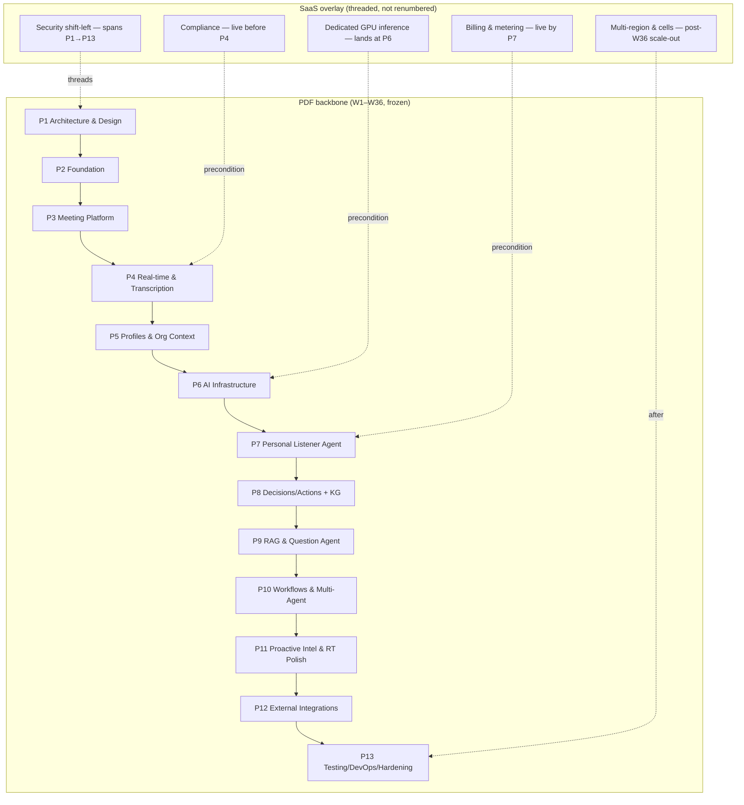
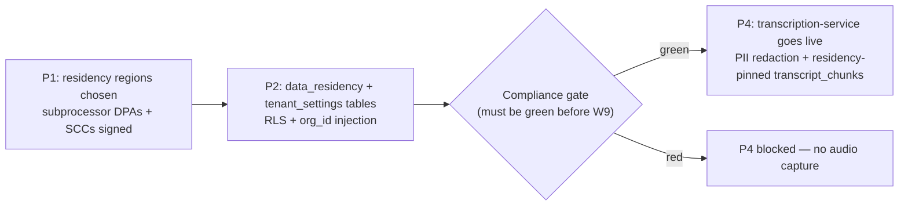
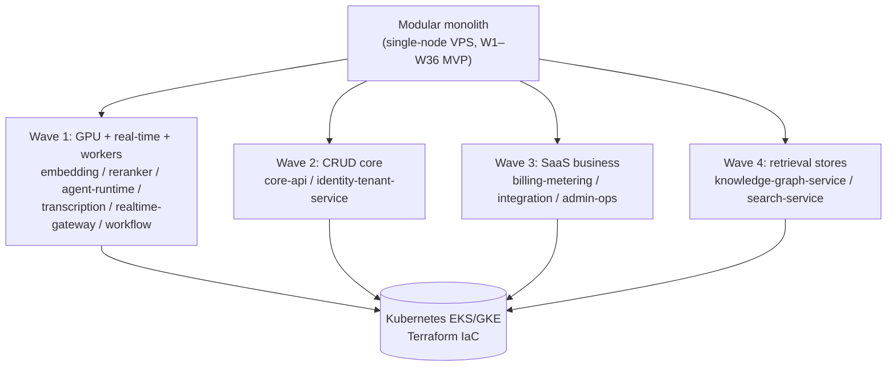
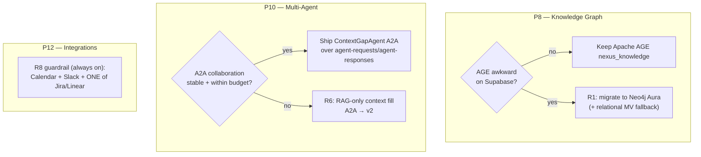
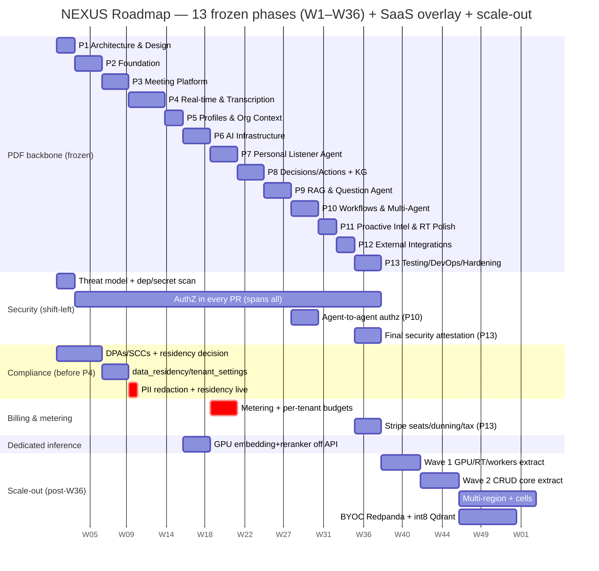

# NEXUS Roadmap & Phasing

How the 13 frozen PDF phases (W1–W36) map onto the production architecture, where the new SaaS capabilities slot in, how the modular monolith peels into services, and how the MVP scales out to the capacity-math anchors.

## Related documents

- [Architecture Overview & Principles](01-architecture-overview-and-principles.md) — the three scaling families and the modular-monolith → services path.
- [System Context](02-system-context.md) — external actors, subprocessors, and the trust boundary phasing must respect.
- [Container Architecture](03-container-architecture.md) — deployable units, the early monolith, and the per-family autoscaler signals.
- [Service Catalog & Bounded Contexts](04-service-catalog.md) — the 20 canonical services each phase builds; the naming authority.
- [Data Architecture](05-data-architecture.md) — partitioning, replicas, cold tiering, and the stores stood up per phase.
- [Multi-Tenancy & Isolation](06-multi-tenancy.md) — pooled + RLS for the long tail, cell-based isolation for large tenants.
- [Event-Driven Architecture](07-event-architecture.md) — Redpanda topics, Avro subjects, outbox/inbox, DLQs introduced at P6.
- [AI / Agent Architecture](08-ai-agent-architecture.md) — the six LangGraph agents and the cost-controlled pipeline landing at P7.
- [RAG & Inference Serving](09-rag-and-inference-serving.md) — the dedicated GPU inference tier standing up at P6.
- [Real-time & Transcription](10-realtime-and-transcription.md) — LiveKit, Deepgram, and the P4 transcription path.
- [Security Architecture](11-security-architecture.md) — the shift-left program that replaces the PDF Phase-13 audit.
- [Compliance & Privacy](12-compliance-and-privacy.md) — GDPR/CCPA, DPAs/SCCs, PII redaction, residency — live before P4.
- [Scalability & Performance](13-scalability-and-performance.md) — the autoscaler signals and SLO budgets the scale-out phases meet.
- [Reliability & Disaster Recovery](14-reliability-and-dr.md) — per-tier availability, PITR, and the multi-region posture of the scale-out.
- [Deployment & Infrastructure](16-deployment-and-infrastructure.md) — the Kubernetes/Terraform substrate the post-W36 scale-out waves land on.
- [Cost & FinOps](17-cost-and-finops.md) — the LLM-cost levers and the ~30% Phase-13 reduction target (C4) measured against the live pipeline.
- [SaaS Business Architecture](18-saas-business-architecture.md) — tenant lifecycle, Stripe billing/seats/dunning/tax, usage metering, plans/tiers, and the admin/ops consoles.
- [Integration Architecture](21-integration-architecture.md) — OAuth, Calendar/Slack/Jira-Linear, the `ActionFollowUpWorkflow`, and the R8 guardrail authoring the P12 work.
- [Service Catalog (canon)](_canon/01-service-catalog.md) — frozen service names and the §7 monolith→services wave order.
- [Data Model (canon)](_canon/02-data-model.md) — frozen entity/table names stood up per phase.
- [Capacity & Scaling Math (canon)](_canon/05-capacity-math.md) — the anchors (A1–A18) the scale-out targets, cited by symbol.
- [Tech & Architecture Decisions (canon)](_canon/06-tech-decisions.md) — the locked decisions cited by Concern key; the integration, billing, and deployment specifics are authored in their sibling docs ([21](21-integration-architecture.md), [18](18-saas-business-architecture.md), [17](17-cost-and-finops.md), [16](16-deployment-and-infrastructure.md)) and the canon row that locks each.

---

## 1. Scope and the one rule

This document is the **time axis** for the whole architecture set. It does not re-decide stores, re-name services, or re-derive load — those are frozen in the canon. It answers one question precisely: *in what order does NEXUS get built, and where does each architecture decision land in calendar time?*

There is exactly one naming rule, and it bites hardest here because two canon files disagree. The [Service Catalog (canon)](_canon/01-service-catalog.md) self-declares as the **single source of truth for service names** and lists 20 kebab-case services; the [Data Model (canon)](_canon/02-data-model.md) §1.1 uses an older, coarser grouping (`identity-service`, `agent-service`, `graph-service`, `billing-service`, `budget-service`, `tenant-service`, `audit-service`). **This document uses the 20 catalog names verbatim and never the data-model variants.** Concretely: token budgets are owned by `billing-metering-service` (not "budget-service"); the agents run in `agent-runtime-service` (not "agent-service"); the graph lives in `knowledge-graph-service` (not "graph-service"); identity and tenancy are one service, `identity-tenant-service`. No rename is introduced because there is no glossary in this set to record one in.

> [SaaS-scale adjustment] The PDF (NEXUS Execution Plan v2.1) was a 13-phase, 36-week plan for a 4-person team building a single-tenant MVP, validated against a seeder of `2 orgs x 10 users x 5 meetings`. This document keeps that 36-week backbone **verbatim** — same phase names, same week ranges — and treats it as the path to a shippable MVP. It then overlays the SaaS-scale work (multi-tenancy, billing, compliance, dedicated inference, hardened delivery) onto that backbone with explicit callouts, and adds a **post-W36 scale-out** that takes the MVP to the [capacity-math](_canon/05-capacity-math.md) anchors (A1 = 5M users, A4 = 3,000 tenants, A5 = 20k peak meetings, A6 = 100k peak participants). The 36-week plan does **not** ship cells, multi-region, BYOC Redpanda, or full GPU autoscaling — those are scale-out, sized for paying-tenant load, not the seeder.

---

## 2. The dual-axis phasing model

Every phase is read on two axes at once:

1. **The PDF backbone (frozen).** Thirteen phases, W1–W36, domain-first, names and week ranges unchanged. This is the build order a small team can actually execute, and it produces a working multi-tenant MVP on the single-node VPS substrate ([ADR-0016](adr/0016-self-hosted-vps-mvp-substrate.md)).
2. **The SaaS overlay (added).** Five cross-cutting capabilities the PDF deferred or never had — security, compliance, billing/metering, dedicated inference, and multi-region — are pulled *earlier* than "Phase 13, last" because each is a hard precondition for the phase it precedes. The overlay never renumbers a phase; it threads through them.

> [SaaS-scale adjustment] The PDF deferred security and "production hardening" to Phase 13 and had no notion of compliance, billing, or tenancy. The overlay is the architectural correction: you cannot legally capture meeting audio at P4 without the compliance gate, and you cannot run token-consuming agents at P7 without the metering and per-tenant budgets that enforce R4. Pulling these capabilities forward is the single most important deviation from the PDF's phase order, and it is done without moving a single phase boundary.

---

## 3. The 13 phases mapped to the architecture

The table below is the master mapping. Phase names and week ranges are **verbatim from the PDF**. "Services built" uses the 20 canonical catalog names — at the relevant phase these ship as *modules inside the modular monolith*, drawn along the seams they will later split on (§5). "Docs" are the sibling specifications that author the detail. "SaaS overlay" is the added work threaded into that phase.

| Phase (verbatim) | Weeks | Services built (catalog names) | Authoring docs | SaaS overlay landing here |
|---|---|---|---|---|
| **P1 Architecture & Design** | W1–2 | (none yet) C4 diagrams, ERD, Avro schema drafts, OpenAPI draft, wireframes, tech-stack lock, repo + CI + Docker Compose | [01](01-architecture-overview-and-principles.md), [02](02-system-context.md), [03](03-container-architecture.md), [04](04-service-catalog.md), all canon | **Threat model authored**; **data-residency strategy decided** (`us`/`eu`/`ap`); dependency + secret scanning wired into CI day one |
| **P2 Foundation** | W3–5 | `identity-tenant-service`, `core-api`, `bff`, `web-app`, `api-gateway` (Clerk auth, core data model + Alembic, meetings CRUD, dashboard) | [04](04-service-catalog.md), [05](05-data-architecture.md), [06](06-multi-tenancy.md), [11](11-security-architecture.md) | **RLS + `org_id` injection middleware from the first migration**; hardened Clerk user-sync (outbox + reconciliation); `tenant_settings` / `data_residency` tables created |
| **P3 Meeting Platform Integration** | W6–8 | `meeting-service`, `realtime-gateway` (LiveKit room UI, token minting, SDK webhooks, Socket.io, chat persist, staging deploy on merge) | [10](10-realtime-and-transcription.md), [03](03-container-architecture.md), [04](04-service-catalog.md) | LiveKit locked behind the transport adapter; `meeting_rooms` map; tenant-scoped Socket.io rooms keyed by `meeting_id` |
| **P4 Real-time & Transcription** | W9–12 | `transcription-service` (Deepgram WS proxy, `transcript_chunks`, live captions, transcript view, manual speaker mapping) | [10](10-realtime-and-transcription.md), [12](12-compliance-and-privacy.md), [05](05-data-architecture.md) | **Compliance gate must be GREEN before W9**: Deepgram DPA + SCCs signed, PII redaction pass live, residency pin enforced on `transcript_chunks` |
| **P5 Profiles & Org Context** | W13–14 | `identity-tenant-service` (users role/skills, teams/departments, `get_user_context()`, role taxonomy, org-chart UI, seeder) | [04](04-service-catalog.md), [06](06-multi-tenancy.md), [08](08-ai-agent-architecture.md) | `get_user_context()` cache namespaced `nexus:{org_id}:user_ctx:{user_id}` (5-min TTL); role→topics taxonomy version-controlled |
| **P6 AI Infrastructure** | W15–17 | `embedding-service`, `reranker-service`, `ingestion-service`, `search-service` + Redpanda/Avro/Schema Registry, embedding consumer, hybrid search | [07](07-event-architecture.md), [09](09-rag-and-inference-serving.md), [05](05-data-architecture.md) | **Dedicated GPU/Ray Serve inference tier, OFF the API tier** (R4/R5 fix); per-tenant Qdrant collections; outbox/inbox + idempotency + DLQs on every topic |
| **P7 Personal Listener Agent** | W18–20 | `agent-runtime-service` (LiteLLM, LangGraph `BaseAgent`, `PersonalListenerAgent`, `worklogs`, worklog UI, agent sidebar shell) | [08](08-ai-agent-architecture.md), [09](09-rag-and-inference-serving.md), [04](04-service-catalog.md) | **`billing-metering-service` metering + per-tenant token budgets live** (R4 enforcement, "budget alerts from Phase 7"); cost-controlled pipeline replaces per-chunk processing |
| **P8 Decisions/Actions + Knowledge Graph** | W21–23 | `agent-runtime-service` (`DecisionAgent`, `ActionAgent`), `knowledge-graph-service` (AGE `nexus_knowledge`, Cypher templates, lineage UI, My Tasks) | [08](08-ai-agent-architecture.md), [05](05-data-architecture.md), [14](14-reliability-and-dr.md) | Org-partitioned `nexus_knowledge` (`$org_id` on every Cypher template); **R1 descope checkpoint** (AGE-on-Supabase → Neo4j Aura) |
| **P9 RAG & Question Agent** | W24–26 | `rag-service` (RAGService, query expansion, hybrid retrieval, reranker, citations), `agent-runtime-service` (`QuestionAgent`, suggestion cards) | [09](09-rag-and-inference-serving.md), [08](08-ai-agent-architecture.md) | RAG cache namespaced `nexus:{org_id}:rag:{user_id}:{query_hash}` (10-min TTL); citation contract frozen per tenant collection |
| **P10 Workflows & Multi-Agent Collaboration** | W27–29 | `workflow-service` (Temporal `MeetingLifecycleWorkflow`), `agent-runtime-service` (`ContextGapAgent` over `agent-requests`/`agent-responses`, context-fill UI, collaboration logs) | [08](08-ai-agent-architecture.md), [07](07-event-architecture.md), [04](04-service-catalog.md) | **Agent-to-agent authz deny-by-default + audit**; **R6 descope checkpoint** (A2A collaboration → RAG-only context fill, ship A2A as v2) |
| **P11 Proactive Intelligence & Real-time Polish** | W30–31 | `agent-runtime-service` (`ProactiveAgent` conflict/workload/stakeholder), `realtime-gateway` (Redis pub/sub backbone, streamed agent output, priority queue, alert UI, sidebar polish) | [08](08-ai-agent-architecture.md), [10](10-realtime-and-transcription.md), [13](13-scalability-and-performance.md) | Per-user priority queue namespaced `nexus:{org_id}:queue:agent:{user_id}`; `agent-stream` Avro deltas |
| **P12 External Integrations** | W32–33 | `integration-service` (Calendar/Slack/Jira-Linear), `workflow-service` (`ActionFollowUpWorkflow`), `notification-service`, `admin-ops-service` (tenant-admin console: members/plan/integrations; internal-ops console: cost/lag dashboards, tenant suspend, audit-log access) | [21](21-integration-architecture.md), [18](18-saas-business-architecture.md), [04](04-service-catalog.md) | OAuth tokens envelope-encrypted (`oauth_tokens.access_token_enc`); **R8 scope guardrail** (Calendar + Slack + one of Jira/Linear only); **`admin-ops-service` consoles** land here once billing (P7) and integrations are live to administer |
| **P13 Testing/DevOps/Hardening/Production** | W34–36 | All services (Playwright E2E, k6/Locust load, security audit, ~30% cost optimization, mobile responsive, Prometheus/Grafana, Postgres backups/PITR/read replica, Cloudflare, custom domain, docs) | [13](13-scalability-and-performance.md), [14](14-reliability-and-dr.md), [11](11-security-architecture.md) | The "security audit" here becomes a **final attestation**, not the first security work; ~30% LLM cost reduction target (C4) measured against the live pipeline |

> [SaaS-scale adjustment] In the PDF, "services" did not exist — phases delivered features into one role-rotating codebase. The "Services built" column re-reads each phase as *the catalog module(s) it brings online*, drawn along the seams from [Service Catalog (canon)](_canon/01-service-catalog.md). This is not a re-cut of the domain; it is the same work, labeled with the boundaries it will split on under load (§5).

### 3.1 Stores stood up, by phase

The physical stores from [Data Architecture](05-data-architecture.md) come online in this order. Nothing is stood up before the phase that needs it, which keeps the early monolith cheap.

| Phase | Postgres tables | Qdrant | AGE | Redis namespaces | Object buckets |
|---|---|---|---|---|---|
| P2 | `organizations`, `users`, `teams`, `team_members`, `departments`, `meetings`, `meeting_participants`, `tenant_settings`, `data_residency`, `audit_logs` (capture begins) | — | — | `user_ctx` (stub) | — |
| P3 | `meeting_rooms`, `chat_messages` | — | — | `presence`, `pubsub:meeting` | `mytheus-recordings` |
| P4 | `transcript_chunks`, `meeting_speakers` | — | — | — | `mytheus-recordings` (recording.ready) |
| P5 | (extends `users`, `teams`) | — | — | `user_ctx` (live, 5-min TTL) | — |
| P6 | `document_chunks` | `transcript_chunks__{org_id}`, `document_chunks__{org_id}` | — | `dedupe:{topic}` (inbox) | `mytheus-documents` |
| P7 | `worklogs`, `agent_budgets`, `usage_events` | — | — | `budget:{period}`, `ratelimit` | — |
| P8 | `decisions`, `action_items` | `decisions__{org_id}` | `nexus_knowledge` (org-partitioned) | — | — |
| P9 | `agent_suggestions` | — | — | `rag:{user_id}:{query_hash}` | — |
| P10 | `agent_collaborations` | — | — | — | — |
| P11 | — | — | — | `queue:agent:{user_id}` | — |
| P12 | `integration_connections`, `oauth_tokens`, `feature_flags`, `ops_audit_log`, `support_grants` (admin-ops-service) | — | — | — | `mytheus-attachments` |
| P13 | `subscriptions`, `invoices`, `plans` (full billing surface); `audit_logs` partitioning/archival hardened (table itself live since P2) | — | — | — | `mytheus-invoices`, `mytheus-audit-archive`, `mytheus-exports` |

> [SaaS-scale adjustment] `tenant_settings`, `data_residency`, `agent_budgets`, `usage_events`, `audit_logs`, `subscriptions`, `invoices`, `plans`, `integration_connections`, `oauth_tokens`, and the admin-ops-service stores (`feature_flags`, `ops_audit_log`, `support_grants`) are all wholly added vs the PDF (which had no tenant column, no billing, no compliance state, and no admin/ops consoles). They are sequenced to land at the phase that first reads them — `data_residency` early (P2, because P4 depends on it), `agent_budgets`/`usage_events` at P7 (when tokens start flowing), the admin-ops stores at P12 (when there is a billing plan, members, and integrations worth administering), and the full Stripe billing surface at P13. **`audit_logs` is the exception: it is stood up at P2, not P13** — the shift-left security program (§4.1) means tenant-isolation and authz events are reviewed and *recorded* from P2 onward, so a tamper-evident audit trail must exist the moment RLS goes live. What P13 hardens is the table's monthly range-partitioning and cold-archive to `mytheus-audit-archive`, not the audit trail itself, which has been capturing since P2.

---

## 4. Where the SaaS capabilities slot in (and why earlier than the PDF)

Each of the five overlay streams is a *precondition* for a specific phase. This section gives the causal "why" the table above only summarizes.

### 4.1 Security — shift-left, replacing the Phase-13 audit

> [SaaS-scale adjustment] **Old → new:** the PDF batched all security into "P13 security audit." The SaaS posture replaces that with a continuous program: **threat model authored in P1**, an **authorization check reviewed in every PR** from P2 onward, and **dependency + secret scanning wired into GitHub Actions on day one**. This is `PDF→SaaS` per [Tech & Architecture Decisions (canon)](_canon/06-tech-decisions.md) §2.11. The P13 "security audit" survives as a *final attestation* over a system that has been secured continuously — not as the first time anyone looks at authz.

The `org_id`-injection middleware and PostgreSQL RLS land in P2 with the first migration, not later, because every table created from P2 onward must be tenant-scoped from birth — retrofitting RLS onto live transcript and decision data is a migration hazard the shift-left avoids. The append-only `audit_logs` table is stood up in that same P2 migration so the tamper-evident audit trail captures the RLS/authz events from the moment they begin; P13 only hardens its partitioning and cold-archive surface, it is **not** the first time auditing exists. Agent-to-agent authorization (deny-by-default, org/role scope, audited) lands in P10 alongside the `ContextGapAgent` that first issues cross-agent `agent-requests`. The two `admin-ops-service` consoles — the tenant-admin console and the internal-ops console (cross-tenant support, feature flags, tenant suspend/migrate, audit-log access) — are RBAC-gated and fully audited; they land at P12 (§3) once there is a plan, membership, and integration surface to administer. See [Security Architecture](11-security-architecture.md) and [SaaS Business Architecture](18-saas-business-architecture.md).

### 4.2 Compliance — live before P4 transcription

> [SaaS-scale adjustment] Compliance is wholly added vs the PDF. It is gated to be **green before W9 (P4)** because P4 is the first phase that captures real human speech. Three things must exist first: the **Deepgram subprocessor DPA + SCCs** (P1 decision, executed before P4), the **PII redaction pass** in the audio/ingestion path, and the **data-residency pin** so `transcript_chunks` land in the tenant's region (`us`/`eu`/`ap`).

The thread is concrete: P1 decides residency regions and signs subprocessor DPAs (Deepgram, Anthropic, LiveKit); P2 creates the `data_residency` and `tenant_settings` tables; the redaction pass and residency enforcement go live by W9 so the very first persisted final in `transcript_chunks` is already compliant. The right-to-be-forgotten Temporal workflow that purges across all six stores is built later (it needs the stores to exist) but the *deletion contract* is designed at P1. See [Compliance & Privacy](12-compliance-and-privacy.md).

### 4.3 Dedicated inference — lands at P6

> [SaaS-scale adjustment] The PDF ran BGE-small embeddings via ONNX *on the FastAPI API service*. The moment embeddings appear (P6 "AI Infrastructure"), `embedding-service` and `reranker-service` stand up as **dedicated autoscaling GPU / Ray Serve / vLLM services OFF the API tier** — embed-on-ingest, query-embed only. This is the architectural fix for R4 (LLM cost spiral) and R5 (latency budget): CPU/GPU-bound inference can never throttle, or be throttled by, request/s-bound CRUD serving. See [RAG & Inference Serving](09-rag-and-inference-serving.md).

P6 also stands up the event backbone — Redpanda + Avro + Schema Registry (one subject per topic, `{topic}-value`, BACKWARD compat) with transactional outbox/inbox, idempotency keys, and per-topic DLQs — because the embedding consumer is the first at-least-once consumer in the system. See [Event-Driven Architecture](07-event-architecture.md).

### 4.4 Billing & metering — live by P7

> [SaaS-scale adjustment] `billing-metering-service` is wholly added. Its **usage metering (`usage-events` → aggregation → quota enforcement) and per-tenant token budgets must be live by P7**, the phase that brings `agent-runtime-service` online and starts consuming LLM tokens on every meeting. The PDF itself anchored "budget alerts from Phase 7" (R4) — the SaaS version makes that a hard, enforced per-tenant token quota (`agent_budgets`, `nexus:{org_id}:budget:{period}`), not just an alert. Full Stripe subscriptions/seats/dunning/tax can lag to P13, but the *metering and quota* half of billing is a P7 precondition or the R4 cost bomb detonates unmetered.

The cost-controlled pipeline itself lands at P7: relevance pre-gating (Haiku) → windowed batching (30s windows, **NOT** per raw `transcript_chunk`) → tiered routing (Haiku → Sonnet → Opus) → semantic + Anthropic prompt caching. This is the BUILT pipeline from [Capacity & Scaling Math (canon)](_canon/05-capacity-math.md) §8 that achieves the 86% call-volume reduction (L10) vs the naive per-chunk trap (N1–N3). See [AI / Agent Architecture](08-ai-agent-architecture.md).

### 4.5 Multi-region & cells — post-W36 scale-out

> [SaaS-scale adjustment] Multi-region (active-passive → active-active) and cell-based isolation for large tenants are **scale-out, not in the 36-week MVP**. The MVP runs single-region pooled + RLS on a self-hosted single-node VPS running Docker Compose ([ADR-0016](adr/0016-self-hosted-vps-mvp-substrate.md)). The scale-out is sequenced against the per-plan availability tiers from [Capacity & Scaling Math (canon)](_canon/05-capacity-math.md) §11.2: Free stays single-region pooled (99.5%), Pro moves to multi-region active-passive (99.9%), Enterprise gets cell-based isolation and is the active-active candidate (99.95%). See [Reliability & DR](14-reliability-and-dr.md) and [Multi-Tenancy & Isolation](06-multi-tenancy.md).

---

## 5. Modular-monolith → microservices evolution

The MVP (W1–W36) ships as a **modular monolith on a self-hosted single-node VPS running Docker Compose** ([ADR-0016](adr/0016-self-hosted-vps-mvp-substrate.md)), with the 20 catalog modules drawn along their final service seams from day one. Extraction happens *after* the MVP, as load arrives, in the wave order frozen in [Service Catalog (canon)](_canon/01-service-catalog.md) §7. Each wave is aligned to a single scaling family so no extraction re-cuts a domain seam.

| Wave | When | Services extracted | Trigger to extract |
|---|---|---|---|
| **Wave 1** — GPU + real-time + workers | Begins during the build (these have a different runtime from the start) | `embedding-service`, `reranker-service` (GPU/Ray Serve), `agent-runtime-service` (token-scaled), `transcription-service` + `realtime-gateway` (connection-scaled), `workflow-service` (Temporal workers) | Different runtime/scaling family; can never share the API tier's autoscaler |
| **Wave 2** — CRUD core | Under first sustained CRUD load (early paying tenants) | `core-api` (from `bff`), then `identity-tenant-service` | HTTP req/s + Postgres connections climbing on the API tier |
| **Wave 3** — SaaS business | On SaaS-business pressure (more tenants, billing volume) | `billing-metering-service`, `integration-service`, `admin-ops-service` | Metering ingest, webhook bursts, ops console traffic warrant isolation |
| **Wave 4** — retrieval stores | Last (start as a library inside `rag-service`) | `knowledge-graph-service`, `search-service` | Qdrant/AGE/FTS each warrant dedicated ops; share read models with `core-api` until then |

> [SaaS-scale adjustment] The PDF never split anything — it was one deployable for a 4-person team. Kubernetes (EKS/GKE) + Terraform IaC is the production substrate the waves land on; the MVP substrate is the single-node VPS, Railway and Render being struck entirely ([ADR-0016](adr/0016-self-hosted-vps-mvp-substrate.md)). This is `PDF→SaaS` per [Tech & Architecture Decisions (canon)](_canon/06-tech-decisions.md) §2.1.

### 5.1 How waves overlay the phase axis

Wave 1 is not a discrete calendar event — its members are born on a different runtime. `transcription-service` and `realtime-gateway` (P3–P4, connection-scaled) and `embedding-service`/`reranker-service` (P6, GPU) are *extractable from the moment they ship* because their autoscaler signal differs from the CRUD tier's req/s. The remaining waves are demand-driven and therefore post-W36: you do not pay K8s + per-service ops cost until tenant load requires it.

---

## 6. Pre-authorized descope paths (R1 / R6 / R8)

The PDF authorized three descopes to protect the timeline. Each has a verbatim ID, a phase, a trigger, and a fallback. These are *project-scope* safety valves — pull them only if the trigger fires.

| Risk ID | Phase | Trigger (what makes you pull it) | Fallback (what you ship instead) | Cost of pulling |
|---|---|---|---|---|
| **R1** | P8 (W21–23) | Apache AGE proves operationally awkward on managed Supabase (extension instability, ops friction, query latency) | Migrate `nexus_knowledge` to **Neo4j Aura** (or self-host Postgres+AGE); relational materialized-view fallback documented as the at-scale exit | Graph store swap; Cypher templates re-pointed; `knowledge-graph-service` already abstracts this |
| **R6** | P10 (W27–29) | Multi-agent collaboration (the novel, least-proven piece) is unstable or misses the p95 < 1.5s A2A round-trip budget | Descope `ContextGapAgent` to **RAG-only context fill**; ship agent-to-agent collaboration as **v2** | Lose cross-meeting agent context; RAG still fills gaps via the fallback chain peer-agents → related-meeting agents → **RAG → silent** |
| **R8** | P12 (W32–33) | Integration scope creep threatens the W36 ship date | Hard guardrail: ship **Calendar + Slack + one of Jira/Linear only** | None — this is a cap that *prevents* slip, not a feature loss |

> [SaaS-scale adjustment] The descope IDs, phases, and fallbacks are carried over **verbatim** from the PDF risk register. The SaaS additions are the *runtime* re-expression of two of them: R1's fallback now names the relational materialized-view exit as the explicit at-scale option, and R6's fallback chain (`peer-agents → related-meeting agents → RAG → silent`) is the same chain the `ContextGapAgent` runs at runtime — so the descope is just "stop at the RAG rung." See [Reliability & DR](14-reliability-and-dr.md), which re-expresses R1/R6/R8 as operational degradation modes.

---

## 7. Staged MVP → scale plan

Two stages, one boundary at W36. Stage 1 is the frozen 13-phase plan and produces a real, multi-tenant, compliant, billable MVP — validated at seeder scale and onboarding the first paying tenants. Stage 2 takes that MVP to the [capacity-math](_canon/05-capacity-math.md) anchors. Nothing in Stage 2 re-cuts a domain seam; it is all rightsizing along the seams Stage 1 already drew.

| Dimension | Stage 1 — MVP (W1–W36) | Stage 2 — Scale-out (post-W36) |
|---|---|---|
| Target load | Seeder (`2 orgs x 10 users x 5 meetings`) → first paying tenants | A1 = 5M users, A4 = 3,000 tenants, A5 = 20k peak meetings, A6 = 100k peak participants |
| Compute | Modular monolith on a single-node VPS | Kubernetes (EKS/GKE) + Terraform; Wave 1–4 extraction |
| Tenancy | Pooled + PostgreSQL RLS, single region | + cell-based isolation for large/enterprise tenants |
| Regions | Single region | Multi-region active-passive → active-active (per-plan tiers, §4.5) |
| Event bus | Redpanda Serverless (30-day trial → small dedicated) | BYOC/dedicated multi-AZ Redpanda; ~17.9k ev/s peak (E12), ~13.9 TB/mo (E13) |
| Inference | `embedding-service`/`reranker-service` on modest GPU | Autoscaling GPU/Ray Serve; ~525 embeds/s peak (EM2), query-embed only |
| Vectors | Per-tenant Qdrant collections, no quantization needed | int8 quantization; 4.42B vectors / ~17 TB live stock (V7–V9) |
| LLM cost control | Cost-controlled pipeline live (gating/batching/tiering/caching) | + ~30% Phase-13 reduction realized (C4: LLM ~$12.8M/mo, cost/MAU ~$6.99) |
| Postgres | Single primary + backups | + PITR + read replica; monthly range partitions on `transcript_chunks`/`chat_messages`/`meetings`; cold tier after 90d |
| Billing | Metering + per-tenant token budgets (P7); Stripe surface (P13) | Full Stripe seats/dunning/tax at volume; usage aggregation pipeline |

```mermaid
flowchart LR
  subgraph S1["Stage 1 — MVP (W1–W36, frozen phases)"]
    direction TB
    A["Modular monolith · single-node VPS"]
    B["Pooled + RLS · single region"]
    C["Redpanda Serverless trial"]
    D["Cost-controlled LLM pipeline live"]
  end
  subgraph S2["Stage 2 — Scale-out (post-W36, capacity anchors)"]
    direction TB
    E["K8s EKS/GKE + Terraform · Waves 1–4"]
    F["+ cells · multi-region active-passive→active-active"]
    G["BYOC multi-AZ Redpanda · ~17.9k ev/s peak"]
    H["int8 Qdrant · ~30% LLM cost reduction (C4)"]
  end
  S1 -->|"first paying tenants justify the move"| S2
```

> [SaaS-scale adjustment] The entire Stage 2 column is the SaaS-scale delta. The PDF's only forward-looking cost note was the Phase-13 "~30% reduction" target (preserved as C4); it had no anchors, no cell model, no multi-region, and used the Redpanda 30-day trial as the production plan. Stage 2 sizes against the frozen anchors so a single edit to [Capacity & Scaling Math (canon)](_canon/05-capacity-math.md) propagates here by symbol.

---

## 8. Gantt overview

The Gantt renders the 13 frozen phases as a serial backbone (each phase chained `after` the prior, durations in days) with the four cross-cutting SaaS overlay streams as their own sections, plus the post-W36 scale-out waves. The calendar start is illustrative (`2025-01-06`); the **week ranges, not the dates, are canonical**.

> [SaaS-scale adjustment] The `crit`-marked tasks (PII redaction + residency live, metering + per-tenant budgets) are the two hard preconditions: the first must complete before P4 captures audio, the second before P7 consumes tokens. The scale-out section is the post-W36 work that takes the MVP to the capacity anchors; it is deliberately drawn *after* P13 to make the MVP/scale boundary visible.

---

## 9. Cross-cutting cadence (carried from the PDF)

These rhythms run through every phase and are carried over verbatim from the PDF: weekly sync, daily async standup, **PR review from outside the author's primary domain**, docs alongside features, tests alongside features, a **demo at the end of every phase**, and domain rotation. The shift-left security program (§4.1) adds one item to this list — an authorization check is part of every PR review — which is the single behavioral change the SaaS posture makes to the PDF's working cadence.

> [SaaS-scale adjustment] The PDF's "PR review from outside the author's primary domain" is preserved exactly; the only addition is that the reviewer also confirms the `org_id`-scoped authorization check, making tenant isolation a reviewed property of every change rather than a P13 audit finding.
