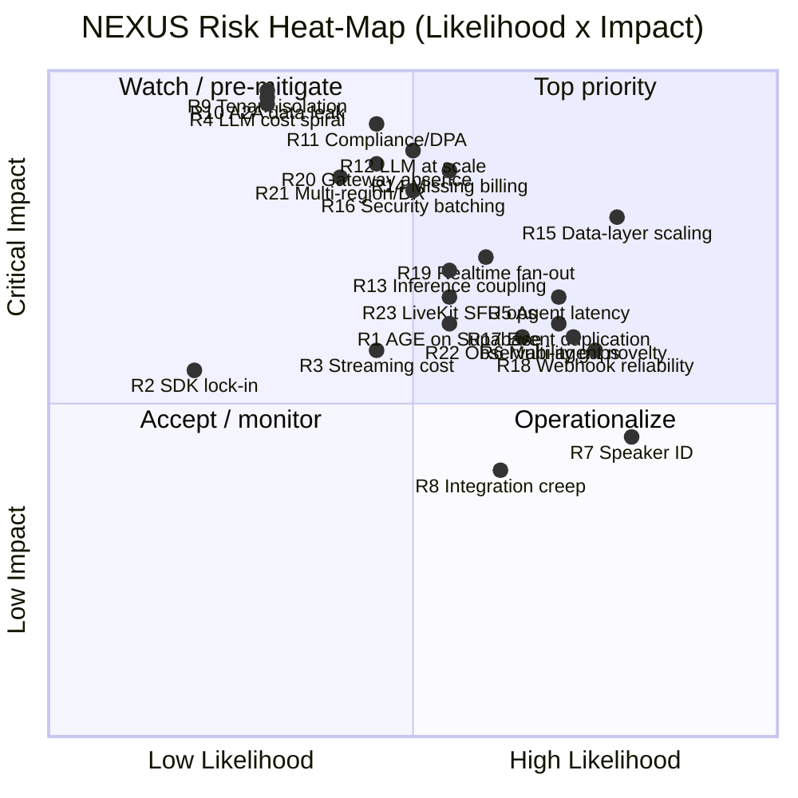
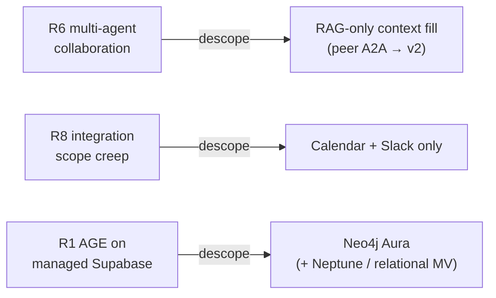

# NEXUS Risk Register

The single consolidated register of every NEXUS risk — the eight PDF-original risks (R1–R8) carried over verbatim, plus the SaaS-scale risks (R9–R23) surfaced by sizing NEXUS as a production multi-tenant platform — each with severity, likelihood, impact, mitigation, owning document, and fallback/descope.

## Related documents

- [Service Catalog & Bounded Contexts](04-service-catalog.md) — service ownership, including `billing-metering-service` and `integration-service`.
- [Data Architecture](05-data-architecture.md) — partitioning, AGE migration path, retention, backups/PITR/read replica.
- [Multi-Tenancy & Tenant Isolation](06-multi-tenancy.md) — pooled + RLS, cell-based isolation, `org_id` injection.
- [Event-Driven Architecture](07-event-architecture.md) — at-least-once, outbox/inbox, dedupe, DLQs, webhook reliability.
- [AI Agent Architecture](08-ai-agent-architecture.md) — the six agents, cost pipeline, agent-to-agent authz, ContextGapAgent.
- [RAG Pipeline & Inference Serving](09-rag-and-inference-serving.md) — dedicated inference tier, reranker budget.
- [Real-time & Transcription](10-realtime-and-transcription.md) — LiveKit transport, Deepgram path, latency budget, speaker mapping.
- [Security Architecture](11-security-architecture.md) — shift-left, API gateway + WAF, RBAC, agent-to-agent authorization.
- [Compliance & Data Privacy](12-compliance-and-privacy.md) — GDPR/CCPA, DPAs/SCCs, residency, PII redaction, RTBF, SOC2.
- [Scalability & Performance](13-scalability-and-performance.md) — autoscaler signals per tier, capacity headroom.
- [Reliability & Disaster Recovery](14-reliability-and-dr.md) — multi-region posture, RPO/RTO, backups.
- [Observability & SRE](15-observability-and-sre.md) — metrics, consumer-lag, quota and cost dashboards.
- [Deployment & Infrastructure](16-deployment-and-infrastructure.md) — Kubernetes/Terraform, multi-region active-passive→active-active, the substrate R21's DR posture rests on.
- [Cost & FinOps](17-cost-and-finops.md) — unit economics, LLM cost share, billing-safety levers.
- [SaaS Business Architecture](18-saas-business-architecture.md) — tenant lifecycle/provisioning saga, Stripe billing, usage metering, plans/tiers; specifies R14's billing and tenant-provisioning mitigations.
- [Roadmap & Phasing](22-roadmap-and-phasing.md) — phase plan and pre-authorized descopes (R6/R8/R1) in delivery context.
- [Canonical Capacity & Scaling Math](_canon/05-capacity-math.md) — every load and cost symbol cited below (`R4`, `T3`, `L7`, `V7`, `E12`, …).
- [Locked Tech & Architecture Decisions](_canon/06-tech-decisions.md) — the locked choices each mitigation rests on.

---

## 1. Purpose and scope

This document is the **single consolidated risk register** for NEXUS. It exists so that severity, likelihood, mitigation, and ownership for every known risk live in exactly one place, citable by ID, rather than scattered across phase plans and ADRs.

It is organized in two sections that share one column schema:

1. **§3 — PDF-original risks R1–R8.** Reproduced **verbatim** from the NEXUS Execution Plan v2.1 "PDF RISK REGISTER" — IDs, descriptions, and stated mitigations/descopes are unchanged. Where the locked SaaS posture has since **updated** a risk's status (e.g. R2 resolved by locking LiveKit, R4 fixed by the cost-controlled pipeline), that update is added **alongside** the original text as a marked adjustment; the PDF text is never overwritten.
2. **§4 — SaaS-scale risks R9–R23.** Wholly new risks surfaced by sizing NEXUS for millions of users across thousands of paying tenants. Three of them (R12, R13, R23) are the **at-scale residual** of a PDF risk and cross-reference it explicitly so the register never contradicts itself.

> [SaaS-scale adjustment] The PDF carried an 8-row risk register (R1–R8) for a 4-person team building an MVP against a `2 orgs x 10 users x 5 meetings` seeder. This document preserves those eight verbatim and adds R9–R23, which only exist because NEXUS is now a production multi-tenant SaaS with billing, compliance, multi-region operation, and the capacity profile frozen in [Capacity & Scaling Math](_canon/05-capacity-math.md). The numbering continues at R9 so no PDF ID is ever reused or shifted.

---

## 2. Rating rubric (read before the tables)

Severity, Likelihood, and Impact are not free-text. They are scored against the fixed rubric below so ratings are comparable across the register and reviewable in PRs.

### 2.1 Likelihood

| Level | Meaning |
|---|---|
| **Low** | Unlikely at the §2 capacity anchors with the locked design in place; would require a compound failure or an unmitigated edge case. |
| **Medium** | Plausible within the first 12 months of production at scale; expect to hit it at least once. |
| **High** | Effectively certain to occur (or already occurs at MVP scale) unless the mitigation is actively maintained. |

### 2.2 Impact

| Level | Meaning |
|---|---|
| **Low** | Degraded experience for some users; recoverable without data loss or customer-visible incident. |
| **Medium** | Customer-visible incident, SLO breach, or recoverable cost overrun bounded to one tier. |
| **High** | Multi-tenant outage, sustained margin erosion, or contractual SLA breach. |
| **Critical** | Cross-tenant data exposure, regulatory breach, unbounded cost, or loss of system of record. |

### 2.3 Severity (the matrix cell)

Severity is the resolved priority of Likelihood × Impact, not an independent guess. **Critical** impact pins severity to at least **High** regardless of likelihood, because cross-tenant leakage and regulatory breaches are unacceptable even when rare.

---

## 3. PDF-original risks (R1–R8) — verbatim

The descriptions and mitigations/descopes below are reproduced exactly from the PDF risk register. The three **pre-authorized descopes** are also PDF-original and are repeated in §3.9 verbatim. Status-update rows marked `[SaaS-scale adjustment]` are additive — they record how the locked posture changed the risk **without** editing the PDF text.

| ID | Risk (PDF verbatim) | Severity | Likelihood | Impact | Mitigation (PDF verbatim) | Owning doc | Fallback / descope |
|---|---|---|---|---|---|---|---|
| **R1** | Apache AGE on managed Supabase may be operationally awkward. | High | Medium | High | Fallback self-host Postgres+AGE or Neo4j Aura. | [Data Architecture](05-data-architecture.md) | Self-host Postgres+AGE; or migrate to Neo4j Aura. Phase 8 pre-authorized descope: **Neo4j Aura if AGE awkward**. SaaS adds Amazon Neptune + a relational materialized-view fallback. |
| **R2** | Meeting-SDK lock-in and pricing (evaluate >=2 in Phase 1, switching costs non-trivial after Phase 3). | Medium | Low | High | Evaluate >=2 SDKs in Phase 1; switching costs non-trivial after Phase 3. | [Real-time & Transcription](10-realtime-and-transcription.md) | Keep the SDK behind a transport adapter so the pick stays swappable. |
| **R3** | Event-streaming provider and cost. | Medium | Medium | Medium | Redpanda Serverless 30-day trial; fallback self-host open-source binary; Kafka API + Avro keep migration to Confluent/Aiven/Upstash mechanical. | [Event-Driven Architecture](07-event-architecture.md) | Self-host open-source Redpanda binary; Kafka API + Avro make migration to Confluent/Aiven/Upstash mechanical. |
| **R4** | LLM cost spiral once agents process every transcript chunk. | High | Low–Medium | Critical | Token budgets, smaller-model routing, prompt compression; Phase 13 targets ~30 percent reduction; budget alerts from Phase 7. | [AI Agent Architecture](08-ai-agent-architecture.md) | Tighten relevance gate, widen batch window, drop to silent-log tier; per-tenant hard quota denies over-budget calls. |
| **R5** | Agent latency budget under 2s is tight. | High | High | Medium | Deepgram ~1s + LLM ~0.8s + network; streaming + prioritized queues load-bearing. | [Real-time & Transcription](10-realtime-and-transcription.md) | Relax p95 to < 4s; stream partial output; pre-empt notes with the per-user priority queue. |
| **R6** | Multi-agent collaboration is the most novel and least-proven piece. | High | High | Medium | Phase 10; descope fallback chain to RAG-only, ship collaboration as v2. | [AI Agent Architecture](08-ai-agent-architecture.md) | Phase 10 pre-authorized descope: **RAG-only context fill**, ship peer-agent collaboration as v2. |
| **R7** | Speaker identification accuracy (voice fingerprinting hard). | Medium | High | Low | Confidence-scored suggestion on top of reliable manual assignment. | [Real-time & Transcription](10-realtime-and-transcription.md) | Manual `meeting_speakers` assignment is the source of truth; suggestion is advisory only. |
| **R8** | Scope creep around integrations. | Medium | Medium | Low | Ship Calendar + Slack + one of Jira/Linear only. | [Service Catalog](04-service-catalog.md) | Phase 12 pre-authorized descope: **Calendar + Slack only**. |

> [SaaS-scale adjustment] R1 status 2026-11-09: realised (the production `supabase/postgres` image has no AGE). Fallback taken: a dedicated self-hosted `apache/age` Postgres for `nexus_knowledge`, owner the maintainer ([ADR-0031](adr/0031-plan-8-graph-store-decision-supersedes-and-mark-done.md) D1).

### 3.1 R1 — Apache AGE on managed Supabase

> [SaaS-scale adjustment] The PDF fallback was self-host Postgres+AGE or Neo4j Aura. At the frozen capacity (`V7` = 4.42B vectors; the `nexus_knowledge` graph accrues hundreds of millions of `decisions`/`actions` edges over a multi-year horizon — `E4` = 3 surfaced decisions + `E5` = 5 surfaced actions per meeting × `R4` = 4.8M meetings/month ≈ 38.4M confirmed edges/month before the confirmation gate) the locked posture keeps **Apache AGE now** with a documented exit to **Amazon Neptune / Neo4j Aura plus a relational materialized-view fallback** ([Data Architecture](05-data-architecture.md)). Under Citus sharding the `nexus_knowledge` graph stays on a coordinator/reference node — that is the operational trigger for taking the managed-graph exit. The PDF Phase-8 descope (Neo4j Aura) is unchanged.

### 3.2 R2 — Meeting-SDK lock-in and pricing

> [SaaS-scale adjustment] **Status: resolved.** The PDF left the SDK open (evaluate >=2 in Phase 1). The locked decision is **LiveKit** (open-source self-hostable SFU: controls per-minute cost at scale, strong server-side audio hooks for the Deepgram path, no per-participant vendor ceiling), held behind the PDF's existing transport adapter so the choice stays swappable ([Tech Decisions](_canon/06-tech-decisions.md) §2.7). Locking an open-source self-host SFU retires the *lock-in/pricing* risk; the *residual* at scale is SFU self-host operational burden, tracked separately as **R23**.

### 3.3 R3 — Event-streaming provider and cost

> [SaaS-scale adjustment] The PDF used the Redpanda Serverless 30-day trial. At `E12` ≈ 17,900 events/sec peak and ~13.9 TB/month ingress, production runs a **BYOC/dedicated multi-AZ Redpanda cluster**, all topics tenant-partitioned ([Event-Driven Architecture](07-event-architecture.md)). The PDF fallback holds verbatim: Kafka API + Avro keep migration to Confluent/Aiven/Upstash mechanical.

### 3.4 R4 — LLM cost spiral

> [SaaS-scale adjustment] **Status: fixed by design.** The naive per-chunk path is `N2` ≈ 41.5B LLM calls/month (≈ $224M/mo all-Sonnet). The locked cost-controlled pipeline — relevance pre-gating → 30s windowed batching (agents run per window, **not** per raw `transcript_chunks` row, `A17`) → tiered routing (Haiku triage / Sonnet extraction / Opus high-stakes) → semantic + Anthropic prompt caching → per-tenant token budgets and hard quotas — yields `L7` ≈ 5.789B calls/month, an **86% reduction (`L10`)** before caching savings, with the PDF's ~30% Phase-13 optimization preserved as `C4` ([AI Agent Architecture](08-ai-agent-architecture.md), [Capacity](_canon/05-capacity-math.md) §8). The at-scale residual (token spend remains 94% of variable cost, `C3`) is tracked as **R12**.

### 3.5 R5 — Agent latency budget under 2s

The PDF budget is carried verbatim: Deepgram ~1s + LLM ~0.8s + network, **p50 < 2s, p95 < 4s** ([Capacity](_canon/05-capacity-math.md) §11.1). Streaming (LiteLLM → `agent-stream` Avro deltas → WebSocket) and the per-user priority queue are load-bearing. The dedicated inference tier (R13) is the precondition that makes this achievable at scale.

### 3.6 R6 — Multi-agent collaboration novelty

The PDF fallback chain is verbatim: `peer-agents -> related-meeting agents -> RAG -> silent`, with correlation IDs, a deadline, and fall-through. The Phase-10 pre-authorized descope is **RAG-only context fill**, shipping `ContextGapAgent` peer collaboration as v2 ([AI Agent Architecture](08-ai-agent-architecture.md)). At SaaS scale the collaboration round-trip is additionally bound by agent-to-agent authorization (R10).

### 3.7 R7 — Speaker identification accuracy

Carried verbatim. Manual assignment via `meeting_speakers` (diarized `speaker_id` → `user_id`) is the **reliable source of truth**; the confidence-scored suggestion sits on top and is advisory ([Real-time & Transcription](10-realtime-and-transcription.md)). No graph edge or worklog attribution is committed on an unconfirmed suggestion.

### 3.8 R8 — Integration scope creep

Carried verbatim. Guardrail: **ship Calendar + Slack + one of Jira/Linear only**. `integration_connections.provider` is constrained to `google_calendar`/`slack`/`jira`/`linear`; `integration-service` owns the surface ([Service Catalog](04-service-catalog.md)). Phase-12 pre-authorized descope: **Calendar + Slack only**.

### 3.9 Pre-authorized descopes (PDF verbatim)

These three descopes are pre-approved in the PDF; invoking them requires no new sign-off, only a recorded decision.

| Trigger | Descope (verbatim) |
|---|---|
| Phase 10 multi-agent collaboration proves unreliable | **Phase 10 -> RAG-only context fill** |
| Integration scope pressure | **Phase 12 -> Calendar + Slack only** |
| Apache AGE awkward on managed Supabase | **Phase 8 -> Neo4j Aura if AGE awkward** |

---

## 4. SaaS-scale risks (R9–R23)

> [SaaS-scale adjustment] Every risk in this section is wholly new relative to the PDF, except R12, R13, and R23, which are the **at-scale residual** of a PDF risk (R4, R4/R5, and R2 respectively) and are framed as escalations, never re-ratings, of the PDF original. IDs continue at R9 so no PDF ID is reused.

| ID | Risk | Severity | Likelihood | Impact | Mitigation | Owning doc | Fallback / descope |
|---|---|---|---|---|---|---|---|
| **R9** | **Multi-tenant isolation failure** — a query, vector search, graph traversal, event, cache read, or object fetch crosses an `org_id` boundary and exposes another tenant's data. | Critical | Low–Medium | Critical | Defense-in-depth: authz middleware injects `org_id` on every query; Postgres RLS `USING (org_id = current_setting('app.current_org')::uuid)` as backstop; per-tenant Qdrant collections `__{org_id}` **plus** mandatory `org_id` payload filter; org-partitioned AGE (`$org_id` on every template); tenant-keyed Redpanda partitions; `nexus:{org_id}:*` Redis namespacing; `{org_id}/` object-storage prefixes. Cell-based isolation for large/enterprise tenants. | [Multi-Tenancy & Tenant Isolation](06-multi-tenancy.md) | Fail closed: a request with no resolvable `org_id` is rejected at the middleware chokepoint. Promote a leaking tenant to a dedicated cell. |
| **R10** | **Agent-to-agent data leak** — a personal agent's `agent-requests` round-trip pulls context from a peer in another tenant or beyond authorized role scope. | Critical | Low–Medium | Critical | Agent-to-agent authorization **deny-by-default**, org/role scope checks on every call, fully audited; `AgentRequest`/`AgentResponse` envelopes carry `requester_agent_id`, `responder_target`, `correlation_id`, `deadline`; agents are tenant-bound. Every round-trip logged to `agent_collaborations`. | [Security Architecture](11-security-architecture.md) | If authorization fails or the deadline lapses, the `ContextGapAgent` fallback chain falls through to org-scoped RAG → silent — never to a cross-tenant source. R6 RAG-only descope stays inside the tenant by construction. |
| **R11** | **Compliance / DPA gap** — GDPR/CCPA, data-residency, PII, or subprocessor obligations unmet; blocks enterprise sales or triggers regulatory breach. | High | Medium | Critical | GDPR/CCPA program; subprocessor DPAs + SCCs for Deepgram/Anthropic/LiveKit; `data_residency` pins region/cell (`us`/`eu`/`ap`), immutable after `locked_at`; PII redaction pass on ingest; right-to-be-forgotten Temporal workflow deletes by `org_id`/`user_id` across all six stores; append-only `audit_logs`; SOC2 readiness. | [Compliance & Data Privacy](12-compliance-and-privacy.md) | Gate affected regions/features behind residency config; block Enterprise onboarding until DPA executed. |
| **R12** | **LLM cost at scale (R4 residual)** — even at `L7` (5.789B calls/mo), LLM is `C3` ≈ 94% of variable cost (`C-total` ≈ $19.5M/mo); a gate-tuning regression or tier-routing bug re-inflates spend. | High | Medium | High | All R4 levers, continuously enforced: relevance pre-gating, 30s windowed batching, Haiku→Sonnet→Opus tiering (mix Haiku 45% / Sonnet 55% / Opus <1%), semantic + Anthropic prompt caching, per-tenant `agent_budgets` with hard caps and 80/95% alerts; cost/MAU `C2` ≈ $9.73 (→ `C4` ≈ $6.99 post-optimization) tracked as a margin SLO. | [Cost & FinOps](17-cost-and-finops.md) | Tighten gate pass-rate, widen the batch window, route more traffic to Haiku; per-tenant hard quota throttles/blocks at the cap. Cross-ref R4. |
| **R13** | **Inference coupling (R4/R5 residual)** — CPU/GPU-bound BGE embedding + reranker inference sharing the API tier lets an ingest backlog throttle API serving and an API spike steal GPU cycles. | High | Medium | High | Dedicated autoscaling `embedding-service` (BGE-small-en 384-dim) and `reranker-service` (BGE-reranker-base) on GPU via Ray Serve/vLLM, **off the API tier**; embed-on-ingest, query-embed only; independent KEDA autoscaler on queue depth + GPU util (`EM2` ≈ 525 embeds/sec peak, `EM4` ≈ 700 query-embeds/sec peak). | [RAG Pipeline & Inference Serving](09-rag-and-inference-serving.md) | Scale inference replicas independently; shed query-embed load to cache before touching ingest. Cross-ref R4, R5. |
| **R14** | **Missing billing / monetization / tenant provisioning** — no tenant lifecycle, metering, or quota enforcement means unbounded free usage and no revenue capture; a failed provisioning saga leaves a half-created tenant; the PDF had no billing or tenant model. | High | Medium | High | `billing-metering-service`: Stripe subscriptions/seats/dunning/tax; `usage-events` → aggregation → quota enforcement; Free/Pro/Enterprise `plans`; per-tenant `agent_budgets` hard caps wired to R12; `invoices` retained 7 years. Fault-tolerant **tenant-provisioning saga** (Temporal, compensating steps, idempotent) creates/suspends/offboards orgs via `tenant-events`. Self-serve onboarding + tenant admin console. | [SaaS Business Architecture](18-saas-business-architecture.md) | Quota-cap Free tier hard; suspend non-paying tenants via `tenant-events`; provisioning saga compensates and retries a partial tenant create. Billing/cost angle: [Cost & FinOps](17-cost-and-finops.md). |
| **R15** | **Data-layer scaling** — `transcript_chunks` at `T3` ≈ 1.73B rows/month / `T4` ≈ 21B rows/year cannot live as one hot Postgres relation; unpartitioned, retention purges and RTBF scan instead of dropping. | High | High | High | Monthly declarative range partitioning on high-volume tables (`transcript_chunks`, `chat_messages`, `meetings`, `usage_events`, `audit_logs`); hot 90d then cold/object tier; index on `(meeting_id, start_ms)` preserved; Qdrant stock `V7` ≈ 4.42B / ~17 TB held with int8 quantization + hot/cold split (`A18` 13-month retention); read replica + PITR. | [Data Architecture](05-data-architecture.md) | Drop partitions for retention/RTBF instead of DELETE; Citus shard-by-`org_id` if a single primary saturates. |
| **R16** | **Security batched into one late phase** — the PDF deferred security to a Phase-13 audit; at SaaS scale that leaves authz/scan gaps live in production for months. | High | Medium | High | Shift-left: threat model in Phase 1, an authorization check reviewed in **every PR**, dependency + secret scanning from day one; API gateway + WAF + global rate limiting; Clerk + SSO/SAML/SCIM; hardened user-sync (outbox + reconciliation, Clerk as source of truth). | [Security Architecture](11-security-architecture.md) | Block merges failing the authz/scan gate; quarantine a service rather than ship an unreviewed authz path. |
| **R17** | **Event duplication / double-apply** — at-least-once delivery over ~11.58B events/month (`E10`) replays events; without dedupe, usage is double-metered, edges double-created, notes duplicated. | High | High | Medium | At-least-once **with idempotency keys + transactional outbox/inbox pattern + dedupe cache + DLQs**; consumers dedupe on `idempotency_key` via inbox table + `nexus:{org_id}:dedupe:{topic}:{idempotency_key}` Redis cache (24h); unique constraints on `usage_events`; graph edges created **only on confirmation**. | [Event-Driven Architecture](07-event-architecture.md) | Poison messages land in per-topic DLQ; replay from offset after fixing the consumer; dedupe cache guarantees ~0 duplicate-apply (SLO §11.3). |
| **R18** | **Webhook reliability** — dropped Clerk, LiveKit, Stripe, Slack, or Jira/Linear webhooks desync identity, room state, billing, and ticket sync. | High | High | Medium | Clerk user-sync via outbox + reconciliation (Clerk as source of truth) survives dropped webhooks; LiveKit/Stripe/provider webhook receivers are idempotent and cursor-tracked (`integration_connections` webhook cursors); reconciliation jobs backfill missed events. | [Event-Driven Architecture](07-event-architecture.md) | Periodic reconciliation/poll closes any gap; replay provider webhooks where supported; DLQ for unparseable payloads. |
| **R19** | **Real-time fan-out** — at `A6` = 100k concurrent participants, Socket.io agent-output/presence fan-out across horizontally scaled pods exceeds single-instance capacity. | High | Medium | High | `realtime-gateway` scales on **concurrent WebSocket connections** (sticky/Redis-backed); Redis pub/sub backbone fans out across instances (`nexus:{org_id}:pubsub:meeting:{meeting_id}`); per-user priority queue pre-empts notes with urgent alerts; rooms keyed by `meeting_id`; reconcile A5/A6 via effective occupancy `A8` = 5.0. | [Real-time & Transcription](10-realtime-and-transcription.md) | Shed low-priority agent output first; degrade to caption-only fan-out under extreme load. |
| **R20** | **API gateway absence** — the PDF had no edge gateway; without one there is no central JWT pre-validation, `org_id` extraction, WAF, or global rate limiting, so a single tenant can starve others. | High | Medium | High | `api-gateway`: TLS termination, WAF, global + per-tenant rate limiting, Clerk JWT pre-validation, `org_id` extraction, routing to `bff`/services; stateless, edge-scaled; multi-region active-passive → active-active. | [Security Architecture](11-security-architecture.md) | Per-tenant rate limits throttle a noisy tenant at the edge before it reaches services; WAF rules block L7 abuse. |
| **R21** | **Multi-region / DR gap** — single-region operation cannot meet Pro/Enterprise availability SLOs or residency obligations; a region loss is a total outage with data loss. | High | Low–Medium | High | Multi-region active-passive evolving to active-active; per-plan availability SLOs (Free 99.5% / Pro 99.9% / Enterprise 99.95%); Postgres backups + PITR + read replica; `data_residency` regional placement; RTBF + retention workflows region-aware. | [Reliability & Disaster Recovery](14-reliability-and-dr.md) | Fail over to passive region (RPO/RTO per [DR](14-reliability-and-dr.md)); pin Enterprise tenants to cells with active-active candidacy. |
| **R22** | **Observability gaps** — without per-tenant metrics, consumer-lag, cost, and quota dashboards, backpressure and budget breaches become user-visible before they're detected. | Medium | Medium–High | Medium | Prometheus + Grafana, structured JSON logs (tenant-tagged), Sentry; consumer-lag monitoring + alerts (lag < 5s, alert at 30s); DLQ-rate, duplicate-delivery, and `agent_budget_state{org_id,period}` dashboards; latency SLOs per surface (§11.1). | [Observability & SRE](15-observability-and-sre.md) | Page on SLO burn-rate and consumer lag before customer impact; per-tenant cost dashboard surfaces a runaway tenant to support pre-ticket. |
| **R23** | **LiveKit SFU self-host operational burden (R2 residual)** — locking an open-source self-host SFU trades vendor lock-in for the ops/scaling cost of running the SFU and recording/egress fleet at 20k concurrent meetings (`A5`) / 100k participants (`A6`). | Medium | Medium | High | LiveKit always behind a transport adapter (swappable); `meeting-service` owns the room↔meeting map, token minting (`POST /api/meetings/:id/token`), and webhook receiver; SFU + egress scale on concurrent rooms in the real-time tier; one diarized Deepgram stream per meeting (6× cost lever, `D3` avoided). | [Real-time & Transcription](10-realtime-and-transcription.md) | Transport adapter keeps the swap mechanical if self-host ops prove untenable — to LiveKit Cloud (same SDK, managed) or to another candidate SDK (Daily/Stream/Agora) without re-cutting the adapter. Cross-ref R2. |

---

## 5. Risk-to-owning-document map

Every risk has exactly one owning document — the doc whose authors are accountable for keeping the mitigation true. Cross-referenced docs are listed but do not own.

| Owning doc | Risks owned |
|---|---|
| [Data Architecture](05-data-architecture.md) | R1, R15 |
| [Multi-Tenancy & Tenant Isolation](06-multi-tenancy.md) | R9 |
| [Event-Driven Architecture](07-event-architecture.md) | R3, R17, R18 |
| [AI Agent Architecture](08-ai-agent-architecture.md) | R4, R6 |
| [RAG Pipeline & Inference Serving](09-rag-and-inference-serving.md) | R13 |
| [Real-time & Transcription](10-realtime-and-transcription.md) | R2, R5, R7, R19, R23 |
| [Security Architecture](11-security-architecture.md) | R10, R16, R20 |
| [Compliance & Data Privacy](12-compliance-and-privacy.md) | R11 |
| [Reliability & Disaster Recovery](14-reliability-and-dr.md) | R21 |
| [Observability & SRE](15-observability-and-sre.md) | R22 |
| [Cost & FinOps](17-cost-and-finops.md) | R12 |
| [SaaS Business Architecture](18-saas-business-architecture.md) | R14 |
| [Service Catalog](04-service-catalog.md) | R8 |

---

## 6. How to maintain this register

1. **IDs are immutable.** R1–R8 are PDF-frozen; R9–R23 are SaaS-frozen. A retired risk keeps its ID with a `resolved` status note (e.g. R2). New risks continue at **R24+**; an ID is never reused or renumbered.
2. **Ratings cite the §2 rubric.** Any Severity/Likelihood/Impact change is a reviewable diff with a one-line justification against the rubric, not a silent edit.
3. **Mitigations cite canon, not literals.** A mitigation references a capacity symbol (`L7`, `T3`, `V7`, `E12`, `A6`) or a locked decision by name, so a single edit in [Capacity](_canon/05-capacity-math.md) or [Tech Decisions](_canon/06-tech-decisions.md) propagates here.
4. **Residual risks cross-reference their parent.** R12→R4, R13→R4/R5, R23→R2. A residual is never rated in a way that contradicts the parent's stated resolution.
5. **The owning doc is the source of truth for the mitigation's design.** This register summarizes; the owning doc specifies. If they disagree, the owning doc wins and this row is corrected.
