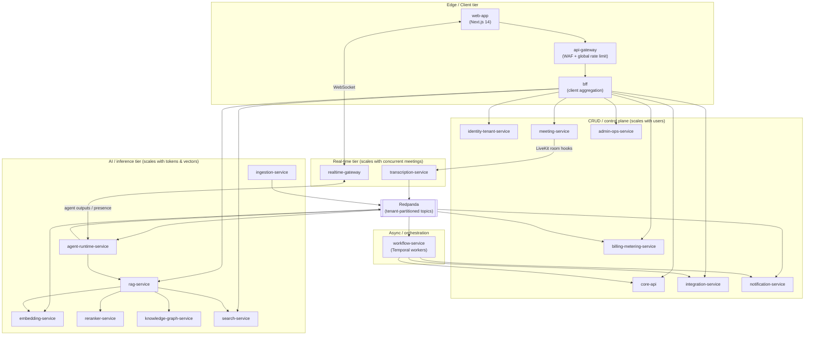
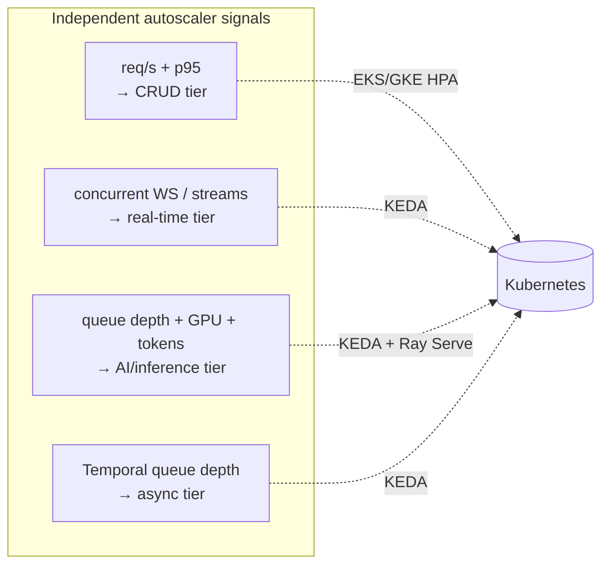
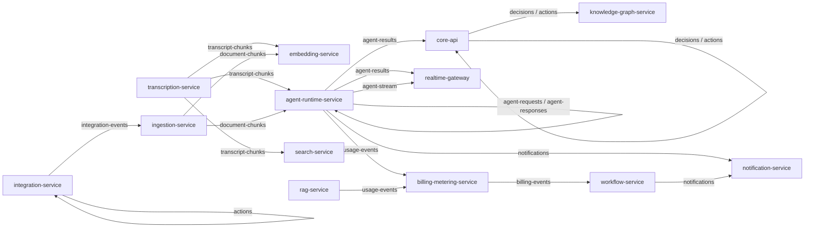
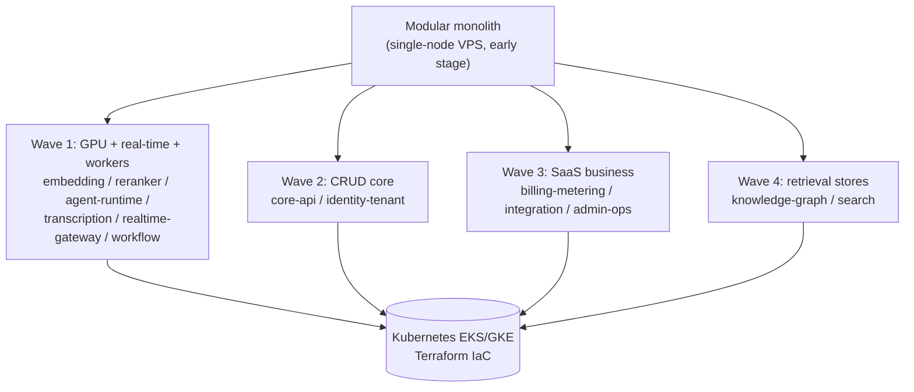

# Service Catalog

The canonical, frozen list of NEXUS microservices and bounded contexts, their data ownership, event contracts, sync APIs, and scaling profiles for the event-driven, multi-tenant SaaS architecture.

## Related documents

- [Glossary](../24-glossary-and-naming.md)
- [Data Architecture](../05-data-architecture.md)
- [Event Streaming & Schema Registry](../07-event-architecture.md)
- [Multi-Tenancy & Isolation](../06-multi-tenancy.md)
- [Security & AuthZ](../11-security-architecture.md)
- [Inference & LLM Pipeline](../09-rag-and-inference-serving.md)
- [Agent Runtime & LangGraph](../08-ai-agent-architecture.md)
- [Deployment & Infrastructure](../16-deployment-and-infrastructure.md)
- [SaaS Business: Billing, Metering, Tenancy Lifecycle](../18-saas-business-architecture.md)

---

## 1. Purpose and scope

This catalog is the **single source of truth for service names**. Every service is named exactly **once**, in kebab-case. No other document, ADR, or diagram in this set may introduce an alternative name for a service listed here; if a rename is ever required it must be recorded in the [Glossary](../24-glossary-and-naming.md) as `old -> new` before use.

The architecture style is **event-driven microservices with an explicit modular-monolith → services evolution path**. Several services below ship as modules inside a single deployable in the early stage (a self-hosted single-node VPS running Docker Compose, [ADR-0016](../adr/0016-self-hosted-vps-mvp-substrate.md)) and split out at the seams already drawn here once they hit independent scaling or team-ownership pressure.

> [SaaS-scale adjustment] The original PDF was phase-and-domain organized (13 phases, role-agnostic, 4-person team) and did not name services. This catalog imposes a bounded-context decomposition because the agent/inference tier scales and costs completely differently from the CRUD tier and **must scale independently**. Service boundaries are drawn so the modular monolith can be peeled into services without re-cutting domain seams.

Two cross-cutting principles bind every service:

1. **Tenant isolation at every layer.** An authz middleware injects `org_id` on every query; events are partitioned by tenant; Postgres uses Row-Level Security (RLS) for the pooled long tail and cell-based isolation for large/enterprise tenants. See [Multi-Tenancy & Isolation](../06-multi-tenancy.md).
2. **At-least-once event delivery with idempotency.** Every producing service uses the transactional **outbox** pattern; every consuming service uses an **inbox**/dedupe cache keyed by idempotency key, with **DLQs** per topic. Avro + Schema Registry with **BACKWARD** compatibility, one subject per topic (`{topic}-value`). See [Event Streaming & Schema Registry](../07-event-architecture.md).

---

## 2. Context map

The three scaling families — **CRUD/control plane**, **real-time**, and **AI/inference** — are the reason the monolith is cut where it is. Each family has its own autoscaler signal and its own cost center (see scaling profiles in §4).

---

## 3. Canonical service table

> Column legend. **Owns data** = the authoritative store(s) this service writes; no other service writes them. **Consumes / Produces events** = Redpanda topics from the canon (`transcript-chunks`, `document-chunks`, `agent-results`, `decisions`, `actions`, `notifications`, `agent-requests`, `agent-responses`, `agent-stream`) plus the SaaS-scale topics introduced below. **Sync API** = HTTP/WS surface owned. **Scaling profile** = autoscaler signal and tier.

| Service name | Responsibility | Owns data | Consumes events | Produces events | Sync API | Scaling profile |
|---|---|---|---|---|---|---|
| `api-gateway` | Single ingress: TLS termination, WAF, global rate limiting, JWT pre-validation (Clerk), `org_id` extraction, routing to `bff`/services. No business logic. Also accepts a personal access token (`mytheus_pat_<org hex>_<secret>`, [ADR-0040](../adr/0040-polish-program.md)) as a bearer: the tenant is read from the token itself, the hash is looked up under RLS, `read` tokens are limited to GET/HEAD, and each token has a per-minute rate limit. | None (stateless; config only) | — | — | All external HTTPS/WSS ingress; reverse-proxy to internal services. [ADR-0040](../adr/0040-polish-program.md) adds the prefixes `/api/v1/api-tokens` (`identity-tenant-service`), `/api/v1/share-links`, `/api/v1/public` (unauthenticated share pages), `/api/v1/me/memory`, `/api/v1/capture`, `/api/v1/search`, `/api/v1/decision-reversals`, `/api/v1/digests`, `/api/v1/clips` (`core-api`), `/api/v1/ask` and `/mcp` (`bff`) | Horizontal, edge; scales on req/s + connections. Multi-region active-passive → active-active. |
| `web-app` | Next.js 14 App Router UI: dashboard, meeting room, agent sidebar, transcript view, RAG context panel, admin/tenant consoles, integration settings. Server components + RSC streaming. | None (CDN-cached assets via Cloudflare) | — | — | Serves HTML/RSC; calls `bff` only | Horizontal, edge/CDN; scales on page req/s. Static-heavy, cheap. |
| `bff` | Backend-for-frontend: aggregates/denormalizes reads for screens, fans out to services, shapes payloads, handles client-session concerns. Thin, no domain ownership. | None (read-through; short Redis cache) | — | — | `GET/POST /bff/*` (screen-shaped endpoints) consumed only by `web-app`, including the participant-only meeting reads `GET /bff/meetings/{id}/brief`, `GET /bff/meetings/{id}/health` (after the meeting ended) and `GET /bff/meetings/{id}/catch-up` ([ADR-0039](../adr/0039-company-brain-and-meeting-companions.md) B8). [ADR-0040](../adr/0040-polish-program.md): `POST /api/v1/ask` (an answer with citations from `rag-service`, each citation carrying `document_id` or `start_ms` so the UI opens the moment), `POST /mcp` (the MCP server, Streamable HTTP, stateless: tools `search_meetings`, `ask_meetings`, `get_meeting_outcome`, `get_decision_record`, `list_my_open_actions`, `list_my_promises`, `create_action` (a `read_write` token), each calling the public API as the caller with a personal access token or a Clerk session), `POST /bff/meetings/precheck` ("Should this be a meeting?": already-decided matches, status updates that would cover agenda lines, recent related meetings; read-only, never blocks scheduling); the brief gains the person's memory and the previous meeting's minutes, and the dashboard's "needs review" reads `review_owner_id` | Horizontal; scales on UI req/s. Co-located with CRUD tier. |
| `identity-tenant-service` | Identity & tenancy control plane: Clerk webhook user-sync (outbox + reconciliation, Clerk as source of truth), org/tenant provisioning & lifecycle, RBAC, SSO/SAML/SCIM, agent-to-agent authorization grants (deny-by-default), `get_user_context(user_id)` source-of-record for role/skills/team, and the company brain (company profile, vocabulary, topic owners, goals, ground rules, readiness, the new joiner brief) served to services as `GetOrgContext` ([ADR-0039](../adr/0039-company-brain-and-meeting-companions.md) Part A). | `users` (role, skills[], bio, avatar_url, the working profile `listen_for`/`ignore_topics` and the agent persona `agent_name`/`agent_avatar_seed`/`agent_personality`/`agent_instructions`, [ADR-0038](../adr/0038-agent-personas-profiles-agendas-and-meeting-agent.md)), `organizations`, `tenants`, RBAC roles/grants, SSO config, SCIM state, agent-authz scopes, `pii_tokens` (the per-tenant reversible PII token vault; sole writer, [ADR-0020](../adr/0020-pii-token-vault-and-ner-placement.md)), the company brain `org_profiles`, `org_glossary_terms`, `topic_owners`, `org_goals` and `tenant_settings.never_record_topics`, and `topic_watches` ([ADR-0039](../adr/0039-company-brain-and-meeting-companions.md)), `api_tokens` ([ADR-0040](../adr/0040-polish-program.md)) | `user-sync-events` (Clerk inbox) | `tenant-events` (provisioned/suspended/deleted), `notifications` | `POST /clerk/webhook`, `GET/POST /orgs`, `GET /users/me`, `GET /users`, `PATCH /users/{user_id}` (the `agent_*` fields self only, [ADR-0038](../adr/0038-agent-personas-profiles-agendas-and-meeting-agent.md)), `/rbac/*`, `/scim/v2/*`, `GET /context/{user_id}`, `POST /pii-tokens/mint` (internal-only, redaction-boundary callers), `POST /pii-tokens/resolve` (RBAC-gated, audited); the company brain ([ADR-0039](../adr/0039-company-brain-and-meeting-companions.md) A1 to A8; writes owner/admin, reads any member): `GET/PUT /org/profile`, `GET/POST /org/glossary`, `PATCH/DELETE /org/glossary/{id}`, `POST /org/glossary/import`, `GET/POST /org/topic-owners`, `PATCH/DELETE /org/topic-owners/{id}`, `GET/POST /org/goals`, `PATCH/DELETE /org/goals/{id}`, `GET/PUT /org/ground-rules`, `GET /org/readiness` (owner/admin), `GET /org/welcome`; self only: `GET/POST /users/me/topic-watches`, `DELETE /users/me/topic-watches/{id}`; internal gRPC `IdentityService.GetOrgContext(GetOrgContextRequest) returns (OrgContext)` (`org_id` in metadata like `GetUserContext`; cached at `nexus:{org_id}:org_ctx` for 5 minutes, evicted by every company-brain write; callers `agent-runtime-service` and `transcription-service`, [ADR-0039](../adr/0039-company-brain-and-meeting-companions.md) A9); `OrgContext` also carries the People structure, `departments` (`OrgDepartment`: id, name, description, parent_id) and `teams` (`OrgTeam`: id, name, description, department_id, member_count), read from `core-api`'s tables ([ADR-0041](../adr/0041-people-structure.md)); personal access tokens, self only ([ADR-0040](../adr/0040-polish-program.md)): `GET/POST /api-tokens` (the plaintext is shown once; only its SHA-256 and last four characters are stored), `DELETE /api-tokens/{token_id}` | Horizontal; scales on auth+webhook req/s. Control-plane critical path; HA, low latency. |
| `core-api` | Domain CRUD: meetings, organizations, teams, team_members, departments (org hierarchy), meeting_participants, chat persistence, worklogs, decisions/actions read models, profiles/org-chart. Owns the relational heart. | `meetings`, `teams`, `team_members`, `departments`, `meeting_participants`, `meeting_speakers`, `meeting_agenda_items`, `meeting_templates`, `worklogs`, `decisions`, `action_items`, `agent_suggestions`, `chat_messages`, `agent_collaborations`, `commitments`, `action_status_requests` ([ADR-0039](../adr/0039-company-brain-and-meeting-companions.md)); [ADR-0040](../adr/0040-polish-program.md): `share_links`, `meeting_followups`, `agent_feedback`, `agent_calibration`, `person_memory`, `meeting_minutes`, `meeting_off_record_segments`, `decision_reversals`, `delegated_answer_statements`, `delegated_answer_log`, `promise_drift_nudges`, `weekly_digests`, `digest_preferences`, `meeting_clips`; [ADR-0043](../adr/0043-meeting-email-invitations.md): `meeting_invitations` | `decisions`, `actions`, `agent-results` (to update read models; applies the agenda updates in `MeetingAgent` `meeting_update` records to `meeting_agenda_items`, [ADR-0038](../adr/0038-agent-personas-profiles-agendas-and-meeting-agent.md); persists `PersonalListenerAgent` `payload_json.commitments` to `commitments`, [ADR-0039](../adr/0039-company-brain-and-meeting-companions.md) B6; [ADR-0040](../adr/0040-polish-program.md): stores each card's moment fields, applies `updates_candidate_id` to a proposed, unedited card, upserts `minutes` records into `meeting_minutes` and sends a follow-up that was waiting for them, logs delegated answers), `agent-feedback` (group `core-api`: the `person_memory` consumer) | `meeting-events` (created/updated/ended), `outbox` → `decisions`/`actions` on confirm, `outbox` → `agent-feedback` with every `agent_feedback` row ([ADR-0040](../adr/0040-polish-program.md)) | `GET/POST/PATCH /meetings`, People structure ([ADR-0041](../adr/0041-people-structure.md); writes owner/admin, reads any member): `PATCH/DELETE /api/v1/departments/{department_id}`, `PATCH/DELETE /api/v1/teams/{team_id}`, `POST /api/v1/teams/{team_id}/members/{user_id}/move`, `PUT /meetings/{id}/agenda`, `PATCH /meetings/{id}/agenda/{item_id}`, `GET /meetings/{id}/carry-forward`, internal caller-token `GET /internal/meetings/{id}/agenda` ([ADR-0038](../adr/0038-agent-personas-profiles-agendas-and-meeting-agent.md); adds `proxies`, [ADR-0039](../adr/0039-company-brain-and-meeting-companions.md) B5); [ADR-0039](../adr/0039-company-brain-and-meeting-companions.md) Part B: `GET /meeting-templates` (members), `POST /meeting-templates`, `PATCH/DELETE /meeting-templates/{id}` (owner/admin), `POST /meetings/agenda-draft` (deterministic, saves nothing), `PUT /meetings/{id}/attendance` (self only), `GET /commitments`, `PATCH /commitments/{id}` (owner only), `GET /status-requests`, `POST /status-requests/{id}/answer` (the assignee), internal caller-token `POST /internal/meetings/{id}/status-requests` (caller `workflow-service`); `/teams`, `/departments`, `/worklogs`, `/decisions`, `/actions`, `/chat`. [ADR-0040](../adr/0040-polish-program.md), all under `/api/v1`: tasks `POST /actions` (a task with no meeting), `GET /actions/mine`, `POST /actions/{id}/reopen`; the room `GET /meetings/{id}/candidates/{candidate_id}` (and `?include_resolved` on the list), `GET /meetings/{id}/chat`, `PATCH /meetings/{id}/agenda/{item_id}` (`status` optional, `extend_minutes`), `POST /meetings/{id}/agenda/advance`, `GET /meetings/{id}/wrap-up`, `POST .../wrap-up/start`, `.../cancel`, `.../close`, `GET /meetings/{id}/catch-up-summary`, `POST /meetings/{id}/stand-ins/{user_id}/ask`, `POST /worklogs/{id}/feedback`; minutes and reach `GET /meetings/{id}/minutes`, `GET /meetings/{id}/recap`, `GET/PUT /meetings/{id}/follow-up`, `POST .../follow-up/send`, `GET/POST /meetings/{id}/share-links`, `GET /decisions/{id}/record`, `GET/POST /decisions/{id}/share-links`, `DELETE /share-links/{link_id}`, public `GET /public/shares/{token}` (no sign-in; the signed token is the authority), `GET /search`; learning `GET/PATCH/DELETE /me/memory`; off the record `GET/POST /meetings/{id}/off-record`, `POST .../off-record/end`; capture `GET /capture/status`, `POST /capture/sessions`, `POST /capture/sessions/{meeting_id}/refresh`, `.../end`; only-Mytheus `GET /decision-reversals`, `GET /decision-reversals/{id}`, `POST .../resolve`, `GET/PUT /meetings/{id}/delegated-answers`, `GET .../delegated-answers/log`, `POST /status-requests` (one-click asks), `GET /digests`, `/digests/latest`, `/digests/preview`, `/digests/{id}`, `GET/PUT /digests/preferences`; `POST /erasures` (owner/admin, reached only through `admin-ops-service`, not routed by `api-gateway`); internal caller-token `GET /internal/agent-policy` (the one threshold source, with per-person calibration), `GET /internal/agent-guidance`, `GET /internal/person-memory/{user_id}`, `GET /internal/meetings/{id}/index-policy`, `GET /internal/meetings/{id}/minutes-source`, `GET /internal/meetings/{id}/delegated-answers`, `POST /internal/meetings/{id}/follow-up/dispatch`, `GET /internal/meetings/{id}/crm-digest`, `GET /internal/decisions/{id}/record`, `GET /internal/promise-drift/due`, `POST /internal/promise-drift/nudges`, `POST /internal/digests/weekly`; clips (C5) `GET/POST /meetings/{id}/clips`, `DELETE /clips/{clip_id}`, `POST /clips/{clip_id}/share-links`, public `GET /public/clips/{token}`; invitations ([ADR-0043](../adr/0043-meeting-email-invitations.md)) `GET/POST /meetings/{id}/invitations` (send: the host, the creator or an owner/admin), `GET /meetings/invitations/status`, `GET /meetings/{id}/calendar.ics`, public `GET /public/calendar/{token}.ics` (no sign-in; calendar data only) | Horizontal stateless; scales on req/s. Pooled+RLS long tail, cell-routed for enterprise. |
| `meeting-service` | LiveKit transport adapter: mints room tokens (`POST /api/meetings/:id/token` with participant verification), receives LiveKit webhooks (room.created, participant.joined, recording.ready), bridges server-side audio hooks to `transcription-service`. SDK abstracted behind transport adapter. | `meeting_rooms` (LiveKit room↔meeting map, egress/recording refs, `started_at`: the meeting's own clock, set by the first token mint or `room_started`; `recording_skip_reason`), `meeting_recordings` (one row per egress segment, [ADR-0040](../adr/0040-polish-program.md) C5) | `meeting-events` (to open/close rooms; opens no room for a meeting whose `source` is not `mytheus` or that is recorded in person, [ADR-0040](../adr/0040-polish-program.md)) | `meeting-room-events` (joined/left/recording-ready; the raw-audio handoff to transcription-service is a server-side LiveKit hook, not a topic) | `POST /api/meetings/:id/token` (body `consent: {version}` records consent at mint; an external meeting answers 409 `EXTERNAL_MEETING`), `POST /livekit/webhook`; [ADR-0040](../adr/0040-polish-program.md): `GET /api/meetings/{id}/session` (the caller's consent state and the meeting clock), `GET /api/meetings/{id}/consent-receipt` (the caller's own receipt), `GET /api/meetings/{id}/recording` (status and 600-second presigned URLs on the meeting clock; participants only, audited); internal, caller `core-api` only: `POST /internal/meetings/{id}/recording/pause`, `.../resume`, `.../erase`, `POST /internal/meetings/{id}/clips/{clip_id}/video` (cuts a shared clip's own object) | Horizontal; scales on concurrent rooms. Real-time tier; audio hook fan-out. |
| `realtime-gateway` | WebSocket/Socket.io fan-out for non-AV events: chat, presence, live captions, agent sidebar outputs, streamed agent tokens, priority alert queue. Redis pub/sub backbone for fan-out across instances. Socket.io rooms keyed by meeting ID. | None (ephemeral connection state; Redis pub/sub channels) | `agent-stream`, `agent-results` (including `MeetingAgent` `meeting_update`, split into agenda updates to every meeting socket and a nudge to the host's sockets only, [ADR-0038](../adr/0038-agent-personas-profiles-agendas-and-meeting-agent.md); its validators accept the `ProactiveAgent` alert types `already_decided` and `topic_watch` and the nudge type `proxy_update`, [ADR-0039](../adr/0039-company-brain-and-meeting-companions.md) D2; forwards each card's moment fields, [ADR-0040](../adr/0040-polish-program.md)), `notifications` (fan to sockets) | `presence-events` | Socket.io / WSS rooms per `meeting_id`; live caption + agent output channels. [ADR-0040](../adr/0040-polish-program.md) room events, each announced only after the gateway re-reads the stored fact from `core-api` with the actor's own token: `reauth`, `candidate-resolved` (broadcast as `candidate-resolution`), `candidate-lock`, `agenda-status` (one or many items), `hand`, `reaction`, `end-meeting` (broadcast as `meeting-ended`), `wrap-up`, `off-record`, `off-record-request`, `off-record-answer`, `caption-language`, `caption-translation`; a joiner gets `room-state` (locks and raised hands) | Horizontal; scales on **concurrent WebSocket connections**. Sticky/Redis-backed. Real-time tier. |
| `transcription-service` | Deepgram WebSocket proxy: keeps API key server-side, streams audio from LiveKit hook, speaker diarization, interim vs final separation, merges utterances by speaker turn, persists **only finals** to `transcript_chunks`, emits chunks to the bus. When a meeting's stream opens it fetches `GetOrgContext` and passes up to 100 key terms (vocabulary terms and aliases, products, customers) to Deepgram Nova-3 as `keyterm`; a failed fetch opens the stream without them ([ADR-0039](../adr/0039-company-brain-and-meeting-companions.md) D1). [ADR-0040](../adr/0040-polish-program.md): persists nothing while `nexus:{org_id}:off-record:{meeting_id}` is set; accepts captured audio on `/capture/audio` from the Chrome extension (sources `meet`/`teams`/`zoom`) and the phone (`in_person`) under a short-lived HS256 capture token, writing the capturer's consent to `audit_logs` before any audio; finishes admin erasure in `transcript_chunks`. | `transcript_chunks` (meeting_id, speaker_id, start_ms, end_ms, text, is_final, confidence) | `meeting-room-events` (recording/audio start), `admin-events` (`erasure_requested`, group `transcription-service.erasure`) | `transcript-chunks` (Avro `TranscriptChunk`), `admin-events` (`erasure_completed`, store `transcript_chunks`) | Internal WS audio in; `GET /meetings/:id/transcript` (read via core-api FTS); WSS `/capture/audio` ([ADR-0040](../adr/0040-polish-program.md)) | Horizontal; scales on **concurrent live streams**. Real-time tier; sub-2s caption budget. |
| `ingestion-service` | Document ingestion via unstructured.io: PDF/DOCX/PPTX/HTML/MD/EML → typed elements (Title/NarrativeText/Table/ListItem), LangChain `RecursiveCharacterTextSplitter` (600/60) + `SemanticChunker` for narrative docs, PII redaction pass, emits document chunks. | `document_chunks`, `document_elements` (typed), ingestion job state | `integration-events` (calendar attachments to ingest) | `document-chunks` (Avro) | `POST /ingest` (file/url), `GET /ingest/jobs/:id` | Horizontal + queue-driven; scales on ingestion backlog. Bursty; AI tier. |
| `embedding-service` | Dedicated autoscaling inference for **BGE-small-en 384-dim** via ONNX runtime. Embed-on-ingest (batch 32, sub-100ms) and query-embed only. Upserts to per-tenant Qdrant collections. OFF the API tier. | None (writes Qdrant vectors; owns no Postgres) | `transcript-chunks`, `document-chunks` (embedding consumer: consume→split→embed→upsert; skips off-the-record and never-record chunks and flags confidential ones, [ADR-0040](../adr/0040-polish-program.md)), `admin-events` (`erasure_requested`, group `embedding-service.erasure`) | `embedding-events` (upsert acks for lag tracking), `admin-events` (`erasure_completed`, store `vectors`) | `POST /embed` (query-embed, internal-only) | Horizontal **GPU / Ray Serve / vLLM**; scales on embed queue depth + GPU util. AI/inference tier, separate cost center. |
| `reranker-service` | Dedicated autoscaling inference for **BGE-reranker-base** cross-encoder. Reranks top-50 → top-10 for `rag-service`, under-500ms-cold latency budget. OFF the API tier. | None | — (request/response via sync) | — | `POST /rerank` (passages → scored top-k, internal-only) | Horizontal **GPU / Ray Serve / vLLM**; scales on rerank req/s + GPU util. AI/inference tier. |
| `ner-service` | Dedicated autoscaling inference for the **lightweight NER model** behind the PII redaction pass ([Compliance §5.2](../12-compliance-and-privacy.md), [ADR-0020](../adr/0020-pii-token-vault-and-ner-placement.md)). Detects the unstructured entities the deterministic regex layer cannot (`PERSON`, `ORG`, `LOC`); the regex/validator layer stays the first, dependency-free pass and is not replaced. Called by all three redaction boundaries. OFF the API tier, and specifically NOT in `transcription-service`, which scales on `A5` and carries the p95 < 2 s caption SLO. | None | — (request/response via sync) | — | `POST /ner` (text → typed spans, internal-only) | Horizontal **GPU / Ray Serve / vLLM**; scales on detect req/s + GPU util. AI/inference tier. |
| `agent-runtime-service` | Hosts the **seven LangGraph agents** on the shared `BaseAgent` lifecycle (spawn/process/terminate) + `AgentState` dataclass + versioned prompt-template loader: PersonalListenerAgent, DecisionAgent, ActionAgent, QuestionAgent, ContextGapAgent, ProactiveAgent, and the meeting-wide MeetingAgent (one per meeting, [ADR-0038](../adr/0038-agent-personas-profiles-agendas-and-meeting-agent.md)). Cost-controlled LLM pipeline (pre-gate → windowed batching → tiered routing → caching). Multi-agent collaboration over the bus. Reads the company brain through `GetOrgContext` ([ADR-0039](../adr/0039-company-brain-and-meeting-companions.md) Part C): a company block (description, up to 60 vocabulary terms, active goals) in PersonalListener, Question, Action and MeetingAgent prompts; never-record topics gate a window to 0; PersonalListenerAgent also returns the participant's own commitments and runs on every window for a participant whose attendance is `agent`; ActionAgent may add `suggested_owner_user_id` from `topic_owners`; MeetingAgent sees each item's `goal_id` and sends the deterministic `proxy_update` nudge; ProactiveAgent gains the window checks `already_decided` and `topic_watch` (never from a confidential meeting). [ADR-0041](../adr/0041-people-structure.md): each participant's company block also says where that person sits (their teams and department, with what each does) and how the company is organised (departments and teams with short descriptions, teams with someone in the meeting marked), so notes fit the role and a missing owning team is visible. [ADR-0040](../adr/0040-polish-program.md): event-driven windows (a cue, a turn end or a 10 to 15 s cap, at least 4 s apart, one task per meeting; notes at least 30 s and suggestions at least 20 s of meeting time unless a cue closes them; held windows are flushed when a listener leaves or the meeting ends); stable "Participant N" labels per meeting with display names substituted after the model answers; the last two windows and the in-meeting ledger in the prompt; one card per moment; never-record and off-the-record enforcement on every output; thresholds, calibration, guidance examples and person memory from `core-api`; minutes after every meeting; live caption translation; delegated answers only from pre-approved statements. | None (writes via `core-api` outbox semantics; reads context) | `transcript-chunks`, `document-chunks`, `agent-requests`, `agent-responses`, `agent-feedback` (group `agent-runtime-feedback-{hostname}`), `meeting-events` (`ended`, group `agent-runtime-minutes`), `transcript-chunks` (group `agent-runtime-translation`) ([ADR-0040](../adr/0040-polish-program.md)) | `agent-results`, `decisions`, `actions`, `agent-requests`, `agent-responses`, `agent-stream` (including `caption_translation`), `notifications`, `usage-events` | Internal control: `POST /agents/spawn`, `/agents/{id}/terminate`; emits to bus + `realtime-gateway` | Horizontal, independent autoscaler on **token throughput + chunk backlog**. Distinct cost center; per-tenant token budgets. See [Agent Runtime](../08-ai-agent-architecture.md). |
| `rag-service` | `RAGService` pipeline: expand → retrieve → rerank → assemble → cite. Query expansion (2–3 variants), hybrid retrieval (Qdrant vector + Postgres FTS + AGE topic-relations, RRF fusion), calls `reranker-service`, citation tracking, Redis cache `(user_id, query_hash)` 10-min TTL. | None (Redis answer cache only) | — | `usage-events` (LLM tokens) | `POST /api/rag/query` → passages + citations | Horizontal; scales on query req/s. AI tier; orchestrates embedding/reranker/KG/search. |
| `knowledge-graph-service` | Owns the Apache AGE graph **`nexus_knowledge`**: node labels Person/Meeting/Decision/Action/Topic; edges **ATTENDED/PRODUCED/ASSIGNED_TO/RELATES_TO/FOLLOWS_FROM**. Pre-built Cypher templates (related decisions for a topic, decisions by a person, actions blocked on a decision, decision lineage). Org-partitioned graph; edges created on confirmation; soft delete. | AGE graph `nexus_knowledge` (org-partitioned) | `decisions`, `actions` (create edges on confirm), `admin-events` (`erasure_requested`, group `knowledge-graph-service.erasure`, [ADR-0040](../adr/0040-polish-program.md)) | `graph-events` (edge created/lineage updated), `admin-events` (`erasure_completed`, store `knowledge_graph`) | `POST /graph/query/{template}`, `/graph/cypher` (internal) | Horizontal read replicas; scales on Cypher query req/s. Migration path: Neptune/Neo4j Aura + relational MV fallback. See [Data Architecture](../05-data-architecture.md). |
| `search-service` | Keyword/lexical retrieval surface: Postgres FTS over `transcript_chunks` and `chat_messages`, in-page transcript search, FTS arm of hybrid retrieval for `rag-service`. | FTS indexes / tsvector materializations (read models over core-api data; the transcript read model carries `confidential`, so org-wide queries exclude a confidential meeting while its participants can still ask about it, [ADR-0040](../adr/0040-polish-program.md)) | `transcript-chunks` (index updates; skips off-the-record and never-record chunks), `admin-events` (`erasure_requested`, group `search-service.erasure`) | `admin-events` (`erasure_completed`, store `search_index`) | `GET /search` (FTS), internal FTS arm for rag-service | Horizontal; scales on search req/s + index size. AI/data tier. |
| `integration-service` | External integrations: Google Calendar OAuth (auto-create meetings, match participants by email, route attachments to `ingestion-service`), Slack bot OAuth (Block Kit prep briefs, summaries), Jira (default)/Linear (alt) OAuth bidirectional action-item sync + status webhooks. Guardrail R8: Calendar + Slack + one of Jira/Linear. | OAuth tokens/grants, external↔NEXUS id maps (`integration_links`), webhook cursors | `actions` (push NEXUS action → ticket), `meeting-events`, `notifications` | `integration-events` (event→meeting, attachment-to-ingest, external status → action update), `actions` (status sync back) | OAuth callbacks `/oauth/{provider}`, `/webhooks/{provider}`; [ADR-0040](../adr/0040-polish-program.md): providers `hubspot`, `notion`, `confluence` (not connected until their OAuth apps exist), `GET /integrations/exports/destinations`, `GET/POST /integrations/exports/decisions/{decision_id}` (a decision record with lineage links to Notion, Confluence or Slack), internal `POST /internal/crm/meeting-note`, `POST /internal/jira/issue-status` (promise drift) | Horizontal; scales on webhook + sync req/s. Bursty; CRUD tier. |
| `workflow-service` | Temporal Cloud workers: `MeetingLifecycleWorkflow`, `ActionFollowUpWorkflow` (reminder day 1/3/7; escalation to manager via Slack DM at day 10), tenant-provisioning and right-to-be-forgotten deletion workflows, billing dunning sagas. Durable orchestration only. For a meeting with `scheduled_start`, `MeetingLifecycleWorkflow` (or a sibling workflow it starts) sleeps on durable timers, not cron: start minus 60 minutes (only with `previous_meeting_id`) calls `core-api` `POST /internal/meetings/{id}/status-requests` and emits one `notifications` record per request; start minus 10 minutes, one brief reminder per live participant; 5 minutes after the end, one catch-up reminder per participant whose attendance was `agent`. A meeting rescheduled or cancelled before a timer fires gets no notification for it ([ADR-0039](../adr/0039-company-brain-and-meeting-companions.md) B9). [ADR-0040](../adr/0040-polish-program.md): at a meeting's end it calls `core-api` `POST /internal/meetings/{id}/follow-up/dispatch` and `integration-service` `POST /internal/crm/meeting-note`; Temporal schedules `promise-drift-daily` (`PromiseDriftWorkflow`, 09:00 UTC) and `weekly-digest` (`WeeklyDigestWorkflow`, Mondays 07:00 UTC). | None (Temporal owns workflow state; service is the worker fleet) | `meeting-events`, `actions`, `tenant-events`, `billing-events` | `notifications`, `actions` (reminders), `integration-events` | Temporal task queues (no public HTTP); admin `POST /workflows/*` | Horizontal worker pool; scales on Temporal task-queue depth. Async tier. |
| `billing-metering-service` | SaaS monetization: Stripe billing/subscriptions/seats/dunning/tax, usage metering (`usage-events` → aggregation → quota enforcement), plans/tiers (Free/Pro/Enterprise), per-tenant token budgets & hard quotas, billing read models. | `subscriptions`, `seats`, `plans`, `usage_aggregates`, `quotas`, `invoices`, Stripe id maps | `usage-events`, `tenant-events` | `billing-events` (quota-exceeded, dunning, plan-changed), `notifications` | `GET/POST /billing/*`, `POST /stripe/webhook`, `GET /usage` | Horizontal; scales on metering ingest + req/s. Aggregation is write-heavy; CRUD/control tier. See [SaaS Business](../18-saas-business-architecture.md). |
| `notification-service` | Unified delivery fabric: in-app (via `realtime-gateway`), email, Slack DM/channel. Templating, per-user priority queue (urgent alerts pre-empt notes), dedupe, delivery receipts. Sole consumer authorized to fan `notifications` to external channels. | `notification_log`, delivery receipts, user channel prefs, `email_deliveries` and `push_devices` ([ADR-0040](../adr/0040-polish-program.md)) | `notifications`, `agent-results` (priority alerts) | `notification-delivery-events` | `GET /notifications`, `PATCH /notifications/:id` (read/dismiss); [ADR-0040](../adr/0040-polish-program.md): `GET/POST /notifications/push-devices`, `DELETE /notifications/push-devices/{device_id}` (Expo push, not connected until `PUSH_PROVIDER=expo`), internal `POST /internal/email/send`, `POST /internal/email/user`, `GET /internal/email/status` (email to people who are not users and to users; not connected until an email provider is set); [ADR-0043](../adr/0043-meeting-email-invitations.md): internal `POST /internal/email/invitations` (meeting invitations, updates and cancellations with the `.ics` attached, Reply-To the sender, retried on transient provider failures) | Horizontal; scales on `notifications` topic throughput. Async tier. |
| `admin-ops-service` | Two consoles: **tenant admin** (org-scoped self-serve: members, plan, integrations, data export/erasure requests) and **internal ops** (cross-tenant support, feature flags, tenant suspend/migrate, consumer-lag & cost dashboards, audit-log access). | Feature flags, ops audit log, support/impersonation grants | `tenant-events`, `billing-events`, `graph-events` (ops views), `admin-events` (`erasure_completed`, group `admin-ops-service.erasure-status`, [ADR-0040](../adr/0040-polish-program.md)) | `admin-events` (flag changed, tenant suspended, erasure requested) | `GET/POST /admin/tenant/*`, `/admin/ops/*` (RBAC-gated, audited); `GET/POST /admin/tenant/erasures` ([ADR-0040](../adr/0040-polish-program.md): drives `core-api` `POST /api/v1/erasures`, revokes the person's tokens, emits `erasure_requested`; an erasure's `status` stays the constant `completed` and `progress` (`in_progress`/`completed`) with `stores[]` reports each store) | Horizontal; low traffic. Control-plane; strict authz + full audit. |

---

## 4. Scaling families and autoscaler signals

The three families below each get an independent Kubernetes HPA/KEDA signal so cost tracks load per tier. Early stage runs these as a modular monolith on the single-node VPS; the seams here are where it splits.

| Family | Services | Primary autoscaler signal | Cost driver |
|---|---|---|---|
| CRUD / control plane | `api-gateway`, `bff`, `identity-tenant-service`, `core-api`, `meeting-service`, `integration-service`, `billing-metering-service`, `admin-ops-service`, `notification-service` | HTTP req/s, p95 latency | CPU + Postgres connections |
| Real-time | `realtime-gateway`, `transcription-service` | Concurrent WebSocket connections / live audio streams | Long-lived connections, Deepgram minutes |
| AI / inference | `ingestion-service`, `embedding-service`, `reranker-service`, `agent-runtime-service`, `rag-service`, `knowledge-graph-service`, `search-service` | Queue depth (chunk backlog), GPU utilization, token throughput | GPU + LLM tokens (separate cost center) |
| Async / orchestration | `workflow-service` | Temporal task-queue depth | Worker CPU |

> [SaaS-scale adjustment] The PDF coupled CPU-bound inference (BGE embeddings, BGE-reranker) and per-chunk LLM agent processing onto the same FastAPI API tier. Here `embedding-service` and `reranker-service` are dedicated GPU/Ray Serve/vLLM services, and `agent-runtime-service` autoscales on token throughput — all **off the API tier** — so the inference cost center scales and bills independently of CRUD traffic. This is the architectural fix for PDF risks R4 (LLM cost spiral) and R5 (agent latency budget).

---

## 5. Event topics by service (producer → consumer)

Canon topics carried verbatim from the PDF: `transcript-chunks`, `document-chunks`, `agent-results`, `decisions`, `actions`, `notifications`, `agent-requests`, `agent-responses`, `agent-stream`. All topics are **partitioned by tenant** and use Avro + Schema Registry (BACKWARD compat, subject `{topic}-value`). Full schemas live in [Event Streaming & Schema Registry](../07-event-architecture.md).

> [SaaS-scale adjustment] The following topics are **added** for SaaS scale and are not in the PDF: `tenant-events`, `meeting-events`, `meeting-room-events`, `integration-events`, `usage-events`, `billing-events`, `graph-events`, `embedding-events`, `presence-events`, `notification-delivery-events`, `user-sync-events`, `admin-events`, and `agent-feedback` ([ADR-0040](../adr/0040-polish-program.md)). They carry control-plane, metering, lifecycle and learning signals that the original single-team phasing handled in-process.

### Idempotency and delivery

Every arrow above is **at-least-once**. Producers write through a transactional outbox in the same DB transaction as their state change; a relay publishes to Redpanda. Consumers dedupe on `idempotency_key` via an inbox table + Redis dedupe cache; poison messages land in a per-topic **DLQ**. The `decisions`/`actions` edges into `knowledge-graph-service` are created **only on confirmation** (no silent commits), matching the PDF agent confirmation rule.

---

## 6. Synchronous API ownership (no overlap)

Each path prefix is owned by exactly one service. The `bff` and `api-gateway` route to these; nothing else calls them directly except through the bus.

| Path / surface | Owner |
|---|---|
| `/clerk/webhook`, `/orgs`, `/org/*` (the company brain), `/users` (including `/users/me/topic-watches`), `/api-tokens` ([ADR-0040](../adr/0040-polish-program.md)), `/rbac/*`, `/scim/v2/*`, `/context/{user_id}`, `/pii-tokens/*` (`mint` internal-only), gRPC `IdentityService.GetOrgContext` (internal) | `identity-tenant-service` |
| `/meetings`, `/meeting-templates`, `/commitments`, `/status-requests`, `/internal/meetings/*` (caller-token, internal), `/teams`, `/departments`, `/worklogs`, `/decisions`, `/actions`, `/chat`; [ADR-0040](../adr/0040-polish-program.md): `/share-links`, `/public/*`, `/me/memory`, `/capture/*`, `/search` (the org-wide transcript search), `/decision-reversals`, `/digests`, `/clips`, `/erasures` (not routed), `/internal/*` (caller-token) | `core-api` |
| `/api/meetings/:id/token`, `/api/meetings/:id/session`, `/api/meetings/:id/consent-receipt`, `/api/meetings/:id/recording`, `/internal/meetings/*/recording/*` and `/internal/meetings/*/clips/*` (caller-token, on `meeting-service`'s own address; never routed by `api-gateway`, so they do not overlap `core-api`'s internal routes), `/livekit/webhook` | `meeting-service` |
| Socket.io / WSS meeting rooms, live captions, agent output channels | `realtime-gateway` |
| Internal audio WS in, transcript finals, `/capture/audio` | `transcription-service` |
| `/ingest`, `/ingest/jobs/:id` | `ingestion-service` |
| `/embed` (internal), `/rerank` (internal) | `embedding-service`, `reranker-service` |
| `/agents/spawn`, `/agents/{id}/terminate` (internal) | `agent-runtime-service` |
| `/api/rag/query` | `rag-service` |
| `/graph/query/{template}`, `/graph/cypher` (internal) | `knowledge-graph-service` |
| `/search` | `search-service` |
| `/oauth/{provider}`, `/webhooks/{provider}`, `/integrations/*` | `integration-service` |
| Temporal task queues, `/workflows/*` (admin) | `workflow-service` |
| `/billing/*`, `/stripe/webhook`, `/usage` | `billing-metering-service` |
| `/notifications`, `/notifications/:id`, `/notifications/push-devices` | `notification-service` |
| `/admin/tenant/*`, `/admin/ops/*` | `admin-ops-service` |
| `/bff/*` (screen-shaped, web-app only), `/api/v1/ask`, `/mcp` ([ADR-0040](../adr/0040-polish-program.md)) | `bff` |
| All external HTTPS/WSS ingress | `api-gateway` |

---

## 7. Modular-monolith → services split order

The seams above are real from day one, but deployment consolidates early. Recommended extraction order as load arrives:

1. **Always separate** (different runtime/scaling from the start): `embedding-service`, `reranker-service` (GPU), `agent-runtime-service` (token-scaled), `transcription-service` + `realtime-gateway` (connection-scaled), `workflow-service` (Temporal workers).
2. **Extract next** under CRUD load: `core-api` from `bff`, then `identity-tenant-service`.
3. **Extract on SaaS-business pressure**: `billing-metering-service`, `integration-service`, `admin-ops-service`.
4. **Extract last** (start as a library inside `rag-service`): `knowledge-graph-service`, `search-service` — they share read models with `core-api` and split cleanly only once Qdrant/AGE/FTS each warrant dedicated ops.

This ordering keeps every split aligned to a single scaling family and a single team-ownership boundary, so no extraction requires re-cutting a domain seam.
