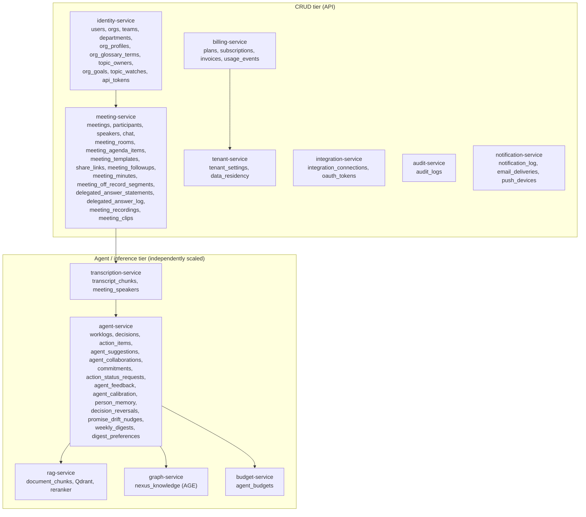
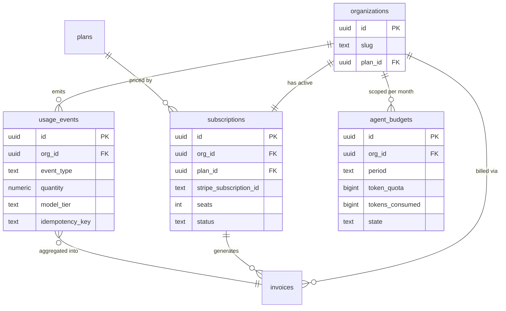
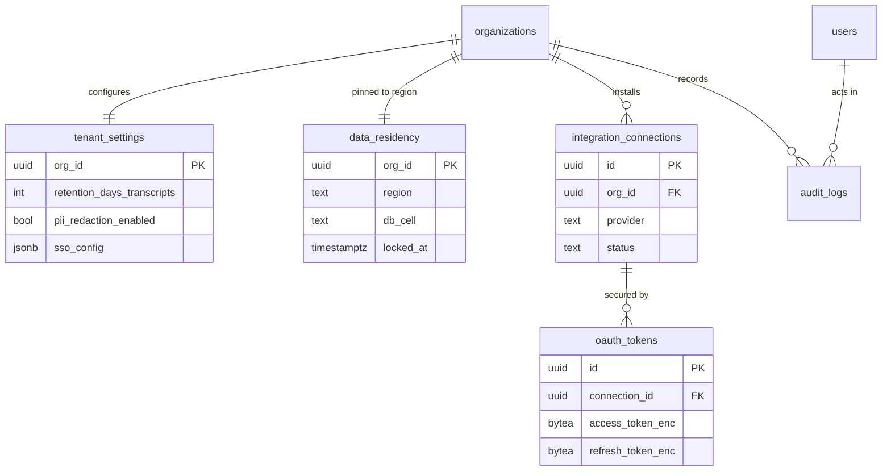
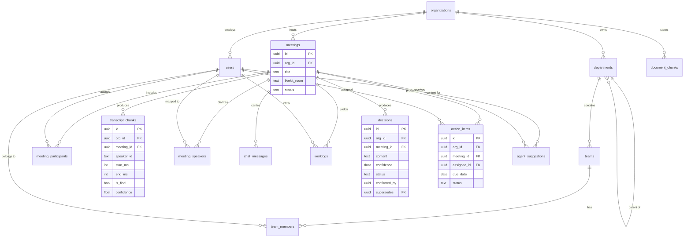
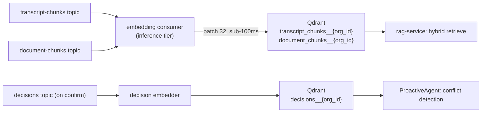
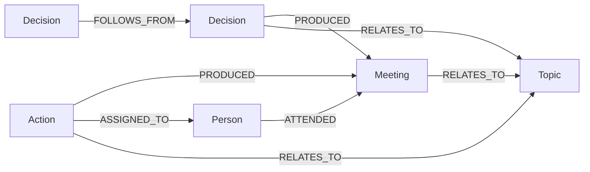
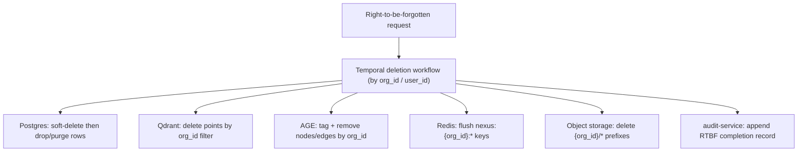

# NEXUS Canonical Data Model

The single naming authority for every NEXUS data entity, its owning service, tenant key, store, and partitioning/retention rules across PostgreSQL, Qdrant, Apache AGE, Redis, and object storage.

## Related documents

- [System Overview](../01-architecture-overview-and-principles.md) — architecture style, the seven agents, service decomposition.
- [Event Streaming & Avro Schemas](../07-event-architecture.md) — Redpanda topics, Avro subjects, outbox/inbox, DLQs.
- [Multi-Tenancy](../06-multi-tenancy.md) — pooled + RLS for the long tail, cell-based isolation for large tenants, `org_id` injection.
- [Data Architecture](../05-data-architecture.md) — store selection, retention enforcement, backups/PITR, read replicas, regional placement.
- [Security & Compliance](../11-security-architecture.md) — RLS policies, PII redaction, right-to-be-forgotten, audit logging, SOC2.
- [SaaS Platform](../18-saas-business-architecture.md) — tenant lifecycle, Stripe billing, usage metering, plans/tiers, admin consoles.
- [Glossary](../24-glossary-and-naming.md) — canonical terms and every recorded rename.

---

## 1. Scope and conventions

This document is the **frozen source of truth for data naming**. Service code, migrations, Avro schemas, Cypher templates, and dashboards MUST use the exact entity names, column names, label names, topic names, and key namespaces defined here. No synonyms, no abbreviations.

Conventions used throughout:

| Convention | Rule |
| --- | --- |
| Table / column names | `snake_case`, plural table names (carried verbatim from the PDF spec). |
| Tenant key | `org_id UUID` references `organizations(id)`. Present on every tenant-scoped row. |
| Primary keys | `id UUID DEFAULT gen_random_uuid()` unless noted; composite PKs called out explicitly. |
| Timestamps | `created_at`, `updated_at` as `timestamptz`, UTC. Soft delete via `deleted_at timestamptz NULL`. |
| Owning service | The single microservice that owns writes to the table. Other services read via API or events, never by cross-writing. |
| Stores | `Postgres` (Supabase-managed primary), `Qdrant` (vectors), `AGE` (graph `nexus_knowledge`), `Redis` (Upstash cache/pubsub), `Object` (S3-compatible blob storage). |

> [SaaS-scale adjustment] The PDF treated NEXUS as a single-app data model with no tenant column. Every tenant-scoped table in this document carries `org_id`, and PostgreSQL Row-Level Security is the default isolation mechanism for the pooled long-tail; large/enterprise tenants are isolated cell-by-cell. See [Multi-Tenancy](../06-multi-tenancy.md).

### 1.1 Service ownership map

> [SaaS-scale adjustment] The PDF was a modular monolith with role-rotating ownership. We decompose into an explicit set of owning services along the modular-monolith → microservices path so the agent/inference tier scales independently of the CRUD tier. Service names below are canonical.

---

## 2. The canonical entity table

Every entity in NEXUS, its owning service, tenant key, key fields, store, and partitioning/retention note. PDF-original tables appear first (names verbatim), followed by SaaS-scale additions.

### 2.1 PDF-original PostgreSQL tables (names carried verbatim)

| Entity | Owning service | Tenant key (`org_id`?) | Key fields | Store | Partitioning / retention note |
| --- | --- | --- | --- | --- | --- |
| `organizations` | identity-service | Is the tenant root (`id` = `org_id`) | `id`, `clerk_org_id`, `name`, `slug`, `plan_id`, `status` (`active`/`suspended`), `created_at`, `deleted_at` | Postgres | Tenant root. **Not a tenant-scoped row and deliberately NOT `tenant_isolation`-policied** (see §7 rule 7). Never partitioned away; deletion cascades a right-to-be-forgotten workflow. `clerk_org_id` is the unique, immutable mapping from a Clerk organization to our tenant root, resolved at the edge ([ADR-0010](../adr/0010-auth-clerk-enterprise-sso.md)). `status` is the suspension state the edge checkpoint reads; it is the relational home of the `suspended` symbol in `TenantEvent`. |
| `users` | identity-service | Yes | `id`, `org_id`, `clerk_user_id`, `email`, `role`, `skills text[]`, `bio`, `avatar_url`, `listen_for text[] NOT NULL DEFAULT '{}'`, `ignore_topics text[] NOT NULL DEFAULT '{}'`, `agent_name text NULL`, `agent_avatar_seed text NULL`, `agent_personality text NOT NULL DEFAULT 'balanced'`, `agent_instructions text NULL` | Postgres | RLS by `org_id`. `skills` is a tag array (PDF). Retained for tenant lifetime; soft-delete on RTBF. `listen_for` / `ignore_topics` are the working profile (at most 15 items each, 1 to 100 chars, trimmed, de-duplicated); `agent_name` (1 to 40 chars), `agent_avatar_seed` (`^[a-z0-9]{4,32}$`), `agent_personality` (CHECK in `balanced`/`concise`/`detailed`/`direct`/`friendly`) and `agent_instructions` (up to 500 chars) are the person's agent persona, writable by that person only. `agent_name` is a display label, never an agent class ([ADR-0038](../adr/0038-agent-personas-profiles-agendas-and-meeting-agent.md) D1, D2). |
| `teams` | identity-service | Yes | `id`, `org_id`, `name`, `department_id`, `description` (what the team does and owns, up to 1000 chars, `CHECK`; [ADR-0041](../adr/0041-people-structure.md)) | Postgres | RLS by `org_id`. Soft-deleted (`deleted_at`); deleting a team removes its `team_members` rows only. Written by `core-api` (owner/admin); every write evicts `nexus:{org_id}:org_ctx` and the members' `nexus:{org_id}:user_ctx:{user_id}`. |
| `team_members` | identity-service | Yes | `team_id`, `user_id`, `role`, PK `(team_id, user_id)` | Postgres | RLS by `org_id` (denormalized for policy). Join table. |
| `departments` | identity-service | Yes | `id`, `org_id`, `name`, `parent_id` (org-hierarchy parent-child), `description` (what the department does and owns, up to 1000 chars, `CHECK`; [ADR-0041](../adr/0041-people-structure.md)) | Postgres | RLS by `org_id`. Self-referential org tree; a parent may not be the department itself or a descendant. Soft-deleted; deleting one moves its teams to no department (`department_id = NULL`) and its child departments up to its own parent, never deleting a team. |
| `meetings` | meeting-service | Yes | `id`, `org_id`, `title`, `scheduled_start`, `scheduled_end`, `livekit_room`, `status`, `created_by`, `calendar_event_id`, `previous_meeting_id uuid NULL`, `template_id uuid NULL`, `confidential boolean NOT NULL DEFAULT false` | Postgres | RLS by `org_id`. Range-partition candidate by `scheduled_start` month at scale. `calendar_event_id` (null unless created from Google Calendar) is unique per `org_id`, so a redelivered calendar event patches the same meeting ([ADR-0037](../adr/0037-plan-12-integrations-follow-ups-and-consoles-build.md)). `previous_meeting_id` (FK `meetings(id) ON DELETE SET NULL`) is the follow-up link: a visible meeting of the same tenant, never the meeting itself; one link per meeting, no series entity. The host is the one participant with `meeting_participants.role_in_meeting = 'host'` ([ADR-0038](../adr/0038-agent-personas-profiles-agendas-and-meeting-agent.md) D5). `template_id` is the `meeting_templates` row the meeting was created from, and that template's `confidential` is the default for `confidential`. A confidential meeting is never a source for topic watch, the ContextGapAgent `related_meeting` hop, or carry-forward shown to non-participants ([ADR-0039](../adr/0039-company-brain-and-meeting-companions.md) B1, B2). [ADR-0040](../adr/0040-polish-program.md) adds `source text NOT NULL DEFAULT 'mytheus'` (CHECK in `mytheus`/`meet`/`teams`/`zoom`/`in_person`): a meeting captured from another call or recorded on a phone has no Mytheus room, so `meeting-service` opens none and `core-api` ignores room-state reports for it; the API publishes `in_person` as `source = mytheus` plus `recorded_in_person = true`, because published enums are frozen. Also `wrap_up_started_at`, `wrap_up_by` (the host opened the 60-second wrap-up; cleared on cancel) and `closed_at`, `closed_by` (who closed the meeting through it), all NULL by default. [ADR-0043](../adr/0043-meeting-email-invitations.md) adds `calendar_sequence integer NOT NULL DEFAULT 0` (`CHECK >= 0`): the iCalendar `SEQUENCE`, bumped by `core-api` in the same `UPDATE` whenever the scheduled time changes or the meeting is cancelled. |
| `meeting_participants` | meeting-service | Yes | `meeting_id`, `user_id`, `role_in_meeting`, `consented_at timestamptz NULL`, `consent_version text NULL`, `attendance text NOT NULL DEFAULT 'live'`, `proxy_update text NULL`, `proxy_questions text[] NOT NULL DEFAULT '{}'`, PK `(meeting_id, user_id)` | Postgres | RLS by `org_id`. Join table; drives `get_user_context`. `consented_at`/`consent_version` ([ADR-0018](../adr/0018-consent-entity-behind-flag.md)) record the recording/transcription consent acknowledgment at token-mint; both NULL until a participant consents, and behavior does not change until a tenant sets `tenant_settings.consent_required = true`. `attendance` (CHECK in `live`/`agent`) records whether the person joins or sends their agent instead; `proxy_update` (up to 2000 chars) is the update their agent carries into the room and is visible to every participant; `proxy_questions` (up to 5, each up to 300 chars) is visible only to the person and the host. Set by the person only, and not after the meeting ended ([ADR-0039](../adr/0039-company-brain-and-meeting-companions.md) B5). |
| `transcript_chunks` | transcription-service | Yes | `id`, `org_id`, `meeting_id`, `speaker_id`, `start_ms`, `end_ms`, `text`, `is_final`, `confidence` | Postgres | **Index on `(meeting_id, start_ms)`** (PDF). Only finals persisted. Range-partition by `created_at` month; hot 90d, then cold tier. |
| `meeting_speakers` | transcription-service | Yes | `id`, `org_id`, `meeting_id`, `speaker_id` (diarized), `user_id` (mapped), `confidence`, `assignment` (`manual`/`suggested`) | Postgres | RLS by `org_id`. Diarized `speaker_id` → `user_id` mapping (PDF R7: reliable manual + confidence-scored suggestion). |
| `worklogs` | agent-service | Yes | `id`, `org_id`, `meeting_id`, `user_id`, `window_id`, `content`, `relevance_score`, `confidence`, `created_by_agent`, `source_chunk_ids uuid[]`, `surfaced`, `created_at`, `deleted_at` | Postgres | RLS by `org_id`. Per-user notes (PersonalListenerAgent). `surfaced = false` is the 0.4-0.7 silent-log band: persisted, never rendered ([ADR-0030](../adr/0030-plan-7-llm-response-cache-and-personal-listener-gating.md) D3). Monthly partitions on `created_at` with a DEFAULT. Retained per tenant retention policy. [ADR-0040](../adr/0040-polish-program.md) adds the card moment columns, all NULL by default: `moment_id uuid` (`uuid5` over the meeting and the quoted final's `chunk_id`), `why` (up to 200), `quote` (up to 300), `quote_speaker_id uuid` (a `users.id`, no FK), `quote_start_ms`, `quote_end_ms bigint` (meeting time); the same six columns are on `decisions`, `action_items` and `agent_suggestions`. |
| `decisions` | agent-service | Yes | `id`, `org_id`, `meeting_id`, `content`, `rationale`, `confidence`, `status` (`proposed`/`confirmed`/`superseded`/`dismissed`), `confirmed_by`, `supersedes` (FK `decisions`, NULL), `created_at`, `deleted_at` | Postgres | RLS by `org_id`. DecisionAgent candidates land as `proposed` with no event ([ADR-0032](../adr/0032-plan-8-decision-and-action-candidates.md)); only a user confirm sets `confirmed` and publishes `decisions`. On confirmation → AGE `Decision`→`Meeting` `PRODUCED` edge; a non-null `supersedes` (the earlier decision this one replaces) → `FOLLOWS_FROM` ([ADR-0031](../adr/0031-plan-8-graph-store-decision-supersedes-and-mark-done.md) D2). Soft delete. [ADR-0040](../adr/0040-polish-program.md) adds the card moment columns (see `worklogs`), `edited_at` (set by a person's PATCH; an agent update never applies to an edited row), `review_owner_id` (FK `users`, ON DELETE SET NULL: who reviews a card still `proposed` at close-out) and `status_changed_at` (set by the trigger `mx_touch_status_changed_at` on every status change). |
| `action_items` | agent-service | Yes | `id`, `org_id`, `meeting_id`, `content`, `assignee_id`, `due_date`, `confidence`, `status` (`proposed`/`confirmed`/`done`/`dismissed`), `confirmed_by`, `created_at`, `deleted_at` | Postgres | RLS by `org_id`. ActionAgent candidates land as `proposed` with no event ([ADR-0032](../adr/0032-plan-8-decision-and-action-candidates.md)); only a user confirm publishes `actions`. On confirmation → AGE `Action`→`Person` `ASSIGNED_TO` edge. `confirmed` → `done` via `POST /api/v1/actions/{id}/done`, which emits no event ([ADR-0031](../adr/0031-plan-8-graph-store-decision-supersedes-and-mark-done.md) D3). [ADR-0040](../adr/0040-polish-program.md): `meeting_id` is nullable (a task a person creates directly, `POST /api/v1/actions`; the graph treats it as a personal task); `done` → `confirmed` again via `POST /api/v1/actions/{id}/reopen` (the Undo); the same moment columns, `edited_at`, `review_owner_id` and `status_changed_at` as `decisions`. |
| `agent_suggestions` | agent-service | Yes | `id`, `org_id`, `user_id`, `meeting_id`, `question`, `priority` (1–3), `status` (`open`/`asked`/`dismissed`/`saved`: Ask/Dismiss/Save-for-later, plus not yet acted on), `confidence` (0–1), `rationale`, `citations` (jsonb, grounding passages), `created_at`, `deleted_at` | Postgres | RLS by `org_id`. QuestionAgent output, one row per suggestion for the participant it was written for (`user_id`). `confidence` decides the band at read time (ADR-0034). Save-for-later persists into next meeting. Monthly partitions on `created_at` with a DEFAULT. [ADR-0040](../adr/0040-polish-program.md) adds the card moment columns (see `worklogs`) on the parent, so every partition has them. |
| `agent_collaborations` | agent-service | Yes | `id`, `org_id`, `meeting_id`, `window_id`, `correlation_id`, `requester` (user), `responder` (`user:{id}` or `rag`), `hop` (`peer`/`related_meeting`/`rag`), `query`, `query_class`, `target_scope`, `result`, `success`, `latency_ms`, `fill_content`, `confidence` (0-1), `surfaced`, `rationale`, `citations jsonb`, `dismissed_at`, `created_at` | Postgres | RLS by `org_id`. ContextGapAgent A2A logs: one row per hop attempt, grants and denials alike; the context fill sits on the row that produced it and is private to `requester` ([ADR-0035](../adr/0035-plan-10-context-gap-agent-and-a2a-build.md)). Latency feeds R5/R6 dashboards. |
| `chat_messages` | meeting-service | Yes | `id`, `org_id`, `meeting_id`, `user_id`, `content`, `created_at` | Postgres | RLS by `org_id`. In-meeting chat (non-AV via Socket.io). Range-partition by `created_at`. |
| `document_chunks` | rag-service | Yes | `id`, `org_id`, `document_id`, `element_id`, `element_type` (Title/NarrativeText/Table/ListItem), `text`, `position` | Postgres | RLS by `org_id`. unstructured.io typed elements. Mirrors Qdrant `document_chunks` payload for citation. |

> [SaaS-scale adjustment] `transcript_chunks`, `chat_messages`, and `meetings` are the high-volume tables. They become PostgreSQL declarative range partitions (monthly) so retention and right-to-be-forgotten purges drop partitions instead of scanning. The PDF carried no partitioning. See [Data Architecture](../05-data-architecture.md).

> [SaaS-scale adjustment] `meeting_participants.consented_at`/`consent_version` and `tenant_settings.consent_required` (below, §2.2) are net-new columns on two PDF-original, previously-frozen tables, recording that a participant acknowledged recording/transcription before joining. The PDF had no consent concept. Landed schema-only and defaulted off ([ADR-0018](../adr/0018-consent-entity-behind-flag.md)) so the tables are not reopened under time pressure later; the token-mint 428 gate that enforces this is a later task. See [Compliance & Privacy §3.3](../12-compliance-and-privacy.md).

> [SaaS-scale adjustment] The agent persona and working-profile columns on `users` (`listen_for`, `ignore_topics`, `agent_name`, `agent_avatar_seed`, `agent_personality`, `agent_instructions`) and `meetings.previous_meeting_id` are net-new columns on PDF-original tables. The PDF's agents had no person-facing identity, and its meetings had no explicit follow-up link. Every new column is nullable or defaulted, so existing rows are unaffected ([ADR-0038](../adr/0038-agent-personas-profiles-agendas-and-meeting-agent.md)).

> [SaaS-scale adjustment] `meetings.template_id`, `meetings.confidential` and the send-your-agent columns on `meeting_participants` (`attendance`, `proxy_update`, `proxy_questions`) are net-new columns on PDF-original tables. The PDF had no meeting types, no confidential meetings, and no way to attend through one's agent. Every new column is nullable or defaulted, so an existing meeting behaves as before ([ADR-0039](../adr/0039-company-brain-and-meeting-companions.md) B1, B2, B5).

### 2.2 SaaS-scale entity additions (wholly added vs PDF)

> [SaaS-scale adjustment] Everything in this subsection is new relative to the PDF, which had no billing, metering, compliance, integration-token, or per-tenant budget model. These tables make NEXUS a multi-tenant commercial SaaS.

| Entity | Owning service | Tenant key (`org_id`?) | Key fields | Store | Partitioning / retention note |
| --- | --- | --- | --- | --- | --- |
| `plans` | billing-service | No (global catalog) | `id`, `code` (`free`/`pro`/`enterprise`), `name`, `seat_price_cents`, `included_meeting_minutes`, `included_agent_tokens`, `features jsonb` | Postgres | Global, non-tenant. Versioned; old plan rows retained for invoice reproducibility. `included_meeting_minutes` and `included_agent_tokens` are **per-tenant monthly pools**, not per seat; `subscriptions.seats` does not scale them ([ADR-0029](../adr/0029-plan-7-budget-scope-tier-mapping-and-metering-ownership.md) D1). |
| `subscriptions` | billing-service | Yes | `id`, `org_id`, `plan_id`, `stripe_subscription_id`, `seats`, `status` (`active`/`past_due`/`canceled`), `current_period_start/end`, `trial_ends_at` | Postgres | RLS by `org_id`. One active subscription per tenant. Retained for tenant lifetime + legal hold. |
| `usage_events` | billing-service | Yes | `id`, `org_id`, `user_id`, `event_type` (`meeting_minute`/`agent_token`/`transcription_second`/`storage_gb`), `quantity`, `model_tier` (`haiku`/`sonnet`/`opus`, set for `agent_token`, null otherwise), `occurred_at`, `idempotency_key` | Postgres | RLS by `org_id`. Append-only. Range-partition by `occurred_at` month with a DEFAULT catch-all, like `chat_messages` and `audit_logs` ([ADR-0029](../adr/0029-plan-7-budget-scope-tier-mapping-and-metering-ownership.md) D6); UNIQUE `(org_id, idempotency_key, occurred_at)`; aggregated nightly, raw retained 90d then summarized. `agent_token` rows are sourced from the `usage-events` topic (see [Event Streaming](../07-event-architecture.md)); `meeting_minute`, `transcription_second` and `storage_gb` rows are derived inside `billing-metering-service` and written directly ([ADR-0029](../adr/0029-plan-7-budget-scope-tier-mapping-and-metering-ownership.md) D3, D4). |
| `invoices` | billing-service | Yes | `id`, `org_id`, `stripe_invoice_id`, `period_start/end`, `amount_due_cents`, `tax_cents`, `status` (`draft`/`open`/`paid`/`void`/`uncollectible`), `pdf_url` | Postgres | RLS by `org_id`. Immutable once finalized. Retained 7 years (tax/compliance). PDF blob in `mytheus-invoices` bucket. |
| `audit_logs` | audit-service | Yes | `id`, `org_id`, `actor_id`, `actor_type` (`user`/`agent`/`system`), `action`, `target_type`, `target_id`, `metadata jsonb`, `ip`, `occurred_at` | Postgres | RLS by `org_id`. **Append-only, no UPDATE/DELETE** (tamper-evident). Range-partition by `occurred_at` month. Retained 1 year hot, archived to `mytheus-audit-archive` for SOC2. |
| `integration_connections` | integration-service | Yes | `id`, `org_id`, `provider` (`google_calendar`/`slack`/`jira`/`linear`, plus `hubspot`/`notion`/`confluence` from [ADR-0040](../adr/0040-polish-program.md)), `external_account_id`, `status`, `scopes text[]`, `installed_by` | Postgres | RLS by `org_id`. Guardrail R8: Calendar + Slack + one of Jira/Linear (Linear built by [ADR-0044](../adr/0044-linear-and-zoom-integrations.md); `external_account_id` is the Linear organization id). One row per installed integration. |
| `oauth_tokens` | integration-service | Yes | `id`, `org_id`, `connection_id`, `access_token_enc`, `refresh_token_enc`, `expires_at`, `token_version` | Postgres | RLS by `org_id` (`ENABLE` + `FORCE`, `tenant_isolation`). **Tokens encrypted at rest (envelope encryption, per-tenant data key wrapped by a KEK; [ADR-0024](../adr/0024-key-custody-and-envelope-encryption.md)).** `access_token_enc`/`refresh_token_enc` are `bytea` holding a self-describing envelope (KEK id, DEK id and wrapped DEK ride with the ciphertext, so key versions rotate without a key table), AAD-bound to `org_id`, the column's purpose and `connection_id`, and CHECK-constrained to the envelope prefix so plaintext cannot be written. `token_version` is the OAuth token generation, UNIQUE `(org_id, connection_id, token_version)`. Refreshed by integration-service; never returned by API. `connection_id` carries no FK until `integration_connections` is migrated. |
| `integration_id_map` | integration-service | Yes | `org_id`, `provider`, `nexus_kind` (`action`/`meeting`, plus `decision` for an exported decision record, [ADR-0040](../adr/0040-polish-program.md)), `nexus_id`, `external_id`, `external_url`, `last_synced_status`, `updated_at`, UNIQUE `(org_id, provider, nexus_kind, nexus_id)` and `(org_id, provider, external_id)` | Postgres | RLS by `org_id`. The service-private external to NEXUS id map ([21](../21-integration-architecture.md) section 2); `last_synced_status` is the loop-suppression anchor ([ADR-0037](../adr/0037-plan-12-integrations-follow-ups-and-consoles-build.md)). |
| `integration_cursors` | integration-service | Yes | `org_id`, `connection_id`, `kind`, `cursor jsonb`, `expires_at`, `updated_at` | Postgres | RLS by `org_id`. The service-private sync cursors and push-channel state (Calendar `syncToken`, channel id, expiry). |
| `integration_webhook_inbox` | integration-service | Yes | `id`, `org_id`, `provider`, `delivery_id`, `payload jsonb`, `received_at`, `processed_at`, UNIQUE `(provider, delivery_id)` | Postgres | RLS by `org_id`. The fast-ACK webhook inbox ([21](../21-integration-architecture.md) section 2): a verified delivery is written here and acknowledged, then drained by the worker; the unique key is the replay guard ([ADR-0037](../adr/0037-plan-12-integrations-follow-ups-and-consoles-build.md)). |
| `tenant_settings` | tenant-service | Yes (one row per tenant) | `org_id` (PK), `default_locale`, `agent_confidence_overrides jsonb`, `retention_days_transcripts`, `retention_days_worklogs`, `pii_redaction_enabled`, `sso_config jsonb`, `consent_required boolean NOT NULL DEFAULT false`, `never_record_topics text[] NOT NULL DEFAULT '{}'` | Postgres | RLS by `org_id`. Drives per-tenant retention and confidence-threshold overrides. One row per tenant. `consent_required` ([ADR-0018](../adr/0018-consent-entity-behind-flag.md)) gates the meeting-join consent flow (see [Compliance & Privacy §3.3](../12-compliance-and-privacy.md)); default `false` so no tenant's join behavior changes until the flag is flipped, which is a legal/compliance decision, not an engineering one. `never_record_topics` (up to 30, each up to 80 chars) are the org's ground rules: a window mainly about one of them yields no note, suggestion, candidate or agenda note. That is a model instruction, not a guarantee. Written by an org `owner` or `admin` through `PUT /api/v1/org/ground-rules` on `identity-tenant-service` ([ADR-0039](../adr/0039-company-brain-and-meeting-companions.md) A5, C2). |
| `data_residency` | tenant-service | Yes (one row per tenant) | `org_id` (PK), `region` (`us`/`eu`/`ap`), `db_cell`, `qdrant_region`, `object_bucket_region`, `locked_at` | Postgres | RLS by `org_id`. Pins tenant data to a region/cell (GDPR data-residency). Immutable after `locked_at` without migration workflow. |
| `rbac_grants` | identity-service | Yes | `id`, `org_id`, `user_id`, `tier` (`owner`/`admin`/`member`), `granted_by`, `created_at`, UNIQUE `(org_id, user_id)` | Postgres | RLS by `org_id`. The **authorization** store: `tier` is the only thing the authz middleware reads. Strictly distinct from `users.role`, which is a job/domain attribute feeding agent relevance and `get_user_context` and is **never** consulted for permissions ([ADR-0010](../adr/0010-auth-clerk-enterprise-sso.md) D5). One tier per user per tenant. |
| `agent_authz_scopes` | identity-service | Yes | `id`, `org_id`, `grantee_role` (`owner`/`admin`/`member`), `query_class` (`meeting_context`/`decision_lineage`/`action_status`), `target_scope` (`self`/`same_team`/`department`/`org`), `effect` (`allow`/`deny`), `created_by`, `created_at`, `deleted_at`, UNIQUE `(org_id, grantee_role, query_class, target_scope)` | Postgres | RLS by `org_id`. The A2A grant store ([ADR-0013](../adr/0013-agent-to-agent-authorization.md) section 3). Deny by default: no row is a deny, an explicit `deny` wins. A fresh tenant has none, so A2A is off until an admin grants. |
| `notification_log` | notification-service | Yes | `id` (the alert or notification id), `org_id`, `user_id`, `meeting_id`, `source` (`agent_alert`/`notification`), `alert_type`, `priority` (1 red, 2 yellow, 3 blue), `title`, `body`, `link`, `payload jsonb`, `status` (`unread`/`read`/`dismissed`), `created_at`, `read_at`, `dismissed_at` | Postgres | RLS by `org_id`. One row per delivered in-app item; private to `user_id`. `ProactiveAgent` alerts land here ([ADR-0036](../adr/0036-plan-11-proactive-agent-and-delivery-build.md)). |
| `notification_preferences` | notification-service | Yes | `org_id`, `user_id`, `channel` (`in_app`/`email`/`slack`), `enabled`, `max_priority`, PK `(org_id, user_id, channel)` | Postgres | RLS by `org_id`. The user channel prefs the service catalog assigns to `notification-service`: a channel delivers an item when it is enabled and the item's priority is at most `max_priority`. |
| `feature_flags` | audit-service | Partly | `key`, `org_id` (null = global), `enabled`, `rules jsonb`, `updated_by`, `updated_at` | Postgres | Owned by `admin-ops-service`. RLS by `org_id` for tenant rows; global rows are staff-managed. Every change emits `admin-events` ([ADR-0037](../adr/0037-plan-12-integrations-follow-ups-and-consoles-build.md)). |
| `ops_audit_log` | audit-service | No | `id`, `staff_user_id`, `action`, `target_org_id`, `details jsonb`, `created_at` | Postgres | Owned by `admin-ops-service`. Append-only record of every internal-ops console call, reads included. Staff-only, never tenant-readable. |
| `support_grants` | audit-service | Yes | `id`, `org_id`, `granted_by`, `staff_user_id`, `scope`, `expires_at`, `revoked_at`, `created_at` | Postgres | Owned by `admin-ops-service`. RLS by `org_id`. A tenant owner or admin grants time-boxed support access; nothing is standing. |
| `support_sessions` | audit-service | Yes | `id`, `org_id`, `grant_id`, `staff_user_id`, `staff_clerk_user_id`, `user_id`, `reason`, `clerk_actor_token_id`, `started_at`, `expires_at`, `ended_at`, `end_reason` | Postgres | Owned by `admin-ops-service`. RLS by `org_id`. One staff support session acting as one member, under an active `impersonate` grant; `tenant_context` refuses a token with an `act` claim unless a matching row is open ([ADR-0046](../adr/0046-superadmin-ops-console.md)). |
| `tenant_migrations` | audit-service | Yes | `id`, `org_id`, `from_region`, `from_cell`, `to_region`, `to_cell`, `status`, `reason`, `requested_by`, `created_at`, `updated_at` | Postgres | Owned by `admin-ops-service`. RLS by `org_id`. A staff request to move a workspace between regions or cells (`requested`/`cancelled`/`completed`); the move itself is not automated yet ([ADR-0046](../adr/0046-superadmin-ops-console.md) D5). |
| `agent_budgets` | budget-service | Yes | `id`, `org_id`, `period` (`YYYY-MM`), `token_quota`, `tokens_consumed`, `hard_cap`, `alert_80_sent`, `alert_95_sent`, `state` (`ok`/`throttled`/`blocked`) | Postgres | RLS by `org_id`. One row per (tenant, month). Enforces R4 token budgets + hard quotas; budget alerts from Phase 7. `token_quota = plans.included_agent_tokens` (per tenant); `hard_cap = token_quota` on Free, `2 x token_quota` on Pro, set per tenant on Enterprise ([ADR-0029](../adr/0029-plan-7-budget-scope-tier-mapping-and-metering-ownership.md) D1). |
| `pii_tokens` | tenant-service | Yes | `id`, `org_id`, `token`, `entity_type` (`EMAIL`/`PHONE`/`IBAN`/`CARD`/`GOVID`/`PERSON`/`ORG`/`LOC`), `value_ciphertext`, `value_hmac`, `dek_id`, UNIQUE `(org_id, token)`, UNIQUE `(org_id, entity_type, value_hmac)` | Postgres | RLS by `org_id`. The per-tenant reversible token vault behind the typed placeholders in [Compliance §5.2](../12-compliance-and-privacy.md) ([ADR-0020](../adr/0020-pii-token-vault-and-ner-placement.md)). Owned and written **only** by `identity-tenant-service`; the three redaction boundaries (`transcription-service`, `ingestion-service`, `agent-runtime-service`/`rag-service`) are callers of its mint/resolve API, never writers, so one shared token space per tenant does not become three writers of one table. `value_ciphertext` is envelope-encrypted under a per-tenant data key. `value_hmac` is a **keyed** HMAC of the normalized value, never a plain digest: direct identifiers have low enough entropy that an unkeyed hash of an email is equivalent to storing the email. The second UNIQUE is what makes the same raw value mint the same token across boundaries, which is the coherence property §5.2 exists for. Resolving a token is a PII disclosure and writes `audit_logs`. `token` is 16 lowercase hex characters derived from `value_hmac`; `value_ciphertext` is AAD-bound to `org_id`, `entity_type` and `value_hmac` so it cannot be moved between rows. Grants: `mytheus_app` SELECT + INSERT only (a minted mapping is immutable on the request path), `mytheus_admin` full DML (RTBF, KEK rewrap). Key custody per [ADR-0024](../adr/0024-key-custody-and-envelope-encryption.md) and [ADR-0026](../adr/0026-vps-file-kek-custody.md): in production the KEK is a local 0400 file on the VPS; losing it makes every row unrecoverable, so it is backed up off-box separately from database backups. |
| `meeting_rooms` | meeting-service | Yes | `id`, `org_id`, `meeting_id`, `livekit_room`, `status` (`pending`/`active`/`ended`), `egress_id`, `recording_ref`, `livekit_metadata_synced_at`, `started_at timestamptz NULL` (the meeting's own clock: set once by the first token mint or LiveKit `room_started`, whichever comes first, [ADR-0040](../adr/0040-polish-program.md)), `recording_skip_reason` (NULL or `consent_missing`: the room could have been recorded but someone had not consented, [ADR-0040](../adr/0040-polish-program.md) C5), UNIQUE `(org_id, meeting_id)`, UNIQUE `(org_id, livekit_room)` | Postgres | RLS by `org_id` (`ENABLE` + `FORCE`, `tenant_isolation`). The LiveKit room ↔ meeting map ([ADR-0003](../adr/0003-meeting-sdk-livekit.md)): one row per meeting, bounded by meeting count, so not partitioned. `status` is CHECK-constrained to the three values above. `recording_ref` points into the `mytheus-recordings` bucket (§6); `egress_id` is the LiveKit egress handle. `org_id` FK is `ON DELETE RESTRICT`. Owner is `meeting-service` **in the Service Catalog sense** (the LiveKit transport adapter) - the one table where this document's overloaded `meeting-service` label and the catalog service of the same name refer to the same thing (see [Glossary §10](../24-glossary-and-naming.md)). |
| `meeting_agenda_items` | meeting-service | Yes | `id`, `org_id`, `meeting_id` (FK `meetings(id) ON DELETE CASCADE`), `position int` (0-based order), `title` (1 to 200 chars), `owner_user_id uuid NULL` (a participant), `duration_minutes int NULL` (1 to 240), `status` (`pending`/`in_progress`/`covered`/`skipped`, default `pending`), `status_source` (`agent`/`host`, NULL), `agent_note` (up to 500 chars, NULL), `goal_id uuid NULL` (an `org_goals` id, no FK across services, [ADR-0039](../adr/0039-company-brain-and-meeting-companions.md) B3), `started_at` (first went `in_progress`; cleared when reopened to `pending`), `ended_at` (last marked `covered` or `skipped`), `extended_minutes int NOT NULL DEFAULT 0` (0 to 240, the host's Extend; the plan is `duration_minutes + extended_minutes`) ([ADR-0040](../adr/0040-polish-program.md)), `created_at`, `updated_at` | Postgres | RLS by `org_id` (`tenant_isolation`). At most 20 items per meeting, so not partitioned. Written by the CRUD tier only: the host or creator edits items and sets `status_source = 'host'`; `core-api`'s `agent-results` consumer applies the agenda updates in `MeetingAgent` `meeting_update` records (`status_source = 'agent'`, `agent_note`), never over a host-set status and never from `covered` back to `in_progress` ([ADR-0038](../adr/0038-agent-personas-profiles-agendas-and-meeting-agent.md) D5, D7). |
| `org_profiles` | identity-service | Yes (one row per tenant) | `org_id` (PK), `description` (up to 2000 chars), `industry` (up to 100), `products text[]` (up to 30, each up to 80), `customers text[]` (up to 50, each up to 80), `updated_by`, `updated_at` | Postgres | RLS by `org_id` (`ENABLE` + `FORCE`, `tenant_isolation`). The company profile, part of the company brain. Read by any member; written by an org `owner` or `admin` (`PUT /api/v1/org/profile`). Every write evicts `nexus:{org_id}:org_ctx` ([ADR-0039](../adr/0039-company-brain-and-meeting-companions.md) A1). |
| `org_glossary_terms` | identity-service | Yes | `id`, `org_id`, `term` (1 to 80 chars), `kind` (`product`/`codename`/`acronym`/`customer`/`person`/`other`), `definition` (up to 300, NULL), `aliases text[]` (up to 10, each up to 80), `created_at`, `updated_at`, UNIQUE `(org_id, lower(term))` | Postgres | RLS by `org_id` (`ENABLE` + `FORCE`, `tenant_isolation`). The company vocabulary: at most 500 per org, so not partitioned. Feeds agent prompts and the Deepgram key terms through `GetOrgContext`. Owner/admin write, member read; every write evicts `nexus:{org_id}:org_ctx` ([ADR-0039](../adr/0039-company-brain-and-meeting-companions.md) A2). |
| `topic_owners` | identity-service | Yes | `id`, `org_id`, `topic` (1 to 80 chars), `owner_user_id` (FK `users(id) ON DELETE CASCADE`), `created_at`, UNIQUE `(org_id, lower(topic))` | Postgres | RLS by `org_id` (`ENABLE` + `FORCE`, `tenant_isolation`). Who owns what: at most 200 per org. `topic` is free text, not an AGE `Topic` node. Lets `ActionAgent` suggest an owner. Owner/admin write, member read; every write evicts `nexus:{org_id}:org_ctx` ([ADR-0039](../adr/0039-company-brain-and-meeting-companions.md) A3, C4). |
| `org_goals` | identity-service | Yes | `id`, `org_id`, `title` (1 to 200 chars), `description` (up to 1000, NULL), `period` (up to 20, for example `2026-Q4`), `status` (`active`/`achieved`/`dropped`), `owner_user_id uuid NULL`, `position`, `created_at`, `updated_at` | Postgres | RLS by `org_id` (`ENABLE` + `FORCE`, `tenant_isolation`). The org's goals: at most 30 `active` per org. An agenda item may point at one through `meeting_agenda_items.goal_id`. Owner/admin write, member read; every write evicts `nexus:{org_id}:org_ctx` ([ADR-0039](../adr/0039-company-brain-and-meeting-companions.md) A4). |
| `topic_watches` | identity-service | Yes | `id`, `org_id`, `user_id`, `topic` (1 to 80 chars), `created_at`, UNIQUE `(org_id, user_id, lower(topic))` | Postgres | RLS by `org_id` (`ENABLE` + `FORCE`, `tenant_isolation`). A person's topic watch: at most 20 per user, read and written by that person only. `ProactiveAgent` raises a `topic_watch` alert to a watcher who is not in a (non-confidential) meeting about the topic, subject to the A2A PDP ([ADR-0013](../adr/0013-agent-to-agent-authorization.md)). Every write evicts `nexus:{org_id}:org_ctx` ([ADR-0039](../adr/0039-company-brain-and-meeting-companions.md) A6, C7). |
| `meeting_templates` | meeting-service | Yes | `id`, `org_id`, `name` (1 to 80 chars), `description` (up to 300), `default_duration_minutes` (5 to 480), `agenda jsonb` (`[{title, duration_minutes}]`, up to 20), `confidential boolean NOT NULL DEFAULT false`, `created_by`, `created_at`, `updated_at` | Postgres | RLS by `org_id` (`ENABLE` + `FORCE`, `tenant_isolation`). Meeting types: at most 50 per org, so not partitioned. Owned by `core-api`; member read, owner/admin write. A template fills a new meeting's length, agenda and `confidential` default ([ADR-0039](../adr/0039-company-brain-and-meeting-companions.md) B1). |
| `commitments` | agent-service | Yes | `id`, `org_id`, `user_id`, `meeting_id`, `content` (up to 500 chars), `due_hint` (up to 100, NULL), `status` (`open`/`done`/`dismissed`), `source_window_id`, `created_at`, `updated_at`, `done_at`, UNIQUE `(meeting_id, user_id, source_window_id, md5(content))` | Postgres | RLS by `org_id` (`ENABLE` + `FORCE`, `tenant_isolation`). Promises: what a participant said they would do, private to `user_id`. Owned and written by `core-api`'s `agent-results` consumer from `PersonalListenerAgent` records' `payload_json.commitments`, like `worklogs`; the unique key makes redelivery idempotent. Only the owner reads it or changes `status` ([ADR-0039](../adr/0039-company-brain-and-meeting-companions.md) B6, C3). [ADR-0040](../adr/0040-polish-program.md) adds `moment_id uuid NULL` and `action_item_id uuid NULL` (FK `action_items`, ON DELETE SET NULL): when an action is confirmed and its assignee promised it at the same moment, `core-api` marks the promise `done` and links it to the task. |
| `action_status_requests` | agent-service | Yes | `id`, `org_id`, `action_id` (an `action_items` id), `user_id` (the assignee), `meeting_id` (the upcoming meeting), `state` (`pending`/`answered`/`expired`), `status_text` (up to 500 chars, NULL), `requested_at`, `answered_at`, UNIQUE `(action_id, meeting_id)` | Postgres | RLS by `org_id` (`ENABLE` + `FORCE`, `tenant_isolation`). Status requests: one per open confirmed action item of a meeting's `previous_meeting_id`, created 60 minutes before the follow-up starts by the internal route `workflow-service` calls. Owned by `core-api`; answered by the assignee only. The latest answer rides on carry-forward `open_actions` as `latest_status` ([ADR-0039](../adr/0039-company-brain-and-meeting-companions.md) B7, B9). [ADR-0040](../adr/0040-polish-program.md) adds `requested_by uuid NULL` (FK `users`): a request a person asked for from the "Should this be a meeting?" hint (`POST /api/v1/status-requests`); NULL for the workflow's pre-meeting requests. |
| `api_tokens` | identity-service | Yes | `id`, `org_id`, `user_id` (FK `users` ON DELETE CASCADE), `name` (1 to 80), `token_hash` (SHA-256 hex, UNIQUE across tenants), `token_hint` (last 4 chars), `scope` (`read`/`read_write`), `expires_at` (mandatory, after `created_at`), `created_at`, `revoked_at`, `revoked_by` | Postgres | RLS by `org_id` (`ENABLE` + `FORCE`, `tenant_isolation`). Personal access tokens for the public API and the MCP server, written only by `identity-tenant-service`. The plaintext `mytheus_pat_<org hex>_<secret>` is shown once and never stored; it names its tenant, so `api-gateway` sets `app.current_org` from it and looks the hash up under RLS with no exception. `last_used_at` comes from Redis ([ADR-0040](../adr/0040-polish-program.md)). |
| `share_links` | meeting-service | Yes | `id`, `org_id`, `kind` (`meeting_recap`/`decision_record`/`meeting_clip`), `meeting_id` (FK, CASCADE), `decision_id` (set only for `decision_record`), `clip_id` (FK `meeting_clips` CASCADE, set exactly for `meeting_clip`), `include_video` (default false; only a clip link may carry it), `created_by`, `expires_at`, `created_at`, `revoked_at`, `revoked_by`, `view_count`, `last_viewed_at` | Postgres | RLS by `org_id` (`ENABLE` + `FORCE`, `tenant_isolation`). Owned by `core-api`. Signed, expiring, revocable public links to a meeting recap (from the shared minutes) or a decision record; the token is an HMAC over (org, link id) and the row is the expiry and revocation authority. The public read counts views ([ADR-0040](../adr/0040-polish-program.md)). |
| `meeting_followups` | meeting-service | Yes | `meeting_id` (PK, FK CASCADE), `org_id`, `enabled` (default true), `guest_emails text[]` (up to 20), `share_link_id`, `last_sent_at`, `last_result jsonb`, `awaiting_minutes_since`, `updated_by`, `created_at`, `updated_at` | Postgres | RLS by `org_id` (`ENABLE` + `FORCE`, `tenant_isolation`). Owned by `core-api`. The host's follow-up email for one meeting: guests who are not users get the recap link. `awaiting_minutes_since` holds the dispatch until the shared minutes land (or say they are unavailable) ([ADR-0040](../adr/0040-polish-program.md)). |
| `meeting_invitations` | meeting-service | Yes | `id`, `org_id`, `meeting_id` (FK CASCADE), `email` (3 to 320, lowercased), `user_id` (FK `users` SET NULL), `invited_by` (FK `users` SET NULL), `message` (up to 500), `status` (`pending`/`sent`/`failed`/`not_configured`), `last_error` (up to 200), `last_kind` (`invite`/`update`/`cancel`), `send_count`, `sent_at`, `created_at`, `updated_at`, UNIQUE `(meeting_id, email)` | Postgres | RLS by `org_id` (`ENABLE` + `FORCE`, `tenant_isolation`, explicit grants). Owned by `core-api`. One row per meeting and invited address with the latest delivery state of the invitation, its update after a reschedule, or its cancellation. Stores no token: the calendar link is a stateless HMAC over (`org_id`, `meeting_id`) ([ADR-0043](../adr/0043-meeting-email-invitations.md)). |
| `email_deliveries` | notification-service | Yes | `id`, `org_id`, `idempotency_key`, `kind` (`meeting_followup`/`weekly_digest`/`meeting_invitation`/`meeting_update`/`meeting_cancel`, the last three [ADR-0043](../adr/0043-meeting-email-invitations.md)), `meeting_id`, `recipient` (3 to 320), `status` (`pending`/`sent`/`failed`/`skipped`), `detail`, `provider`, `created_at`, `updated_at`, UNIQUE `(org_id, idempotency_key)` | Postgres | RLS by `org_id` (`ENABLE` + `FORCE`, `tenant_isolation`). One row per email `notification-service` sent, so a replayed dispatch is a no-op. Not connected until an email provider is configured ([ADR-0040](../adr/0040-polish-program.md)). |
| `push_devices` | notification-service | Yes | `id`, `org_id`, `user_id`, `token` (1 to 255), `platform` (`ios`/`android`), `created_at`, `last_seen_at`, UNIQUE `(org_id, token)` | Postgres | RLS by `org_id` (`ENABLE` + `FORCE`, `tenant_isolation`). Expo push tokens of signed-in phones; registering a token again moves it to whoever is signed in. A token Expo reports as unregistered is deleted ([ADR-0040](../adr/0040-polish-program.md)). |
| `agent_feedback` | agent-service | Yes | `id`, `org_id`, `user_id`, `meeting_id` (NULL), `agent` (an agent class), `kind` (`decision`/`action`/`suggestion`/`note`/`context_fill`), `candidate_id`, `action` (`confirm`/`dismiss`/`edit`/`ask`/`save`), `confidence`, `content` (redacted, up to 280), `edit_diff jsonb`, `created_at` | Postgres | RLS by `org_id` (`ENABLE` + `FORCE`, `tenant_isolation`). Owned by `core-api`: one row per real transition, written in the same transaction as the state change and the `agent-feedback` outbox row. `DELETE /api/v1/me/memory` nulls `content` and `edit_diff` for the caller; the counts stay for calibration ([ADR-0040](../adr/0040-polish-program.md)). |
| `agent_calibration` | agent-service | Yes | `id`, `org_id`, `user_id` (NULL = the workspace row), `agent`, `surface` (NULL below the minimum sample), `positives`, `negatives`, `samples`, `computed_at`, UNIQUE NULLS NOT DISTINCT `(org_id, agent, user_id)` | Postgres | RLS by `org_id` (`ENABLE` + `FORCE`, `tenant_isolation`). Owned by `core-api`. Decayed confirm and dismiss counts per agent, per workspace and per person (person rows only for `PersonalListenerAgent`, `QuestionAgent`, `ContextGapAgent`); the surface threshold is computed from them and the current base on every read, bounded to 0.6 to 0.85, from a 90-day window with a 14-day half-life, after at least 20 workspace or 8 personal samples ([ADR-0040](../adr/0040-polish-program.md)). |
| `person_memory` | agent-service | Yes | `org_id`, `user_id`, PK `(org_id, user_id)`, `topics jsonb` (weighted, 30-day half-life), `questions jsonb`, `muted_topics jsonb`, `learning_enabled boolean NOT NULL DEFAULT true`, `created_at`, `updated_at` | Postgres | RLS by `org_id` (`ENABLE` + `FORCE`, `tenant_isolation`). Owned by `core-api`: written by its `agent-feedback` consumer and by the owner's `PATCH`/`DELETE /api/v1/me/memory`; private to `user_id`. With `learning_enabled = false` nothing new is learned and nothing is served. Open actions and promises are read live, never copied here ([ADR-0040](../adr/0040-polish-program.md)). |
| `meeting_minutes` | meeting-service | Yes | `id`, `org_id`, `meeting_id`, `user_id` (NULL = shared), `scope` (`personal`/`shared`, kept in step with `user_id`), `status` (`ready`/`empty`/`unavailable`, the last shared only), `reason`, `content jsonb`, `prompt_version`, `generation`, `created_at`, `updated_at`, UNIQUE NULLS NOT DISTINCT `(meeting_id, user_id)` | Postgres | RLS by `org_id` (`ENABLE` + `FORCE`, `tenant_isolation`). Owned by `core-api`, written only by its `agent-results` consumer from `MeetingAgent` `minutes` records: one private row per participant and one shared row per meeting; a later generation replaces a row in place ([ADR-0040](../adr/0040-polish-program.md)). |
| `meeting_off_record_segments` | meeting-service | Yes | `id`, `org_id`, `meeting_id`, `started_at`, `started_by`, `requested_by`, `ended_at`, `ended_by`, `start_ms`, `end_ms` (the meeting's clock), partial UNIQUE `(meeting_id) WHERE ended_at IS NULL` | Postgres | RLS by `org_id` (`ENABLE` + `FORCE`, `tenant_isolation`). Owned by `core-api`. The record of what was not recorded; at most one open segment per meeting. The enforcement is the Redis flag `nexus:{org_id}:off-record:{meeting_id}` set in the same request ([ADR-0040](../adr/0040-polish-program.md)). |
| `decision_reversals` | agent-service | Yes | `id`, `org_id`, `old_decision_id`, `new_decision_id`, `action_id`, `owner_user_id`, `status` (`pending`/`kept`/`rescoped`/`closed`), `resolved_by`, `resolved_at` (NULL exactly while `pending`), `created_at`, UNIQUE `(new_decision_id, action_id)` | Postgres | RLS by `org_id` (`ENABLE` + `FORCE`, `tenant_isolation`). Owned by `core-api`. When a confirmed decision supersedes another, each open owned action of the replaced decision's meeting gets a row and its owner a notification to keep, re-scope or close the task ([ADR-0040](../adr/0040-polish-program.md)). |
| `delegated_answer_statements` | meeting-service | Yes | `id`, `org_id`, `meeting_id`, `user_id`, `text` (1 to 300), `position` (0 to 99), `created_at`, `updated_at`, `deleted_at` | Postgres | RLS by `org_id` (`ENABLE` + `FORCE`, `tenant_isolation`). Owned by `core-api`. What a person who sent their agent pre-approved for one meeting: at most 10 live statements, editable until the meeting is over; a removed statement is soft-deleted so the log still points at it ([ADR-0040](../adr/0040-polish-program.md)). |
| `delegated_answer_log` | meeting-service | Yes | `id` (the agent's own answer id), `org_id`, `meeting_id`, `user_id`, `statement_id`, `statement_text`, `question` (1 to 1000), `answer` (1 to 1000), `covered`, `asked_by`, `window_id`, `created_at` | Postgres | RLS by `org_id` (`ENABLE` + `FORCE`, `tenant_isolation`). Owned by `core-api`, written by its `agent-results` consumer (`ON CONFLICT (id) DO NOTHING`). Every answer the person's agent gave, or its refusal; read only by that person ([ADR-0040](../adr/0040-polish-program.md)). |
| `promise_drift_nudges` | agent-service | Yes | `id`, `org_id`, `action_id`, `stage` (`owner`/`host`), `user_id`, `due_date`, `issue_key`, `issue_url`, `created_at`, UNIQUE `(action_id, stage, due_date)` | Postgres | RLS by `org_id` (`ENABLE` + `FORCE`, `tenant_isolation`). Owned by `core-api`. A promise whose Jira issue is still open after its due date: the owner is nudged privately first, the meeting host two days later; the unique key is the daily job's idempotency ([ADR-0040](../adr/0040-polish-program.md)). |
| `weekly_digests` | agent-service | Yes | `id`, `org_id`, `user_id`, `week_start`, `content jsonb`, `item_count`, `email_status`, `created_at`, UNIQUE `(user_id, week_start)` | Postgres | RLS by `org_id` (`ENABLE` + `FORCE`, `tenant_isolation`). Owned by `core-api`. One "what changed for you" digest per person per week, built from the decision graph and filtered by listen-for topics ([ADR-0040](../adr/0040-polish-program.md)). |
| `meeting_recordings` | meeting-service | Yes | `id`, `org_id`, `meeting_id` (FK CASCADE), `egress_id`, `status` (`recording`/`processing`/`ready`/`failed`; `ready` needs `object_key`), `object_key` (inside `mytheus-recordings` under `{org_id}/{meeting_id}/`, never a URL), `media_type` (`video/mp4`/`audio/ogg`), `started_at`, `ended_at`, `duration_ms`, `size_bytes`, `error`, `created_at`, `updated_at`, UNIQUE `(org_id, egress_id)` | Postgres | RLS by `org_id` (`ENABLE` + `FORCE`, `tenant_isolation`). Owned and written only by `meeting-service` (the catalog service of that name, owner of the bucket): one row per LiveKit egress, so a meeting paused for off the record has one segment per recorded stretch; `started_at` minus `meeting_rooms.started_at` places a segment on the meeting's clock. Playback is a presigned GET minted per request ([ADR-0040](../adr/0040-polish-program.md) C5). |
| `meeting_clips` | meeting-service | Yes | `id`, `org_id`, `meeting_id` (FK CASCADE), `created_by`, `title` (1 to 200), `start_ms`, `end_ms` (meeting clock; at most 600000 ms), `created_at` | Postgres | RLS by `org_id` (`ENABLE` + `FORCE`, `tenant_isolation`). Owned by `core-api`: a named span of a meeting made by a participant; a clip may not cross an off-the-record gap. A shared clip's video is cut by `meeting-service` into its own object `{org_id}/{meeting_id}/clips/{clip_id}.mp4`, so the full recording is never shared ([ADR-0040](../adr/0040-polish-program.md) C5). |
| `digest_preferences` | agent-service | Yes | `user_id` (PK), `org_id`, `weekly_enabled` (default true), `email_enabled` (default false), `updated_at` | Postgres | RLS by `org_id` (`ENABLE` + `FORCE`, `tenant_isolation`). Owned by `core-api`; defaults apply when absent ([ADR-0040](../adr/0040-polish-program.md)). |

> [SaaS-scale adjustment] `meeting_rooms` is new relative to the PDF but is not a commercial-SaaS table like the rest of this subsection: it exists because the SaaS build adopted LiveKit as the meeting transport ([ADR-0003](../adr/0003-meeting-sdk-livekit.md)), which needs a materialization of the provider's room for each `meetings` row. It sits here rather than in §2.1 because §2.1 is reserved for tables carried verbatim from the PDF, and the PDF had no meeting-transport provider at all.

> [SaaS-scale adjustment] The company brain (`org_profiles`, `org_glossary_terms`, `topic_owners`, `org_goals`, plus `tenant_settings.never_record_topics`), `topic_watches`, `meeting_templates`, `commitments` and `action_status_requests` are new relative to the PDF, whose agents knew the person and the meeting but nothing about the company, and which had no meeting types, promises list or pre-meeting status requests. Every limit above is enforced by the API (422 naming the field). The informal labels follow the existing pattern: the identity tables sit under `identity-service` (catalog `identity-tenant-service`), `meeting_templates` under `meeting-service` like `meeting_agenda_items`, and `commitments` and `action_status_requests` under `agent-service` like `worklogs` and `action_items`; all three of the latter are owned by `core-api` in the [Service Catalog](01-service-catalog.md) ([ADR-0039](../adr/0039-company-brain-and-meeting-companions.md)).

> [SaaS-scale adjustment] The polish program ([ADR-0040](../adr/0040-polish-program.md)) adds `api_tokens`, `share_links`, `meeting_followups`, `email_deliveries`, `push_devices`, `agent_feedback`, `agent_calibration`, `person_memory`, `meeting_minutes`, `meeting_off_record_segments`, `decision_reversals`, `delegated_answer_statements`, `delegated_answer_log`, `promise_drift_nudges`, `weekly_digests`, `digest_preferences`, `meeting_recordings` and `meeting_clips` ([ADR-0043](../adr/0043-meeting-email-invitations.md) adds `meeting_invitations` and `meetings.calendar_sequence`), and nullable or defaulted columns on `meetings`, `meeting_rooms`, `meeting_agenda_items`, `decisions`, `action_items`, `agent_suggestions`, `worklogs`, `commitments` and `action_status_requests`. The PDF had no public API, share links, learning loop, minutes, off-the-record segments or capture. Every new table carries `org_id` with ENABLE and FORCE RLS, the `tenant_isolation` policy and an explicit `grant_tenant_table` ([ADR-0021](../adr/0021-explicit-grants-no-schema-wide-default-privileges.md)). Informal labels follow the existing pattern: `api_tokens` under `identity-service` (catalog `identity-tenant-service`), `email_deliveries` and `push_devices` under `notification-service`, `meeting_recordings` under `meeting-service` (which here is also the catalog service of that name, like `meeting_rooms`), and every other new table under `meeting-service` or `agent-service` but owned by `core-api` in the [Service Catalog](01-service-catalog.md). In `mytheus-intelligence`'s own schema, the search read model `intelligence.transcript_chunk_search` (owned by `search-service`) gains `confidential boolean NOT NULL DEFAULT false`.

#### 2.2.1 Billing & metering entity relationships

#### 2.2.2 Compliance & integration entity relationships

### 2.3 Core domain ERD (PDF entities)

---

## 3. Qdrant vector collections

Vector store is **Qdrant Cloud**, 384-dim **BGE-small-en** embeddings via ONNX runtime, embedded on ingest by the dedicated inference tier (query-embed only at read time). Three collections, named to mirror their relational counterparts.

> [SaaS-scale adjustment] The PDF described one shared Qdrant store. At SaaS scale we use **per-tenant Qdrant collections** (collection-per-tenant for the long tail; dedicated Qdrant clusters for cell-isolated enterprise tenants). Tenant isolation is enforced at the collection boundary AND by an `org_id` payload filter on every query — defense in depth.

| Collection | Vector | Payload fields (citation-bearing) | Tenancy approach | Source |
| --- | --- | --- | --- | --- |
| `transcript_chunks` | 384-dim BGE-small-en, cosine | `org_id`, `meeting_id`, `chunk_id`, `speaker`, `start_ms`, `is_final` | Per-tenant collection `transcript_chunks__{org_id}` for pooled tenants; dedicated cluster for cell-isolated tenants. Mandatory `org_id` filter. | `transcript-chunks` topic → embedding consumer |
| `document_chunks` | 384-dim BGE-small-en, cosine | `org_id`, `document_id`, `element_id`, `element_type`, `meeting_id?` | Per-tenant collection `document_chunks__{org_id}`; dedicated cluster for cell-isolated tenants. Mandatory `org_id` filter. | `document-chunks` topic → embedding consumer |
| `decisions` | 384-dim BGE-small-en, cosine | `org_id`, `decision_id`, `meeting_id`, `status`, `confidence` | Per-tenant collection `decisions__{org_id}`. Enables semantic conflict detection (ProactiveAgent) alongside AGE graph queries. | `decisions` topic on confirmation |

Naming rule: the logical collection names are exactly `transcript_chunks`, `document_chunks`, `decisions`; the physical per-tenant collection appends `__{org_id}`. The transport adapter and RAGService resolve logical → physical names from `data_residency.qdrant_region` + `org_id`.

**Citation contract** (Phase 9 RAG): every retrieved passage carries `meeting_id` + `chunk_id` + `speaker` for transcripts, or `document_id` + `element_id` for documents. This payload shape is frozen and matches `transcript_chunks` / `document_chunks` Postgres rows.

---

## 4. Apache AGE knowledge graph (`nexus_knowledge`)

Graph store is **Apache AGE** (Cypher over PostgreSQL), graph named **`nexus_knowledge`** (verbatim). Edges are created on confirmation, never speculatively. Owned by graph-service. In production the graph runs in a dedicated self-hosted `apache/age` Postgres beside the system-of-record Postgres, addressed by `AGE_DATABASE_URL` (R1 fallback, [ADR-0031](../adr/0031-plan-8-graph-store-decision-supersedes-and-mark-done.md) D1).

> [SaaS-scale adjustment] The PDF described one global `nexus_knowledge` graph. At SaaS scale the graph is **org-partitioned**: every node carries an `org_id` property and every Cypher template is parameterized with `$org_id` so traversals never cross tenant boundaries. A documented migration path exists to Amazon Neptune / Neo4j Aura plus a relational materialized-view fallback (honors PDF R1, adds the at-scale exit). See [Data Architecture](../05-data-architecture.md).

### 4.1 Node labels (verbatim)

| Node label | Backed by | Key properties |
| --- | --- | --- |
| `Person` | `users` | `user_id`, `org_id`, `role` |
| `Meeting` | `meetings` | `meeting_id`, `org_id`, `title` |
| `Decision` | `decisions` | `decision_id`, `org_id`, `status`, `confidence` (plus `meeting_id`, `content`, `confirmed_at` for the lineage view, [ADR-0031](../adr/0031-plan-8-graph-store-decision-supersedes-and-mark-done.md) D4) |
| `Action` | `action_items` | `action_id`, `org_id`, `status` |
| `Topic` | role→topics taxonomy | `name`, `org_id` |

### 4.2 Edge labels (verbatim)

| Edge label | From → To | Created when |
| --- | --- | --- |
| `ATTENDED` | `Person` → `Meeting` | Participant joins a meeting |
| `PRODUCED` | `Decision` → `Meeting` | Decision confirmed (also `Action` → `Meeting`) |
| `ASSIGNED_TO` | `Action` → `Person` | Action confirmed with assignee |
| `RELATES_TO` | `Decision`/`Action`/`Meeting` → `Topic` | Topic extraction links entity to taxonomy |
| `FOLLOWS_FROM` | `Decision` → `Decision` | Decision lineage / supersession |

Pre-built Cypher templates remain named functions, each parameterized by `$org_id`: related decisions for a topic, decisions by a person, actions blocked on a decision, decision lineage. Soft delete is supported (nodes/edges tagged `deleted_at`, filtered out of templates).

---

## 5. Redis key namespaces

Cache/pubsub is **Redis (Upstash)**. Every key is **tenant-namespaced** so eviction, isolation, and per-tenant flush are clean.

> [SaaS-scale adjustment] The PDF used unscoped Redis keys (e.g. the `get_user_context` cache, the RAG cache). All keys are now prefixed `nexus:{org_id}:…` to enforce namespaced Redis isolation and enable per-tenant cache invalidation on RTBF and plan changes.

| Namespace pattern | Purpose | TTL | Source feature |
| --- | --- | --- | --- |
| `nexus:{org_id}:user_ctx:{user_id}` | `get_user_context()` result (role/skills/team/recent meetings/topics) | 5 min (PDF) | Phase 5 |
| `nexus:{org_id}:org_ctx` | `GetOrgContext` result (company profile, vocabulary, topic owners, active goals, never-record topics, topic watches); evicted by every company-brain or topic-watch write ([ADR-0039](../adr/0039-company-brain-and-meeting-companions.md) A9) | 5 min | Company brain |
| `nexus:{org_id}:a2a:grant:{grantee_role}:{query_class}:{target_scope}` | A2A authorization decision (`allow`/`deny`) cached by the PEP; deleted on grant create/revoke ([ADR-0013](../adr/0013-agent-to-agent-authorization.md) section 4) | 60 s | Phase 10 |
| `nexus:{org_id}:a2a:grant:version` | Per-tenant grant version, incremented on every grant change; the PEP caches a decision only if it is unchanged across the PDP call ([ADR-0035](../adr/0035-plan-10-context-gap-agent-and-a2a-build.md) D10) | none | Phase 10 |
| `nexus:{org_id}:rag:{user_id}:{query_hash}` | RAG query result cache (passages + citations) | 10 min (PDF) | Phase 9 |
| `nexus:{org_id}:presence:{meeting_id}` | Socket.io presence set for a meeting room | meeting-lifetime | Phase 3 |
| `nexus:{org_id}:pubsub:meeting:{meeting_id}` | Redis pub/sub fan-out channel for Socket.io across backend instances | n/a (channel) | Phase 11 |
| `nexus:{org_id}:queue:agent:{user_id}` | Per-user priority queue (urgent alerts pre-empt notes) | session | Phase 11 |
| `nexus:{org_id}:dedupe:{topic}:{consumer_group}:{idempotency_key}` | At-least-once consumer dedupe cache, one key per consumer group like the inbox ([ADR-0031](../adr/0031-plan-8-graph-store-decision-supersedes-and-mark-done.md) D6) | 24h | Event delivery (inbox) |
| `nexus:{org_id}:budget:{period}` | Hot mirror of `agent_budgets.tokens_consumed` for fast quota checks | period-end | R4 budgets |
| `nexus:{org_id}:ratelimit:{user_id}` | Per-user LiteLLM rate-limit counters | sliding window | LLM routing |
| `nexus:{org_id}:llmcache:{prompt_ref}:{input_hash}` | Completion cache for an LLM call whose tier, prompt version and normalized input match exactly ([ADR-0030](../adr/0030-plan-7-llm-response-cache-and-personal-listener-gating.md)) | 1h | LLM routing (P7) |
| `nexus:{org_id}:candidate-locks:{meeting_id}` | Hash, field = candidate id: who is editing a shared card (`{userId, socketId, until}`); a lock lasts 90 s, renewed while editing, released on disconnect ([ADR-0040](../adr/0040-polish-program.md)) | lock 90 s; hash 6 h quiet | Shared candidate ledger |
| `nexus:{org_id}:hands:{meeting_id}` | Hash, field = user id: raised hands, read on join ([ADR-0040](../adr/0040-polish-program.md)) | 6 h quiet | Room |
| `nexus:{org_id}:meeting-ledger:{meeting_id}` | Hash the agents read as in-meeting memory: `c:{candidate_id}` written by the agent runtime, `s:{candidate_id}` and `q:{user_id}:{suggestion_id}` written by `core-api` on a person's resolution ([ADR-0040](../adr/0040-polish-program.md)) | 24 h | Memory inside the meeting |
| `nexus:{org_id}:never_record:{meeting_id}:{window}` | Never-record mark on a 30-second window, shared by `embedding-service` and `search-service` so neither indexes it ([ADR-0040](../adr/0040-polish-program.md)) | 24 h | Never record everywhere |
| `nexus:{org_id}:never_record:check:{digest}` | Cached answer of the triage-tier never-record check for one (topics, text) pair, so the two indexers ask once ([ADR-0040](../adr/0040-polish-program.md)) | 24 h | Never record everywhere |
| `nexus:{org_id}:off-record:{meeting_id}` | JSON `{segment_id, started_at, started_by}` while the meeting is off the record; set and deleted by `core-api`, read by `transcription-service`, `agent-runtime-service`, `embedding-service`, `search-service` and `realtime-gateway` ([ADR-0040](../adr/0040-polish-program.md)) | 24 h (safety net) | Off the record |
| `nexus:{org_id}:minutes:{meeting_id}:{generation}` | Marks a minutes generation as flushed, so a replayed `ended` does not bill the calls again ([ADR-0040](../adr/0040-polish-program.md)) | 7 days | Minutes |
| `nexus:{org_id}:caption-langs:{meeting_id}` | Hash, field = socket id, value = ISO 639-1 code: the caption languages viewers chose; the agent runtime reads the distinct values ([ADR-0040](../adr/0040-polish-program.md)) | 6 h quiet | Live translation |
| `nexus:{org_id}:caption-translate:notice:{meeting_id}:{language}` | Throttle: at most one `budget_denied` or `unavailable` notice per meeting and language a minute ([ADR-0040](../adr/0040-polish-program.md)) | 60 s | Live translation |
| `nexus:{org_id}:erasure:{kind}:{target}` | Erasure tombstone (`kind` `person`/`meeting`) the indexing consumers check, so a late chunk of an erased target is not indexed again ([ADR-0040](../adr/0040-polish-program.md)) | 30 days | Erasure |
| `nexus:{org_id}:pat:last_used:{token_id}` | A personal access token's last use, written by `api-gateway`, read by the token list ([ADR-0040](../adr/0040-polish-program.md)) | 90 days | Public API |
| `nexus:{org_id}:ratelimit:pat:{token_id}:{window}` | Per-token request counter for a one-minute window ([ADR-0040](../adr/0040-polish-program.md)) | 120 s | Public API |

---

## 6. Object-storage buckets

Object storage is **Cloudflare R2**, an S3-compatible blob store, placed per tenant via `data_residency.object_bucket_region` ([Tech Decisions §2.3](06-tech-decisions.md), [ADR-0023](../adr/0023-object-storage-cloudflare-r2.md)). The API is S3-compatible, so every "S3-compatible" statement elsewhere in the set remains literally true and no SDK changes; R2 is the implementation behind it.

> [SaaS-scale adjustment] R2's placement model is not S3's, and the difference is load-bearing for residency. R2 offers a hard **EU jurisdiction** guarantee and *location hints* elsewhere, so `object_bucket_region = eu` is enforceable while `ap` is best-effort until a matching jurisdiction exists. ADR-0023 records this as an accepted, disclosed limit rather than a solved problem; a tenant contractually requiring APAC-resident blobs cannot be served by R2 alone today.

> [SaaS-scale adjustment] The PDF stored recordings/attachments implicitly. We define explicit, regionally-placed, lifecycle-managed buckets with per-tenant prefixes for data residency and retention enforcement.

| Bucket | Contents | Key prefix | Lifecycle / retention |
| --- | --- | --- | --- |
| `mytheus-recordings` | Meeting recordings (LiveKit egress; one object per `meeting_recordings` segment) and shared clip videos (`{org_id}/{meeting_id}/clips/{clip_id}.mp4`, [ADR-0040](../adr/0040-polish-program.md) C5) | `{org_id}/{meeting_id}/` | Per-tenant `retention_days_transcripts`; transition to cold tier after 30d; purge on RTBF. |
| `mytheus-documents` | Uploaded source docs ingested via unstructured.io (PDF/DOCX/PPTX/HTML/MD/EML) | `{org_id}/{document_id}/` | Tenant retention; originals kept while `document_chunks` exist. |
| `mytheus-attachments` | Calendar event attachments routed through ingestion | `{org_id}/{meeting_id}/` | Tenant retention; deleted with parent meeting. |
| `mytheus-invoices` | Finalized invoice PDFs (`invoices.pdf_url`) | `{org_id}/{invoice_id}.pdf` | 7-year legal retention; immutable (object lock). |
| `mytheus-audit-archive` | Cold-archived `audit_logs` partitions | `{org_id}/{YYYY-MM}/` | SOC2 retention; write-once object lock. |
| `mytheus-exports` | GDPR data-export bundles (right-of-access) | `{org_id}/{export_id}.zip` | Auto-expire 7 days after generation. |

---

## 7. Cross-cutting data rules

These rules bind every entity above and are enforced in code, not by convention.

1. **`org_id` injection.** An authz middleware injects `org_id` (from the Clerk-verified JWT) into every query; RLS policies `USING (org_id = current_setting('app.current_org')::uuid)` are the backstop. See [Security & Compliance](../11-security-architecture.md).
2. **At-least-once + idempotency.** Every event-sourced write (`usage_events`, agent outputs, embedding upserts) carries an `idempotency_key`; the `nexus:{org_id}:dedupe:*` inbox cache and unique constraints prevent double-apply. Transactional outbox tables shadow each owning service. See [Event Streaming](../07-event-architecture.md).
3. **Tenant partitioning at every layer.** DB rows by RLS/cell, Qdrant by collection, AGE by `$org_id`, Redpanda by tenant-keyed partition, Redis by namespace, object storage by key prefix.
4. **Retention is per-tenant and partition-aligned.** `tenant_settings.retention_days_*` drive partition drops and bucket lifecycle rules; right-to-be-forgotten deletes by `org_id` across all six stores in a single Temporal workflow.
5. **Soft delete then hard purge.** `deleted_at` hides rows immediately; a scheduled purge enforces retention and RTBF, including AGE nodes/edges and Qdrant points.
6. **Confidence thresholds gate persistence** (agent outputs): above 0.7 surfaced, 0.4–0.7 silent-logged to `worklogs`, below dropped — overridable per tenant via `tenant_settings.agent_confidence_overrides`.
7. **The tenant root is not a tenant-scoped row.** `organizations` carries no `org_id` column (its `id` **is** the `org_id`), so the rule-1 policy is not expressible on it and it is deliberately **not** `tenant_isolation`-policied. This makes rule 1 exceptionless and therefore machine-checkable: **every table with an `org_id` column MUST carry a `tenant_isolation` policy**, asserted in CI over `information_schema.columns` and `pg_policies`, alongside the assertion that no request-path role holds `rolsuper` or `rolbypassrls`. `organizations` is protected instead by column-level grants plus a single sanctioned accessor in the shared tenancy library; it holds directory metadata only, and anything tenant-confidential belongs in `tenant_settings` or `data_residency`, which do carry `org_id` and are policied. `plans` is the other un-tenanted table. See [ADR-0002](../adr/0002-multi-tenancy-model.md) D3.
8. **A policy is only as good as the grant beneath it.** RLS decides which rows a role may see; a GRANT decides whether the role reaches the table at all, and the two are enforced at different places. Three consequences bind every migration in every repo that writes to the shared PostgreSQL schema. First, **no schema-wide default privilege may grant on TABLES**: a partition created by `CREATE TABLE ... PARTITION OF` is itself a newly created table, so it inherits the grant, while the parent's `tenant_isolation` policy is enforced only on access **through the parent** - a partition named directly is checked against its own row-security state. Second, and following from it, **a partition carries no direct grant to any role**; access is through the parent, which is where both the policy and the grant live. Third, **no role holding `rolbypassrls` may hold any privilege on a tenant table**, whether or not this program created that role: the rule-7 assertion covers the roles we define and cannot see one the database image ships. All three are asserted in CI over `pg_class.relacl`, `pg_default_acl` and `pg_roles`. See [ADR-0021](../adr/0021-explicit-grants-no-schema-wide-default-privileges.md).

