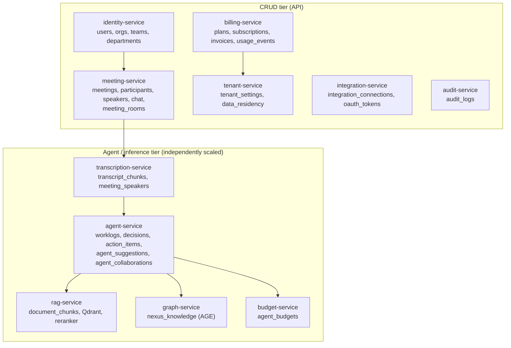
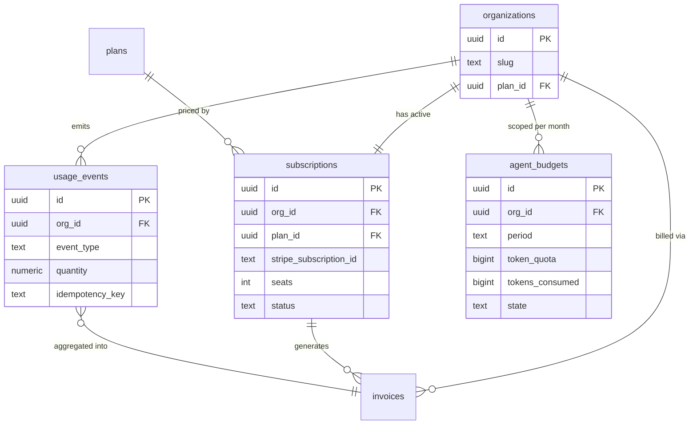
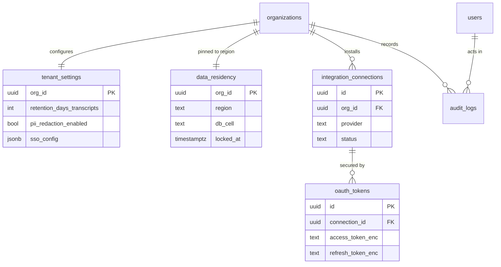
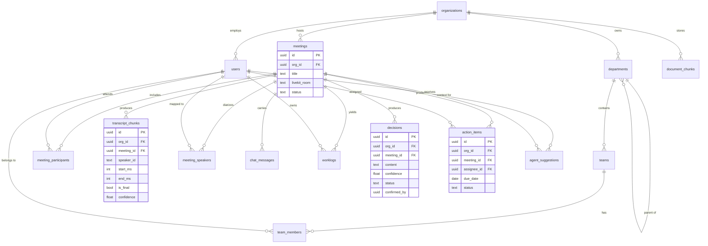
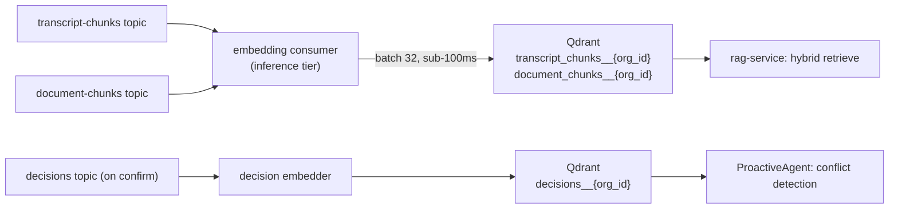
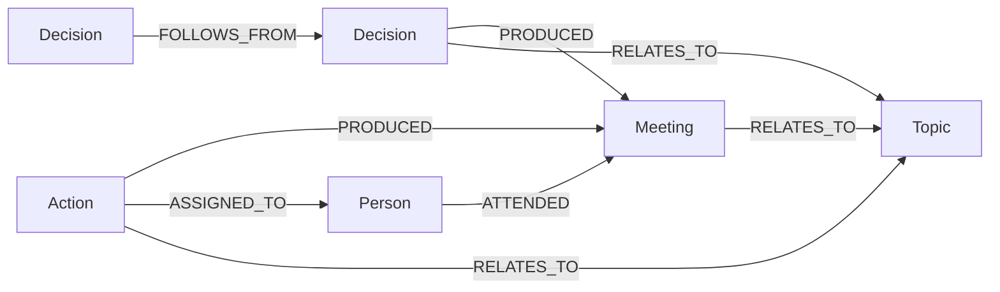
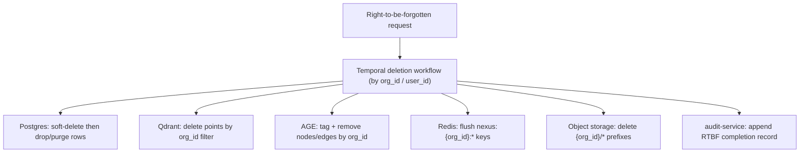

# NEXUS Canonical Data Model

The single naming authority for every NEXUS data entity, its owning service, tenant key, store, and partitioning/retention rules across PostgreSQL, Qdrant, Apache AGE, Redis, and object storage.

## Related documents

- [System Overview](../01-architecture-overview-and-principles.md) — architecture style, the six agents, service decomposition.
- [Event Streaming & Avro Schemas](../07-event-architecture.md) — Redpanda topics, Avro subjects, outbox/inbox, DLQs.
- [Multi-Tenancy](../06-multi-tenancy.md) — pooled + RLS for the long tail, cell-based isolation for large tenants, `org_id` injection.
- [Data Architecture](../05-data-architecture.md) — store selection, retention enforcement, backups/PITR, read replicas, regional placement.
- [Security & Compliance](../11-security-architecture.md) — RLS policies, PII redaction, right-to-be-forgotten, audit logging, SOC2.
- [SaaS Platform](../18-saas-business-architecture.md) — tenant lifecycle, Stripe billing, usage metering, plans/tiers, admin consoles.
- [Glossary](../24-glossary-and-naming.md) — canonical terms and every recorded rename.

---

## 1. Scope and conventions

This document is the **frozen source of truth for data naming**. Service code, migrations, Avro schemas, Cypher templates, and dashboards MUST use the exact entity names, column names, label names, topic names, and key namespaces defined here. No synonyms, no abbreviations.

Conventions used throughout:

| Convention | Rule |
| --- | --- |
| Table / column names | `snake_case`, plural table names (carried verbatim from the PDF spec). |
| Tenant key | `org_id UUID` references `organizations(id)`. Present on every tenant-scoped row. |
| Primary keys | `id UUID DEFAULT gen_random_uuid()` unless noted; composite PKs called out explicitly. |
| Timestamps | `created_at`, `updated_at` as `timestamptz`, UTC. Soft delete via `deleted_at timestamptz NULL`. |
| Owning service | The single microservice that owns writes to the table. Other services read via API or events, never by cross-writing. |
| Stores | `Postgres` (Supabase-managed primary), `Qdrant` (vectors), `AGE` (graph `nexus_knowledge`), `Redis` (Upstash cache/pubsub), `Object` (S3-compatible blob storage). |

> [SaaS-scale adjustment] The PDF treated NEXUS as a single-app data model with no tenant column. Every tenant-scoped table in this document carries `org_id`, and PostgreSQL Row-Level Security is the default isolation mechanism for the pooled long-tail; large/enterprise tenants are isolated cell-by-cell. See [Multi-Tenancy](../06-multi-tenancy.md).

### 1.1 Service ownership map

> [SaaS-scale adjustment] The PDF was a modular monolith with role-rotating ownership. We decompose into an explicit set of owning services along the modular-monolith → microservices path so the agent/inference tier scales independently of the CRUD tier. Service names below are canonical.

---

## 2. The canonical entity table

Every entity in NEXUS, its owning service, tenant key, key fields, store, and partitioning/retention note. PDF-original tables appear first (names verbatim), followed by SaaS-scale additions.

### 2.1 PDF-original PostgreSQL tables (names carried verbatim)

| Entity | Owning service | Tenant key (`org_id`?) | Key fields | Store | Partitioning / retention note |
| --- | --- | --- | --- | --- | --- |
| `organizations` | identity-service | Is the tenant root (`id` = `org_id`) | `id`, `clerk_org_id`, `name`, `slug`, `plan_id`, `status` (`active`/`suspended`), `created_at`, `deleted_at` | Postgres | Tenant root. **Not a tenant-scoped row and deliberately NOT `tenant_isolation`-policied** (see §7 rule 7). Never partitioned away; deletion cascades a right-to-be-forgotten workflow. `clerk_org_id` is the unique, immutable mapping from a Clerk organization to our tenant root, resolved at the edge ([ADR-0010](../adr/0010-auth-clerk-enterprise-sso.md)). `status` is the suspension state the edge checkpoint reads; it is the relational home of the `suspended` symbol in `TenantEvent`. |
| `users` | identity-service | Yes | `id`, `org_id`, `clerk_user_id`, `email`, `role`, `skills text[]`, `bio`, `avatar_url` | Postgres | RLS by `org_id`. `skills` is a tag array (PDF). Retained for tenant lifetime; soft-delete on RTBF. |
| `teams` | identity-service | Yes | `id`, `org_id`, `name`, `department_id` | Postgres | RLS by `org_id`. |
| `team_members` | identity-service | Yes | `team_id`, `user_id`, `role`, PK `(team_id, user_id)` | Postgres | RLS by `org_id` (denormalized for policy). Join table. |
| `departments` | identity-service | Yes | `id`, `org_id`, `name`, `parent_id` (org-hierarchy parent-child) | Postgres | RLS by `org_id`. Self-referential org tree. |
| `meetings` | meeting-service | Yes | `id`, `org_id`, `title`, `scheduled_start`, `scheduled_end`, `livekit_room`, `status`, `created_by` | Postgres | RLS by `org_id`. Range-partition candidate by `scheduled_start` month at scale. |
| `meeting_participants` | meeting-service | Yes | `meeting_id`, `user_id`, `role_in_meeting`, `consented_at timestamptz NULL`, `consent_version text NULL`, PK `(meeting_id, user_id)` | Postgres | RLS by `org_id`. Join table; drives `get_user_context`. `consented_at`/`consent_version` ([ADR-0018](../adr/0018-consent-entity-behind-flag.md)) record the recording/transcription consent acknowledgment at token-mint; both NULL until a participant consents, and behavior does not change until a tenant sets `tenant_settings.consent_required = true`. |
| `transcript_chunks` | transcription-service | Yes | `id`, `org_id`, `meeting_id`, `speaker_id`, `start_ms`, `end_ms`, `text`, `is_final`, `confidence` | Postgres | **Index on `(meeting_id, start_ms)`** (PDF). Only finals persisted. Range-partition by `created_at` month; hot 90d, then cold tier. |
| `meeting_speakers` | transcription-service | Yes | `id`, `org_id`, `meeting_id`, `speaker_id` (diarized), `user_id` (mapped), `confidence`, `assignment` (`manual`/`suggested`) | Postgres | RLS by `org_id`. Diarized `speaker_id` → `user_id` mapping (PDF R7: reliable manual + confidence-scored suggestion). |
| `worklogs` | agent-service | Yes | `id`, `org_id`, `meeting_id`, `user_id`, `content`, `relevance_score`, `created_by_agent`, `source_chunk_ids uuid[]` | Postgres | RLS by `org_id`. Per-user notes (PersonalListenerAgent). Retained per tenant retention policy. |
| `decisions` | agent-service | Yes | `id`, `org_id`, `meeting_id`, `content`, `rationale`, `confidence`, `status`, `confirmed_by` | Postgres | RLS by `org_id`. On confirmation → AGE `Decision`→`Meeting` `PRODUCED` edge. Soft delete. |
| `action_items` | agent-service | Yes | `id`, `org_id`, `meeting_id`, `content`, `assignee_id`, `due_date`, `confidence`, `status` | Postgres | RLS by `org_id`. On confirmation → AGE `Action`→`Person` `ASSIGNED_TO` edge. |
| `agent_suggestions` | agent-service | Yes | `id`, `org_id`, `user_id`, `meeting_id`, `question`, `priority` (1–3), `status` (Ask/Dismiss/Save-for-later) | Postgres | RLS by `org_id`. QuestionAgent output. Save-for-later persists into next meeting. |
| `agent_collaborations` | agent-service | Yes | `id`, `org_id`, `requester`, `responder`, `query`, `result`, `success`, `latency` | Postgres | RLS by `org_id`. ContextGapAgent A2A logs. Latency feeds R5/R6 dashboards. |
| `chat_messages` | meeting-service | Yes | `id`, `org_id`, `meeting_id`, `user_id`, `content`, `created_at` | Postgres | RLS by `org_id`. In-meeting chat (non-AV via Socket.io). Range-partition by `created_at`. |
| `document_chunks` | rag-service | Yes | `id`, `org_id`, `document_id`, `element_id`, `element_type` (Title/NarrativeText/Table/ListItem), `text`, `position` | Postgres | RLS by `org_id`. unstructured.io typed elements. Mirrors Qdrant `document_chunks` payload for citation. |

> [SaaS-scale adjustment] `transcript_chunks`, `chat_messages`, and `meetings` are the high-volume tables. They become PostgreSQL declarative range partitions (monthly) so retention and right-to-be-forgotten purges drop partitions instead of scanning. The PDF carried no partitioning. See [Data Architecture](../05-data-architecture.md).

> [SaaS-scale adjustment] `meeting_participants.consented_at`/`consent_version` and `tenant_settings.consent_required` (below, §2.2) are net-new columns on two PDF-original, previously-frozen tables, recording that a participant acknowledged recording/transcription before joining. The PDF had no consent concept. Landed schema-only and defaulted off ([ADR-0018](../adr/0018-consent-entity-behind-flag.md)) so the tables are not reopened under time pressure later; the token-mint 428 gate that enforces this is a later task. See [Compliance & Privacy §3.3](../12-compliance-and-privacy.md).

### 2.2 SaaS-scale entity additions (wholly added vs PDF)

> [SaaS-scale adjustment] Everything in this subsection is new relative to the PDF, which had no billing, metering, compliance, integration-token, or per-tenant budget model. These tables make NEXUS a multi-tenant commercial SaaS.

| Entity | Owning service | Tenant key (`org_id`?) | Key fields | Store | Partitioning / retention note |
| --- | --- | --- | --- | --- | --- |
| `plans` | billing-service | No (global catalog) | `id`, `code` (`free`/`pro`/`enterprise`), `name`, `seat_price_cents`, `included_meeting_minutes`, `included_agent_tokens`, `features jsonb` | Postgres | Global, non-tenant. Versioned; old plan rows retained for invoice reproducibility. |
| `subscriptions` | billing-service | Yes | `id`, `org_id`, `plan_id`, `stripe_subscription_id`, `seats`, `status` (`active`/`past_due`/`canceled`), `current_period_start/end`, `trial_ends_at` | Postgres | RLS by `org_id`. One active subscription per tenant. Retained for tenant lifetime + legal hold. |
| `usage_events` | billing-service | Yes | `id`, `org_id`, `user_id`, `event_type` (`meeting_minute`/`agent_token`/`transcription_second`/`storage_gb`), `quantity`, `occurred_at`, `idempotency_key` | Postgres | RLS by `org_id`. Append-only. Range-partition by `occurred_at` day; aggregated nightly, raw retained 90d then summarized. Sourced from `usage-events` topic (see [Event Streaming](../07-event-architecture.md)). |
| `invoices` | billing-service | Yes | `id`, `org_id`, `stripe_invoice_id`, `period_start/end`, `amount_due_cents`, `tax_cents`, `status` (`draft`/`open`/`paid`/`void`/`uncollectible`), `pdf_url` | Postgres | RLS by `org_id`. Immutable once finalized. Retained 7 years (tax/compliance). PDF blob in `nexus-invoices` bucket. |
| `audit_logs` | audit-service | Yes | `id`, `org_id`, `actor_id`, `actor_type` (`user`/`agent`/`system`), `action`, `target_type`, `target_id`, `metadata jsonb`, `ip`, `occurred_at` | Postgres | RLS by `org_id`. **Append-only, no UPDATE/DELETE** (tamper-evident). Range-partition by `occurred_at` month. Retained 1 year hot, archived to `nexus-audit-archive` for SOC2. |
| `integration_connections` | integration-service | Yes | `id`, `org_id`, `provider` (`google_calendar`/`slack`/`jira`/`linear`), `external_account_id`, `status`, `scopes text[]`, `installed_by` | Postgres | RLS by `org_id`. Guardrail R8: Calendar + Slack + one of Jira/Linear. One row per installed integration. |
| `oauth_tokens` | integration-service | Yes | `id`, `org_id`, `connection_id`, `access_token_enc`, `refresh_token_enc`, `expires_at`, `token_version` | Postgres | RLS by `org_id`. **Tokens encrypted at rest (envelope encryption, per-tenant KMS data key).** Refreshed by integration-service; never returned by API. |
| `tenant_settings` | tenant-service | Yes (one row per tenant) | `org_id` (PK), `default_locale`, `agent_confidence_overrides jsonb`, `retention_days_transcripts`, `retention_days_worklogs`, `pii_redaction_enabled`, `sso_config jsonb`, `consent_required boolean NOT NULL DEFAULT false` | Postgres | RLS by `org_id`. Drives per-tenant retention and confidence-threshold overrides. One row per tenant. `consent_required` ([ADR-0018](../adr/0018-consent-entity-behind-flag.md)) gates the meeting-join consent flow (see [Compliance & Privacy §3.3](../12-compliance-and-privacy.md)); default `false` so no tenant's join behavior changes until the flag is flipped, which is a legal/compliance decision, not an engineering one. |
| `data_residency` | tenant-service | Yes (one row per tenant) | `org_id` (PK), `region` (`us`/`eu`/`ap`), `db_cell`, `qdrant_region`, `object_bucket_region`, `locked_at` | Postgres | RLS by `org_id`. Pins tenant data to a region/cell (GDPR data-residency). Immutable after `locked_at` without migration workflow. |
| `rbac_grants` | identity-service | Yes | `id`, `org_id`, `user_id`, `tier` (`owner`/`admin`/`member`), `granted_by`, `created_at`, UNIQUE `(org_id, user_id)` | Postgres | RLS by `org_id`. The **authorization** store: `tier` is the only thing the authz middleware reads. Strictly distinct from `users.role`, which is a job/domain attribute feeding agent relevance and `get_user_context` and is **never** consulted for permissions ([ADR-0010](../adr/0010-auth-clerk-enterprise-sso.md) D5). One tier per user per tenant. |
| `agent_budgets` | budget-service | Yes | `id`, `org_id`, `period` (`YYYY-MM`), `token_quota`, `tokens_consumed`, `hard_cap`, `alert_80_sent`, `alert_95_sent`, `state` (`ok`/`throttled`/`blocked`) | Postgres | RLS by `org_id`. One row per (tenant, month). Enforces R4 token budgets + hard quotas; budget alerts from Phase 7. |
| `pii_tokens` | tenant-service | Yes | `id`, `org_id`, `token`, `entity_type` (`EMAIL`/`PHONE`/`IBAN`/`CARD`/`GOVID`/`PERSON`/`ORG`/`LOC`), `value_ciphertext`, `value_hmac`, `dek_id`, UNIQUE `(org_id, token)`, UNIQUE `(org_id, entity_type, value_hmac)` | Postgres | RLS by `org_id`. The per-tenant reversible token vault behind the typed placeholders in [Compliance §5.2](../12-compliance-and-privacy.md) ([ADR-0020](../adr/0020-pii-token-vault-and-ner-placement.md)). Owned and written **only** by `identity-tenant-service`; the three redaction boundaries (`transcription-service`, `ingestion-service`, `agent-runtime-service`/`rag-service`) are callers of its mint/resolve API, never writers, so one shared token space per tenant does not become three writers of one table. `value_ciphertext` is envelope-encrypted under a per-tenant data key. `value_hmac` is a **keyed** HMAC of the normalized value, never a plain digest: direct identifiers have low enough entropy that an unkeyed hash of an email is equivalent to storing the email. The second UNIQUE is what makes the same raw value mint the same token across boundaries, which is the coherence property §5.2 exists for. Resolving a token is a PII disclosure and writes `audit_logs`. **Not yet migrated:** ADR-0020 blocks implementation on key custody, which no part of the program provides today. |
| `meeting_rooms` | meeting-service | Yes | `id`, `org_id`, `meeting_id`, `livekit_room`, `status` (`pending`/`active`/`ended`), `egress_id`, `recording_ref`, `livekit_metadata_synced_at`, UNIQUE `(org_id, meeting_id)`, UNIQUE `(org_id, livekit_room)` | Postgres | RLS by `org_id` (`ENABLE` + `FORCE`, `tenant_isolation`). The LiveKit room ↔ meeting map ([ADR-0003](../adr/0003-meeting-sdk-livekit.md)): one row per meeting, bounded by meeting count, so not partitioned. `status` is CHECK-constrained to the three values above. `recording_ref` points into the `nexus-recordings` bucket (§6); `egress_id` is the LiveKit egress handle. `org_id` FK is `ON DELETE RESTRICT`. Owner is `meeting-service` **in the Service Catalog sense** (the LiveKit transport adapter) - the one table where this document's overloaded `meeting-service` label and the catalog service of the same name refer to the same thing (see [Glossary §10](../24-glossary-and-naming.md)). |

> [SaaS-scale adjustment] `meeting_rooms` is new relative to the PDF but is not a commercial-SaaS table like the rest of this subsection: it exists because the SaaS build adopted LiveKit as the meeting transport ([ADR-0003](../adr/0003-meeting-sdk-livekit.md)), which needs a materialization of the provider's room for each `meetings` row. It sits here rather than in §2.1 because §2.1 is reserved for tables carried verbatim from the PDF, and the PDF had no meeting-transport provider at all.

#### 2.2.1 Billing & metering entity relationships

#### 2.2.2 Compliance & integration entity relationships

### 2.3 Core domain ERD (PDF entities)

---

## 3. Qdrant vector collections

Vector store is **Qdrant Cloud**, 384-dim **BGE-small-en** embeddings via ONNX runtime, embedded on ingest by the dedicated inference tier (query-embed only at read time). Three collections, named to mirror their relational counterparts.

> [SaaS-scale adjustment] The PDF described one shared Qdrant store. At SaaS scale we use **per-tenant Qdrant collections** (collection-per-tenant for the long tail; dedicated Qdrant clusters for cell-isolated enterprise tenants). Tenant isolation is enforced at the collection boundary AND by an `org_id` payload filter on every query — defense in depth.

| Collection | Vector | Payload fields (citation-bearing) | Tenancy approach | Source |
| --- | --- | --- | --- | --- |
| `transcript_chunks` | 384-dim BGE-small-en, cosine | `org_id`, `meeting_id`, `chunk_id`, `speaker`, `start_ms`, `is_final` | Per-tenant collection `transcript_chunks__{org_id}` for pooled tenants; dedicated cluster for cell-isolated tenants. Mandatory `org_id` filter. | `transcript-chunks` topic → embedding consumer |
| `document_chunks` | 384-dim BGE-small-en, cosine | `org_id`, `document_id`, `element_id`, `element_type`, `meeting_id?` | Per-tenant collection `document_chunks__{org_id}`; dedicated cluster for cell-isolated tenants. Mandatory `org_id` filter. | `document-chunks` topic → embedding consumer |
| `decisions` | 384-dim BGE-small-en, cosine | `org_id`, `decision_id`, `meeting_id`, `status`, `confidence` | Per-tenant collection `decisions__{org_id}`. Enables semantic conflict detection (ProactiveAgent) alongside AGE graph queries. | `decisions` topic on confirmation |

Naming rule: the logical collection names are exactly `transcript_chunks`, `document_chunks`, `decisions`; the physical per-tenant collection appends `__{org_id}`. The transport adapter and RAGService resolve logical → physical names from `data_residency.qdrant_region` + `org_id`.

**Citation contract** (Phase 9 RAG): every retrieved passage carries `meeting_id` + `chunk_id` + `speaker` for transcripts, or `document_id` + `element_id` for documents. This payload shape is frozen and matches `transcript_chunks` / `document_chunks` Postgres rows.

---

## 4. Apache AGE knowledge graph (`nexus_knowledge`)

Graph store is **Apache AGE** (Cypher over PostgreSQL), graph named **`nexus_knowledge`** (verbatim). Edges are created on confirmation, never speculatively. Owned by graph-service.

> [SaaS-scale adjustment] The PDF described one global `nexus_knowledge` graph. At SaaS scale the graph is **org-partitioned**: every node carries an `org_id` property and every Cypher template is parameterized with `$org_id` so traversals never cross tenant boundaries. A documented migration path exists to Amazon Neptune / Neo4j Aura plus a relational materialized-view fallback (honors PDF R1, adds the at-scale exit). See [Data Architecture](../05-data-architecture.md).

### 4.1 Node labels (verbatim)

| Node label | Backed by | Key properties |
| --- | --- | --- |
| `Person` | `users` | `user_id`, `org_id`, `role` |
| `Meeting` | `meetings` | `meeting_id`, `org_id`, `title` |
| `Decision` | `decisions` | `decision_id`, `org_id`, `status`, `confidence` |
| `Action` | `action_items` | `action_id`, `org_id`, `status` |
| `Topic` | role→topics taxonomy | `name`, `org_id` |

### 4.2 Edge labels (verbatim)

| Edge label | From → To | Created when |
| --- | --- | --- |
| `ATTENDED` | `Person` → `Meeting` | Participant joins a meeting |
| `PRODUCED` | `Decision` → `Meeting` | Decision confirmed (also `Action` → `Meeting`) |
| `ASSIGNED_TO` | `Action` → `Person` | Action confirmed with assignee |
| `RELATES_TO` | `Decision`/`Action`/`Meeting` → `Topic` | Topic extraction links entity to taxonomy |
| `FOLLOWS_FROM` | `Decision` → `Decision` | Decision lineage / supersession |

Pre-built Cypher templates remain named functions, each parameterized by `$org_id`: related decisions for a topic, decisions by a person, actions blocked on a decision, decision lineage. Soft delete is supported (nodes/edges tagged `deleted_at`, filtered out of templates).

---

## 5. Redis key namespaces

Cache/pubsub is **Redis (Upstash)**. Every key is **tenant-namespaced** so eviction, isolation, and per-tenant flush are clean.

> [SaaS-scale adjustment] The PDF used unscoped Redis keys (e.g. the `get_user_context` cache, the RAG cache). All keys are now prefixed `nexus:{org_id}:…` to enforce namespaced Redis isolation and enable per-tenant cache invalidation on RTBF and plan changes.

| Namespace pattern | Purpose | TTL | Source feature |
| --- | --- | --- | --- |
| `nexus:{org_id}:user_ctx:{user_id}` | `get_user_context()` result (role/skills/team/recent meetings/topics) | 5 min (PDF) | Phase 5 |
| `nexus:{org_id}:rag:{user_id}:{query_hash}` | RAG query result cache (passages + citations) | 10 min (PDF) | Phase 9 |
| `nexus:{org_id}:presence:{meeting_id}` | Socket.io presence set for a meeting room | meeting-lifetime | Phase 3 |
| `nexus:{org_id}:pubsub:meeting:{meeting_id}` | Redis pub/sub fan-out channel for Socket.io across backend instances | n/a (channel) | Phase 11 |
| `nexus:{org_id}:queue:agent:{user_id}` | Per-user priority queue (urgent alerts pre-empt notes) | session | Phase 11 |
| `nexus:{org_id}:dedupe:{topic}:{idempotency_key}` | At-least-once consumer dedupe cache | 24h | Event delivery (inbox) |
| `nexus:{org_id}:budget:{period}` | Hot mirror of `agent_budgets.tokens_consumed` for fast quota checks | period-end | R4 budgets |
| `nexus:{org_id}:ratelimit:{user_id}` | Per-user LiteLLM rate-limit counters | sliding window | LLM routing |

---

## 6. Object-storage buckets

Object storage is **S3-compatible** blob storage, regionally placed per tenant via `data_residency.object_bucket_region`.

> [SaaS-scale adjustment] The PDF stored recordings/attachments implicitly. We define explicit, regionally-placed, lifecycle-managed buckets with per-tenant prefixes for data residency and retention enforcement.

| Bucket | Contents | Key prefix | Lifecycle / retention |
| --- | --- | --- | --- |
| `nexus-recordings` | Meeting recordings (LiveKit `recording.ready` webhook) | `{org_id}/{meeting_id}/` | Per-tenant `retention_days_transcripts`; transition to cold tier after 30d; purge on RTBF. |
| `nexus-documents` | Uploaded source docs ingested via unstructured.io (PDF/DOCX/PPTX/HTML/MD/EML) | `{org_id}/{document_id}/` | Tenant retention; originals kept while `document_chunks` exist. |
| `nexus-attachments` | Calendar event attachments routed through ingestion | `{org_id}/{meeting_id}/` | Tenant retention; deleted with parent meeting. |
| `nexus-invoices` | Finalized invoice PDFs (`invoices.pdf_url`) | `{org_id}/{invoice_id}.pdf` | 7-year legal retention; immutable (object lock). |
| `nexus-audit-archive` | Cold-archived `audit_logs` partitions | `{org_id}/{YYYY-MM}/` | SOC2 retention; write-once object lock. |
| `nexus-exports` | GDPR data-export bundles (right-of-access) | `{org_id}/{export_id}.zip` | Auto-expire 7 days after generation. |

---

## 7. Cross-cutting data rules

These rules bind every entity above and are enforced in code, not by convention.

1. **`org_id` injection.** An authz middleware injects `org_id` (from the Clerk-verified JWT) into every query; RLS policies `USING (org_id = current_setting('app.current_org')::uuid)` are the backstop. See [Security & Compliance](../11-security-architecture.md).
2. **At-least-once + idempotency.** Every event-sourced write (`usage_events`, agent outputs, embedding upserts) carries an `idempotency_key`; the `nexus:{org_id}:dedupe:*` inbox cache and unique constraints prevent double-apply. Transactional outbox tables shadow each owning service. See [Event Streaming](../07-event-architecture.md).
3. **Tenant partitioning at every layer.** DB rows by RLS/cell, Qdrant by collection, AGE by `$org_id`, Redpanda by tenant-keyed partition, Redis by namespace, object storage by key prefix.
4. **Retention is per-tenant and partition-aligned.** `tenant_settings.retention_days_*` drive partition drops and bucket lifecycle rules; right-to-be-forgotten deletes by `org_id` across all six stores in a single Temporal workflow.
5. **Soft delete then hard purge.** `deleted_at` hides rows immediately; a scheduled purge enforces retention and RTBF, including AGE nodes/edges and Qdrant points.
6. **Confidence thresholds gate persistence** (agent outputs): above 0.7 surfaced, 0.4–0.7 silent-logged to `worklogs`, below dropped — overridable per tenant via `tenant_settings.agent_confidence_overrides`.
7. **The tenant root is not a tenant-scoped row.** `organizations` carries no `org_id` column (its `id` **is** the `org_id`), so the rule-1 policy is not expressible on it and it is deliberately **not** `tenant_isolation`-policied. This makes rule 1 exceptionless and therefore machine-checkable: **every table with an `org_id` column MUST carry a `tenant_isolation` policy**, asserted in CI over `information_schema.columns` and `pg_policies`, alongside the assertion that no request-path role holds `rolsuper` or `rolbypassrls`. `organizations` is protected instead by column-level grants plus a single sanctioned accessor in the shared tenancy library; it holds directory metadata only, and anything tenant-confidential belongs in `tenant_settings` or `data_residency`, which do carry `org_id` and are policied. `plans` is the other un-tenanted table. See [ADR-0002](../adr/0002-multi-tenancy-model.md) D3.
8. **A policy is only as good as the grant beneath it.** RLS decides which rows a role may see; a GRANT decides whether the role reaches the table at all, and the two are enforced at different places. Three consequences bind every migration in every repo that writes to the shared PostgreSQL schema. First, **no schema-wide default privilege may grant on TABLES**: a partition created by `CREATE TABLE ... PARTITION OF` is itself a newly created table, so it inherits the grant, while the parent's `tenant_isolation` policy is enforced only on access **through the parent** - a partition named directly is checked against its own row-security state. Second, and following from it, **a partition carries no direct grant to any role**; access is through the parent, which is where both the policy and the grant live. Third, **no role holding `rolbypassrls` may hold any privilege on a tenant table**, whether or not this program created that role: the rule-7 assertion covers the roles we define and cannot see one the database image ships. All three are asserted in CI over `pg_class.relacl`, `pg_default_acl` and `pg_roles`. See [ADR-0021](../adr/0021-explicit-grants-no-schema-wide-default-privileges.md).

