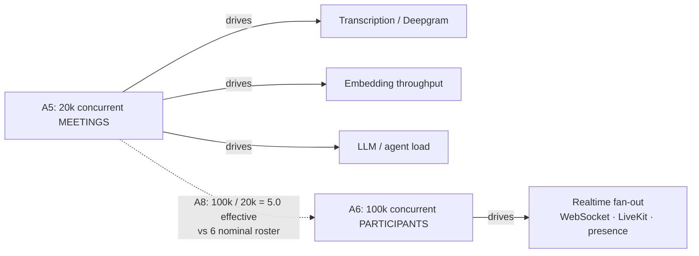
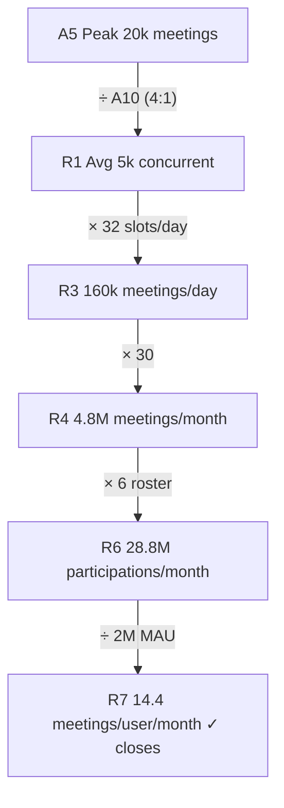
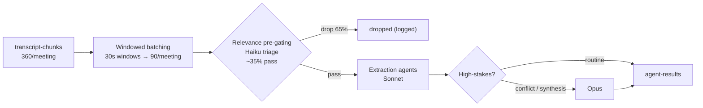

# NEXUS Capacity & Scaling Math (Canonical)

The single, frozen source of capacity assumptions and derived load/cost numbers that every other NEXUS architecture document must reuse verbatim.

**Related documents**

- [System Architecture Overview](../01-architecture-overview-and-principles.md)
- [Data Architecture](../05-data-architecture.md)
- [Event Streaming & Avro Contracts](../07-event-architecture.md)
- [Agent Tier & LLM Processing Pipeline](../08-ai-agent-architecture.md)
- [RAG & Inference Services](../09-rag-and-inference-serving.md)
- [Multi-Tenancy & Isolation](../06-multi-tenancy.md)
- [SaaS Business & Billing](../18-saas-business-architecture.md)
- [Glossary](../24-glossary-and-naming.md)

> [SaaS-scale adjustment] The entire premise of this document is a SaaS-scale delta. The PDF execution plan targeted a 4-person team building an MVP with a seeder of `2 orgs x 10 users x 5 meetings`. This document instead sizes NEXUS as a production multi-tenant SaaS for millions of users across thousands of paying tenant organizations. The capacity numbers below supersede the seeder-scale assumptions for all production sizing, cost modeling, and SLO setting. The seeder remains the canonical *development/test* fixture only.

---

## 1. How to use this document

This is a **closed, self-reconciling capacity model**. Every number below is derived from a small set of anchors, computed once, and frozen. Other documents — data architecture, event streaming, agent tier, billing — **import these numbers by reference rather than re-deriving them**. If a sibling doc needs a number not present here, add it here first so the model stays single-sourced.

Three rules govern the model:

1. **Peak concurrency is ground truth.** All throughput is anchored on peak concurrent meetings (`20k`) and a single peak:average ratio (`4:1`). We then *check* that this closes against DAU and meetings/user/month, rather than assuming meetings/user/month independently.
2. **Two anchors, two domains.** `20k concurrent meetings` drives transcription, embedding, and LLM/agent load (one diarized stream per *meeting*). `100k concurrent participants` drives realtime fan-out (WebSocket connections, LiveKit tracks, presence). They are not interchangeable.
3. **Flows vs. stocks.** `transcript_chunks` is a *flow* (rows written per year). Qdrant vectors are a cumulative *stock* governed by a retention window, not a per-year flow. Never conflate them.

All arithmetic in this document was computed programmatically; tables show the exact rounded results.

---

## 2. Base assumptions (FROZEN — import verbatim)

These are the only free parameters. Everything else is derived.

| ID | Parameter | Value | Notes |
|----|-----------|-------|-------|
| A1 | Registered users | **5,000,000** | Total accounts across all tenants |
| A2 | Monthly Active Users (MAU) | **2,000,000** | Users with >=1 meeting/month |
| A3 | Daily Active Users (DAU) | **1,000,000** | DAU/MAU ratio = **0.50** |
| A4 | Paying tenant organizations | **3,000** | Thousands of tenants (Free/Pro/Enterprise mix) |
| A5 | Peak concurrent meetings | **20,000** | Ground-truth throughput anchor (drives transcription/LLM) |
| A6 | Peak concurrent meeting participants | **100,000** | Realtime fan-out anchor (drives WebSocket/LiveKit) |
| A7 | Nominal participants per meeting (roster) | **6** | Per-meeting roster size |
| A8 | Effective concurrent participants per meeting | **5.0** | `100k / 20k`; reconciles A5 vs A6 (join-late / leave-early) |
| A9 | Average meeting duration | **45 min** | |
| A10 | Peak : average concurrency ratio | **4 : 1** | Business hours + partial global timezone spread |
| A11 | Active throughput window | **24 h** | Global tenant spread keeps the pipeline warm around the clock |
| A12 | Deepgram finals (utterances) per minute | **8** | Speaker-turn-ish finals across a ~6-person active call |
| A13 | Speaking rate | **150 wpm** | Conversational; ~5 chars/word incl. spaces |
| A14 | LangChain split | **chunk_size 600 / overlap 60** | Carried over verbatim from PDF; effective advance 540 chars |
| A15 | Document attach rate | **30% of meetings** | Avg attached doc ~15,000 chars (post unstructured.io) |
| A16 | Embedding model / dim | **BGE-small-en / 384-dim** | float32 raw = 1,536 bytes/vector |
| A17 | Windowed batching window | **30 s** | Agents run per window, NOT per raw chunk (see §8) |
| A18 | Qdrant hot retention | **13 months** | Governs the live vector stock |

> [SaaS-scale adjustment] A4, A8, A10, A11, A15, A17, and A18 are introduced for SaaS-scale sizing and are not present in the PDF. A17 (30s windowed batching) and A18 (13-month hot retention) are the two most load-bearing additions: A17 is the lever that defeats the R4 LLM cost bomb; A18 converts the unbounded vector flow into a bounded, billable stock.

### 2.1 The reconciliation: 20k meetings vs 100k participants

The gap between `20k x 6 = 120k` nominal and `100k` observed concurrent participants is the **effective occupancy** of `5.0`: at any instant a meeting averages 5 connected participants because people join late and leave early. Use **6** for per-meeting roster math (worklogs, agents spawned) and **100k** for connection-count math (WebSocket gateway sizing).

---

## 3. Throughput reconciliation loop (the consistency backbone)

We anchor on peak concurrency and verify the loop closes against DAU.

| Step | Quantity | Derivation | Value |
|------|----------|------------|-------|
| R1 | Avg concurrent meetings | `A5 / A10` = `20,000 / 4` | **5,000** |
| R2 | Meeting slots per day | `(24 x 60) / 45` | **32.0** |
| R3 | Meetings / day | `R1 x R2` = `5,000 x 32` | **160,000** |
| R4 | Meetings / month | `R3 x 30` | **4,800,000** |
| R5 | Meetings / year | `R3 x 365` | **58,400,000** |
| R6 | Participations / month | `R4 x A7` = `4.8M x 6` | **28,800,000** |
| R7 | **Meetings / user / month (vs MAU)** | `R6 / A2` = `28.8M / 2M` | **14.4** |
| R8 | Meetings / user / month (vs DAU) | `R6 / A3` = `28.8M / 1M` | **28.8** |

**Closure check (R7):** 14.4 meetings/MAU/month ≈ ~3.3 meetings/week for an active knowledge worker — a realistic figure for a meeting-intelligence product. The loop is internally consistent: the `20k` peak anchor, the `4:1` ratio, and the `2M` MAU produce a believable per-user behavior. If a sibling doc assumes a *different* meetings/user/month, it must change A2, A5, or A10 here first — not patch the number locally.

---

## 4. transcript_chunks (flow)

`transcript_chunks` rows are raw Deepgram **finals** persisted (interims are never persisted, per the carried-over real-time spec). One row per finalized utterance.

| ID | Quantity | Derivation | Value |
|----|----------|------------|-------|
| T1 | finals / meeting | `A12 x A9` = `8 x 45` | **360** |
| T2 | **transcript_chunks / meeting** | = T1 | **360** |
| T3 | **transcript_chunks / month** | `T2 x R4` = `360 x 4.8M` | **1,728,000,000** |
| T4 | **transcript_chunks / year** | `T2 x R5` = `360 x 58.4M` | **21,024,000,000** |

> [SaaS-scale adjustment] At ~1.73B `transcript_chunks` rows/month, the table cannot live as a single hot Postgres relation forever. [Data Architecture](../05-data-architecture.md) specifies monthly range partitioning on `(meeting_id, start_ms)` and tiering rows older than 90 days to cold/object storage. The PDF treated `transcript_chunks` as one indexed table; that holds for the seeder, not for 21B rows/year.

---

## 5. Qdrant vectors (stock)

The embedding consumer consumes `transcript-chunks`, **re-splits** with LangChain (chunk_size 600 / overlap 60), embeds at BGE-small 384-dim, and upserts to per-tenant Qdrant collections. This is a *different and smaller* count than `transcript_chunks` (tens/meeting, not hundreds). Documents (`document_chunks`) add to the stock.

### 5.1 Per-meeting vector production

| ID | Quantity | Derivation | Value |
|----|----------|------------|-------|
| V1 | Transcript chars / meeting | `A9 x A13 x 5` = `45 x 150 x 5` | **33,750** |
| V2 | Transcript vectors / meeting | `V1 / 540` (effective advance) | **62.5** |
| V3 | Document vectors / attached doc | `15,000 / 540` | **27.8** |
| V4 | Document vectors / meeting (amortized) | `A15 x V3` = `0.30 x 27.8` | **8.3** |
| V5 | **Total vectors / meeting** | `V2 + V4` | **70.8** |

### 5.2 Flow and stock

| ID | Quantity | Derivation | Value |
|----|----------|------------|-------|
| V6 | Vectors ingested / month | `V5 x R4` = `70.8 x 4.8M` | **340,000,000** |
| V7 | **Qdrant live stock** | `V6 x A18` = `340M x 13` | **4,420,000,000** |
| V8 | Raw vector storage | `V7 x 1,536 B` | **~6.8 TB raw** |
| V9 | Indexed storage (HNSW + payload, ~2.5x) | `V8 x 2.5` | **~17 TB** |

> [SaaS-scale adjustment] The PDF specified a single Qdrant Cloud collection with 384-dim BGE-small vectors. At 4.42B vectors / ~17 TB this becomes **per-tenant Qdrant collections** (tenant isolation, per §[Multi-Tenancy](../06-multi-tenancy.md)) with **scalar int8 quantization** (cuts resident RAM ~4x) and a hot/cold split aligned to A18. Embedding is **embed-on-ingest, query-embed only** on a dedicated inference tier — see [RAG & Inference Services](../09-rag-and-inference-serving.md).

---

## 6. Redpanda events (flow)

All NEXUS topics — `transcript-chunks`, `document-chunks`, `agent-results`, `decisions`, `actions`, `notifications`, `agent-requests`, `agent-responses`, `agent-stream` — are partitioned by tenant. Per-meeting event production aggregates across topics.

| ID | Topic / source | Per meeting | Derivation |
|----|----------------|-------------|------------|
| E1 | `transcript-chunks` | 360 | = T2 |
| E2 | `document-chunks` | 8.3 | = V4 |
| E3 | `agent-results` | 756 | windows(90) x roster(6) x realtime-agents(4) x gate-pass(0.35) |
| E4 | `decisions` | 3 | surfaced decisions/meeting |
| E5 | `actions` | 5 | surfaced action items/meeting |
| E6 | `notifications` | 8 | |
| E7 | `agent-requests` + `agent-responses` | 12 | ContextGapAgent collaboration round-trips |
| E8 | `agent-stream` | 1,260 | gate-passing windows (31.5) x ~40 streamed token deltas |
| **E9** | **Total events / meeting** | **~2,412** | sum E1..E8 |

| ID | Quantity | Derivation | Value |
|----|----------|------------|-------|
| E10 | **Events / month** | `E9 x R4` = `2,412 x 4.8M` | **~11,580,000,000** |
| E11 | Events / sec (average) | `E10 / 2.59M s` | **~4,470** |
| E12 | **Events / sec (peak)** | `E11 x A10` | **~17,900** |
| E13 | Ingress volume / month | `E10 x ~1.2 KB Avro` | **~13,900 GB** |

The `agent-stream` topic dominates event *count* (streamed LLM token deltas), while `transcript-chunks` dominates *durable* volume. Both are partitioned by tenant key so a noisy tenant cannot starve others.

> [SaaS-scale adjustment] The PDF used the Redpanda Serverless 30-day trial. At ~17.9k events/sec peak and ~13.9 TB/month ingress, production runs a **BYOC/dedicated multi-AZ Redpanda cluster** with all topics tenant-partitioned, transactional outbox/inbox + idempotency keys + DLQs (at-least-once with dedupe). Avro + Schema Registry with BACKWARD compatibility (one subject `{topic}-value`) is preserved verbatim — see [Event Streaming](../07-event-architecture.md).

---

## 7. Deepgram meeting-minutes (flow)

**Billing decision (locked): one diarized stream per meeting, not per participant.** Audio is captured server-side via the LiveKit hook and proxied through the FastAPI WebSocket to a single Deepgram session per meeting with speaker diarization. This is a **6x cost lever** and is consistent with the diarization design (`meeting_speakers` maps diarized `speaker_id -> user_id`).

| ID | Quantity | Derivation | Value |
|----|----------|------------|-------|
| D1 | **Deepgram minutes / month** | `R4 x A9` = `4.8M x 45` | **216,000,000** |
| D2 | Deepgram minutes / year | `R5 x A9` | **2,628,000,000** |
| D3 | Per-participant billing (AVOIDED) | `D1 x 6` | 1,296,000,000 — **6x, do not do this** |

---

## 8. LLM calls under the cost-controlled pipeline (the load-bearing number)

This is the single most architecturally important number. It **must** derive from the locked cost-controlled pipeline — relevance pre-gating → windowed batching (NOT per raw chunk) → tiered routing — not from raw chunk volume. We first show the naive per-chunk figure being avoided (this is **R4**, the LLM cost spiral).

### 8.1 R4 cost bomb: naive per-chunk (AVOIDED)

If every realtime agent ran on every raw `transcript_chunk`:

| ID | Quantity | Derivation | Value |
|----|----------|------------|-------|
| N1 | LLM calls / meeting | `T2(360) x agents(4) x roster(6)` | **8,640** |
| N2 | LLM calls / month | `N1 x R4` | **41,472,000,000** |
| N3 | LLM calls / sec (peak) | `(N2 / 2.59M) x 4` | **~64,000** |

This is the trap the PDF flagged as **R4**. We do not build this.

### 8.2 Cost-controlled pipeline (BUILT)

| ID | Stage (tier) | Per meeting | Derivation |
|----|--------------|-------------|------------|
| L1 | Triage / pre-gating (**Haiku**) | 540 | windows(90) x roster(6); one triage per window per participant |
| L2 | Extraction — Listener/Decision/Action (**Sonnet**) | 567 | windows(90) x roster(6) x gate-pass(0.35) x agents(3) |
| L3 | QuestionAgent (**Sonnet**) | 81 | windows(90) x roster(6) x 0.15 |
| L4 | ContextGapAgent synthesis (**Sonnet**) | 12 | collaboration round-trips |
| L5 | High-stakes reasoning (**Opus**) | 6 | ProactiveAgent conflict / ContextGap fallback synthesis |
| **L6** | **Total LLM calls / meeting** | **~1,206** | sum L1..L5 |

| ID | Quantity | Derivation | Value |
|----|----------|------------|-------|
| L7 | **LLM calls / month** | `L6 x R4` = `1,206 x 4.8M` | **~5,789,000,000** |
| L8 | LLM calls / sec (average) | `L7 / 2.59M` | **~2,230** |
| L9 | **LLM calls / sec (peak)** | `L8 x A10` | **~8,930** |
| L10 | **Reduction vs naive (N2)** | `1 - L7/N2` | **86%** |

**Tier mix (by call volume):** Haiku **45%**, Sonnet **55%**, Opus **<1%**. Triage is the highest-volume / cheapest tier by design; Opus is reserved for confirmed high-stakes reasoning only. Confidence thresholds carried over verbatim: **>0.7 surface, 0.4–0.7 silent log, <0.4 drop**.

> [SaaS-scale adjustment] The PDF described per-participant agents that "process every transcript chunk." That is N1–N3 — the R4 cost bomb. Production replaces it with **windowed batching (A17)** + **relevance pre-gating (Haiku)** + **tiered routing (Haiku→Sonnet→Opus)** + **semantic & Anthropic prompt caching** + **per-tenant token budgets and hard quotas**, delivering an 86% call-volume reduction before any caching savings. See [Agent Tier & LLM Processing](../08-ai-agent-architecture.md).

---

## 9. Embedding throughput

Driven by V6 (vectors/month) on the dedicated embedding inference tier, batch size 32.

| ID | Quantity | Derivation | Value |
|----|----------|------------|-------|
| EM1 | Embeddings / sec (average) | `V6 / 2.59M` | **~131** |
| EM2 | **Embeddings / sec (peak)** | `EM1 x A10` | **~525** |
| EM3 | Peak batches / sec (batch 32) | `EM2 / 32` | **~16.4** |
| EM4 | Query embeddings / sec (peak) | RAG queries, see §10 | **~700** (query-embed only) |

> [SaaS-scale adjustment] BGE-small embedding and BGE-reranker run on a **dedicated autoscaling inference tier (GPU / Ray Serve / vLLM), off the API tier**. The PDF ran BGE-small via ONNX on the API service; at 525 embeds/sec ingest plus query load this couples CPU-bound inference with API serving and is decoupled here — see [RAG & Inference Services](../09-rag-and-inference-serving.md).

---

## 10. Monthly cost ballpark

All figures are **monthly, USD, order-of-magnitude** for production steady-state at the §2 anchors. Token assumptions reflect Anthropic prompt caching (effective cached input shown). Compute (K8s/EKS, GPU inference tier), egress, and CDN are excluded here and covered in the infra cost doc.

| Component | Basis | Est. monthly cost | Notes |
|-----------|-------|------------------:|-------|
| **LLM — Haiku** | 2.59B calls; ~250 cached-in / 60 out tok | **~$1,140,000** | Triage tier; $0.80/$4.00 per MTok |
| **LLM — Sonnet** | 3.17B calls; ~500 cached-in / 220 out tok | **~$15,210,000** | Extraction tier (cost center); $3.00/$15.00 per MTok |
| **LLM — Opus** | 28.8M calls; ~1,500 cached-in / 600 out tok | **~$1,944,000** | High-stakes only; $15.00/$75.00 per MTok |
| **LLM subtotal** | L7 = 5.79B calls | **~$18,290,000** | Naive per-chunk all-Sonnet ≈ **$224M/mo** — AVOIDED |
| **Deepgram** | D1 = 216M min, ~$0.0077/min, 35% volume discount | **~$1,081,000** | One stream/meeting; per-participant would be 6x |
| **Redpanda (BYOC)** | ~17.9k ev/s peak, ~13.9 TB/mo, multi-AZ | **~$28,000** | Tenant-partitioned dedicated cluster |
| **Qdrant** | 4.42B vec / ~17 TB, int8 quantized, per-tenant | **~$22,000** | Hot RAM-resident + cold disk |
| **Temporal Cloud** | ~1.34B state transitions/mo | **~$33,600** | Lifecycle + ActionFollowUpWorkflow (~$25/M actions) |
| **Postgres (managed)** | 1.73B chunk rows/mo, primary + replica + PITR | **~$9,000** | AGE `nexus_knowledge` + RLS; cold-tier after 90d |
| **TOTAL (variable infra)** | | **~$19,460,000 / mo** | ~$234M/yr; excludes K8s/GPU/egress |

### 10.1 Unit economics

| ID | Metric | Value |
|----|--------|-------|
| C1 | Variable infra cost / meeting | **~$4.06** |
| C2 | Variable infra cost / MAU / month | **~$9.73** |
| C3 | LLM share of variable cost | **94%** |
| C4 | Post Phase-13 LLM optimization (~30% per R4) | LLM **~$12.8M/mo**; total **~$14.0M/mo**; cost/MAU **~$6.99** |

**Pricing implication:** at ~$9.73/MAU (→ ~$6.99 post-optimization), a Pro seat priced at $20–30/seat/month retains healthy gross margin, and Free-tier usage must be quota-capped via the usage-metering pipeline. LLM is 94% of variable cost, so the R4 levers (gating, batching, tiering, caching) and the Phase-13 30% reduction target are the dominant margin drivers — not infra rightsizing. See [SaaS Business & Billing](../18-saas-business-architecture.md).

> [SaaS-scale adjustment] Cost modeling, per-tenant token budgets, hard quotas, usage metering, and Stripe-backed seat/usage billing are wholly added vs. the PDF. The PDF's only cost note was a Phase-13 "~30% reduction" target (preserved here as C4) and Phase-7 budget alerts.

---

## 11. SLO targets

Service-level objectives by tier. The end-to-end agent latency budget (Deepgram ~1s + LLM ~0.8s + network) is carried over verbatim from the PDF (R5); the per-plan availability tiers are a SaaS-scale addition.

### 11.1 Latency SLOs

| Surface | Metric | Target | Source |
|---------|--------|-------:|--------|
| CRUD / REST API (`/api/...`) | p95 latency | **< 300 ms** | API tier |
| CRUD / REST API | p99 latency | **< 800 ms** | API tier |
| Live captions (Deepgram final → UI) | p95 | **< 2 s** | PDF: "within 2s of speech" |
| End-to-end agent output (speech → sidebar) | **p50** | **< 2 s** | PDF R5 budget |
| End-to-end agent output | **p95** | **< 4 s** | PDF R5 budget |
| RAG search (`POST /api/rag/query`) | p95 (warm) | **< 500 ms** | PDF reranker budget (cold < 500 ms over top-50→top-10) |
| RAG search | p95 (cold) | **< 1.5 s** | Cross-encoder cold start |
| Token-mint (`POST /api/meetings/:id/token`) | p95 | **< 250 ms** | Realtime join path |
| Agent-to-agent collaboration round-trip | p95 | **< 1.5 s** | ContextGapAgent deadline before fall-through |

### 11.2 Availability SLOs (per plan tier)

> [SaaS-scale adjustment] Per-plan availability tiers and the supporting multi-region posture are wholly added vs. the PDF.

| Plan tier | Monthly availability | Allowed downtime / mo | Posture |
|-----------|---------------------:|----------------------:|---------|
| Free | **99.5%** | ~3h 39m | Single-region, pooled + RLS |
| Pro | **99.9%** | ~43m | Multi-region active-passive |
| Enterprise | **99.95%** | ~22m | Cell-based isolation, active-active candidate |

### 11.3 Pipeline health SLOs

| Subsystem | Metric | Target |
|-----------|--------|-------:|
| Embedding consumer | Consumer lag | **< 5 s** (alert at 30 s) |
| Embedding latency | Per batch of 32 | **< 100 ms** (per PDF) |
| Redpanda | DLQ rate | **< 0.1%** of events |
| Event delivery | Duplicate-delivery rate (post-dedupe) | **~0** (idempotency keys) |
| Deepgram WS proxy | Reconnect success | **> 99.9%** within 2 s |
| Per-tenant token budget | Quota-breach enforcement | **100%** (hard cap, deny-by-default) |

---

## 12. Summary — the numbers other docs import

| Canonical quantity | Symbol | Value |
|--------------------|:------:|------:|
| Registered users | A1 | 5,000,000 |
| MAU / DAU | A2 / A3 | 2,000,000 / 1,000,000 |
| Peak concurrent meetings | A5 | 20,000 |
| Peak concurrent participants | A6 | 100,000 |
| Meetings / month | R4 | 4,800,000 |
| Meetings / year | R5 | 58,400,000 |
| Meetings / user / month | R7 | 14.4 |
| transcript_chunks / month | T3 | 1,728,000,000 |
| transcript_chunks / year | T4 | 21,024,000,000 |
| Qdrant vectors / month (flow) | V6 | 340,000,000 |
| Qdrant live stock (13-mo) | V7 | 4,420,000,000 (~17 TB) |
| Redpanda events / month | E10 | 11,580,000,000 |
| Redpanda events / sec (peak) | E12 | ~17,900 |
| Deepgram minutes / month | D1 | 216,000,000 |
| LLM calls / month (cost-controlled) | L7 | 5,789,000,000 |
| LLM calls / sec (peak) | L9 | ~8,930 |
| LLM reduction vs naive | L10 | 86% |
| Embeddings / sec (peak) | EM2 | ~525 |
| Total variable infra cost | C-total | ~$19.5M/mo |
| Cost / MAU / month | C2 | ~$9.73 |

Any document needing a capacity number cites the symbol (e.g. "at R4 = 4.8M meetings/month") rather than restating a literal, so a single edit here propagates everywhere.
