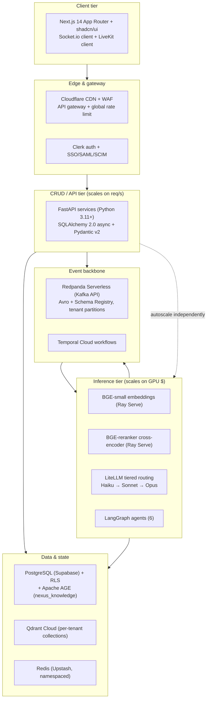
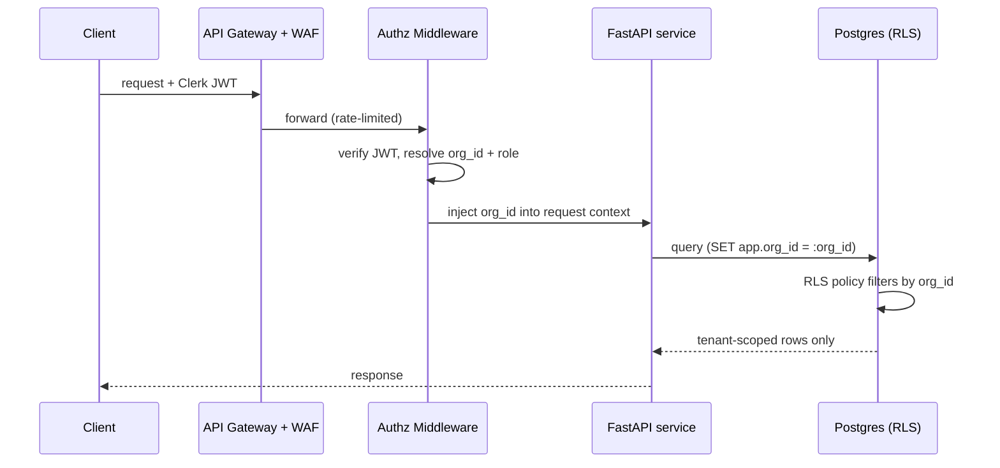
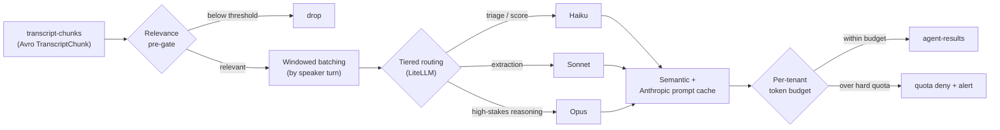

# NEXUS Locked Tech & Architecture Decisions

The canonical, frozen quick-reference of every locked technology and architecture decision for NEXUS — the authority cited by ADRs and the system overview.

## Related documents

- [System Overview](../01-architecture-overview-and-principles.md)
- [Architecture Style](../01-architecture-overview-and-principles.md)
- [Multi-Tenancy](../06-multi-tenancy.md)
- [Security](../11-security-architecture.md)
- [Compliance](../12-compliance-and-privacy.md)
- [Data Architecture](../05-data-architecture.md)
- [SaaS Business Platform](../18-saas-business-architecture.md)
- [Event Streaming](../07-event-architecture.md)
- [Inference & LLM Pipeline](../09-rag-and-inference-serving.md)
- [Agents & LangGraph](../08-ai-agent-architecture.md)
- [Architecture Decision Records](../adr/0001-event-driven-microservices.md)
- [Glossary](../24-glossary-and-naming.md)

---

## 1. How to read this document

This is the single source of truth for **what is decided and why**, in one line each. It does not justify decisions at length — that is the job of the [ADRs](../adr/0001-event-driven-microservices.md). When an ADR, a phase plan, or a service README needs to cite the authoritative decision, it cites a row here by its **Concern** key.

Every row carries five columns:

| Column | Meaning |
| --- | --- |
| **Concern** | The stable decision key. ADRs reference these verbatim. |
| **Decision** | The locked choice. Names, versions, and numbers are canonical and used verbatim everywhere else. |
| **Status** | Always `locked` in this document. A decision leaves this table only via a superseding ADR. |
| **Origin** | `PDF` = carried over from the original NEXUS Execution Plan v2.1. `SaaS-add` = added or changed for production multi-tenant SaaS scale. `PDF→SaaS` = the PDF made a choice and the SaaS posture extended/hardened it without renaming. |
| **Rationale** | One line. The "why" in a breath. |

> [SaaS-scale adjustment] The original PDF had no consolidated decision register; decisions were scattered across a 13-phase, 36-week plan. This table exists because a multi-tenant SaaS targeting millions of users across thousands of tenants needs an unambiguous, citable lock list so that 13 phases of work and a growing ADR corpus never drift on names, versions, or capacity numbers.

The decision landscape, by tier:

---

## 2. The locked decision table

### 2.1 Architecture, compute & topology

| Concern | Decision | Status | Origin | Rationale |
| --- | --- | --- | --- | --- |
| Architecture style | Event-driven microservices with an explicit modular-monolith → services evolution path | locked | SaaS-add | Agent/inference tier scales and costs differently from the CRUD tier; events decouple them and let each scale independently. |
| Inference/CRUD separation | Agent + inference tier scales and is billed separately from the CRUD tier | locked | SaaS-add | GPU-bound, bursty inference must never be throttled by, or throttle, request/s-bound API serving. |
| Compute platform | Kubernetes (EKS/GKE) + Terraform IaC; a self-hosted single-node VPS running Docker Compose is the MVP substrate | locked | PDF→SaaS | PDF chose Railway/Render; the MVP runs the whole backend on an already-owned VPS instead (ADR-0016, superseding the PaaS fast path in ADR-0014). K8s + IaC remains the production substrate for autoscaling, multi-region, and reproducibility. |
| Region strategy | Multi-region active-passive, evolving to active-active | locked | SaaS-add | Meets latency, residency, and availability targets without paying full active-active complexity on day one. |
| Hosting (edge/CDN) | Cloudflare CDN + WAF, custom domain | locked | PDF→SaaS | PDF specified Cloudflare CDN; WAF and gateway role added for SaaS edge security. |
| Service framework | FastAPI (Python 3.11+) | locked | PDF | Async-native, Pydantic-integrated, the team's chosen backend stack. |
| Workflow engine | Temporal Cloud | locked | PDF | Durable execution for MeetingLifecycleWorkflow and ActionFollowUpWorkflow without bespoke retry/timer logic. |
| Real-time fan-out | Redis pub/sub backbone for Socket.io across backend instances | locked | PDF | PDF Phase 11; required so agent outputs and presence fan out across horizontally scaled API pods. |

> [SaaS-scale adjustment] Kubernetes + Terraform and the multi-region posture replace the PDF's Railway/Render-only hosting. The MVP substrate is not a PaaS at all: the whole backend (FastAPI modular monolith, outbox relay, Temporal worker) plus every stateful store (PostgreSQL, Redis, Redpanda, Temporal) runs self-hosted on a single VPS under Docker Compose, fronted by Caddy for TLS. Railway and Render are struck: they are not the fast path and not a fallback (ADR-0016). The VPS is the sanctioned substrate until a real load signal forces the K8s move (Plan 14).

### 2.2 Multi-tenancy & isolation

| Concern | Decision | Status | Origin | Rationale |
| --- | --- | --- | --- | --- |
| Tenancy model | Pooled + PostgreSQL Row-Level Security for the long tail; cell-based isolation for large/enterprise tenants | locked | SaaS-add | Pooled keeps the long tail cheap; cells give big tenants blast-radius and noisy-neighbor isolation within the same microservices style. |
| DB isolation | PostgreSQL RLS policies keyed on `org_id` | locked | SaaS-add | Defense-in-depth at the row level even if an app-layer check is missed. |
| Vector isolation | Per-tenant Qdrant collections | locked | SaaS-add | Hard physical separation of embeddings; no cross-tenant vector leakage possible at query time. |
| Graph isolation | Org-partitioned Apache AGE graph (`nexus_knowledge`) | locked | SaaS-add | Cypher traversals are scoped to one org's subgraph; org partition key on every node. |
| Stream isolation | Tenant-keyed Redpanda partitions on all topics | locked | SaaS-add | Per-tenant ordering and throughput isolation; enables per-tenant replay and rate control. |
| Cache isolation | Namespaced Redis keys per tenant | locked | SaaS-add | `get_user_context` cache and others cannot collide or leak across tenants. |
| Authz injection | Authz middleware injects `org_id` on every query | locked | SaaS-add | Single chokepoint guarantees tenant scoping; failures fail closed. |

> [SaaS-scale adjustment] The PDF was single-deployment with no tenancy concept. Every isolation row above is wholly added: RLS, per-tenant Qdrant collections, org-partitioned `nexus_knowledge`, tenant-keyed Redpanda partitions, namespaced Redis, and mandatory `org_id` injection.

The org_id injection chokepoint:

### 2.3 Data stores

| Concern | Decision | Status | Origin | Rationale |
| --- | --- | --- | --- | --- |
| Primary DB | PostgreSQL via Supabase (managed) | locked | PDF | Managed Postgres with auth/edge tooling; carries the relational core (`users`, `meetings`, `transcript_chunks`, `decisions`, `action_items`, `worklogs`, …). |
| ORM / data layer | SQLAlchemy 2.0 async + asyncpg | locked | PDF | Async ORM matched to FastAPI; asyncpg for throughput. |
| Validation | Pydantic v2 | locked | PDF | Request/response and settings validation; aligns with FastAPI. |
| Migrations | Alembic | locked | PDF | Versioned schema evolution from Phase 2 onward. |
| Graph store | Apache AGE extension, graph named `nexus_knowledge` | locked | PDF→SaaS | Cypher-over-Postgres keeps the graph co-located; SaaS adds documented exit to Amazon Neptune / Neo4j Aura plus a relational materialized-view fallback. Production runs AGE in a dedicated self-hosted Postgres (R1 fallback, [ADR-0031](../adr/0031-plan-8-graph-store-decision-supersedes-and-mark-done.md) D1). |
| Graph migration path | Amazon Neptune / Neo4j Aura + relational materialized-view fallback | locked | SaaS-add | Honors PDF R1 (AGE may be awkward on managed Supabase) and adds the at-scale exit. |
| Vector DB | Qdrant Cloud | locked | PDF | Managed ANN store for hybrid retrieval; per-tenant collections at scale. |
| Embedding model | BGE-small-en, 384-dim, via ONNX runtime | locked | PDF | Small, fast, good-enough recall; 384-dim keeps Qdrant memory low. |
| Cache / pub-sub | Redis (Upstash) | locked | PDF | `get_user_context` cache (TTL 5 min), RAG cache (10-min TTL), Socket.io fan-out, priority queues. |
| Object storage | **Cloudflare R2** (S3-compatible API) | locked | SaaS-add | The blob store behind every `nexus-*` bucket ([Data Model §6](02-data-model.md), [ADR-0023](../adr/0023-object-storage-cloudflare-r2.md)). S3-compatible, so the "S3-compatible" contract every doc already states stays literally true and the SDK is unchanged. Chosen over S3 primarily for **zero egress fees**: recordings and export downloads are read-heavy and egress-billed elsewhere, and Cloudflare is already the CDN/WAF vendor, so this adds no new vendor relationship. Data-residency caveat is recorded in the ADR: R2's **EU jurisdiction** is a hard placement guarantee, while other placements are location *hints*, so `ap` is best-effort until a jurisdiction exists for it. |
| Backups / DR | Production Postgres backups + PITR + read replica | locked | PDF | PDF Phase 13; standard RPO/RTO posture for the system of record. |

### 2.4 Event streaming, serialization & delivery

| Concern | Decision | Status | Origin | Rationale |
| --- | --- | --- | --- | --- |
| Event streaming | Redpanda Serverless (Kafka API compatible) | locked | PDF | Kafka API + Avro keep migration to Confluent/Aiven/Upstash mechanical (PDF R3). |
| Serialization | Apache Avro + Redpanda Schema Registry | locked | PDF | Typed events; one subject per topic. |
| Subject naming | One subject per topic, `{topic}-value`, BACKWARD compatibility | locked | PDF | Consumers upgrade independently; producers cannot break readers. |
| Topic partitioning | All topics partitioned by tenant | locked | SaaS-add | Per-tenant ordering, isolation, replay, and throughput control. |
| Delivery semantics | At-least-once with idempotency keys | locked | SaaS-add | Tolerates retries without double-processing across millions of events. |
| Reliability pattern | Transactional outbox/inbox + dedupe cache + DLQs | locked | SaaS-add | Atomic DB-and-event commit, idempotent consume, and poison-message quarantine. |
| Producer utility | confluent-kafka-python + AvroSerializer, schema-validated | locked | PDF | Single sanctioned producer path; rejects unregistered/incompatible payloads. |
| Consumer base | Base consumer class with AvroDeserializer, offset commit, retry policy | locked | PDF | Uniform consume semantics across every service. |
| Lag observability | Consumer-lag monitoring + alerts | locked | PDF | Detects backpressure before it becomes user-visible latency. |

> [SaaS-scale adjustment] The PDF specified at-most-once-ish "consume → process" semantics implicitly. SaaS locks **at-least-once with idempotency keys + transactional outbox/inbox + dedupe cache + DLQs**, and partitions every topic by tenant. Topic names, Avro subjects, and BACKWARD compatibility are unchanged.

The canonical Redpanda topics (names verbatim from the PDF) and their Avro value schemas:

| Topic | Avro value schema | Primary producer | Primary consumer |
| --- | --- | --- | --- |
| `transcript-chunks` | `TranscriptChunk` | Deepgram WS proxy | Embedding consumer, PersonalListenerAgent |
| `document-chunks` | (chunk envelope) | unstructured.io ingestion | Embedding consumer |
| `agent-results` | `AgentResult` | LangGraph agents | Worklog/notification writers |
| `decisions` | `Decision` | DecisionAgent (on confirm) | Graph writer, notifications |
| `actions` | `Action` | ActionAgent (on confirm) | Graph writer, follow-up workflow |
| `notifications` | `Notification` | Multiple | Socket.io fan-out |
| `agent-requests` | `AgentRequest` | ContextGapAgent | Peer agents |
| `agent-responses` | `AgentResponse` | Peer agents | ContextGapAgent |
| `agent-stream` | (token-delta envelope) | LiteLLM stream bridge | WebSocket → UI |

### 2.5 Inference & LLM pipeline

| Concern | Decision | Status | Origin | Rationale |
| --- | --- | --- | --- | --- |
| Inference placement | Dedicated autoscaling inference services for BGE-small embeddings and the BGE-reranker, OFF the API tier | locked | PDF→SaaS | Fixes PDF coupling of CPU/GPU-bound inference with API serving; embed-on-ingest, query-embed only. |
| Inference runtime | GPU via Ray Serve / vLLM | locked | SaaS-add | Right-sized GPU autoscaling and batching for embeddings/rerank that the API tier cannot provide. |
| Reranker | BGE-reranker-base cross-encoder, top-50 → top-10 | locked | PDF | Cross-encoder rerank; latency budget under 500ms cold. |
| LLM routing | LiteLLM fronting Anthropic only (OpenAI dropped; fast-response and triage tier is Haiku 5.5, model id `claude-haiku-5-5`; extraction tier is Sonnet 5.5, model id `claude-sonnet-5-5`; high-stakes tier: mapping to be set, unused before Plan 10), per-user rate limits, token tracking | locked | PDF→SaaS | One routing layer, provider-agnostic so the door stays open, with built-in quota and accounting hooks. Single LLM vendor per [ADR-0027](../adr/0027-anthropic-only-llm-provider.md); extraction tier per [ADR-0029](../adr/0029-plan-7-budget-scope-tier-mapping-and-metering-ownership.md) D2. |
| LLM cost pipeline | Relevance pre-gating → windowed batching → tiered routing (Haiku triage/score, Sonnet extract, Opus high-stakes) → semantic + Anthropic prompt caching → per-tenant token budgets & hard quotas | locked | PDF→SaaS | Fixes the PDF "run an agent on every raw chunk" cost bomb (R4); agents run on windows, not raw chunks. |
| Per-tenant quotas | Per-tenant token budgets with hard quotas and budget alerts | locked | PDF→SaaS | PDF had per-user budgets/alerts from Phase 7; SaaS adds tenant-level hard caps for billing safety. |
| Cost reduction target | ~30% reduction via cost optimization | locked | PDF | PDF Phase 13 target preserved as a measurable goal. |

> [SaaS-scale adjustment] The PDF's PersonalListenerAgent processed transcript chunks one-by-one. SaaS locks **relevance pre-gating → windowed batching → tiered model routing → prompt caching → per-tenant hard quotas**: agents are invoked on speaker-turn windows, not per raw `transcript-chunks` message, and the cheapest model that can do the job is routed first.

### 2.6 Agents & orchestration

| Concern | Decision | Status | Origin | Rationale |
| --- | --- | --- | --- | --- |
| Agent framework | LangGraph; `BaseAgent` lifecycle (spawn/process/terminate), shared `AgentState` dataclass, versioned prompt-template loader | locked | PDF | One lifecycle and state contract for all six agents; prompts are versioned artifacts. |
| Agent roster | PersonalListenerAgent, DecisionAgent, ActionAgent, QuestionAgent, ContextGapAgent, ProactiveAgent | locked | PDF | The six agents, names verbatim; one personal agent per participant plus cross-meeting collaboration. |
| Confidence thresholds | >0.7 surface; 0.4–0.7 silent log; <0.4 drop | locked | PDF | Uniform surfacing policy; no silent commits — decisions/actions require user confirmation. |
| Multi-agent collaboration | ContextGapAgent over `agent-requests` / `agent-responses` with correlation IDs, deadline, fall-through; fallback chain peer-agents → related-meeting agents → RAG → silent | locked | PDF | The novel cross-meeting context fill (R6); pre-authorized descope to RAG-only if needed. |
| Agent-to-agent authz | Deny-by-default, org/role scope checks, audited | locked | SaaS-add | An agent may only query peers within its own tenant and authorized scope; every call is logged. |
| User context utility | `get_user_context(user_id)` → role/skills/team/recent meetings/topics, Redis-cached TTL 5 min | locked | PDF | Single source for per-user personalization, cheap to call per chunk window. |
| Role taxonomy | Role→topics taxonomy, version-controlled (YAML/JSON) | locked | PDF | Deterministic role-relevance filtering, reviewable in PRs. |

> [SaaS-scale adjustment] Agent-to-agent authorization (deny-by-default, org/role scope, audit) is wholly added. In the PDF, agents requested context freely; at SaaS scale a personal agent must be cryptographically and authorization-bound to its tenant so `agent-requests` can never cross org boundaries.

### 2.7 Real-time meeting & transcription

| Concern | Decision | Status | Origin | Rationale |
| --- | --- | --- | --- | --- |
| Meeting SDK | LiveKit (open-source self-hostable SFU), always behind a transport adapter | locked | PDF→SaaS | PDF deferred the pick (R2) among LiveKit/Daily/Stream/Agora; SaaS locks LiveKit — self-host SFU controls per-minute cost, strong server-side audio hooks, no per-participant ceiling. |
| Transport abstraction | Transport adapter interface over the SDK | locked | PDF→SaaS | Preserves PDF's "abstract the SDK" stance; keeps the LiveKit pick swappable. |
| Transcription | Deepgram (WebSocket, speaker diarization, interim + final) | locked | PDF | Streaming ASR with diarization; only finals persisted to `transcript_chunks`. |
| Audio path | SDK hook / MediaRecorder → FastAPI WebSocket proxy → Deepgram | locked | PDF | Keeps the Deepgram key server-side; separates interim vs final. |
| Live caption latency | Live captions within 2s of speech | locked | PDF | User-facing real-time bar. |
| End-to-end agent latency | p50 < 2s, p95 < 4s (Deepgram ~1s + LLM ~0.8s + network) | locked | PDF | The tight live-intelligence budget (R5); streaming + priority queues are load-bearing. |
| Token minting | `POST /api/meetings/:id/token` verifies participant | locked | PDF | Server-mediated join authorization. |
| SDK webhooks | Receiver for room.created, participant.joined, recording.ready | locked | PDF | Drives meeting lifecycle state. |
| Non-AV real-time | Socket.io server, rooms keyed by meeting ID | locked | PDF | Chat, presence, and agent outputs ride Socket.io, not the SFU. |
| Speaker mapping | Confidence-scored suggestion on top of reliable manual assignment | locked | PDF | Voice fingerprinting is unreliable (R7); manual is the source of truth via `meeting_speakers`. |

> [SaaS-scale adjustment] The PDF left the meeting SDK open (R2: evaluate ≥2 in Phase 1, switch costs non-trivial after Phase 3). SaaS locks **LiveKit** — a self-hostable open-source SFU caps per-minute cost with no per-participant vendor ceiling and exposes strong server-side audio hooks for the Deepgram path — while keeping it behind the PDF's existing transport adapter so the choice stays swappable.

### 2.8 Frontend

| Concern | Decision | Status | Origin | Rationale |
| --- | --- | --- | --- | --- |
| Framework | Next.js 14 App Router, TypeScript | locked | PDF | Server components + streaming UI for the dashboard and meeting room. |
| Styling / components | Tailwind + shadcn/ui | locked | PDF | Consistent, accessible component primitives. |
| Real-time client | Socket.io client | locked | PDF | Matches the Socket.io server for chat/presence/agent outputs. |
| Meeting client | LiveKit React client (meeting-SDK client) | locked | PDF→SaaS | Pairs with the locked LiveKit transport. |
| Agent sidebar | Collapsible meeting-room sidebar (My Notes, suggestion cards, decision/action cards, context-fill card, conflict banner, workload/stakeholder/dependency alerts), calm animation discipline, Save-for-later queue persisting into next meeting | locked | PDF | The hardest design surface; specified in detail and frozen. |

### 2.9 Ingestion, chunking & RAG

| Concern | Decision | Status | Origin | Rationale |
| --- | --- | --- | --- | --- |
| Document ingestion | unstructured.io (PDF/DOCX/PPTX/HTML/MD/EML → typed elements Title/NarrativeText/Table/ListItem) | locked | PDF | One ingestion path to typed elements for documents. |
| Chunking | LangChain RecursiveCharacterTextSplitter (chunk_size 600, overlap 60) default + SemanticChunker for narrative docs; Deepgram utterances merged by speaker turn before splitting | locked | PDF | Balanced chunk size; speaker-turn merge keeps transcript context coherent. |
| Embedding consumer | consume → split (LangChain) → embed batch (32, sub-100ms) → upsert to Qdrant | locked | PDF | Single batched embed pipeline; embed-on-ingest. |
| RAG pipeline | `RAGService` = expand → retrieve → rerank → assemble → cite | locked | PDF | Fixed five-stage shape for every retrieval. |
| Query expansion | LLM returns 2–3 query variants | locked | PDF | Improves recall before fusion. |
| Hybrid retrieval | Qdrant vector + Postgres FTS + AGE topic-relations, RRF fusion | locked | PDF | Three complementary signals fused by Reciprocal Rank Fusion. |
| Citations | Every passage carries `meeting_id`, `chunk_id`, speaker (transcripts) or `document_id`, `element_id` (documents); confirmed decisions and actions cite as `decision_id` or `action_id` plus `meeting_id` (ADR-0033 D3) | locked | PDF, amended SaaS-add | Traceable, clickable provenance in the context panel; lets the graph arm and `decisions__{org_id}` contribute citable passages. |
| Retrieval access | A transcript, chat or decision passage is retrievable only by a participant of its meeting (`meeting_participants`); documents are org-wide; applied in every arm (ADR-0033 D1) | locked | SaaS-add | Same rule as every other read of meeting content; tenant isolation alone would let any org member read any meeting. |
| RAG cache | Redis keyed `(user_id, query_hash)`, 10-min TTL | locked | PDF | Cuts repeat-query cost and latency. |
| RAG API | `POST /api/rag/query` → passages + citations; with `generate: true`, also a streamed answer whose every sentence cites a returned passage, or a fixed abstention (ADR-0033 D6) | locked | PDF, amended SaaS-add | One contract for retrieval; the answer is additive, so a passages-only client is unaffected. |

### 2.10 Knowledge graph schema

| Concern | Decision | Status | Origin | Rationale |
| --- | --- | --- | --- | --- |
| Node labels | Person, Meeting, Decision, Action, Topic | locked | PDF | The five graph entity types in `nexus_knowledge`. |
| Edge labels | ATTENDED, PRODUCED, ASSIGNED_TO, RELATES_TO, FOLLOWS_FROM | locked | PDF | The five relationship types; names verbatim. |
| Cypher templates | Named functions: related decisions for a topic, decisions by a person, actions blocked on a decision, decision lineage | locked | PDF | Pre-built, reviewable traversals instead of ad-hoc Cypher. |
| Edge creation | Edges created on confirmation (Decision→Meeting PRODUCED, Action→Person ASSIGNED_TO); soft delete supported | locked | PDF | No silent graph writes; graph mirrors confirmed truth. |

### 2.11 Auth, security & compliance

| Concern | Decision | Status | Origin | Rationale |
| --- | --- | --- | --- | --- |
| Identity | Clerk (Next.js + backend JWT verification, webhook user sync) | locked | PDF | Managed auth with first-class Next.js + JWT story. |
| Enterprise identity | Enterprise SSO / SAML / SCIM via Clerk | locked | SaaS-add | Required for Enterprise-tier tenants. |
| RBAC | Org RBAC; agent-to-agent authz deny-by-default | locked | SaaS-add | Tenant-scoped roles and least-privilege agent calls. |
| User sync hardening | Outbox + reconciliation, Clerk as source of truth | locked | SaaS-add | PDF used a plain webhook; outbox + reconciliation survives dropped webhooks. |
| Edge security | API gateway + WAF + global rate limiting | locked | SaaS-add | Tenant-aware throttling and L7 protection at the edge. |
| Security process | Shift-left: threat model in Phase 1, authz in every PR, dependency + secret scanning from day one | locked | PDF→SaaS | Replaces the PDF's "security audit in Phase 13"; security is continuous, not a phase. |
| Field-level encryption | Envelope encryption: AES-256-GCM under per-(tenant, purpose) data keys wrapped by a key-encryption key behind one `KeyProvider` interface (`libs/shared/crypto`); AAD binds `org_id` + purpose; self-describing ciphertext carries the KEK and DEK ids; keyed HMAC blind indexes for equality lookup. Scheme per [ADR-0024](../adr/0024-key-custody-and-envelope-encryption.md). Production custodian on the VPS: a local KEK file (`FileKeyProvider`, `MYTHEUS_KEY_CUSTODY=local-file`, mode 0400, mounted into `identity-tenant-service` only), with KMS as the explicit upgrade path ([ADR-0026](../adr/0026-vps-file-kek-custody.md)) | locked | SaaS-add | One key story for `oauth_tokens` and `pii_tokens`; ciphertexts carry the KEK id, so the later move to KMS is a rewrap, not a data migration. |
| Compliance | GDPR/CCPA, subprocessor DPAs (Deepgram/Anthropic/LiveKit) + SCCs, data residency + regional placement, PII redaction, retention + right-to-be-forgotten, audit logging, SOC2 readiness. The Anthropic DPA is not a gate on LLM egress while Mytheus is an academic project with no customers; PII redaction before egress stays always-on ([ADR-0029](../adr/0029-plan-7-budget-scope-tier-mapping-and-metering-ownership.md) D5) | locked | SaaS-add | Wholly added; table-stakes for selling to thousands of orgs. |

> [SaaS-scale adjustment] Security moves from a single Phase-13 audit (PDF) to **shift-left** — threat modeling in Phase 1, an authorization check reviewed in every PR, and dependency/secret scanning from day one. Compliance (GDPR/CCPA, DPAs+SCCs, residency, PII redaction, RTBF, audit log, SOC2 readiness) is added in full.

### 2.12 SaaS business platform

| Concern | Decision | Status | Origin | Rationale |
| --- | --- | --- | --- | --- |
| Tenant lifecycle | Tenant provisioning + lifecycle management | locked | SaaS-add | Self-serve creation, suspension, offboarding of customer orgs. |
| Billing | Stripe billing + subscriptions + seats + dunning + tax | locked | SaaS-add | End-to-end monetization including failed-payment recovery and tax. |
| Usage metering | usage-events → aggregation → quota enforcement | locked | SaaS-add | Meters tokens/minutes/seats and feeds per-tenant hard quotas. |
| Plans / tiers | Free / Pro / Enterprise | locked | SaaS-add | Packaging that gates features and quotas. |
| Onboarding | Self-serve onboarding | locked | SaaS-add | Low-touch acquisition for the long tail. |
| Admin consoles | Tenant admin console + internal ops console | locked | SaaS-add | Customer self-management and internal support/observability. |

> [SaaS-scale adjustment] The entire SaaS business platform (tenant lifecycle, Stripe billing/seats/dunning/tax, usage metering → quota enforcement, Free/Pro/Enterprise tiers, self-serve onboarding, admin + ops consoles) is wholly added vs the PDF, which had no notion of tenants, billing, or plans.

### 2.13 Integrations

| Concern | Decision | Status | Origin | Rationale |
| --- | --- | --- | --- | --- |
| Calendar | Google Calendar OAuth (auto-create meetings, match participants by email, route attachments through unstructured.io) | locked | PDF | Pre-meeting context made searchable; meetings created from events. |
| Chat | Slack bot OAuth (Block Kit prep briefs per user, post-meeting summaries to channel/DM) | locked | PDF | Personalized prep and recap where teams already work. |
| Project management | Jira (default) / Linear (alt) OAuth, bidirectional action-item sync | locked | PDF | NEXUS action → external ticket; external status → NEXUS via webhook. |
| Follow-up workflow | Temporal `ActionFollowUpWorkflow` (reminders day 1/3/7; manager escalation via Slack DM at day 10) | locked | PDF | Durable, timed nudges and escalation. |
| Integration scope guardrail | Ship Calendar + Slack + one of Jira/Linear only (R8) | locked | PDF | Hard scope cap against integration creep. |

### 2.14 CI/CD, observability & testing

| Concern | Decision | Status | Origin | Rationale |
| --- | --- | --- | --- | --- |
| CI/CD | GitHub Actions | locked | PDF | Pipeline of record; staging deploy on merge. |
| Error tracking | Sentry | locked | PDF | Exception capture across frontend and backend. |
| Metrics / dashboards | Prometheus + Grafana | locked | PDF | Metrics, latency SLOs, consumer-lag and quota dashboards. |
| Logging | Structured JSON logs | locked | PDF | Machine-parseable, tenant-tagged logs. |
| Backend tests | Pytest | locked | PDF | Unit/integration tests alongside features. |
| E2E tests | Playwright | locked | PDF | Browser-level meeting and dashboard flows. |
| Frontend tests | Vitest | locked | PDF | Fast component/unit tests. |
| Load testing | k6 / Locust | locked | PDF | Validates the latency budget and capacity under load. |
| Containerization | Docker Compose (local), Docker images for K8s | locked | PDF→SaaS | PDF specified Docker Compose for the repo; images promoted onto K8s for production. |

---

## 3. Origin summary

Of the 103 locked rows above, **65 are carried over verbatim from the PDF**, **27 are wholly new SaaS additions**, and **11 are PDF choices the SaaS posture extended or hardened without renaming**. The PDF tech stack survives intact; the net-new mass is multi-tenancy, the SaaS business platform, compliance, and hardened event delivery.

| Origin | What it means | Examples |
| --- | --- | --- |
| **PDF** | Carried over verbatim from NEXUS Execution Plan v2.1. Names and numbers are frozen as-is. | FastAPI, Deepgram, `transcript_chunks`, `nexus_knowledge`, the six agents, confidence thresholds. |
| **PDF→SaaS** | The PDF made a choice; the SaaS posture extended or hardened it **without renaming**. | Apache AGE (+ Neptune/Aura exit), LiveKit pick behind the existing transport adapter, self-hosted VPS→K8s, per-user→per-tenant quotas, shift-left security. |
| **SaaS-add** | Wholly new for production multi-tenant scale; absent from the PDF. | Multi-tenancy/RLS/cells, agent-to-agent authz, compliance suite, the entire SaaS business platform, outbox/inbox + DLQ delivery. |

---

## 4. Canonical names this table freezes

Other documents and ADRs **must** use these exact strings. This list is the naming authority; the [Glossary](../24-glossary-and-naming.md) carries definitions and any old→new renames.

- **Graph:** `nexus_knowledge` (Apache AGE)
- **Node labels:** Person, Meeting, Decision, Action, Topic
- **Edge labels:** ATTENDED, PRODUCED, ASSIGNED_TO, RELATES_TO, FOLLOWS_FROM
- **Agents:** PersonalListenerAgent, DecisionAgent, ActionAgent, QuestionAgent, ContextGapAgent, ProactiveAgent
- **Core tables:** `users`, `organizations`, `teams`, `team_members`, `departments`, `meetings`, `meeting_participants`, `transcript_chunks`, `meeting_speakers`, `worklogs`, `decisions`, `action_items`, `agent_suggestions`, `agent_collaborations`, `chat_messages`, `document_chunks`
- **Topics:** `transcript-chunks`, `document-chunks`, `agent-results`, `decisions`, `actions`, `notifications`, `agent-requests`, `agent-responses`, `agent-stream`
- **Avro schemas:** TranscriptChunk, AgentResult, Decision, Action, Notification, AgentRequest, AgentResponse
- **Utilities:** `get_user_context(user_id)`
- **Workflows:** MeetingLifecycleWorkflow, ActionFollowUpWorkflow
- **Confidence thresholds:** `>0.7` surface · `0.4–0.7` silent log · `<0.4` drop
- **Latency budget:** live captions < 2s; agent end-to-end p50 < 2s / p95 < 4s; rerank < 500ms cold; embed batch 32 sub-100ms

No alternative names for the above are permitted anywhere in the architecture set. Any future rename must land in the [Glossary](../24-glossary-and-naming.md) as an explicit `old → new` entry **and** supersede the relevant row here via an [ADR](../adr/0001-event-driven-microservices.md).
