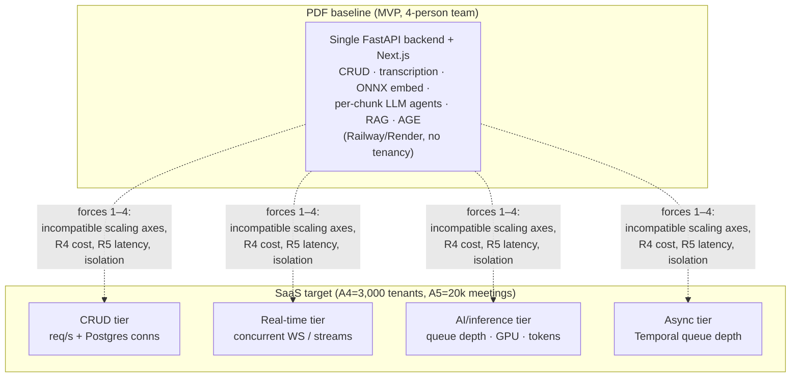
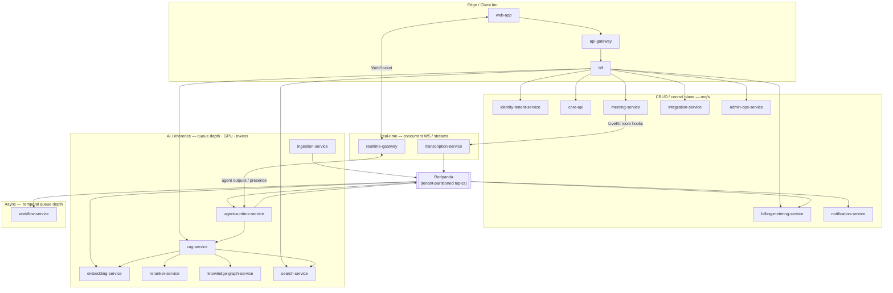
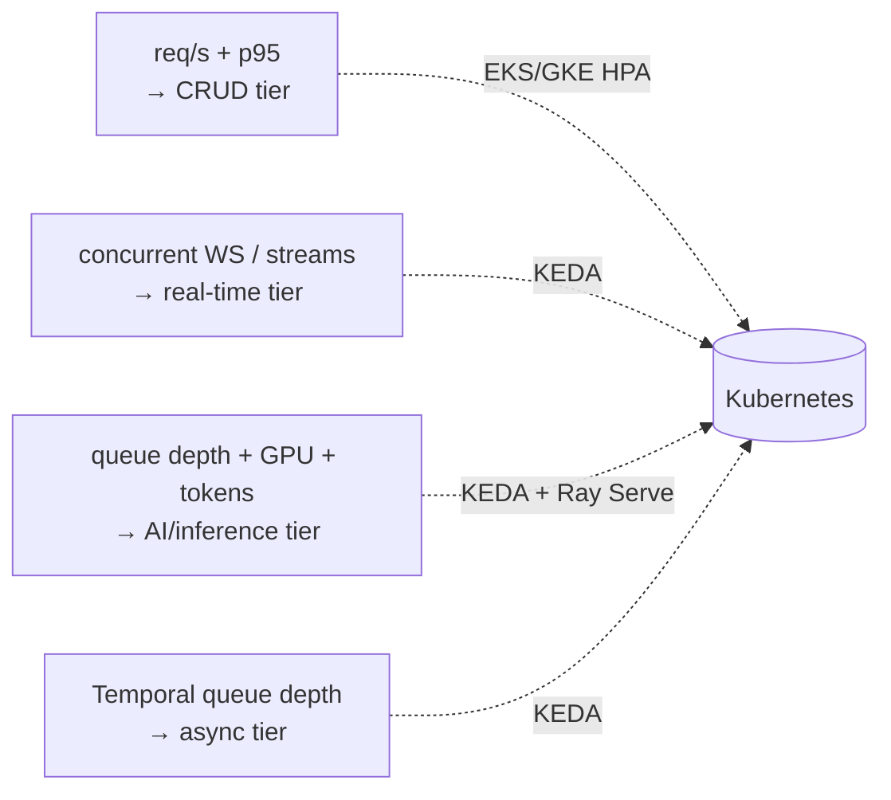
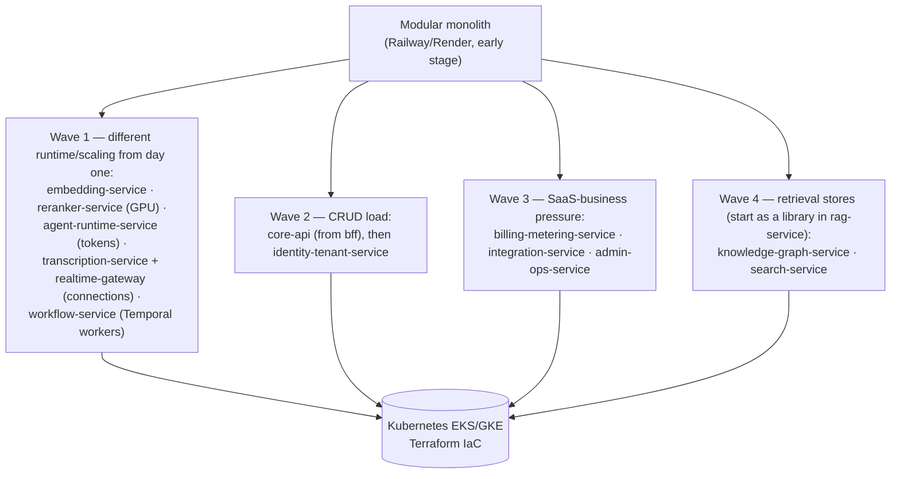

# ADR-0001: Event-Driven Microservices with Modular-Monolith Evolution

This record locks the NEXUS architecture style — event-driven microservices decomposed along three cost/scaling families, deployed first as a single modular monolith and peeled into independently-scaling services along seams that never require re-cutting a domain boundary.

## Related documents

- [Architecture Overview & Principles](../01-architecture-overview-and-principles.md) — the style decision and the principles every doc inherits.
- [Service Catalog & Bounded Contexts](../04-service-catalog.md) — the full per-service expansion of the 20 canonical services.
- [Service Catalog (canon)](../_canon/01-service-catalog.md) — the frozen, single source of truth for service names and the wave extraction order.
- [Canonical Data Model](../_canon/02-data-model.md) — the frozen naming authority for entities, tables, collections, graph labels, key namespaces.
- [Capacity & Scaling Math (canon)](../_canon/05-capacity-math.md) — the frozen load/cost/SLO numbers this ADR cites by symbol.
- [Locked Tech & Architecture Decisions (canon)](../_canon/06-tech-decisions.md) — the decision register; the *Architecture style* row this ADR justifies.
- [Event-Driven Architecture](../07-event-architecture.md) — the bus contract: topics, Avro subjects, outbox/inbox, DLQs, tenant partitioning.
- [Data Architecture](../05-data-architecture.md) — store selection, partitioning, retention, backups/PITR, regional placement.
- [Multi-Tenancy & Isolation](../06-multi-tenancy.md) — pooled + RLS, cell isolation, `org_id` injection chokepoint.
- [Scalability & Performance](../13-scalability-and-performance.md) — autoscaler signals and the latency budget.
- [Deployment & Infrastructure](../16-deployment-and-infrastructure.md) — Kubernetes/Terraform substrate and the early-stage Railway/Render path.
- [Roadmap & Phasing](../22-roadmap-and-phasing.md) — how the wave extraction order maps onto delivery phases.

---

## Status

**Accepted.** This ADR is the controlling justification for the *Architecture style* row in [Locked Tech & Architecture Decisions §2.1](../_canon/06-tech-decisions.md). The decision leaves `locked` status only via a superseding ADR.

---

## Context

### The PDF baseline

The original NEXUS Execution Plan v2.1 (the "PDF") described **one application built by a 4-person team across 13 phases over 36 weeks**, organized by domain-first phasing with role rotation. It named **no services**. The unit of deployment was a single FastAPI backend plus a single Next.js frontend, hosted on Railway/Render, with a development seeder of `2 orgs x 10 users x 5 meetings`. Everything — CRUD, transcription proxying, embedding via ONNX, per-chunk LLM agent processing, RAG, the Apache AGE graph — ran in-process on the same tier. That is a correct and economical shape for an MVP.

It is not a correct shape for the target. The locked target is a **production multi-tenant SaaS for millions of users across thousands of paying tenant organizations**. The capacity model fixes the anchors this ADR reasons from (cited by symbol, never restated as literals — see [Capacity & Scaling Math](../_canon/05-capacity-math.md)):

| Anchor | Symbol | Value | Why it forces the cut |
| --- | --- | --- | --- |
| Paying tenant organizations | A4 | 3,000 | Tenant isolation and per-tenant scaling/billing become first-class. |
| Peak concurrent meetings | A5 | 20,000 | Drives transcription, embedding, and LLM/agent load. |
| Peak concurrent participants | A6 | 100,000 | Drives realtime WebSocket / LiveKit fan-out. |
| LLM calls / month (cost-controlled) | L7 | ~5.79B | The dominant cost center; 94% of variable infra spend (C3). |
| Embeddings / sec (peak) | EM2 | ~525 | GPU-bound inference, decoupled from API serving. |
| Redpanda events / sec (peak) | E12 | ~17,900 | The bus is the load-bearing seam between tiers. |

### The forces

1. **The inference tier scales and costs on a completely different axis from the CRUD tier.** CRUD work scales with HTTP req/s and Postgres connections; agent/LLM work scales with token throughput and GPU utilization; embedding/rerank scale with GPU; realtime scales with concurrent long-lived connections; orchestration scales with Temporal task-queue depth. At L7 ≈ 5.79B LLM calls/month — **94%** of variable cost (C3) — a CRUD-traffic autoscaler signal cannot govern the inference bill, and an inference burst must never throttle (or be throttled by) request-bound API serving. A single deployable forces one autoscaler signal onto four incompatible load shapes.

2. **The PDF's "run an agent on every raw transcript chunk" is a cost bomb (R4).** Naively, every realtime agent on every raw `transcript_chunks` row is N2 ≈ 41.5B LLM calls/month. The cost-controlled pipeline (relevance pre-gating → windowed batching → tiered Haiku→Sonnet→Opus routing → prompt caching → per-tenant hard quotas) drops this to L7 ≈ 5.79B, an **86% reduction** (L10). That pipeline only works if the agent tier is an independently-deployable, independently-budgeted unit with its own backpressure — not a code path inside the API request cycle.

3. **The latency budget is tight (R5).** End-to-end agent output must hit p50 < 2s and p95 < 4s (Deepgram ~1s + LLM ~0.8s + network); live captions < 2s. These paths must not contend with CRUD request handling on the same threads, connection pools, or pods.

4. **Tenant isolation must hold at every layer.** At A4 = 3,000 tenants, isolation is enforced in the DB (RLS for the pooled long tail, cell-based for enterprise), per-tenant Qdrant collections, the org-partitioned Apache AGE graph `nexus_knowledge`, tenant-keyed Redpanda partitions, and namespaced Redis. A shared in-process module makes the `org_id` injection chokepoint advisory rather than structural.

5. **A 4-person-team origin still constrains early delivery.** Twenty services on day one is operational suicide for a small team. The architecture must let the seams exist conceptually from day one while consolidating deployment until load and team-ownership pressure justify each split.

---

## Decision

> [SaaS-scale adjustment] The architecture style — **event-driven microservices with an explicit modular-monolith → services evolution path** — is wholly new versus the PDF, which had no service decomposition and no event-as-contract discipline (it handled control-plane, metering, and lifecycle signals in-process). This row is marked `SaaS-add` in [Tech & Architecture Decisions §2.1](../_canon/06-tech-decisions.md). The locked tech stack (FastAPI, Deepgram, Redpanda, Qdrant, Apache AGE, the six agents, confidence thresholds) survives this cut intact; only the deployment topology and the inter-service contract change.

We adopt **event-driven microservices, deployed first as a modular monolith and split along pre-drawn seams as load arrives.** Concretely:

### D1 — Decompose into the 20 canonical bounded contexts

The service list is frozen in [Service Catalog (canon)](../_canon/01-service-catalog.md), which is **the single source of truth for service names** (kebab-case, each named exactly once). This ADR references that list and does not reproduce or rename it. The 20 services, grouped by their scaling family:

| Family | Services | Autoscaler signal | Cost driver |
| --- | --- | --- | --- |
| CRUD / control plane | `api-gateway`, `bff`, `identity-tenant-service`, `core-api`, `meeting-service`, `integration-service`, `billing-metering-service`, `admin-ops-service`, `notification-service` | HTTP req/s, p95 latency | CPU + Postgres connections |
| Real-time | `realtime-gateway`, `transcription-service` | Concurrent WebSocket connections / live audio streams | Long-lived connections, Deepgram minutes |
| AI / inference | `ingestion-service`, `embedding-service`, `reranker-service`, `agent-runtime-service`, `rag-service`, `knowledge-graph-service`, `search-service` | Queue depth (chunk backlog), GPU utilization, token throughput | GPU + LLM tokens (separate cost center) |
| Async / orchestration | `workflow-service` | Temporal task-queue depth | Worker CPU |

The four families above account for 19 of the 20 canonical services. The twentieth, `web-app`, is an **Edge/CDN service** per [Service Catalog (canon) §3](../_canon/01-service-catalog.md): it owns no data (CDN-cached assets via Cloudflare), scales on page req/s, is static-heavy and cheap, and therefore sits **outside** the four cost/scaling families — it is deliberately **not** attributed the CRUD family's `CPU + Postgres connections` cost driver. The D1 diagram below places it in the Edge/Client tier accordingly, matching [Service Catalog (canon) §2–§4](../_canon/01-service-catalog.md).

The decomposition recognizes **four** scaling families, of which **three** (CRUD, real-time, AI/inference) are the differentiated cost/scaling drivers that motivate the cut; the async/orchestration family (`workflow-service`, Temporal Cloud workers) is a fourth distinct autoscaler signal that rides the same seams. Service boundaries are drawn so that **every boundary aligns to exactly one scaling family and one team-ownership boundary** — this is the property that lets the monolith peel apart without re-cutting any domain seam. See [Service Catalog & Bounded Contexts](../04-service-catalog.md) for the per-service expansion.

> [SaaS-scale adjustment] The [Canonical Data Model §1.1](../_canon/02-data-model.md) service-ownership diagram uses coarser, illustrative names (`identity-service`, `agent-service`, `graph-service`, `billing-service`, `audit-service`, `budget-service`) to show data ownership at a glance. Those are **data-ownership groupings, not the deployable-service names**. The naming authority for deployable services is [Service Catalog (canon)](../_canon/01-service-catalog.md); where the two differ, service names follow the catalog. Concretely: `agent-service` → `agent-runtime-service`; `graph-service` → `knowledge-graph-service`; `billing-service`/`audit-service`/`budget-service` ownership folds into `billing-metering-service` and `admin-ops-service`; `identity-service`/`tenant-service` fold into `identity-tenant-service`. The data model remains authoritative for **entity, column, and label names**; the service catalog remains authoritative for **service names**.

### D2 — The event bus is the contract between families

Services communicate **asynchronously over Redpanda** (Kafka API compatible) for all cross-family signals, and synchronously over HTTP/WS only within tightly-coupled request paths (e.g. `bff` → `core-api`, `rag-service` → `reranker-service`). The canonical topics are carried verbatim from the PDF — `transcript-chunks`, `document-chunks`, `agent-results`, `decisions`, `actions`, `notifications`, `agent-requests`, `agent-responses`, `agent-stream` — plus the SaaS-scale control-plane/lifecycle topics (`tenant-events`, `meeting-events`, `meeting-room-events`, `integration-events`, `usage-events`, `billing-events`, `graph-events`, `embedding-events`, `presence-events`, `notification-delivery-events`, `user-sync-events`, `admin-events`). The full bus contract — Avro subjects, partitioning, retention, DLQs — lives in [Event-Driven Architecture](../07-event-architecture.md).

Three invariants bind every cross-service event and are non-negotiable consequences of this decision:

1. **Avro + Schema Registry, one subject per topic `{topic}-value`, BACKWARD compatibility** (carried verbatim from the PDF). Producers cannot break readers; consumers upgrade independently.
2. **Partition key = tenant (`org_id`) on every topic.** Per-tenant ordering, isolation, replay, and throughput control; a noisy tenant cannot starve another's stream.
3. **At-least-once with idempotency keys + transactional outbox/inbox + dedupe cache + per-topic DLQs.** Producers write the outbox row in the same DB transaction as the state change; consumers dedupe on `idempotency_key` via an inbox table plus the Redis dedupe cache (`nexus:{org_id}:dedupe:{topic}:{idempotency_key}`, 24h TTL). Net effect: exactly-once application of every event.

> **Narrowed by [ADR-0017](0017-transcript-chunks-composite-partition-key.md), added, does not alter the decision above.** Invariant 2 as decided here still stands for 19 of the 21 topics. ADR-0017 later ratified a composite `{org_id}:{meeting_id}` key for `transcript-chunks` and `agent-stream` specifically, so `org_id` is the leading component of the key on those two rather than the whole key. This is a forward pointer, not a rewrite of what was decided at the time.

> [SaaS-scale adjustment] At-least-once delivery, idempotency keys, transactional outbox/inbox, dedupe cache, and per-topic DLQs are wholly added versus the PDF's implicit "consume → process" semantics. Topic names, Avro subjects, and BACKWARD compatibility are unchanged. The added topics carry control-plane, metering, and lifecycle signals the single-team in-process design handled with direct function calls.

### D3 — Independent autoscaler signal per family

Each family gets its own Kubernetes signal so cost tracks load per tier: CRUD on **HPA (req/s, p95)**; real-time on **KEDA (concurrent WS / live streams)**; AI/inference on **KEDA + Ray Serve (chunk-backlog queue depth, GPU utilization, token throughput)**; async on **KEDA (Temporal task-queue depth)**. The inference cost center bills independently of CRUD traffic. See [Scalability & Performance](../13-scalability-and-performance.md).

### D4 — Deploy as a modular monolith first, split on pressure

The seams above are real from day one, but **deployment consolidates early**: in the early stage the CRUD-family services ship as modules inside a single deployable on Railway/Render, communicating through the same outbox/inbox abstractions they will use across the wire. Compute substrate is **Kubernetes (EKS/GKE) + Terraform IaC** for production; Railway/Render only for the early-stage build (see [Deployment & Infrastructure](../16-deployment-and-infrastructure.md)). Extraction follows the canonical wave order in [Service Catalog (canon) §7](../_canon/01-service-catalog.md) — see Migration below.

---

## Consequences

### Positive

- **Each cost center scales and bills on its own axis.** The inference tier (L7 ≈ 5.79B LLM calls/month, EM2 ≈ 525 embeds/sec peak) autoscales on GPU/tokens and never throttles or is throttled by CRUD req/s. This is the structural prerequisite for the R4 cost-control pipeline and the R5 latency budget.
- **Tenant isolation becomes structural, not advisory.** With `org_id` injected at the gateway and enforced at every store (RLS, per-tenant Qdrant collections, org-partitioned `nexus_knowledge`, tenant-keyed partitions, namespaced Redis), a missed app-layer check fails closed at the data layer. See [Multi-Tenancy & Isolation](../06-multi-tenancy.md).
- **Independent deploy and blast-radius containment.** A bad `agent-runtime-service` deploy cannot take down meeting joins (`meeting-service`) or billing (`billing-metering-service`). DLQs quarantine poison messages without wedging a partition.
- **Schema evolution is decoupled.** BACKWARD-compatible Avro subjects let any consumer upgrade on its own cadence, which a 4-person-team-grown service set needs as ownership fragments.
- **The modular-monolith start keeps early velocity.** A small team ships one deployable and pays microservice operational cost only as load justifies each split.

### Negative (accepted)

- **Eventual consistency across families.** Read models in `core-api` (e.g. `decisions`/`actions` projections) lag their source agent outputs by the consumer pipeline latency. We accept this; the UI surfaces confirm-before-commit (no silent commits), so the user-facing path tolerates the lag. The exactly-once-in-effect machinery (D2) is the mitigation.
- **Operational surface grows with each split.** Each extracted service adds Redpanda consumer groups, DLQ alarms, dashboards, and an HPA/KEDA policy. We accept this and front-load the cost with shared base consumer/producer libraries (confluent-kafka-python + Avro, the canonical base consumer class) and the per-topic DLQ + consumer-lag alerting baked into the platform (lag < 5s, alert at 30s — see [Capacity & Scaling Math §11.3](../_canon/05-capacity-math.md)).
- **Distributed debugging is harder.** A single agent output now crosses `transcription-service` → Redpanda → `agent-runtime-service` → `core-api`/`realtime-gateway`. We accept this and mandate tenant-tagged structured JSON logs and trace propagation across the bus (see [Observability & SRE](../15-observability-and-sre.md)).
- **The bus is a hard dependency.** A Redpanda outage degrades the AI/inference path. We accept this and run a BYOC/dedicated multi-AZ cluster at production scale (~17.9k events/sec peak, E12) with outbox buffering so producers never lose writes during a transient bus outage.

### What we explicitly accept

- We accept the modular monolith as a **legitimate first deployment**, not a failure state — the seams are drawn so the consolidation is reversible without rework.
- We accept synchronous calls **within** a request path (e.g. `rag-service` → `reranker-service` under the < 500ms cold rerank budget) where the alternative — async round-tripping a latency-critical path through the bus — would blow the SLO.

---

## Alternatives considered

| Alternative | Why not |
| --- | --- |
| **Stay a modular monolith permanently** (the PDF shape) | Forces one autoscaler signal onto four incompatible load shapes. At L7 ≈ 5.79B LLM calls/month, a GPU/token burst would contend with CRUD req/s on shared pods, connection pools, and threads — directly violating R4 (cost) and R5 (latency). Correct for the MVP, wrong for A4 = 3,000 tenants. |
| **Synchronous (request/response) microservices, no event bus** | Couples failure domains: a slow `agent-runtime-service` would block `transcription-service` callers synchronously, cascading latency into the live-caption path. No natural backpressure, replay, or per-tenant ordering. The R5 budget needs the bus's buffering and the per-tenant partition isolation. |
| **Big-bang split into 20 services on day one** | Operationally infeasible for a team that originated as 4 people; 20 consumer groups, DLQs, and HPA policies before there is load to justify them. The modular-monolith-first path (D4) defers this cost to where load demands it. |
| **Serverless functions (FaaS) for the agent tier** | Cold-start latency is fatal to the R5 p50 < 2s budget on streamed agent output, and per-invocation pricing at L7 scale is far worse than autoscaled GPU pods with prompt caching. Ray Serve / vLLM on K8s wins on both latency and unit cost. |
| **Shared database across services (integration via DB)** | Breaks the single-writer rule in the [Canonical Data Model](../_canon/02-data-model.md) (each table has exactly one owning service), defeats per-service schema evolution, and makes the RLS/cell isolation boundary leak across service ownership. Events, not shared tables, are the integration contract. |
| **Per-tenant deployment (full stack per tenant)** | Untenable for the pooled long tail of A4 = 3,000 tenants on cost grounds. We instead use pooled + RLS for the long tail and reserve cell-based isolation for large/enterprise tenants — the tenancy strategy *within* this microservices style, not a competing architecture. See [Multi-Tenancy & Isolation](../06-multi-tenancy.md). |

---

## Migration and rollback

### Extraction order (modular monolith → services)

The split order is frozen in [Service Catalog (canon) §7](../_canon/01-service-catalog.md). Each wave aligns to a single scaling family and a single ownership boundary, so no extraction re-cuts a domain seam. The async/orchestration family extracts in Wave 1 alongside GPU and real-time, since Temporal workers are connection-/queue-scaled and must not share the CRUD pod lifecycle.

| Wave | Services | Extraction trigger |
| --- | --- | --- |
| 1 — always separate | `embedding-service`, `reranker-service`, `agent-runtime-service`, `transcription-service`, `realtime-gateway`, `workflow-service` | Different runtime/scaling (GPU, connections, tokens, Temporal) from the start. |
| 2 — CRUD load | `core-api` (from `bff`), then `identity-tenant-service` | HTTP req/s and Postgres-connection pressure on the CRUD pod. |
| 3 — SaaS-business pressure | `billing-metering-service`, `integration-service`, `admin-ops-service` | Metering ingest, webhook bursts, and ops-console traffic warrant their own lifecycle. |
| 4 — retrieval stores | `knowledge-graph-service`, `search-service` (start as a library inside `rag-service`) | Split only once Qdrant/AGE/FTS each warrant dedicated ops; they share read models with `core-api`. |

### How the seams stay clean during extraction

- **Code already calls the boundary, not the implementation.** Cross-family communication uses the outbox/inbox + producer/consumer abstractions from day one, even when both ends are in-process. Extracting a service swaps an in-process handoff for a Redpanda topic the receiving consumer already understands — no API redesign.
- **No shared tables.** Each entity has one owning service in the [Canonical Data Model](../_canon/02-data-model.md); extraction never has to disentangle a shared write path.
- **BACKWARD-compatible Avro** means the extracted service's consumer can deploy before/after its producer without a lockstep release.

### Rollback

Because each wave is deployment topology, not domain re-cutting, **rollback is re-consolidation, not redesign**:

1. **Per-service rollback.** A misbehaving extracted service is reverted to its prior image via the GitHub Actions pipeline; the bus buffers its input topic (outbox on the producer side, retained partitions on Redpanda) so no events are lost during the revert. Consumer lag drains once the healthy image is back.
2. **Re-collapse a service into the monolith.** If an extraction proves premature (operational cost exceeds the load benefit), the module is redeployed inside the monolith deployable and its topic handoffs revert to in-process calls — the abstraction boundary is unchanged, so no consumer contract breaks. This is the inverse of the Wave step and requires no schema or domain change.
3. **DLQ replay.** Events quarantined during a bad deploy are replayed from the per-topic DLQ after rollback, with idempotency keys guaranteeing no double-application.

The migration is therefore **monotonic and reversible**: load pushes services out of the monolith along pre-drawn seams; the absence of load (or excess operational cost) pulls them back in, with the event contract and data ownership invariant across both directions.

---

## References

- Decision register row this ADR justifies: *Architecture style* — [Locked Tech & Architecture Decisions §2.1](../_canon/06-tech-decisions.md).
- Frozen service list and wave order: [Service Catalog (canon)](../_canon/01-service-catalog.md).
- Capacity anchors (A4, A5, A6, L7, L10, E12, EM2, C3): [Capacity & Scaling Math (canon)](../_canon/05-capacity-math.md).
- Risks addressed: **R4** (LLM cost spiral), **R5** (agent latency budget), **R3** (event-streaming provider/cost), and tenant-isolation forces — see [Risk Register](../23-risk-register.md).
