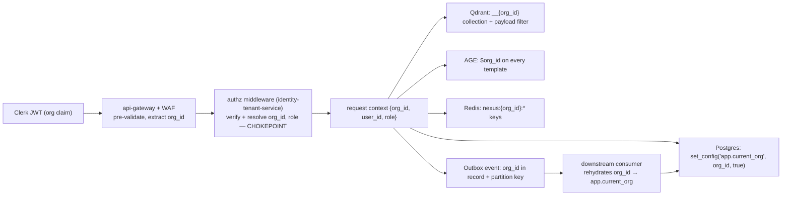
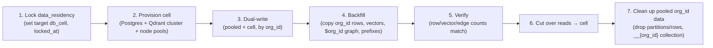

# ADR-0002: Multi-tenancy — pooled + RLS with cell-based isolation for enterprise

Records the decision to isolate NEXUS tenants with a hybrid model — pooled PostgreSQL Row-Level Security for the long tail and dedicated cells for large/enterprise tenants — keyed on a single tenant identifier, `org_id`.

## Related documents

- [Multi-Tenancy & Tenant Isolation](../06-multi-tenancy.md) — the full design and per-layer mechanics this ADR decides.
- [Data Architecture](../05-data-architecture.md) — RLS policy code, partitioning, cells, and the Citus sharding path (§3.7).
- [Data Model](../_canon/02-data-model.md) — frozen entity/table names, the `org_id` tenant key, RLS notes.
- [Tech & Architecture Decisions](../_canon/06-tech-decisions.md) — the locked `Tenancy model`, `DB isolation`, and isolation register cited here.
- [Service Catalog](../_canon/01-service-catalog.md) — `identity-tenant-service`, the `org_id` injection chokepoint, scaling families.
- [Capacity & Scaling Math](../_canon/05-capacity-math.md) — frozen anchors (A4 tenants, A1 users) and per-plan SLOs (§11.2).
- [Security Architecture](../11-security-architecture.md) — JWT verification, agent-to-agent authz, audit.
- [SaaS Business Architecture](../18-saas-business-architecture.md) — provisioning, plans/tiers, quotas, the cell migration workflow.

---

## Status

**Accepted.** Supersedes nothing. This ADR is the authoritative record for the `Tenancy model`, `DB isolation`, `Vector isolation`, `Graph isolation`, `Stream isolation`, `Cache isolation`, and `Authz injection` rows in [Tech Decisions §2.2](../_canon/06-tech-decisions.md). Any change to the tenancy posture must supersede this ADR.

---

## Context

### The forces

NEXUS must serve **A4 = 3,000 paying tenant organizations** and **A1 = 5,000,000 registered users** ([Capacity §2](../_canon/05-capacity-math.md)) from one logical platform. Four forces shape the decision:

1. **Cost of the long tail.** The vast majority of the 3,000 orgs are Free/Pro tenants with small footprints. A dedicated database (or cluster) per tenant would multiply fixed cost by ~3,000 and make the unit economics in [Capacity §10.1](../_canon/05-capacity-math.md) (C2 ≈ $9.73/MAU/month, 94% of which is LLM) impossible to sustain. The long tail must be **pooled** to amortize fixed infrastructure.
2. **Blast radius and noisy neighbors for large tenants.** A single enterprise tenant can drive a disproportionate share of the **A5 = 20,000 peak concurrent meetings** and **T3 = 1.728B `transcript_chunks` rows/month**. Pooling everyone means one tenant's spike or one tenant's bad migration degrades all others, and a single shared database failure is a platform-wide outage.
3. **Defense-in-depth against the one real cross-tenant path.** Tenants never touch the database directly; the only realistic cross-tenant leak is an **application bug that omits a scope predicate**. Isolation must therefore fail *closed* at a layer below the application — not rely on every developer remembering to filter by tenant.
4. **Compliance: residency and right-to-be-forgotten.** GDPR/CCPA, data residency, and RTBF ([Compliance](../12-compliance-and-privacy.md)) require that a tenant's data be regionally pinned and deletable as a single, complete, mechanical operation across every store.

These forces pull in opposite directions: (1) demands sharing; (2) and (4) demand separation. A single uniform posture cannot satisfy both.

### The PDF baseline

> [SaaS-scale adjustment] The original PDF (NEXUS Execution Plan v2.1) was a **single-deployment application with no tenancy concept**. Its data model carried no tenant column, its seeder was `2 orgs x 10 users x 5 meetings`, isolation was implicit, and there were no plans, no regions, and no per-tenant cost controls. Every decision in this ADR is a SaaS-scale addition; the PDF's stack, entity names, agents, and topics survive verbatim and multi-tenancy wraps them.

The PDF did define `organizations` as an entity, which we promote to the tenant root — but it never used it for isolation. There is no prior tenancy decision to reconcile or supersede.

---

## Decision

NEXUS adopts a **hybrid tenancy model**, locked as the `Tenancy model` row in [Tech Decisions §2.2](../_canon/06-tech-decisions.md):

> **Pooled multi-tenancy with PostgreSQL Row-Level Security for the long tail; cell-based isolation for large/enterprise tenants. Cell-based isolation is the tenancy strategy *within* the event-driven microservices style — not a competing architecture.**

The decision has six binding parts.

### D1 — Single tenant key: `org_id`

The tenant key is **`org_id UUID`**, references **`organizations(id)`** (the tenant root; `organizations.id` *is* the `org_id`), and is present on **every** tenant-scoped row, vector payload, graph node, event record, cache key, and object-storage prefix. There is no second tenant identifier and no alternative name. This single key is what makes the pooled → cell → sharded escalation mechanical: the same column doubles as the RLS predicate, the Qdrant collection suffix, the AGE node property, the Redpanda partition key, the Redis prefix, and (later) the Citus distribution column.

### D2 — Two postures bound to plan tiers

| Posture | Who | Postgres | Qdrant | Region / availability SLO | Blast radius |
|---|---|---|---|---|---|
| **Pooled + RLS** | Free / Pro (the long tail) | Shared cluster, RLS `FORCE` on `org_id` | Per-tenant **collection** `transcript_chunks__{org_id}` in a shared cluster | Free single-region 99.5%; Pro multi-region active-passive 99.9% | Logical — an RLS-bypassing bug is the only cross-tenant path |
| **Cell-based** | Enterprise (or any tenant by contract) | Dedicated **cell** DB, RLS still on | Dedicated Qdrant **cluster** | Cell pinned to region; active-active candidate 99.95% | Physical — a cell failure or noisy-neighbor event is contained |

Posture and region are recorded in **`data_residency`** (`org_id` PK, `region`, `db_cell`, `qdrant_region`, `object_bucket_region`, `locked_at`), **immutable after `locked_at`** without a migration workflow. The availability tiers match [Capacity §11.2](../_canon/05-capacity-math.md). Provisioning chooses the posture; see [SaaS Business](../18-saas-business-architecture.md).

### D3 — RLS is the fail-closed backstop, on even inside cells

Every tenant-scoped table enables and **forces** RLS. The canonical policy (frozen in [Data Model §7](../_canon/02-data-model.md)) compares `org_id` to the transaction-local GUC `app.current_org`:

```sql
ALTER TABLE transcript_chunks ENABLE ROW LEVEL SECURITY;
ALTER TABLE transcript_chunks FORCE ROW LEVEL SECURITY;

CREATE POLICY tenant_isolation ON transcript_chunks
  USING      (org_id = current_setting('app.current_org')::uuid)
  WITH CHECK (org_id = current_setting('app.current_org')::uuid);
```

```sql
-- Set per request, transaction-local, so a pooled connection cannot leak it.
SELECT set_config('app.current_org', :org_id_from_jwt, true);
```

Cells reduce blast radius and remove noisy neighbors; they **do not** replace RLS. A missed app-layer scope still returns **zero rows**, never another tenant's data. The application role has **no `BYPASSRLS`**; migrations and the RTBF purge run as a separate elevated role unreachable from request handlers.

**Hardened predicate (amended 2026-07-26).** The implemented policy wraps the GUC read: `org_id = NULLIF(current_setting('app.current_org', true), '')::uuid`. The bare form above **raises** when the GUC is unset; the wrapped form yields NULL, so the predicate is false and the query returns **zero rows**. Fail-closed by returning nothing is stricter and more useful under a pooled connection than fail-closed by erroring, and it is the form every tenant table uses. Callers MUST pass a validated UUID: a malformed GUC value still raises `22P02` on the cast.

**Scope of the mandate: tenant-scoped tables only (amended 2026-07-26).** `organizations` is the tenant **root**, not a tenant-scoped row. It carries no `org_id` column, so the canonical policy is not expressible on it, and it is deliberately **not** `tenant_isolation`-policied. This is what makes the mandate exceptionless and therefore enforceable by machine rather than by memory: **every table with an `org_id` column MUST carry a `tenant_isolation` policy**, asserted in CI. A self-referential policy on the root would have required a hardcoded exception in that assertion, and hardcoded exceptions rot. It would also have left the edge with no executable path for the pre-tenant Clerk-organization lookup that [ADR-0010](0010-auth-clerk-enterprise-sso.md) makes the authorization checkpoint, since `FORCE` subjects even a `SECURITY DEFINER` function's owner to the policy. `organizations` is protected instead by column-level grants, a single sanctioned accessor in the shared tenancy library, and a build gate that fails any other read of it. It holds directory metadata only; tenant-confidential per-tenant state lives in `tenant_settings` and `data_residency`, which are policied. `plans` is the other un-tenanted table. See [Data Model §7 rule 7](../_canon/02-data-model.md).

**The three database roles (amended 2026-07-26).** Named here so no repo invents a fourth convention:

| Role | Used by | `BYPASSRLS` | Reach |
|---|---|---|---|
| `mytheus_app` | Every request handler and HTTP service | **No** | Tenant tables, row-scoped by `tenant_isolation`. Column-level grants on `organizations`. No `UPDATE`/`DELETE` on `audit_logs`. |
| `mytheus_relay` | The transactional-outbox relay worker only | **No** | `SELECT` plus `UPDATE (published_at, attempts)` on `outbox` **only**, admitted by a dedicated permissive `outbox_relay_drain` policy. |
| `mytheus_admin` | Alembic migrations and the RTBF purge | **No** | Owns the tables. Unreachable from request handlers. |

The relay is a worker, not a request path, and it must read every tenant's `outbox` rows to drain them. It gets that reach through **one permissive policy on one table**, never through `BYPASSRLS`, which would expose every row of every table. Roles are created out of band (they are cluster-global, and a migration must not need `CREATEROLE`); grants and policies are database-local and ship in the migration.

> [SaaS-scale adjustment] The GUC is set **transaction-locally** (`set_config(..., true)`) precisely because PgBouncer runs in transaction-pooling mode ([Data Architecture §3.5](../05-data-architecture.md)). A session `SET` would bleed one tenant's `org_id` into the next lease of the same connection — the single most important RLS operational rule at SaaS scale, absent from the single-tenant PDF.

### D4 — Isolation at every layer, all keyed on `org_id`

The full per-layer mechanics live in [Multi-Tenancy §3](../06-multi-tenancy.md); the decision is that each layer is independently sufficient and the set is defense-in-depth:

| Layer | Mechanism | Backstop |
|---|---|---|
| Relational DB | PostgreSQL RLS `FORCE` on `org_id` | Zero rows if `app.current_org` unset; cell for enterprise |
| Vector store | Per-tenant Qdrant collection `__{org_id}` | Mandatory `org_id` payload filter on every query |
| Knowledge graph | Org-partitioned AGE `nexus_knowledge`, `$org_id` node property | Every named Cypher template parameterized; no ad-hoc Cypher in prod |
| Event stream | Tenant-keyed Redpanda partitions (`org_id` partition key) | Consumer **rehydrates** `org_id` from the Avro record and re-sets `app.current_org` before any write |
| Cache / pub-sub | Namespaced Redis `nexus:{org_id}:…` | Key builder raises if `org_id` is absent |
| Compute | Per-tenant token budgets / hard caps + cell node pools | Deny-by-default at `agent_budgets.hard_cap` |

### D5 — `org_id` injection chokepoint and event rehydration

`org_id` originates from the Clerk-verified JWT, is resolved once by the **authz middleware** in `identity-tenant-service` (the chokepoint), and propagates through a single chain to all six layers. For events, the producer stamps `org_id` into the Avro record **and** uses it as the partition key; the consumer **rehydrates** `org_id` and sets `app.current_org` before any write — so the same RLS backstop covers event-sourced writes (`usage_events`, agent outputs, embedding upserts, graph edges) as covers synchronous requests. A record with no `org_id` is dead-lettered, never applied to a guessed tenant.



### D6 — Agent-to-agent collaboration is tenant-bound, deny-by-default

The novel cross-tenant risk is multi-agent collaboration (PDF **R6**): `ContextGapAgent` queries other users' agents over **`agent-requests`** / **`agent-responses`**. The decision: these topics are partitioned by `org_id`; agent-to-agent authorization grants in `identity-tenant-service` are **deny-by-default, org/role scope-checked, and audited** to `agent_collaborations` and the append-only `audit_logs` (`actor_type = 'agent'`). A request bearing a foreign `org_id` is dropped to DLQ — never served. The fallback chain (peer-agents → related-meeting agents → RAG → silent) stays inside the tenant by construction, including the pre-authorized RAG-only descope.

---

## Consequences

### Positive

- **Cost-efficient long tail, isolated enterprise.** Pooling amortizes fixed infra across the 3,000 orgs while cells give the largest tenants physical blast-radius and noisy-neighbor containment — satisfying forces (1) and (2) simultaneously.
- **Fail-closed by default.** RLS `FORCE` + the chokepoint mean an omitted scope yields zero rows, not a leak. Six independent layers make a single missed predicate non-catastrophic.
- **Mechanical RTBF and retention.** Because every store is `org_id`-keyed, right-to-be-forgotten is **one `org_id`-parameterized Temporal workflow** that drops Postgres partitions/rows, Qdrant `__{org_id}` collections, AGE `$org_id` nodes/edges, Redis `nexus:{org_id}:*` keys, and object-storage `{org_id}/*` prefixes, then appends an `audit_logs` record ([Data Model §7](../_canon/02-data-model.md)).
- **Smooth escalation path.** The same `org_id` is the RLS predicate today and the Citus distribution column tomorrow ([Data Architecture §3.7](../05-data-architecture.md)); pooled → more cells → sharded requires **no schema re-cut**.
- **Residency and per-plan SLOs are expressible.** `data_residency` pins region/cell; postures map cleanly to the Free/Pro/Enterprise availability tiers.

### Negative

- **RLS adds query overhead and an operational footgun.** Every query carries the `org_id` predicate, and the transaction-local GUC under PgBouncer transaction pooling is a subtle correctness requirement — a session `SET` would silently leak across connection leases. Mitigated by making `SET LOCAL`/`set_config(..., true)` the only sanctioned path in the data layer and testing for it.
- **Cells add operational surface.** Each cell is a Postgres instance + Qdrant cluster + node pools to provision, monitor, back up, and patch. Cell count grows with enterprise sales; the control plane and CI/CD stay shared to bound this.
- **Two postures means two of some runbooks.** Backup/restore, failover, and migration differ between pooled and cell tenants. Accepted because the alternative (one posture) fails either cost or blast-radius.
- **Pooled tenants share a failure domain.** A shared-cluster incident affects all pooled tenants at once; their 99.5%/99.9% SLOs are set accordingly, and the cell path exists precisely for tenants that cannot accept this.

### What we accept

- The long tail's blast radius is **logical, not physical**. We accept this for Free/Pro tenants and rely on RLS `FORCE` + defense-in-depth, reserving physical isolation for those who pay for a cell.
- `data_residency` is **immutable after `locked_at`**; moving a tenant's region/cell requires the migration workflow, not an in-place update. This is a deliberate guard against accidental residency violations.
- We carry an RLS predicate on the **T3 = 1.728B-rows/month** `transcript_chunks` table; mitigated by monthly range partitioning and a leading-`org_id` composite index ([Data Architecture §3.3](../05-data-architecture.md)), not by removing the policy.

---

## Alternatives considered

| Alternative | Why not |
|---|---|
| **Database-per-tenant for everyone** | Physically isolates all tenants but multiplies fixed cost by ~3,000 (force 1) and makes per-tenant patching/backup unmanageable at the long-tail scale. Reserved instead for cells, where the tenant funds the dedicated infra. |
| **Pooled + RLS for everyone, no cells** | Cheapest, but every tenant shares one failure domain and the noisy-neighbor problem is unbounded — one enterprise tenant could degrade all others (force 2). Fails the Enterprise 99.95% SLO and blast-radius requirement. |
| **Schema-per-tenant (Postgres schema per org)** | Avoids RLS overhead but explodes to thousands of schemas, breaks connection pooling and migration tooling (every DDL must fan out across thousands of schemas), and `org_id` would no longer be a uniform column for events, vectors, and graph. Loses the single-key escalation property of D1. |
| **Application-only scoping (WHERE org_id = ? everywhere, no RLS)** | Relies on every developer remembering the predicate on every query; a single omission leaks across tenants with no backstop (force 3). RLS `FORCE` is the fail-closed layer that makes omissions return zero rows. |
| **Sharding from day one (Citus immediately)** | Premature at A4 = 3,000 tenants; adds distributed-query complexity and the AGE-on-coordinator constraint before load demands it. Deferred as the documented escalation when pooled+cells run out of room — `org_id` is already the distribution column, so the move stays mechanical ([Data Architecture §3.7](../05-data-architecture.md)). |
| **Separate tenant_id distinct from org_id** | A second identifier would fork the tenant key across stores and break the uniform `org_id` propagation. Rejected: the PDF's `organizations` table is promoted to the tenant root and `organizations.id` *is* `org_id`. |

---

## Migration and rollback notes

### Pooled → cell promotion (forward migration)

Promoting a tenant from the pooled estate to a dedicated cell uses the RTBF-grade migration workflow in [Data Architecture §3.7](../05-data-architecture.md), orchestrated by `workflow-service` and parameterized solely by `org_id`:



Because every store is `org_id`-keyed, each step operates on the tenant's slice alone and never touches other tenants. RLS stays `FORCE` on both source and destination throughout, so a partial migration cannot leak.

### Rollback

- **Within the migration:** before cut-over (steps 1–5) the pooled copy remains authoritative; abort by stopping dual-write and clearing the target `db_cell`. After cut-over, roll back by reversing the dual-write direction (cell → pooled) and cutting reads back — the same workflow run in reverse, since both sides retain the `org_id` slice until step 7 cleanup.
- **For the model itself:** rolling back the *decision* (e.g., abandoning cells) is reversible because RLS-on-everything is the common substrate — a cell tenant can be folded back into the pooled estate by the reverse migration with no schema change. The `org_id` key is unaffected either direction.

### Escalation beyond cells

When pooled + cells exhaust headroom, the next step is **Citus** (distributed Postgres) with `org_id` as the distribution column, co-locating a tenant's `meetings`, `transcript_chunks`, `decisions`, and `action_items` on one shard. The AGE `nexus_knowledge` graph does not distribute under Citus and follows its own R1 exit (Amazon Neptune / Neo4j Aura + relational materialized-view fallback). Both paths preserve the `org_id` / `$org_id` contracts; see [Data Architecture §3.7 and §5](../05-data-architecture.md).
