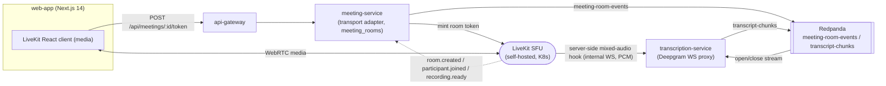
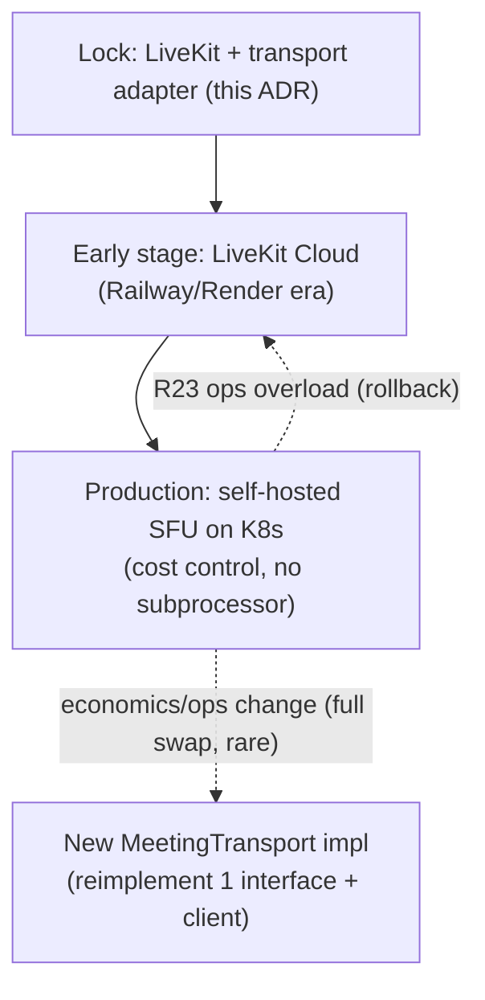

# ADR-0003: Meeting transport SDK — LiveKit

This record locks **LiveKit** (open-source, self-hostable SFU) as the NEXUS meeting transport, always reached through a transport adapter, resolving the PDF's deferred meeting-SDK choice (risk **R2**).

## Related documents

- [Real-time & Transcription](../10-realtime-and-transcription.md) — the runtime spec this ADR decides for: token minting, `POST /livekit/webhook`, server-side audio hook → Deepgram, latency budget.
- [Service Catalog](../_canon/01-service-catalog.md) — `meeting-service`, `transcription-service`, `realtime-gateway` ownership and sync-API boundaries.
- [Canonical Data Model](../_canon/02-data-model.md) — `meeting_rooms`, `meetings`, `transcript_chunks`, `meeting_speakers`, `nexus-recordings`.
- [Capacity & Scaling Math](../_canon/05-capacity-math.md) — anchors A5/A6/A8/A9 and the Deepgram one-stream-per-meeting cost lever (D1, §7).
- [Locked Tech & Architecture Decisions](../_canon/06-tech-decisions.md) — §2.7 (real-time meeting & transcription), the authoritative decision row this ADR justifies.
- [Risk Register](../23-risk-register.md) — R2 (resolved by this ADR) and its at-scale residual R23 (LiveKit SFU self-host ops).
- [Cost & FinOps](../17-cost-and-finops.md) — per-minute media economics that the SFU choice governs.
- [Deployment & Infrastructure](../16-deployment-and-infrastructure.md) — the Kubernetes (EKS/GKE) substrate the SFU runs on.

---

## Status

**Accepted.** Supersedes the PDF's open choice (R2: "evaluate ≥2 in Phase 1, switching costs non-trivial after Phase 3"). This ADR is the justification for the locked decision row in [Tech Decisions §2.7](../_canon/06-tech-decisions.md); that table remains the naming authority.

---

## Context

### The PDF baseline

The NEXUS Execution Plan v2.1 named the meeting SDK as a **managed SDK (LiveKit / Daily / Stream / Agora)** with the final pick deferred to Phase 1, and explicitly required the SDK to be **abstracted behind a transport adapter**. It flagged the choice as **risk R2** (SDK lock-in and pricing; switching costs non-trivial after Phase 3). It also locked the audio path: **SDK hook / MediaRecorder → FastAPI WebSocket proxy → Deepgram**, keeping the Deepgram key server-side, and **one diarized Deepgram stream** with `meeting_speakers` mapping diarized `speaker_id → user_id`.

### The forces

The transport choice is decided primarily by **cost at scale** and **the server-side audio hook**, not by client UX (every candidate ships a competent React client). The frozen capacity anchors in [Capacity Math](../_canon/05-capacity-math.md) make the economics decisive:

| Anchor | Value | Why it bears on the transport |
|---|---|---|
| A5 — peak concurrent meetings | **20,000** | One diarized Deepgram stream per meeting → 20k server-side audio subscriptions at peak. |
| A6 — peak concurrent participants | **100,000** | The media fan-out load an SFU must forward; a per-participant pricing meter bills against this number. |
| A8 — effective participants/meeting | **5.0** | `100k / 20k`; the media tracks an SFU forwards per room. |
| A9 — average meeting duration | **45 min** | Drives D1. |
| D1 — Deepgram minutes/month | **216,000,000** | Already the second-largest variable cost line; media transport must not add a second per-minute meter on top of it. |

Four forces dominate:

1. **Per-minute / per-participant media cost.** At A6 = 100k concurrent participants and D1-scale meeting minutes, a managed SDK that bills per participant-minute compounds the existing Deepgram bill. Media is a commodity at this volume; we must be able to convert it to **our own compute** on the locked Kubernetes substrate ([Tech Decisions §2.1](../_canon/06-tech-decisions.md)).
2. **Server-side audio hook fidelity.** The whole NEXUS thesis — live, per-participant agent intelligence — depends on tapping **mixed room audio server-side** and proxying it to Deepgram **without a client uplink and without exposing the Deepgram key**. The transport must expose a first-class server-side track-subscription / egress API.
3. **One diarized stream per meeting (the 6× lever).** [Capacity §7](../_canon/05-capacity-math.md) locks a single diarized Deepgram session per meeting (D1 = 216M min/mo); per-participant transcription would be D3 = 1,296M min/mo. This requires subscribing to **room-mixed audio** server-side, not to N per-participant tracks.
4. **Lock-in / switching cost (R2).** The PDF warned that switching is non-trivial after Phase 3. The mitigation is structural — the transport adapter — and a choice whose **exit is cheapest** when economics or operations change.

### Candidate comparison

| Criterion | **LiveKit (chosen)** | Daily | Stream | Agora |
|---|---|---|---|---|
| Deployment model | OSS, **self-hostable SFU** on our K8s; managed Cloud optional | Managed only | Managed only | Managed only |
| Media cost at A6 scale | **Own compute** (no per-participant vendor ceiling) | Per participant-minute | Per participant-minute | Per participant-minute |
| Server-side audio hook | **First-class** (server track subscription + egress) | Recording/egress, weaker live server tap | Limited server-side tap | Per-track server SDK, heavier |
| One-stream-per-meeting (mixed audio) | **Native** server-side room-audio subscribe | Workable via egress | Awkward | Per-track oriented |
| Lock-in / exit | **Lowest** (OSS, run anywhere; adapter swap) | High | High | High |
| Self-host ops burden | **Highest** (we run the SFU) → residual R23 | None | None | None |

Only LiveKit lets us (a) move media to our own compute so cost tracks compute not a seat meter, and (b) subscribe to mixed room audio server-side for the single diarized Deepgram stream. The candidates with zero ops burden all carry a per-participant pricing meter that does not survive the A6 / D1 capacity math.

---

## Decision

**NEXUS uses LiveKit as the meeting transport — the open-source, self-hostable SFU — always reached through a transport adapter.** This matches [Tech Decisions §2.7](../_canon/06-tech-decisions.md) verbatim and is detailed at runtime in [Real-time & Transcription](../10-realtime-and-transcription.md).

> [SaaS-scale adjustment] The PDF deferred the SDK (R2: evaluate ≥2, decide in Phase 1). This ADR **locks LiveKit** because only a self-hostable OSS SFU caps per-minute media cost with **no per-participant vendor ceiling** at A6 = 100,000 concurrent participants, and exposes the server-side audio hook the Deepgram one-stream-per-meeting design (D1, the 6× lever) requires. The transport adapter — already mandated by the PDF — is what keeps the lock reversible.

The decision has five concrete, binding parts.

### 1. Self-hostable SFU on the locked compute substrate

LiveKit runs **self-hosted** on the production Kubernetes (EKS/GKE) substrate ([Tech Decisions §2.1](../_canon/06-tech-decisions.md), [Deployment & Infrastructure](../16-deployment-and-infrastructure.md)). An SFU forwards each track once per subscriber rather than re-encoding (unlike an MCU), so media cost tracks our compute, not a vendor seat meter. LiveKit Cloud remains a sanctioned **early-stage** fallback (Railway/Render era) before the first paying tenants land, identical to the broader compute path. Media is the **real-time scaling family** ([Capacity §2.1](../_canon/05-capacity-math.md)); the SFU scales on concurrent participant tracks (A6), distinct from `transcription-service` which scales on concurrent meetings (A5).

### 2. Transport adapter is the only seam that imports the SDK

LiveKit is reached **exclusively** through the `MeetingTransport` adapter inside `meeting-service` ([Service Catalog §3](../_canon/01-service-catalog.md)). No other service — not `core-api`, not `transcription-service`, not the agent tier — imports the LiveKit SDK. This preserves the PDF's "abstract the SDK" stance and is the mechanism that makes R2's "non-trivial switching cost after Phase 3" survivable: a future SFU swap reimplements one interface.

```python
# meeting-service: the ONLY place the LiveKit SDK is imported.
class MeetingTransport(Protocol):
    async def mint_join_token(
        self, *, org_id: UUID, meeting_id: UUID, room: str,
        identity: UUID, grants: RoomGrants, ttl_s: int = 600,
    ) -> str: ...
    async def start_egress(self, *, org_id: UUID, meeting_id: UUID, room: str) -> str: ...
    async def subscribe_room_audio(self, *, org_id: UUID, room: str) -> AudioTrackHandle: ...
    async def verify_webhook(self, body: bytes, sig: str) -> LiveKitEvent: ...

class LiveKitTransport(MeetingTransport):
    """Concrete LiveKit binding. Swappable per Tech Decisions §2.7."""
```

### 3. `meeting-service` owns the transport surface; `meeting_rooms` is its only store

`meeting-service` ([Service Catalog §3](../_canon/01-service-catalog.md)) owns the LiveKit transport adapter and exactly two public paths — `POST /api/meetings/:id/token` (participant-verified token mint, p95 < 250 ms per [Capacity §11.1](../_canon/05-capacity-math.md)) and `POST /livekit/webhook` (`room.created`, `participant.joined`, `recording.ready`). It owns one table, **`meeting_rooms`** (LiveKit room ↔ meeting map, egress/recording refs — [Data Model §2.1](../_canon/02-data-model.md)), and emits `meeting-room-events`. It does **not** own `meetings` (that is `core-api`/meeting domain) or `transcript_chunks` (that is `transcription-service`).



### 4. One diarized stream per meeting via the server-side audio hook

The LiveKit server-side audio hook delivers **mixed room audio** to `transcription-service` over an internal WS; `transcription-service` opens **one Deepgram WebSocket session per meeting** with diarization and proxies the audio, keeping the Deepgram key server-side. This is the locked 6× cost lever — D1 = 216M min/mo, not D3 = 1,296M min/mo ([Capacity §7](../_canon/05-capacity-math.md)) — and is consistent with `meeting_speakers` mapping diarized `speaker_id → user_id` (reliable manual assignment plus a confidence-scored suggestion, PDF risk **R7**). Persistence rules carried verbatim: **interims never persisted; only finals** become `transcript_chunks` rows. The full proxy spec lives in [Real-time & Transcription §3](../10-realtime-and-transcription.md).

### 5. Multi-tenant and provider posture

> [SaaS-scale adjustment] The PDF had no tenancy concept for the transport. Every transport surface is tenant-scoped: token grants are minted only after participant verification against `meeting_participants` with `org_id` from the Clerk-verified JWT; `meeting_rooms` rows carry `org_id` under RLS ([Multi-Tenancy](../06-multi-tenancy.md)); `meeting-room-events` is partitioned by `org_id`; recordings land in `nexus-recordings` at `{org_id}/{meeting_id}/` ([Data Model §6](../_canon/02-data-model.md)). LiveKit webhooks are deduped via the at-least-once inbox key `{room}:{event}:{participant_sid}` so a redelivered `recording.ready` cannot double-write `meeting_rooms`.

> [SaaS-scale adjustment] LiveKit is a **subprocessor** only when LiveKit Cloud is used; the self-hosted SFU on our own infrastructure removes it from the subprocessor list. The DPA/SCC obligation in [Compliance & Privacy](../12-compliance-and-privacy.md) therefore applies to LiveKit Cloud (early stage) and is **dropped** at self-host, which is a compliance advantage of the chosen model.

---

## Consequences

### Positive

- **Media cost tracks compute, not a seat meter.** No per-participant vendor ceiling at A6 = 100k concurrent participants; the SFU is the only line item that scales with our own K8s capacity. This is the single largest reason the choice survives the capacity math.
- **The server-side audio hook is first-class**, which makes the one-diarized-stream-per-meeting design (the 6× Deepgram lever, D1) native rather than a workaround, and keeps the Deepgram key server-side with no client uplink.
- **Lowest lock-in of the candidates.** OSS + self-host means we can run anywhere; combined with the mandated adapter, R2's "non-trivial switching cost" is reduced to a single-interface reimplementation.
- **Subprocessor surface shrinks at self-host** (see compliance callout), simplifying enterprise DPAs.
- **Clean tier separation.** The SFU (media, A6) and `transcription-service` (streams, A5) scale on independent signals; neither over-provisions for the other.

### Negative — accepted

- **We now run an SFU.** Self-hosting moves operational burden (capacity planning, TURN/relay for restrictive networks, region placement, upgrades, media-quality tuning) onto the NEXUS SRE function. This is tracked as the explicit at-scale residual **R23 (LiveKit SFU self-host ops)** in the [Risk Register](../23-risk-register.md) — R2 is *resolved* (lock-in/pricing retired), R23 is the cost of resolving it.
- **GPU/CPU media capacity is a new cost center** on the K8s substrate ([Deployment & Infrastructure](../16-deployment-and-infrastructure.md)); it must be sized against A6 and load-tested with k6/Locust ([Capacity §11](../_canon/05-capacity-math.md)).
- **Operational maturity lag vs. a managed SDK** on day one — mitigated by the LiveKit Cloud early-stage fallback (§Decision.1) so the product does not block on SFU ops readiness.

### What we accept

We accept higher operational ownership (R23) in exchange for cost control and the server-side audio hook, because at A6/D1 scale the per-participant pricing of every managed alternative is the dominant, non-negotiable constraint. We accept that the LiveKit React client pairs the frontend to LiveKit's client SDK ([Tech Decisions §2.8](../_canon/06-tech-decisions.md), [Frontend Architecture](../20-frontend-architecture.md)); the adapter abstracts only the server side, so a transport swap touches the client too — a bounded, known cost.

---

## Alternatives considered

| Alternative | Why not |
|---|---|
| **Daily** | Managed-only, per-participant-minute pricing that compounds the D1 Deepgram bill at A6 scale; no path to move media onto our own compute. Live server-side audio tap is weaker than LiveKit's; one-stream-per-meeting requires egress workarounds. Highest lock-in. |
| **Stream** | Managed-only with per-participant economics. Limited server-side audio subscription makes the mixed-audio Deepgram hook awkward. Strong client UX does not offset the cost/lock-in posture. |
| **Agora** | Mature, per-track server SDKs, but per-participant/per-minute pricing and a per-track orientation that fights the single mixed-audio stream design. Heaviest integration, managed-only, high lock-in. |
| **LiveKit Cloud (managed) as the permanent choice** | Same OSS engine and adapter, so reversible — but re-introduces a per-participant vendor meter and a subprocessor obligation. Retained only as the **early-stage** fallback, not the production target. |
| **WebRTC mesh / build our own SFU** | A mesh does not scale past a few participants (A8 = 5.0 effective, A7 = 6 roster would already strain it); building an SFU is a multi-quarter detour off the product. Rejected outright. |

---

## Migration & rollback notes

### Reversibility (the adapter is the exit)

The `MeetingTransport` adapter (§Decision.2) is the seam that makes this decision reversible despite the PDF's R2 warning. A transport swap touches:

1. A new `MeetingTransport` implementation in `meeting-service` (token mint, egress, server-side audio subscribe, webhook verify).
2. The webhook receiver path `POST /livekit/webhook` (provider event mapping → `meeting-room-events`).
3. The LiveKit React client on the frontend ([Frontend Architecture](../20-frontend-architecture.md)).

Nothing in `core-api`, `transcription-service`, the agent tier, or the event schemas changes — `transcript-chunks` is produced from the internal audio WS regardless of transport. The blast radius is one service plus the client.

### Self-host ↔ Cloud (R23 mitigation)

Self-hosted SFU and LiveKit Cloud share one engine and one adapter implementation; the difference is a config/endpoint change, not a code change. If R23 (self-host ops) materializes faster than SRE capacity can absorb it, NEXUS can **fall back to LiveKit Cloud per region** without a transport rewrite, accepting the per-participant cost and the LiveKit-Cloud subprocessor DPA temporarily. This is the rollback path for the operational risk, distinct from a full provider swap.



### Phasing

Per [Roadmap & Phasing](../22-roadmap-and-phasing.md), the transport lands in the meeting-platform phase; the audio hook → Deepgram path follows in the real-time/transcription phase. The PDF's "switching cost non-trivial after Phase 3" is precisely why the adapter and the lock are committed up front rather than discovered mid-build.
