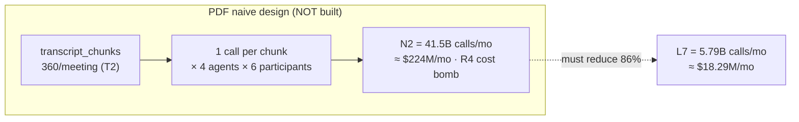
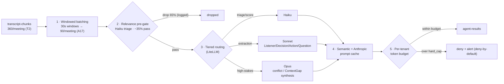
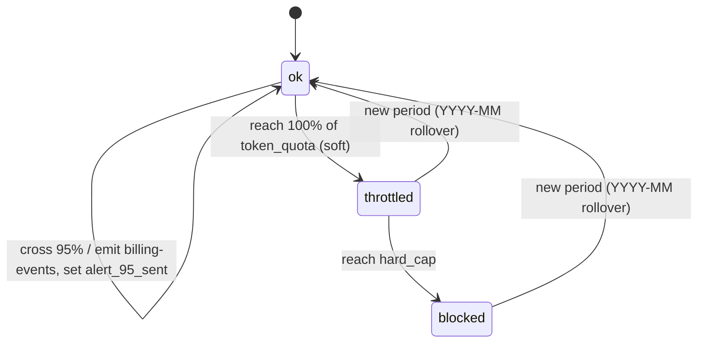

# ADR-0004: LLM Cost-Control Pipeline (Windowed Batching + Relevance Gating + Tiered Routing + Caching + Per-Tenant Budgets)

This record locks the five-stage pipeline that turns NEXUS's "every participant gets a personal agent that processes the meeting" promise into an affordable, quota-bounded production cost, defeating the PDF's R4 LLM cost spiral.

## Related documents

- [AI Agent Architecture](../08-ai-agent-architecture.md) — the six agents, `AgentState`, the pipeline implementation, confidence surfacing.
- [RAG Pipeline & Inference Serving](../09-rag-and-inference-serving.md) — LiteLLM tiered routing, prompt caching, the dedicated inference tier.
- [Cost Architecture & FinOps](../17-cost-and-finops.md) — COGS per meeting, gross-margin model, budget alerts, hard quotas.
- [SaaS Business Architecture](../18-saas-business-architecture.md) — `usage-events` metering, plans/tiers, quota enforcement.
- [Capacity & Scaling Math](../_canon/05-capacity-math.md) — the frozen capacity numbers (`A17`, `N2`, `L7`, `L10`, `C2`–`C4`) this ADR cites.
- [Locked Tech & Architecture Decisions](../_canon/06-tech-decisions.md) — §2.5, the LLM cost-pipeline lock this ADR justifies.
- [Risk Register](../23-risk-register.md) — R4 (LLM cost spiral), R5 (agent latency budget).
- [Multi-Tenancy & Tenant Isolation](../06-multi-tenancy.md) — per-tenant budgets and namespaced Redis.

---

## Status

**Accepted.** Supersedes the PDF's implicit "PersonalListenerAgent processes every transcript chunk" design. This ADR is the justification record for the locked decision in [Locked Tech §2.5](../_canon/06-tech-decisions.md); the mechanics live in [AI Agent Architecture §4](../08-ai-agent-architecture.md). A change to this decision leaves the lock table only via a superseding ADR.

---

## Context

### The promise that creates the problem

NEXUS's differentiator is **personalized per-participant intelligence**: every participant gets a personal AI agent that listens to the whole meeting and produces role-relevant notes, decisions, actions, and questions in real time. That promise multiplies LLM load three ways at once — per **participant**, per **agent**, and per **transcript unit** — and it does so on the realtime path where the latency budget (R5) is already tight.

### The PDF baseline

The NEXUS Execution Plan v2.1 described the PersonalListenerAgent (and the other realtime agents) as subscribing to `transcript-chunks` and processing chunks one at a time. It flagged the resulting cost exposure as risk **R4 (LLM cost spiral once agents process every transcript chunk)** and named four mitigations in prose — token budgets, smaller-model routing, prompt compression, a Phase-13 ~30% reduction target — plus per-user budget alerts from Phase 7. It did not size the exposure, did not specify the pipeline shape, and budgeted per **user**, not per **tenant**. The cost levers were intentions, not an architecture.

### Sizing the exposure (why intentions are not enough)

At the canon production anchors (`R4` = 4.8M meetings/month, `A7` = 6 participants/meeting, `T2` = 360 `transcript_chunks`/meeting), the naive per-chunk design is catastrophic. From [Capacity §8.1](../_canon/05-capacity-math.md):

| Symbol | Quantity | Derivation | Value |
|---|---|---|---|
| `N1` | naive LLM calls / meeting | `T2(360) × agents(4) × roster(6)` | **8,640** |
| `N2` | naive LLM calls / month | `N1 × R4` | **41,472,000,000** |
| `N3` | naive LLM calls / sec (peak) | `(N2 / 2.59M) × 4` | **~64,000** |

Priced as all-Sonnet, `N2` is **≈ $224M/month** in LLM spend alone ([Capacity §10](../_canon/05-capacity-math.md)). LLM is **94%** of variable infrastructure cost (`C3`). The R4 cost bomb is therefore not one risk among many — it is *the* margin driver. No amount of infra rightsizing matters next to it; only changing how many LLM calls happen, and at what tier, moves the number.



### Forces in tension

| Force | Pull |
|---|---|
| Product differentiation | Per-participant, per-agent, realtime intelligence — maximizes calls. |
| Margin (`C3` = 94% LLM) | Minimize call count and per-call cost — minimizes calls. |
| Latency (R5: p50 < 2s, p95 < 4s) | Extra pipeline stages add hops; gating/batching must not blow the budget. |
| Quality | The cheapest model that *can* do the job must actually do it — under-routing degrades extraction. |
| Multi-tenancy | A single noisy tenant must never run NEXUS into negative margin or starve others. |
| Predictability | Finance needs a hard ceiling on per-tenant spend, not a best-effort dial. |

The decision below resolves these forces with a fixed, ordered pipeline rather than ad-hoc throttling.

---

## Decision

**We process realtime agents through a fixed five-stage cost-control pipeline, executed in this order: windowed batching → relevance pre-gating → tiered model routing (Haiku → Sonnet → Opus) → semantic + Anthropic prompt caching → per-tenant token budgets with hard quotas.** Agents run **per 30-second window, not per raw `transcript_chunks` row.** The pipeline is owned by `agent-runtime-service`; routing is via LiteLLM; budgets are enforced against the `agent_budgets` table mirrored hot in Redis.

This is the architectural fix for **R4**, and — by cutting call volume and keeping a streamed, prioritized realtime path — a contributing fix for **R5**.

> **Order reconciliation.** [Locked Tech §2.5](../_canon/06-tech-decisions.md) lists the pipeline stages gate-first ("Relevance pre-gating → windowed batching → ...") as a *feature list* of the cost levers, not as an execution sequence. The *execution* order is **window-then-gate**: 360 `transcript_chunks` are first batched into 90 windows, then the 90 windows are gated at the 0.35 gate-pass rate. This is the only order under which the [Capacity §8.2](../_canon/05-capacity-math.md) arithmetic closes (`L1` = 540 Haiku triage calls = windows × roster; gate-pass `0.35` applied to windows, not raw chunks → `L6` ≈ 1,206, `L7` ≈ 5.789B, `L10` = 86%). Per the canon rule that every order/number is single-sourced in the capacity math, this ADR aligns to [Capacity §8.2](../_canon/05-capacity-math.md); the lock-string ordering is a list, not a sequence, and must not be used to "correct" this ADR back to gate-first.



> [SaaS-scale adjustment] Every stage except the model calls themselves is a SaaS-scale addition. The PDF ran each agent on each raw `transcript_chunks` row with no batching + relevance gating, no tiering, no caching layer, and per-user (not per-tenant) budgets. The ordered five-stage pipeline, the 30-second window (`A17`), and the tenant-level hard quota are the net-new mass.

### Stage 1 — Windowed batching (`A17` = 30 s)

Deepgram utterances are merged by speaker turn and batched into **30-second windows** before any agent sees them. This converts `T2` = 360 raw `transcript_chunks`/meeting into **90 windows/meeting**. Agents run per window, not per chunk — a 4× reduction at the unit boundary before any other lever applies.

The window is carried in `AgentState.chunk` (it holds a 30s window of speaker-merged utterances, not a single `transcript_chunks` row — see [AI Agent Architecture §3](../08-ai-agent-architecture.md)). Windowing is the single most load-bearing capacity addition (`A17`) in the [capacity model](../_canon/05-capacity-math.md).

> [SaaS-scale adjustment] `A17` (30s windowed batching) is introduced for SaaS-scale sizing and is not in the PDF. It is the lever that converts per-chunk processing into per-window processing.

### Stage 2 — Relevance pre-gating (Haiku triage)

One cheap **Haiku** triage call per window per participant scores relevance to that participant via `get_user_context(user_id)` (role/skills/team/recent meetings/topics; Redis-cached 5-min TTL). **~35% of windows pass** (gate-pass `0.35`, [Capacity §8.2](../_canon/05-capacity-math.md)); the 65% that fail are logged and dropped, and **no extraction call is ever made for them**. This relevance score is the *pre-gate* signal ("does this window matter to this user") and is distinct from the *confidence* surfacing thresholds below.

### Stage 3 — Tiered model routing (LiteLLM, Haiku → Sonnet → Opus)

The router picks the cheapest model that can do the job:

| Tier | Model | Work | Per-meeting calls (Capacity §8.2) |
|---|---|---|---|
| Triage / score | **Haiku** | relevance pre-gate (`L1`) | 540 |
| Extraction | **Sonnet** | PersonalListener / Decision / Action (`L2`), Question (`L3`), ContextGap synthesis (`L4`) | 567 + 81 + 12 |
| High-stakes | **Opus** | ProactiveAgent conflict / ContextGap fallback synthesis (`L5`) | 6 |

**Tier mix by call volume: Haiku 45%, Sonnet 55%, Opus < 1%.** Triage is the highest-volume, cheapest tier by design; Opus is reserved for confirmed high-stakes reasoning only. Routing names are carried verbatim from [Locked Tech §2.5](../_canon/06-tech-decisions.md).

### Stage 4 — Semantic + Anthropic prompt caching

Stable prefixes — the system prompt, the role→topics taxonomy, the versioned prompt template, and prior-window context — are **Anthropic-prompt-cached**; semantically near-duplicate windows hit a **semantic cache** before reaching any model. Caching is applied *after* tiering and shows up in the effective cached-input token counts that produce the [Capacity §10](../_canon/05-capacity-math.md) dollar figures. The Phase-13 `~30%` reduction target (`C4`) is expected to come primarily from caching-hit-rate improvement plus gate-tightening on the Sonnet tier; only the 30% target itself is frozen in canon (`C4`), and this composition is the ADR's expected decomposition, not a frozen quantity.

### Stage 5 — Per-tenant token budgets with hard quotas

Every call checks the tenant's budget before dispatch. State lives in `agent_budgets` (one row per `(org_id, period=YYYY-MM)`: `token_quota`, `tokens_consumed`, `hard_cap`, `alert_80_sent`, `alert_95_sent`, `state`) and is mirrored hot in Redis `nexus:{org_id}:budget:{period}` so the check is an in-memory read, not a Postgres round-trip. Token usage is emitted on `usage-events` to `billing-metering-service`.

> [SaaS-scale adjustment] Budgets are **per tenant** (`org_id`), not per user. The PDF budgeted per user (Phase-7 alerts). A multi-tenant SaaS needs a tenant-level hard cap so one organization cannot exceed its contracted cost envelope or starve others. See [Cost & FinOps §7](../17-cost-and-finops.md).

The `agent_budgets.state` enum has **exactly three members** — `ok`, `throttled`, `blocked`. The 80%/95% crossings are **not** states; they are self-transitions on `ok` that emit `billing-events` and set the boolean flags `alert_80_sent` / `alert_95_sent`.



| Consumption | `state` | Action | Emits |
|---|---|---|---|
| < 80% of `token_quota` | `ok` | normal processing | — |
| ≥ 80% | `ok` (+ `alert_80_sent`) | warn tenant admin | `billing-events` → `notification-service` |
| ≥ 95% | `ok` (+ `alert_95_sent`) | warn again, suggest upgrade | `billing-events` → `notification-service` |
| ≥ 100% of `token_quota` | `throttled` | drop to Haiku-only / degrade to silent-log | `billing-events` |
| ≥ `hard_cap` | `blocked` | agent processing stops (deny-by-default) | `billing-events` |

Per-plan budget shape (from [Cost & FinOps §6.1](../17-cost-and-finops.md)):

- **Free**: `token_quota = hard_cap`, so there is **no throttle band** — the machine transitions `ok → blocked` directly. A Free tenant that exhausts its monthly `included_agent_tokens` stops agent processing (transcription and CRUD continue) until the next period or an upgrade.
- **Pro / Enterprise**: `token_quota < hard_cap`, giving a soft `throttled` Haiku-only degradation band before the hard stop.

```python
# agent-runtime-service: budget pre-check before LiteLLM dispatch.
async def within_budget(org_id: str, period: str, est_tokens: int) -> bool:
    # hot mirror of agent_budgets.tokens_consumed; TTL = period-end
    key = f"nexus:{org_id}:budget:{period}"
    state = await redis.hget(key, "state")          # ok | throttled | blocked
    if state == "blocked":
        return False                                # deny-by-default
    if state == "throttled":
        return route_is_haiku_only()                # soft band: triage only
    return True                                     # ok (incl. 80/95 warn bands)
```

The confidence surfacing thresholds are unchanged from the PDF and are orthogonal to the cost pipeline: **> 0.7 surface, 0.4–0.7 silent-log, < 0.4 drop** ([AI Agent Architecture §6](../08-ai-agent-architecture.md)). No silent commits — decisions/actions still require user confirmation.

### The number this decision produces

| Symbol | Quantity | Value |
|---|---|---|
| `L6` | controlled LLM calls / meeting | **~1,206** |
| `L7` | controlled LLM calls / month | **~5,789,000,000** |
| `L9` | controlled LLM calls / sec (peak) | **~8,930** |
| `L10` | reduction vs naive `N2` | **86%** |

In dollars: the controlled LLM subtotal is **~$18.29M/month** versus the naive all-Sonnet per-chunk **≈ $224M/month** — the pipeline is worth roughly **$206M/month**. Unit economics land at `C1` ≈ $4.06 variable infra cost/meeting and `C2` ≈ **$9.73 cost/MAU/month**; the Phase-13 `~30%` optimization (`C4`) brings the LLM subtotal to ~$12.8M/mo and cost/MAU to **~$6.99**. All figures imported verbatim from [Capacity §8 and §10](../_canon/05-capacity-math.md).

---

## Consequences

### Positive

- **R4 is defeated quantitatively.** 86% call-volume reduction (`L10`) *before* caching savings; the dollar gap is ~$206M/month. This is the dominant margin lever (`C3` = 94%), so it dwarfs every infra-rightsizing decision.
- **Margin is bounded, not best-effort.** The per-tenant `hard_cap` guarantees a tenant cannot run NEXUS into negative margin: token spend stops before COGS exceeds the contracted envelope. Finance gets a ceiling, not a dial.
- **Tier mix tracks quality to cost.** Haiku does the cheap, high-volume triage; Sonnet does extraction; Opus is < 1% of calls, reserved for confirmed high-stakes reasoning. The expensive model only runs where it earns its keep.
- **Latency budget protected (R5).** Windowing reduces per-second call pressure (`L9` ≈ 8,930 peak vs `N3` ≈ 64,000 naive), and the budget check is a Redis read, not a Postgres query. The streamed realtime path (`agent-stream`) and priority queue stay load-bearing for R5.
- **Caching has a Phase-13 runway.** The `~30%` reduction (`C4`) is expected to come primarily from caching-hit-rate and gate-tightening, not a vague aspiration — though only the 30% target itself is the frozen canon quantity.
- **Tenant-aware degradation, not outage.** Over-budget tenants degrade gracefully (Haiku-only / silent-log under `throttled`) rather than failing hard, except Free, which is intentionally hard-stopped.

### Negative / costs we take on

- **More moving parts on the hot path.** Five ordered stages add operational surface: a pre-gate model, a windowing buffer, a router, two cache layers, and a budget check. Each is a place to mis-tune.
- **Pre-gating can suppress signal.** A too-aggressive gate drops windows that mattered to a participant (false negatives in relevance). We monitor PersonalListener relevance precision/recall against role labels ([AI Agent Architecture §7](../08-ai-agent-architecture.md)) and treat the 0.35 gate-pass rate as a tunable, not a constant.
- **Windowing adds up to 30s of intra-pipeline buffering** before an agent reasons over a turn. This is inside the R5 budget for sidebar output but means an agent never reacts to a half-spoken sentence — an accepted product trade.
- **Tier routing can under-serve quality.** Routing extraction to a model too small degrades decision/action precision. The router defaults to Sonnet for all extraction (never Haiku) precisely to avoid this; Haiku is triage-only.
- **Free-tier hard stop is user-visible.** A Free tenant mid-meeting can lose agent output when `blocked`. This is intentional (Free is structurally unprofitable at MAU scale) and surfaced in the tenant admin console, but it is a real UX cliff.
- **Cache invalidation coupling.** Prompt caching keys off stable prefixes including the **versioned** prompt template and the role→topics taxonomy; a prompt-template version bump or taxonomy edit invalidates cache and temporarily raises cost until hit rates recover.

### What we explicitly accept

- We accept that agents operate on 30-second windows, not individual utterances, and that the pre-gate drops ~65% of windows unprocessed. This is the price of an affordable per-participant product, and it is the deliberate design — not a degradation.
- We accept per-tenant (not per-user) budgeting as the enforcement boundary; per-user attribution still happens via `usage-events` for billing detail, but the *hard cap* is at the tenant.
- We accept that the capacity numbers (`A17`, `L7`, `L10`, `C2`–`C4`) are frozen in [Capacity Math](../_canon/05-capacity-math.md); any change to gate-pass rate, window size, or tier mix must update that canon first, not be patched locally.

---

## Alternatives considered

| Alternative | Why not |
|---|---|
| **Per-chunk processing (PDF baseline)** | The R4 cost bomb: `N2` = 41.5B calls/mo ≈ $224M/mo. Structurally unaffordable; the entire ADR exists to avoid it. |
| **One shared note-taker per meeting (no per-participant agents)** | Cheapest of all, but it deletes the product differentiator (personalized per-participant intelligence). The cost problem is solved by killing the product. Rejected. |
| **All-Sonnet, no tiering** | Simpler routing, but Sonnet on every gate-pass window is ~3.75× Haiku input cost on the highest-volume stage. Triage is 45% of calls; paying Sonnet rates for triage erases most of the savings. Tiered routing keeps triage cheap. |
| **Self-hosted open-weight LLM for triage/extraction** | Could cut per-token cost, but adds a second GPU fleet, eval/quality risk against Anthropic models, and contradicts the locked LiteLLM (OpenAI + Anthropic) routing decision (superseded by [ADR-0027](0027-anthropic-only-llm-provider.md): provider set is now Anthropic only). Held as a future cost lever, not a launch decision; the inference tier is already GPU-heavy for embeddings/rerank ([RAG & Inference Serving](../09-rag-and-inference-serving.md)). |
| **Larger windows (e.g. 2-minute batching)** | Fewer windows → fewer calls, but pushes agent reaction time past the R5 sidebar budget and makes live questions/decisions feel stale. 30s (`A17`) is the balance point between cost and the "calm, real-time" sidebar UX. |
| **Per-user budgets only (PDF)** | A noisy user is capped, but a noisy *tenant* (many users) is not — one org could exceed its cost envelope. Per-tenant hard caps are required for contract-level margin safety. Per-user tracking is retained for billing detail, not as the cap. |
| **Soft throttle for all tiers (no hard cap)** | Best-effort throttling cannot *guarantee* a margin ceiling; a metering lag or hot-path bug could overspend. Deny-by-default at `hard_cap` is the only design that makes "a tenant cannot run NEXUS into negative margin" a hard invariant. |
| **Reduce cost only via the Phase-13 ~30% target** | The PDF's only sized lever. 30% off $224M is still $157M/mo — an order of magnitude over budget. The 86% structural reduction must come *first*; the 30% (`C4`) is then an optimization on top of an already-affordable base. |

---

## Migration / rollback notes

### Build sequencing

The pipeline is built incrementally and is safe to ship stage-by-stage because each stage degrades to "process more, pay more," never to "process wrong":

1. **Windowing (Stage 1)** lands with the PersonalListenerAgent in **Phase 7** — `AgentState.chunk` is a 30s window from day one. This alone is the 4× unit-boundary reduction.
2. **Budgets + alerts (Stage 5)** also land in **Phase 7** (PDF: budget alerts from Phase 7), starting in alert-only mode (`alert_80_sent` / `alert_95_sent` fire; `hard_cap` enforcement off) so we observe real per-tenant token curves before enabling deny-by-default.
3. **Tiered routing (Stage 3)** and **pre-gating (Stage 2)** land with the realtime extraction agents (Decision/Action/Question, Phases 8–9). The gate-pass rate (0.35) is tuned against observed relevance precision/recall before it is trusted.
4. **Caching (Stage 4)** is enabled once prompt templates are versioned and stable; it is purely additive and reversible (disable cache_control → fall back to uncached input pricing, higher cost, identical output).

### Rollback

- **Disable a stage independently.** Each stage is a config flag in `agent-runtime-service`. Pre-gating off → all windows processed (higher cost, no quality loss). Caching off → uncached pricing. Tiering off → forced single model. Budget enforcement off → alert-only. None changes agent *output correctness*; rollback only moves cost up.
- **Budget enforcement is the one user-visible switch.** Disabling `hard_cap` enforcement (revert to alert-only) removes the Free-tier hard stop but exposes margin. This is the deliberate dial during incident response if a metering bug is suspected — accept temporary cost exposure to keep tenants unblocked, then re-enable once metering integrity is confirmed.
- **Window-size and gate-pass changes** are not local rollbacks: they must be reflected in [Capacity Math](../_canon/05-capacity-math.md) (`A17`, gate-pass `0.35`) so the cost model stays single-sourced, then propagated to [Cost & FinOps](../17-cost-and-finops.md).

### Idempotency under retry

Because `usage-events` is at-least-once with idempotency keys ([Event Architecture](../07-event-architecture.md)), a retried agent call cannot double-count tokens against `agent_budgets`; the dedupe inbox (`nexus:{org_id}:dedupe:usage-events:{idempotency_key}`) and the `usage_events.idempotency_key` unique constraint guarantee single-apply. This is what makes the hard quota trustworthy as a margin guarantee rather than an approximation.
