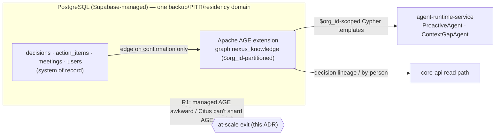
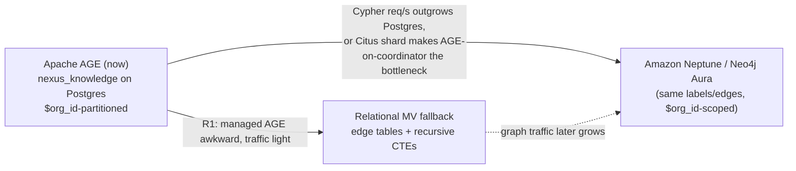
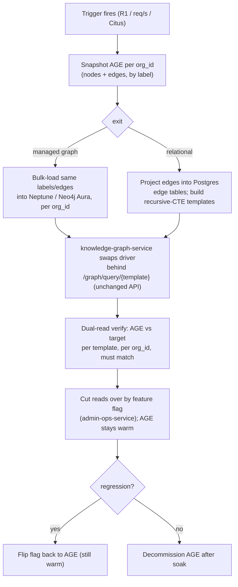

# ADR-0005: Graph store — Apache AGE now, Neptune/Neo4j migration path

This ADR records why NEXUS runs its `nexus_knowledge` graph on Apache AGE (Cypher over PostgreSQL) today, how it is org-partitioned for multi-tenant scale, and the two locked exits — Amazon Neptune / Neo4j Aura and a relational materialized-view fallback — that retire risk R1.

## Related documents

- [Data Architecture](../05-data-architecture.md) — §5 owns the physical AGE schema, indexing DDL, query budget, and migration mechanics this ADR decides.
- [Multi-Tenancy](../06-multi-tenancy.md) — pooled + RLS vs cell isolation, the `org_id` tenant key, and the org-partitioned graph posture.
- [Service Catalog](../04-service-catalog.md) — `knowledge-graph-service` ownership, sync API, and event contracts.
- [AI Agent Architecture](../08-ai-agent-architecture.md) — ProactiveAgent conflict detection and ContextGapAgent, the live consumers of graph queries.
- [Scalability & Performance](../13-scalability-and-performance.md) — the Postgres write-ceiling escalation order and why the graph follows a separate path under Citus.
- [Tech Decisions (canon)](../_canon/06-tech-decisions.md) — the locked `Graph store` and `Graph migration path` rows this ADR realizes.
- [Risk Register](../23-risk-register.md) — R1 (AGE on managed Supabase may be awkward).

---

## Status

**Accepted.** Supersedes nothing. Realizes the canon `Graph store` (`PDF→SaaS`) and `Graph migration path` (`SaaS-add`) rows in [Tech Decisions](../_canon/06-tech-decisions.md). Any future change of graph engine must supersede this ADR and update those rows.

---

## Context

### The PDF baseline

The NEXUS Execution Plan v2.1 locked the knowledge graph as **Apache AGE** (the Apache AGE extension giving Cypher over PostgreSQL), graph named **`nexus_knowledge`**, with five node labels — `Person`, `Meeting`, `Decision`, `Action`, `Topic` — and five edge labels — `ATTENDED`, `PRODUCED`, `ASSIGNED_TO`, `RELATES_TO`, `FOLLOWS_FROM`. It defined four pre-built Cypher templates as named functions: *related decisions for a topic*, *decisions by a person*, *actions blocked on a decision*, and *decision lineage*. Edges are created **on confirmation only** (Decision→Meeting `PRODUCED`, Action→Person `ASSIGNED_TO`), never speculatively, and soft delete is supported. The PDF already flagged the central concern as **R1**: *"Apache AGE on managed Supabase may be operationally awkward (fallback self-host Postgres+AGE or Neo4j Aura)."* The pre-authorized Phase-8 descope was *"Neo4j Aura if AGE awkward."*

These names and behaviors are frozen canon and are carried over **verbatim** in this ADR.

### Why the graph exists at all

The graph is not decoration — three product features query it on the hot path:

| Feature | Owner | Graph query |
| --- | --- | --- |
| Conflict detection | ProactiveAgent | decisions contradicting past decisions via the `FOLLOWS_FROM` lineage chain |
| Workload / missing-stakeholder | ProactiveAgent | open `Action` `ASSIGNED_TO` `Person`; org-graph traversal for stakeholders |
| Cross-meeting context fill | ContextGapAgent | related-meeting agents reached via `Person` `ATTENDED` `Meeting` + `RELATES_TO` `Topic` |
| Decision history / lineage UI | `core-api` read path | *decision lineage* and *decisions by a person* templates |

Two of these (ProactiveAgent conflict detection and ContextGapAgent fallback) run inside live meetings and must fit the end-to-end agent latency budget — **p50 < 2s, p95 < 4s** per [Scalability & Performance](../13-scalability-and-performance.md). The graph store choice is therefore latency-sensitive, not just a back-office analytics concern.

### The forces

1. **Co-location vs. a separate engine.** A standalone graph DB (Neptune/Neo4j) is the textbook choice for graph workloads, but it adds a sixth stateful store to operate, its own backup/PITR/residency story, and a network hop on the agent latency path. AGE keeps the graph *inside* the system-of-record Postgres — one backup domain, one PITR timeline, one residency boundary, transactional consistency with the `decisions`/`action_items` rows that source the edges.
2. **Multi-tenancy.** The PDF described **one global** `nexus_knowledge` graph. At SaaS scale — thousands of tenant orgs (A4 = 3,000) — a traversal must never cross a tenant boundary. The tenant key `org_id` must be enforced inside the graph, not only at the app layer.
3. **R1 operational risk.** AGE on managed Supabase is genuinely awkward: the extension lags Postgres major versions, managed providers gate `shared_preload_libraries`, and Cypher tooling is thinner than Neo4j's. We must commit to AGE *and* hold a credible exit so R1 cannot strand the product.
4. **Interaction with the relational sharding path.** [Scalability & Performance](../13-scalability-and-performance.md) and [Data Architecture §3.7](../05-data-architecture.md) lock the Postgres write-ceiling escalation as **pooling + read replicas → range partitioning → cells → Citus sharding by `org_id`**. AGE does **not** distribute under Citus; a sharded relational core would leave the graph stuck on the coordinator/reference node. That coupling is the principal trigger for the at-scale exit and must be designed in, not discovered later.
5. **Scale ceiling.** The confirmed graph is small relative to the rest of NEXUS: edges are written only on confirmation (E4 = ~3 decisions/meeting, E5 = ~5 actions/meeting at R4 = 4.8M meetings/month), not per transcript chunk. The graph is a *stock of confirmed facts*, not a high-volume flow — which is exactly why a Postgres-coupled graph is viable far longer than the chunk/vector tables are.



---

## Decision

**Run the `nexus_knowledge` graph on Apache AGE (Cypher over PostgreSQL), co-located in the Supabase-managed primary, owned by `knowledge-graph-service`. Org-partition it on `org_id`. Hold two pre-engineered exits — Amazon Neptune / Neo4j Aura, or a relational materialized-view fallback — both honoring R1.** The decision has five concrete commitments.

### D1 — AGE is the production graph store now, co-located in Postgres

The graph is the Apache AGE extension in the system-of-record Postgres, not a separate database. Node labels, edge labels, and the four named Cypher templates are carried over **verbatim** from the PDF:

| Node label | Backed by | Key properties |
| --- | --- | --- |
| `Person` | `users` | `user_id`, `org_id`, `role` |
| `Meeting` | `meetings` | `meeting_id`, `org_id`, `title` |
| `Decision` | `decisions` | `decision_id`, `org_id`, `status`, `confidence` |
| `Action` | `action_items` | `action_id`, `org_id`, `status` |
| `Topic` | role→topics taxonomy | `name`, `org_id` |

| Edge label | From → To | Created when |
| --- | --- | --- |
| `ATTENDED` | `Person` → `Meeting` | Participant joins a meeting |
| `PRODUCED` | `Decision` → `Meeting` (also `Action` → `Meeting`) | Decision/Action confirmed |
| `ASSIGNED_TO` | `Action` → `Person` | Action confirmed with assignee |
| `RELATES_TO` | `Decision`/`Action`/`Meeting` → `Topic` | Topic extraction links entity to taxonomy |
| `FOLLOWS_FROM` | `Decision` → `Decision` | Decision lineage / supersession |

Edges are created **on confirmation only** — matching the PDF agent-confirmation rule (no silent commits). The `decisions` and `actions` Redpanda topics are consumed by `knowledge-graph-service` and edges are written when, and only when, a user confirms the decision/action. Soft delete is honored via a `deleted_at` property; templates filter soft-deleted nodes/edges. The full physical DDL, per-label index strategy, and template SQL live in [Data Architecture §5](../05-data-architecture.md); this ADR does not duplicate them.

### D2 — Org-partition the graph on `org_id`

> [SaaS-scale adjustment] The PDF had one global `nexus_knowledge` graph with no tenant concept. We org-partition it: **every node carries an `org_id` property, and every pre-built Cypher template is parameterized with `$org_id`** so a traversal can never escape one tenant's subgraph. AGE materializes each label as a Postgres table, so we add a btree index on the `org_id` agtype property of every vertex and edge table to make the partition predicate index-backed (DDL in [Data Architecture §5.2](../05-data-architecture.md)). This is the graph-layer instance of the platform-wide rule from [Multi-Tenancy](../06-multi-tenancy.md): `org_id` is present on every tenant-scoped row, vector payload, **graph node**, event record, cache key, and object prefix.

Tenant scoping is defense-in-depth: the `$org_id` template parameter is the primary guard, and `knowledge-graph-service` rejects any ad-hoc Cypher submitted to `/graph/cypher` that does not bind `$org_id`. Cell-isolated enterprise tenants get the same org-partitioned graph inside their dedicated Postgres cell ([Multi-Tenancy §2](../06-multi-tenancy.md)); RLS-equivalent scoping stays on even inside a cell.

```cypher
-- Decision-lineage template, org-scoped (illustrative; canonical form in Data Architecture §5.2).
MATCH (d:Decision {org_id: $org_id})-[:FOLLOWS_FROM*1..10]->(prior:Decision {org_id: $org_id})
WHERE d.decision_id = $decision_id AND prior.deleted_at IS NULL
RETURN prior
```

### D3 — Bound every template so it fits the live agent latency budget

Templates are **bounded-depth** and **single-org** by construction (e.g. `FOLLOWS_FROM*1..10` over one tenant's confirmed-decision subgraph). Traversal cost is governed by one tenant's confirmed-decision count, not the global graph, so a noisy large tenant cannot blow the budget for everyone. `knowledge-graph-service` scales horizontally on Cypher query req/s with **read replicas**; graph queries backing ProactiveAgent and ContextGapAgent must return inside the agent end-to-end p50 < 2s budget ([Scalability & Performance](../13-scalability-and-performance.md)). The internal sync API is `POST /graph/query/{template}` and `POST /graph/cypher` (internal-only), per [Service Catalog](../04-service-catalog.md).

### D4 — Two pre-engineered exits, both honoring R1

The graph **schema** (5 node labels, 5 edge labels, 4 named templates) is store-agnostic by design — it is expressible in property-graph Cypher (Neptune openCypher / Neo4j Cypher) and in relational edge tables alike. Two exits are held ready:

| Exit | When chosen | What moves | What stays |
| --- | --- | --- | --- |
| **Amazon Neptune / Neo4j Aura** (managed graph) | Cypher query req/s outgrows a Postgres-coupled graph, **or** Citus sharding by `org_id` makes AGE-on-coordinator the bottleneck | The same labels/edges lift into a dedicated managed graph; `knowledge-graph-service` swaps its driver behind the same `/graph/query/{template}` API | `$org_id`-scoped templates, edge-on-confirmation rule, soft delete, the consuming agents |
| **Relational materialized-view fallback** | Graph traffic stays light and AGE itself proves operationally awkward on managed Supabase (R1 triggered early) | Edges become plain Postgres edge tables; the four templates are answered with recursive CTEs | Same data, same `org_id` scoping, predictable SQL; sacrifices arbitrary ad-hoc Cypher |



### D5 — Decouple the graph from the relational shard

Because AGE cannot be distributed by Citus, the locked escalation order — *pooling + read replicas → range partitioning → cells → Citus sharding by `org_id`* ([Scalability & Performance](../13-scalability-and-performance.md), [Data Architecture §3.7](../05-data-architecture.md)) — explicitly carves the graph out: when the relational core shards, the graph does **not** stay pinned to a single Citus coordinator/reference node. Reaching the Citus trigger is itself a primary signal to take the Neptune/Aura exit (D4). The graph and the relational core escalate on **separate** paths, by design.

---

## Consequences

### Positive

- **One backup, PITR, and residency domain.** The graph rides the Postgres backups + PITR + read-replica posture already locked in [Tech Decisions](../_canon/06-tech-decisions.md); no sixth stateful store, no separate DR runbook, no separate `data_residency` enforcement.
- **Transactional edge writes.** An edge is committed in the same Postgres transaction that confirms its `decisions`/`action_items` source row, so the graph never diverges from the confirmed relational truth — important because edges are the input to conflict detection.
- **Hard tenant isolation in the graph.** `$org_id` on every node + per-label index + template parameterization means a Cypher traversal is physically incapable of leaving one tenant's subgraph; cells add a second physical wall for enterprise tenants.
- **R1 is bounded, not open.** Two concrete exits are pre-engineered against the same store-agnostic schema; the descope path the PDF only named ("Neo4j Aura if AGE awkward") is now fully specified, including the Citus interaction.
- **The graph is the *cheap* store.** Edge-on-confirmation keeps the graph a small stock (~8 confirmed facts/meeting) rather than a flow; at ~$9,000/mo total managed Postgres ([Capacity Math §10](../_canon/05-capacity-math.md)), the graph adds negligible incremental cost versus a standalone Neptune/Neo4j cluster.

### Negative / accepted

- **AGE maturity and tooling gap (accepted).** AGE trails Neo4j on Cypher feature coverage, query planning, and ecosystem tooling. We accept this because our query surface is four pre-built, bounded-depth templates — not open-ended graph analytics — and the Neptune/Aura exit (D4) is held in reserve for the day richer Cypher is needed.
- **Managed-Supabase operational friction (accepted, watched).** R1 is real: extension/version gating on managed Postgres is the live risk. We accept it for the early stage and monitor it as a tracked trigger in [Risk Register](../23-risk-register.md); the relational MV fallback is the early-exit if friction blocks an upgrade.
- **Graph cannot ride Citus (accepted).** When the relational core shards by `org_id`, the graph must leave Postgres rather than shard with it (D5). We accept the eventual migration work because the trigger is well-understood and the schema is designed to lift cleanly.
- **Read-replica lag on the agent path (accepted, mitigated).** `knowledge-graph-service` reads scale on replicas; an edge confirmed milliseconds ago may not yet be on a replica. We accept brief staleness for live conflict detection because confirmed decisions are not created mid-utterance, so the async read-replica lag SLO (< 5s, per [Data Architecture §3.6](../05-data-architecture.md)) is tolerable for this read path; the replica read query itself returns well within the agent end-to-end p95 < 4s budget.

---

## Alternatives considered

| Alternative | Why not (now) |
| --- | --- |
| **Neo4j Aura / Amazon Neptune from day one** | Best-in-class graph engine, but adds a sixth stateful store with its own backup/PITR/residency/cost story and a network hop on the agent latency path — for a graph that is small and bounded by edge-on-confirmation. Kept as the **D4 at-scale exit**, not the starting point. The PDF itself deferred this to a fallback. |
| **No graph; recursive CTEs over relational edge tables only** | Viable for the four templates and is precisely our **relational MV fallback** (D4). Rejected as the *default* because it forecloses ad-hoc Cypher exploration (decision-influence analysis, multi-hop stakeholder discovery) that the product roadmap wants, and because `nexus_knowledge` is locked canon. Held as the low-novelty exit. |
| **Pure vector similarity for conflict detection (drop the graph)** | Qdrant `decisions__{org_id}` already supports semantic conflict detection ([Data Architecture §4](../05-data-architecture.md)), but it cannot express *lineage* (`FOLLOWS_FROM` supersession chains) or *structural* queries (actions blocked on a decision, org-hierarchy stakeholder traversal). Vector and graph are complementary, not substitutes — both are used, neither replaces the other. |
| **AGE on self-hosted Postgres instead of managed Supabase** | The PDF's other R1 fallback. Removes the managed-extension gating problem but trades it for owning Postgres ops, defeating the reason Supabase was chosen. Available as an intermediate stop if the MV fallback is insufficient but Neptune/Aura is not yet warranted; not the default. |
| **A second specialized graph engine alongside AGE (polyglot)** | Two graph stores doubles the isolation, residency, and RTBF surface for no near-term benefit. Rejected. |

---

## Migration / rollback notes

### Trigger conditions (when to leave AGE)

A migration off AGE is initiated when **any** of these fire (tracked in [Risk Register](../23-risk-register.md) R1):

1. Managed Supabase blocks an AGE/Postgres upgrade we need (R1 realized) → take the **relational MV fallback** if graph traffic is light, else **Neptune/Aura**.
2. Cypher query req/s on `knowledge-graph-service` saturates Postgres read replicas and threatens the agent p95 < 4s budget → **Neptune/Aura**.
3. The relational core reaches the **Citus sharding** stage (D5) → **Neptune/Aura**, because AGE-on-coordinator becomes the bottleneck.

### Migration mechanics (store-agnostic schema is the enabler)



- **API stability is the migration shield.** Consumers (ProactiveAgent, ContextGapAgent, `core-api` read path) call only `POST /graph/query/{template}` with `$org_id` bound; the engine swap happens **behind** that API. No agent or UI code changes on migration.
- **Per-tenant cutover.** Migration is per `org_id`, so cells migrate independently and a single tenant can be rolled forward or back without touching the pooled estate.
- **Rollback.** AGE is kept warm and dual-read-verified per template per `org_id` before reads cut over. Rollback is a feature-flag flip in `admin-ops-service` back to AGE; because edges are re-derivable from confirmed `decisions`/`action_items` rows (edge-on-confirmation, D1), the graph can also be **fully rebuilt** from the relational source of truth if a target store is abandoned — the graph is a projection, never the only copy of the data.
- **RTBF and residency carry over.** The cross-store right-to-be-forgotten saga ([Data Architecture §8.1](../05-data-architecture.md)) already deletes graph nodes/edges by `org_id`; the target engine plugs into the same Temporal deletion workflow step, and residency stays pinned via `data_residency` regardless of engine.

> [SaaS-scale adjustment] The PDF's R1 mitigation was a one-line fallback ("self-host Postgres+AGE or Neo4j Aura"). This ADR upgrades it to a fully specified, per-tenant, API-shielded, dual-read-verified migration with feature-flag rollback and a graph-rebuild-from-relational-truth safety net — required because at thousands of tenants a graph migration cannot be a big-bang event.
