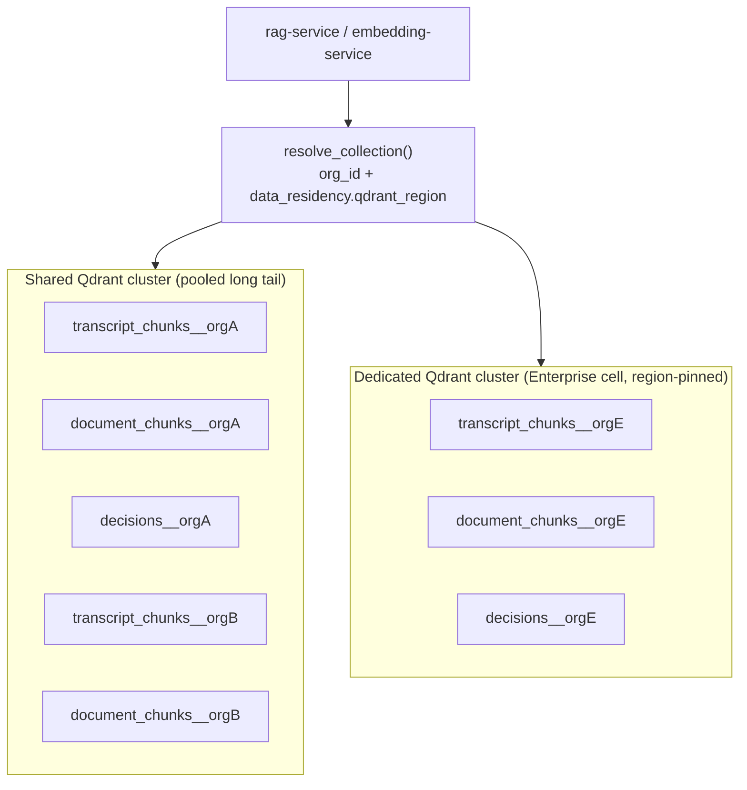
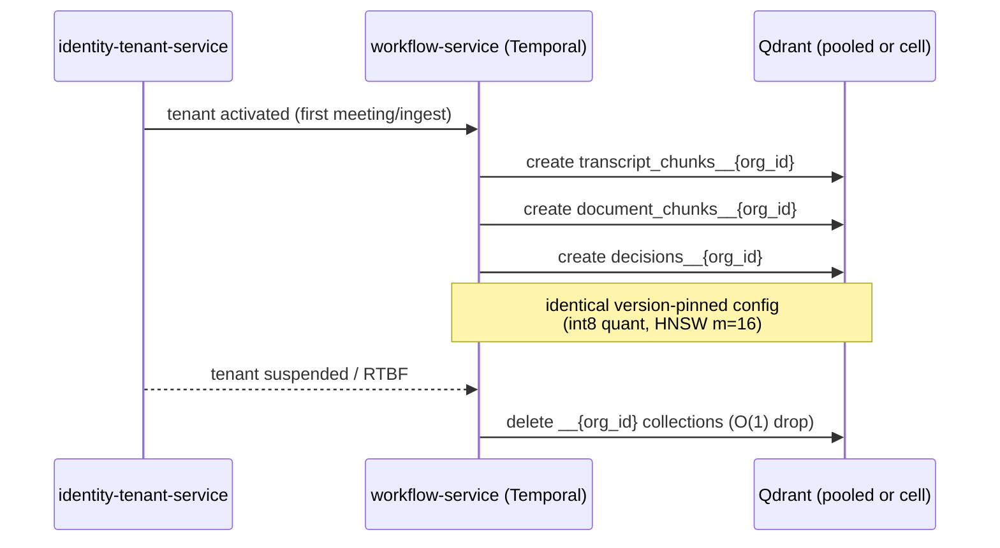
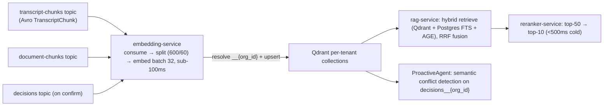

# ADR-0006: Vector store tenancy — per-tenant Qdrant collections

Locks how NEXUS isolates embeddings in Qdrant across thousands of paying tenant organizations: a physical per-tenant collection (`transcript_chunks__{org_id}`, `document_chunks__{org_id}`, `decisions__{org_id}`) plus a mandatory `org_id` payload filter on every query.

## Related documents

- [Data Architecture](../05-data-architecture.md) — §4 Qdrant store selection, quantization, hot/cold split, RTBF.
- [Multi-Tenancy](../06-multi-tenancy.md) — §3.2 vector isolation, tenant context propagation, cell vs pooled.
- [RAG and Inference Serving](../09-rag-and-inference-serving.md) — embedding-service, reranker-service, hybrid retrieval, citations.
- [Capacity & Scaling Math](../_canon/05-capacity-math.md) — V5–V9 vector flow/stock, A16/A18 anchors.
- [Data Model (canon)](../_canon/02-data-model.md) — §3 Qdrant collections, payload citation contract.
- [Tech & Architecture Decisions (canon)](../_canon/06-tech-decisions.md) — §2.2 vector isolation, §2.3 Qdrant, §2.5 inference.
- [Service Catalog (canon)](../_canon/01-service-catalog.md) — `embedding-service`, `rag-service`, `knowledge-graph-service`, `search-service`.
- [Compliance and Privacy](../12-compliance-and-privacy.md) — right-to-be-forgotten, data residency.

---

## Status

**Accepted.** Supersedes nothing. This ADR formalizes the `Vector isolation` row locked in [Tech Decisions §2.2](../_canon/06-tech-decisions.md) (`Per-tenant Qdrant collections`, Origin: `SaaS-add`) and the physical naming frozen in [Data Model §3](../_canon/02-data-model.md). It does not introduce a new name; it justifies and operationalizes the locked one.

---

## Context

### The PDF baseline

The NEXUS Execution Plan v2.1 specified a **single shared Qdrant Cloud store**: 384-dim BGE-small-en vectors via ONNX runtime, three logical groupings (`transcript_chunks`, `document_chunks`, `decisions`), embedded on ingest by an embedding consumer (`consume → split → embed batch 32 → upsert`). The seeder was `2 orgs x 10 users x 5 meetings`. At that scale, one collection with an `org_id` payload field is entirely adequate, and the PDF — which had no tenancy concept at all — correctly did not over-engineer it.

> [SaaS-scale adjustment] The PDF treated Qdrant as one shared store with no tenant boundary. The target is now a production multi-tenant SaaS: **5M registered users, 3,000 paying tenant organizations, 4.42B live vectors / ~17 TB indexed** ([Capacity §5, V7/V9](../_canon/05-capacity-math.md)). At that scale a single shared collection with payload-only filtering is both an isolation risk (one missed filter leaks another tenant's meeting transcripts) and an operational liability (no per-tenant drop, no per-tenant residency, no per-tenant capacity control). This ADR resolves the tenancy boundary.

### Forces

The decision sits at the intersection of five forces that pull in different directions:

| Force | Pressure | Why it matters |
| --- | --- | --- |
| **Isolation / blast radius** | Toward hard physical separation | Vectors carry verbatim transcript text in their payload (`speaker`, `meeting_id`, `chunk_id`). A cross-tenant leak is a confidentiality breach and a GDPR/SOC2 incident, not a cosmetic bug. |
| **Right-to-be-forgotten** | Toward per-tenant addressability | RTBF must delete a tenant's entire vector footprint deterministically and fast ([Compliance §RTBF](../12-compliance-and-privacy.md)). A `delete-by-filter` over a 4.42B-vector shared collection is slow and leaves tombstones; dropping a per-tenant collection is O(1). Note: because vectors now live in per-tenant `__{org_id}` collections, RTBF under this ADR drops those collections — the "delete points by `org_id` filter" wording in canon ([Data Model §7](../_canon/02-data-model.md), [Data Architecture](../05-data-architecture.md)) describes the legacy single-collection shape and the in-collection >13-month retention purge, not the RTBF path here (see Consequences › Positive). |
| **Data residency** | Toward per-tenant placement | `data_residency.qdrant_region` (`us`/`eu`/`ap`) pins a tenant's vectors to a region ([Data Model §2.2](../_canon/02-data-model.md)). A shared global collection cannot honor per-tenant region pinning. |
| **Collection-count overhead** | **Against** unbounded collection-per-tenant | Every Qdrant collection carries fixed segment, HNSW-graph, and RAM overhead. Naively minting a collection per *every* registered org (5M users / 3,000 paying orgs, plus trials and Free signups) would create hundreds of thousands of tiny collections and exhaust segment memory. This is the counter-force that prevents "one Qdrant instance per tenant." |
| **Cost / RAM** | Toward quantization + hot/cold | 4.42B vectors at raw float32 = ~6.8 TB ([Capacity V8](../_canon/05-capacity-math.md)); ~17 TB indexed (V9). Resident RAM must be cut ~4× to be affordable. |

### What is already locked (and constrains this ADR)

- **Hybrid tenancy model** ([Tech Decisions §2.2](../_canon/06-tech-decisions.md)): pooled + Postgres RLS for the long tail; cell-based isolation for large/enterprise tenants. The vector boundary must align to those two classes, not invent a third.
- **Per-tenant Qdrant collections** is the locked `Vector isolation` decision; this ADR cannot pick a different boundary, only specify and defend it.
- **Embed-on-ingest, query-embed only**, on the dedicated `embedding-service` (GPU / Ray Serve / vLLM, off the API tier) — [Tech Decisions §2.5](../_canon/06-tech-decisions.md), [RAG and Inference Serving](../09-rag-and-inference-serving.md).
- **Frozen citation payload contract** ([Data Model §3](../_canon/02-data-model.md)): transcripts carry `meeting_id` + `chunk_id` + `speaker`; documents carry `document_id` + `element_id`. Tenancy must not change the payload shape.
- **Authz middleware injects `org_id`** on every query ([Multi-Tenancy §tenant context](../06-multi-tenancy.md)). The resolved `org_id` is the only input to collection-name resolution — there is no client-supplied collection name.

---

## Decision

**Each tenant gets its own physical Qdrant collection per logical collection, named by appending `__{org_id}` to the logical name, AND every query additionally carries a mandatory `org_id` payload filter. Isolation is defense-in-depth at the collection boundary and at the payload boundary.**

### 1. Naming and resolution

The logical collection names are exactly `transcript_chunks`, `document_chunks`, and `decisions` (verbatim from the PDF). The physical collection appends `__{org_id}`:

| Logical collection | Physical (pooled tenant) | Payload (citation-bearing, frozen) | Source |
| --- | --- | --- | --- |
| `transcript_chunks` | `transcript_chunks__{org_id}` | `org_id`, `meeting_id`, `chunk_id`, `speaker`, `start_ms`, `is_final` | `transcript-chunks` topic → `embedding-service` |
| `document_chunks` | `document_chunks__{org_id}` | `org_id`, `document_id`, `element_id`, `element_type`, `meeting_id?` | `document-chunks` topic → `embedding-service` |
| `decisions` | `decisions__{org_id}` | `org_id`, `decision_id`, `meeting_id`, `status`, `confidence` | `decisions` topic on confirmation |

`org_id` is a UUID; rendered into the collection name it uses the hyphenless 32-char hex form to keep names within Qdrant's identifier constraints — e.g. `transcript_chunks__9f8c2a1b4e7d4f0a8c3b1d6e5a204f77`. This is purely a **rendering of the frozen `{org_id}` token**, not a new name: canon ([Data Model §3](../_canon/02-data-model.md)) freezes the physical name as `transcript_chunks__{org_id}`, and `transcript_chunks__{org_id}` and `transcript_chunks__9f8c…4f77` denote the same canonical collection — the hex is simply how the `{org_id}` UUID is serialized into a valid identifier. The mapping is deterministic and one-way (UUID → hex); no reverse lookup is needed because the caller always already holds the `org_id`. (Operator/ops attribution of a physical collection back to a tenant — see Consequences › Positive — uses the `org_id` payload/metric tag, never name-reversal.)

The **physical collection name is never client-supplied.** The `rag-service` and the transport adapter resolve logical → physical from the middleware-injected `org_id` plus `data_residency.qdrant_region`:

```python
# Single resolution chokepoint. org_id comes from the Clerk-verified JWT via authz
# middleware; it is NEVER taken from the request body or a query param.
def resolve_collection(logical: str, org_id: UUID, residency: DataResidency) -> CollectionRef:
    physical = f"{logical}__{org_id.hex}"          # physical isolation
    cluster  = qdrant_cluster_for(residency)        # region + pooled-vs-cell routing
    return CollectionRef(cluster=cluster, name=physical)

# Every query is org-scoped TWICE: by collection AND by payload filter.
ref = resolve_collection("transcript_chunks", ctx.org_id, residency)
client_for(ref.cluster).search(
    collection_name=ref.name,                       # 1) physical boundary
    query_filter=Filter(must=[                      # 2) payload backstop
        FieldCondition(key="org_id", match=MatchValue(value=str(ctx.org_id)))
    ]),
    query_vector=query_embedding,
    limit=50,                                        # top-50 → reranker-service → top-10
)
```

The `org_id` payload filter is not redundant theater: it is the backstop that holds even if a future routing change, a cell-migration cutover, or an operator mistake places more than one tenant's points in the same physical collection. **A query can only return points whose payload `org_id` matches the caller's `org_id`, regardless of collection.**

### 2. Mapping to the locked tenancy classes

The vector boundary aligns 1:1 with the two locked tenancy postures — it does not invent a third:

| Tenancy posture | Who | Qdrant placement | Collection shape |
| --- | --- | --- | --- |
| **Pooled + RLS** | Free / Pro (the long tail — the vast majority of the 3,000 orgs) | Per-tenant **collection** inside a **shared** Qdrant cluster | `transcript_chunks__{org_id}`, `document_chunks__{org_id}`, `decisions__{org_id}` |
| **Cell-based** | Enterprise (and any tenant by contract) | Per-tenant **collection** inside a **dedicated** Qdrant cluster | Same names; physically isolated cluster pinned by `data_residency.db_cell` / `qdrant_region` |



> [SaaS-scale adjustment] The pooled-vs-cell split for Qdrant is wholly added vs the PDF. Pooled tenants share a cluster but never a collection; cell-isolated tenants get a dedicated cluster. The boundary is the same `__{org_id}` collection in both cases, so the application code path is identical — only the cluster handle differs, resolved from `data_residency`.

### 3. Collection lifecycle is bound to tenant lifecycle, not to first write

To control the collection-count force, collections are **created at tenant provisioning, not lazily on first vector upsert**, and **only for tenants that have crossed an activation threshold**:

- **Provisioned-but-idle / Free-trial-not-started tenants do NOT get collections.** A tenant gets its three collections created by the `identity-tenant-service` provisioning workflow only once it has at least one completed meeting or document ingest. This keeps the live collection count proportional to *active* paying/usage tenants (~3,000 paying orgs × 3 = ~9,000 collections in steady state), not to all 5M registered accounts.
- **Suspended / churned tenants’ collections are dropped** by the deprovisioning workflow after the contractual retention window, freeing segment RAM.
- **Per-collection config is identical and version-pinned** (below), applied at creation, so there is no per-tenant config drift.



### 4. Per-collection physical configuration (locked, identical for every tenant)

Sized verbatim from [Capacity §5](../_canon/05-capacity-math.md) (V7 = 4.42B vectors, V8 ~6.8 TB raw, V9 ~17 TB indexed). int8 scalar quantization cuts resident RAM ~4×; original float32 vectors live on disk and are used only for rescoring.

```jsonc
// Applied at collection creation for every tenant (pooled and cell).
{
  "vectors": { "size": 384, "distance": "Cosine" },        // A16: BGE-small-en, cosine
  "quantization_config": {
    "scalar": { "type": "int8", "always_ram": true }        // ~4x resident-RAM cut
  },
  "hnsw_config": { "m": 16, "ef_construct": 128, "on_disk": false },
  "optimizers_config": { "memmap_threshold": 50000 },       // cold/large segments mmap originals
  "on_disk_payload": true                                    // payload off the RAM-resident path
}
```

**Hot/cold split aligned to A18 (13-month hot retention):** the most recent ~90 days stay in fully-optimized segments; older-but-in-window points move to memmap-heavy cold segments; beyond 13 months they are deleted in lockstep with the Postgres cold tier and object-store archive ([Data Architecture §retention](../05-data-architecture.md)). See [Data Architecture §4.3](../05-data-architecture.md) for the same config block as the store-level source of truth.

### 5. Ingest and query paths are unchanged in shape

The locked pipeline is preserved verbatim — only the target collection is now per-tenant:



The `embedding-service` reads `org_id` from the Avro message envelope (every topic is tenant-partitioned per [Event Architecture](../07-event-architecture.md)) and routes the upsert through `resolve_collection()`. Query-embed-only at read time keeps the GPU tier off the API path.

---

## Consequences

### Positive

- **Hard physical isolation.** No cross-tenant vector leakage is possible at query time even if a collection name is mis-resolved, because the `org_id` payload filter is a second independent gate. Two failures must coincide to leak — collection mis-resolution *and* a missing payload filter — and the payload filter is enforced in the single `resolve_collection()`/search wrapper, not scattered across call sites.
- **O(1) right-to-be-forgotten.** A tenant's entire vector footprint is removed by dropping its three `__{org_id}` collections — the RTBF fast path invoked by the cross-store Temporal deletion saga ([Data Architecture §RTBF](../05-data-architecture.md), [Multi-Tenancy §RTBF](../06-multi-tenancy.md)). No 4.42B-vector `delete-by-filter` scan, no tombstone backlog. Reconciliation with canon: the frozen [Data Model §7](../_canon/02-data-model.md) RTBF diagram and [Data Architecture](../05-data-architecture.md) label the Qdrant step "delete points by `org_id` filter" — that wording describes the **legacy single-shared-collection shape** and the in-collection **>13-month retention-window point purge** (Decision §4 hot/cold split; Alternatives, the "point purge inside the per-tenant collection" row). Under this ADR, because each tenant's vectors are in their own `__{org_id}` collections, RTBF is the **collection drop** (O(1)); per-point `delete-by-filter` remains the mechanism only for retention purges *inside* a live collection, not for RTBF. The two deletion paths are deliberately distinct, not contradictory.
- **Per-tenant data residency.** `data_residency.qdrant_region` pins each tenant's cluster; resolution honors region without any cross-region shared collection.
- **Clean per-tenant capacity & cost attribution.** Collection-level metrics (point count, segment RAM, query latency) map directly to a tenant, feeding usage metering and noisy-neighbor detection ([Cost and FinOps](../17-cost-and-finops.md)). Attribution does **not** require reversing the hex collection name back to a UUID (the rendering is one-way); metrics are tagged with the `org_id` at emission — the same `org_id` carried in every point's payload — so the tenant label travels with the metric.
- **Cell migration is mechanical.** Promoting a pooled tenant to a cell is a per-collection snapshot-and-restore from the shared cluster to a dedicated one, keyed on `__{org_id}` — no re-cut of any payload schema.

### Negative / costs we accept

- **Collection-count overhead is real and must be governed.** ~9,000 collections (3,000 active paying orgs × 3) in the pooled cluster carry fixed segment + HNSW + RAM overhead per collection. We accept this and bound it by (a) creating collections only at tenant *activation*, not at signup; (b) dropping collections on suspension/RTBF; (c) sharding the pooled long tail across multiple Qdrant clusters so no single cluster holds an unsustainable collection count. We explicitly do **not** mint a collection per registered account.
- **Small-tenant inefficiency.** A Free tenant with a handful of meetings has three nearly-empty collections, each paying minimum segment overhead. Accepted: int8 quantization, `on_disk_payload`, and memmap keep the per-collection floor low, and Free-tier usage is quota-capped via the metering pipeline ([SaaS Business Architecture](../18-saas-business-architecture.md)).
- **No cross-tenant analytics in Qdrant.** Aggregate vector analytics across tenants would require iterating collections. Accepted — cross-tenant analytics is an internal-ops concern served from the metering/warehouse path, never from the live vector store.
- **Provisioning/deprovisioning coupling.** Collection lifecycle is now a step in the tenant lifecycle workflow (`workflow-service`). Accepted: it is one durable Temporal activity with idempotent create/drop, and a reconciliation job detects orphaned or missing collections against `organizations`.

---

## Alternatives considered

| Alternative | What it is | Why not |
| --- | --- | --- |
| **Single shared collection + `org_id` payload filter only** | One global `transcript_chunks` collection; isolate purely by a `must` filter on `org_id` (Qdrant's documented single-collection multitenancy with a payload index on `org_id`). | A single missed/forged filter leaks verbatim transcript text across tenants — one bug from a breach, no defense-in-depth. RTBF becomes a slow `delete-by-filter` over 4.42B vectors with tombstones. No per-tenant region pinning. Loses per-tenant capacity attribution. Rejected on isolation, RTBF, and residency grounds even though it has the lowest collection count. |
| **One Qdrant instance/cluster per tenant** | Every tenant — including Free — gets a dedicated Qdrant deployment. | Operationally and financially absurd for the pooled long tail (thousands of clusters for tiny tenants); contradicts the locked pooled+RLS model, which shares infrastructure for the long tail. We *do* use dedicated clusters — but only for cell-isolated Enterprise tenants, not as the universal boundary. Rejected for pooled tenants. |
| **Named vectors / partition-by-payload within shared collection (`is_tenant` index)** | Qdrant's tenant-optimized single-collection mode: one collection, an indexed `org_id` payload key marked as the tenant partition so the HNSW graph is segment-partitioned by tenant. | Better than naive payload-only (segment locality, faster filtered search), but still one collection: RTBF is delete-by-filter, residency cannot be per-tenant, and a routing bug can still surface another tenant's points if the filter is dropped. Closer to acceptable than alternative 1, but fails the hard-isolation and per-tenant-residency requirements. Rejected as the primary boundary; its *filtering discipline* is retained as our payload-filter backstop. |
| **Collection per (tenant × time-window)** | e.g. `transcript_chunks__{org_id}__{YYYY_MM}` to make retention a collection drop. | Multiplies collection count by the retention window (13×), worsening the count force we already fight; retention is already handled by the hot/cold segment split + point purge inside the per-tenant collection. Rejected as over-partitioning. |
| **A different vector DB with native multitenancy (e.g. namespaces)** | Switch off Qdrant to a store with first-class per-tenant namespaces. | Qdrant Cloud is locked ([Tech Decisions §2.3](../_canon/06-tech-decisions.md)); per-tenant collections give us equivalent isolation. Re-evaluating the vector DB is out of scope for a tenancy ADR and would reopen a locked decision without cause. |

---

## Migration and rollback notes

### Forward migration (from the PDF single-collection shape)

The PDF/dev shape is a single shared collection. Migration to per-tenant collections is a one-time backfill:

1. **Provision** `__{org_id}` collections (version-pinned config) for every *active* tenant via the `workflow-service` provisioning activity.
2. **Backfill**: scroll the legacy shared collection by `org_id` payload filter and re-upsert into the matching `__{org_id}` collection. The payload shape is unchanged (frozen citation contract), so points copy verbatim — no re-embedding required. Embedding is expensive; we move vectors, we do not regenerate them.
3. **Cutover** reads in `rag-service` and `ProactiveAgent` to `resolve_collection()` behind a feature flag, per tenant, validating recall parity against the legacy collection.
4. **Drop** the legacy shared collection once all active tenants are cut over and verified.

The dev/test environment (the seeder: `2 orgs x 10 users x 5 meetings`) runs the same code path with two `__{org_id}` collections, so the path is exercised continuously, not only at production migration time.

### Rollback

Because step 2 is a copy (not a move) and the citation payload is identical, the legacy shared collection can be retained read-only during cutover. Rollback for a tenant is flipping its feature flag back to the legacy collection; rollback for the platform is leaving the legacy collection authoritative and dropping the per-tenant ones. No data is lost in either direction because backfill never deletes the source until step 4.

### Cell promotion (pooled → dedicated cluster)

Promoting a tenant to a cell does not change collection names. It is a `__{org_id}`-keyed snapshot from the shared cluster + restore into the dedicated cluster, then repoint `data_residency.qdrant_region` (under the `data_residency` immutability/migration rules) so `resolve_collection()` routes to the new cluster. The application layer is unaware of the move beyond the cluster handle.

---

## Cross-store consistency note

This ADR governs only the vector boundary. The same tenant `org_id` keys every other store — Postgres RLS/cell, AGE `$org_id` on `nexus_knowledge`, tenant-keyed Redpanda partitions, namespaced Redis (`nexus:{org_id}:…`), and object-storage key prefixes ([Multi-Tenancy](../06-multi-tenancy.md), [Data Model §7](../_canon/02-data-model.md)). Qdrant's `__{org_id}` collection is the vector layer of that single, uniform tenant-isolation scheme, and its drop is one branch of the single cross-store RTBF Temporal saga.
