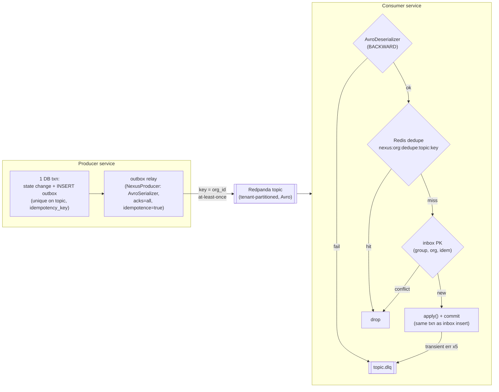
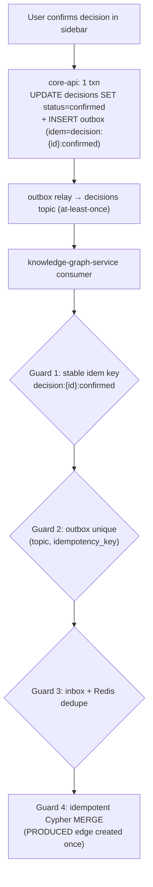

# ADR-0007: Event delivery — Avro + Schema Registry + outbox/inbox + idempotency

This ADR locks NEXUS event-delivery semantics at **at-least-once with idempotency keys**, made *exactly-once in effect* by a transactional **outbox** on every producer, an **inbox** + Redis dedupe cache on every consumer, **DLQs** per topic, and **Avro + Schema Registry** with `{topic}-value` subjects and **BACKWARD** compatibility.

## Related documents

- [Event-Driven Architecture](../07-event-architecture.md) — the full machinery this ADR decides (envelope, partitions, outbox/inbox code, DLQ envelope, duplicate-decisions guards).
- [Service Catalog](../_canon/01-service-catalog.md) — service names, producer/consumer map, idempotency-and-delivery note.
- [Canonical Data Model](../_canon/02-data-model.md) — `usage_events.idempotency_key`, the `nexus:{org_id}:dedupe:*` Redis namespace, table names.
- [Capacity & Scaling Math](../_canon/05-capacity-math.md) — the event volume/throughput/SLO numbers cited here verbatim.
- [Locked Tech & Architecture Decisions](../_canon/06-tech-decisions.md) — the locked event-streaming decision rows (§2.4).
- [Data Architecture](../05-data-architecture.md) — store selection, partitioning, retention enforcement.
- [Multi-Tenancy](../06-multi-tenancy.md) — tenant partition keys, RLS, cell isolation.
- [AI Agent Architecture](../08-ai-agent-architecture.md) — the six agents, the confirmation rule, A2A collaboration.
- [Reliability & DR](../14-reliability-and-dr.md) — failure modes, replay, RPO/RTO.
- [Observability & SRE](../15-observability-and-sre.md) — consumer-lag dashboards, DLQ alerting.
- [Risk Register](../23-risk-register.md) — R3 (event-streaming provider/cost), R6 (multi-agent collaboration).

---

## Status

**Accepted.** Supersedes nothing; this is the first ADR to formalize the delivery contract. It freezes the rows under [Tech Decisions §2.4](../_canon/06-tech-decisions.md) ("Event streaming, serialization & delivery") and is the decision record behind [Event-Driven Architecture](../07-event-architecture.md), which carries the implementation detail. Any change to delivery semantics, subject naming, or compatibility mode must supersede this ADR.

---

## Context

### The PDF baseline

The NEXUS Execution Plan v2.1 specified the bus components but not the *guarantees*:

- **Redpanda Serverless** (Kafka API compatible), 30-day trial, with the canonical topics `transcript-chunks`, `document-chunks`, `agent-results`, `decisions`, `actions`, `notifications`, `agent-requests`, `agent-responses`, `agent-stream`.
- **Apache Avro + Redpanda Schema Registry**, one subject per topic named `{topic}-value`, **BACKWARD** compatibility.
- A **producer utility** (`confluent-kafka-python` + `AvroSerializer`, schema-validated, rejects unregistered/incompatible payloads) and a **base consumer class** (`AvroDeserializer`, offset-commit semantics, a retry policy).
- **Consumer-lag monitoring + alerts.**

What the PDF did *not* define, because it was a 4-person team building a modular monolith where producing and consuming were in-process function calls: any statement of delivery semantics (at-most-once vs at-least-once vs exactly-once), any deduplication, any transactional coupling between a DB write and the event it implies, any dead-letter handling, and any tenant partitioning. In a monolith, "emit `decisions` on confirmation" is a synchronous call inside the same database transaction — there is no network, no redelivery, no duplicate.

### The forces at SaaS scale

The locked SaaS posture makes the bus the **integration contract** between independently deployed, independently scaled services (see the three scaling families in [Service Catalog §4](../_canon/01-service-catalog.md)). At that point the in-process assumption breaks against hard numbers:

| Force | Number | Source |
|---|---|---|
| Events per month | **~11.58B** | [Capacity §6, E10](../_canon/05-capacity-math.md) |
| Events per second (peak) | **~17,900** | [Capacity §6, E12](../_canon/05-capacity-math.md) |
| `transcript_chunks` per month | **1,728,000,000** | [Capacity §4, T3](../_canon/05-capacity-math.md) |
| `usage_events` (billing) per month | metered, billable | [Data Model §2.2](../_canon/02-data-model.md) |
| Tenants sharing the bus | **3,000** paying orgs | [Capacity §2, A4](../_canon/05-capacity-math.md) |
| Required duplicate-delivery rate (post-dedupe) | **~0** | [Capacity §11.3](../_canon/05-capacity-math.md) |
| Required DLQ rate | **< 0.1%** of events | [Capacity §11.3](../_canon/05-capacity-math.md) |

Five forces dictate the decision:

1. **Networks retry; offset commits are at-least-once.** A consumer that commits offsets after processing will reprocess on a crash/rebalance; a consumer that commits before will lose work on a crash. Kafka/Redpanda offer no free exactly-once across heterogeneous sinks (Postgres, Qdrant, Apache AGE `nexus_knowledge`, Redis, external tickets). The honest guarantee is **at-least-once**; exactly-once must be *constructed* at the application layer.
2. **A duplicate is not benign.** A redelivered `decisions` event would create a second `decisions` row, a second `PRODUCED` edge in `nexus_knowledge`, and a duplicate notification. The graph is the source of truth for the **ProactiveAgent**'s conflict detection — a decision could appear to "contradict" its own duplicate. This is the single most damaging duplicate in the system.
3. **A DB write and the event it implies must be atomic.** "Write the row, then publish" is a lost-update / phantom-publish bug: a crash between the two either loses an event or publishes a fact that rolled back. Billing (`usage_events` → invoices) and the knowledge graph cannot tolerate either.
4. **One poison message must not wedge a partition.** At ~17.9k events/sec a single un-deserializable or business-invalid payload that blocks its partition stalls every tenant whose key hashes to it. Failures must be quarantined, not retried forever.
5. **~20 services upgrade independently.** Schema evolution cannot be a flag day. A producer must never emit a shape that a lagging consumer cannot read.

> [SaaS-scale adjustment] The PDF's implicit in-process "consume → process" (effectively at-most-once-ish, no dedupe, no outbox, no DLQ, no tenant partitioning) is replaced by an explicit at-least-once + idempotency contract. The components (Redpanda, Avro, Schema Registry, `{topic}-value`, BACKWARD, the producer utility, the base consumer, lag monitoring) are carried over verbatim; the *delivery guarantee* and the machinery that enforces it are added because the bus is now a network boundary between scaling tiers, not a function call.

---

## Decision

NEXUS event delivery is **at-least-once with idempotency keys, exactly-once in effect**. The decision has six locked parts; the implementation of each lives in [Event-Driven Architecture](../07-event-architecture.md) and is summarized here as the authoritative choices.

### 1. Delivery semantics: at-least-once + idempotency keys

Every arrow on the bus is **at-least-once**. Exactly-once *in effect* is achieved by making every consumer idempotent against a business **idempotency key** carried in the Avro envelope header. We do **not** rely on Kafka transactions / EOS read-process-write, because our sinks are heterogeneous (Postgres, Qdrant, AGE, Redis, external SaaS) and EOS only spans Kafka-to-Kafka.

### 2. Serialization & schema governance: Avro + Schema Registry, `{topic}-value`, BACKWARD

- **Avro** values, **Redpanda Schema Registry**, one subject per topic named exactly `{topic}-value`, **BACKWARD** compatibility — carried over verbatim from the PDF.
- A **shared envelope header** prefixes every topic's payload: `event_id`, `idempotency_key`, `org_id`, `correlation_id`, `causation_id`, `schema_version`, `producer`, `occurred_at`. (Header detail: [Event-Driven Architecture §3.1](../07-event-architecture.md).) `idempotency_key` is the dedupe key (stable across producer retries of the *same* logical fact); `event_id` is unique per emitted message.
- **Evolution discipline:** schema changes are **append-only with defaults**. A **CI compatibility gate** runs `check-compatibility (BACKWARD)` against the Registry on every PR that touches a schema; a non-defaulted required field fails the build.

> [SaaS-scale adjustment] The shared envelope header and the CI BACKWARD-compatibility gate are added vs the PDF, which defined per-topic schemas (`TranscriptChunk`, `AgentResult`, `Decision`, `Action`, `Notification`, `AgentRequest`, `AgentResponse`) but no shared header and no enforced evolution gate. The Avro subjects, `{topic}-value` naming, and BACKWARD mode are unchanged.

### 3. Producer side: transactional outbox + relay

A producer **never** does "write DB, then publish" as two steps. The state change and an **outbox** row commit in **one** Postgres transaction; a separate **relay** worker publishes unpublished outbox rows to Redpanda and marks them published.

- Outbox carries a unique index `(topic, idempotency_key)` — a double-confirm (double-click, retried request) cannot enqueue the same fact twice.
- The relay is the **only** caller of the sanctioned producer (`NexusProducer`: `confluent-kafka-python` + `AvroSerializer`, `acks=all`, `enable.idempotence=true`, keyed by `org_id`). No service hand-rolls a Kafka client or produces inline from a request handler.
- A relay crash after `produce()` but before `mark_published` re-publishes on restart — that is the at-least-once duplicate the consumer absorbs.

> Producer reconciliation: [Tech Decisions §2.4](../_canon/06-tech-decisions.md) names the `decisions`/`actions` primary producer as `DecisionAgent` / `ActionAgent` (on confirm); that should be read as "originates the candidate." The agent emits a confidence-scored *candidate* on `agent-results`; `core-api` writes the `decisions` / `action_items` row and publishes the confirmed `decisions` / `actions` event via its transactional outbox ([Service Catalog §3](../_canon/01-service-catalog.md)). The agent tier proposes, `core-api` commits — so "no silent commits" holds. (Mirrors [AI Agent Architecture §2 producer-reconciliation note](../08-ai-agent-architecture.md).)

### 4. Consumer side: inbox + Redis dedupe, commit-after-effect

Every consumer is idempotent against the envelope `idempotency_key` via two layers:

- **Redis dedupe cache** — fast first-line reject, key `nexus:{org_id}:dedupe:{topic}:{idempotency_key}`, **24h TTL** (the canonical namespace from [Data Model §5](../_canon/02-data-model.md)).
- **Durable inbox table** — authoritative, PK `(consumer_group, org_id, idempotency_key)`, survives cache eviction.

The inbox insert and the business effect commit in the **same transaction**, and the offset is committed **only after** the effect (`enable.auto.commit=false`). A crash after the effect but before marking processed cannot double-apply: the unique inbox key absorbs the redelivery. Each downstream consumer (`knowledge-graph-service`, `notification-service`, `core-api` read-model updater) is a **separate consumer group**, so each applies a fact exactly once independently.

### 5. Tenant partitioning on every topic

Every topic is **partitioned by `org_id`** (the locked tenant partition key — [Tech Decisions §2.4](../_canon/06-tech-decisions.md), [Multi-Tenancy](../06-multi-tenancy.md)). This gives per-tenant ordering, per-tenant replay, and noisy-neighbor isolation: a runaway tenant's lag is contained to its partitions and cannot starve others. The dedupe namespace, inbox PK, and DLQ envelope all carry `org_id` so isolation holds end-to-end.

### 6. DLQ + bounded retry per topic

Consumer failures split two ways:

- **Transient** (downstream timeout/5xx/lock): retry in place with bounded exponential backoff `max_attempts=5, base_ms=200, factor=2.0, jitter` (`200 → 400 → 800 → 1600 → 3200ms`), offset **not** advanced.
- **Poison** (deserialize failure, schema-incompatible, business-invalid, max-retries exceeded): publish a replayable `DlqEnvelope` (original bytes base64 + failure class + `org_id` + `idempotency_key`) to the per-topic `<topic>.dlq` (14-day retention), advance the offset, keep the partition moving. (`DlqEnvelope` is a net-new Avro record defined in [Event-Driven Architecture §7](../07-event-architecture.md), not one of the seven frozen-canon Avro schema names.)

DLQ **replay** is an `admin-ops-service` operation that re-produces with the **original `idempotency_key`**, so the consumer's dedupe/inbox decides whether the message is genuinely new — replaying an already-applied poison message is safe (it dedupes out). SLO target: **DLQ rate < 0.1%** ([Capacity §11.3](../_canon/05-capacity-math.md)).

### The duplicate-decisions guarantee (the load-bearing case)

The most damaging duplicate gets **four independent guards**, any one sufficient:

1. **Stable key** `decision:{decision_id}:confirmed` — derived from the immutable `decisions.id` and the terminal `confirmed` state, never from `event_id`/timestamp/retry counter. Every redelivery carries the identical key.
2. **Outbox unique index** — the fact is enqueued exactly once per confirmation; only *transport* can duplicate it.
3. **Inbox + dedupe** — transport duplicates are absorbed per consumer group.
4. **Idempotent graph writes** — the Cypher template uses `MERGE`, not `CREATE`, so the canonical `PRODUCED` edge (`Decision → Meeting`) and `ASSIGNED_TO` edge (`Action → Person`) in `nexus_knowledge` are created at most once. Edges are created **only on confirmation** (the PDF rule), now also duplicate-proof.

This preserves the PDF "no silent commits" rule: `core-api` writes the `decisions`/`actions` row and the outbox record in one transaction **only after** the user confirms; the agent merely surfaces a candidate via `agent-results`. (Full detail: [Event-Driven Architecture §9](../07-event-architecture.md).)

---

## Consequences

### Positive

- **Exactly-once in effect** across a heterogeneous sink set without paying for, or being limited by, Kafka EOS. The knowledge graph stays clean, billing (`usage_events`) never double-counts, and notifications never duplicate — the duplicate-delivery SLO of **~0 post-dedupe** is met.
- **Atomic publish.** The transactional outbox makes "DB row and event both commit, or neither" true under crashes — eliminating phantom publishes and lost events.
- **No partition wedging.** Bounded retry + per-topic DLQ keep a poison message at SaaS volume from stalling a tenant's partition; the 14-day DLQ window plus idempotency-preserving replay make recovery routine, not forensic.
- **Independent service evolution.** BACKWARD + the CI gate + append-only/default-only fields let ~20 services upgrade on their own cadence; a lagging consumer can always read a newer producer's payload.
- **Tenant isolation end-to-end.** `org_id` partitioning + namespaced dedupe + `org_id` in the inbox PK and DLQ envelope mean a noisy tenant's lag, retries, and poison messages are contained.
- **One mechanism, two jobs.** The same windowing/pre-gate knobs that control the R4 LLM cost spiral also serve as the backpressure lever (see [Event-Driven Architecture §10](../07-event-architecture.md)) — cost control and load-shedding are one control surface.

### Negative / costs we accept

- **Idempotent consumers are mandatory, not optional.** Every `apply()` must tolerate redelivery. This is a real engineering tax on every consumer author; we accept it as the price of at-least-once honesty. The `BaseConsumer` makes it the default path so the tax is paid once.
- **Outbox write amplification + relay latency.** Every produced event costs an extra Postgres row write and a poll-relay hop (single-digit ms typical). At T3 = 1.73B `transcript_chunks`/month this is non-trivial write volume; we accept it and mitigate via batched relay produces and outbox-row pruning after publish.
- **Inbox/dedupe storage.** A durable inbox row per `(consumer_group, org_id, idempotency_key)` plus a 24h Redis key per event. We accept this and bound it: inbox rows are partition-pruned on the same retention cadence as the source topic; Redis keys self-expire at 24h (the practical redelivery window), with the inbox table as the unbounded authority.
- **No global ordering.** Ordering is per-partition (per-tenant) only. Cross-tenant or cross-topic global order is not provided and not needed; consumers that require causal order use `causation_id`/`correlation_id`, not arrival order.
- **At-least-once means transient over-delivery is normal.** Dashboards will show non-zero dedupe-cache hits; that is health, not error. The *post-dedupe* duplicate rate is the SLO, and it is ~0.
- **DLQ requires human triage.** A growing DLQ is an operational signal that needs an on-call response within the 14-day window; we accept the runbook burden and alert at the 0.1% threshold.

### What we explicitly accept

- We accept **at-least-once**, not broker-level exactly-once, as the transport guarantee. Application-layer idempotency is the contract.
- We accept that **producer-level idempotence** (`enable.idempotence=true`, `acks=all`) only dedupes within a single relay session; across-restart duplicates are covered by the outbox unique index and the consumer inbox — not by the broker.
- We accept the **outbox relay as a per-service component** (library + worker) rather than adopting a CDC tool (see Alternatives) for the first production iteration.

---

## Alternatives considered

| Alternative | Why not |
|---|---|
| **Kafka/Redpanda transactions + EOS (read-process-write)** | EOS guarantees exactly-once only for Kafka-to-Kafka topologies. NEXUS sinks are Postgres, Qdrant, Apache AGE `nexus_knowledge`, Redis, and external SaaS (Jira/Linear/Slack). EOS cannot make a graph `MERGE` or a Stripe call transactional with the offset commit, so it would give false confidence while still requiring app-layer idempotency for the non-Kafka sinks. We adopt the idempotency we'd need anyway and skip the EOS complexity/throughput tax. |
| **At-most-once (commit offset before processing)** | Cheapest and simplest, but silently drops events on any crash/rebalance. Unacceptable for `decisions`, `actions`, and `usage_events` (billing) — a dropped billing event is lost revenue; a dropped confirmed decision corrupts the record of truth. |
| **Naive at-least-once with no dedupe** | Meets durability but fails the **~0 duplicate** SLO: duplicate `PRODUCED` edges, double notifications, double-billed `usage_events`. The whole point of this ADR is that at-least-once *without* idempotency is the bug. |
| **"Write DB, then publish" (no outbox)** | Two non-atomic steps. A crash between them loses the event or publishes a rolled-back fact. The transactional outbox is the standard fix and is required for the atomicity force above. |
| **CDC (Debezium/Postgres logical decoding) instead of an app-level outbox** | Strong option and a viable future migration (see below): it removes the relay write-amplification and tails the WAL directly. We defer it because (a) it couples event shape to table shape unless an outbox table is *still* used as the CDC source, (b) it adds a Kafka Connect/Debezium operational surface before it is justified, and (c) the explicit outbox keeps the `idempotency_key` and Avro envelope construction in application code where the business rules live. The outbox table is deliberately CDC-shaped so this migration is mechanical later. |
| **JSON Schema or Protobuf instead of Avro** | The PDF locked Avro + Schema Registry with BACKWARD compatibility, and the canonical schema names (`TranscriptChunk`, `AgentResult`, `Decision`, `Action`, `Notification`, `AgentRequest`, `AgentResponse`) are frozen. Avro's compact binary + Registry-managed BACKWARD evolution fit the ~13.9 TB/month ingress and the independent-upgrade force. No reason to break the lock. |
| **FORWARD or FULL compatibility instead of BACKWARD** | BACKWARD (new consumer reads old data) matches our rollout reality: consumers are upgraded after producers, and a new consumer schema must read in-flight data written by the previous producer. BACKWARD is the PDF lock and the right mode; FULL would over-constrain field removal without operational benefit here. |
| **Per-meeting partition key (`{org_id}:{meeting_id}`)** | Tempting for hot-tenant fan-out, but it weakens per-tenant ordering and complicates per-tenant replay/rate-control. It is *proposed but not ratified* ([Event-Driven Architecture §4.1/§11](../07-event-architecture.md)); the locked key is `org_id`. Revisit only if a single tenant's partition becomes a proven hotspot. |
| **A separate message broker for the AI/inference tier** | Splitting buses (e.g. a second cluster for `agent-stream`) was considered to isolate the high-count throwaway stream. Rejected: one tenant-partitioned cluster with per-topic retention (`agent-stream` at 1h, durable facts longer) and value-tiered backpressure achieves the isolation without a second operational surface. |

---

## Migration / rollback notes

### Provider migration (honors R3)

The bus runs on **Redpanda** (Kafka API). Because we use the **Kafka API + Avro + Schema Registry**, migration to Confluent / Aiven / Upstash / self-hosted Redpanda is mechanical: re-point `bootstrap.servers` and `schema.registry.url`, re-register subjects, mirror topics. The PDF's R3 fallback (self-host the open-source Redpanda binary) remains valid. At production volume (~17.9k events/sec peak, ~13.9 TB/month) the trial is replaced by a **BYOC/dedicated multi-AZ cluster** ([Capacity §6/§10](../_canon/05-capacity-math.md), [Risk Register R3](../23-risk-register.md)).

> [SaaS-scale adjustment] The PDF ran on the Redpanda Serverless 30-day trial with no partition counts, retentions, or DLQ topics. Production locks a dedicated multi-AZ cluster with per-topic partition counts/retention and one `<topic>.dlq` per topic; the Kafka-API + Avro contract keeps the provider swap mechanical.

### Rolling out the delivery guarantee

The modular monolith ships first (Railway/Render), where many "events" are still in-process calls at the seams. The outbox/inbox machinery is introduced **at extraction time**, in the split order from [Service Catalog §7](../_canon/01-service-catalog.md):

1. Wave-1 GPU/real-time/worker services (`embedding-service`, `agent-runtime-service`, `transcription-service`, `realtime-gateway`, `workflow-service`) cross the network boundary first and adopt outbox/inbox on day one of extraction.
2. The `decisions`/`actions` path (`core-api` → `knowledge-graph-service`) adopts the four-guard duplicate fix the moment those consumers run out-of-process.
3. New SaaS topics (`usage-events`, `tenant-events`, `billing-events`, etc.) are at-least-once + idempotent from inception.

### Schema rollback

A bad-but-BACKWARD-compatible schema change is rolled back by registering the prior subject version and redeploying producers; lagging consumers are unaffected by design. A change that *should never have passed* the CI gate is impossible to deploy because the gate fails the PR before merge.

### Consumer rollback

Because consumers are idempotent and commit offsets only after the effect, a consumer can be rolled back to a prior version and **replayed from an earlier offset** safely: the inbox/dedupe absorbs anything already applied. This is also the recovery path after a DLQ-replay or a backlog burst — replay is always safe, which is the property that lets the AI/inference tier and the graph tier scale apart while the durable record stays correct.

### Rollback of the decision itself

This ADR is foundational; rolling it back (e.g. to at-most-once) is not a config change but a re-architecture and must come via a superseding ADR that re-justifies dropping the duplicate-delivery and billing-correctness guarantees. No code path is built that depends on at-most-once semantics, so there is no hidden coupling to unwind — but there is also no cheap reverse gear, and that is intentional.
