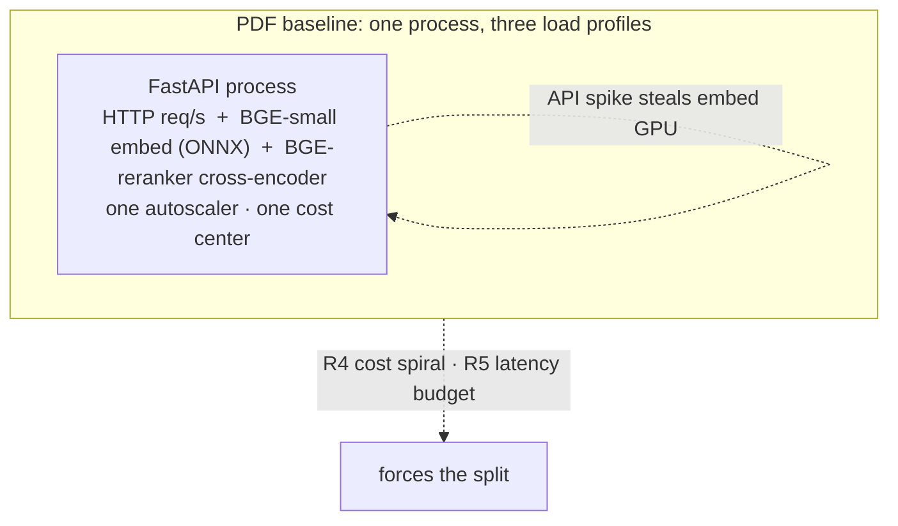
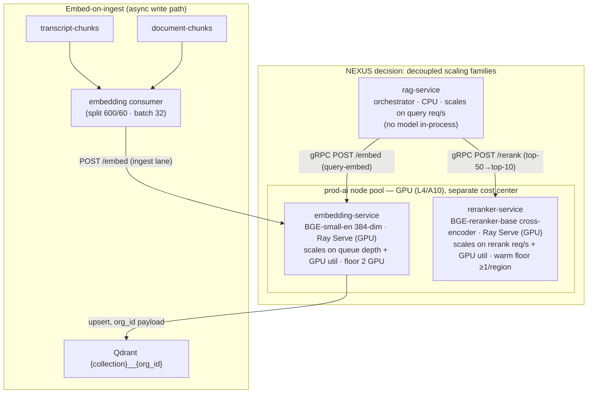
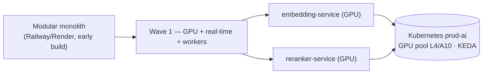

# ADR-0008: Dedicated autoscaling inference services for embeddings and reranking

This record locks the decision to run NEXUS's BGE-small-en embedding model and BGE-reranker-base cross-encoder as dedicated, GPU-backed, autoscaling services (`embedding-service`, `reranker-service`) completely off the API tier, and explains the forces, consequences, alternatives, and migration/rollback path.

## Related documents

- [RAG Pipeline & Inference Serving](../09-rag-and-inference-serving.md) — the design this ADR governs: `RAGService`, `embedding-service`, `reranker-service`, the embed-on-ingest / query-embed-only call patterns, warm-pool floor.
- [AI / Agent Architecture & LLM Pipeline](../08-ai-agent-architecture.md) — the *agent* LLM pipeline (pre-gating, windowed batching, tiered routing) that is a sibling, not a subject, of this ADR.
- [Container Architecture](../03-container-architecture.md) — the internal gRPC mesh `rag-service` uses to reach the model servers.
- [Deployment & Infrastructure](../16-deployment-and-infrastructure.md) — GPU node pools (L4/A10, `g6.xlarge`), KEDA autoscalers, canary rollout, replica floors, split order.
- [Service Catalog](../_canon/01-service-catalog.md) — canonical ownership and scaling families for `embedding-service`, `reranker-service`, `rag-service`.
- [Canonical Data Model](../_canon/02-data-model.md) — Qdrant per-tenant collections, the citation contract, the query-embed Redis namespace.
- [Capacity & Scaling Math](../_canon/05-capacity-math.md) — frozen anchors `EM2`, `EM3`, `EM4`, `V6`, `V7` and the SLO table imported here by reference, never re-derived.
- [Locked Tech & Architecture Decisions](../_canon/06-tech-decisions.md) — Concern keys *Inference placement*, *Inference runtime*, *Reranker*, *Inference/CRUD separation*, *Embedding model*.

---

## Status

**Accepted.** Locked. This ADR is the authority behind the [Tech Decisions](../_canon/06-tech-decisions.md) §2.5 rows *Inference placement* (`PDF→SaaS`) and *Inference runtime* (`SaaS-add`). It leaves `Accepted` only via a superseding ADR.

---

## Context

### The PDF baseline

The NEXUS Execution Plan v2.1 specified the inference components but not their placement. It ran the embedding model **BGE-small-en, 384-dim, "via ONNX runtime"** inside the FastAPI service, and described the **BGE-reranker-base** cross-encoder as a step inside the `RAGService` pipeline (`expand → retrieve → rerank → assemble → cite`) — implicitly on the same API process. For a 4-person team building an MVP against a `2 orgs × 10 users × 5 meetings` seeder, co-locating model inference with request serving is the correct, simplest choice: one deployable, one autoscaler, no mesh hop.

The models, their dimensions, and their contracts are carried over verbatim and are **not** what this ADR changes:

| Carried over from PDF (unchanged) | Value |
|---|---|
| Embedding model | `BGE-small-en`, **384-dim**, cosine |
| Embedding pattern | embed-on-ingest, query-embed only |
| Ingest batch | **32**, sub-100 ms per batch |
| Reranker model | `BGE-reranker-base` cross-encoder |
| Rerank shape | top-50 → top-10 |
| RAG pipeline shape | `expand → retrieve → rerank → assemble → cite` |

### The forcing functions at SaaS scale

At the production anchors in [Capacity & Scaling Math](../_canon/05-capacity-math.md) the in-process placement breaks, because a single FastAPI process is forced to absorb **three load profiles that share none of their scaling math**:

| Load profile on the coupled process | Driven by | Cost driver | Autoscaler signal |
|---|---|---|---|
| HTTP request serving (CRUD + `POST /api/rag/query`) | user/req traffic | CPU + Postgres connections | HTTP req/s, p95 latency |
| Embedding **at ingest** (write path) | meeting + document volume | GPU | queue depth / GPU utilization |
| Cross-encoder rerank **at query time** | RAG/agent read traffic | GPU | rerank req/s + GPU utilization |

The capacity numbers make the coupling untenable. Imported by reference (do **not** re-derive — [Capacity §5, §9](../_canon/05-capacity-math.md)):

| Symbol | Quantity | Value |
|---|---|---|
| `EM2` | Embeddings/sec, peak (ingest) | **~525** |
| `EM3` | Peak batches/sec (batch 32) | **~16.4** |
| `EM4` | Query embeddings/sec, peak | **~700** |
| `V6` | Vectors ingested/month (flow) | **340,000,000** |
| `V7` | Qdrant live stock (13-mo retention) | **4,420,000,000 (~17 TB)** |

A meeting-volume ingest backlog (`EM2 ≈ 525/s`) would throttle API request serving, and an API/RAG traffic spike (`EM4 ≈ 700/s`, larger than ingest) would steal GPU cycles from embedding. This is the mechanical root of the two PDF risks the canon already flags: **R4** (LLM cost spiral — inference cost cannot be isolated, budgeted, or attributed per tenant if it rides the CRUD process) and **R5** (the agent end-to-end p50 < 2 s / p95 < 4 s and RAG warm p95 < 500 ms budgets are unmeetable if a rerank cold-start competes with CRUD CPU). The bi-encoder and cross-encoder also have opposite cost profiles — the bi-encoder precomputes document vectors once at ingest and the query is cheap; the cross-encoder runs a full forward pass per `(query, passage)` pair (~50× the per-pair work) and cannot be precomputed — so they cannot share one autoscaler signal even if both stayed in one process.

The forces in one list:
- **Different scaling families.** API serving scales on req/s; inference scales on GPU utilization + queue depth ([Service Catalog §4](../_canon/01-service-catalog.md)). One autoscaler cannot serve both.
- **Different cost centers.** GPU is the dominant variable cost; it must be sized, budgeted, and billed independently to make the per-tenant token budgets and the C2 ≈ $9.73/MAU model in [Capacity §10](../_canon/05-capacity-math.md) meaningful.
- **Different latency postures.** The reranker needs a *warm GPU floor* to hold its p95; the API tier must not be forced GPU-backed to provide it.
- **Locked model contract.** BGE-small-en 384-dim and BGE-reranker-base are locked ([Tech Decisions §2.5](../_canon/06-tech-decisions.md)), so the decision space is *where and how to run them*, not *which models*.

---

## Decision

**Run BGE-small-en and BGE-reranker-base as two dedicated, stateless, GPU-backed, independently autoscaled services — `embedding-service` and `reranker-service` — in the AI/inference scaling family, completely off the API tier.** `rag-service` remains a CPU-bound orchestrator with **no model in-process** and reaches both model servers over the internal gRPC mesh.

This is precise on the following points, each consistent with the locked canon:

1. **Two services, not one.** `embedding-service` (bi-encoder) and `reranker-service` (cross-encoder) are separate deployments with separate autoscalers, because their cost and scaling profiles are opposite (see [RAG & Inference §5.1](../09-rag-and-inference-serving.md)). Neither owns a Postgres table; `embedding-service` writes Qdrant vectors and answers query-embed, `reranker-service` is pure compute.

2. **Runtime.** Both run on **Ray Serve** on GPU. BGE-small-en uses Ray Serve dynamic micro-batching (the right tool for a small 384-dim bi-encoder); **vLLM is reserved for larger LLM serving paths**, not the BGE models ([RAG & Inference §4.3](../09-rag-and-inference-serving.md)). Weights are baked into a CUDA runtime image at build time so a pod start is a *load*, not a *fetch* ([Deployment §3.1](../16-deployment-and-infrastructure.md)).

3. **Two and only two embedding call patterns**, locked verbatim from the PDF: **embed-on-ingest** (the embedding consumer reads `transcript-chunks` / `document-chunks`, splits with LangChain 600/60, embeds at **batch 32 sub-100 ms**, upserts to per-tenant Qdrant `{collection}__{org_id}`) and **query-embed only** (`POST /embed`, internal, 1–3 query variants). The two lanes share the model but get **separate Ray Serve deployments** so a query-embed burst never starves the ingest lane.

4. **Reranker contract.** `POST /rerank` takes the top-50 RRF candidates and returns the top-10 by joint `(query, passage)` cross-encoder relevance. It runs a **minimum warm replica floor of ≥ 1 per active region** and never scales to zero during business hours.

5. **Autoscaler signals (KEDA).** `embedding-service` scales on **embed queue depth + GPU utilization**; `reranker-service` scales on **rerank req/s + GPU utilization**. Both sit in the `prod-ai` node pool on a GPU shape (**L4/A10, e.g. `g6.xlarge`**) with a **2-GPU replica floor** each ([Deployment §2.3, §4.1](../16-deployment-and-infrastructure.md)).

6. **Cost center.** The AI/inference tier is a distinct cost center that scales and bills independently of CRUD traffic — the precondition for per-tenant token budgets, usage metering, and the cost/MAU model.

7. **Tenant isolation is unchanged by the split.** Embed-on-ingest writes carry the `org_id` payload into per-tenant Qdrant collections; query-embed and rerank are stateless and operate only on passages `rag-service` already scoped to one `org_id`. The model servers never widen the tenant boundary.

> [SaaS-scale adjustment] The *placement* — moving inference off the API tier — is `PDF→SaaS` ([Tech Decisions §2.5](../_canon/06-tech-decisions.md), Concern *Inference placement*): the PDF chose the models and the embed-on-ingest pattern; SaaS scale extends that by physically separating execution from request serving. The model contract (BGE-small-en 384-dim, BGE-reranker-base, batch 32 sub-100 ms, top-50→top-10) is **unchanged and not a SaaS addition**.

> [SaaS-scale adjustment] The **GPU / Ray Serve runtime, the KEDA autoscalers on GPU utilization + queue depth, the dedicated per-tier cost center, the reranker warm-replica floor, and the cold/warm SLO split** are wholly added for SaaS scale (`SaaS-add`, Concern *Inference runtime* and *Inference/CRUD separation*). The PDF ran BGE-small via ONNX on the API service with no GPU, no warm floor, and a single "< 500 ms cold" reranker number — workable for the seeder, not at `EM2 ≈ 525/s` ingest + `EM4 ≈ 700/s` query.

---

## Consequences

### Positive

- **Independent scaling.** Ingest surges (meeting volume) consume embedding GPU without touching API p95; API/RAG spikes don't steal embedding GPU. Each family rides its own KEDA signal under the `A10 = 4:1` peak:average surge budget ([Deployment §2.3](../16-deployment-and-infrastructure.md)).
- **Independent, attributable cost.** GPU is isolated to `prod-ai` node pools, so the GPU cost center is sized, budgeted, and billed apart from CRUD — making the per-tenant token budgets and the `C2 ≈ $9.73/MAU` figure ([Capacity §10](../_canon/05-capacity-math.md)) computable and enforceable. This is a direct mitigation of **R4**.
- **Latency budget held cheaply.** The reranker holds a warm GPU floor for **warm p95 < 500 ms** without forcing the entire API fleet to be GPU-backed; the read path stays inside the RAG warm budget because the heavy embedding flow (`V6 = 340M/mo`) is on the async write path. Direct mitigation of **R5**.
- **Right tool per model.** Bi-encoder gets Ray Serve micro-batching; cross-encoder gets a warm-floored GPU deployment. Opposite cost profiles get opposite autoscalers.
- **Swappable behind a contract.** `rag-service` only knows `POST /embed` and `POST /rerank` over gRPC, so the model server implementation, GPU shape, or runtime can change without touching the orchestrator.

### Negative / costs we accept

- **More moving parts.** Two extra deployments, a GPU node pool, KEDA scalers, and an internal mesh hop versus one in-process call. We accept the operational surface in exchange for the scaling and cost isolation; early-stage builds still ship these as modules in the modular monolith ([Service Catalog §7](../_canon/01-service-catalog.md)).
- **A network hop on the warm RAG path.** `rag-service → reranker-service` is now gRPC, not a function call. We accept it; it is inside the < 500 ms warm budget and the gRPC mesh is intra-cluster ([Container Architecture §4.1](../03-container-architecture.md)).
- **A warm GPU floor costs money at idle.** `reranker-service` holds ≥ 1 warm replica/region (and a 2-GPU floor) even at low traffic, because a scaled-to-zero cross-encoder would routinely miss the warm SLO. We accept paying for the floor; **cold p95 < 1.5 s** bounds only the worst case (a region waking up), not steady state.
- **GPU is capacity-constrained, so rollouts are canary.** A blue-green swap that doubles the GPU fleet is uneconomical, so GPU/AI services roll out **canary 5% → 25% → 50% → 100%** with SLO-gated auto-abort ([Deployment §7.1](../16-deployment-and-infrastructure.md)). We accept slower, gated GPU rollouts.

### Neutral / explicitly out of scope

- This ADR does **not** change the *agent* LLM pipeline (relevance pre-gating, windowed batching, tiered Haiku/Sonnet/Opus routing). That is a sibling decision owned by [AI / Agent Architecture](../08-ai-agent-architecture.md). The one overlap — RAG query expansion is a small LiteLLM call — is governed there.
- This ADR does **not** change Qdrant quantization or retention; int8 scalar quantization keeping `V7 ≈ 17 TB` affordable is owned by [Data Architecture](../05-data-architecture.md) / the data tier.

---

## Alternatives considered

| Alternative | Why not |
|---|---|
| **Keep inference in-process on the API tier** (PDF baseline) | Couples three incompatible load profiles on one autoscaler and one cost center; ingest backlog throttles API serving and API spikes steal embed GPU. This is the direct mechanism behind R4 (no isolated/attributable inference cost) and R5 (rerank cold-start competes with CRUD CPU). Correct for the seeder, fails at `EM2/EM4` scale. |
| **Managed embedding / rerank APIs** (e.g. OpenAI embeddings, Cohere Rerank) | (a) The embedding model is **locked to BGE-small-en 384-dim** and the reranker to BGE-reranker-base ([Tech Decisions §2.5](../_canon/06-tech-decisions.md)) — a managed API changes the model and the 384-dim Qdrant contract. (b) Per-call pricing at `V6 = 340M vectors/month` ingest plus `EM4 ≈ 700/s` query is far costlier than amortized owned GPU. (c) Sending every transcript/document chunk to a third party adds a subprocessor, DPA, and data-residency surface we deliberately bound; embeddings stay in-region on owned GPU. |
| **Serverless GPU** (Modal / Replicate / SageMaker Serverless Inference) | Cold-start latency is fundamentally at odds with the reranker **warm p95 < 500 ms** SLO — a scale-to-zero cross-encoder routinely misses it. At sustained `EM2 ≈ 525/s` and `EM4 ≈ 700/s` the service is effectively always-on, so serverless pricing loses to a provisioned floor while *adding* cold-start risk. We provision a warm floor on `prod-ai` instead. |
| **One combined inference service hosting both models** | Bi-encoder and cross-encoder have **opposite cost and scaling profiles** ([RAG & Inference §5.1](../09-rag-and-inference-serving.md)): embedding precomputes once at ingest and scales on queue depth; rerank is ~50× per-pair work, scales on query req/s, and is the only one needing a warm floor. One deployment would force one autoscaler signal and one floor policy onto two services that need different ones, partly recreating the coupling we are removing. |
| **vLLM (or TGI) for everything, including BGE** | vLLM is optimized for autoregressive LLM decode, not small bi-encoder embedding throughput; Ray Serve dynamic micro-batching is the right tool for the 384-dim BGE-small-en bi-encoder and is the locked runtime for it. **vLLM is reserved for the larger LLM serving paths** ([RAG & Inference §4.3](../09-rag-and-inference-serving.md)). Using vLLM for BGE adds complexity without throughput benefit. |
| **CPU-only inference off the API tier** (split, but no GPU) | Splitting the service fixes the cost-center and autoscaler coupling but not the latency posture: CPU cross-encoder rerank over 50 candidates cannot reliably hold warm p95 < 500 ms, and CPU embedding at `EM2 ≈ 525/s` needs far more replicas than a small GPU pool. GPU is the cost-effective way to hold both the embed-batch sub-100 ms and rerank-warm < 500 ms budgets. |

---

## Migration and rollback notes

### Build-stage path (modular monolith → services)

`embedding-service` and `reranker-service` are **Wave 1 "always separate"** services — they split out of the modular monolith first, *before* CRUD core, because their runtime (GPU) and scaling signal (queue depth / GPU util) differ from day one and Railway/Render cannot offer GPU pools or KEDA-on-queue-depth ([Service Catalog §7](../_canon/01-service-catalog.md), [Deployment §11 split order](../16-deployment-and-infrastructure.md)). The seams are real from the first commit even while the early build deploys them co-located.

### Cutover

1. Stand up `embedding-service` and `reranker-service` in `prod-ai` with 2-GPU floors; bake BGE-small-en and BGE-reranker-base weights into the CUDA image (no fetch at pod start).
2. Point the embedding consumer and `rag-service` at `POST /embed` / `POST /rerank` over the gRPC mesh. The Qdrant 384-dim vector contract and the citation payload are unchanged, so **no re-embedding of existing vectors is required** — the move is placement-only.
3. Canary the GPU services 5% → 25% → 50% → 100%, auto-aborting on the frozen SLOs (RAG warm p95 < 500 ms, embed batch < 100 ms, rerank warm p95 < 500 ms / cold < 1.5 s) per [Deployment §7.1, §7.3](../16-deployment-and-infrastructure.md).

### Rollback

The rollback seam is the **stable internal contract**: `rag-service` and the embedding consumer only ever speak `POST /embed` and `POST /rerank`. To roll back, repoint those clients at an in-process model adapter (the PDF baseline) — no schema, topic, Qdrant, or citation change is needed. Because the contract is identical, rollback is a routing change, not a data migration. The locked **graph/vector/topic names and the 384-dim embedding contract are invariant across the split**, so neither direction touches stored data.

> [SaaS-scale adjustment] The canary-not-blue-green GPU rollout and the SLO-gated auto-abort are SaaS-scale operational additions ([Deployment §7](../16-deployment-and-infrastructure.md)); the PDF had no GPU fleet and no differentiated rollout strategy.
