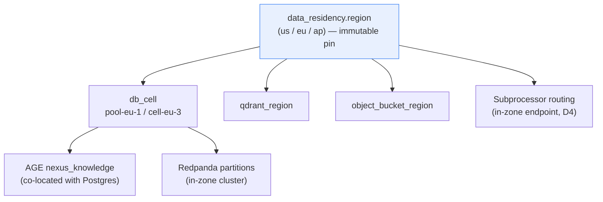
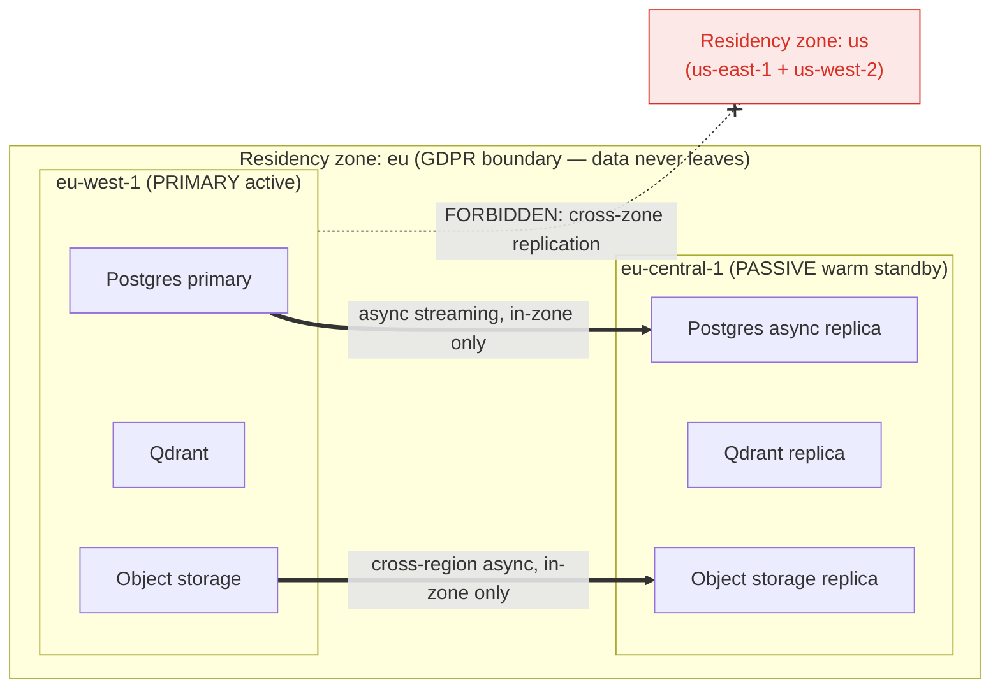

# ADR-0009: Data residency and multi-region topology

Records the decision to pin every tenant's data to one of three immutable **residency zones** (`us` / `eu` / `ap`) and to run the multi-region active-passive → active-active topology **entirely within a tenant's zone**, so that disaster-recovery replication can never become a residency violation.

## Related documents

- [Multi-Tenancy & Tenant Isolation](../06-multi-tenancy.md) — pooled+RLS / cells, `org_id` injection, the per-layer isolation this ADR pins to a region.
- [Data Architecture](../05-data-architecture.md) — `data_residency` routing, the tenant router (§3.7), read replicas (§3.6), object-storage region pinning (§7).
- [Reliability & Disaster Recovery](../14-reliability-and-dr.md) — the failover mechanics, RPO/RTO ladder, and per-store DR matrix this ADR governs but does not restate.
- [Compliance & Privacy](../12-compliance-and-privacy.md) — the legal framing of residency, subprocessor DPAs/SCCs, and cross-border transfer that this ADR's topology must satisfy.
- [Canonical Data Model](../_canon/02-data-model.md) — the frozen `data_residency` row (`region`, `db_cell`, `qdrant_region`, `object_bucket_region`, `locked_at`) and the `nexus-*` buckets.
- [Capacity & Scaling Math](../_canon/05-capacity-math.md) — frozen anchors (A4 tenants) and the per-plan availability/RPO/RTO SLOs (§11.2) this ADR ties topology to.
- [Tech & Architecture Decisions](../_canon/06-tech-decisions.md) — the locked `Region strategy` (§2.1) and `Compliance` residency clause (§2.11) this ADR is the authoritative record for.
- [ADR-0002: Multi-tenancy model](0002-multi-tenancy-model.md) — the pooled/cell postures and `data_residency` immutability this ADR extends to the region axis.
- [ADR-0003: Meeting transport — LiveKit](0003-meeting-sdk-livekit.md) — the LiveKit SFU and Deepgram audio path whose regional placement this ADR governs.

---

## Status

**Accepted.** This ADR is the authoritative record for the `Region strategy` row in [Tech Decisions §2.1](../_canon/06-tech-decisions.md) ("multi-region active-passive, evolving to active-active") and for the **data-residency / regional-placement clause** of the `Compliance` row in [Tech Decisions §2.11](../_canon/06-tech-decisions.md). It **does not** re-decide the tenancy postures (pooled+RLS / cells) or the `data_residency` immutability rule — those are owned by [ADR-0002](0002-multi-tenancy-model.md) and cross-referenced here. Any change to residency zones or the regional topology must supersede this ADR.

---

## Context

### The forces

NEXUS serves **A4 = 3,000 paying tenant organizations** across regulated jurisdictions ([Capacity §2](../_canon/05-capacity-math.md)), and its most sensitive payload is verbatim human conversation — `transcript_chunks`, the `worklogs` derived from them, and `chat_messages` ([Compliance §2](../12-compliance-and-privacy.md), class C4). Four forces pull on where that data physically sits:

1. **Residency law demands a single, provable home region.** GDPR/CCPA and customer contracts require an EU tenant's content to stay in the EU and a US tenant's in the US. The pin must be *enforceable* (queries, vectors, graph, blobs, events all land in-region) and *provable* (a single row says where, and it cannot silently drift).
2. **Availability demands more than one region.** The per-plan SLOs ([Capacity §11.2](../_canon/05-capacity-math.md)) — Pro 99.9%, Enterprise 99.95% — cannot be met from a single region; a region loss must not exhaust the monthly downtime budget ([Reliability §3.3](../14-reliability-and-dr.md)).
3. **These two forces appear to contradict.** "Pin to one region" and "fail over to another region" are in direct tension. A naive multi-region DR design — replicate Region A to a geographically convenient Region B — silently exports EU data to the US the moment the replica is written. That is a residency violation baked into the happy path, not the failure path.
4. **Subprocessor placement is part of residency, not separate from it.** NEXUS forwards C4/C3 content to subprocessors by design (four at the time of writing; three after ADR-0027) — Deepgram (ASR), Anthropic (LLM) (OpenAI dropped, superseded by [ADR-0027](0027-anthropic-only-llm-provider.md)), LiveKit (media) ([Compliance §2](../12-compliance-and-privacy.md)). Residency that pins the database but routes inference to an out-of-zone endpoint is residency in name only.

The resolution of forces 1 and 2 is the spine of this decision: **a residency zone is not the same thing as a physical region.**

### The PDF baseline

> [SaaS-scale adjustment] The original PDF (NEXUS Execution Plan v2.1) was a **single-deployment application with no tenant, region, or residency concept**. It named **Cloudflare CDN** for edge delivery and listed "production Postgres backups/PITR/read replica" as a Phase-13 hardening item — that is the entire multi-region story in the PDF. There were no residency zones, no per-tenant region pin, no failover topology, and no subprocessor-region governance. Everything in this ADR except the carried-over Cloudflare edge and the PITR/replica primitives is a SaaS-scale addition required to sell to thousands of orgs across jurisdictions.

The PDF did define the `organizations` entity, promoted to the tenant root by [ADR-0002](0002-multi-tenancy-model.md). There is no prior region decision to supersede.

---

## Decision

NEXUS adopts **zone-pinned data residency with in-zone multi-region topology**, locking the `Region strategy` decision in [Tech Decisions §2.1](../_canon/06-tech-decisions.md). The decision has five binding parts.

### D1 — Three immutable residency zones, pinned per tenant

Every tenant is assigned exactly one **residency zone** at provisioning, recorded in `data_residency.region ∈ {us, eu, ap}` (values verbatim from [Data Model §2.2](../_canon/02-data-model.md)). The zone is the legal and physical home of all of the tenant's data and is **immutable after `data_residency.locked_at`** without the region-change migration workflow (D5) — the same immutability guarantee [ADR-0002 §D2](0002-multi-tenancy-model.md) and [Compliance §1](../12-compliance-and-privacy.md) reference, here applied to the `region` axis.

Residency choice is **plan-gated**: Free tenants are provisioned into a platform default zone (the zone nearest the signup region, no choice); Pro tenants may select a zone at signup; Enterprise tenants select a zone and may contract a dedicated cell within it ([SaaS Business](../18-saas-business-architecture.md) owns the provisioning flow that writes the `data_residency` row).

> [SaaS-scale adjustment] Residency zones and the plan-gated choice are wholly added vs the PDF. The three-value `region` enum is canon ([Data Model §2.2](../_canon/02-data-model.md)); this ADR fixes its *meaning* as the immutable, contract-bearing home of all six stores.

### D2 — The zone resolves every store's physical location

The single `region` value deterministically resolves the other `data_residency` columns; no store is placed independently of the zone:

| `data_residency` column | Resolves | In-zone constraint |
|---|---|---|
| `region` | The residency zone (`us`/`eu`/`ap`) — legal + physical home | The root pin; immutable after `locked_at` |
| `db_cell` | Which Postgres primary/replica pair (pooled cluster or dedicated cell) serves the tenant | Locator encodes the zone, e.g. `pool-eu-1`, `cell-eu-3` ([Data Architecture §3.7](../05-data-architecture.md)) |
| `qdrant_region` | Which Qdrant region hosts the tenant's `transcript_chunks__{org_id}` / `document_chunks__{org_id}` / `decisions__{org_id}` collections | Must equal the zone |
| `object_bucket_region` | Which regional bucket backs the tenant's `nexus-recordings`/`nexus-documents`/`nexus-attachments`/`nexus-exports` prefixes ([Data Model §6](../_canon/02-data-model.md)) | Must equal the zone |

Two derived placements are not separate columns but follow the same rule by construction:

- **Apache AGE `nexus_knowledge`** is co-located with the tenant's Postgres (`db_cell`), so the org-partitioned graph inherits the zone automatically.
- **Redpanda partitions** for the tenant (all topics partitioned by `org_id`) live on the in-zone cluster; the cross-region MirrorMaker2 mirror ([Reliability §4](../14-reliability-and-dr.md)) targets only the *in-zone* passive region (D3).

> **Narrowed by [ADR-0017](0017-transcript-chunks-composite-partition-key.md), added, does not alter the decision above.** `transcript-chunks` and `agent-stream` are keyed by the composite `{org_id}:{meeting_id}` rather than `org_id` alone; `org_id` remains the leading component of that key, so the same tenant still resolves to the same in-zone cluster and the residency placement rule above is unaffected. Every other topic here is still `org_id`-only exactly as decided. This is a forward pointer, not a rewrite of what was decided at the time.

A `data_residency` row whose `db_cell`, `qdrant_region`, or `object_bucket_region` does not match `region` is a provisioning bug, rejected by a CI invariant and a startup assertion in the tenant router.

### D3 — Residency zone vs physical region: the in-zone failover rule

This is the spine of the ADR and the resolution of forces 1–2.

A **residency zone** is a *legal/geographic boundary* (`us`, `eu`, `ap`). A **physical region** is a *cloud datacenter region* (e.g. `eu-west-1`, `eu-central-1`). A zone contains **two physical regions in the same jurisdiction**:

| Zone | Primary physical region | Passive physical region (same jurisdiction) |
|---|---|---|
| `eu` | `eu-west-1` | `eu-central-1` |
| `us` | `us-east-1` | `us-west-2` |
| `ap` | `ap-southeast-1` | `ap-southeast-2` |

The locked region strategy — **active-passive evolving to active-active** ([Tech Decisions §2.1](../_canon/06-tech-decisions.md)) — operates **only between the two physical regions of a single zone**. The binding rule:

> **In-zone failover rule.** Every replication, failover, and backup target for a tenant MUST reside in the same residency zone as the tenant's `data_residency.region`. Cross-zone replication is forbidden at every layer (Postgres streaming replica, Redpanda MirrorMaker2 mirror, cross-region object replication). An `eu` tenant's passive region is another EU region — never a US region.

This is what makes residency and multi-region one decision rather than two: the DR replica is not "a convenient second region," it is "the other physical region inside the tenant's zone." The contradiction in force 3 dissolves because data never leaves the zone, even on the failure path.

The *mechanics* of how failover executes — Cloudflare health-checked DNS swing, streaming-replica promotion, the real-time tier's deliberate cold-passive posture — are specified in [Reliability §3](../14-reliability-and-dr.md) and not restated here. This ADR governs **which regions are eligible targets** (in-zone only); doc 14 governs **how the swing happens**.

Per-tier topology, tied to the SLOs (numbers imported from [Reliability §3.3 / §4](../14-reliability-and-dr.md) and [Capacity §11.2](../_canon/05-capacity-math.md), not recomputed):

| Plan tier | In-zone topology | Availability | RPO | RTO |
|---|---|---|---|---|
| Free | Single physical region, no passive (pooled+RLS) | 99.5% | ≤ 5 min (in-region PITR) | ≤ 2h |
| Pro | Active-passive across the two in-zone regions (pooled) | 99.9% | ≤ 5s (async replica lag) | ≤ 30m |
| Enterprise | Cell-based, active-active **candidate** across in-zone regions | 99.95% | ~0 (active-active) / ≤ 5s (single-cell) | ~0 / ≤ 15m |

### D4 — Subprocessor and inference regionality is part of the pin

A tenant's zone governs where its content is **processed**, not only where it is stored. The decision, layered on the [Compliance §4](../12-compliance-and-privacy.md) subprocessor governance:

1. **Route to an in-zone subprocessor endpoint where one exists.** The LiteLLM tiered router ([Tech Decisions §2.5](../_canon/06-tech-decisions.md)), the Deepgram WS proxy in `transcription-service`, and the LiveKit SFU ([ADR-0003](0003-meeting-sdk-livekit.md)) read `data_residency.region` and select the subprocessor's matching regional endpoint when the vendor offers one in that jurisdiction. The dedicated `embedding-service` and `reranker-service` (BGE-small / BGE-reranker on Ray Serve, [RAG & Inference](../09-rag-and-inference-serving.md)) run **inside the tenant's zone** — these are NEXUS-operated, so in-zone placement is unconditional.
2. **Where the vendor offers no in-zone endpoint, the SCC + zero-retention backstop applies.** This ADR does not assert that every LLM/ASR vendor exposes an EU or AP inference region. Where they do not, the cross-border transfer is lawful under the Standard Contractual Clauses + zero-retention vendor configuration + PII-redaction node already locked in [Compliance §1, §4–5](../12-compliance-and-privacy.md). This is the backstop the compliance program established; this ADR builds on it rather than contradicting it.
3. **The choice is recorded, not assumed.** Which subprocessor endpoints are in-zone for each `region` is a versioned routing table in `tenant_settings`-adjacent config, surfaced to tenant admins so an Enterprise contract can require "EU-only processing" and have it be enforceable (in-zone endpoint) or explicitly waived (SCC path), never silent.

> [SaaS-scale adjustment] Subprocessor and inference regionality keyed on `data_residency.region` is the distinctive addition of this ADR. The PDF named the vendors but had no notion of routing them by region. We make the zone govern the *processing* path (LLM/ASR/media endpoints, NEXUS-operated inference tier), with the existing SCC + zero-retention + redaction posture from [Compliance](../12-compliance-and-privacy.md) as the explicit fallback where a vendor has no in-zone region.

### D5 — Region change is a migration workflow, never an in-place update

Because `data_residency.region` is immutable after `locked_at`, moving a tenant between zones (e.g. a US tenant acquired by an EU parent that contracts EU residency) runs an `org_id`-parameterized Temporal saga in `workflow-service`, structurally the cross-region analogue of [ADR-0002 §"Pooled → cell promotion"](0002-multi-tenancy-model.md):

```mermaid
flowchart LR
  L["1. Lock data_residency<br/>(set target region + zone-derived<br/>db_cell/qdrant_region/object_bucket_region)"]
  L --> P["2. Provision target-zone stores<br/>(Postgres cell, Qdrant, buckets)"]
  P --> DW["3. Dual-write in-flight changes<br/>(source + target, by org_id)"]
  DW --> BF["4. Backfill<br/>(copy org_id rows, vectors,<br/>$org_id graph, object prefixes)"]
  BF --> V["5. Verify<br/>(row / vector / edge / blob counts match)"]
  V --> CO["6. Cut over reads → target zone<br/>(update tenant router)"]
  CO --> CL["7. Purge source-zone data<br/>(drop partitions, __{org_id} collection,<br/>$org_id graph, {org_id}/* prefixes)"]
  CL --> AUD["8. Append audit_logs record<br/>(region change, actor, timestamps)"]
```

Every step operates on the tenant's `org_id` slice alone ([Data Architecture §8.1](../05-data-architecture.md)). RLS stays `FORCE` on both source and target throughout, so a partial migration cannot leak across tenants, and the final purge satisfies the "no residual data in the old zone" requirement. This workflow is the escape hatch that both [ADR-0002](0002-multi-tenancy-model.md) and [Compliance §1](../12-compliance-and-privacy.md) reference when they say residency is immutable "without a migration workflow."

---

## Consequences

### Positive

- **Residency and DR are reconciled, not traded off.** The in-zone failover rule (D3) means a tenant gets multi-region availability *and* a hard residency guarantee simultaneously — the DR replica is in-zone by construction, so the failure path is residency-correct, not just the happy path.
- **The pin is enforceable and provable.** A single `data_residency` row drives every store's placement (D2), a CI invariant + router assertion reject any cross-zone misconfiguration, and the immutability + migration-workflow (D5) means region drift is impossible without an audited saga.
- **Processing residency, not just storage residency.** D4 extends the zone to the inference/subprocessor path, so an Enterprise "EU-only processing" contract is enforceable end-to-end (in-zone endpoint) or explicitly SCC-waived — never an unrecorded transfer.
- **Per-plan packaging falls out cleanly.** Residency choice and topology map directly onto Free/Pro/Enterprise (D1, D3), reusing the same `data_residency` row that [ADR-0002](0002-multi-tenancy-model.md) uses for the cell pin — one mechanism, two product levers.
- **Mechanical region change.** Because every store is `org_id`-keyed and zone-derived, moving a tenant is the same workflow shape as pooled→cell promotion — no bespoke per-store migration logic.

### Negative

- **Three zones triple regional infrastructure.** Each zone needs its own primary+passive Postgres, Qdrant region, object buckets, and Redpanda cluster. Cost grows roughly with zone count, not tenant count; mitigated by pooling the long tail within each zone and standing up `ap`/`eu` only as demand and contracts warrant.
- **Subprocessor in-zone routing is vendor-dependent.** D4's "route in-zone where one exists" means the in-zone guarantee for *processing* is conditional on each vendor's regional footprint; where absent, we fall to the SCC path, which is lawful but is a transfer. The routing table makes this explicit per zone, but it is operational surface to maintain.
- **No cross-zone DR.** The in-zone rule forbids using a far region as a cheap warm standby; a simultaneous loss of both in-zone regions has no out-of-zone fallback (it would be a residency violation to have one). Accepted: such an event restores from in-zone backups, and the probability is below the SLO budget.
- **Region change is heavyweight.** D5 is a full dual-write/backfill/verify/cutover/purge saga, not a config flip — deliberately, to prevent accidental residency violations.

### What we accept

- **In-flight meetings reconnect; they do not migrate.** Consistent with [Reliability §3.1](../14-reliability-and-dr.md), the real-time tier (`realtime-gateway`, `transcription-service`) is not kept warm in the passive region. On a region loss, live `LiveKit` rooms re-establish in the surviving in-zone region and clients reconnect — there is no zero-loss in-flight meeting migration, because synchronous cross-region audio replication would blow the live-caption < 2s budget. We optimize for fast resumption of new meetings, not transparent migration of running ones.
- **`data_residency` is immutable after `locked_at`.** Region (like cell) cannot be changed in place; the D5 workflow is the only path. This is a deliberate guard, accepted as friction against accidental violation.
- **Zones are coarse-grained.** `{us, eu, ap}` covers the dominant jurisdictions; a tenant requiring a jurisdiction outside these three (e.g. data-sovereign-only-in-Canada) is an Enterprise dedicated-cell engagement, handled by adding a zone, not by an exception within an existing one.

---

## Alternatives considered

| Alternative | Why not |
|---|---|
| **Single global region** (PDF baseline) | Cannot meet Pro 99.9% / Enterprise 99.95% availability ([Capacity §11.2](../_canon/05-capacity-math.md)), and cannot satisfy GDPR residency for EU tenants at all. The PDF's single-deployment posture is the development fixture, not a production option. |
| **Multi-region DR with a globally-convenient passive region** (e.g. EU primary → US passive for cost/latency) | Violates residency on the *happy path*: the moment the streaming replica or object replica is written, EU C4 content lands in the US. This is force 3's trap; the in-zone failover rule (D3) exists specifically to forbid it. |
| **Active-active everywhere from day one** | Premature at A4 = 3,000 tenants and far more expensive (synchronous conflict resolution, full warm capacity in both regions). The locked strategy is active-passive *evolving to* active-active; Enterprise cells are the active-active candidate where the 99.95% budget and a single-tenant blast radius justify it ([Reliability §3.2](../14-reliability-and-dr.md)). |
| **Per-tenant dedicated region for everyone** | Physically isolates residency but multiplies fixed regional infra by ~3,000 — the same long-tail cost trap [ADR-0002](0002-multi-tenancy-model.md) rejects for databases. Reserved for Enterprise cells, where the tenant funds the dedicated footprint. |
| **Application-layer region tagging without a hard store pin** (route by a JWT region claim, single shared backend) | Relies on every code path honoring the claim; one omission writes cross-region with no backstop. D2's deterministic zone→store derivation + the CI invariant make placement fail-closed, mirroring why RLS backs the `org_id` predicate in [ADR-0002 §D3](0002-multi-tenancy-model.md). |
| **A second `tenant_region` identifier distinct from `data_residency.region`** | Forks the residency key and breaks the single-row-drives-everything property of D2. Rejected: `data_residency.region` is the one authoritative pin, exactly as `org_id` is the one tenant key. |

---

## Migration and rollback notes

### Forward: standing up a new zone

Adding a zone (e.g. launching `ap`) is provisioning two in-zone physical regions, an in-zone Qdrant region, regional `nexus-*` buckets, and an in-zone Redpanda cluster, then enabling that `region` value in the provisioning flow ([SaaS Business](../18-saas-business-architecture.md)). Existing tenants are unaffected — their `data_residency.region` is immutable, so no tenant moves implicitly when a zone is added.

### Forward: moving a tenant between zones

The D5 Temporal saga (lock → provision → dual-write → backfill → verify → cutover → purge → audit), `org_id`-parameterized, orchestrated by `workflow-service`. It is the cross-region analogue of [ADR-0002](0002-multi-tenancy-model.md)'s pooled→cell promotion and reuses the same `org_id`-keyed-everything property.

### Rollback

- **Within a region-change migration:** before cutover (steps 1–6) the source zone remains authoritative; abort by stopping dual-write and clearing the target columns in `data_residency`. After cutover, roll back by reversing the dual-write direction (target → source) and cutting reads back — both zones retain the `org_id` slice until the step-7 purge, so the reverse is symmetric.
- **For the decision itself:** rolling back the zone *topology* (e.g. collapsing `ap` into `eu`) is a fleet of D5 migrations, one per `ap` tenant, into the surviving zone — never an in-place region edit. The `data_residency` immutability rule guarantees no tenant's residency changes except through an audited saga, even during a topology rollback.

### Interaction with the tenancy and DR layers

This ADR sets *which regions are eligible* (in-zone only); it does not change *how* failover swings ([Reliability §3](../14-reliability-and-dr.md)) or *which posture* a tenant runs (pooled/cell, [ADR-0002](0002-multi-tenancy-model.md)). A cell promotion and a region change are independent sagas on the same `data_residency` row: the cell pin (`db_cell`) and the zone pin (`region`) move on separate workflows, both `org_id`-scoped, both audited.
