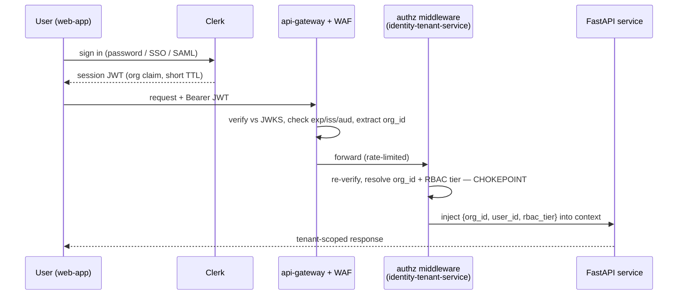
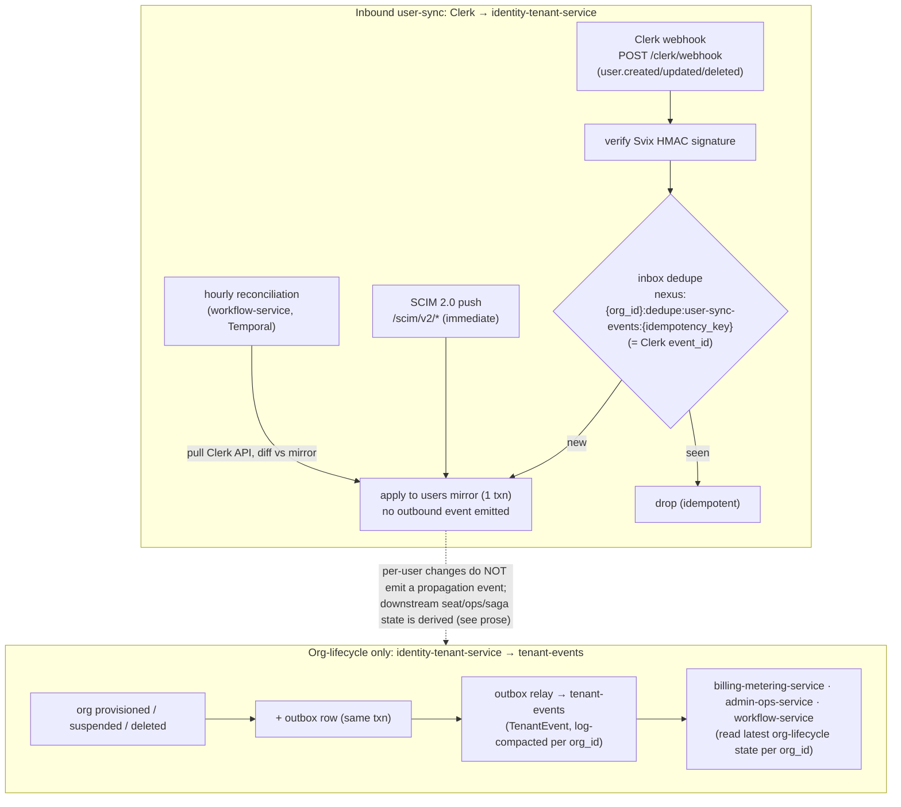

# ADR-0010: Identity — Clerk with enterprise SSO/SAML/SCIM and hardened user-sync

Records the decision to keep Clerk as the identity provider and source of truth, extend it with enterprise SSO/SAML/SCIM, and harden the PDF's single webhook into an inbox + hourly reconciliation + transactional outbox so a multi-tenant SaaS never locks a real user out or leaves a deactivated user with access.

## Related documents

- [Security Architecture](../11-security-architecture.md) — the full auth/authz design this ADR decides: Clerk JWT verification (§2.1), SSO/SAML/SCIM (§2.2), the hardened user-sync mechanics (§4), and the RBAC tiers (§3).
- [SaaS Business Architecture](../18-saas-business-architecture.md) — tenant provisioning saga (§2.3), self-serve onboarding, plan gating of SSO/SCIM (Enterprise tier).
- [Event-Driven Architecture](../07-event-architecture.md) — `user-sync-events` (Clerk inbox; producer = consumer = `identity-tenant-service`, §2.2 line 71) and `tenant-events` (outbound, **org-lifecycle only**, log-compacted latest-state-per-`org_id`, §2.2 line 61 / §3 line 205) topics, transactional outbox/inbox, idempotency, DLQs.
- [Multi-Tenancy & Tenant Isolation](../06-multi-tenancy.md) — the `org_id` injection chokepoint that consumes the Clerk `org` claim; agent-to-agent authz isolation.
- [Data Model](../_canon/02-data-model.md) — `users`, `organizations`, `tenant_settings.sso_config`, the per-tenant KMS data key, RLS notes.
- [Tech & Architecture Decisions](../_canon/06-tech-decisions.md) — the locked `Identity`, `Enterprise identity`, `RBAC`, and `User sync hardening` rows (§2.11) this ADR records.
- [Service Catalog](../_canon/01-service-catalog.md) — `identity-tenant-service`, its owned data, sync API surface, and event contracts.
- [Capacity & Scaling Math](../_canon/05-capacity-math.md) — frozen anchors (A1 users, A4 tenants) and the CRUD p95 < 300 ms budget cited here.
- [ADR-0002: Multi-tenancy model](0002-multi-tenancy-model.md) — the `org_id` tenant key this ADR's identity claim feeds.

---

## Status

**Accepted.** Supersedes nothing. This ADR is the authoritative record for the `Identity`, `Enterprise identity`, `RBAC`, and `User sync hardening` rows in [Tech Decisions §2.11](../_canon/06-tech-decisions.md). The detailed mechanics live in [Security Architecture §2–§4](../11-security-architecture.md); this ADR records *the decision and why*, and any change to the identity posture must supersede it.

---

## Context

### The forces

NEXUS authenticates **A1 = 5,000,000 registered users** across **A4 = 3,000 paying tenant organizations** ([Capacity §2](../_canon/05-capacity-math.md)), from self-serve Free signups to Enterprise tenants that will not buy without SAML and SCIM. Five forces shape the decision:

1. **Build, don't reinvent, identity.** Session management, password reset, MFA, bot detection, SAML/OIDC federation, and SCIM are a deep, security-critical surface. A 4-person-origin team (PDF) cannot safely own this; a managed IdP is the only responsible choice and the PDF already picked one — Clerk.
2. **Enterprise identity is table-stakes.** Enterprise tenants federate to Okta / Azure AD / Google Workspace via SAML 2.0 or OIDC and expect **SCIM 2.0** lifecycle: when HR deactivates an employee, that employee must lose NEXUS access on the SCIM push — not on next token expiry. The PDF had no SSO, no SCIM, and no enterprise tier.
3. **Webhooks drop, and both failure directions are unacceptable.** The PDF synced the local `users` mirror from Clerk via a **single webhook**. A dropped `user.created` strands a user who holds a valid Clerk JWT but has no local `users` row — authz fails closed and they are **locked out**. A dropped `user.deleted` leaves a deactivated user with lingering access — a **security incident**. At 5M users a one-in-a-thousand webhook drop is thousands of broken accounts.
4. **Every session must carry exactly one tenant.** Authorization, RLS, per-tenant Qdrant collections, tenant-keyed Redpanda partitions, and namespaced Redis all key on a single `org_id` ([ADR-0002](0002-multi-tenancy-model.md)). The identity layer must put a trustworthy `org` claim in the session JWT — server-issued, signature-covered, never client-mutable — so the `org_id` chokepoint has a source it can trust.
5. **Identity ≠ permission.** A user's domain role (`users.role`, e.g. "Backend Engineer") feeds the role→topics taxonomy and `get_user_context(user_id)` for `PersonalListenerAgent` relevance. It is **not** a permission tier. Overloading it would couple agent relevance filtering to authorization, so a tenant renaming a job title could grant or revoke access.

### The PDF baseline

> [SaaS-scale adjustment] The PDF (NEXUS Execution Plan v2.1) specified **Clerk (Next.js + backend JWT verification, webhook user sync)** and a single `users.role`/`skills[]` attribute for agent relevance. It had **no enterprise SSO, no SAML, no SCIM, no RBAC permission tiers, no tenant concept, and no webhook-reliability story** beyond "webhook user sync." Clerk and the JWT-verification primitive survive verbatim; enterprise identity, the RBAC tier, and the user-sync hardening are SaaS-scale additions.

The PDF's auth primitives are carried over exactly: Clerk as IdP, front-channel sign-in in Next.js, backend JWT verification, and `POST /clerk/webhook` user-sync owned by `identity-tenant-service` ([Service Catalog §3](../_canon/01-service-catalog.md)). There is no prior identity decision to supersede.

---

## Decision

NEXUS keeps **Clerk** as the identity provider and source of truth, extends it with **enterprise SSO/SAML/SCIM**, and replaces the bare webhook with a **three-part hardened user-sync** — locked as the `Identity`, `Enterprise identity`, `RBAC`, and `User sync hardening` rows in [Tech Decisions §2.11](../_canon/06-tech-decisions.md). The decision has six binding parts.

### D1 — Clerk is the identity provider and the source of truth

Identity is **Clerk** (PDF, verbatim): Next.js front-channel sign-in, a short-lived **session JWT** as bearer token on every backend request, and webhook-driven user-sync. **Clerk is authoritative for identity**; NEXUS keeps a local `users` mirror ([Data Model §2.1](../_canon/02-data-model.md)) so authz and `get_user_context(user_id)` never call Clerk on the hot path. When local state and Clerk disagree, **Clerk wins** and the mirror converges to it (D4). All identity provider secrets — Clerk backend keys, the Svix webhook signing secret — live in the managed secret manager and rotate per [Security §6](../11-security-architecture.md).

### D2 — JWT verified twice: pre-validated at the edge, re-verified in the service

The Clerk session JWT is verified against Clerk's JWKS in two places, with the `org` claim resolved into `org_id` at the edge.

| Stage | Where | What it does |
|---|---|---|
| **Pre-validation** | `api-gateway` (+ WAF) | Verifies signature against Clerk's JWKS (cached, rotation honored), checks `exp`/`nbf`/`iss`/`aud`, extracts the `org` claim → `org_id`. Rejects malformed/expired tokens with `401` at the edge before any service worker is touched. |
| **Re-verification** | authz middleware (`identity-tenant-service`) | Re-verifies the signature, resolves `org_id` + RBAC tier, injects them into request context (the `org_id` chokepoint). |

> [SaaS-scale adjustment] The PDF verified the JWT once, inside the FastAPI service. At edge scale (CRUD p95 < 300 ms, [Capacity §11.1](../_canon/05-capacity-math.md)) signature verification is pushed to `api-gateway` so the overwhelming majority of forged/expired tokens never consume a worker — a performance optimization **and** a DDoS shield. The service tier still re-verifies: the gateway pre-validation is not a trust delegation. The full path is in [Security §2.1](../11-security-architecture.md) and [Multi-Tenancy §4](../06-multi-tenancy.md).

### D3 — Enterprise SSO/SAML/SCIM fronted by Clerk, configured per tenant

> [SaaS-scale adjustment] Enterprise SSO/SAML/SCIM is wholly added vs the PDF; it is table-stakes for the Enterprise tier ([Tech Decisions §2.11/§2.12](../_canon/06-tech-decisions.md)) and plan-gated by `features.sso_saml`/`features.scim_provisioning` ([SaaS Business §2.3](../18-saas-business-architecture.md)).

Clerk fronts the enterprise identity surface; NEXUS configures it per tenant via **`tenant_settings.sso_config jsonb`** ([Data Model §2.2](../_canon/02-data-model.md)):

- **SAML 2.0 / OIDC SSO.** An Enterprise tenant connects its IdP (Okta, Azure AD, Google Workspace). Clerk performs the SAML assertion / OIDC exchange; the resulting NEXUS session JWT carries the **same `org` claim** as a password user, so downstream authorization is **identical regardless of how the user authenticated**.
- **SCIM 2.0 provisioning.** The IdP pushes user lifecycle (create / update / **deactivate**) to **`/scim/v2/*`**, owned by `identity-tenant-service` ([Service Catalog §6](../_canon/01-service-catalog.md)). SCIM deactivation is **near-real-time** — applied on the push, not deferred to token expiry or the hourly reconciliation. SCIM writes flow through the **same hardened user-sync** (D4) so SCIM and webhook events converge on one reconciled state.
- **Just-in-time provisioning.** First SSO login for a known-domain tenant provisions the `users` row JIT, scoped to that tenant's `org_id`, with the default `member` RBAC tier (D5).

`tenant_settings.sso_config` carries IdP metadata and signing certificates and is therefore **envelope-encrypted at rest with the tenant's per-tenant KMS data key** ([Data Model §2.2](../_canon/02-data-model.md), [Security §7](../11-security-architecture.md)), never returned by any read API.

### D4 — Hardened user-sync: inbox dedupe + hourly reconciliation + transactional outbox

> [SaaS-scale adjustment] The PDF used a plain webhook. SaaS locks **outbox + reconciliation, Clerk as source of truth** ([Tech Decisions §2.11](../_canon/06-tech-decisions.md)). Origin is **PDF→SaaS**: the webhook is the PDF's; the inbox + reconciliation + outbox hardening is the SaaS addition.

The three pieces solve three **distinct** problems and are not the same mechanism renamed. The inbound Clerk path is an **inbox** problem (not an outbox one); calling it "outbox" mislabels the direction.

| Piece | Direction | Problem it solves | Mechanism |
|---|---|---|---|
| **Inbox dedupe** | Inbound (Clerk → NEXUS) | Webhook **replays** / at-least-once redelivery applying the same change twice | `inbox` table + `nexus:{org_id}:dedupe:user-sync-events:{idempotency_key}` (frozen pattern `nexus:{org_id}:dedupe:{topic}:{idempotency_key}`, [Data Model §5](../_canon/02-data-model.md); for `user-sync-events` the `idempotency_key` **is** the Clerk webhook `event_id` — see [Event Architecture §6.3](../07-event-architecture.md)) |
| **Hourly reconciliation** | Inbound (NEXUS pulls Clerk API) | **Dropped / lost webhooks** — the actual flakiness fix; converges the mirror to Clerk's truth | Scheduled `workflow-service` (Temporal) job, diff vs Clerk API |
| **Transactional outbox** | Outbound (NEXUS → downstream services) | **Atomic propagation** of genuine **org-lifecycle** transitions (org provisioned / suspended / deleted) to other services | `outbox` row in the same txn → `tenant-events` ([Event Architecture §6.1](../07-event-architecture.md)) |

Concretely: `identity-tenant-service` **consumes** the `user-sync-events` topic (the Clerk webhook inbox; `UserSyncEvent` schema, producer **and** consumer both `identity-tenant-service`, [Event Architecture §2.2 line 71](../07-event-architecture.md)). `user-sync-events` is an **inbound-only** topic — the only consumer is `identity-tenant-service` itself — and is **never** an outbound/propagation topic. The hardened user-sync updates the local `users` mirror; it does **not** emit a per-user event onto the bus.

> [SaaS-scale adjustment] **No per-user identity-propagation topic exists in canon, and this ADR deliberately does not invent one.** `tenant-events` is frozen as **org-lifecycle only** — schema `TenantEvent`, payload "Tenant provisioned / suspended / deleted" ([Service Catalog §3 line 107](../_canon/01-service-catalog.md); [Event Architecture §2.2 line 61](../07-event-architecture.md)) — and is **log-compacted to the latest tenant-lifecycle state per `org_id` key** ([Event Architecture §3 line 205](../07-event-architecture.md)). A compacted, per-org-keyed lifecycle topic **cannot** carry per-user events: it would collapse every user's create/update/deactivate to a single latest-state-per-org record, destroying exactly the per-user add/remove granularity that seat counting needs. Therefore the `identity-tenant-service` outbox emits on `tenant-events` **only for genuine org-lifecycle transitions** (org provisioned / suspended / deleted). Downstream identity-derived state is computed without a per-user feed:
> - **`billing-metering-service` seat counts** are derived by `billing-metering-service` from its **own** `subscriptions` / `seats` state ([Service Catalog §3 line 121](../_canon/01-service-catalog.md): it owns `subscriptions`, `seats`) plus `tenant-events` org-lifecycle transitions and Stripe webhooks — **not** from a per-user identity stream. (Membership truth lives in Clerk/SCIM and the `users` mirror; billing reconciles seat *entitlement* against its subscription, queried from `identity-tenant-service` when it needs the live head-count, never pushed per user over `tenant-events`.)
> - **`admin-ops-service` ops views** read `tenant-events` for org-lifecycle and query `identity-tenant-service` (`GET /context/{user_id}`, `/orgs`) for member detail on demand.
> - **`workflow-service` lifecycle sagas** (tenant provisioning, RTBF deletion) are triggered by org-lifecycle `tenant-events`, not per-user changes.
> If a future requirement genuinely needs per-user create/deactivate propagation pushed to downstream services, that is a **net-new topic** (e.g. a `UserChangedEvent` schema on a dedicated topic, producer `identity-tenant-service`) and **must first be ratified** into [Service Catalog §3/§5](../_canon/01-service-catalog.md) and [Event Architecture §2.2](../07-event-architecture.md) — mirroring the net-new-name ratification rule at [Event Architecture §2.2 line 53](../07-event-architecture.md). It must **not** be smuggled onto `tenant-events`. This ADR does not propose it because the derived signals above already satisfy every named downstream consumer.

- **Webhook receiver.** `POST /clerk/webhook` verifies the **Svix HMAC signature** before anything else — an unsigned/mis-signed payload is a Spoofing attempt and is rejected. Verified events dedupe on the Clerk `event_id` via the inbox — for the `user-sync-events` topic the Clerk `event_id` **is** the `idempotency_key` (it is stable across redelivery, the natural inbound idempotency key, per [Event Architecture §6.3](../07-event-architecture.md)), so the frozen dedupe key `nexus:{org_id}:dedupe:user-sync-events:{idempotency_key}` resolves to `…:{event_id}` here — then apply to `users` in one transaction.
- **Hourly reconciliation.** A Temporal scheduled job pulls the Clerk user list per tenant and diffs it against the local mirror: present-in-Clerk-but-missing-locally → create; deactivated-in-Clerk-but-active-locally → soft-delete; drift logged. This is the piece that recovers from dropped webhooks. It is idempotent (a diff, not a replay). **Hourly** is the steady-state convergence bound; **SCIM deactivations (D3) are immediate** and never wait for it, so enterprise offboarding is near-real-time while reconciliation is the safety net.
- **Transactional outbox.** When an **org-lifecycle** transition applies (provisioned / suspended / deleted), the same transaction writes an `outbox` row, so propagation to `tenant-events` is atomic — "DB row and event both commit, or neither does." Because `tenant-events` is log-compacted to latest-state-per-`org_id`, this is exactly the right shape: a downstream consumer that missed intermediate events still reads the current lifecycle state per org on replay. Per-user mirror updates (webhook/SCIM/reconciliation) do **not** write an outbox row, since they have no canon propagation topic and downstream seat/ops/saga state is derived as above. Poison messages land in the per-topic DLQ; a record with no resolvable `org_id` is dead-lettered, never applied to a guessed tenant.

### D5 — RBAC permission tiers live in a grant store, never in `users.role`

> [SaaS-scale adjustment] The PDF had only `users.role` (a domain/skills attribute for agent relevance) and no permission model. The `owner`/`admin`/`member` RBAC tier is a SaaS-add ([Tech Decisions §2.11](../_canon/06-tech-decisions.md)) stored as **RBAC grants in `identity-tenant-service`, distinct from `users.role`**.

Two role concepts are kept in separate stores by design:

| Concept | Field / store | Purpose |
|---|---|---|
| **Domain role** | `users.role` + `users.skills text[]` ([Data Model §2.1](../_canon/02-data-model.md)) | Job/domain identity; feeds role→topics taxonomy and `get_user_context(user_id)` so `PersonalListenerAgent` filters chunks by relevance. **No permission meaning.** |
| **RBAC permission tier** | RBAC roles/grants store in `identity-tenant-service` | `owner` / `admin` / `member` — what a user may *do* (billing, member management, integration install, data export/erasure). |

The three tiers (full table in [Security §3.1](../11-security-architecture.md)): `owner` (everything `admin` can plus billing, ownership transfer, tenant deletion → RTBF, data-residency approval); `admin` (members + RBAC grants, integration install/revoke, `tenant_settings` including SSO, export/erasure requests, audit-log read); `member` (create/join meetings, own worklogs/decisions/actions, agents and RAG, own notifications and Save-for-later). The middleware **fails closed**: an unset `org_id`, unknown route, or missing tier raises `403` — paired with RLS, where an unset `app.current_org` matches **zero rows**, so an authz bug degrades to "user sees nothing," never "user sees everything."

### D6 — Agents inherit their principal's tenant; agent-to-agent authz is deny-by-default

An agent (`ContextGapAgent` querying other users' agents over `agent-requests` / `agent-responses`, the PDF's R6) inherits its principal user's `org_id` and a deny-by-default scope from the **same RBAC grant store** in `identity-tenant-service`. A request is authorized only if requester and responder share `org_id` **and** the scope permits the query; a foreign-`org_id` request is dropped to DLQ, never served, and audited to `agent_collaborations` and the append-only `audit_logs` (`actor_type = 'agent'`). The `audit_logs` write goes through **`admin-ops-service`** — per the Service-Catalog naming rule there is no `audit-service` in the catalog (it folds audit-log access into `admin-ops-service`), and the `audit-service` name in [Data Model §2.2](../_canon/02-data-model.md) is a Data-Model-only owner; this ADR uses the catalog name and cites the discrepancy flag at [Event Architecture §2.2 line 76](../07-event-architecture.md). The isolation mechanics are owned by [Multi-Tenancy §6.1](../06-multi-tenancy.md) and [AI Agent Architecture](../08-ai-agent-architecture.md); this ADR records only that **identity is the root of the agent's tenant binding**.

---

## Consequences

### Positive

- **Identity is bought, not built.** Clerk owns the deep, security-critical surface (sessions, MFA, bot detection, SAML/OIDC, SCIM); NEXUS owns only a thin mirror and the authz decision. The 4-person-origin team never hand-rolls federation.
- **Enterprise-ready.** SAML/OIDC + SCIM unblock the Enterprise tier, and SCIM deactivation makes offboarding near-real-time — a hard procurement requirement. The session JWT's `org` claim is identical across password and SSO logins, so authz code is auth-method-agnostic.
- **No lock-out, no lingering access.** The inbox defends against replays, hourly reconciliation recovers from dropped webhooks (Clerk authoritative → mirror always converges within the hour), and the outbox propagates **org-lifecycle** transitions atomically to `tenant-events`. The two unacceptable PDF failure modes — both per-user — are closed by the inbound inbox + reconciliation against the `users` mirror, **not** by any outbound topic: there is no per-user propagation event, so user lock-out/lingering-access is a mirror-convergence property, while `tenant-events` carries only org provisioned/suspended/deleted.
- **Single trustworthy tenant claim.** A server-issued, signature-covered, non-client-mutable `org` claim gives the `org_id` chokepoint ([ADR-0002](0002-multi-tenancy-model.md)) a source it can trust without re-deriving tenancy per request.
- **Permissions and domain role can never silently couple.** Keeping RBAC grants out of `users.role` means renaming a job title cannot grant or revoke access, and agent relevance filtering cannot leak into authorization.

### Negative

- **Hard dependency on Clerk.** Clerk availability gates sign-in (mitigated: short-lived JWTs keep already-authenticated sessions working through a brief Clerk outage; the local `users` mirror means authz/`get_user_context` do not call Clerk on the hot path). A Clerk outage still blocks *new* logins.
- **Reconciliation cost.** An hourly per-tenant pull against the Clerk API across 3,000 tenants is real work and rate-limited by Clerk; mitigated by paging, backoff, and running it under an elevated read role in `workflow-service`, off the request path.
- **SCIM and webhook converge on one mirror.** Two write paths into `users` (SCIM push + Clerk webhook + reconciliation diff) must be idempotent and ordered per tenant; achieved via the inbox dedupe key and `org_id`-keyed ordering, but it is more moving parts than one webhook.
- **`sso_config` is sensitive at rest.** IdP certs/metadata require the per-tenant KMS data key path, adding an encryption dependency to tenant settings reads/writes.

### What we accept

- **Clerk is the source of truth**; the local mirror is eventually-consistent within the **one-hour reconciliation bound** (SCIM deactivations excepted — immediate). We accept up to one hour of mirror drift for a *dropped* webhook, because the steady-state path is the webhook itself (seconds) and the reconciliation is the safety net, not the primary.
- **A single managed-IdP vendor.** We accept Clerk lock-in for the identity surface in exchange for not owning federation/SCIM ourselves; the JWT-bearer + `org` claim contract keeps the *consuming* side portable if a future ADR ever supersedes the provider.
- **Two verification points** (edge + service) cost a duplicate signature check per request; accepted as a DDoS shield, not a trust delegation.

---

## Alternatives considered

| Alternative | Why not |
|---|---|
| **Auth0 / Okta Customer Identity / AWS Cognito** | All are credible managed IdPs with SAML/SCIM. Rejected because the PDF already locked **Clerk** with first-class Next.js + backend-JWT integration; re-picking the IdP is a net cost with no offsetting benefit, and Clerk covers SSO/SAML/SCIM at the Enterprise tier we need. Switching the provider would require a superseding ADR, not a default. |
| **Self-hosted Keycloak / Ory** | Full control and no per-MAU vendor cost, but the team would own the federation, SCIM, MFA, and bot-detection surface — exactly the deep security work force (1) says to avoid. Operationally heavy for a 4-person-origin team; rejected. |
| **Single webhook only (PDF baseline)** | Cheapest, but a dropped `user.created` locks a real user out and a dropped `user.deleted` leaves access lingering (force 3). At 5M users this is thousands of broken accounts. Rejected in favor of inbox + reconciliation + outbox. |
| **Outbox for the inbound Clerk path** | Mislabels the direction. The inbound Clerk→NEXUS path is an **inbox** (dedupe replays); the outbox is the *outbound* propagation of **org-lifecycle** transitions to `tenant-events` (org provisioned/suspended/deleted), not a per-user feed. Conflating them would leave dropped-webhook recovery unsolved (the outbox does nothing for events Clerk never delivered). Rejected; reconciliation is the dropped-webhook fix. |
| **No local `users` mirror — call Clerk per request** | Removes sync entirely, but puts Clerk on every request's hot path, blowing the CRUD p95 < 300 ms budget and coupling availability to Clerk for *every* call, not just login. Rejected; the mirror + reconciliation is the standard fix. |
| **Permission tier in `users.role`** | One fewer store, but couples agent relevance filtering to authorization — a tenant renaming a job title could grant/revoke access (force 5). Rejected; RBAC grants are a separate store. |
| **Trust an `org_id` / role claim minted client-side** | Removes a server round-trip, but a client-mutable tenant or role claim is a privilege-escalation hole. Rejected: the `org` claim is server-issued by Clerk and signature-covered; the RBAC tier is resolved server-side from the grant store, never from the JWT. |

---

## Migration and rollback notes

### Forward (within the SaaS build)

This is greenfield against the PDF's bare webhook; there is no live system to cut over. The build order:

1. **Clerk + edge JWT pre-validation + service re-verification** (Phase 2 foundation) — the PDF primitive plus the edge pre-validation of D2.
2. **Inbox dedupe + transactional outbox** on `POST /clerk/webhook` — ride the same outbox/inbox substrate the rest of the platform uses ([Event Architecture §6](../07-event-architecture.md)); no bespoke reliability code.
3. **Hourly reconciliation** Temporal job in `workflow-service` — the dropped-webhook safety net.
4. **Enterprise SSO/SAML/SCIM** (gated behind `features.sso_saml` / `features.scim_provisioning`) when the first Enterprise tenant lands; SCIM writes reuse the D4 path.

### Rollback

- **Disable SSO/SCIM per tenant** by clearing `tenant_settings.sso_config` and the feature flags — password auth via Clerk continues unaffected, since the session JWT contract (`org` claim) is identical across auth methods.
- **Disable reconciliation** independently (it is a scheduled `workflow-service` job) without touching the live webhook path; the inbox + outbox keep working, only the dropped-webhook safety net pauses.
- **Provider change** (e.g. abandoning Clerk) is a superseding ADR, not a rollback: the consuming side depends only on the JWT-bearer + signature-covered `org` claim contract and the local `users` mirror, so a replacement IdP that issues the same claim shape is mechanically swappable, but the webhook/SCIM ingestion and reconciliation diff would be rewritten against the new provider's API.
