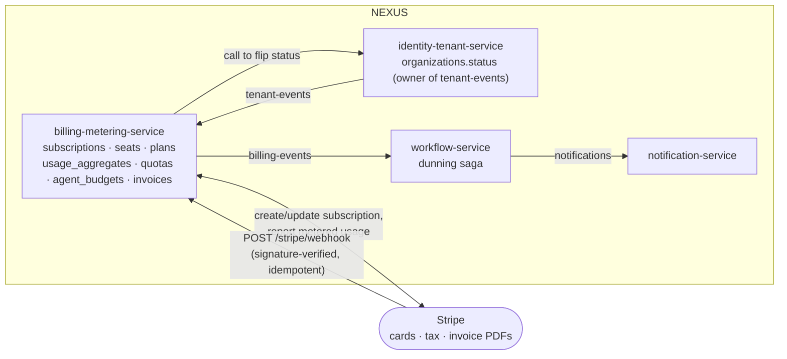
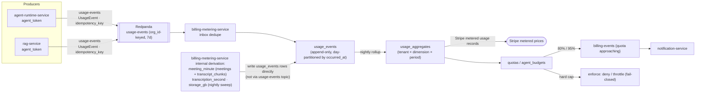
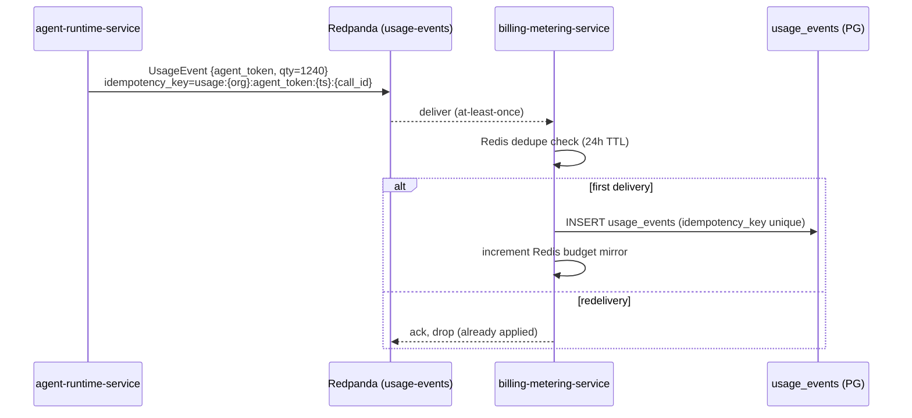
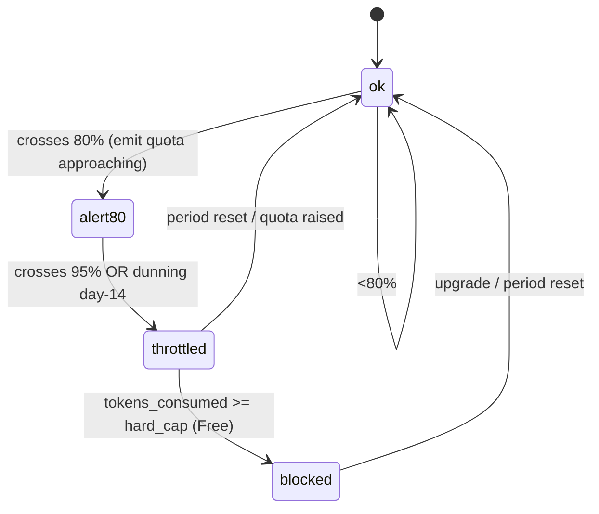
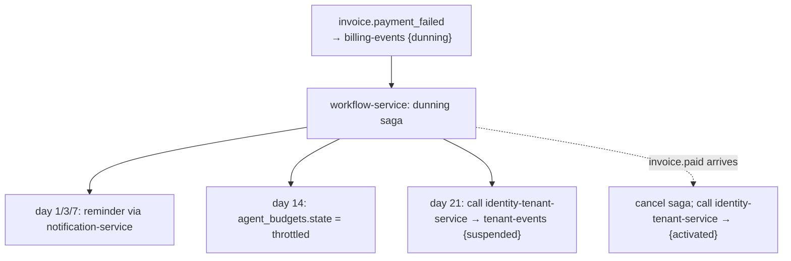

# ADR-0011: Billing and usage metering with Stripe + usage-events

Locks how NEXUS monetizes a multi-tenant SaaS: Stripe as the system of record for subscriptions/seats/invoices/tax, and a `usage-events → aggregation → quota enforcement` metering pipeline owned by `billing-metering-service` that bills metered overage and enforces the per-tenant hard quotas defending margin against the R4 LLM cost spiral.

## Related documents

- [SaaS Business Architecture](../18-saas-business-architecture.md) — §3 Stripe/plans/seats, §5 metering pipeline, §5.3 `agent_budgets`, the parent design this ADR formalizes.
- [Service Catalog (canon)](../_canon/01-service-catalog.md) — `billing-metering-service`, `identity-tenant-service`, `workflow-service`, `notification-service`, `agent-runtime-service`, `rag-service` ownership and event maps.
- [Data Model (canon)](../_canon/02-data-model.md) — §2.2 frozen entities `plans`, `subscriptions`, `usage_events`, `invoices`, `agent_budgets`; §5 Redis budget mirror.
- [Capacity & Scaling Math (canon)](../_canon/05-capacity-math.md) — D1 Deepgram minutes, L7 LLM calls, C1–C4 unit economics, A4 paying tenants.
- [Tech & Architecture Decisions (canon)](../_canon/06-tech-decisions.md) — §2.5 LLM cost pipeline & per-tenant quotas, §2.12 SaaS business platform.
- [Event Architecture](../07-event-architecture.md) — §4.2 `usage-events`/`billing-events` partitions+retention, §6 idempotency keys, §3 Avro envelope.
- [Data Architecture](../05-data-architecture.md) — `usage_events` day-partitioning, 90-day raw retention, rollup to `usage_aggregates`.
- [Multi-Tenancy](../06-multi-tenancy.md) — `org_id` injection, RLS, deny-by-default fail-closed enforcement.
- [Cost and FinOps](../17-cost-and-finops.md) — variable-cost model the quotas defend.
- [AI Agent Architecture](../08-ai-agent-architecture.md) — the six agents whose token consumption is metered.

---

## Status

**Accepted.** Supersedes nothing. This ADR formalizes three locked rows from [Tech Decisions §2.12](../_canon/06-tech-decisions.md) — `Billing` (Stripe billing + subscriptions + seats + dunning + tax), `Usage metering` (`usage-events → aggregation → quota enforcement`), and `Plans / tiers` (Free / Pro / Enterprise) — together with the per-tenant token-budget hard-quota row from [Tech Decisions §2.5](../_canon/06-tech-decisions.md). It introduces no new service, entity, or topic name; every name used here is frozen in the canon. It operationalizes [SaaS Business Architecture §3 and §5](../18-saas-business-architecture.md).

---

## Context

### The PDF baseline

The NEXUS Execution Plan v2.1 had **no notion of money**. It described a single-deployment meeting-intelligence app built by a 4-person team with a seeder of `2 orgs x 10 users x 5 meetings`. There were no tenants in the commercial sense, no plans, no subscriptions, no invoices, no metering, and no quota enforcement. The PDF's only cost-adjacent primitives were three things, and they all survive into this ADR by name and intent:

1. **Per-user LLM token budgets and token tracking** via LiteLLM (per-user rate limits) — Phase 7 introduced "budget alerts."
2. **A Phase-13 "~30% cost reduction"** optimization target.
3. **The R4 risk** itself: "LLM cost spiral once agents process every transcript chunk."

> [SaaS-scale adjustment] The entire commercial layer in this ADR is new relative to the PDF. NEXUS is now a production multi-tenant SaaS targeting **A4 = 3,000 paying tenant organizations** across **A1 = 5,000,000 registered users** ([Capacity §2](../_canon/05-capacity-math.md)). Selling to thousands of orgs requires billing, metered overage, per-tenant hard quotas, dunning, tax, and seat management — none of which the single-team phasing needed. The PDF's per-*user* token budget is generalized to a per-*tenant* `agent_budgets` hard quota.

### The forces

Billing sits at the intersection of margin protection, correctness under at-least-once delivery, and customer trust. Six forces pull on the design:

| Force | Pressure | Why it matters |
| --- | --- | --- |
| **Margin defense (R4)** | Toward hard per-tenant token caps | LLM is **94% of variable cost** (C3); a single tenant defeating the cost-controlled pipeline could run an unbounded bill. At C1 ≈ **$4.06 variable cost/meeting** and C2 ≈ **$9.73/MAU/month** ([Capacity §10.1](../_canon/05-capacity-math.md)), an unmetered tenant is a direct margin leak. |
| **Metering correctness** | Toward idempotent, append-only counting | `usage-events` is at-least-once ([Event Architecture §6](../07-event-architecture.md)). Double-counting tokens over-bills a customer (a trust and chargeback risk); under-counting leaks margin. Counting must be exactly-once *in effect*. |
| **PCI scope minimization** | Toward delegating card data to Stripe | Storing PANs would drag NEXUS into PCI-DSS scope. Stripe must be the system of record for payment methods, tax, and invoice PDFs; NEXUS mirrors only the minimum. |
| **Metering volume** | Toward aggregation before billing | `usage_events` rows track meeting minutes, transcription seconds, agent tokens, and storage across **R4 = 4.8M meetings/month** and **L7 = 5.79B LLM calls/month**. Stripe and the UI must read `usage_aggregates`, never the raw firehose. |
| **Graceful degradation** | Toward shedding *discretionary* work only | Hitting a quota must never drop durable facts (`transcript-chunks`, `decisions`, `actions`, `usage-events`). Only LLM-discretionary work degrades; captions and transcription continue. |
| **Tenant ownership boundary** | Toward strict producer separation | `billing-metering-service` owns Stripe and `billing-events`, but it must **never** write `organizations.status` or produce `tenant-events` — that ownership belongs to `identity-tenant-service`. |

### What is already locked (and constrains this ADR)

- **`billing-metering-service`** is the single owner of `subscriptions`, `seats`, `plans`, `usage_aggregates`, `quotas`, `invoices`, and Stripe id maps ([Service Catalog §3](../_canon/01-service-catalog.md) — its Owns-data column). The [Data Model](../_canon/02-data-model.md) splits this ownership more finely — `usage_events` under `billing-service` (§2.2) and `agent_budgets` under `budget-service` (§1.1/§2.2). This ADR **consolidates the Data Model `billing-service` and `budget-service` entities (`usage_events`, `agent_budgets`) under the Service Catalog's canonical `billing-metering-service` name** — the [Service Catalog §1](../_canon/01-service-catalog.md) is the naming authority. This is a cross-doc consolidation, not a rename: the entity names (`usage_events`, `agent_budgets`) are unchanged.
- **Frozen entities** `plans`, `subscriptions`, `usage_events`, `invoices`, `agent_budgets` with the exact columns in [Data Model §2.2](../_canon/02-data-model.md).
- **`usage-events`** is partitioned by `org_id`, 7-day Redpanda retention, `UsageEvent` Avro value; **`billing-events`** is `BillingEvent`, 30-day retention ([Event Architecture §4.2](../07-event-architecture.md)).
- **At-least-once + idempotency + transactional outbox/inbox + dedupe + DLQs** ([Tech Decisions §2.4](../_canon/06-tech-decisions.md)).
- **Per-tenant token budgets with hard quotas and budget alerts** at 80%/95% ([Tech Decisions §2.5](../_canon/06-tech-decisions.md)).
- **Deny-by-default, fail-closed** enforcement is the security default ([Multi-Tenancy](../06-multi-tenancy.md), [Security §1](../11-security-architecture.md)).
- **`tenant-events` is produced solely by `identity-tenant-service`** ([Event Architecture §4](../07-event-architecture.md)); `billing-metering-service` calls it for status writes.

---

## Decision

**Stripe is the system of record for monetization (subscriptions, seats, tax, invoice PDFs, payment methods via the hosted Customer Portal); `billing-metering-service` owns the internal billing read models and the metering pipeline. Metered usage flows over the `usage-events` topic as the `UsageEvent` Avro value, is deduped on a canonical `idempotency_key`, appended to the day-partitioned `usage_events` table, rolled up nightly into `usage_aggregates`, reported to Stripe as metered-price usage records, and enforced against per-tenant `quotas` and `agent_budgets`. Enforcement is deny-by-default and fail-closed; it degrades discretionary LLM work before it blocks, and never sheds durable facts.**

### 1. Roles: Stripe vs NEXUS (system-of-record split)

NEXUS never stores raw card data. Stripe holds PANs, tax logic, and invoice PDF generation; NEXUS mirrors the minimum it needs to gate features and quotas.

| Concern | System of record | NEXUS mirror |
| --- | --- | --- |
| Payment method / card | **Stripe** (Customer Portal, PCI-scoped) | none (no PAN ever touches NEXUS) |
| Tax calculation | **Stripe Tax** | `invoices.tax_cents` (read-only mirror) |
| Subscription state | **Stripe** | `subscriptions` (`status`, `seats`, `current_period_*`, `trial_ends_at`, `stripe_subscription_id`) |
| Invoice + PDF | **Stripe** | `invoices` (`status`, `amount_due_cents`, `pdf_url` → `nexus-invoices` bucket) |
| Plan catalog | **NEXUS** `plans` (mapped to Stripe products/prices) | `plans.code` ∈ `free`/`pro`/`enterprise` |
| Metered usage | **NEXUS** `usage_aggregates` (reported *to* Stripe) | Stripe metered prices |
| Quota / budget state | **NEXUS** `quotas`, `agent_budgets` | none (NEXUS-internal) |

> [SaaS-scale adjustment] Delegating card and payment-method management to the **Stripe Customer Portal** (a hosted, PCI-scoped surface) — rather than building a card form — keeps NEXUS out of PCI-DSS cardholder-data scope. This is wholly added vs the PDF, which had no payment surface at all. See [SaaS Business §3](../18-saas-business-architecture.md).



### 2. Plans and seats

Plans are a NEXUS-owned catalog (`plans` table — global, non-tenant, versioned for invoice reproducibility per [Data Model §2.2](../_canon/02-data-model.md)) mapped onto Stripe products/prices. Each plan carries `seat_price_cents`, `included_meeting_minutes`, `included_agent_tokens`, and a `features jsonb`.

| Plan `code` | Seat model | Overage policy | Availability target | Isolation |
| --- | --- | --- | --- | --- |
| `free` | capped seats | **hard-cap** at `included_agent_tokens` (block) | 99.5% | pooled + RLS |
| `pro` | metered seats (Stripe quantity, prorated) | metered overage billed | 99.9% | pooled + RLS, multi-region active-passive |
| `enterprise` | contracted seats | metered overage + negotiated quotas | 99.95% | cell-based isolation |

A **seat** is a billable user slot (`subscriptions.seats`). Seat math is enforced at member-invite time by `identity-tenant-service`, which calls `billing-metering-service` to validate against `subscriptions.seats` and the plan's seat cap before creating the `users`/membership row. Pro auto-increments the Stripe subscription quantity (proration on); Free blocks at the cap. Availability targets are imported verbatim from [Capacity §11.2](../_canon/05-capacity-math.md).

### 3. The metering pipeline: usage-events → aggregation → enforcement

This is the canon's locked `usage-events → aggregation → quota enforcement` ([Tech Decisions §2.12](../_canon/06-tech-decisions.md)).



#### 3.1 Metered dimensions

Exactly four `usage_events.event_type` values, frozen in [Data Model §2.2](../_canon/02-data-model.md):

| `event_type` | Unit | Emitted by | Drives |
| --- | --- | --- | --- |
| `meeting_minute` | minute of meeting (one diarized stream/meeting) | aggregated by `billing-metering-service` (see note) | minutes quota; Deepgram cost (D1) |
| `transcription_second` | second of audio transcribed | aggregated by `billing-metering-service` (see note) | fine-grained Deepgram metering |
| `agent_token` | LLM token consumed (Haiku/Sonnet/Opus) | `agent-runtime-service`, `rag-service` | `agent_budgets` token quota; 94% of variable cost (C3) |
| `storage_gb` | GB-month of recordings/documents/vectors | swept/derived by `billing-metering-service` (see note) | storage quota; object-bucket lifecycle |

> [SaaS-scale adjustment] **Producer reconciliation (load-bearing):** the **topic** and the **table** are governed by different canon documents, and they must not be conflated. The canonical [Service Catalog §3/§5](../_canon/01-service-catalog.md) and [Event Architecture §3.1](../07-event-architecture.md) list the `usage-events` **topic** producers as **`agent-runtime-service` and `rag-service` only**; `transcription-service`'s producer column lists only `transcript-chunks`. Separately, [Data Model §2.2](../_canon/02-data-model.md) enumerates all four values — `meeting_minute`, `transcription_second`, `agent_token`, `storage_gb` — as `usage_events.event_type` symbols, i.e. all four are expected to exist **as `usage_events` rows**. The reconciliation that honors both: **`agent_token` flows onto the `usage-events` topic directly** (its only two sanctioned producers), while **`meeting_minute`, `transcription_second`, and `storage_gb` are *derived inside* `billing-metering-service`** — `meeting_minute`/`transcription_second` by aggregating meeting durations (`meetings.scheduled_start`/`scheduled_end` and `transcript_chunks` start/end timestamps), `storage_gb` by a nightly storage sweep — and **written directly as `usage_events` rows** (which then roll up into `usage_aggregates`), **not emitted onto the `usage-events` topic** by `transcription-service` or any other service. All four therefore materialize as `usage_events` rows (satisfying Data Model §2.2's `event_type` enumeration), but only `agent_token` traverses the topic (satisfying the Service Catalog §3/§5 producer map). Should direct topic emission of any derived dimension ever be required — including a separate `storage_gb` sweep producer — it must **first be added to the Service Catalog §3/§5 producer map** before it may be depicted producing onto `usage-events`. This ADR follows the Service Catalog, the naming authority. (`meeting_minute` is billed **once per meeting, not per participant** — the diarization design makes one Deepgram stream serve a ~6-person call, the deliberate 6x cost lever D3 "do not do this" in [Capacity §7](../_canon/05-capacity-math.md).)

#### 3.2 The three stages

1. **Ingest.** `billing-metering-service` consumes `usage-events`, dedupes on the envelope `idempotency_key` (durable inbox table + the Redis dedupe cache `nexus:{org_id}:dedupe:usage-events:{idempotency_key}`, 24h TTL — [Event Architecture §6](../07-event-architecture.md)), and appends to `usage_events`. The table is **day-partitioned by `occurred_at`**; raw rows are retained 90 days then summarized ([Data Model §2.2](../_canon/02-data-model.md), [Data Architecture](../05-data-architecture.md)).
2. **Aggregate.** A nightly rollup (a `workflow-service` Temporal schedule) collapses `usage_events` into `usage_aggregates` — one row per `(org_id, dimension, billing_period)`. Aggregates are what Stripe metered usage records are reported from and what the `/usage` API and tenant-admin dashboards read — **never** the raw row firehose (T3 = 1.728B `transcript_chunks`-class volume).
3. **Enforce.** Quota state lives in `quotas` (general dimensions) and `agent_budgets` (the token dimension). For real-time hot-path enforcement, `agent_budgets.tokens_consumed` is mirrored to Redis `nexus:{org_id}:budget:{period}` ([Data Model §5](../_canon/02-data-model.md)) so the agent tier checks budget in a single Redis read, not a Postgres round-trip.

#### 3.3 The idempotency key (exactly-once metering in effect)

Every `usage-events` record carries the canonical key, frozen in [Event Architecture §6](../07-event-architecture.md) and matching `usage_events.idempotency_key` in [Data Model §2.2](../_canon/02-data-model.md):

```
usage:{org_id}:{event_type}:{occurred_at}:{source_id}
```

The key is derived from immutable facts (the tenant, the metered dimension, when it happened, and the source object id — e.g. a meeting window id or an LLM call id), **not** from `event_id`, a timestamp-of-enqueue, or a retry counter. Combined with the dedupe inbox, an at-least-once redelivery of the same metered unit **never double-counts** against the bill or the quota.



### 4. Per-tenant `agent_budgets` and quota enforcement

`agent_budgets` (one row per tenant per `YYYY-MM` per [Data Model §2.2](../_canon/02-data-model.md)) carries `token_quota`, `tokens_consumed`, `hard_cap`, `alert_80_sent`, `alert_95_sent`, and `state` ∈ `ok`/`throttled`/`blocked`.

> [SaaS-scale adjustment] `agent_budgets` is the per-*tenant* evolution of the PDF's per-*user* LiteLLM token budget. The 80%/95% alerts and the hard cap are the billing-safety backstop for **R4 (LLM cost spiral)**, sitting *downstream* of the cost-controlled pipeline (relevance pre-gating → windowed batching → tiered routing → prompt caching — [Capacity §8.2](../_canon/05-capacity-math.md), [Tech Decisions §2.5](../_canon/06-tech-decisions.md)). Even a tenant whose traffic defeats the gating cannot run an unbounded LLM bill: the hard cap is the floor under margin.

Enforcement is **deny-by-default and fail-closed** ([Multi-Tenancy](../06-multi-tenancy.md)). It degrades discretionary LLM work gracefully before it blocks:

| `agent_budgets.state` | Trigger | Agent-tier behavior |
| --- | --- | --- |
| `ok` | `tokens_consumed < 80% × token_quota` | All six agents run normally |
| `ok` + `alert_80_sent` | crosses 80% | `billing-events {quota approaching}` → notify owner/admin; no behavior change |
| `throttled` | crosses 95%, or dunning day-14 | Route all windows to Haiku triage only; suspend Sonnet/Opus extraction and `ProactiveAgent`; `ContextGapAgent` falls through to RAG-only (the PDF-authorized **R6** descope) |
| `blocked` | `tokens_consumed ≥ hard_cap` (overage disabled, e.g. Free) | Agent spawns denied; transcription + captions continue; UI surfaces an upgrade prompt |

Pro/Enterprise plans bill metered overage instead of blocking; Free hard-caps. The state machine guarantees durable facts — `transcript-chunks`, `decisions`, `actions`, `usage-events` — are **never** shed for quota reasons ([Event Architecture §shedding](../07-event-architecture.md)); only discretionary LLM work degrades. The `throttled` Haiku-only / RAG-only path is the same degradation the cost-control pipeline already uses, so it costs no new code path.



### 5. Stripe webhook ingress and dunning

`POST /stripe/webhook` (owned by `billing-metering-service`) is the inbound control path. Every webhook is **signature-verified** (Stripe signing secret), **idempotent** (the Stripe event id is the idempotency key, deduped via `nexus:{org_id}:dedupe:stripe:{event_id}`), and translated into internal `billing-events` only where a state change matters.

| Stripe event | NEXUS effect | Emits |
| --- | --- | --- |
| `customer.subscription.created/updated` | sync `subscriptions.status`, `seats`, period dates | `billing-events {plan-changed}` if plan/seats changed |
| `invoice.paid` | mark `invoices.status=paid`; call `identity-tenant-service` to flip `organizations.status=active` if recovering | `billing-events {recovered}` |
| `invoice.payment_failed` | move tenant to `past_due`; start dunning saga | `billing-events {dunning}` |
| `customer.subscription.deleted` | invoke `identity-tenant-service` to move tenant toward `pending_deletion` after grace | `billing-events {canceled}` |

> [SaaS-scale adjustment] **`tenant-events` is never produced by `billing-metering-service`.** Per the frozen event contract ([Service Catalog §5](../_canon/01-service-catalog.md), [Event Architecture §4](../07-event-architecture.md)), `identity-tenant-service` is the **sole producer of `tenant-events`** because it owns `organizations.status`. When a Stripe webhook implies a tenant-status transition, `billing-metering-service` (or `workflow-service` in the dunning saga) **calls `identity-tenant-service`**, which performs the `organizations.status` write and emits the corresponding `tenant-events`. `billing-metering-service` emits only its own `billing-events`.

The **dunning saga** is a Temporal `workflow-service` orchestration driven by `billing-events {dunning}`: reminders at day 1/3/7 via `notification-service` (in-app, email, owner Slack DM), `agent_budgets.state → throttled` at day 14, and hard suspension (call `identity-tenant-service` → `tenant-events {suspended}`) at day 21. The dunning saga never sends notifications directly — it uses the same `notification-service` delivery fabric the agents use.

> [SaaS-scale adjustment] **Reminder-cadence reconciliation.** This ADR's reminder days (1/3/7) adopt the PDF `ActionFollowUpWorkflow` durable-timer cadence (reminders day 1/3/7, which [SaaS Business §4.4](../18-saas-business-architecture.md) prose also cites as the reused pattern). The parent [SaaS Business §4.4](../18-saas-business-architecture.md) dunning-specific *diagram* shows a Day 0/7/14 reminder timeline; **where the two differ, §4.4's diagram is the authoritative dunning-specific timeline**. The day-14 `throttled` transition and day-21 suspension agree across both documents and are unchanged. Canon does not freeze the dunning timeline, so this is a cross-doc seam, not a CANON deviation.



---

## Consequences

### Positive

- **Margin is structurally defended.** The per-tenant hard cap is the floor under R4: even a pathological tenant cannot exceed `agent_budgets.hard_cap` tokens/month. With LLM at 94% of variable cost (C3) and a post-Phase-13 target of C4 ≈ **$6.99/MAU/month**, quotas plus the cost-controlled pipeline are the dominant margin lever — not infra rightsizing.
- **Metering is exactly-once in effect.** The canonical `usage:{org_id}:{event_type}:{occurred_at}:{source_id}` key + inbox dedupe means at-least-once redelivery never over-bills a customer or mis-charges a quota — eliminating a whole class of billing chargebacks.
- **PCI scope is minimized.** Stripe holds all card data; NEXUS stores no PANs, keeping it out of PCI-DSS cardholder-data scope and out of the corresponding audit burden ([Compliance](../12-compliance-and-privacy.md)).
- **The UI and Stripe read aggregates, not the firehose.** `usage_aggregates` keeps the `/usage` API and tenant-admin dashboards fast at T3-class row volume; the raw `usage_events` table is day-partitioned so 90-day expiry drops partitions rather than scanning.
- **Quota degradation is graceful and reuses existing paths.** `throttled` (Haiku-only / RAG-only) is the same degradation the cost-control pipeline already implements; durable facts are never shed, so a tenant over budget still gets transcripts, captions, decisions, and actions.
- **Clean ownership boundary.** `billing-metering-service` owns money and `billing-events`; `identity-tenant-service` owns `organizations.status` and `tenant-events`. No service writes another's state.

### Negative / costs we accept

- **Nightly aggregation lag.** `usage_aggregates` is computed nightly, so the `/usage` dashboard and Stripe metered reporting lag the raw firehose by up to ~24h. We accept this: quota *enforcement* is real-time via the Redis budget mirror (§3.2 step 3), so the lag affects only billing display and Stripe reconciliation, not margin protection.
- **Two metering paths (all four dimensions accounted for).** Of the four `usage_events.event_type` dimensions, only **`agent_token` arrives over the `usage-events` topic** (its two sanctioned producers, `agent-runtime-service`/`rag-service`); **`meeting_minute`, `transcription_second`, and `storage_gb` are derived inside `billing-metering-service`** (the first two from meeting durations, `storage_gb` from a nightly sweep) and written directly as `usage_events` rows. All four still land as `usage_events` rows per Data Model §2.2; only one traverses the topic per the Service Catalog §3/§5 producer map. This asymmetry (forced by the producer map) is a documented seam — anyone adding direct topic emission of any derived dimension, including a `storage_gb` sweep producer, must amend the Service Catalog §3/§5 first.
- **Stripe is a hard dependency on the billing path.** A Stripe outage degrades plan changes and invoice finalization. We accept this because Stripe's availability exceeds our own targets and webhooks are idempotent-replayable from Stripe's dashboard; metering and quota enforcement are NEXUS-internal and survive a Stripe outage.
- **Free-tier abuse surface.** Hard-capping Free at `included_agent_tokens` means a determined abuser gets the full Free budget before blocking. We accept this as a CAC cost; the block is deny-by-default once `tokens_consumed ≥ hard_cap`.
- **Per-`(tenant, month)` budget granularity.** A tenant cannot carry budget across months. Accepted: monthly alignment matches Stripe billing periods and keeps the `agent_budgets` row count bounded (one per tenant per `YYYY-MM`).

---

## Alternatives considered

| Alternative | Why not |
| --- | --- |
| **Build billing in-house (no Stripe)** | Re-implementing subscriptions, proration, tax, dunning, and invoice PDFs is a multi-quarter project that drags NEXUS into PCI scope and global tax compliance. Stripe is locked in [Tech Decisions §2.12](../_canon/06-tech-decisions.md); this ADR does not reopen it. |
| **Meter by reading Postgres counters synchronously (no `usage-events` topic)** | Synchronous per-call counter increments on the hot path add latency to the agent tier (which has a p50 < 2s budget, R5) and couple the inference tier to the billing DB. The event-driven `usage-events` pipeline decouples metering from the hot path; only the Redis budget *read* is on the path. |
| **Per-user token budgets (the PDF model) at SaaS scale** | A tenant buys a plan, not a per-user allotment; billing and overage are tenant-level. Per-user LiteLLM rate limits are retained as a *secondary* abuse control, but the *billing* quota is `agent_budgets` per tenant. |
| **Per-participant Deepgram/meeting-minute billing** | Billing minutes per participant would be a **6x cost inflation** (D3, "do not do this"). One diarized stream per meeting is the locked cost lever; `meeting_minute` is metered once per meeting. |
| **Soft quotas only (alert, never block)** | Alerts without a hard cap leave R4 unbounded — a single tenant could run a $-runaway LLM bill. Free *must* hard-cap to protect margin; Pro/Enterprise bill overage, which is itself a bounded, billable outcome. |
| **Stream metered usage to Stripe in real time (no aggregation)** | Stripe metered-usage APIs are not sized for L7 = 5.79B calls/month of raw events. Nightly aggregation to `usage_aggregates` is the only viable reporting granularity; the trade-off is the accepted ~24h display lag. |
| **`billing-metering-service` writes `organizations.status` directly** | Violates the single-owner rule and would create two producers of tenant lifecycle truth. Status writes go through `identity-tenant-service`, the sole `tenant-events` producer. |

---

## Migration and rollback notes

- **Schema evolution.** `UsageEvent` and `BillingEvent` are Avro with **BACKWARD** compatibility on subjects `usage-events-value` / `billing-events-value` ([Event Architecture §3.2](../07-event-architecture.md)). New metered dimensions are added only as enum-tail `event_type` symbols **with a default**, gated by the CI `check-compatibility` step; never as a required field. A new dimension also requires a corresponding `plans` column or `features jsonb` flag before it can bill.
- **Backfill.** Because `usage_events` is the source of `usage_aggregates`, the nightly rollup is idempotent and re-runnable: re-aggregating a period from raw rows is safe (the rollup is an upsert keyed on `(org_id, dimension, billing_period)`). A metering bug is corrected by replaying the affected `usage-events` partition slice (per-tenant, per [Event Architecture §4.1](../07-event-architecture.md)) within its 7-day retention window, or by re-running the rollup if the raw rows are still inside the 90-day window.
- **Stripe reconciliation / rollback.** Internal `subscriptions`/`invoices` are a *mirror*; Stripe is authoritative. If the mirror drifts (e.g. a missed webhook), a reconciliation job re-pulls subscription and invoice state from the Stripe API keyed on `stripe_subscription_id`/`stripe_invoice_id` and rewrites the mirror — the same outbox+reconciliation discipline used for Clerk user-sync. Rolling back a bad billing deploy never loses money: Stripe holds the truth, and `billing-events` are replayable from their 30-day retention.
- **Quota rollout.** Enforcement ships **alert-only first** (`ok` + `alert_80_sent`/`alert_95_sent`, no `throttled`/`blocked`) so token-budget calibration is validated against real per-tenant burn before any tenant is throttled or blocked. The `state` machine is then enabled per-cohort via the `admin-ops-service` feature flag (`admin-events {flag changed}`), with Enterprise tenants migrated last. Rollback is flipping the flag: budgets revert to alert-only without code change.
- **DLQ safety.** A poison `usage-events` payload lands in `usage-events.dlq` (14-day retention, [Event Architecture §DLQ](../07-event-architecture.md)) and is replayed by `admin-ops-service` with the **original** `idempotency_key`, so a replay that was already applied dedupes out — replay can never double-bill.
