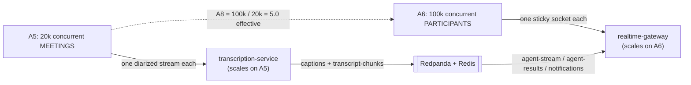
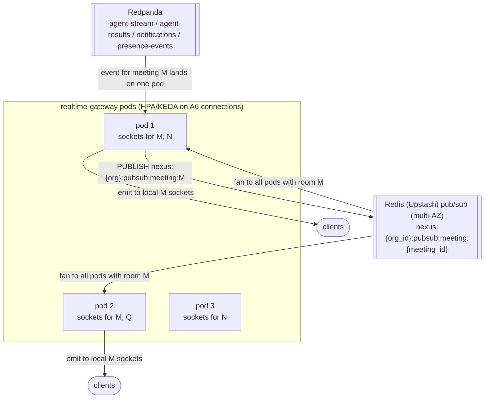
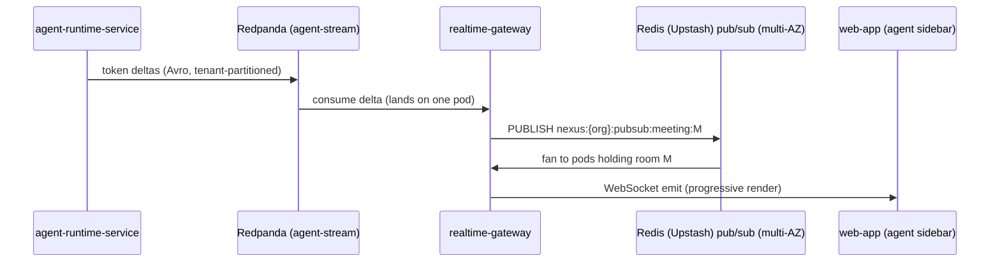
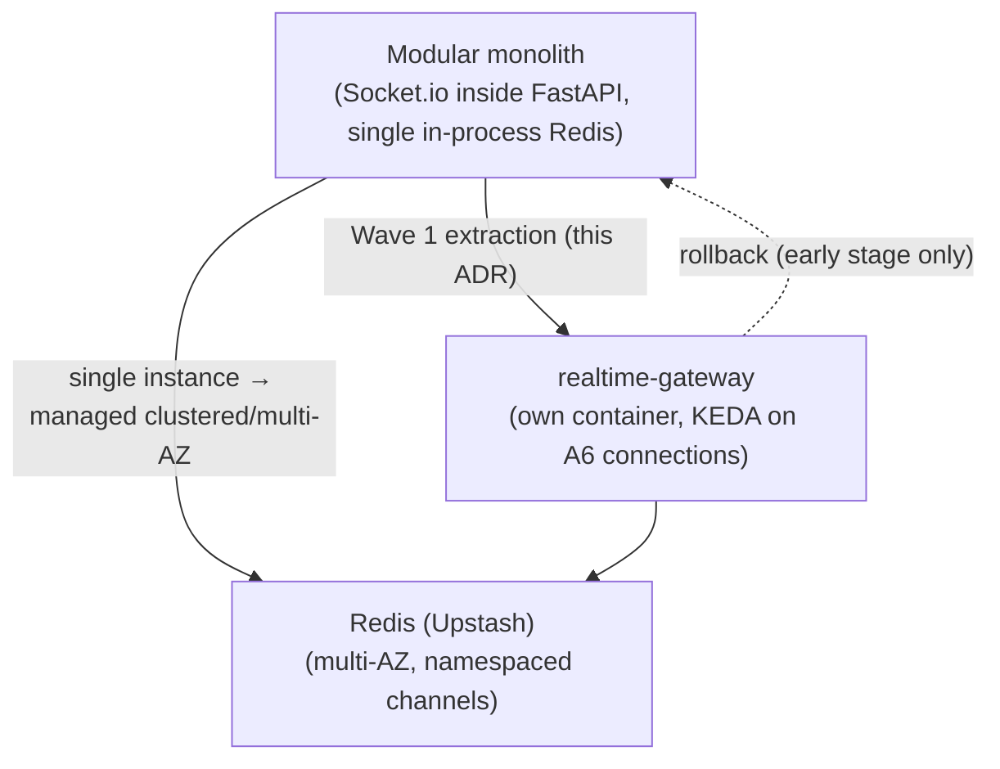

# ADR-0012: Real-time transport and a dedicated WebSocket gateway tier

This record splits non-AV real-time fan-out out of the FastAPI application into a dedicated, independently-scaled `realtime-gateway` tier — Socket.io over WSS, backed by a managed Redis (Upstash) pub/sub backbone — anchored on connections (`A6`) rather than meetings (`A5`), mitigating the at-scale fan-out risk **R19**.

## Related documents

- [Real-time & Transcription](../10-realtime-and-transcription.md) — the runtime spec this ADR decides for: `realtime-gateway` §4, streamed agent output §5, the per-path latency budget §6.
- [Container Architecture](../03-container-architecture.md) — the C4 L2 view that places `realtime-gateway` and `transcription-service` in the real-time scaling family (`meeting-service` is the CRUD-tier LiveKit transport adapter).
- [Meeting SDK — LiveKit](0003-meeting-sdk-livekit.md) — the *media* transport decision; this ADR is its non-AV counterpart and deliberately leaves all media on LiveKit.
- [Service Catalog](../_canon/01-service-catalog.md) — `realtime-gateway`, `transcription-service`, `meeting-service`, `agent-runtime-service`, `notification-service` ownership and sync-API boundaries.
- [Canonical Data Model](../_canon/02-data-model.md) — §5 Redis key namespaces (`presence`, `pubsub`, `queue`), the channels and queues this tier owns.
- [Event-Driven Architecture](../07-event-architecture.md) — `agent-stream`, `agent-results`, `notifications`, `presence-events` schemas and partition keys.
- [Capacity & Scaling Math](../_canon/05-capacity-math.md) — anchors `A5`/`A6`/`A8`/`A10`, and `E8` (the `agent-stream` event count this tier fans out).
- [Locked Tech & Architecture Decisions](../_canon/06-tech-decisions.md) — §2.1 (real-time fan-out), §2.7 (non-AV real-time), the authoritative decision rows this ADR justifies.
- [Multi-Tenancy & Isolation](../06-multi-tenancy.md) — namespaced Redis channels and `org_id` scoping of every socket.
- [Risk Register](../23-risk-register.md) — **R19** (mitigated by this ADR) and **R5** (the latency budget this tier serves).
- [Deployment & Infrastructure](../16-deployment-and-infrastructure.md) — the Kubernetes (EKS/GKE) substrate, ingress affinity, and KEDA signals.

---

## Status

**Accepted.** This ADR justifies the locked decision rows in [Tech Decisions §2.1 (real-time fan-out)](../_canon/06-tech-decisions.md) and [§2.7 (non-AV real-time)](../_canon/06-tech-decisions.md); that table remains the naming authority. It is the architectural-separation counterpart to [ADR-0003 (LiveKit media transport)](0003-meeting-sdk-livekit.md): ADR-0003 decides how *media* moves; this ADR decides how *non-AV real-time signals* (captions, presence, chat, agent sidebar output, streamed tokens, priority alerts) move.

---

## Context

### The PDF baseline

The NEXUS Execution Plan v2.1 specified, across Phases 3, 4, and 11, a **Socket.io server with rooms keyed by meeting ID** for all non-AV real-time events (chat, presence, agent outputs), a **Redis pub/sub backbone** so Socket.io could fan out across backend instances (Phase 11), **streamed LLM tokens** (LiteLLM stream → Redpanda `agent-stream` Avro deltas → WebSocket → UI), a **per-user priority queue** so urgent alerts pre-empt routine notes, **live captions within 2 s** of speech, and the **end-to-end agent latency budget** of p50 < 2 s / p95 < 4 s (Deepgram ~1 s + LLM ~0.8 s + network). Critically, the PDF ran **all of this inside the single FastAPI application** — the same process that served the CRUD API also held the WebSocket connections and ran the Socket.io fan-out.

That is correct for a 4-person team and a `2 orgs × 10 users × 5 meetings` seeder. It does not survive the production capacity anchors.

### The forces

The decision is driven almost entirely by **connection count and fan-out amplification**, not by feature surface (Socket.io already covers every feature the PDF named). The frozen anchors in [Capacity Math §2](../_canon/05-capacity-math.md) make the structural problem concrete:

| Anchor | Value | Why it bears on the WebSocket tier |
|---|---|---|
| `A6` — peak concurrent participants | **100,000** | Each participant holds **one long-lived sticky WebSocket** for the meeting's lifetime. This is the tier's ground-truth sizing number. |
| `A5` — peak concurrent meetings | **20,000** | The number of `meeting_id` Socket.io rooms; also the `transcription-service` stream count. Distinct from `A6`. |
| `A8` — effective participants/meeting | **5.0** | `100k / 20k`; reconciles A5 vs A6. A room averages 5 connected sockets, so per-room fan-out targets ~5 sockets that may be spread across pods. |
| `A10` — peak:average ratio | **4 : 1** | Connection churn is bursty; the tier must scale on a connection signal, not a request signal. |
| `E8` — `agent-stream` deltas/meeting | **1,260** | Streamed token deltas dominate event *count*. Every delta must be fanned out to the right participant's socket — this is the amplification load. |

Four forces dominate:

1. **Connections scale on a different axis than meetings.** `transcription-service` scales on `A5` = 20,000 streams (one diarized Deepgram stream per meeting). The connection plane scales on `A6` = 100,000 sockets. The `A8` = 5.0 reconciliation is precisely why these are *not* interchangeable: 20,000 meetings carry ~100,000 live connections, not the `20,000 × 6` = 120,000 nominal roster. Coupling them onto one autoscaler forces one to over-provision for the other's load.

2. **A WebSocket is sticky; a REST request is not.** A long-lived TCP connection must stay pinned to the pod that owns it for its lifetime. The CRUD/API tier is stateless and scales on req/s with no affinity; mixing 100,000 sticky sockets into it breaks the stateless scaling model, makes rolling deploys evict live meetings, and couples the API tier's restart cadence to in-meeting users.

3. **Fan-out is cross-pod and amplifying.** A connection for meeting `M` may land on any pod, but an `agent-results`, caption, or `agent-stream` delta for `M` arrives at *one* pod from the bus. At `E8` = 1,260 deltas/meeting × 4.8M meetings/month, the fan-out path is the highest-frequency hot loop in the system; it needs a backbone (managed Redis (Upstash) pub/sub, multi-AZ) that is sized for that one job, not shared with the API tier's incidental cache traffic.

4. **The latency budget (R5) is connection-bound on the last hop.** The p50 < 2 s / p95 < 4 s agent budget closes on the final fan-out hop — `agent-stream` → fan-out → socket. Head-of-line blocking on a congested socket (a routine note delta stuck in front of an urgent conflict banner) blows the budget for the alert that matters most. The per-user priority queue must live on this tier, next to the connection.

### Why this is its own ADR

[ADR-0003](0003-meeting-sdk-livekit.md) already moved **media** off the application onto a self-hosted LiveKit SFU scaling on `A6` participant *tracks*. This ADR addresses the **non-AV** half of the real-time tier — the data plane that LiveKit does *not* carry: captions, presence, chat, agent sidebar output, streamed tokens, and priority alerts. The two share the `A6` anchor and the real-time scaling family ([Container Architecture §8](../03-container-architecture.md)) but are different processes with different protocols (WebRTC media vs. WSS Socket.io) and different failure modes. Deciding them separately keeps each lock auditable.

---

## Decision

**NEXUS extracts non-AV real-time fan-out from the FastAPI application into a dedicated `realtime-gateway` tier: Socket.io over WSS, Socket.io rooms keyed by `meeting_id`, a managed Redis (Upstash) pub/sub backbone (multi-AZ) for cross-pod fan-out, sticky connections with stateless pods, and a per-user priority queue — autoscaled on concurrent WebSocket connections (`A6`), independently of `transcription-service` (`A5`) and the CRUD tier (req/s).** This matches [Tech Decisions §2.1 and §2.7](../_canon/06-tech-decisions.md) verbatim and is detailed at runtime in [Real-time & Transcription §4–§6](../10-realtime-and-transcription.md).

> [SaaS-scale adjustment] The PDF ran Socket.io and the Redis pub/sub backbone *inside* the single FastAPI application (Phases 3/4/11, single instance). At `A6` = 100,000 sticky connections fanning out `E8`-scale token deltas, the connection plane must scale on connection count while the API tier scales on req/s and transcription scales on stream count. `realtime-gateway` is therefore a **separate container with its own HPA/KEDA signal**, and the Redis pub/sub backbone is a **managed Redis (Upstash) deployment (clustered/multi-AZ)** with tenant-namespaced channels — neither of which the PDF's single in-process instance has.

The decision has six concrete, binding parts.

### 1. A separate tier, scaling on connections

`realtime-gateway` ([Service Catalog §3](../_canon/01-service-catalog.md)) is a standalone container in the **real-time scaling family** ([Capacity §2.1](../_canon/05-capacity-math.md)). Its KEDA autoscaler signals on **concurrent WebSocket connections** (anchor `A6` = 100,000 peak), exported as a gauge per pod and summed across the fleet — never on req/s, which would mis-size a tier whose load is held connections, not request throughput.

| Tier | Service(s) | Autoscaler signal | Anchor |
|---|---|---|---|
| CRUD / control plane | `api-gateway`, `bff`, `core-api`, … | HTTP req/s, p95 latency | — |
| Real-time (media) | LiveKit SFU ([ADR-0003](0003-meeting-sdk-livekit.md)) | Concurrent participant tracks | `A6` |
| **Real-time (non-AV)** | **`realtime-gateway`** | **Concurrent WebSocket connections** | **`A6`** |
| Real-time (transcription) | `transcription-service` | Concurrent live streams | `A5` |

It owns **no durable data** — only ephemeral connection state and the Redis structures below. It is the *sole consumer authorized to fan agent output and notifications to client sockets*; the `notification-service` remains the sole fabric authorized to fan `notifications` to *external* channels (email, Slack), so the two do not overlap ([Service Catalog §3](../_canon/01-service-catalog.md)).

### 2. Socket.io rooms keyed by `meeting_id`; sticky connection, stateless pod

Socket.io rooms are keyed by `meeting_id` (PDF, carried verbatim). The connection is sticky; the pod behind it is stateless.

- **Sticky at the edge.** The `api-gateway`/ingress uses connection-hash (or `sid` cookie) affinity so a participant's socket stays pinned to one `realtime-gateway` pod for its lifetime. This is *connection* stickiness, not session stickiness — no user state is bound to the pod.
- **Stateless behind it.** Room membership, fan-out, presence sets, and the per-user priority queue all live in Redis. Any pod can serve any meeting; losing a pod loses only its live sockets, which reconnect elsewhere with **no data loss** because every durable fact is already in Postgres (`transcript_chunks`, confirmed `decisions`/`action_items`, `chat_messages`) or Redpanda.

> [SaaS-scale adjustment] The "sticky connection, stateless pod" split is the property that lets `realtime-gateway` belong to the *stateless-services / durable-stores* invariant ([Container Architecture](../03-container-architecture.md)) despite holding 100,000 live connections. The PDF's single-instance Socket.io server had no such separation because there was nothing to fan out *across*.

### 3. Managed Redis (Upstash) pub/sub backbone, tenant-namespaced

Cross-pod fan-out uses the Socket.io Redis adapter against a **managed Redis (Upstash) deployment (clustered/multi-AZ, not a single instance)**, publishing on the canonical channel `nexus:{org_id}:pubsub:meeting:{meeting_id}` ([Data Model §5](../_canon/02-data-model.md)). A bus event for meeting `M` arriving at one pod is published to that channel; every pod holding a socket in room `M` receives it and emits to its local sockets.

| Redis structure | Key namespace | Purpose | Owner |
|---|---|---|---|
| Pub/sub channel | `nexus:{org_id}:pubsub:meeting:{meeting_id}` | Cross-pod Socket.io fan-out | `realtime-gateway` |
| Presence set | `nexus:{org_id}:presence:{meeting_id}` | Live presence membership for a room | `realtime-gateway` |
| Priority queue | `nexus:{org_id}:queue:agent:{user_id}` | Per-user priority queue (urgent pre-empts notes) | `realtime-gateway` |

> [SaaS-scale adjustment] The PDF specified Redis pub/sub for Socket.io fan-out (Phase 11) but as a single in-process Redis instance in the monolith with unscoped keys. At `A6` = 100,000 connections the backbone is the canon-locked managed **Redis (Upstash)** run in a clustered/multi-AZ configuration, and every channel/set/queue is prefixed `nexus:{org_id}:…` so fan-out, eviction, and per-tenant flush (on RTBF or plan change) are tenant-isolated ([Multi-Tenancy](../06-multi-tenancy.md), [Data Model §5](../_canon/02-data-model.md)).

### 4. Streamed agent output rides `agent-stream`, never a direct push

The agent sidebar renders LLM tokens progressively. The path is fixed: **LiteLLM stream → `agent-stream` topic (Avro token-delta envelope) → `realtime-gateway` → WebSocket → UI**. `realtime-gateway` consumes `agent-stream`, `agent-results`, and `notifications` from the bus and fans them to sockets; it never holds a direct socket from the agent process.

> [SaaS-scale adjustment] Routing token deltas through the tenant-partitioned `agent-stream` topic (rather than pushing straight from the agent process to the socket) decouples the agent tier's autoscaler (token throughput) from the connection tier's (`A6`). The bus absorbs the impedance mismatch and gives the deltas tenant-partition isolation so a noisy tenant cannot starve another's stream. `agent-stream` is fan-out only — `agent-results` is the **durable** record written via `core-api`, so a dropped socket loses no confirmed output.

### 5. Per-user priority queue: urgent pre-empts routine

A congested socket must never let a routine note delta block an urgent alert (conflict banner, workload warning). The per-user priority queue `nexus:{org_id}:queue:agent:{user_id}` ([Data Model §5](../_canon/02-data-model.md)) is the head-of-line-blocking mitigation the latency budget (R5) depends on.

| Priority | Examples | Pre-emption |
|---|---|---|
| Urgent | Conflict banner, workload warning, dependency warning | Jumps the queue; emitted before any routine delta |
| Routine | Live note deltas (`My Notes` worklog), suggestion cards | Yielded behind urgent items on a saturated connection |

This is the PDF Phase 11 priority queue, now per-tenant-namespaced and owned by `realtime-gateway`.

### 6. Captions, presence, chat, and reconnect

`realtime-gateway` carries the live, ephemeral surfaces; the durable surfaces stay with their owning services.

| Surface | Carried by `realtime-gateway` | Durable system of record |
|---|---|---|
| Live captions (Deepgram interim + final) | Yes, WebSocket emit, p95 < 2 s ([Capacity §11.1](../_canon/05-capacity-math.md)) | `transcript_chunks` (finals only, `transcription-service`) |
| Presence | join/leave → `presence-events`; live set in Redis | `presence-events` topic (analytics) |
| In-meeting chat | Emit to room | `chat_messages` (`meeting-service`, [Data Model §2.1](../_canon/02-data-model.md)) |
| Agent sidebar output / decisions / actions | Yes (progressive) | `agent-results`, `decisions`, `action_items` via `core-api` |

**Reconnect:** Socket.io auto-reconnect with exponential backoff; on reconnect the client re-joins the `meeting_id` room and **re-hydrates** caption/agent history from `core-api` (durable), so a dropped socket never loses transcript or confirmed agent output. This is why connection loss is a UX blip, not data loss.

---

## Consequences

### Positive

- **Connections and meetings scale on their true anchors.** `realtime-gateway` on `A6` = 100k connections, `transcription-service` on `A5` = 20k streams; neither over-provisions for the other (the architectural mitigation for **R19**).
- **The CRUD/API tier stays stateless and deployable.** Rolling deploys and HPA on `core-api`/`bff` no longer evict live meeting sockets; in-meeting users are insulated from API release cadence.
- **Fan-out is operated as a first-class hot loop.** The managed Redis (Upstash) backbone is sized and monitored for the `E8`-scale delta volume specifically, not as incidental cache traffic.
- **The latency budget's last hop is protected.** The per-user priority queue lives next to the connection, so urgent alerts pre-empt routine deltas and the R5 p95 < 4 s budget holds under congestion.
- **Tenant isolation reaches the socket.** Namespaced channels/sets/queues and per-socket `org_id` scoping mean fan-out can never cross an org boundary, and per-tenant flush is clean.

### Negative — accepted

- **A new sticky-connection tier to operate.** Connection-hash/`sid` affinity at the ingress and graceful connection draining on pod shutdown are net-new SRE responsibilities ([Deployment & Infrastructure](../16-deployment-and-infrastructure.md), [Observability & SRE](../15-observability-and-sre.md)). The fan-out backbone is the canon-locked managed **Redis (Upstash)**, so cluster *operation* itself is not an SRE responsibility — Upstash runs the cluster — but the tier now carries a hard runtime dependency on its availability.
- **The managed Redis (Upstash) pub/sub backbone is a shared dependency on the live path.** An Upstash AZ/region partition degrades cross-pod fan-out for every meeting simultaneously; mitigated by Upstash's multi-AZ posture and the fact that durable state (Postgres/Redpanda) is never on this path, so degradation is "captions/agent output stall," not "data loss."
- **One more deploy unit in the early stage.** In the modular-monolith phase ([Service Catalog §7](../_canon/01-service-catalog.md)), `realtime-gateway` is one of the **Wave 1 always-separate** extractions (connection-scaled), so it is split from day one even on Railway/Render — a small early-stage operational cost paid up front to avoid re-cutting the seam later.

### What we accept

We accept running a dedicated sticky-connection tier and depending on the managed Redis (Upstash) fan-out backbone in exchange for connection-axis autoscaling, a stateless deployable API tier, and a protected latency budget — because at `A6` = 100,000 sticky sockets fanning out `E8`-scale token deltas, keeping fan-out inside the FastAPI application is the dominant, non-negotiable scaling failure (R19). We accept that under extreme load the tier **degrades** rather than fails: it sheds low-priority agent output first and can fall back to caption-only fan-out, which is the explicit R19 fallback in the [Risk Register](../23-risk-register.md).

---

## Alternatives considered

| Alternative | Why not |
|---|---|
| **Keep Socket.io inside the FastAPI app (the PDF model)** | Correct for the seeder; fails at `A6` = 100k sticky connections. Couples the API tier's req/s autoscaler and rolling-deploy cadence to held connections, evicts live meetings on every API release, and shares the fan-out hot loop with incidental CRUD traffic. This is exactly the **R19** failure mode. |
| **Single Redis instance for pub/sub (PDF Phase 11)** | A single instance cannot absorb the `E8`-scale delta fan-out across 100k connections and is a single point of failure for *all* meetings at once. The canon-locked managed Redis (Upstash) in a clustered/multi-AZ configuration is required; namespacing `nexus:{org_id}:…` is required for tenant isolation. |
| **Push streamed tokens straight from `agent-runtime-service` to the socket** | Couples the agent tier's token-throughput autoscaler to the connection tier and creates an N×M mesh of agent-pod-to-gateway-pod sockets. Routing through the tenant-partitioned `agent-stream` topic decouples the autoscalers and gives per-tenant isolation; the bus is the correct impedance buffer. |
| **Server-Sent Events (SSE) instead of WebSockets** | SSE is unidirectional; chat and presence need a client→server channel, and a second SSE+HTTP path would double the connection model. One bidirectional Socket.io/WSS plane is simpler and is what the PDF locked. |
| **Carry agent output / captions over the LiveKit data channel** | Couples non-AV signaling to the media SFU, putting the latency budget and priority queue inside LiveKit's data plane and breaking the [ADR-0003](0003-meeting-sdk-livekit.md) separation of media from data. The SFU scales on tracks, not on the per-user priority semantics agent output needs. Media stays on LiveKit; data stays on `realtime-gateway`. |
| **Managed real-time vendor (Pusher / Ably / Supabase Realtime)** | Re-introduces a per-connection/per-message vendor meter against `A6` = 100k connections and `E8`-scale deltas — the same per-unit-pricing trap rejected for media in [ADR-0003](0003-meeting-sdk-livekit.md) — plus a new subprocessor for live meeting content. Socket.io on our own K8s keeps the cost on compute we already run. |

---

## Migration & rollback notes

### From monolith to tier (the seam was drawn up front)

`realtime-gateway` is a **Wave 1** extraction in the modular-monolith → services split order ([Service Catalog §7](../_canon/01-service-catalog.md)): it is one of the always-separate, connection-scaled services pulled out first, alongside `transcription-service` and the GPU/agent tier. The migration is therefore not a re-cut of a domain seam — the seam exists from day one. The steps:

1. Run the Socket.io server as its own process/container with its own image, even in the early stage.
2. Point the ingress at it with connection-hash/`sid` affinity for `/socket.io` (and the WSS upgrade path) routes.
3. Move the Redis pub/sub backbone from the single in-process instance to a managed Redis (Upstash) clustered/multi-AZ deployment and namespace every channel/set/queue under `nexus:{org_id}:…`.
4. Switch `agent-runtime-service` to emit token deltas to the `agent-stream` topic; `realtime-gateway` consumes and fans out — no direct socket from the agent process.

### Rollback

Rollback is bounded and early-stage only. Because the contract is "consume `agent-stream`/`agent-results`/`notifications` from the bus and emit to `meeting_id` rooms," the fan-out logic can be re-collapsed into the FastAPI process **in the early stage** (before the first paying tenants land) by reverting the ingress affinity rules and pointing at a single Redis instance — no schema, topic, or client change. Past the early stage, the connection volume (`A6`) makes re-collapsing infeasible; the forward path (degrade under load: shed low-priority output, then caption-only) is the operational safety valve, not rollback.

### Phasing

Per [Roadmap & Phasing](../22-roadmap-and-phasing.md), Socket.io fan-out lands in the meeting-platform phase (PDF Phase 3), live captions in the real-time/transcription phase (Phase 4), and the Redis pub/sub backbone, streamed agent output, and priority queue in the real-time-polish phase (Phase 11). This ADR commits the *separation* up front so the Phase 11 backbone work lands on an already-extracted tier rather than forcing a mid-build re-architecture.
