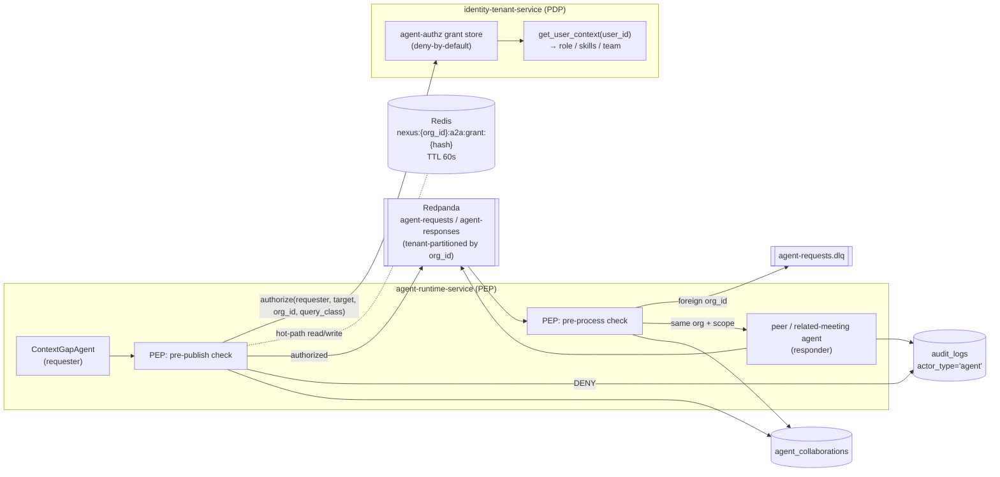
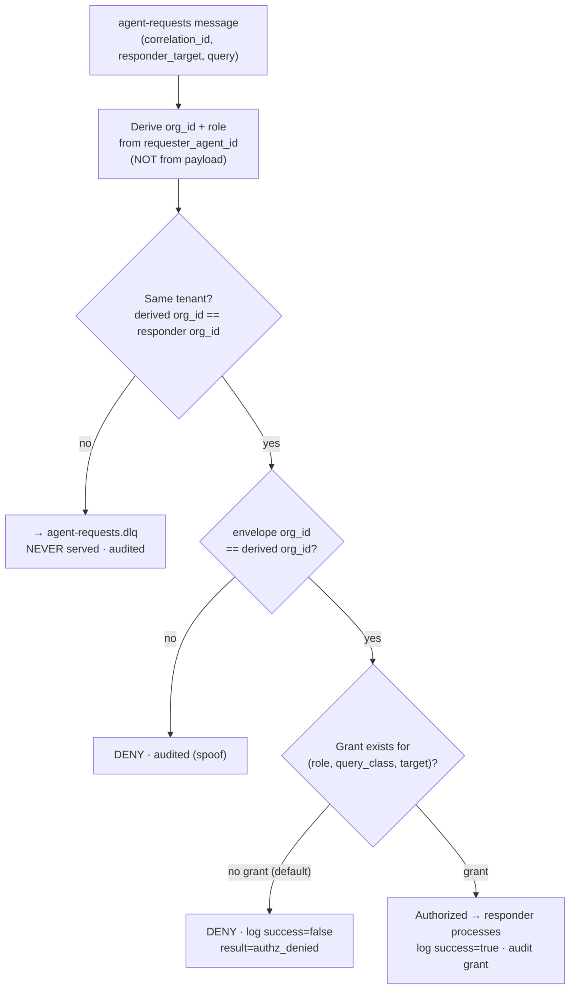
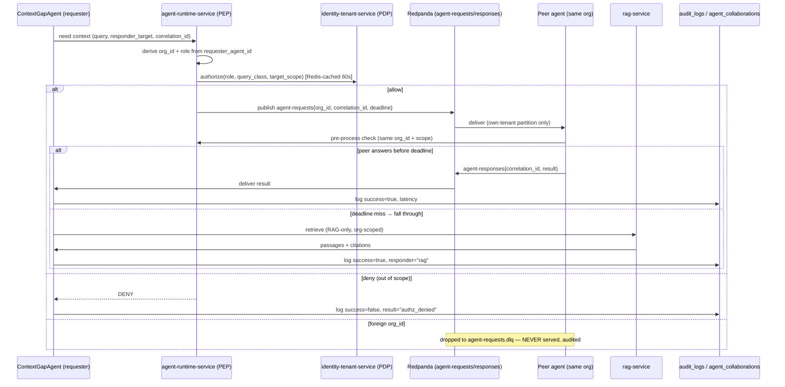

# ADR-0013: Agent-to-agent authorization protocol

This ADR locks how one participant's NEXUS agent is authorized to ask **another user's agent** for context over `agent-requests` / `agent-responses`: **deny-by-default**, **same-tenant-only**, **role/scope-checked**, and **fully audited**, with the authorization decision derived from the agent's bound identity and never from the message payload.

## Related documents

- [AI Agent Architecture](../08-ai-agent-architecture.md) — the six LangGraph agents, the `ContextGapAgent` fallback chain, the `AgentRequest`/`AgentResponse` envelope, and the §5.3 authorization rules this ADR formalizes.
- [Security Architecture](../11-security-architecture.md) — the authz middleware, the STRIDE multi-agent surface, and the `actor_type='agent'` audit trail.
- [Multi-Tenancy](../06-multi-tenancy.md) — §6.1 (the agent-to-agent isolation path), the `org_id` injection chokepoint, and tenant-keyed Redpanda partitions as the defense-in-depth backstop.
- [Event-Driven Architecture](../07-event-architecture.md) — the Avro envelope (`org_id`, `correlation_id`, …), tenant partitioning, and the per-topic DLQ this ADR routes foreign-tenant requests to.
- [Service Catalog](../_canon/01-service-catalog.md) — the canonical service names (`agent-runtime-service`, `identity-tenant-service`, `core-api`) and the agent-authz-grants ownership.
- [Canonical Data Model](../_canon/02-data-model.md) — the `agent_collaborations` schema, the `audit_logs` schema, and the `nexus:{org_id}:*` Redis namespaces.
- [Capacity & Scaling Math](../_canon/05-capacity-math.md) — the frozen A2A round-trip SLO (§11.1, p95 < 1.5s) and the collaboration volume (§6, E7 = 12 round-trips/meeting; §8, L4).
- [Locked Tech & Architecture Decisions](../_canon/06-tech-decisions.md) — §2.6 (agent-to-agent authz, deny-by-default), the row this ADR freezes.
- [ADR-0002: Multi-tenancy model](0002-multi-tenancy-model.md) — pooled+RLS / cell isolation, the tenant boundary this protocol must never cross.
- [ADR-0007: Event delivery — idempotency](0007-event-delivery-idempotency.md) — at-least-once + DLQ semantics on `agent-requests`/`agent-responses`.

---

## Status

**Accepted.** Supersedes nothing; this is the first ADR to formalize the agent-to-agent (A2A) authorization protocol. It freezes the row under [Tech Decisions §2.6](../_canon/06-tech-decisions.md) ("Agent-to-agent authz — deny-by-default, org/role scope checks, audited") and is the decision record behind [AI Agent Architecture §5.3](../08-ai-agent-architecture.md) and [Multi-Tenancy §6.1](../06-multi-tenancy.md), which carry the implementation detail. Any change to A2A authorization semantics, the grant model, or the audit contract must supersede this ADR.

---

## Context

### The PDF baseline

The NEXUS Execution Plan v2.1 introduced `ContextGapAgent` (Phase 10, the multi-agent collaboration piece flagged as **R6**, the most novel and least-proven feature). Its design, carried over verbatim:

- When the live conversation references context a participant lacks, the participant's `ContextGapAgent` asks **other users' agents** over the `agent-requests` / `agent-responses` topics.
- The `AgentRequest` / `AgentResponse` envelopes carry `requester_agent_id`, `responder_target`, `query`, `deadline`, and `correlation_id` (names verbatim).
- The fallback chain is **peer-agents → related-meeting agents → RAG → silent**: each hop has a deadline; on a miss the agent falls through; if all miss it stays silent rather than fabricate a fill.
- Every round-trip is logged to `agent_collaborations` (`requester`, `responder`, `query`, `result`, `success`, `latency`).

What the PDF did **not** define, because it was a 4-person team building a single-tenant modular monolith: any authorization on the request. In a single-tenant app there is one organization's data, so "ask any agent" is sound — every agent already sees the same tenant's meetings. There was no `org_id`, no role scope on the query, no audit of who asked whom for what, and no notion that a request could reach the wrong tenant because there was only ever one.

### The forces at SaaS scale

The locked SaaS posture serves **3,000 paying tenant organizations** across **5,000,000 registered users** ([Capacity §2, A1/A4](../_canon/05-capacity-math.md)) on **shared infrastructure** (pooled + RLS for the long tail, cells for enterprise — [ADR-0002](0002-multi-tenancy-model.md)). The agents run in a single multi-tenant `agent-runtime-service` fleet, and `agent-requests` / `agent-responses` are shared Redpanda topics. The PDF's "ask any agent" is now a **cross-tenant data-leak primitive**: an unauthorized request reaching another org's agent would exfiltrate that org's meeting context — the single most damaging confidentiality failure in the system.

| Force | Value | Source |
|---|---|---|
| Paying tenants sharing the bus | **3,000** | [Capacity §2, A4](../_canon/05-capacity-math.md) |
| A2A round-trips per meeting | **12** (`agent-requests` + `agent-responses`, E7) | [Capacity §6](../_canon/05-capacity-math.md) |
| `ContextGapAgent` synthesis calls / meeting | **12** (Sonnet, L4) | [Capacity §8](../_canon/05-capacity-math.md) |
| Meetings / month | **4,800,000** (R4) | [Capacity §3](../_canon/05-capacity-math.md) |
| A2A round-trip SLO | **p95 < 1.5s** | [Capacity §11.1](../_canon/05-capacity-math.md) |

Four forces dictate the decision:

1. **A request is processed by a peer in a multi-tenant fleet.** The same `agent-runtime-service` pods host agents for many orgs simultaneously. Nothing in the message itself proves the requester is who it claims; an attacker (or a bug) that sets `org_id`/`requester_agent_id` in the payload could address another tenant's agent. **Identity must be derived, not declared.**
2. **A leak is any over-share, not only a cross-org one.** Within one org, an IC's agent asking the CEO's agent about a board-comp meeting is also a confidentiality violation. Same-tenant scoping is necessary but **not sufficient**; the *query* must be scoped to what the requester's role may see.
3. **The check sits on a p95 < 1.5s live path.** The authorization decision is taken ~12 times per meeting, inside the live conversation budget. It must be **fast** (sub-millisecond hot path) and **fail-closed** — a decision system that adds latency or fails open is worse than no collaboration.
4. **Every A2A access must be attributable for SOC2 and incident response.** Who asked, who answered, what was asked, and whether it was granted or denied — for both grants and denials — must land in a tamper-evident audit trail ([Compliance & Privacy](../12-compliance-and-privacy.md)).

> [SaaS-scale adjustment] In the PDF, agents requested context freely because there was exactly one tenant. At SaaS scale that is a cross-tenant data leak. This ADR adds **deny-by-default agent-to-agent authorization with org + role scope checks and full audit logging** ([Tech Decisions §2.6](../_canon/06-tech-decisions.md)). The `ContextGapAgent` behavior, the envelope field names, the fallback chain, and the `agent_collaborations` log are all PDF-original and unchanged.

---

## Decision

NEXUS enforces a **policy-enforcement-point / policy-decision-point (PEP/PDP)** split on every A2A request, fail-closed, with the authorization decision bound to the agent's **derived identity**.

- **PDP — `identity-tenant-service`.** Owns the agent-authz grant store (`RBAC roles/grants`, `agent-authz scopes` — [Service Catalog](../_canon/01-service-catalog.md)). Answers a single question: *may agent X, bound to org A with role R, ask the query class Q of target T?* The decision is **deny-by-default**: absent an explicit grant, the answer is deny.
- **PEP — `agent-runtime-service`.** Calls the PDP before a responder agent is allowed to process an `agent-requests` message, and before a requester is allowed to publish one. Enforces the decision: authorized → serve; out-of-scope → DENY (audited); foreign `org_id` → DLQ, never served.



> [SaaS-scale adjustment] The `agent_collaborations` and `audit_logs` arrows above are **logical** logging, not direct writes by the agent tier. Per the [Service Catalog](../_canon/01-service-catalog.md), `agent-runtime-service` "Owns data = None (writes via `core-api` outbox semantics; reads context)" — it owns **no Postgres tables**. `agent_collaborations` is owned by `core-api`/`agent-service` ([Data Model §2.1](../_canon/02-data-model.md)), so its durable persistence flows through the **`core-api` transactional outbox**, never a cross-write from the agent tier — this matches the reconciliation [AI Agent Architecture §intro and the producer-reconciliation note](../08-ai-agent-architecture.md) already carry, so the two documents read consistently. (`audit_logs` is the one legitimate cross-cutting append target: every service appends with `actor_type='agent'`, per [Security Architecture STRIDE](../11-security-architecture.md).)

### 1. Identity is derived, never declared

The requester's `org_id` and role scope are resolved from the **bound identity** of `requester_agent_id`, not read from the message body. An agent identity is minted at spawn (`POST /agents/spawn`) and pins the agent to its principal user's `org_id` and RBAC role; `agent-runtime-service` holds that binding in process and re-asserts it on every PEP call.

> [SaaS-scale adjustment] The envelope's `org_id` field (added in [AI Agent Architecture §5.1](../08-ai-agent-architecture.md), SaaS-add on top of the PDF envelope) is treated as **untrusted input** for routing/partitioning convenience only. The authorization decision uses the *derived* `org_id` from `requester_agent_id`. If the envelope `org_id` disagrees with the derived `org_id`, the request is denied and the mismatch is audited — a spoof attempt.

This is the core security property: **a tenant boundary cannot be crossed by lying in the payload**, because the payload is not the source of identity.

### 2. The three rules (fail-closed, in order)

Carried verbatim from [AI Agent Architecture §5.3](../08-ai-agent-architecture.md), this ADR freezes them as the decision:

| # | Rule | Mechanism | On violation |
|---|---|---|---|
| 1 | **Same-tenant only** | `request.org_id` (derived) must equal the responder's bound `org_id`. Topics are tenant-partitioned by `org_id`, so a request is physically constrained to its tenant's partitions; the check is defense-in-depth on top of that. | Foreign `org_id` → **DLQ** (`agent-requests.dlq`), **never served**. Audited as a tenant-boundary violation. |
| 2 | **Role scope** | The requester's role (from `get_user_context(user_id)`) must hold a grant for the query class against the target. **Deny-by-default**: no grant ⇒ deny. | **DENY**, returned to requester; logged `agent_collaborations.success = false`, `result = 'authz_denied'`. |
| 3 | **Audit** | Every grant *and* every denial is appended to `audit_logs` (`actor_type = 'agent'`, append-only, tamper-evident — [Data Model §2.2](../_canon/02-data-model.md)) and reflected in `agent_collaborations.success`. | n/a (this rule is the record, not a gate). |



### 3. Grant model

> [SaaS-scale adjustment] No canon table name is frozen for the agent-authz grant store; [Service Catalog](../_canon/01-service-catalog.md) lists it as `agent-authz scopes` owned by `identity-tenant-service`. This ADR specifies the concrete schema below. It is a new, tenant-scoped relation in the `identity-tenant-service` store.

```sql
-- Owned by identity-tenant-service. RLS forced by org_id.
CREATE TABLE agent_authz_scopes (
    id              UUID PRIMARY KEY DEFAULT gen_random_uuid(),
    org_id          UUID NOT NULL REFERENCES organizations(id),
    grantee_role    TEXT NOT NULL,          -- requester's RBAC role (from get_user_context)
    query_class     TEXT NOT NULL,          -- e.g. 'meeting_context', 'decision_lineage', 'action_status'
    target_scope    TEXT NOT NULL,          -- 'same_team' | 'department' | 'org' | 'self'
    effect          TEXT NOT NULL DEFAULT 'allow' CHECK (effect IN ('allow','deny')),
    created_by      UUID NOT NULL,          -- admin who granted (audited)
    created_at      TIMESTAMPTZ NOT NULL DEFAULT now(),
    deleted_at      TIMESTAMPTZ,            -- soft delete; revocation
    UNIQUE (org_id, grantee_role, query_class, target_scope)
);
ALTER TABLE agent_authz_scopes ENABLE ROW LEVEL SECURITY;
ALTER TABLE agent_authz_scopes FORCE ROW LEVEL SECURITY;
CREATE POLICY tenant_isolation ON agent_authz_scopes
  USING (org_id = current_setting('app.current_org')::uuid);
```

**Deny-by-default semantics.** The PDP returns `allow` only when a matching, non-deleted `effect='allow'` row exists *and* no matching `effect='deny'` row exists (explicit deny wins). The absence of any matching row is a deny. A tenant's default posture (no rows) therefore disables A2A entirely until an admin grants — the safe default.

**`query_class` and `target_scope`** are derived by the PEP from the request: the `query` is classified (cheap, deterministic, no LLM) into one of the fixed `query_class` values, and `responder_target` resolves to a `target_scope` relative to the requester (same team / department / org / self). This keeps the PDP a pure lookup, not a semantic judgment.

### 4. Grant caching on the hot path

The PDP decision is needed ~12 times per meeting under a **p95 < 1.5s** round-trip budget. A synchronous Postgres round-trip per check would consume too much of the budget and couple A2A latency to control-plane DB load.

> [SaaS-scale adjustment] The PDF had no grants and no hot path. This ADR caches the **decision** (not the grant rows) in the tenant-namespaced Redis cache, consistent with the [Multi-Tenancy](../06-multi-tenancy.md) Redis-namespacing rule.

| Property | Value |
|---|---|
| Key | `nexus:{org_id}:a2a:grant:{grantee_role}:{query_class}:{target_scope}` |
| Value | `allow` / `deny` |
| TTL | **60 s** |
| Population | First miss calls the PDP; result cached |
| Invalidation | On grant create/revoke, `identity-tenant-service` deletes matching keys via `nexus:{org_id}:a2a:grant:*`; the 60 s TTL is the backstop if invalidation is missed (`tenant-events` is **not** used for this — per canon that topic is lifecycle-scoped: provisioned/suspended/deleted) |

**Accepted staleness window.** A revoked grant can be honored for up to 60 s after revocation if cache invalidation is lost. This is acceptable: A2A surfaces *meeting context within the same org* (never cross-tenant, which is enforced by partitioning + Rule 1 and is never cached as `allow` for a foreign org), and the worst case is a same-org over-share for under a minute, fully audited and reversible. We trade a bounded same-org staleness window for staying inside the p95 < 1.5s budget. Cross-tenant scoping (Rule 1) is **never** cached as a positive decision across orgs because the cache key is itself `org_id`-namespaced.

### 5. Where it sits in the collaboration sequence

The authorization gate is the first thing that happens on the publish side and on the process side; it precedes any network hop or LLM call. The frozen end-to-end constraint is **p95 < 1.5s** for the round-trip ([Capacity §11.1](../_canon/05-capacity-math.md)); per-hop deadlines are tuned operationally against that envelope and are **not** canon numbers.



The fallback chain is unchanged from the PDF: **peer-agents → related-meeting agents → RAG → silent**. Authorization failure or a deadline miss falls through the *same* chain to `rag-service` (itself org-scoped per [Multi-Tenancy §3.2](../06-multi-tenancy.md)) and ultimately to silence — **never** to a cross-tenant source.

---

## Consequences

### Positive

- **Cross-tenant leak is structurally impossible**, not merely checked: identity is derived from the bound `requester_agent_id`, topics are tenant-partitioned, and a foreign `org_id` is DLQ'd before any processing. Two independent layers (partition + authz) must both fail to leak.
- **Intra-tenant least privilege.** Role-scoped grants stop same-org over-share (the IC-asks-CEO case), which same-tenant scoping alone would miss.
- **Full attributability.** Grants and denials both land in `audit_logs` (`actor_type='agent'`) and `agent_collaborations`, satisfying SOC2 access-logging and feeding the R5/R6 dashboards ([Observability & SRE](../15-observability-and-sre.md)).
- **Inside the latency budget.** The Redis-cached decision keeps the PEP/PDP check sub-millisecond on the hot path, preserving p95 < 1.5s.
- **No new infrastructure.** Grants live in the existing `identity-tenant-service` RBAC store; the cache uses the existing namespaced Redis. The PDP is a library call, not a network sidecar.

### Negative / costs

- **Tenants must configure grants to use A2A.** Deny-by-default means a fresh tenant has no A2A until an admin grants scopes (or accepts a sensible platform-default grant template). This is intentional friction; it is surfaced in the tenant admin console ([SaaS Business](../18-saas-business-architecture.md)).
- **Query classification is a fixed taxonomy.** `query_class` is a deterministic, enumerated mapping; a genuinely novel query class outside the taxonomy defaults to deny until the taxonomy is extended (version-controlled, reviewed in PR — like the role→topics taxonomy).
- **A control-plane dependency on the live path.** A2A authorization depends on `identity-tenant-service`/Redis. Mitigated by the 60 s decision cache (the live path survives a brief PDP outage on cache hits) and by fail-closed behavior (on a hard cache+PDP miss, deny → fall through to RAG, never serve).

### What we accept

- **A bounded same-org revocation staleness window (≤ 60 s).** A revoked grant may be honored briefly if invalidation is lost; the TTL is the backstop. Accepted because the exposure is same-org, audited, and reversible (§4). Cross-tenant is never cached positively.
- **A2A is descopable.** Per R6, if collaboration proves unreliable the entire protocol collapses to RAG-only context fill (see Migration/rollback). The authorization model is built so the descope is a config flip, not a redesign.

---

## Alternatives considered

| Alternative | Why not |
|---|---|
| **Allow-by-default within an org** (only block cross-tenant) | Rejected. A leak is any over-share, not only a cross-org one (Rule 2 rationale): within one tenant, an IC's agent reading a board-comp meeting via the CEO's agent is still a confidentiality violation. Deny-by-default with role scope is the only posture that contains intra-tenant exposure. |
| **Network/partition isolation only, no authz check** | Rejected. Tenant-keyed partitions are one layer; an application bug (mis-set partition key, mis-derived `org_id`) bypasses it silently. Defense-in-depth requires an *independent* authz assertion in addition to partitioning — [Multi-Tenancy §6.1](../06-multi-tenancy.md) treats partitioning as the backstop, not the gate. |
| **mTLS / agent-identity authentication only** (authenticate the agent, no role scope) | Rejected. Authenticating *which* agent is asking does not constrain *what* it may ask. mTLS proves identity but grants no query-level scope, so it cannot stop intra-tenant over-share. (Agent identity binding is still used — to derive `org_id`/role — but it is an input to authorization, not a substitute for it.) |
| **External policy engine / OPA sidecar (PDP over the network)** | Rejected. Adds a network hop to a p95 < 1.5s path evaluated ~12×/meeting, and the grant data already lives in the `identity-tenant-service` RBAC store. An in-process PDP backed by a 60 s Redis-cached decision is faster and avoids a new operational dependency. Revisit only if grant policy grows beyond what a relational lookup expresses. |
| **Trust the envelope `org_id` for the authz decision** | Rejected. The payload is untrusted (forgeable). Deriving identity from the bound `requester_agent_id` is the property that makes the boundary uncrossable by payload manipulation (§1). The envelope `org_id` is kept for routing/partitioning and cross-checked against the derived value to catch spoofs. |
| **Per-user (not per-tenant-role) ACLs on every agent pair** | Rejected. O(users²) grant explosion across 5M users; unmanageable and uncacheable. Role × query_class × target_scope grants are O(roles × classes), bounded and admin-comprehensible. |

---

## Migration / rollback notes

### Rollout (greenfield)

A2A authorization ships **with** `ContextGapAgent` in Phase 10 ([Roadmap & Phasing](../22-roadmap-and-phasing.md)). There is no pre-existing unauthorized A2A traffic to migrate; the protocol is authorized from its first message. Sequence: (1) create `agent_authz_scopes` via Alembic with RLS forced; (2) ship a platform-default grant template (e.g. `same_team` `meeting_context` for common roles) tenants can adopt or tighten; (3) enable the PEP check in `agent-runtime-service` behind a per-tenant flag; (4) enable globally once the eval/canary on ~1% of tenants is clean.

### Rollback — the R6 pre-authorized descope

> [SaaS-scale adjustment] R6 (multi-agent collaboration is the least-proven piece) carries a **pre-authorized descope**: collapse the fallback chain to **RAG-only** context fill and ship peer-agent collaboration as v2.

Because the fallback chain falls through to `rag-service` (org-scoped by construction — [Multi-Tenancy §3.2](../06-multi-tenancy.md)), the descope is a **config flip**, not a redesign:

1. Set the platform/tenant flag to disable the peer-agents and related-meeting-agent hops; `ContextGapAgent` skips straight to the RAG hop.
2. No `agent-requests` / `agent-responses` are published; the authorization protocol is dormant but intact.
3. Context fill stays **inside the tenant** by construction — RAG retrieves only the requester's own org's vectors and graph.
4. Re-enabling peer collaboration is the reverse flip; no schema or data migration is required because `agent_authz_scopes` and the audit trail persist unused.

This keeps the most novel feature reversible at runtime while never compromising the tenant boundary — the boundary is enforced by partitioning + RAG org-scoping even when the authorization protocol is switched off.

### Forward path

If grant policy outgrows the relational lookup (e.g. attribute-based conditions on meeting sensitivity), migrate the PDP to a richer policy representation **inside** `identity-tenant-service` (keeping it in-process) before considering an external engine; the PEP/PDP split means the PEP and the audit/cache contracts are unaffected. Any such change supersedes this ADR.
