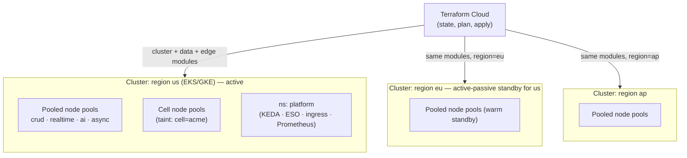
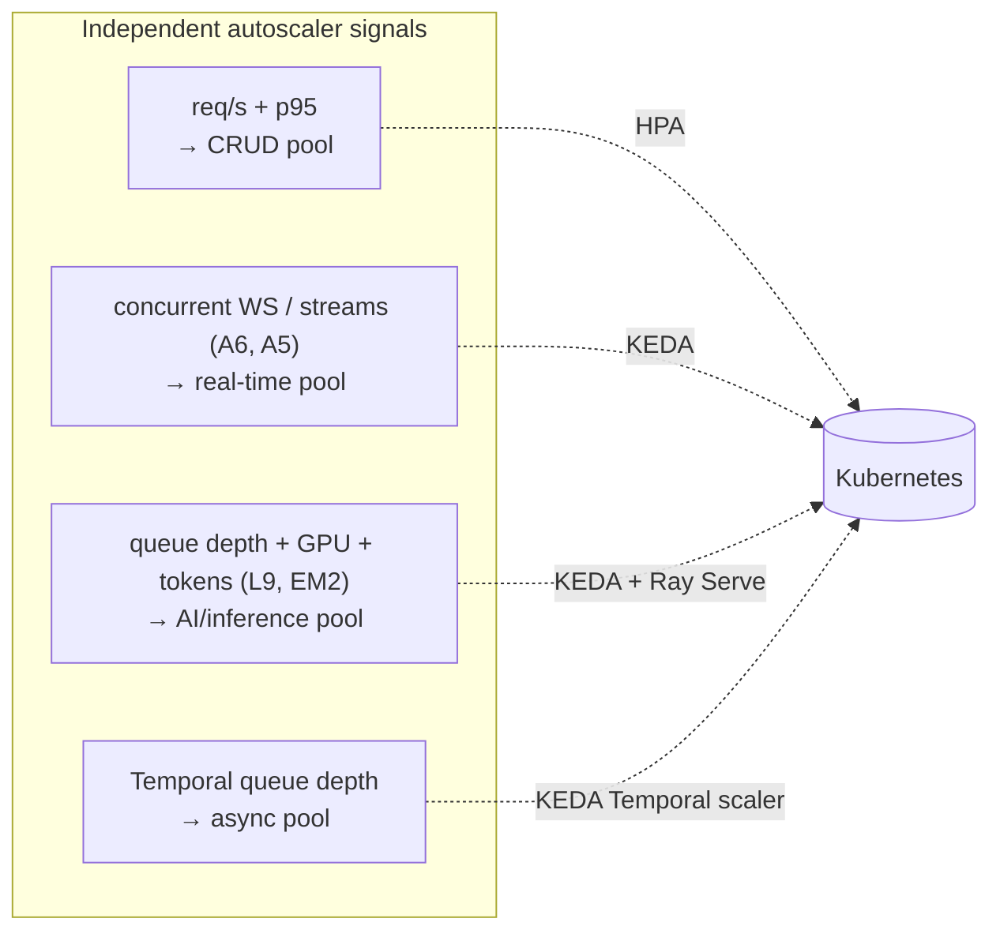
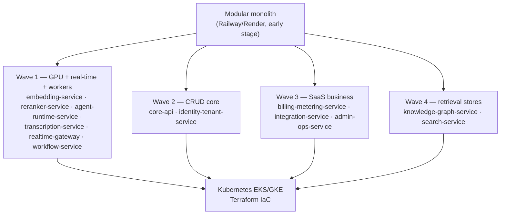

# ADR-0014: Compute platform — Kubernetes (EKS/GKE) + Terraform IaC

This ADR locks the NEXUS production compute substrate at **Kubernetes (EKS/GKE) provisioned by Terraform IaC**, with one cluster per region, four family-aligned node pools, family-specific autoscalers (HPA/KEDA/Ray Serve), and Railway/Render preserved only as the sanctioned early-stage modular-monolith fast path.

## Related documents

- [Deployment & Infrastructure](../16-deployment-and-infrastructure.md) — the full topology, node pools, Terraform layers, GitOps pipeline, and migration mechanics this ADR decides.
- [Service Catalog](../_canon/01-service-catalog.md) — the canonical service names, the three scaling families (§4), and the frozen Wave 1–4 split order (§7).
- [Capacity & Scaling Math](../_canon/05-capacity-math.md) — the frozen anchors (`A5`, `A6`, `A10`, `L9`, `EM2`) that drive autoscaler signals and replica floors.
- [Tech & Architecture Decisions](../_canon/06-tech-decisions.md) — the locked `Compute platform`, `Region strategy`, `Inference/CRUD separation`, and `Containerization` rows (§2.1, §2.5, §2.14).
- [Multi-Tenancy & Tenant Isolation](../06-multi-tenancy.md) — pooled + RLS, and the dedicated **cell node pools** (taints/affinity) for enterprise tenants.
- [RAG Pipeline & Inference Serving](../09-rag-and-inference-serving.md) — `embedding-service` / `reranker-service` GPU autoscaling on Ray Serve / vLLM.
- [ADR-0008: Dedicated autoscaling inference services for embeddings and reranking](0008-dedicated-inference-serving.md) — the authoritative decision locking `embedding-service` / `reranker-service` onto GPU off the API tier (the GPU node pool this substrate builds).
- [ADR-0009: Data residency and multi-region topology](0009-data-residency-multi-region.md) — the authoritative decision for the `us`/`eu`/`ap` residency zones and the multi-region active-passive → active-active topology this substrate realizes as one cluster per region.
- [Event-Driven Architecture](../07-event-architecture.md) — Redpanda topics and KEDA-on-consumer-lag for the AI/async tiers.
- [Reliability & DR](../14-reliability-and-dr.md) — multi-region active-passive, failover, RPO/RTO.
- [Cost & FinOps](../17-cost-and-finops.md) — per-family cost centers, spot/on-demand mix, GPU bin-packing.
- [Compliance & Privacy](../12-compliance-and-privacy.md) — data residency pinning compute to a region.

---

## Status

**Accepted.** Supersedes nothing; this is the first ADR to formalize the compute substrate. It freezes the `Compute platform`, `Region strategy`, and `Containerization` rows under [Tech Decisions §2.1 / §2.14](../_canon/06-tech-decisions.md) and is the decision record behind [Deployment & Infrastructure](../16-deployment-and-infrastructure.md), which carries the implementation detail (node-pool shapes, Helm/Argo CD GitOps, rollout step weights). Any change to the compute platform, the IaC tool, or the region strategy must supersede this ADR.

This ADR pairs with — and does not re-decide — several adjacent locked decisions: tenancy (cells map to node pools) in [ADR-0002](0002-multi-tenancy-model.md), the GPU inference tier (`embedding-service` / `reranker-service` on GPU off the API tier) in [ADR-0008](0008-dedicated-inference-serving.md) and [§2.5](../_canon/06-tech-decisions.md), event delivery in [ADR-0007](0007-event-delivery-idempotency.md), and data residency / multi-region topology in [ADR-0009](0009-data-residency-multi-region.md). The LLM token cost center (gating/batching/tiering/caching/budgets that govern spend on `agent-runtime-service`) is owned separately by [ADR-0004](0004-llm-cost-control-pipeline.md) — distinct from the GPU node pool decided in ADR-0008. This ADR decides only *what the substrate is and why*.

---

## Context

### The PDF baseline

The NEXUS Execution Plan v2.1 specified, for hosting and compute:

- **Railway/Render** for services, **Cloudflare CDN**, **Supabase** for the database.
- **Docker Compose** for the repository (local orchestration of the modular monolith).
- **GitHub Actions** CI/CD with **staging deploy on merge**, **Sentry**, **Prometheus + Grafana**, structured JSON logs.
- A Phase-13 production-hardening line item: "production Postgres backups/PITR/read replica, Cloudflare, custom domain."

This was the correct call for the PDF's stated reality: a **4-person team** building an MVP against a **`2 orgs × 10 users × 5 meetings`** seeder. Railway/Render is git-push-to-deploy, zero infrastructure code, no cluster to operate. There was **one application, one environment, one host, one region**, no GPU tier, and no notion of tenants, regions, or per-tier scaling. Kubernetes would have been pure overhead.

> [SaaS-scale adjustment] Everything below is the SaaS-scale delta. The PDF had no Kubernetes, no Terraform, no multi-region story, no node pools, and no autoscaler-per-tier. The locked target is production multi-tenant SaaS for **A1 = 5,000,000 registered users** across **A4 = 3,000 paying tenant organizations** ([Capacity §2](../_canon/05-capacity-math.md)) — a regime the single-host model cannot reach. The PDF's CI/CD and observability stack (GitHub Actions, staging-on-merge, Sentry, Prometheus + Grafana, structured JSON logs, Docker Compose) **survives verbatim** and is the foundation the Kubernetes pipeline extends, not replaces.

### The forces at SaaS scale

The locked architecture is **event-driven microservices with an explicit modular-monolith → services evolution path**, organized into **three scaling families** ([Service Catalog §4](../_canon/01-service-catalog.md)). Each family has a different autoscaler signal and a different cost center. The substrate must let each scale and bill independently. Six forces dictate the decision:

| Force | Number / fact | Source |
|---|---|---|
| Peak concurrent meetings (transcription/LLM anchor) | **A5 = 20,000** | [Capacity §2](../_canon/05-capacity-math.md) |
| Peak concurrent participants (realtime fan-out anchor) | **A6 = 100,000** | [Capacity §2](../_canon/05-capacity-math.md) |
| Peak : average concurrency ratio (surge budget) | **A10 = 4 : 1** | [Capacity §2](../_canon/05-capacity-math.md) |
| LLM calls/sec at peak (token-scaled tier) | **L9 ≈ 8,930** | [Capacity §8](../_canon/05-capacity-math.md) |
| Embeddings/sec at peak (GPU tier) | **EM2 ≈ 525** | [Capacity §9](../_canon/05-capacity-math.md) |
| Regions for residency | **`us` / `eu` / `ap`** | [Data Model — `data_residency`](../_canon/02-data-model.md) |

1. **Three scaling families want three different machines.** The CRUD tier scales on HTTP req/s; the real-time tier (`realtime-gateway`, `transcription-service`) scales on long-lived WebSocket connections / live audio streams toward `A6` and `A5`; the AI/inference tier is one scaling family with a single signal *set* but heterogeneous hardware ([Service Catalog §4](../_canon/01-service-catalog.md)): `embedding-service` and `reranker-service` scale on **GPU utilization** (toward `EM2`), `agent-runtime-service` on **token throughput + chunk-backlog queue depth** (toward `L9`), and `rag-service` on **query req/s** — so the family needs both a GPU pool (embedding/reranker) and a high-CPU pool (agent-runtime/rag), mirroring [Deployment §2.3](../16-deployment-and-infrastructure.md). A general-purpose PaaS that scales one dimension (req/s or instance count) cannot drive a **KEDA-on-active-connections** signal for the real-time tier or a **GPU-utilization** signal for the embedding/reranker workloads. The substrate must support multiple, pluggable autoscaler signals on heterogeneous hardware (CPU pools, network-optimized pools, GPU pools) within one control plane.

2. **GPU inference must be a first-class node pool.** [ADR-0008](0008-dedicated-inference-serving.md) and [Tech Decisions §2.5](../_canon/06-tech-decisions.md) lock `embedding-service` and `reranker-service` onto **GPU via Ray Serve / vLLM, OFF the API tier**. Railway/Render has no GPU primitive, no node-pool concept, and no way to bin-pack GPU workloads or keep them off the CRUD autoscaler. The GPU pool must be a **hardware boundary** for *scaling-signal and latency isolation* — its autoscaler is GPU utilization (toward `EM2`), unrelated to CRUD req/s, and its sub-100ms embed / under-500ms-cold rerank budgets must not contend with batch or API work. This is distinct from the **LLM token cost center**, which dominates variable cost — 94% of variable cost is LLM API tokens routed via `agent-runtime-service` / `rag-service`, per [Capacity §10.1, C3](../_canon/05-capacity-math.md), and is governed by [ADR-0004](0004-llm-cost-control-pipeline.md). The GPU embedding/reranker node pool itself is a *small* fraction of variable spend (Qdrant ~$22k/mo vs LLM ~$18.3M/mo, [Capacity §10](../_canon/05-capacity-math.md)); its node-pool boundary is justified by scaling signal and latency, not by the 94% LLM share.

3. **Data residency pins compute to a region.** GDPR/CCPA residency ([Compliance](../12-compliance-and-privacy.md)) requires a tenant's data and the compute that touches it to live in the region recorded in **`data_residency.region`** (`us`/`eu`/`ap`). That mandates a **cluster per region** with deterministic, reproducible topology — not three hand-clicked PaaS projects that drift.

4. **Cell isolation needs hardware placement.** The locked tenancy model ([ADR-0002](0002-multi-tenancy-model.md)) gives large/enterprise tenants **dedicated cells** to remove noisy neighbors. A cell is, at the compute layer, a **dedicated node pool plus namespace with taints/affinity** ([Multi-Tenancy §3.6](../06-multi-tenancy.md)). That primitive does not exist on a PaaS.

5. **Multi-region active-passive → active-active.** The locked region strategy ([Tech Decisions §2.1](../_canon/06-tech-decisions.md)) and per-plan availability SLOs (Free 99.5%, Pro 99.9%, Enterprise 99.95% per [Capacity §11.2](../_canon/05-capacity-math.md)) require reproducible standby clusters, health-checked failover, and a substrate where bringing up a new region is a parameter change, not a project rebuild.

6. **The seams are already cut; deployment must follow them.** [Service Catalog §7](../_canon/01-service-catalog.md) freezes the **Wave 1–4** split order. The substrate must let services peel off the early monolith **in that exact order** without re-cutting a domain seam — i.e. it must support both the consolidated early deployable and the decomposed target on the same image/contract model.

These forces are mutually reinforcing: every one of them needs node pools, multiple autoscaler signals, GPU hardware, reproducible regional topology, and hardware-level tenant placement. That is the definition of Kubernetes + IaC.

---

## Decision

NEXUS runs on **Kubernetes (EKS or GKE) provisioned and governed by Terraform IaC**, locked as the `Compute platform` row in [Tech Decisions §2.1](../_canon/06-tech-decisions.md):

> **Kubernetes (EKS/GKE) + Terraform IaC; Railway/Render only for the early-stage build. Multi-region active-passive evolving to active-active.**

The decision has six binding parts.

### D1 — Kubernetes is the production substrate; Railway/Render is the early-stage fast path only

Production NEXUS runs on managed Kubernetes — **EKS on AWS, GKE on GCP** — chosen per the cloud account a region lives in; the workload manifests are cloud-agnostic Helm charts so the choice is per-region, not global. Railway/Render remains the **sanctioned build substrate for the modular monolith until the first paying tenants land** ([Tech Decisions §2.1](../_canon/06-tech-decisions.md)). The crossover is not a rewrite: the same Docker images, the same Redpanda topics, and the same sync path prefixes carry across (see D6 and Migration).

> [SaaS-scale adjustment] Keeping Railway/Render explicitly *in scope as the early path* is the deliberate hedge against premature complexity. A 4-person team does not operate a multi-region EKS fleet on day one. The architecture earns Kubernetes when the scaling-family, GPU, residency, and cell forces above actually bite — not before.

### D2 — One cluster per region; namespaces partition environment and family; cells are node pools

The topology composes three orthogonal axes ([Deployment §2](../16-deployment-and-infrastructure.md)):

| Axis | Mechanism | Values |
|---|---|---|
| **Region** | One Kubernetes cluster per region | `us`, `eu`, `ap` (matching `data_residency.region`) |
| **Environment** | Namespace prefix | `dev`, `staging` (shared non-prod cluster), `prod` (isolated) |
| **Cell** | Dedicated node pool + namespace with taints/affinity | `prod-cell-{slug}` per enterprise tenant |

Pooled (Free/Pro) tenants share the default family node pools and namespaces; cell-isolated tenants get a dedicated node pool, exactly as the tenancy contract requires.

> [SaaS-scale adjustment] The region × environment × cell composition is wholly added — the PDF had one host. It exists because (a) residency pins compute to a region and (b) the locked tenancy model maps a cell to **dedicated node pools (Kubernetes taints/affinity)** per [Multi-Tenancy §3.6](../06-multi-tenancy.md). Cells are placement *within* the microservices style, not a competing architecture.

### D3 — Four family-aligned node pools, each with its own autoscaler signal

The three scaling families from [Service Catalog §4](../_canon/01-service-catalog.md), plus the async/orchestration tier, become four node pools — each with the autoscaler the family's cost driver demands. **No node pool may scale on another family's signal.**

| Family (namespace) | Node pool | Autoscaler & signal | Anchor |
|---|---|---|---|
| **CRUD / control plane** (`prod-crud`) | General-purpose CPU; spot-tolerant for `bff` / `web-app` | **HPA** on HTTP req/s + p95 latency | API tier |
| **Real-time** (`prod-realtime`) | Network-optimized, **on-demand only** | **KEDA** on concurrent WebSocket connections / live audio streams | `A6` (100k), `A5` (20k) |
| **AI / inference** (`prod-ai`) | **GPU pool** (e.g. L4/A10) for `embedding-service` / `reranker-service`; high-CPU for `agent-runtime-service` / `rag-service` | **KEDA + Ray Serve autoscale** on queue depth / chunk backlog, GPU util, token throughput | `L9` (≈8,930), `EM2` (≈525) |
| **Async / orchestration** (`prod-async`) | General-purpose CPU; spot-tolerant | **KEDA (Temporal scaler)** on task-queue depth | Temporal queue |

The real-time pool is **on-demand, never spot**: spot reclamation would sever live WebSocket and Deepgram-proxy connections that `transcription-service` and `realtime-gateway` hold for the full meeting duration (`A9 ≈ 45 min`), which the latency budget (live captions < 2s; agent p50 < 2s / p95 < 4s, [Capacity §11.1](../_canon/05-capacity-math.md)) cannot tolerate. HPA/KEDA tuning uses **`A10 = 4:1`** as the surge budget; replica floors (engineering specifics, derived from the anchors, not new capacity numbers) live in [Deployment §2.3](../16-deployment-and-infrastructure.md).

> [SaaS-scale adjustment] Per-family node pools and per-family autoscalers are the architectural fix for PDF risks **R4** (LLM cost spiral) and **R5** (agent latency budget): the GPU/token-scaled inference cost center scales and bills independently of CRUD req/s, and the connection-scaled real-time tier never competes with batch inference for the same machine. The PDF coupled all of this onto one Railway/Render deployable.

### D4 — Terraform owns all cloud substrate; nothing is click-opped in production

**Terraform Cloud is the single control plane for cloud-provider state** ([Deployment §4](../16-deployment-and-infrastructure.md)). State is split per `(account, region, layer)` so a blast radius is bounded — a botched `prod/eu/data` apply cannot touch `prod/us/cluster`. Three module layers:

| Layer | Owns |
|---|---|
| `cluster` | EKS/GKE control plane, the four family node pools + per-cell tainted pools, IRSA / Workload Identity bindings |
| `data` | Supabase / managed Postgres (primary + read replica + PITR), Qdrant Cloud clusters, Redis (Upstash), Redpanda BYOC cluster, Temporal Cloud namespace |
| `edge` | Cloudflare CDN + WAF, DNS, custom domain, health-checked failover |

A new region is a new `region` variable instantiation of the same versioned `cluster` + `data` + `edge` modules — not a copy-paste. `plan` runs on every PR touching `terraform/`; `apply` is review-gated and runs from Terraform Cloud, never a laptop. `tfsec`/`checkov` gate the IaC for misconfiguration. Kubernetes *workloads* are delivered separately by Helm + Argo CD GitOps (the deploy step is a commit to the `nexus-deploy` repo bumping `image.digest`), so the cluster is always equal to git and rollback is a git revert ([Deployment §6](../16-deployment-and-infrastructure.md)).

> [SaaS-scale adjustment] Terraform IaC, the per-`(account, region, layer)` state split, BYOC Redpanda, and GitOps reconciliation are wholly added. The PDF's only infra-as-state note was the Phase-13 "Postgres backups/PITR/read replica," preserved here as the `data` layer's responsibility.

### D5 — Multi-region active-passive, evolving to active-active

Production runs **multi-region active-passive** ([Tech Decisions §2.1](../_canon/06-tech-decisions.md)): one active region per residency zone with a warm standby fed by async Postgres replication and cross-region object-storage replication, and Cloudflare health-checked DNS failover. Enterprise cells are the natural unit of the future **active-active** evolution because a cell already owns dedicated node pools and pinned data. Per-plan SLOs from [Capacity §11.2](../_canon/05-capacity-math.md) bind the posture: Free 99.5% (single-region), Pro 99.9% (active-passive), Enterprise 99.95% (cell, active-active candidate). DR mechanics (RPO/RTO, replication lag) are owned by [Reliability & DR](../14-reliability-and-dr.md).

### D6 — Containers carry across substrates; the image is the contract

Production images are built **once in CI** and **promoted by digest** through `dev → staging → prod` ([Tech Decisions §2.14](../_canon/06-tech-decisions.md)). **Docker Compose stays the source of truth for the local modular monolith** (carried verbatim from the PDF); K8s manifests are generated from a Helm chart, not from Compose. GPU inference images bake the BGE-small-en / BGE-reranker-base weights and the Ray Serve + ONNX/vLLM runtime at build time so a pod cold start is a *load*, not a model *fetch*. Because the image and the bus/sync contracts are identical on Railway/Render and on Kubernetes, the migration in §Migration is a redeploy, not a rebuild.

---

## Consequences

### Positive

- **Each scaling family scales and bills on its own signal and its own hardware.** The GPU inference cost center, the connection-scaled real-time tier, and the req/s CRUD tier never throttle one another — the direct fix for R4/R5.
- **GPU is a first-class node pool**, enabling Ray Serve / vLLM bin-packing and embed-on-ingest / query-embed-only economics for `embedding-service` and `reranker-service`.
- **Residency and cells are hardware-enforced**: a cluster per region honors `data_residency.region`, and a cell is a tainted node pool — defense-in-depth beneath the RLS / `org_id` isolation contract.
- **Reproducible, blast-radius-bounded infrastructure**: a new region is a Terraform variable change; a bad apply is contained to one `(account, region, layer)`.
- **GitOps makes "what is running where" answerable from git**, and rollback a revert — across N regional clusters.
- **The PDF stack survives**: GitHub Actions, Sentry, Prometheus + Grafana, structured JSON logs, and Docker Compose are unchanged; Kubernetes extends them.

### Negative

- **Operational complexity jumps**: cluster upgrades, node-pool lifecycle, KEDA/Ray Serve operators, Argo CD, and Terraform state management require platform-engineering skill the PDF's 4-person team did not need. Mitigated by *not* adopting K8s until paying tenants justify it (D1).
- **GPU node pools are expensive and lumpy**: GPU instances bin-pack worse than CPU and have minimum-size floors, so the AI pool carries idle cost between surges. Owned and tuned by [Cost & FinOps](../17-cost-and-finops.md).
- **On-demand-only real-time pool forgoes spot savings** — an accepted cost of connection durability (D3).
- **Multi-region multiplies fixed cost and config surface**: standby clusters cost money before they ever serve a failover.

### What we accept

- Managed Kubernetes is **not portable for free** across clouds; EKS and GKE differ in IRSA vs Workload Identity, load-balancer controllers, and GPU instance families. We accept per-cloud `cluster`-layer divergence and keep only the **workload** layer (Helm) cloud-agnostic.
- We accept that the early Railway/Render path and the production K8s path **coexist** during the modular-monolith era, with a one-time migration cost (§Migration), in exchange for not over-engineering the build phase.
- We accept idle GPU and standby-region cost as the price of the locked latency, residency, and availability SLOs.

---

## Alternatives considered

| Alternative | Why not |
|---|---|
| **Stay on Railway/Render at scale** (PDF baseline) | No GPU primitive, no node-pool concept, no multi-axis autoscaler (cannot drive KEDA-on-connections or GPU-util), no per-region reproducible topology, no cell placement. Fails forces 1–6 outright. Kept only as the early-stage fast path (D1). |
| **AWS ECS / Fargate (no Kubernetes)** | Simpler than K8s, but Fargate offers no GPU and ECS lacks the rich autoscaler ecosystem (KEDA scalers, Ray Serve integration) and the cell-as-node-pool placement model. Would force the GPU inference tier off-platform anyway, splitting the substrate. |
| **Serverless functions (Lambda / Cloud Run) for everything** | Cold-start and execution-duration limits are fatal for `transcription-service` and `realtime-gateway`, which hold WebSocket/Deepgram sessions for the full `A9 ≈ 45 min` meeting, and for long-lived Ray Serve GPU workers. Wrong execution model for the real-time and inference families. |
| **Nomad + Consul** | Lighter operationally, but a far smaller GPU-scheduling, autoscaler, and managed-control-plane ecosystem than EKS/GKE; the team would build what KEDA/Ray Serve/Argo give for free. Higher long-run cost for a self-managed control plane. |
| **Single-region Kubernetes** | Cheaper, but violates the locked residency requirement (`us`/`eu`/`ap`) and the Pro/Enterprise availability SLOs ([Capacity §11.2](../_canon/05-capacity-math.md)). Multi-region is non-negotiable, so the cluster topology is built for it from the start (D2/D5). |
| **Pulumi / CDK instead of Terraform** | Viable IaC engines, but Terraform's provider maturity (EKS/GKE, Cloudflare, Supabase, Qdrant, Redpanda) and Terraform Cloud's plan/apply/state-locking workflow are the lower-risk choice, and `tfsec`/`checkov` integrate cleanly. No force pulls toward a general-purpose language IaC here. |

---

## Migration / rollback notes

### Railway/Render → Kubernetes (forward migration)

Migration follows the **frozen Wave 1–4 order** from [Service Catalog §7](../_canon/01-service-catalog.md) — not a new sequence ([Deployment §11](../16-deployment-and-infrastructure.md)):

Each wave moves with the **strangler-fig** pattern, mechanical because every service is already a bounded context behind the locked sync transport and the Redpanda bus:

1. **Cut over the bus first.** The monolith already produces/consumes the canonical topics (`transcript-chunks`, `document-chunks`, `agent-results`, `decisions`, `actions`, …); pointing the extracted service at the same Redpanda topics requires no code change. At-least-once + idempotency ([ADR-0007](0007-event-delivery-idempotency.md)) makes a brief dual-running window safe — duplicates dedupe on `idempotency_key`.
2. **Repoint sync calls** from in-process to gRPC/REST via the service's stable path prefix ([Service Catalog §6](../_canon/01-service-catalog.md)).
3. **Run both, drain the monolith's copy, then delete the module.**

Wave 1 goes first precisely because Railway/Render *cannot* host it: GPU pools, KEDA-on-connections, and Temporal workers have no PaaS equivalent.

> [SaaS-scale adjustment] The migration *path* honors the PDF's Phase-13 production-hardening intent, but the *Wave ordering* and strangler-fig mechanics are SaaS-scale. The PDF never decomposed, so it had nothing to extract; the wave order exists because each wave is a single scaling family and a single ownership boundary, so no extraction re-cuts a domain seam.

### Rollback

Three rollback scopes, smallest to largest:

- **Workload rollback (routine):** Argo CD is git-backed — a deployment regression is a **`git revert` of the `image.digest` bump** in `nexus-deploy`; Argo reconciles the cluster back. This is the day-to-day rollback and needs no Terraform.
- **Infrastructure rollback:** Terraform state is versioned per `(account, region, layer)`; a bad `cluster`/`data`/`edge` apply rolls back by re-applying the prior module version, blast-radius-bounded to one layer in one region.
- **Substrate rollback (early stage only):** while the modular monolith still runs on Railway/Render, a Wave that misbehaves on Kubernetes can fall back to the monolith's still-running copy of that module — the dual-run window in step 3 above is the safety net. Once a module is deleted from the monolith, this fallback closes and rollback is workload/infra-scoped only.

### Trigger conditions (when to adopt K8s)

Adopt Kubernetes when any of: (a) the first paying tenants land (the contractual trigger in [Tech Decisions §2.1](../_canon/06-tech-decisions.md)); (b) GPU inference requires a dedicated node pool ([ADR-0008](0008-dedicated-inference-serving.md)); (c) an enterprise tenant requires a cell ([ADR-0002](0002-multi-tenancy-model.md)); or (d) a second residency region is sold. Until then, Railway/Render is correct and Kubernetes is deferred overhead.
