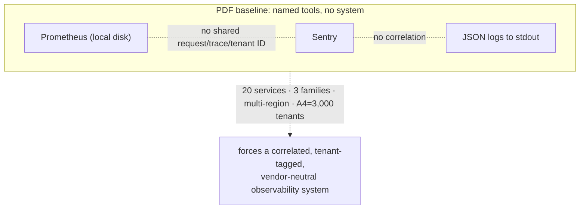
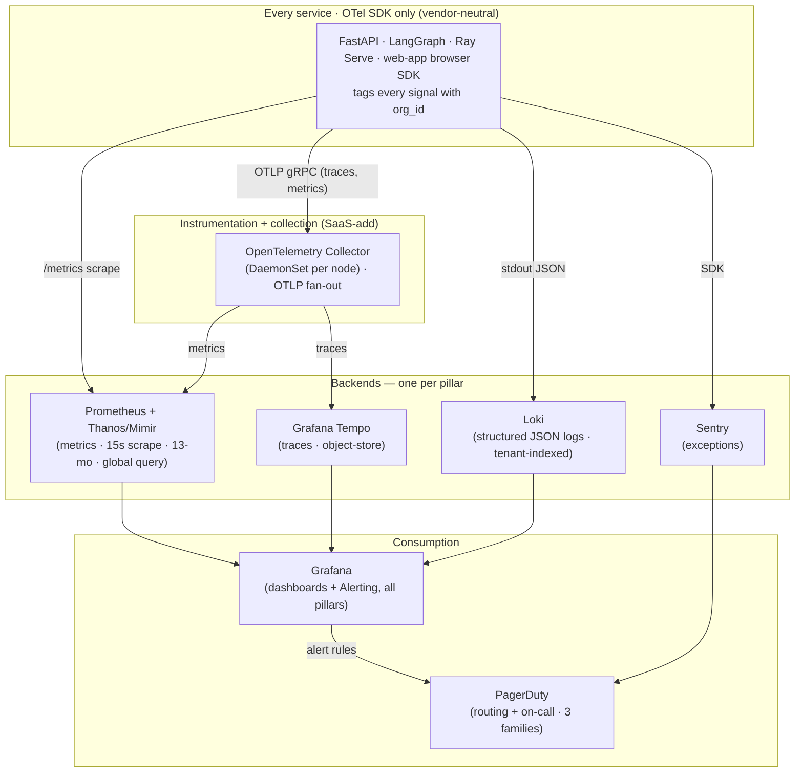
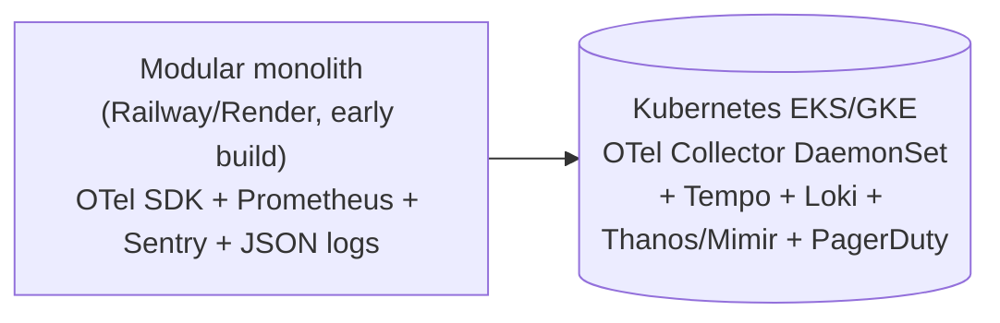

# ADR-0015: Observability stack — OpenTelemetry + Prometheus/Grafana + Sentry

This record locks the NEXUS production observability stack — OpenTelemetry as the vendor-neutral instrumentation layer feeding Prometheus + Grafana (metrics/dashboards), Grafana Tempo (traces), Loki (logs), and Sentry (exceptions), with Thanos/Mimir for long-term global metrics and PagerDuty for routing — and explains the forces, consequences, alternatives, and migration/rollback path.

## Related documents

- [Observability & SRE](../15-observability-and-sre.md) — **the design this ADR governs**: the telemetry pipeline, the metric/log/trace data model, cardinality rules, golden signals, domain dashboards, error-budget policy, PagerDuty on-call, runbooks, and game-days. This ADR records *why* that stack; doc 15 specifies *how it is operated*.
- [Locked Tech & Architecture Decisions](../_canon/06-tech-decisions.md) — §2.14 *Error tracking* (Sentry), *Metrics / dashboards* (Prometheus + Grafana), *Logging* (structured JSON logs), *Load testing* (k6/Locust); the rows this ADR is the authority behind.
- [Capacity & Scaling Math](../_canon/05-capacity-math.md) — the frozen SLO table (§11) and load anchors (`A1`, `A4`, `E12`, `L7`, `L9`, `C2`, `C3`) imported here by symbol, never re-derived.
- [Service Catalog](../_canon/01-service-catalog.md) — the canonical service names and the three scaling families (CRUD / real-time / AI-inference) every signal is tagged by.
- [Canonical Data Model](../_canon/02-data-model.md) — `usage_events`, `agent_budgets`, `audit_logs`, and the `nexus:{org_id}:*` Redis namespaces that feed cost and budget dashboards.
- [Multi-Tenancy & Tenant Isolation](../06-multi-tenancy.md) — the authz-middleware `org_id` chokepoint every metric, log, and span inherits its tenant tag from.
- [Event-Driven Architecture](../07-event-architecture.md) — consumer-lag and DLQ-rate signals jointly owned with doc 15.
- [Deployment & Infrastructure](../16-deployment-and-infrastructure.md) — the EKS/GKE node pools and OTel Collector DaemonSet this stack deploys onto.

---

## Status

**Accepted.** Locked. This ADR is the authority behind the [Tech Decisions §2.14](../_canon/06-tech-decisions.md) rows *Error tracking* = **Sentry** (`PDF`), *Metrics / dashboards* = **Prometheus + Grafana** (`PDF`), and *Logging* = **structured JSON logs** (`PDF`). It additionally **ratifies the SaaS-scale instrumentation and storage layer** — OpenTelemetry, Grafana Tempo, Loki, Thanos/Mimir, and PagerDuty routing — which the PDF did not name; an ADR is the sanctioned mechanism by which the canon is extended. It leaves `Accepted` only via a superseding ADR.

> [SaaS-scale adjustment] The §2.14 canon names only the three PDF-carried tools (Prometheus + Grafana, Sentry, structured JSON logs) plus k6/Locust. **OpenTelemetry, Tempo, Loki, Thanos/Mimir, and PagerDuty are not in §2.14** and are introduced here as SaaS-scale additions. This ADR is where they enter the locked-decision corpus.

---

## Context

### The PDF baseline

The NEXUS Execution Plan v2.1 named observability *tools* but no observability *system*. From the carried-over stack and [Tech Decisions §2.14](../_canon/06-tech-decisions.md):

| Carried over from PDF (unchanged) | Role |
|---|---|
| **Prometheus + Grafana** | Metrics and dashboards; "latency SLOs, consumer-lag and quota dashboards." |
| **Sentry** | Exception capture across frontend and backend. |
| **Structured JSON logs** | Machine-parseable logs. |
| k6 / Locust | Load testing (a sibling concern, not part of this stack). |

The PDF also folded "Prometheus/Grafana, security audit, observability everywhere" into a single Phase-13 hardening pass. For a 4-person team building an MVP against a `2 orgs × 10 users × 5 meetings` seeder, this is correct: a handful of dashboards watched by eye, one Prometheus on a local disk, Sentry on for crashes, JSON logs `grep`-ed in a terminal. No tenant correlation, no trace context across services, no error budgets, no on-call rotation.

What the PDF did **not** specify, and what SaaS scale forces:

- **No instrumentation contract.** Sentry and Prometheus were named, but nothing tied a metric, a log line, and an exception to the same request, the same trace, or the same tenant. There was no distributed tracing at all.
- **No telemetry data model.** No rule for what is a metric label vs. a log field vs. a span attribute — at the seeder you can label freely; at `A1 = 5,000,000` registered users a single unbounded label is a self-inflicted outage of the metrics tier.
- **No long-term, global-query metric store.** A single local-disk Prometheus cannot retain 13 months of per-tenant series or answer a cross-region query.
- **No operational layer.** No SLO-bound error budgets, no PagerDuty routing, no severity model.

### The forcing functions at SaaS scale

The locked SaaS posture ([Tech Decisions §2.1](../_canon/06-tech-decisions.md)) — **event-driven microservices** (the 20 services of [Service Catalog §3](../_canon/01-service-catalog.md)) across **three scaling families** and a **multi-region active-passive → active-active** topology — makes the PDF's tool-list-without-a-system untenable. Anchors imported by reference (do **not** re-derive — [Capacity §2, §6, §8, §10](../_canon/05-capacity-math.md)):

| Symbol | Quantity | Value | Consequence for observability |
|---|---|---|---|
| `A1` | Registered users | **5,000,000** | `user_id` can never be a metric label. |
| `A4` | Paying tenant organizations | **3,000** | `org_id` *is* a bounded, mandatory label; incidents are a tenant's incidents. |
| `E12` | Redpanda events/sec, peak | **~17,900** | A single local-disk Prometheus cannot retain or globally query this series volume. |
| `L7` / `L9` | LLM calls/month · peak/sec | **5.79B · ~8,930** | Agent latency and per-tenant token cost must be live, alertable signals. |
| `C2` / `C3` | Cost/MAU/mo · LLM share of variable cost | **~$9.73 · 94%** | LLM cost-per-tenant-per-day is a first-class, error-budgeted signal, not a monthly report. |

The forces in one list:

- **Cross-service correlation is mandatory.** A request crosses `api-gateway → bff → core-api`, an agent output crosses `transcription-service → agent-runtime-service → realtime-gateway`. Diagnosing a p95 regression or a stuck agent requires a single trace ID stitched across process boundaries — which Prometheus and Sentry cannot provide and the PDF never had.
- **Tenant attribution is the first question on every page.** At `A4 = 3,000` tenants, "which tenant(s)?" is the opening move of every incident. `org_id` must be on every series, log line, and span, sourced from the one authz-middleware chokepoint ([Multi-Tenancy](../06-multi-tenancy.md)).
- **Backends must be swappable without re-instrumenting.** Locking application code to a single vendor's SDK is the trap that an all-in-one commercial APM sets; at 20 services across multiple regions the cost of re-instrumenting to escape a vendor is prohibitive. The instrumentation layer and the storage backends must be decoupled.
- **Cardinality is a capacity problem.** At `A1`/`A5` scale, metric cardinality is itself sized, budgeted, and bounded — the same discipline applied to GPU and tokens elsewhere in the canon.

---

## Decision

**Instrument every NEXUS service with OpenTelemetry (OTel) as the single, vendor-neutral telemetry layer, exporting over OTLP to backend stores chosen per pillar: Prometheus + Grafana for metrics and dashboards, Grafana Tempo for traces, Loki for structured logs, and Sentry for exceptions — with Thanos/Mimir behind Prometheus for long-term, global-query metrics and PagerDuty for alert routing.** Every metric series, log line, and trace span carries `org_id`. This is the stack that [Observability & SRE](../15-observability-and-sre.md) operationalizes.

The decision is precise on the following points, each consistent with the locked canon and with doc 15's §1.1 pipeline diagram:

1. **OpenTelemetry is the instrumentation contract, not a backend.** Every service (FastAPI, LangGraph in `agent-runtime-service`, Ray Serve in `embedding-service`/`reranker-service`, the `web-app` browser SDK) emits telemetry through the OTel SDK and exports OTLP/gRPC to an **OpenTelemetry Collector** running as a per-node DaemonSet. The Collector is the fan-out point: metrics to Prometheus, traces to Tempo, logs (where not scraped directly) to Loki. Application code depends on the OTel API only — never on a backend SDK — so a backend can be swapped without re-instrumenting.

2. **Metrics → Prometheus + Grafana (PDF-carried), Thanos/Mimir behind it (SaaS-add).** Every service exposes a `/metrics` endpoint scraped on a **15 s** interval (per [doc 15 §2.1](../15-observability-and-sre.md)). A per-region Prometheus with a Thanos sidecar (or Mimir) provides 13-month retention and a single global query plane across regions. Grafana is the dashboard and alerting front end for all pillars.

3. **Traces → Grafana Tempo (SaaS-add).** Object-store-backed, sampled distributed tracing. Tempo is the locked primary, matching doc 15's §1.1 diagram; trace IDs are propagated via W3C `traceparent` across every gRPC/HTTP hop and carried inside the Avro event envelope (the frozen `EventEnvelopeHeader`, via the `traceparent`/`correlation_id` fields) so an async agent pipeline is one trace. The async trace hop is keyed off the frozen envelope (`correlation_id` is the span join key per [Event Streaming §3.1](../07-event-architecture.md)); no separate Redpanda record-header is introduced, preserving the locked envelope contract.

4. **Logs → Loki (SaaS-add), structured JSON (PDF-carried).** The log *format* is the PDF's structured JSON; the *store* is Loki — a tenant-indexed, queryable log backend keyed for fast `org_id` / `request_id` / `trace_id` lookup. Every log line carries `request_id`, `org_id`, `service`, `trace_id`, and (in logs only, never as a metric label) `user_id`.

5. **Exceptions → Sentry (PDF-carried).** Sentry remains the exception-capture tool for frontend and backend, enriched with the same `org_id` / `trace_id` so an exception links to its trace in Tempo and its tenant in every dashboard.

6. **Alerting → Grafana Alerting → PagerDuty (SaaS-add).** Grafana alert rules and Sentry both route to PagerDuty, which owns on-call rotation and severity-based escalation per the three scaling families ([doc 15 §7–§8](../15-observability-and-sre.md)).

7. **Every signal is tenant-attributable; cardinality is bounded.** `org_id` (≈3,000, bounded) is allowed on tenant-scoped series; `service`/`tier`/`region`/`route`/`model`/`agent`/`topic`/`consumer_group` are low-cardinality and allowed; **`user_id` (5M), `meeting_id`, `chunk_id`, `request_id`, `trace_id` are never Prometheus labels** — they live in logs and traces. Per-*user* cost is computed from the `usage_events` aggregation pipeline, not a metric series ([doc 15 §2.1, §4.1](../15-observability-and-sre.md)).

8. **SLOs and numbers are imported, not minted.** Error budgets and burn-rate alerts are bound to the **frozen SLO table** in [Capacity §11](../_canon/05-capacity-math.md) (agent e2e p50 < 2 s / p95 < 4 s, live captions p95 < 2 s, RAG warm p95 < 500 ms, CRUD p95 < 300 ms, embedding consumer lag < 5 s alert at 30 s, DLQ rate < 0.1%, per-plan availability 99.5 / 99.9 / 99.95%). This ADR introduces no new SLO values.

> [SaaS-scale adjustment] **OpenTelemetry, the OTel Collector, Grafana Tempo, Loki, Thanos/Mimir, and PagerDuty are wholly added vs. the PDF.** Prometheus + Grafana, Sentry, and the structured-JSON log *format* are carried over verbatim from [Tech Decisions §2.14](../_canon/06-tech-decisions.md). The shape of the addition is deliberate: keep every PDF tool, wrap them in a vendor-neutral instrumentation layer (OTel) so the *backends* are swappable, and add the trace + long-term-metric + log stores that 20 services across multiple regions require.

> [SaaS-scale adjustment] The `org_id`-on-every-signal rule and the strict label-cardinality discipline (`user_id`/`meeting_id`/`trace_id` never a Prometheus label) are SaaS-scale additions. At the PDF seeder you label freely; at `A1 = 5M` users and `A4 = 3,000` tenants, tenant attribution is mandatory and unbounded labels are a metrics-tier outage. Detail in [doc 15 §2.1](../15-observability-and-sre.md).

---

## Consequences

### Positive

- **Vendor-neutral, swappable backends.** Because application code depends only on the OTel API, any backend — Tempo, Prometheus, Loki — can be replaced (e.g. a future move to Mimir, Jaeger, or a managed offering) by reconfiguring the Collector, with **zero application re-instrumentation**. This is the single most important property at 20 services and the structural defense against APM lock-in.
- **One correlated story per request.** A `traceparent` propagated across HTTP, gRPC, and the Avro event envelope stitches `api-gateway → bff → core-api` and the async `transcription-service → agent-runtime-service → realtime-gateway` pipeline into a single trace; the same `trace_id` appears on the Sentry exception, the Loki log, and the Tempo span. Mean-time-to-diagnose drops because the three pillars join.
- **Tenant-first operations.** `org_id` on every signal makes "which tenant?" answerable in one Grafana filter, and makes per-tenant cost (`C3 = 94%` of variable cost) an alertable, error-budgeted metric rather than a month-end surprise.
- **PDF investment preserved.** Prometheus, Grafana, and Sentry are unchanged; teams that already know them keep their dashboards and queries. The addition is additive, not a rip-and-replace.
- **Scales with the topology.** Thanos/Mimir gives 13-month, cross-region metric retention and a global query plane that a single local-disk Prometheus cannot, matching the multi-region posture ([Tech Decisions §2.1](../_canon/06-tech-decisions.md)).

### Negative / costs we accept

- **More moving parts than three named tools.** A Collector DaemonSet, Tempo, Loki, and Thanos/Mimir are real infrastructure to run, upgrade, and capacity-plan. We accept the operational surface; the alternative (no tracing, no global metrics, no log store) is undiagnosable incidents at scale. Early-stage builds run a thinner subset until the first paying tenants land ([Tech Decisions §2.1](../_canon/06-tech-decisions.md), Railway/Render fast path).
- **OTel maturity is uneven across languages.** The Python (FastAPI/LangGraph) and JS (`web-app`) instrumentation is solid; some auto-instrumentation gaps require manual spans. We accept owning a small set of explicit spans (notably the agent windowed-batch boundary and the Redpanda produce/consume hops).
- **Trace sampling is a deliberate fidelity trade.** At `E12 ≈ 17,900 events/sec` we cannot store 100% of traces affordably; we tail-sample (keep all errors + slow traces, sample the rest). We accept that a fraction of healthy requests are not individually traceable, in exchange for a Tempo bill that fits the cost model.
- **Cardinality is a standing constraint, not a one-time setup.** New metrics must respect the label rules forever; a careless `user_id` label in a future PR is an outage risk. We accept that the cardinality discipline is enforced in review (it pairs with the shift-left "authz in every PR" posture).

### Neutral / explicitly out of scope

- This ADR does **not** define the SLO numbers, dashboards, alert routing, severity model, runbooks, or game-days — those are owned by [Observability & SRE](../15-observability-and-sre.md) and the SLO values are frozen in [Capacity §11](../_canon/05-capacity-math.md).
- **Load testing (k6/Locust)** is a sibling §2.14 decision, not part of this observability stack.
- **Audit logging** (`audit_logs`, append-only, tamper-evident) is a compliance concern owned by [Data Model §2.2](../_canon/02-data-model.md) and the security/compliance docs; it is distinct from operational logs in Loki, though both may carry `org_id`.

---

## Alternatives considered

| Alternative | Why not |
|---|---|
| **Keep only the PDF tools (Prometheus + Grafana + Sentry), add nothing** | No distributed tracing, no cross-service request correlation, and a single local-disk Prometheus that cannot retain 13-month per-tenant series or answer cross-region queries at `E12 ≈ 17,900 ev/s`. Workable for the seeder; leaves SaaS incidents undiagnosable. We keep all three tools but add the instrumentation and storage layer around them. |
| **All-in-one commercial APM** (Datadog / New Relic / Honeycomb) | Per-host / per-series / per-ingested-GB pricing explodes at ~20 services × multi-region × `A4 = 3,000` tenants × the §4 metric volume; and it couples application instrumentation to one vendor's agent, recreating the lock-in we explicitly reject. OTel decouples instrumentation from backend, so we can *adopt* a managed backend later without re-instrumenting — the opposite of locking in now. |
| **OpenTelemetry-instrumented but exporting to a managed Grafana Cloud / Datadog backend** | Viable and explicitly preserved as a future option *because* OTel makes the backend swappable. Rejected as the *default* on cost and data-residency grounds: telemetry carries `org_id` and request shapes, and shipping all of it to a third-party backend adds a subprocessor and residency surface we'd rather bound. We self-host the backends and keep the managed door open via the Collector config. |
| **Tracing via Jaeger instead of Tempo** | Jaeger is a fine OTel trace backend, but Tempo's object-store storage model and native Grafana integration match the §1.1 pipeline and the rest of the Grafana-centric stack with less operational surface. Jaeger remains a drop-in alternative behind the same OTLP exporter — the choice is reversible by Collector reconfiguration, not re-instrumentation. |
| **Logs via the ELK/OpenSearch stack instead of Loki** | OpenSearch is named as the alternative in doc 15's §1.1 and is a valid choice; we lock **Loki** as primary for its label-indexed model (cheap to index `org_id`/`trace_id`, store the rest in object storage) and tight Grafana integration. OpenSearch's full-text indexing is heavier than NEXUS operational logs require; it stays the documented fallback. |
| **CloudWatch + X-Ray (cloud-native)** | Ties observability to one cloud provider's primitives, undermining the EKS/GKE-portable, Terraform-IaC posture ([Tech Decisions §2.1](../_canon/06-tech-decisions.md)) and the multi-region story. X-Ray tracing is also weaker than OTel+Tempo for the polyglot (Python/JS/Ray) service mix. |
| **Per-`user_id` metric labels for fine-grained cost/latency** | Directly forbidden by cardinality math: `A1 = 5,000,000` users as a label dimension is a metrics-tier outage. Per-user breakdowns come from the `usage_events` aggregation pipeline and from traces/logs, never from Prometheus series ([doc 15 §2.1](../15-observability-and-sre.md)). |

---

## Migration and rollback notes

### Build-stage path (modular monolith → services)

Observability is **cross-cutting and ships from day one**, consistent with the shift-left posture that replaced the PDF's batch-it-into-Phase-13 plan ([Tech Decisions §2.11](../_canon/06-tech-decisions.md), security process). In the early-stage modular monolith on Railway/Render, the thin subset is Prometheus + Grafana + Sentry + JSON logs (the PDF tools). The OTel SDK is wired in from the first commit — emitting to a local Collector — so that when services split out along the [Service Catalog §7](../_canon/01-service-catalog.md) seams, tracing and tenant tagging already exist and no service is ever "instrumented later."

### Cutover

1. Wire the **OTel SDK** into every service behind the OTel API (no backend SDK in app code); propagate `traceparent` across HTTP/gRPC and propagate it inside the Avro event envelope header (per [Event Streaming §3.1](../07-event-architecture.md), the frozen envelope is the trace-context carrier across the bus, joined on `correlation_id`) so async agent pipelines are one trace.
2. Deploy the **OTel Collector** as a per-node DaemonSet on EKS/GKE; configure exporters: Prometheus remote-write/scrape, Tempo (traces), Loki (logs).
3. Stand up **Prometheus + Thanos/Mimir** per region, **Tempo**, and **Loki**; point **Grafana** at all three plus Sentry; wire **Grafana Alerting → PagerDuty**.
4. Bind alert rules to the **frozen SLOs** ([Capacity §11](../_canon/05-capacity-math.md)) with burn-rate windows per [doc 15 §6](../15-observability-and-sre.md). Verify `org_id` is present on a sampled metric, log, and span before declaring the tenant-attribution contract met.

### Rollback

The rollback seam is the **OTel instrumentation boundary**. Because application code speaks only the OTel API:

- To roll back any single backend (e.g. drop Tempo, or revert Loki → stdout), reconfigure the **Collector exporters** — an infrastructure change, no application redeploy and no re-instrumentation.
- To roll back to the **PDF baseline** entirely, disable the Collector's trace/log exporters and keep Prometheus + Grafana + Sentry direct. The PDF tools never stopped working; the SaaS layer is additive, so reverting it is subtractive and safe.
- No stored telemetry-schema migration is involved: metric names, the structured-JSON log shape, and the canonical `org_id`/`service`/`region` labels are invariant across the stack, so neither direction touches the data contract.

> [SaaS-scale adjustment] Shipping observability cross-cuttingly from day one (rather than the PDF's Phase-13 batch) is itself the SaaS-scale change — it mirrors the shift-left security posture and ensures the trace/tenant contract exists before the services that depend on it split apart.
