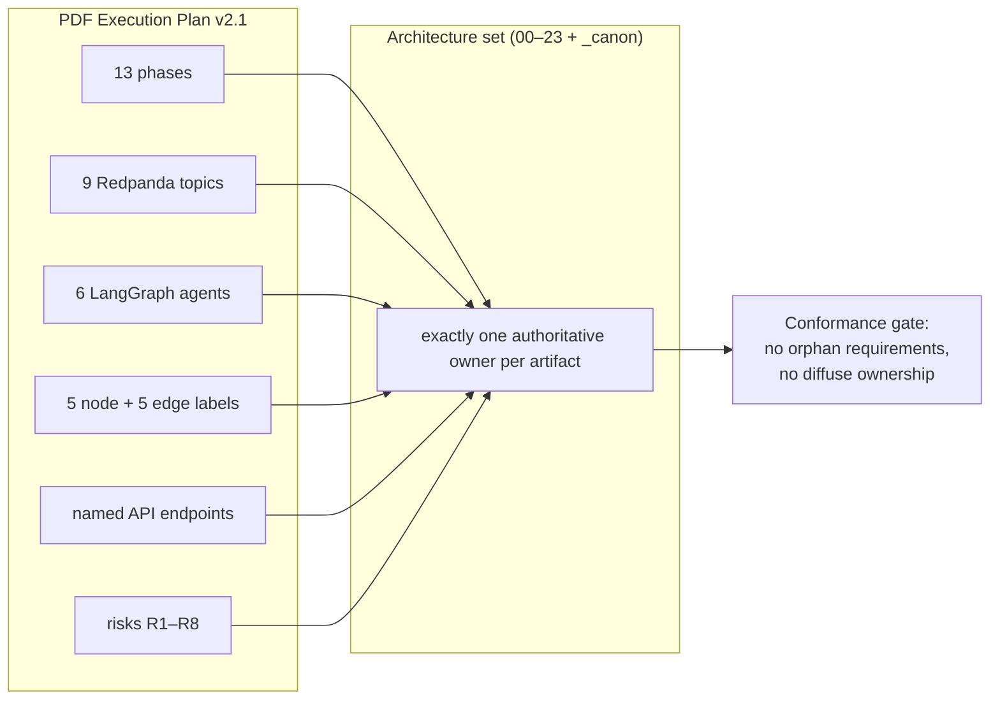
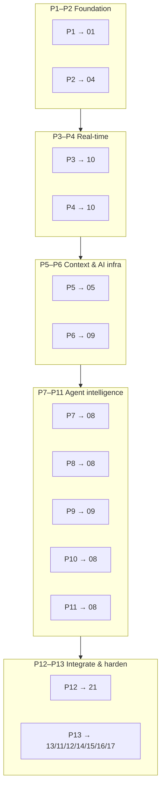
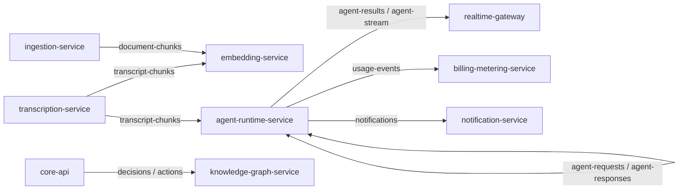
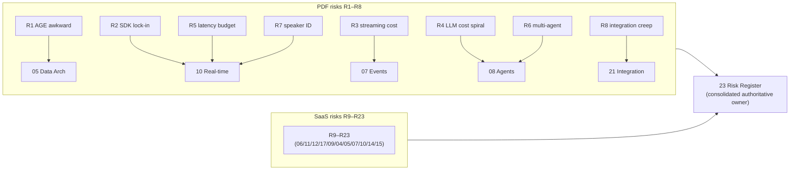

# Coverage Traceability Matrix

This document proves the NEXUS architecture set covers every phase, topic, agent, graph label, API endpoint, and risk from the original Execution Plan v2.1 by mapping each PDF artifact to the one architecture document that authoritatively owns it.

## Related documents

- [Architecture Overview & Principles](01-architecture-overview-and-principles.md)
- [System Context (C4 Level 1)](02-system-context.md)
- [Container Architecture (C4 Level 2)](03-container-architecture.md)
- [Service Catalog & Bounded Contexts](04-service-catalog.md)
- [Data Architecture](05-data-architecture.md)
- [Multi-Tenancy & Tenant Isolation](06-multi-tenancy.md)
- [Event-Driven Architecture](07-event-architecture.md)
- [AI Agent Architecture](08-ai-agent-architecture.md)
- [RAG Pipeline & Inference Serving](09-rag-and-inference-serving.md)
- [Real-time & Transcription](10-realtime-and-transcription.md)
- [Security Architecture](11-security-architecture.md)
- [Compliance & Data Privacy](12-compliance-and-privacy.md)
- [Scalability & Performance](13-scalability-and-performance.md)
- [Reliability & Disaster Recovery](14-reliability-and-dr.md)
- [Observability & SRE](15-observability-and-sre.md)
- [Deployment & Infrastructure](16-deployment-and-infrastructure.md)
- [Cost Architecture & FinOps](17-cost-and-finops.md)
- [SaaS Business Architecture](18-saas-business-architecture.md)
- [API Architecture](19-api-architecture.md)
- [Frontend Architecture](20-frontend-architecture.md)
- [Integration Architecture](21-integration-architecture.md)
- [Roadmap & Phasing](22-roadmap-and-phasing.md)
- [Risk Register](23-risk-register.md)
- Canon: [Service Catalog](_canon/01-service-catalog.md) · [Data Model](_canon/02-data-model.md) · [Capacity Math](_canon/05-capacity-math.md) · [Tech Decisions](_canon/06-tech-decisions.md)

---

## 1. How to read this matrix

A traceability matrix exists to make two failure modes impossible: **silent omission** (a PDF requirement that no document carries) and **diffuse ownership** (a requirement scattered across many docs with no authority). Every row below has exactly one **authoritative owner** — the document where the decision is made, schema is frozen, and trade-off is argued — except Table 1 (phases legitimately span documents) and a small number of rows with a justified secondary owner.

Two conventions are load-bearing:

1. **Owning ≠ mentioning.** Most artifacts are referenced in a dozen documents. The owner is the one document that would be wrong to change without re-reviewing the artifact. A reference elsewhere is not ownership.
2. **Names are frozen.** Service names, table names, topic names, node/edge labels, endpoint paths, and the six agent names are reproduced **verbatim** from the canon ([Tech Decisions §4](_canon/06-tech-decisions.md), [Service Catalog](_canon/01-service-catalog.md), [Data Model](_canon/02-data-model.md)). The intentionally mixed endpoint styles — `:id` colon path params alongside `{user_id}` brace params — are preserved, not normalized.

> [SaaS-scale adjustment] The PDF was a 13-phase, 36-week execution plan for a 4-person team with no document set, no service decomposition, and no risk-to-owner mapping. This matrix is wholly new: it is the audit artifact that proves the production multi-tenant architecture absorbs 100% of the original plan while folding in the SaaS-scale additions (multi-tenancy, billing/metering, compliance, hardened event delivery). It is also the conformance gate — a PR that introduces a new topic, agent, endpoint, or graph label must add a row here naming its owner.

---

## 2. Table 1 — PDF phases → owning architecture doc(s)

The phase→architecture mapping is authoritatively owned by [22-roadmap-and-phasing.md](22-roadmap-and-phasing.md), which maps the 13 frozen PDF phases (W1–W36) onto the production architecture and the modular-monolith peel order; this table reproduces that mapping as an index. The PDF's 13 phases are a delivery schedule, not a decomposition; each phase's *content* lands in one or more architecture documents. Phases legitimately span documents — Phase 1 (Architecture & Design) seeds the entire C4 stack; Phase 13 (Hardening/Production) touches security, reliability, observability, and cost. The **primary** column names the document that owns the phase's central decision; [22-roadmap-and-phasing.md](22-roadmap-and-phasing.md) is the co-primary owner of the phase→architecture mapping as a whole.

| Phase | PDF scope (weeks) | Primary owning doc | Supporting docs |
|---|---|---|---|
| **P1** Architecture & Design | C4 diagrams, ERD, Avro schemas, OpenAPI draft, wireframes, tech-stack lock, repo+CI+Docker Compose (W1–2) | [01-architecture-overview-and-principles.md](01-architecture-overview-and-principles.md) | [02-system-context.md](02-system-context.md), [03-container-architecture.md](03-container-architecture.md), [04-service-catalog.md](04-service-catalog.md), [19-api-architecture.md](19-api-architecture.md) (OpenAPI draft), [22-roadmap-and-phasing.md](22-roadmap-and-phasing.md), [_canon/06-tech-decisions.md](_canon/06-tech-decisions.md) |
| **P2** Foundation | FastAPI service, Next.js shell, Clerk auth, core data model + Alembic, meetings CRUD, dashboard (W3–5) | [04-service-catalog.md](04-service-catalog.md) | [05-data-architecture.md](05-data-architecture.md), [11-security-architecture.md](11-security-architecture.md) |
| **P3** Meeting Platform Integration | LiveKit room UI, token minting, SDK webhooks, Socket.io, chat persist, staging deploy (W6–8) | [10-realtime-and-transcription.md](10-realtime-and-transcription.md) | [04-service-catalog.md](04-service-catalog.md), [07-event-architecture.md](07-event-architecture.md) |
| **P4** Real-time & Transcription | audio capture, Deepgram WS proxy, `transcript_chunks`, live captions, transcript view, manual speaker mapping (W9–12) | [10-realtime-and-transcription.md](10-realtime-and-transcription.md) | [05-data-architecture.md](05-data-architecture.md), [13-scalability-and-performance.md](13-scalability-and-performance.md) |
| **P5** Profiles & Org Context | users role/skills, teams/departments, `get_user_context()`, role taxonomy, org chart UI, seeder (W13–14) | [05-data-architecture.md](05-data-architecture.md) | [04-service-catalog.md](04-service-catalog.md), [08-ai-agent-architecture.md](08-ai-agent-architecture.md) |
| **P6** AI Infrastructure | Qdrant, chunking pipeline, unstructured.io ingestion, BGE-small embeddings, Redpanda+Avro+Schema Registry, embedding consumer, hybrid search (W15–17) | [09-rag-and-inference-serving.md](09-rag-and-inference-serving.md) | [07-event-architecture.md](07-event-architecture.md), [05-data-architecture.md](05-data-architecture.md) |
| **P7** Personal Listener Agent | LiteLLM, LangGraph `BaseAgent`, PersonalListenerAgent, worklogs, worklog UI, agent sidebar shell (W18–20) | [08-ai-agent-architecture.md](08-ai-agent-architecture.md) | [09-rag-and-inference-serving.md](09-rag-and-inference-serving.md), [17-cost-and-finops.md](17-cost-and-finops.md) |
| **P8** Decisions/Actions + Knowledge Graph | DecisionAgent, ActionAgent, Apache AGE `nexus_knowledge`, Cypher templates, decision history + lineage UI, My Tasks (W21–23) | [08-ai-agent-architecture.md](08-ai-agent-architecture.md) | [05-data-architecture.md](05-data-architecture.md) |
| **P9** RAG & Question Agent | `RAGService`, query expansion, hybrid retrieval, reranker, citations, QuestionAgent, suggestion cards (W24–26) | [09-rag-and-inference-serving.md](09-rag-and-inference-serving.md) | [08-ai-agent-architecture.md](08-ai-agent-architecture.md), [ADR-0033](adr/0033-plan-9-rag-retrieval-upgrades.md) |
| **P10** Workflows & Multi-Agent Collaboration | Temporal `MeetingLifecycleWorkflow`, `agent-requests`/`agent-responses`, ContextGapAgent, context-fill UI, collaboration logs (W27–29) | [08-ai-agent-architecture.md](08-ai-agent-architecture.md) | [07-event-architecture.md](07-event-architecture.md), [04-service-catalog.md](04-service-catalog.md) |
| **P11** Proactive Intelligence & Real-time Polish | ProactiveAgent conflict/workload/stakeholder, Redis pub/sub backbone, streamed agent output, priority queue, alert UI (W30–31) | [08-ai-agent-architecture.md](08-ai-agent-architecture.md) | [10-realtime-and-transcription.md](10-realtime-and-transcription.md), [13-scalability-and-performance.md](13-scalability-and-performance.md) |
| **P12** External Integrations | Calendar/Slack/Jira-Linear, `ActionFollowUpWorkflow` (W32–33) | [21-integration-architecture.md](21-integration-architecture.md) | [04-service-catalog.md](04-service-catalog.md), [07-event-architecture.md](07-event-architecture.md), [11-security-architecture.md](11-security-architecture.md) |
| **P13** Testing/DevOps/Hardening/Production | Playwright E2E, k6/Locust load, security audit, ~30% cost optimization, mobile responsive, Prometheus/Grafana, Postgres backups/PITR/read replica, Cloudflare, docs (W34–36) | [13-scalability-and-performance.md](13-scalability-and-performance.md) | [11-security-architecture.md](11-security-architecture.md), [12-compliance-and-privacy.md](12-compliance-and-privacy.md), [14-reliability-and-dr.md](14-reliability-and-dr.md), [15-observability-and-sre.md](15-observability-and-sre.md), [16-deployment-and-infrastructure.md](16-deployment-and-infrastructure.md), [17-cost-and-finops.md](17-cost-and-finops.md) |

> [SaaS-scale adjustment] The PDF batched all hardening into the single Phase 13 ("security audit, cost optimization, production DevOps"). The production posture is **shift-left**: security is owned continuously by [11-security-architecture.md](11-security-architecture.md) (threat model in P1, authz in every PR), compliance by [12-compliance-and-privacy.md](12-compliance-and-privacy.md), and cost discipline by [17-cost-and-finops.md](17-cost-and-finops.md) from Phase 7. P13 remains the *validation* phase (load tests, audits, PITR proofs), but its concerns are owned by docs that engage from day one.

---

## 3. Table 2 — Redpanda topics → owning doc

All nine PDF topics and the SaaS-scale topics are defined, schema-frozen, and partitioned in the [Event-Driven Architecture](07-event-architecture.md), which is therefore the single authoritative owner. The **producer/consumer** column reproduces the canon ([Service Catalog §5](_canon/01-service-catalog.md), [Tech Decisions §2.4](_canon/06-tech-decisions.md)) so this table doubles as a wiring index.

| Topic (verbatim) | Avro value schema | Primary producer → consumer | Owning doc |
|---|---|---|---|
| `transcript-chunks` | `TranscriptChunk` | `transcription-service` → `embedding-service`, `agent-runtime-service`, `search-service` | [07-event-architecture.md](07-event-architecture.md) |
| `document-chunks` | chunk envelope | `ingestion-service` → `embedding-service`, `agent-runtime-service` | [07-event-architecture.md](07-event-architecture.md) |
| `agent-results` | `AgentResult` | `agent-runtime-service` → `core-api`, `realtime-gateway`, `notification-service` | [07-event-architecture.md](07-event-architecture.md) |
| `decisions` | `Decision` | `core-api` (on confirm) → `knowledge-graph-service`, `notification-service` | [07-event-architecture.md](07-event-architecture.md) |
| `actions` | `Action` | `core-api` (on confirm) → `knowledge-graph-service`, `workflow-service`, `integration-service` | [07-event-architecture.md](07-event-architecture.md) |
| `notifications` | `Notification` | multiple → `notification-service` (sole external fan-out) | [07-event-architecture.md](07-event-architecture.md) |
| `agent-requests` | `AgentRequest` | `agent-runtime-service` (ContextGapAgent) → peer agents | [07-event-architecture.md](07-event-architecture.md) |
| `agent-responses` | `AgentResponse` | peer agents → `agent-runtime-service` (ContextGapAgent) | [07-event-architecture.md](07-event-architecture.md) |
| `agent-stream` | token-delta envelope | `agent-runtime-service` (LiteLLM bridge) → `realtime-gateway` → UI | [07-event-architecture.md](07-event-architecture.md) |

> [SaaS-scale adjustment] The following topics are **wholly added** for SaaS scale and not in the PDF, but their owner is the same [07-event-architecture.md](07-event-architecture.md): `tenant-events`, `meeting-events`, `meeting-room-events`, `integration-events`, `usage-events`, `billing-events`, `graph-events`, `embedding-events`, `presence-events`, `notification-delivery-events`, `user-sync-events`, `admin-events`. They carry control-plane, metering, and lifecycle signals the single-team PDF handled in-process. All topics — PDF and SaaS — are partitioned by tenant and use Avro + Schema Registry with **BACKWARD** compatibility, subject `{topic}-value` (carried verbatim).

---

## 4. Table 3 — The six agents → owning doc

All six LangGraph agents share the `BaseAgent` lifecycle (spawn/process/terminate), the `AgentState` dataclass, and the versioned prompt-template loader; they are hosted in `agent-runtime-service` and authoritatively specified in the [AI Agent Architecture](08-ai-agent-architecture.md). Names are verbatim from [Tech Decisions §4](_canon/06-tech-decisions.md).

| Agent (verbatim) | PDF phase | Responsibility (canon) | Confidence policy | Owning doc |
|---|---|---|---|---|
| **PersonalListenerAgent** | P7 | Filters chunks by user role/skills via `get_user_context()`, extracts notes, scores relevance 0–1, writes to `worklogs` above threshold | `>0.7` surface · `0.4–0.7` silent log · `<0.4` drop | [08-ai-agent-architecture.md](08-ai-agent-architecture.md) |
| **DecisionAgent** | P8 | Detects decisions, extracts rationale/stakeholders, confidence-scored, surfaces for user confirmation (no silent commits) | same thresholds; confirm gate before `decisions` topic | [08-ai-agent-architecture.md](08-ai-agent-architecture.md) |
| **ActionAgent** | P8 | Detects action items, extracts assignee/deadline/dependencies, confidence-scored | same thresholds; confirm gate before `actions` topic | [08-ai-agent-architecture.md](08-ai-agent-architecture.md) |
| **QuestionAgent** | P9 | Detects context gaps in live conversation, proposes role-specific questions, priority 1–3, Ask/Dismiss/Save-for-later | priority strip, persisted to `agent_suggestions` | [08-ai-agent-architecture.md](08-ai-agent-architecture.md) |
| **ContextGapAgent** | P10 | Multi-agent collaboration over `agent-requests`/`agent-responses` (correlation IDs, deadline, fall-through); fallback chain peer-agents → related-meeting agents → RAG → silent | deadline before fall-through (R6) | [08-ai-agent-architecture.md](08-ai-agent-architecture.md) |
| **ProactiveAgent** | P11 | Conflict detection (AGE graph query), workload (sum open actions per assignee, flag at 80/95% capacity), missing-stakeholder (org-graph traversal) | high-stakes routing to Opus | [08-ai-agent-architecture.md](08-ai-agent-architecture.md) |

> [SaaS-scale adjustment] The agents are unchanged in name and behavior, but their *invocation model* moved: the PDF ran a personal agent on **every raw `transcript_chunks` message**; production runs them on **30s windowed batches behind a Haiku relevance pre-gate** with **tiered routing (Haiku→Sonnet→Opus)** and **per-tenant token budgets**. The cost mechanics are owned by [09-rag-and-inference-serving.md](09-rag-and-inference-serving.md) and [17-cost-and-finops.md](17-cost-and-finops.md); the agent *contracts* remain owned by [08-ai-agent-architecture.md](08-ai-agent-architecture.md). Agent-to-agent authorization (deny-by-default, org/role scope, audited) is added by [11-security-architecture.md](11-security-architecture.md).

---

## 5. Table 4 — AGE node & edge labels → owning doc

The Apache AGE graph `nexus_knowledge` and all of its labels are frozen in the [Data Architecture](05-data-architecture.md) (canon: [Data Model §4](_canon/02-data-model.md)). Labels are verbatim; the **created when** column reproduces the confirmation-only edge rule.

### 5.1 Node labels

| Node label (verbatim) | Backed by | Key properties | Owning doc |
|---|---|---|---|
| `Person` | `users` | `user_id`, `org_id`, `role` | [05-data-architecture.md](05-data-architecture.md) |
| `Meeting` | `meetings` | `meeting_id`, `org_id`, `title` | [05-data-architecture.md](05-data-architecture.md) |
| `Decision` | `decisions` | `decision_id`, `org_id`, `status`, `confidence` | [05-data-architecture.md](05-data-architecture.md) |
| `Action` | `action_items` | `action_id`, `org_id`, `status` | [05-data-architecture.md](05-data-architecture.md) |
| `Topic` | role→topics taxonomy | `name`, `org_id` | [05-data-architecture.md](05-data-architecture.md) |

### 5.2 Edge labels

| Edge label (verbatim) | From → To | Created when | Owning doc |
|---|---|---|---|
| `ATTENDED` | `Person` → `Meeting` | Participant joins a meeting | [05-data-architecture.md](05-data-architecture.md) |
| `PRODUCED` | `Decision`/`Action` → `Meeting` | Decision/Action confirmed | [05-data-architecture.md](05-data-architecture.md) |
| `ASSIGNED_TO` | `Action` → `Person` | Action confirmed with assignee | [05-data-architecture.md](05-data-architecture.md) |
| `RELATES_TO` | `Decision`/`Action`/`Meeting` → `Topic` | Topic extraction links entity to taxonomy | [05-data-architecture.md](05-data-architecture.md) |
| `FOLLOWS_FROM` | `Decision` → `Decision` | Decision lineage / supersession | [05-data-architecture.md](05-data-architecture.md) |

> [SaaS-scale adjustment] The labels are PDF-verbatim, but the graph is now **org-partitioned**: every node carries an `org_id` property and every Cypher template is parameterized with `$org_id`. Tenant isolation of `nexus_knowledge` is co-owned by [06-multi-tenancy.md](06-multi-tenancy.md). The migration path to Amazon Neptune / Neo4j Aura plus a relational materialized-view fallback (PDF R1 + at-scale exit) is owned by [05-data-architecture.md](05-data-architecture.md).

---

## 6. Table 5 — Named API endpoints → owning doc

The **API contract** itself — versioning, pagination, the typed error model, idempotency, rate limiting, webhook signatures, and OpenAPI governance — is authoritatively owned by [19-api-architecture.md](19-api-architecture.md), which expands the canonical synchronous-API ownership table. Endpoint *service* ownership is canonical in [Service Catalog §6](_canon/01-service-catalog.md); the **owning service** column is reproduced from there. Each row therefore names [19-api-architecture.md](19-api-architecture.md) as the **API-contract owner** and a **domain doc** where the endpoint's behavior is specified in depth; [04-service-catalog.md](04-service-catalog.md) remains the service/ownership reference. Mixed path styles (`:id` vs `{user_id}`) are preserved exactly.

| Endpoint / surface (verbatim) | Owning service | API-contract owner | Domain / service doc |
|---|---|---|---|
| `POST /clerk/webhook` | `identity-tenant-service` | [19-api-architecture.md](19-api-architecture.md) | [04-service-catalog.md](04-service-catalog.md), [11-security-architecture.md](11-security-architecture.md) |
| `GET/POST /orgs`, `/rbac/*`, `/scim/v2/*` | `identity-tenant-service` | [19-api-architecture.md](19-api-architecture.md) | [04-service-catalog.md](04-service-catalog.md), [06-multi-tenancy.md](06-multi-tenancy.md) |
| `GET /context/{user_id}` | `identity-tenant-service` | [19-api-architecture.md](19-api-architecture.md) | [04-service-catalog.md](04-service-catalog.md), [08-ai-agent-architecture.md](08-ai-agent-architecture.md) |
| `/meetings`, `/teams`, `/departments`, `/worklogs`, `/decisions`, `/actions`, `/chat` | `core-api` | [19-api-architecture.md](19-api-architecture.md) | [04-service-catalog.md](04-service-catalog.md), [05-data-architecture.md](05-data-architecture.md) |
| `POST /api/meetings/:id/token` | `meeting-service` | [19-api-architecture.md](19-api-architecture.md) | [04-service-catalog.md](04-service-catalog.md), [10-realtime-and-transcription.md](10-realtime-and-transcription.md) |
| `POST /livekit/webhook` | `meeting-service` | [19-api-architecture.md](19-api-architecture.md) | [04-service-catalog.md](04-service-catalog.md), [10-realtime-and-transcription.md](10-realtime-and-transcription.md) |
| Socket.io / WSS meeting rooms, live caption + agent output channels | `realtime-gateway` | [19-api-architecture.md](19-api-architecture.md) | [04-service-catalog.md](04-service-catalog.md), [10-realtime-and-transcription.md](10-realtime-and-transcription.md) |
| `GET /meetings/:id/transcript` (read served via `core-api` Postgres FTS over `transcription-service`-owned `transcript_chunks`; `transcription-service` owns the internal audio WS in + persisting transcript finals, not this read endpoint — canon §6) | `core-api` (read) over `transcription-service` data | [19-api-architecture.md](19-api-architecture.md) | [04-service-catalog.md](04-service-catalog.md), [10-realtime-and-transcription.md](10-realtime-and-transcription.md) |
| `POST /ingest`, `GET /ingest/jobs/:id` | `ingestion-service` | [19-api-architecture.md](19-api-architecture.md) | [04-service-catalog.md](04-service-catalog.md), [09-rag-and-inference-serving.md](09-rag-and-inference-serving.md) |
| `POST /embed` (internal) | `embedding-service` | [19-api-architecture.md](19-api-architecture.md) | [04-service-catalog.md](04-service-catalog.md), [09-rag-and-inference-serving.md](09-rag-and-inference-serving.md) |
| `POST /rerank` (internal) | `reranker-service` | [19-api-architecture.md](19-api-architecture.md) | [04-service-catalog.md](04-service-catalog.md), [09-rag-and-inference-serving.md](09-rag-and-inference-serving.md) |
| `POST /agents/spawn`, `POST /agents/{id}/terminate` (internal) | `agent-runtime-service` | [19-api-architecture.md](19-api-architecture.md) | [04-service-catalog.md](04-service-catalog.md), [08-ai-agent-architecture.md](08-ai-agent-architecture.md) |
| `POST /api/rag/query` | `rag-service` | [19-api-architecture.md](19-api-architecture.md) | [04-service-catalog.md](04-service-catalog.md), [09-rag-and-inference-serving.md](09-rag-and-inference-serving.md) |
| `POST /graph/query/{template}`, `/graph/cypher` (internal) | `knowledge-graph-service` | [19-api-architecture.md](19-api-architecture.md) | [04-service-catalog.md](04-service-catalog.md), [05-data-architecture.md](05-data-architecture.md) |
| `GET /search` | `search-service` | [19-api-architecture.md](19-api-architecture.md) | [04-service-catalog.md](04-service-catalog.md), [09-rag-and-inference-serving.md](09-rag-and-inference-serving.md) |
| `/oauth/{provider}`, `/webhooks/{provider}` | `integration-service` | [19-api-architecture.md](19-api-architecture.md) | [21-integration-architecture.md](21-integration-architecture.md), [04-service-catalog.md](04-service-catalog.md), [11-security-architecture.md](11-security-architecture.md) |
| Temporal task queues, `POST /workflows/*` (admin) | `workflow-service` | [19-api-architecture.md](19-api-architecture.md) | [04-service-catalog.md](04-service-catalog.md), [14-reliability-and-dr.md](14-reliability-and-dr.md) |
| `GET/POST /billing/*`, `POST /stripe/webhook`, `GET /usage` | `billing-metering-service` | [19-api-architecture.md](19-api-architecture.md) | [18-saas-business-architecture.md](18-saas-business-architecture.md), [04-service-catalog.md](04-service-catalog.md), [17-cost-and-finops.md](17-cost-and-finops.md) |
| `GET /notifications`, `PATCH /notifications/:id` | `notification-service` | [19-api-architecture.md](19-api-architecture.md) | [04-service-catalog.md](04-service-catalog.md), [07-event-architecture.md](07-event-architecture.md) |
| `/admin/tenant/*`, `/admin/ops/*` (RBAC-gated, audited) | `admin-ops-service` | [19-api-architecture.md](19-api-architecture.md) | [18-saas-business-architecture.md](18-saas-business-architecture.md), [04-service-catalog.md](04-service-catalog.md), [12-compliance-and-privacy.md](12-compliance-and-privacy.md) |
| `/bff/*` (screen-shaped, web-app only) | `bff` | [19-api-architecture.md](19-api-architecture.md) | [04-service-catalog.md](04-service-catalog.md), [03-container-architecture.md](03-container-architecture.md), [20-frontend-architecture.md](20-frontend-architecture.md) |
| All external HTTPS/WSS ingress | `api-gateway` | [19-api-architecture.md](19-api-architecture.md) | [04-service-catalog.md](04-service-catalog.md), [11-security-architecture.md](11-security-architecture.md) |

> [SaaS-scale adjustment] The PDF named only the user-facing endpoints (`POST /api/meetings/:id/token`, `POST /api/rag/query`, the SDK webhook receiver, the transcript view) and an OpenAPI *draft* in Phase 1; it had no consolidated API-contract layer. [19-api-architecture.md](19-api-architecture.md) is the wholly-added authoritative owner of the API contract — versioning, pagination, the typed error model, idempotency, rate limiting, webhook signatures, and OpenAPI governance — and is the API-contract owner for every endpoint above. All `/billing/*`, `/stripe/webhook`, `/usage`, `/orgs`, `/rbac/*`, `/scim/v2/*`, `/admin/*`, and internal inference endpoints (`/embed`, `/rerank`, `/agents/*`, `/graph/*`) are SaaS-scale additions; the `:id` (PDF) vs `{id}` (SaaS-add) path styles are both preserved verbatim from the canon. Note that `GET /meetings/:id/transcript` is a **read** served by `core-api` Postgres FTS over the `transcript_chunks` that `transcription-service` owns and persists (canon §6, [04-service-catalog.md](04-service-catalog.md)); `transcription-service` owns the internal audio-WS-in and final persistence, not the read endpoint.

---

## 7. Table 6 — risks → owning doc

The single consolidated authoritative owner of **every** NEXUS risk is [23-risk-register.md](23-risk-register.md): the eight PDF-original risks (R1–R8) carried over verbatim **plus** the SaaS-scale risks R9–R23 surfaced by sizing NEXUS as a production multi-tenant platform, each with severity/likelihood/impact, mitigation, an owning document, and a fallback/descope. This matrix reconciles to that register rather than re-deriving risk ownership independently. The **mitigation/design owner** column below names the dedicated domain doc that owns each risk's mitigation; the consolidated register ([23-risk-register.md](23-risk-register.md)) is the authoritative owner of the risk record itself.

> [SaaS-scale adjustment] The PDF carried an 8-row risk register (R1–R8) inline in the plan with no consolidated owner doc and no SaaS-scale risks. [23-risk-register.md](23-risk-register.md) is the wholly-added consolidated register; it preserves R1–R8 verbatim and adds R9–R23. The matrix defers to it.

### 7.1 PDF-original risks R1–R8

These reconcile to [23-risk-register.md](23-risk-register.md) §3. Per-risk mitigation/design owners are reproduced from that register, **except R8**, which the matrix routes to the dedicated [21-integration-architecture.md](21-integration-architecture.md) (the R8-guardrail owner) where the register records it under [04-service-catalog.md](04-service-catalog.md).

| Risk ID | PDF risk | Mitigation / design owner | Consolidated register |
|---|---|---|---|
| **R1** | Apache AGE on managed Supabase may be operationally awkward (fallback self-host or Neo4j Aura) | [05-data-architecture.md](05-data-architecture.md) — graph store + Neptune/Aura + relational MV fallback | [23-risk-register.md](23-risk-register.md) |
| **R2** | Meeting-SDK lock-in and pricing (evaluate ≥2; switching costly after P3) | [10-realtime-and-transcription.md](10-realtime-and-transcription.md) — LiveKit behind a transport adapter (swappable) | [23-risk-register.md](23-risk-register.md) |
| **R3** | Event-streaming provider and cost (Redpanda trial; Kafka API + Avro keep migration mechanical) | [07-event-architecture.md](07-event-architecture.md) — Redpanda BYOC, Schema Registry BACKWARD compat | [23-risk-register.md](23-risk-register.md) |
| **R4** | LLM cost spiral once agents process every transcript chunk | [08-ai-agent-architecture.md](08-ai-agent-architecture.md) — pre-gate → windowed batching → tiered routing → caching → per-tenant quotas (86% reduction); cost validation [17-cost-and-finops.md](17-cost-and-finops.md) | [23-risk-register.md](23-risk-register.md) |
| **R5** | Agent latency budget under 2s is tight (Deepgram ~1s + LLM ~0.8s + network) | [10-realtime-and-transcription.md](10-realtime-and-transcription.md) — p50<2s / p95<4s via streaming + priority queues; SLO/load proof [13-scalability-and-performance.md](13-scalability-and-performance.md) | [23-risk-register.md](23-risk-register.md) |
| **R6** | Multi-agent collaboration is the most novel / least-proven piece | [08-ai-agent-architecture.md](08-ai-agent-architecture.md) — ContextGapAgent fallback chain → RAG-only descope | [23-risk-register.md](23-risk-register.md) |
| **R7** | Speaker identification accuracy (voice fingerprinting hard) | [10-realtime-and-transcription.md](10-realtime-and-transcription.md) — reliable manual `meeting_speakers` + confidence-scored suggestion | [23-risk-register.md](23-risk-register.md) |
| **R8** | Scope creep around integrations | [21-integration-architecture.md](21-integration-architecture.md) — guardrail: ship Calendar + Slack + one of Jira/Linear only | [23-risk-register.md](23-risk-register.md) |

> [SaaS-scale adjustment] R4 and R5 split *design* from *cost/performance validation*: the LLM cost pipeline is designed in [08-ai-agent-architecture.md](08-ai-agent-architecture.md) / [09-rag-and-inference-serving.md](09-rag-and-inference-serving.md) but its $/MAU budget and the ~30% Phase-13 reduction target are owned by [17-cost-and-finops.md](17-cost-and-finops.md); the latency design lives in [10-realtime-and-transcription.md](10-realtime-and-transcription.md) but the SLO and load-test proof are owned by [13-scalability-and-performance.md](13-scalability-and-performance.md). R8's mitigation owner is the dedicated [21-integration-architecture.md](21-integration-architecture.md) (the register records the service-side owner [04-service-catalog.md](04-service-catalog.md); both are correct — service vs. dedicated spec). The pre-authorized descopes (P10→RAG-only, P12→Calendar+Slack, P8→Neo4j Aura) are recorded in the respective owning docs and the register.

### 7.2 SaaS-scale risks R9–R23

> [SaaS-scale adjustment] These 15 risks are wholly new vs the PDF and exist only because NEXUS is now a production multi-tenant SaaS. They are not optional for coverage: the matrix would silently omit 15 documented risks if it covered only R1–R8. R12, R13, and R23 are the **at-scale residual** of a PDF risk (R4, R4/R5, and R2 respectively) and cross-reference the parent rather than re-rating it. Mitigation/design owners below are reproduced from [23-risk-register.md](23-risk-register.md) §4; the register is the authoritative consolidated owner.

| Risk ID | SaaS-scale risk | Mitigation / design owner | Consolidated register |
|---|---|---|---|
| **R9** | Multi-tenant isolation failure (a query/vector/graph/event/cache/object crosses an `org_id` boundary) | [06-multi-tenancy.md](06-multi-tenancy.md) | [23-risk-register.md](23-risk-register.md) |
| **R10** | Agent-to-agent data leak (`agent-requests` round-trip crosses tenant or role scope) | [11-security-architecture.md](11-security-architecture.md) | [23-risk-register.md](23-risk-register.md) |
| **R11** | Compliance / DPA gap (GDPR/CCPA, residency, PII, subprocessor) | [12-compliance-and-privacy.md](12-compliance-and-privacy.md) | [23-risk-register.md](23-risk-register.md) |
| **R12** | LLM cost at scale (R4 residual — LLM ≈ 94% of variable cost) | [17-cost-and-finops.md](17-cost-and-finops.md) | [23-risk-register.md](23-risk-register.md) |
| **R13** | Inference coupling (R4/R5 residual — CPU/GPU inference sharing the API tier) | [09-rag-and-inference-serving.md](09-rag-and-inference-serving.md) | [23-risk-register.md](23-risk-register.md) |
| **R14** | Missing billing / monetization (no tenant lifecycle, metering, or quota enforcement) | [04-service-catalog.md](04-service-catalog.md) (business: [18-saas-business-architecture.md](18-saas-business-architecture.md); cost: [17-cost-and-finops.md](17-cost-and-finops.md)) | [23-risk-register.md](23-risk-register.md) |
| **R15** | Data-layer scaling (`transcript_chunks` at ~1.73B rows/mo cannot be one hot relation) | [05-data-architecture.md](05-data-architecture.md) | [23-risk-register.md](23-risk-register.md) |
| **R16** | Security batched into one late phase (PDF deferred security to a Phase-13 audit) | [11-security-architecture.md](11-security-architecture.md) | [23-risk-register.md](23-risk-register.md) |
| **R17** | Event duplication / double-apply (at-least-once over ~11.58B events/mo) | [07-event-architecture.md](07-event-architecture.md) | [23-risk-register.md](23-risk-register.md) |
| **R18** | Webhook reliability (dropped Clerk/LiveKit/Stripe/Slack/Jira-Linear webhooks) | [07-event-architecture.md](07-event-architecture.md) | [23-risk-register.md](23-risk-register.md) |
| **R19** | Real-time fan-out (at 100k concurrent participants, Socket.io fan-out across pods) | [10-realtime-and-transcription.md](10-realtime-and-transcription.md) | [23-risk-register.md](23-risk-register.md) |
| **R20** | API gateway absence (no central JWT pre-validation, `org_id` extraction, WAF, rate limiting) | [11-security-architecture.md](11-security-architecture.md) | [23-risk-register.md](23-risk-register.md) |
| **R21** | Multi-region / DR gap (single-region cannot meet Pro/Enterprise SLOs or residency) | [14-reliability-and-dr.md](14-reliability-and-dr.md) | [23-risk-register.md](23-risk-register.md) |
| **R22** | Observability gaps (no per-tenant metrics, consumer-lag, cost, quota dashboards) | [15-observability-and-sre.md](15-observability-and-sre.md) | [23-risk-register.md](23-risk-register.md) |
| **R23** | LiveKit SFU self-host operational burden (R2 residual) | [10-realtime-and-transcription.md](10-realtime-and-transcription.md) | [23-risk-register.md](23-risk-register.md) |

---

## 8. Table 7 — Major SaaS-scale adjustments → owning doc

Everything in this table is wholly added or hardened relative to the PDF. Each adjustment has one authoritative owner. (Source of locks: [Tech Decisions](_canon/06-tech-decisions.md), [Capacity Math](_canon/05-capacity-math.md).)

> [SaaS-scale adjustment] This entire table is the delta vs the PDF — multi-tenancy, the SaaS business platform, compliance, hardened event delivery, and the inference/CRUD scaling split. The PDF had no notion of tenants, billing, plans, compliance, or independent scaling families.

| SaaS-scale adjustment | What changed vs PDF | Owning doc |
|---|---|---|
| Event-driven microservices + modular-monolith → services path | PDF was a single modular monolith with role-rotating ownership | [01-architecture-overview-and-principles.md](01-architecture-overview-and-principles.md) |
| Bounded-context service decomposition | PDF named no services; 20 canonical services + split-order defined | [04-service-catalog.md](04-service-catalog.md) |
| Pooled + RLS long tail; cell-based isolation for enterprise | PDF was single-deployment, no tenant column | [06-multi-tenancy.md](06-multi-tenancy.md) |
| `org_id` injection middleware + RLS backstop on every query | PDF queries were untenanted | [06-multi-tenancy.md](06-multi-tenancy.md) |
| Tenant-root exemption: `organizations` carries no `org_id` and is deliberately unpolicied, making "every table with an `org_id` column carries `tenant_isolation`" exceptionless and CI-assertable | PDF had no tenant root and no RLS | [06-multi-tenancy.md](06-multi-tenancy.md) ([ADR-0002](adr/0002-multi-tenancy-model.md) D3) |
| Three PostgreSQL roles (`mytheus_app` / `mytheus_relay` / `mytheus_admin`), none holding `BYPASSRLS`; the outbox relay drains cross-tenant through one permissive policy on `outbox` alone | PDF had a single database user | [06-multi-tenancy.md](06-multi-tenancy.md) ([ADR-0002](adr/0002-multi-tenancy-model.md) D3) |
| `organizations.clerk_org_id` resolution at the edge as the authorization checkpoint (org exists, not suspended, not soft-deleted); `organizations.status` is the relational home of the `suspended` symbol in `TenantEvent` | PDF had no external identity provider and no tenant lifecycle | [11-security-architecture.md](11-security-architecture.md) ([ADR-0010](adr/0010-auth-clerk-enterprise-sso.md) D2) |
| `rbac_grants.tier` as the sole authorization store, strictly separate from `users.role` | PDF had only `users.role`, with no permission meaning | [11-security-architecture.md](11-security-architecture.md) ([ADR-0010](adr/0010-auth-clerk-enterprise-sso.md) D5) |
| Per-tenant Qdrant collections, org-partitioned `nexus_knowledge`, namespaced Redis, tenant-keyed Redpanda partitions | PDF used single shared stores | [06-multi-tenancy.md](06-multi-tenancy.md) |
| Dedicated GPU inference tier (Ray Serve/vLLM) for `embedding-service` + `reranker-service`, off the API tier | PDF ran BGE via ONNX on the FastAPI API tier | [09-rag-and-inference-serving.md](09-rag-and-inference-serving.md) |
| `ner-service` (third dedicated model server) and `pii_tokens`, the per-tenant reversible PII token vault written only by `identity-tenant-service` | PDF had no PII redaction, no token vault, and no NER | [12-compliance-and-privacy.md §5.2](12-compliance-and-privacy.md), [ADR-0020](adr/0020-pii-token-vault-and-ner-placement.md) |
| Object storage is **Cloudflare R2** (S3-compatible), the provider behind every `nexus-*` bucket | PDF stored recordings and attachments implicitly and named no provider; canon said "S3-compatible" and locked no vendor | [_canon/06-tech-decisions.md §2.3](_canon/06-tech-decisions.md), [ADR-0023](adr/0023-object-storage-cloudflare-r2.md) |
| Explicit per-table GRANTs with no schema-wide default privilege, no direct grant on any partition, and no `rolbypassrls` role holding a privilege on a tenant table | PDF had no tenancy, so no grant model at all; the SaaS RLS design needed the GRANT layer beneath it stated, after a schema-wide default privilege produced a live cross-tenant read/write/delete | [_canon/02-data-model.md §7 rule 8](_canon/02-data-model.md), [06-multi-tenancy.md §4](06-multi-tenancy.md), [ADR-0021](adr/0021-explicit-grants-no-schema-wide-default-privileges.md) |
| OpenAPI documents emitted from the app rather than hand-written, gated by a regeneration check plus `spectral` plus `oasdiff` | PDF listed an "OpenAPI draft" as a one-time Phase-1 artifact; at SaaS scale the contract is generated, linted and breaking-change-gated, and the spec-first direction the design pack assumed was never reconcilable in practice | [19-api-architecture.md §11](19-api-architecture.md), [ADR-0023](adr/0022-openapi-emitted-from-code.md) |
| Anthropic-only LLM provider (OpenAI dropped; LiteLLM retained; Haiku 5.5 fast tier) | PDF named a dual-provider LiteLLM setup | [08-ai-agent-architecture.md](08-ai-agent-architecture.md), [12-compliance-and-privacy.md](12-compliance-and-privacy.md) | [ADR-0027](adr/0027-anthropic-only-llm-provider.md) |
| Plan 7 entry decisions (per-tenant allowances, Sonnet 5.5 extraction tier, in-service metering derivation, `model_tier` on usage, no Anthropic DPA gate) | PDF budgeted per user and had no plans, metering or subprocessor gate | [_canon/02-data-model.md](_canon/02-data-model.md), [_canon/03-event-taxonomy.md](_canon/03-event-taxonomy.md), [_canon/06-tech-decisions.md](_canon/06-tech-decisions.md) | [ADR-0029](adr/0029-plan-7-budget-scope-tier-mapping-and-metering-ownership.md) |
| Plan 7 build decisions (exact-match LLM response cache, PersonalListener relevance threshold, `core-api` owns `surfaced` with tenant overrides, only surfaced notes stream, per-user live delivery) | PDF named a semantic cache and a per-tenant threshold without a key, a number or an owner | [_canon/02-data-model.md](_canon/02-data-model.md) | [ADR-0030](adr/0030-plan-7-llm-response-cache-and-personal-listener-gating.md) |
| Cost-controlled LLM pipeline (pre-gate → windowed batching → tiered routing → caching → hard quotas) | PDF processed every chunk per agent (R4 bomb) | [09-rag-and-inference-serving.md](09-rag-and-inference-serving.md) |
| At-least-once delivery + idempotency keys + transactional outbox/inbox + dedupe cache + DLQs | PDF implied at-most-once consume→process | [07-event-architecture.md](07-event-architecture.md) |
| Independent autoscaler signals per scaling family (CRUD / real-time / AI / async) | PDF coupled all tiers on one FastAPI service | [13-scalability-and-performance.md](13-scalability-and-performance.md) |
| Kubernetes (EKS/GKE) + Terraform IaC; multi-region active-passive → active-active | PDF used Railway/Render only | [16-deployment-and-infrastructure.md](16-deployment-and-infrastructure.md) |
| SaaS business platform: tenant lifecycle, Stripe billing/seats/dunning/tax, usage metering, Free/Pro/Enterprise, admin + ops consoles | PDF had no tenants, billing, or plans | [18-saas-business-architecture.md](18-saas-business-architecture.md) |
| Per-tenant token budgets + hard quotas + budget alerts | PDF had per-user budgets/alerts only | [18-saas-business-architecture.md](18-saas-business-architecture.md) (quota mechanism) · [17-cost-and-finops.md](17-cost-and-finops.md) (cost/margin) |
| Shift-left security: threat model in P1, authz in every PR, dependency + secret scanning, agent-to-agent authz (deny-by-default) | PDF batched a security audit into P13 | [11-security-architecture.md](11-security-architecture.md) |
| Compliance suite: GDPR/CCPA, DPAs+SCCs, data residency, PII redaction, RTBF, audit logging, SOC2 readiness | PDF had no compliance posture | [12-compliance-and-privacy.md](12-compliance-and-privacy.md) |
| Capacity model (20k concurrent meetings / 100k participants, ~$19.5M/mo variable infra, SLO tiers) | PDF sized only a `2 orgs × 10 users × 5 meetings` seeder | [13-scalability-and-performance.md](13-scalability-and-performance.md) ([_canon/05-capacity-math.md](_canon/05-capacity-math.md)) |
| Structured observability: Prometheus/Grafana SLOs, consumer-lag + quota dashboards, tenant-tagged JSON logs | PDF listed tooling but no SLO/dashboard ownership | [15-observability-and-sre.md](15-observability-and-sre.md) |
| Composite `{org_id}:{meeting_id}` partition key for `transcript-chunks` and `agent-stream` only (19 other topics stay `org_id`-only) | PDF had no tenant concept and no partition key strategy of any kind | [07-event-architecture.md](07-event-architecture.md) ([ADR-0017](adr/0017-transcript-chunks-composite-partition-key.md)) |
| Consent entity landed schema-first, defaulted off: `meeting_participants.consented_at`/`consent_version`, `tenant_settings.consent_required` | PDF had no consent concept and no data-subject/consent capture | [12-compliance-and-privacy.md](12-compliance-and-privacy.md) ([ADR-0018](adr/0018-consent-entity-behind-flag.md)) |

---

## 9. Table 8 — PDF frontend / UI artifacts → owning doc

The PDF named a rich set of `web-app` UI artifacts — most prominently the agent sidebar, which the PDF itself flagged as "the hardest design problem" — but the original matrix gave them no traceable owner. [20-frontend-architecture.md](20-frontend-architecture.md) is the frozen, authoritative owner of the `web-app` frontend: its Next.js 14 App Router topology, the Tailwind + shadcn/ui design system, the Socket.io + LiveKit React real-time client, the screen inventory, and the mobile-responsive/performance budgets. These are **PDF artifacts** (not SaaS-scale additions), so they live in their own table and do not change the Table 7 SaaS-adjustment tally.

| PDF UI artifact | PDF scope | Owning doc |
|---|---|---|
| Agent sidebar (My Notes worklog, suggestion cards Ask/Dismiss/Save, decision/action cards, context-fill card, conflict banner, workload/stakeholder/dependency alerts; calm animation; Save-for-later queue persisting into next meeting) | PDF "hardest design problem" | [20-frontend-architecture.md](20-frontend-architecture.md) |
| Meeting-room UI (video grid 1–9 participants, controls, screen share, pre-join device check, in-meeting chat) | P3 | [20-frontend-architecture.md](20-frontend-architecture.md) |
| Transcript-view UI (`/meetings/:id/transcript`: colored speaker labels, click-timestamp jump, in-page FTS search) | P4 | [20-frontend-architecture.md](20-frontend-architecture.md) |
| Dashboard + org-chart UI, profiles | P2 / P5 | [20-frontend-architecture.md](20-frontend-architecture.md) |
| RAG context panel with source cards (citation rendering) | P9 | [20-frontend-architecture.md](20-frontend-architecture.md) |
| Frontend stack (Next.js 14 App Router, TypeScript, Tailwind, shadcn/ui, Socket.io client, LiveKit React client) | P1–P2 | [20-frontend-architecture.md](20-frontend-architecture.md) |

> [SaaS-scale adjustment] The frontend artifacts above are carried over from the PDF verbatim in name and behavior; [20-frontend-architecture.md](20-frontend-architecture.md) keeps every PDF frontend decision and adds only what multi-tenant SaaS scale forces (the client now talks to `bff` through `api-gateway`/Cloudflare rather than a monolith, the meeting-SDK React client is pinned to LiveKit, and the WebSocket leg connects to the independently-scaled `realtime-gateway`). The **server-side** real-time fan-out plane (`realtime-gateway`, `agent-stream`, captions) remains owned by [10-realtime-and-transcription.md](10-realtime-and-transcription.md); doc 20 owns the **client** consumption of it.

---

## 10. Coverage assertion

Every PDF artifact resolves to exactly one authoritative owner that exists on disk in the 00–23 architecture set:

- **13 / 13 phases** mapped (Table 1) — primary owner + supporting docs, with [22-roadmap-and-phasing.md](22-roadmap-and-phasing.md) as co-primary owner of the phase→architecture mapping; no phase orphaned.
- **9 / 9 PDF topics** (+ 12 SaaS topics) → [07-event-architecture.md](07-event-architecture.md) (Table 2).
- **6 / 6 agents** → [08-ai-agent-architecture.md](08-ai-agent-architecture.md) (Table 3).
- **5 node + 5 edge labels** → [05-data-architecture.md](05-data-architecture.md) (Table 4).
- **All canon endpoints** → [19-api-architecture.md](19-api-architecture.md) as API-contract owner, [04-service-catalog.md](04-service-catalog.md) as service/ownership reference, domain doc for in-depth behavior (Table 5).
- **23 / 23 risks** → [23-risk-register.md](23-risk-register.md) consolidated authoritative owner; 8 PDF risks R1–R8 (§7.1) + 15 SaaS-scale risks R9–R23 (§7.2), each with a mitigation/design owner. No documented risk is silently omitted.
- **16 major SaaS adjustments** → owning doc (Table 7).
- **6 PDF UI artifacts** (agent sidebar, meeting-room, transcript view, dashboard/org-chart, RAG context panel, frontend stack) → [20-frontend-architecture.md](20-frontend-architecture.md) (Table 8).

All 25 core docs (00–24, including the published Glossary & Naming) plus the five canon files are on disk; every authoritative-owner doc among them — including 16, 18, 19, 20, 21, 22, and 23 — is cited at least once above. No row is empty, none is TBD, and no cell points to a non-existent file. Adding a topic, agent, endpoint, graph label, risk, or UI artifact to the system without adding a row here is a conformance violation caught in PR review.
