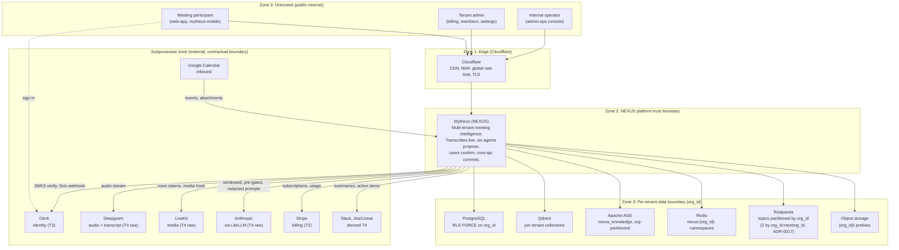

# C4 Level 1: System Context

P1 design artifact (Plan 1-2 section 3.1 step 1). Derived from [02-system-context.md](../02-system-context.md). This diagram is a view of that document, not a new source of truth: every actor, external system, and trust zone here traces back to it.

## 1. The diagram

## 2. Trust-zone boundaries and what each enforces

Crossing any inward boundary requires authentication. Crossing any tenant boundary requires `org_id` authorization.

| Boundary | Protects | Control |
|---|---|---|
| Zone 0 to Zone 1 | The platform from the public internet | TLS termination, WAF, DDoS mitigation, global L7 rate limit |
| Zone 1 to Zone 2 | Platform services from unauthenticated traffic | `api-gateway` pre-validates the Clerk JWT against cached JWKS, resolves `org_id`, rejects unauthenticated or unrouted traffic. No business logic at the gateway. |
| Zone 2 to Zone 3 | One tenant's data from another tenant's | The `org_id` chokepoint injects tenant context; PostgreSQL RLS on `app.current_org` is the fail-closed backstop; per-tenant Qdrant collections; `$org_id`-parameterized AGE Cypher; tenant-keyed Redpanda partitions; `nexus:{org_id}:` Redis namespaces |
| Zone 2 to Subprocessor | Customer data leaving the boundary | DPAs plus SCCs, PII redaction before egress where configured, server-side API keys, regional routing per `data_residency` |

## 3. What Plan 1-2 actually builds

This diagram is the whole target. The band builds the CRUD spine only.

| Element | Status at the end of Plan 1-2 |
|---|---|
| Zone 0, Zone 1, Zone 2 | Live. `web-app` sign-in through Clerk, Cloudflare in front of `api-gateway`. |
| Zone 3 PostgreSQL | Live, with RLS `FORCE` on every table carrying `org_id`. |
| Zone 3 Redis | Live for the Clerk-organization resolution cache, the `get_user_context` cache, consumer dedupe, and the `bff` read cache. |
| Zone 3 Redpanda | Producer side only: `tenant-events`, `meeting-events`, `notifications`, plus the `user-sync-events` inbox. Consumers land in later bands. |
| Zone 3 Qdrant, AGE, object storage | Not built. Later bands. |
| Clerk | Live: JWKS verification, Svix user-sync webhook. |
| Deepgram, LiveKit, Anthropic, Stripe, Slack, Jira/Linear, Google Calendar | Not integrated. Their DPAs are executed in this band regardless, because compliance-by-construction requires the subprocessor list before any T4 data flows. See [subprocessors.md](subprocessors.md). |

## 4. Related

- [02-system-context.md](../02-system-context.md) is the authoritative narrative.
- [c4-l2-container.md](c4-l2-container.md) zooms into Zone 2.
- [_canon/01-service-catalog.md](../_canon/01-service-catalog.md) is the service-naming authority.
