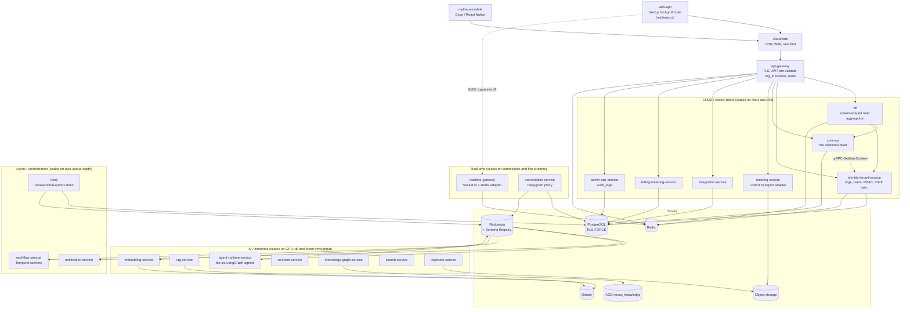

# C4 Level 2: Container Architecture

P1 design artifact (Plan 1-2 section 3.1 step 1). Derived from [03-container-architecture.md](../03-container-architecture.md) and [_canon/01-service-catalog.md](../_canon/01-service-catalog.md) section 2. Service names are canonical and used verbatim.

## 1. The diagram

## 2. The three scaling families

Boundaries are cut so each family gets one independent autoscaler signal and its own cost center. This is the reason the system is decomposed at all.

| Family | Containers | Autoscaler signal | Cost driver |
|---|---|---|---|
| CRUD / control plane | `api-gateway`, `bff`, `identity-tenant-service`, `core-api`, `meeting-service`, `integration-service`, `billing-metering-service`, `admin-ops-service` | HTTP req/s and p95 latency | CPU and Postgres connections |
| Real-time | `realtime-gateway`, `transcription-service` | Concurrent WebSocket connections and live audio streams | Connection count, never spot instances |
| AI / inference | `agent-runtime-service`, `rag-service`, `embedding-service`, `reranker-service`, `knowledge-graph-service`, `search-service`, `ingestion-service` | Queue depth, GPU utilization, token throughput | GPU hours and LLM tokens |
| Async / orchestration | `notification-service`, `workflow-service`, `relay` | Temporal task-queue depth, outbox backlog | Worker CPU |

## 3. The edge path

`web-app` to Cloudflare to `api-gateway` to `bff` to services, with the WebSocket leg bypassing `bff` and riding the gateway straight to `realtime-gateway`.

- `api-gateway` is the single public ingress. It verifies the Clerk JWT against cached JWKS, resolves the Clerk organization claim to our `org_id`, and forwards it as a signed internal header. It holds no business logic and owns no data.
- The service tier **re-verifies**. The gateway is a DDoS shield, not a trust delegation.
- `bff` is the only caller of `/bff/*` and aggregates screen-shaped reads. It owns no domain data and holds only a short read cache.
- `org_id` rides every internal hop as a REST header and as gRPC metadata, and becomes `app.current_org` before any tenant-scoped query.

## 4. MVP deployment shape

> [SaaS-scale adjustment] The containers above are logical boundaries, not pods. Per [ADR-0016](../adr/0016-self-hosted-vps-mvp-substrate.md) the MVP runs every CRUD container as a Python module inside one FastAPI deployable on a single self-hosted VPS under Docker Compose, alongside self-hosted PostgreSQL, Redis, Redpanda, and Temporal behind Caddy. `relay` and `workflow-service` run as worker processes in the same deployable. The seams are real from day one so later extraction onto Kubernetes is mechanical; the deployment simply co-locates them. Kubernetes is Plan 14 only.

## 5. What Plan 1-2 builds

Solid in this band: `api-gateway`, `bff`, `identity-tenant-service`, `core-api`, `admin-ops-service` (the `audit_logs` surface only), `relay`, `web-app`, PostgreSQL, Redis, and the Redpanda producer side.

Not built in this band: every AI container, both real-time containers, `meeting-service`, `integration-service`, `billing-metering-service`, Qdrant, AGE, and object storage.

## 6. Related

- [03-container-architecture.md](../03-container-architecture.md) is the authoritative narrative.
- [c4-l1-system-context.md](c4-l1-system-context.md) is the zoom-out.
- [_canon/01-service-catalog.md](../_canon/01-service-catalog.md) is the naming authority.
