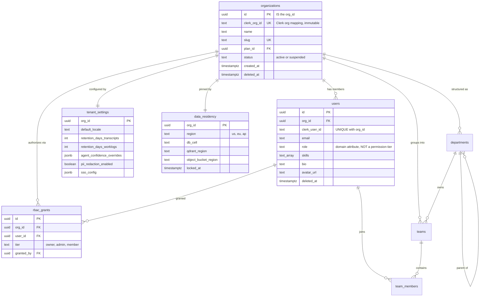
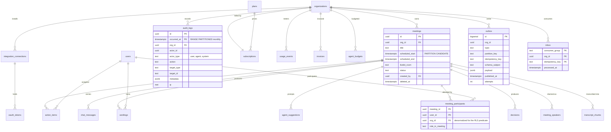

# Entity Relationship Diagram

P1 design artifact (Plan 1-2 section 3.1 step 2). Derived from [_canon/02-data-model.md](../_canon/02-data-model.md) section 2 and [05-data-architecture.md](../05-data-architecture.md) section 2.

This is the **whole** target model, not the Plan 1-2 subset, so migrations never have to re-cut a table. Section 4 marks what this band actually builds.

## 1. Reading rules

- Every tenant-scoped table carries `org_id UUID NOT NULL` referencing `organizations(id)`, and carries a `tenant_isolation` RLS policy. This is exceptionless and asserted in CI.
- **Two tables are deliberately un-tenanted.** `organizations` is the tenant root: its `id` **is** the `org_id`, so it has no `org_id` column and no `tenant_isolation` policy ([_canon/02-data-model.md](../_canon/02-data-model.md) section 7 rule 7). `plans` is a global catalog. Everything else is tenant-scoped.
- Soft delete is `deleted_at timestamptz NULL`. Hard purge is the right-to-be-forgotten workflow; see [rtbf-contract.md](rtbf-contract.md).
- `org_id` is never a path or query parameter. It is derived from the verified JWT.

## 2. Core tenancy and identity



**The two role concepts are separate stores by design.** `rbac_grants.tier` is the only thing authorization reads. `users.role` plus `users.skills` is job identity feeding agent relevance and `get_user_context`, and is never consulted for permissions. Overloading one column would make a profile field a security boundary. See [ADR-0010](../adr/0010-auth-clerk-enterprise-sso.md) D5.

## 3. Meetings, agent output, and the rest of the target model



`meeting_participants` and `team_members` carry `org_id` denormalized so the RLS predicate is a column compare and not a subquery ([06-multi-tenancy.md](../06-multi-tenancy.md) section 3.1).

## 4. Range partitioning

Canon marks seven tables for range partitioning. They are not all equal, and the distinction is load-bearing.

| Table | Partition key | Canon wording | Decision for this program |
|---|---|---|---|
| `audit_logs` | `occurred_at` monthly | Mandated | **Partition now**, in Plan 1-2. Append-only, nothing references it, so the composite primary key costs nothing. Pre-create twelve months plus a catch-all partition so a missed maintenance window can never fail an insert. |
| `transcript_chunks` | `created_at` monthly | Mandated | Partition from the first row in Plan 3-4. At T3 volume this is not optional. |
| `chat_messages` | `created_at` monthly | Mandated | Partition when the table is created. |
| `usage_events` | `occurred_at` daily | Mandated | Partition when the table is created, in the billing band. |
| `meetings` | `scheduled_start` monthly | **"Range-partition candidate at scale"** | **Deferred.** See below. |
| `worklogs` | `created_at` monthly | Candidate at scale | Deferred to its owning band. |
| `agent_suggestions` | `created_at` monthly | Candidate at scale | Deferred to its owning band. |

**Why `meetings` is deferred.** Three reasons, and the third is decisive.

1. Canon hedges it as a candidate at scale; only the reader docs state it as done. Canon wins.
2. The partition key must be non-null to sit in the primary key, which would force every ad-hoc meeting to carry a sentinel `scheduled_start`. A meeting created on the spot has no scheduled start.
3. PostgreSQL requires every unique constraint on a partitioned table to include all partition-key columns. So `UNIQUE (org_id, id)` becomes impossible, and with it the **tenant-safe composite foreign keys** that make a cross-tenant dangling reference unrepresentable:

```sql
ALTER TABLE meetings ADD CONSTRAINT uq_meetings_org_id UNIQUE (org_id, id);
ALTER TABLE meeting_participants
  ADD CONSTRAINT fk_mp_meeting_org
  FOREIGN KEY (org_id, meeting_id) REFERENCES meetings (org_id, id);
```

Without those, a participant row can carry `org_id = B` while pointing at a meeting owned by `org_id = A`. RLS hides the row from B's reads, so the corruption is silent, and the right-to-be-forgotten sweep cannot be trusted to find everything. Partitioning an empty table would permanently trade that guarantee away. For a product whose worst bug class is a cross-tenant leak, that trade is backwards.

**Exit trigger, recorded so it is not forgotten:** partition `meetings` when it exceeds roughly 5 to 10 million rows or when a listing query's p95 crosses its SLO, whichever comes first. At that point `meeting_participants` must be re-cut too. The conversion is a shadow-table swap and the partitioning machinery is proven on `audit_logs` in this band regardless.

## 5. What Plan 1-2 builds

| Built and complete | `organizations`, `users`, `tenant_settings`, `data_residency`, `rbac_grants`, `teams`, `team_members`, `departments`, `meetings`, `meeting_participants`, `audit_logs`, `outbox`, `inbox` |
|---|---|
| **Not built** | `transcript_chunks`, `meeting_speakers`, `worklogs`, `decisions`, `action_items`, `agent_suggestions`, `agent_collaborations`, `chat_messages`, `document_chunks`, `plans`, `subscriptions`, `usage_events`, `invoices`, `agent_budgets`, `integration_connections`, `oauth_tokens` |

Eight of the thirteen built tables already exist from Plan 0 but as thin shells missing canonical columns. Plan 1-2 widens them to canon rather than creating them fresh.

## 6. Related

- [_canon/02-data-model.md](../_canon/02-data-model.md) is the naming authority. Where this diagram and canon disagree, canon wins and this file is the bug.
- [rtbf-contract.md](rtbf-contract.md) for the deletion contract every table above is designed to satisfy.
- [ADR-0002](../adr/0002-multi-tenancy-model.md) for the RLS posture and the three database roles.
