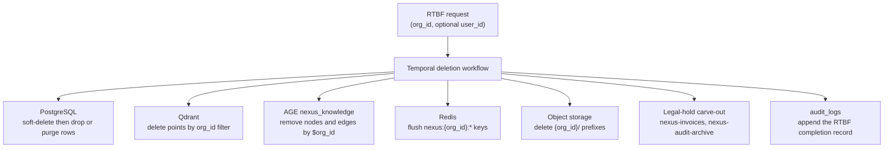

# Right-to-be-forgotten deletion contract

P1 design artifact (Plan 1-2 section 3.1 step 10). Derived from [05-data-architecture.md](../05-data-architecture.md) section 8.1 and [_canon/02-data-model.md](../_canon/02-data-model.md) section 7.

## 1. What this document is

The frozen cross-store deletion specification. Plan 1-2 implements **none** of it beyond making PostgreSQL deletable. The contract is written now so that the Temporal RTBF workflow, which lands in a later band, has a specification rather than an invention, and so every table built between now and then is designed deletable.

Being deletable means two things and they are both structural: every tenant row is reachable from `org_id`, and every row soft-deletes before it hard-purges.

## 2. The single parameterized contract

One workflow, keyed by `org_id` for tenant erasure or `(org_id, user_id)` for a single subject. Because every store is `org_id`-keyed, each step operates on exactly one tenant's slice and can never touch another's.

## 3. Per-store obligations

| Store | Action | Notes |
|---|---|---|
| **PostgreSQL** | Set `deleted_at` immediately, then hard-purge on the retention schedule. Range-partitioned tables drop whole partitions rather than scanning. | Runs as `mytheus_admin`. See the two traps in section 5. |
| **Qdrant** | Delete points by `org_id` payload filter, or drop the per-tenant collection outright for full tenant erasure. | Not built until the AI band. |
| **AGE `nexus_knowledge`** | Remove nodes and edges carrying the tenant's `$org_id`. | The graph is org-partitioned by property, so this is a parameterized Cypher delete. |
| **Redis** | Flush `nexus:{org_id}:*`. | See the gap in section 5. |
| **Object storage** | Delete every object under the `{org_id}/` prefix, across `nexus-recordings`, `nexus-documents`, and `nexus-exports`. | Regional buckets follow `data_residency.object_bucket_region`. |
| **Redpanda** | No deletion. Topics are retention-bounded and replayable; erasure is by expiry, not by seek-and-destroy. | Stated explicitly because "delete from the event log" is a natural but wrong instinct. |
| **Subprocessors** | Trigger each processor's own deletion API or contractual deletion obligation. | See [subprocessors.md](subprocessors.md). |

## 4. The legal-hold carve-out

Two things are **not** deleted, and this is deliberate:

| Retained | Why | Retention |
|---|---|---|
| `nexus-invoices` | Tax and financial-record obligations outlive an erasure request. | 7 years |
| `nexus-audit-archive` | The audit trail is the evidence that the erasure itself was performed correctly. Deleting it would destroy the proof. | Per SOC 2 policy, write-once object lock |

A completed RTBF **appends** to `audit_logs`. The record of the erasure survives the erasure. This is not a contradiction: the audit row records that data was deleted, not the deleted data.

## 5. Three traps this band must design around

Found while writing this contract. Each is cheap to prevent now and expensive to discover later.

**Trap 1: seven tenant tables have no foreign key to the tenant root.** The shared `TenantMixin` adds the `org_id` column with an index but no `ForeignKey`, so `outbox`, `inbox`, `meetings`, `teams`, `departments`, `meeting_participants`, and `team_members` accept orphan `org_id` values. RTBF-by-`org_id` depends on every tenant row being reachable from `organizations`. An orphan row is undeletable by this contract and invisible to it. **Fix at the mixin in Plan 1-2**, so every future table inherits the key.

**Trap 2: cross-tenant dangling references are currently representable.** `meeting_participants` carries `org_id` but its foreign keys are single-column to `meetings.id` and `users.id`. Nothing prevents a row with `org_id = B` pointing at a meeting owned by `org_id = A`. RLS hides it from B's reads, so the corruption is silent, and the purge walking `org_id` behaves unpredictably. The fix is composite keys, `UNIQUE (org_id, id)` on the parent and `FOREIGN KEY (org_id, child_ref)` on the child, which makes the bad state unrepresentable. This is only possible while `meetings` stays unpartitioned; see [erd.md](erd.md) section 4.

**Trap 3: the pre-tenant Redis key escapes the flush.** The Clerk-organization resolution cache is written **before** `org_id` is known, so it cannot live under `nexus:{org_id}:` and the `nexus:{org_id}:*` flush cannot match it. A tenant could be erased and still resolve at the edge. The mapping key must therefore be deleted explicitly on suspend, delete, and RTBF, or carry a TTL short enough that the window is acceptable. Recorded in [ADR-0010](../adr/0010-auth-clerk-enterprise-sso.md) D2.

A fourth, milder note: `mytheus_admin` owns the tables and is not `BYPASSRLS`, so `FORCE` RLS applies to it. A purge that forgets to set `app.current_org` will affect **zero rows and report success**. Per-`org_id` scoping is therefore mandatory in the workflow, which is natural since the workflow is parameterized by `org_id` anyway.

## 6. What Plan 1-2 actually delivers against this contract

| Delivered | Not delivered |
|---|---|
| Every table `org_id`-keyed and RLS-scoped | The Temporal workflow itself |
| `deleted_at` soft delete on every table that needs it | Any non-PostgreSQL store |
| Foreign keys to the tenant root, fixing trap 1 | Subprocessor deletion triggers |
| Composite tenant-safe keys, fixing trap 2 | The retention-driven hard purge |
| The Redis mapping-key rule, fixing trap 3 | Partition-drop automation |

## 7. Related

- [05-data-architecture.md](../05-data-architecture.md) section 8.1 is the authoritative narrative.
- [_canon/02-data-model.md](../_canon/02-data-model.md) section 7 rules 4 and 5 for retention and soft-delete.
- [12-compliance-and-privacy.md](../12-compliance-and-privacy.md) for the legal basis.
