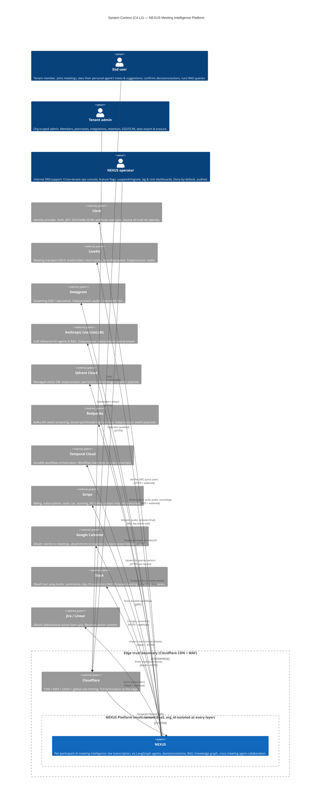
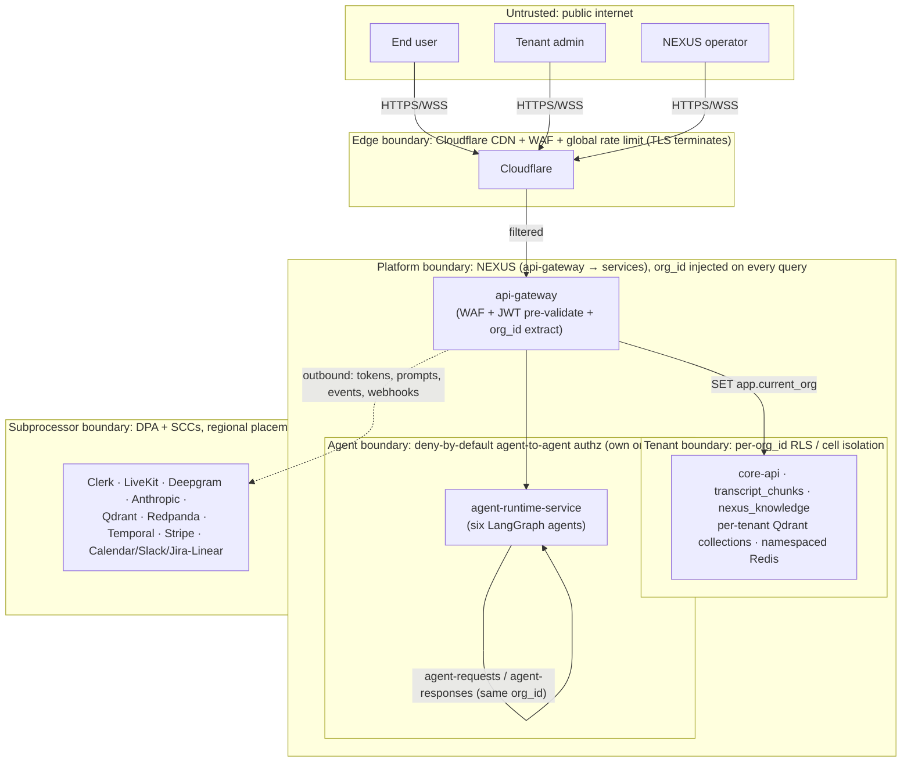

# System Context (C4 L1)

A single-diagram, system-boundary view of NEXUS — every human/machine actor, every external system it depends on, the trust boundaries between them, and the classification of data crossing each line — for the production multi-tenant SaaS serving millions of users across thousands of paying tenant organizations.

## Related documents

- [System Context (prose, full L1 treatment)](../02-system-context.md) — the narrative companion to this diagram doc: actor tables, per-system data-crossing analysis, data classification.
- [Service Catalog](../04-service-catalog.md) — the C4 L2 (Container) decomposition that this black box zooms into.
- [Data Architecture](../05-data-architecture.md) — store selection, residency, retention, backups/PITR.
- [Multi-Tenancy](../06-multi-tenancy.md) — pooled + RLS for the long tail, cell isolation for enterprise, `org_id` injection.
- [Event Architecture](../07-event-architecture.md) — Redpanda topics, Avro subjects, outbox/inbox, DLQs.
- [AI Agent Architecture](../08-ai-agent-architecture.md) — the six LangGraph agents, ContextGapAgent collaboration.
- [RAG & Inference Serving](../09-rag-and-inference-serving.md) — embedding/reranker inference tier, cost-controlled LLM pipeline.
- [Security Architecture](../11-security-architecture.md) — Clerk, RBAC, agent-to-agent authz, edge security.
- [SaaS Business Architecture](../18-saas-business-architecture.md) — Stripe billing, usage metering, plans/tiers.
- [Integration Architecture](../21-integration-architecture.md) — Calendar/Slack/Jira-Linear OAuth and sync.
- [Capacity & Scaling Math](../_canon/05-capacity-math.md) — frozen load anchors (`A5` 20k peak meetings, `A6` 100k peak participants).
- [Locked Tech & Architecture Decisions](../_canon/06-tech-decisions.md) — the decision register every external pick is frozen in.

---

## 1. Scope

This document is the **C4 Level 1** picture and nothing else: NEXUS as one black box, the actors around it, the external systems it depends on, and the trust boundaries that separate them. The internal decomposition into `api-gateway`, `core-api`, `agent-runtime-service`, `embedding-service`, `reranker-service`, `transcription-service`, and the rest is the **Level 2 (Container)** view in the [Service Catalog](../04-service-catalog.md). Full actor tables and per-system data-classification analysis live in the prose [System Context](../02-system-context.md); this file is the canonical diagram surface.

> [SaaS-scale adjustment] The PDF described NEXUS as a single-app build by a 4-person team with a `2 orgs x 10 users x 5 meetings` seeder — no tenant boundary, no operator persona, no billing/compliance external systems, no subprocessor relationships. This context introduces the **tenant trust boundary**, the **NEXUS operator** persona, and the SaaS external systems (Cloudflare WAF, Stripe, and the compliance-relevant subprocessor set). The seeder remains the development fixture only; production sizing follows [Capacity & Scaling Math](../_canon/05-capacity-math.md).

---

## 2. C4 L1 — actors, external systems, trust boundaries

---

## 3. Trust boundaries (zoom)

The diagram above collapses three concentric trust zones into the edge boundary. They expand as follows; the `org_id` injection chokepoint and the deny-by-default agent-to-agent authz live inside the platform boundary, detailed in [Security Architecture](../11-security-architecture.md) and [Multi-Tenancy](../06-multi-tenancy.md).

> [SaaS-scale adjustment] The **tenant boundary**, the **agent boundary** (deny-by-default agent-to-agent authz), and the **subprocessor boundary** (DPAs + SCCs, regional placement) are all new versus the PDF, which had a single undifferentiated trust zone. The PDF allowed agents to request peer context freely; at SaaS scale an agent may query only peers within its own `org_id` over `agent-requests`/`agent-responses`, and every call is audited.

---

## 4. Legend

| Symbol / zone | Meaning |
| --- | --- |
| **Person** | Human actor outside the system boundary. |
| **System** (filled) | NEXUS — the black box this diagram is about; decomposed at C4 L2 in the [Service Catalog](../04-service-catalog.md). |
| **System_Ext** | An external system NEXUS depends on but does not own. |
| **Edge boundary** | Cloudflare CDN + WAF + global rate limiting; TLS terminates here. All human traffic crosses it. |
| **Platform boundary** | Inside NEXUS; `api-gateway` is the first internal hop and injects `org_id` from the Clerk-verified JWT. |
| **Tenant boundary** | Per-`org_id` isolation: Postgres RLS (pooled long tail) / cell isolation (enterprise), per-tenant Qdrant collections, org-partitioned `nexus_knowledge`, tenant-keyed Redpanda partitions, namespaced Redis. |
| **Agent boundary** | `agent-runtime-service`; agent-to-agent authz is deny-by-default, scoped to the agent's own `org_id`, audited. |
| **Subprocessor boundary** | External data processors under DPA + SCCs with regional placement (data residency). |
| **Solid arrow** | Synchronous request / streaming connection. |
| **Dotted arrow** | Outbound integration / webhook / event traffic to subprocessors. |

---

## 5. Key flows

- **Human ingress is single-boundary.** Every end user, tenant admin, and operator reaches NEXUS only through `Cloudflare -> api-gateway`. The gateway pre-validates the Clerk JWT, extracts `org_id`, and injects it into request context so the Postgres RLS policy `USING (org_id = current_setting('app.current_org')::uuid)` is the fail-closed backstop. See [Security Architecture](../11-security-architecture.md).
- **The audio path keeps keys server-side.** LiveKit captures meeting audio via a server-side room hook; NEXUS proxies one diarized Deepgram WebSocket stream **per meeting** (not per participant — a 6x cost lever per [Capacity & Scaling Math §7](../_canon/05-capacity-math.md)), persisting only finals to `transcript_chunks` and emitting the `transcript-chunks` topic. See [RAG & Inference Serving](../09-rag-and-inference-serving.md) and [Event Architecture](../07-event-architecture.md).
- **LLM inference leaves the boundary as derived prompts only.** The six agents (PersonalListenerAgent, DecisionAgent, ActionAgent, QuestionAgent, ContextGapAgent, ProactiveAgent) route through LiteLLM to Anthropic under the cost-controlled pipeline (relevance pre-gating → windowed batching → tiered Haiku/Sonnet/Opus routing → caching → per-tenant token budgets). Raw audio never crosses to the LLM subprocessor. See [AI Agent Architecture](../08-ai-agent-architecture.md).
- **Identity is brokered by Clerk, never owned by NEXUS.** Clerk is the source of truth; NEXUS verifies JWTs inbound and syncs users via the `/clerk/webhook` receiver hardened with outbox + reconciliation (Clerk authoritative). SSO/SAML/SCIM for Enterprise tenants ride the same boundary.
- **Confirmed knowledge flows outward to PM and Slack.** On user confirmation (no silent commits), `decisions`/`actions` create `nexus_knowledge` graph edges (`PRODUCED`, `ASSIGNED_TO`) and the `integration-service` syncs actions bidirectionally to Jira/Linear; Slack receives Block Kit prep briefs, summaries, and day-10 escalation DMs via the Temporal `ActionFollowUpWorkflow`. See [Integration Architecture](../21-integration-architecture.md).
- **The operator path is the highest-risk line.** The NEXUS operator's cross-tenant reach (ops console, suspend/migrate, audit access) is deny-by-default and every action lands in append-only `audit_logs` — the only routine path that legitimately spans the tenant boundary. See [Multi-Tenancy](../06-multi-tenancy.md) and [SaaS Business Architecture](../18-saas-business-architecture.md).
